# Sparse · Hybrid Attention 구조 분석 및 아키텍처 시사점

차세대 아키텍처 탐색을 위한 KV cache · 색인 동작 특성 정량 분석 · 2026.11

> 슬라이드 원고 (Claude 버전). `---` 하나가 슬라이드 한 장이고, `# Ⅰ.` 같은 장 제목은 간지 한 장이다. 그림은 [figures-claude/](figures-claude/)에 있고 `python arch_insight/figures-claude/make_figures.py`로 다시 만든다 (계산 요약도 함께 출력).
> 계획과 기준: [00-deck-plan-claude.md](00-deck-plan-claude.md) · 비교 기준: **128K = 공통 비교 조건**, **1M = 차세대 설계 시나리오** (V3.2 · Qwen3.8은 지원 길이 밖 — 외삽)

---

## 요약

### KV cache 부담은 줄지만 새 부담이 생김 — Sparse는 '고르는 비용', Hybrid는 'state 갱신'. 대역폭 하나가 아닌 연산 · 지연 · 온칩 · 쓰기의 균형 설계 필요

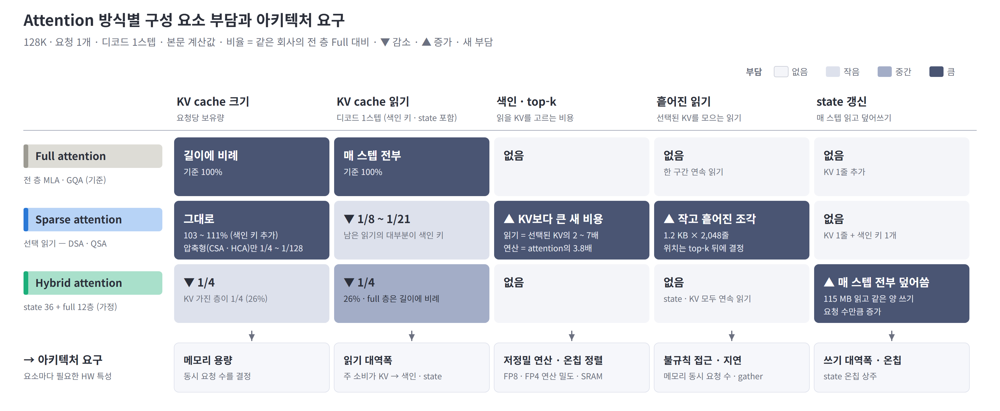

- **Sparse:** KV cache **읽기 감소**(1/8 ~ 1/21) · **크기는 그대로** → 대신 **색인 읽기 · 연산 증가**(선택된 KV의 2 ~ 7배 읽기, attention의 3.8배 연산) · GPU가 약한 **흩어진 읽기 증가**
- **Hybrid:** KV cache **크기 감소**(약 1/4) · **읽기 감소**(약 1/4) → 대신 **state 읽기 · 쓰기 증가**(매 스텝 115 MB 전부 덮어씀)
- **결합 (Qwen3.8):** **읽기 · 크기 모두 감소**(읽기 + 쓰기 3% · 크기 27%) → 남는 부담은 **색인 연산 · state 쓰기** — 대역폭 하나로는 해결 불가

※ 기준: 128K · 요청 1개 · 디코드 1스텝 계산값, 비율은 같은 회사의 전 층 Full 대비(Sparse = DSA(V3.2) · QSA(Qwen3.8), 압축형 = CSA · HCA(V4), Hybrid = Qwen3.8 차원의 state 36층 + full GQA 12층 가정 구성). 칸 색은 해당 요소의 상대 부담을 4단계로 나눈 정성 구분. 근거: 크기 · 읽기 Ⅱ, 색인 Ⅲ, 흩어진 읽기 2.3, state Ⅳ, 아키텍처 요구 5.3.

---

## 구성

| 장 | 내용 |
|---|---|
| **Ⅰ. 구조 개요** | Attention 구조 동향 · 방식별 KV cache 쓰기 · 읽기 · 층 구성 · 모델별 규모 · MoE 비교 · Sparse attention 디코드 읽기 구성 |
| **Ⅱ. KV cache** | 읽기 · 크기 절감 효과 · 컨텍스트 길이별 효과 · 읽기 패턴과 GPU 메모리 특성 |
| **Ⅲ. 색인** | 색인 키 읽기와 절감 포화 · 색인 연산 특성 |
| **Ⅳ. Hybrid** | 모델 전체 읽기 · 쓰기 구성 · Sparse와의 역할 분담 |
| **Ⅴ. 종합** | 데이터별 메모리 접근 특성 · 단계별 특성과 예상 제약 · Sparse · Hybrid 특성과 아키텍처 요구 |
| **Ⅵ. HW 요구 사항** | Sparse attention의 주요 한계 · Compute · Memory · 통신 · 스케줄링 요구 사항 · Prefill과 decode의 차이 · 종합 |

---

# Ⅰ. 구조 개요

### 전 층 full attention은 조사 모델 15개 중 1개로 감소 → Sparse(선택 읽기) · Hybrid(linear state)를 층마다 섞는 구조가 주류 — 방식마다 줄이는 대상이 KV cache 읽기 · 크기로 갈림

1.1 구조 동향 · 1.2 방식별 KV cache 쓰기 · 읽기 · 1.3 층 구성 · 1.4 가중치와 KV cache 규모 · 1.5 MoE와의 비교 · 1.6 Sparse attention 디코드 읽기 구성

---

## 1.1 Attention 구조 동향

### 조사 대상 2026 하반기 15개 모델 중 전 층 full attention은 1개

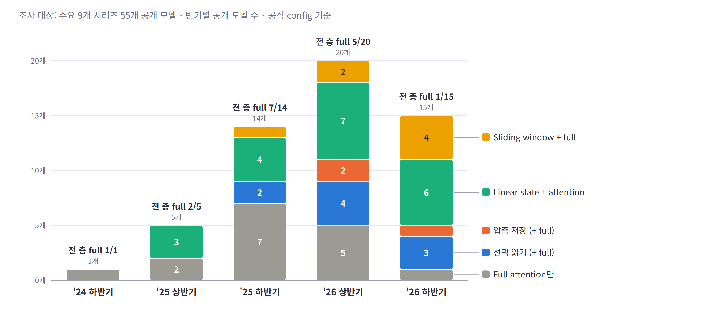

- 전 층 full attention 모델: 2025 하반기 7/14 → 2026 상반기 5/20 → **2026 하반기 1/15**
- 대체 방식은 회사별로 상이 — 선택 읽기(DSA 계열), 압축 저장(DeepSeek-V4), linear state 혼합(Qwen · Kimi · Nemotron), sliding window 혼합
- hybrid 모델도 일부 full 층은 KV cache를 전부 읽음 — "전부 읽기 탈피"는 층 단위로 진행 중

※ 출처: 주요 9개 시리즈 55개 공개 모델의 공식 config ([메모리 보고서](../reports/llm-memory-requirements.md) §1). 조사 대상 표본이며 '24 하반기 · '25 상반기는 모델 수가 적음. 모델별로 가장 먼저 해당하는 분류 하나로 집계.

---

## 1.2 방식별 KV cache 쓰기 · 읽기 구조

### 방식마다 KV cache에 쓰는 양 · 읽는 양 · 보관 크기가 다름 — 선택 읽기는 읽기만, 압축 · window는 크기까지, state는 쓰기가 큼

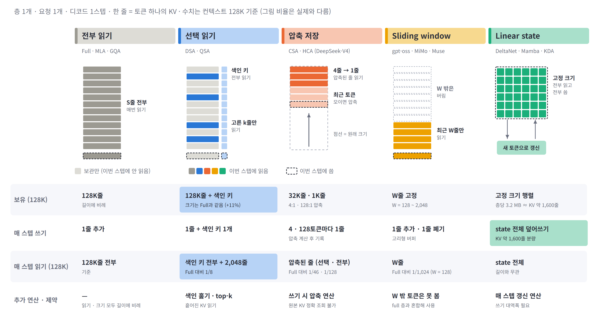

- **선택 읽기:** 쓰기 · 크기는 Full과 같고(색인 키 +11%) 읽기만 감소 — 128K에서 색인 키 전부 + 2,048줄, Full 대비 1/8
- **압축 저장 · sliding window:** 보관하는 줄 수 자체를 줄여 크기 · 읽기 모두 감소 — 압축은 쓰기 시 압축 연산 추가, window는 W 밖 토큰 조회 불가
- **Linear state:** 크기는 길이와 무관하게 고정이지만 매 스텝 state 전체(KV 약 1,600줄 분량)를 읽고 덮어씀 — 쓰기가 가장 큰 방식

※ 기준: 층 1개 · 128K. 선택 읽기 = DSA(V3.2), 압축 = CSA 4:1 · HCA 128:1(DeepSeek-V4), window = gpt-oss · MiMo 128줄 · Muse 2,048줄, state = Qwen3.8 DeltaNet 층당 3.2 MB(Qwen3.8 full 층 KV 1줄 2,048 B로 환산). 출처: [세미나 자료](../seminar/01-attention-seminar_sum_ver.md) §4.3 그림 재구성, 그림 비율은 실제와 다름.

---

## 1.3 층 구성의 Hybrid화

### 단일 방식 대신 층마다 다른 방식을 혼합 — 한 모델 안에 서로 다른 메모리 접근 패턴이 공존

- 2024년 모델은 전 층 동일 방식 → 2026년 모델은 **층마다 다른 방식을 교대 배치**
- DeepSeek-V4: 4줄 압축 층(선택 읽기)과 128줄 압축 층(전부 읽기)을 **1:1 교대** — 정밀한 부분 조회와 거친 전체 조회를 병행
- Qwen3.8: 48층 중 **12층만 KV cache 보유**, 36층은 고정 크기 linear state — 모델 전체 비용은 Ⅳ장에서 합산

※ 출처: 각 모델 config의 층별 설정 — V4-Pro `compress_ratios`, Qwen3.8-Flash-Next · gpt-oss `layer_types`.

---

## 1.4 모델 계열별 가중치와 KV cache 규모

### 1M 요청 1개를 처리하려면 가중치 + KV cache — KV cache 비중은 Full GQA 53%, 선택 읽기 11 ~ 25%, 압축 · linear state 1 ~ 4%

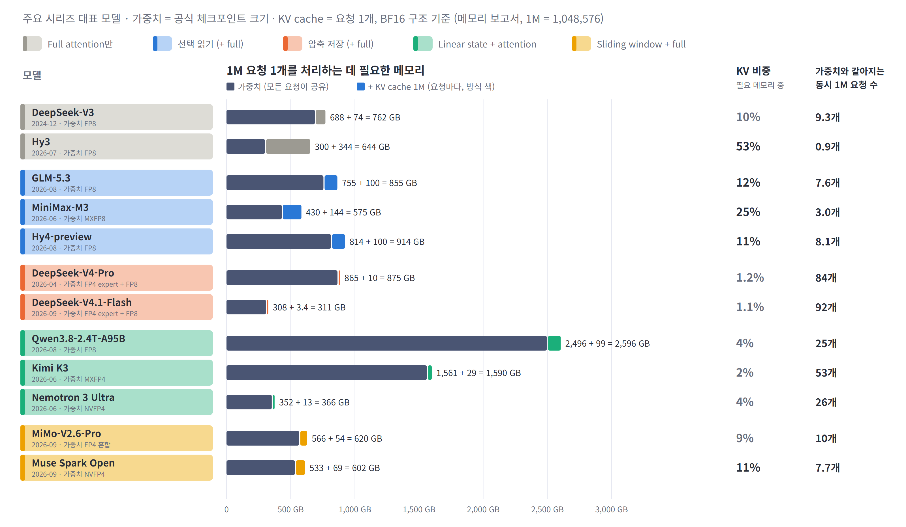

- **Full attention:** Hy3(GQA)는 KV cache 344 GB가 가중치 300 GB보다 큼 — 요청 1개가 필요 메모리의 절반 이상. 같은 Full이라도 MLA(V3)는 10%
- **선택 읽기:** GLM-5.3 · Hy4는 1M당 KV cache 100 GB(11 ~ 12%) — 읽기만 줄이고 크기는 그대로라 동시 요청 7 ~ 8개면 가중치와 같아짐
- **압축 · linear state:** KV cache 비중 1 ~ 4% — DeepSeek-V4 계열은 동시 84 ~ 92개가 모여야 가중치와 같아짐. **크기를 줄인 방식만 동시 요청 수가 크게 늘어남**

※ 출처: [메모리 보고서](../reports/llm-memory-requirements.md) 데이터. 필요 메모리 = 가중치 + 요청 1개의 KV cache (활성값 · 버퍼 제외). 가중치는 공식 체크포인트 크기(정밀도는 모델마다 다름), KV cache는 구조 비교용 BF16 기준, 1M = 1,048,576. 가중치는 모든 요청이 공유, KV cache는 요청마다 따로 필요.

---

## 1.5 MoE와의 비교

### Sparse attention은 'KV cache의 MoE' — 단, 선택 대상과 제약이 다름

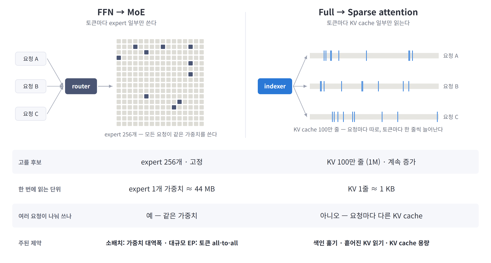

- 공통점: 소형 선택기(router / indexer)가 **일부만 선택해 사용**, 미선택 expert · KV도 **전부 보유**
- 차이점: MoE는 고정된 expert 256개를 **전 요청이 공유**, sparse는 계속 증가하는 KV 100만 줄을 **요청별로 따로** 선택
- 제약: MoE는 소배치에서 가중치 대역폭, 대규모 expert 병렬에서 토큰 activation의 all-to-all 통신. sparse attention은 색인 훑기 · 흩어진 KV 읽기 · KV cache 용량

※ 기준: expert 1개 = DeepSeek-V3 3 × 7,168 × 2,048 파라미터 · FP8 ≈ 44 MB (가중치 읽기 단위). KV 1줄 = MLA 576차원 · BF16 = 1,152 B (층당). all-to-all이 옮기는 것은 가중치가 아니라 토큰 activation.

---

## 1.6 Sparse attention 디코드 읽기 구성

### KV cache 읽기는 2,048줄로 고정 — 길이에 비례해 늘어나는 것은 색인 키 읽기 (128K에서 84%)

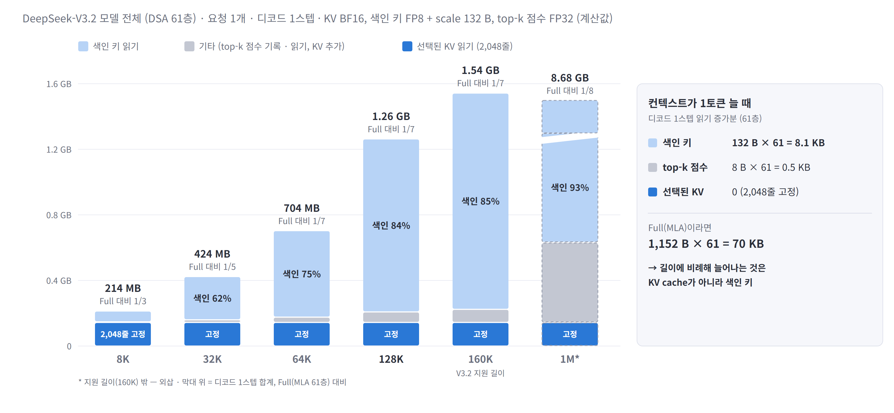

- **KV cache:** 선택된 2,048줄만 읽어 길이와 무관하게 0.14 GB 고정 — 디코드 1스텝 합계는 Full(MLA) 대비 128K 1/7, 1M 1/8 (Ⅱ장)
- **색인 키:** 컨텍스트 1토큰마다 132 B × 61층씩 늘어나 8K 31% → 128K 84% → 1M 93% — sparse attention 읽기의 대부분이자 절감 포화의 원인 (Ⅲ장)
- **기타:** top-k 점수 기록 · 읽기(토큰당 8 B)와 KV 추가 쓰기 — 5% 안팎이지만 색인 키와 함께 길이에 비례

※ 기준: DeepSeek-V3.2 61층 · 요청 1개 · 디코드 1스텝 · KV BF16 · 색인 키 132 B 계산값. top-k 점수는 FP32로 HBM에 기록했다가 다시 읽는 구현 기준 — 점수 계산과 top-k를 한 커널로 합치면 줄어듦. 1M은 지원 길이(160K) 밖.

---

# Ⅱ. KV cache

### Sparse는 KV cache 읽기 감소(1/8 ~ 1/21) · 크기는 그대로(압축형만 1/4 ~ 1/128 감소) → 대신 읽는 KV가 작고 흩어진 조각(1.2 KB × 2,048줄)이라 GPU가 약한 흩어진 읽기 증가

2.1 KV cache 읽기 · 크기 절감 효과 · 2.2 컨텍스트 길이별 읽기 절감 · 2.3 읽기 패턴과 GPU 메모리 특성

---

## 2.1 KV cache 읽기 · 크기 절감 효과

### 128K에서 디코드당 KV cache 읽기 1/8 ~ 1/128 — 선택 읽기는 KV cache 크기를 유지, 압축만 크기도 감소

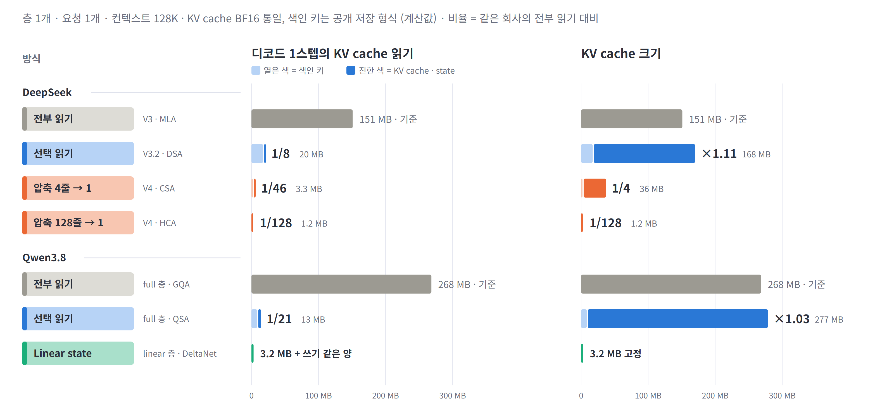

- **선택 읽기(DSA · QSA):** KV cache 읽기 1/8 · 1/21, 크기는 ×1.11 · ×1.03 (색인 키 추가분) — 읽기만 줄이는 방식
- **압축 저장(CSA · HCA):** 읽기 1/46 · 1/128, 크기 1/4 · 1/128 — 모델 전체로는 V4-Pro가 MLA 대비 128K 1/68, 1M 1/92 (CSA · HCA 층 교대 합산)
- **Linear state:** 층당 3.2 MB를 읽고 같은 양을 씀, 크기 고정 — 128K full 층(GQA 268 MB) 대비 읽기 1/84

※ 기준: 층 1개 · 128K · KV cache BF16 통일(구조 효과 비교), 색인 키는 공개 저장 형식(DSA FP8 + scale 132 B, CSA FP4 64 B, QSA 블록 키는 정밀도 미표기로 BF16 256 B 가정). 비율은 같은 회사의 전부 읽기 구조(V3 MLA · Qwen3.8 full 층 GQA) 대비. 읽기 막대의 옅은 색은 색인 키 — 비중은 Ⅲ장.

---

## 2.2 컨텍스트 길이별 KV cache 읽기 절감

### 선택형은 길어질수록 효과가 커지다 약 9×(DSA) · 32×(QSA)에서 포화 — 압축형은 짧은 컨텍스트에서도 효과

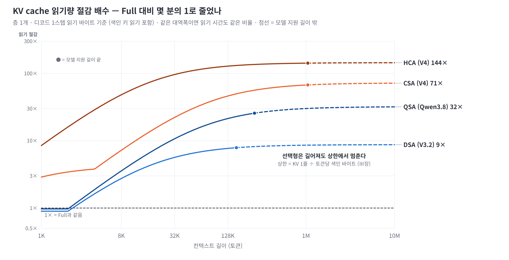

- **읽기량 기준:** 디코드 1스텝에 읽는 바이트(색인 키 포함)의 Full 대비 배수 — 같은 메모리 대역폭이면 KV cache 읽기 시간도 같은 비율로 단축
- **선택형(DSA · QSA):** 8K에서 DSA 2.7× · QSA 3.6×, 128K 7.7× · 21× → 상한에서 포화. 2K 이하는 전부 선택되는 구간이라 색인만큼 손해 (실제로는 색인 생략 가능)
- **압축형(CSA · HCA):** 1K에서도 CSA 2.9× · HCA 8.5× — KV cache 자체가 작아 짧은 길이에서도 효과

※ 기준: 층 1개 · 디코드 1스텝 계산값. 실선 = 지원 길이 안, 점선 = 밖(외삽), ● = 지원 길이 끝(V3.2 160K · Qwen3.8 256K · V4 1M). 읽기 시간 환산은 대역폭이 같다는 가정 — 흩어진 읽기의 효율 저하는 2.3장.

---

## 2.3 KV cache 읽기 패턴과 GPU 메모리 특성

### 선택된 KV는 위치가 매번 바뀌는 작은 조각 2,048개 — GPU가 약한 '작고 · 흩어지고 · 늦게 정해지는' 읽기가 sparse attention에서 증가

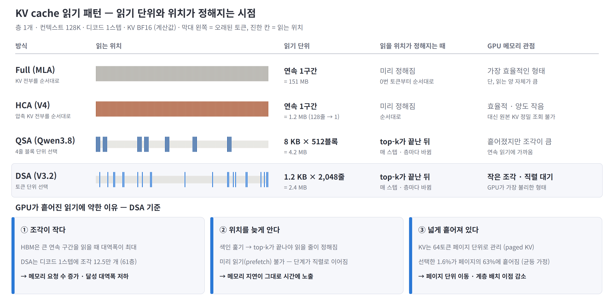

- **연속 읽기 (Full · HCA):** 미리 정해진 한 구간을 순서대로 읽음 — GPU 메모리가 가장 효율적인 형태. 대신 Full은 읽는 양(151 MB)이 크고, HCA는 원본 KV 정밀 조회가 불가
- **블록 선택 (QSA):** 8 KB 블록 512개 — 위치는 흩어져 있지만 조각이 커서 연속 읽기에 가까움
- **토큰 선택 (DSA):** 1.2 KB 조각 2,048개(61층이면 디코드 1스텝에 12.5만 개) — ① 조각이 작아 메모리 요청 수 증가, ② top-k가 끝나야 위치가 정해져 미리 읽기 불가 · 직렬 대기, ③ 페이지의 63%에 흩어져 페이지 단위 이동 · 계층 배치 이점 감소

※ 기준: 층 1개 · 128K · KV BF16 계산값, 그림의 읽는 위치는 예시. 페이지 = 64토큰(FlashMLA paged KV 블록 크기), 선택 위치는 균등 분포 가정 — 실제는 최근 토큰 · 특정 구간에 몰려 이보다 덜 흩어짐. 흩어진 읽기의 실제 효율 저하는 실측 필요(부록 C).

---

# Ⅲ. 색인

### 색인 읽기 · 연산 증가 — 선택된 KV보다 2 ~ 7배 더 읽고 본 attention보다 3.8배 더 계산해 읽기 절감이 8.7×에서 포화 → 색인 키를 줄이면 대역폭 부담은 감소, 대신 연산이 병목

3.1 색인 키 읽기와 절감 포화 · 3.2 색인 연산 특성

---

## 3.1 색인 키 읽기와 절감 포화

### 길어질수록 선택된 KV 몫은 사라지고 색인 키(Full의 11.5%)가 바닥으로 남음 — DSA 절감은 8.7×에서 포화, 상한은 토큰당 색인 바이트가 결정

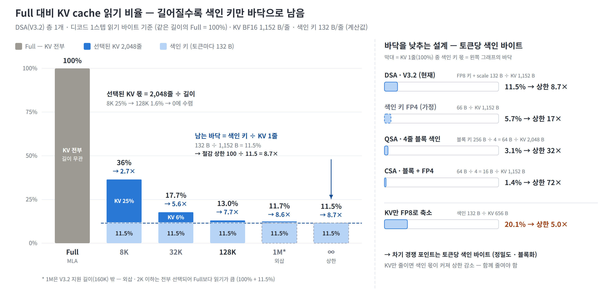

- **포화 구조:** Full 대비 읽기 = 선택된 KV(2,048줄 ÷ 길이) + 색인 키(132 ÷ 1,152 = 11.5%) — 8K 36%(2.7×) → 128K 13%(7.7×) → 바닥 11.5%(8.7×)
- **바닥을 낮추는 설계:** 색인 키 FP4 5.7%(17×, 가정) · 4줄 블록 색인 3.1%(QSA 32×) · 블록 + FP4 1.4%(CSA 72×) — 차기 경쟁 포인트는 **토큰당 색인 바이트**
- **정밀도 효과:** KV만 FP8(656 B)로 줄이면 색인 키 몫이 20%로 커져 상한 5.0× — KV와 색인 키를 함께 줄여야 함

※ 기준: DSA(V3.2) 층 1개 · 디코드 1스텝 읽기 바이트(top-k 점수 제외) · KV BF16 계산값, 같은 길이의 Full(MLA) = 100%. ∞는 컨텍스트 → ∞ 극한. 블록 색인은 블록 키 1개가 4토큰을 대표하므로 토큰당 색인 바이트 = 블록 키 ÷ 4. QSA는 GQA 2,048 B, 나머지는 MLA 1,152 B 대비. 2K 이하는 전부 선택되어 Full보다 읽기가 큼(111.5%).

---

## 3.2 색인 연산 특성

### 색인 키 훑기는 대역폭과 연산을 함께 요구 — DSA는 읽기 시간의 30%만큼 FP8 연산, 본 attention 연산의 3.8배

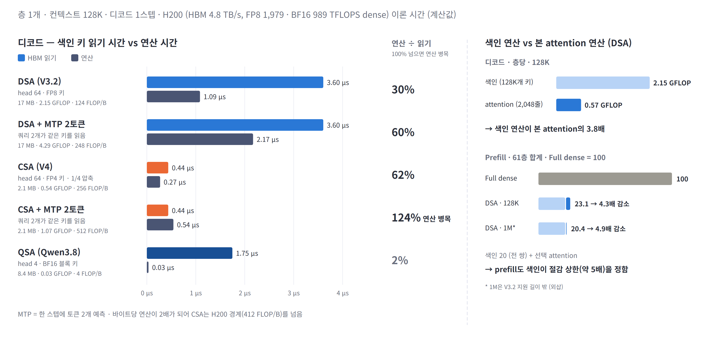

- **대역폭:** 128K 층당 색인 키 17 MB를 매 스텝 순차로 읽음 — H200 HBM으로 3.6 µs, 같은 층의 선택된 KV 읽기(2.4 MB)의 7배
- **연산:** 키 1 B당 124 FLOP(DSA) · 256 FLOP(CSA) — indexer head 64개가 같은 키를 각각 곱하기 때문. HBM 속도로 훑으려면 FP8 피크의 30 ~ 62%, MTP 2토큰이면 CSA는 **연산 병목(124%)**. QSA는 head 4개라 2%
- **3.1과의 연결:** 색인 키를 FP4 · 블록으로 줄이면 읽기는 줄지만 바이트당 연산은 커짐 — **대역폭 문제가 연산 문제로 이동**. 색인 연산은 길이에 비례해 본 attention 대비 32K 0.9배 → 128K 3.8배 → 1M 29배

※ 기준: 층 1개 · 128K 디코드 1스텝, 색인 키 저장 바이트 기준(DSA 132 B, CSA 64 B, QSA 블록 키 256 B). H200 HBM 4.8 TB/s, FP8 1,979 · BF16 989 TFLOPS(dense) — QSA는 BF16 키라 BF16 피크, CSA FP4 키는 H200에 FP4 연산기가 없어 FP8 피크 적용. 본 attention = head 128 × (576 + 512) × 2 FLOP × 2,048줄. 1M은 V3.2 지원 길이 밖.

---

# Ⅳ. Hybrid

### Hybrid는 KV cache 크기 · 읽기 약 1/4로 감소 → 대신 state 읽기 · 쓰기 증가(매 스텝 115 MB 전부 덮어씀) — Sparse와 결합하면 읽기 + 쓰기 3% · 크기 27%로 모두 감소

4.1 Hybrid 모델 디코드 읽기 · 쓰기 구성 · 4.2 Sparse와 Hybrid의 역할 분담

---

## 4.1 Hybrid 모델 디코드 읽기 · 쓰기 구성

### Hybrid 고유 비용은 state 갱신 — Qwen3.8은 128K까지 디코드 I/O의 60% 이상이 state 읽기 · 쓰기

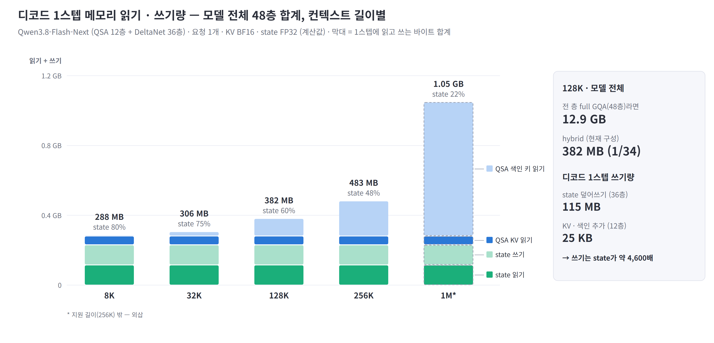

- **state 비중:** 모델 전체 읽기 · 쓰기 중 8K 80%, 32K 75%, 128K 60% → 1M 22% — 짧은 컨텍스트일수록 KV cache보다 state가 주된 메모리 트래픽
- **전 층 full GQA 대비:** 128K에서 디코드 1스텝 모델 전체 읽기 12.9 GB → 382 MB (1/34)
- **쓰기:** state 덮어쓰기 115 MB(36층) vs KV · 색인 추가 25 KB(12층) — 쓰기 대역폭과 온칩 처리가 hybrid의 별도 요구 사항

※ 기준: Qwen3.8-Flash-Next 모델 전체(QSA 12층 + DeltaNet 36층) 합계, 요청 1개 · 디코드 1스텝, KV BF16 · state FP32(config `mamba_ssm_dtype`) 계산값. 막대 = 1스텝에 읽고 쓰는 바이트 합계. 1M은 지원 길이(256K) 밖.

---

## 4.2 Sparse와 Hybrid의 역할 분담

### Sparse는 읽기를, Hybrid는 크기를 줄임 — 128K에서 둘을 합쳐야 읽기 + 쓰기 3% · 크기 27%

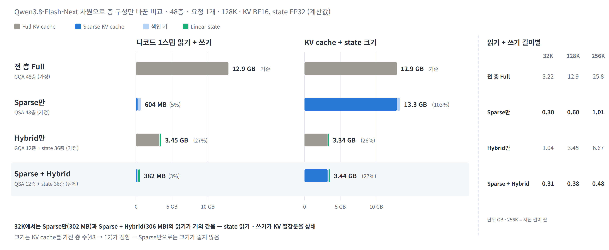

- **Sparse만 (전 층 QSA, 가정):** 읽기 + 쓰기 5%로 크게 줄지만 KV cache 크기는 103% — 색인 키만큼 오히려 증가
- **Hybrid만 (GQA 12층 + state 36층, 가정):** 크기 26% · 읽기 + 쓰기 27% — KV cache를 가진 층이 1/4로 줄어든 만큼 둘 다 감소하지만, 읽기는 여전히 길이에 비례
- **결합 (Qwen3.8 실제):** 읽기 + 쓰기 3% · 크기 27%. 단, 32K에서는 Sparse만(302 MB)과 읽기가 거의 같음 — state 읽기 · 쓰기 231 MB가 KV 절감분을 상쇄, hybrid의 읽기 이득은 128K 1.6배 · 256K 2.1배로 긴 컨텍스트에서 나타남

※ 기준: Qwen3.8-Flash-Next 차원(48층, full 층 KV head 2 × 256, QSA 블록 키 BF16 256 B 가정, DeltaNet state FP32 3.2 MB/층)으로 층 구성만 바꾼 계산값. 요청 1개 · 디코드 1스텝 · KV BF16. Sparse만 · Hybrid만은 가정 구성. %는 전 층 Full 대비.

---

# Ⅴ. 종합

### KV cache는 크지만 매 스텝 1.6%만, 색인 키 · state는 매번 전부 읽음 → 부담이 용량 · 읽기 대역폭에서 색인 연산 · 흩어진 읽기 · top-k · state 쓰기로 이동 — 대역폭 하나로는 해결 불가

5.1 데이터별 메모리 접근 특성 · 5.2 단계별 특성과 예상 제약 · 5.3 Sparse · Hybrid 특성과 아키텍처 요구

---

## 5.1 데이터별 메모리 접근 특성

### KV cache는 크지만 매 스텝 1.6%만 읽고, 색인 키 · state는 매번 전부 읽음 — 데이터마다 필요한 메모리가 용량형 · 대역폭형으로 갈림

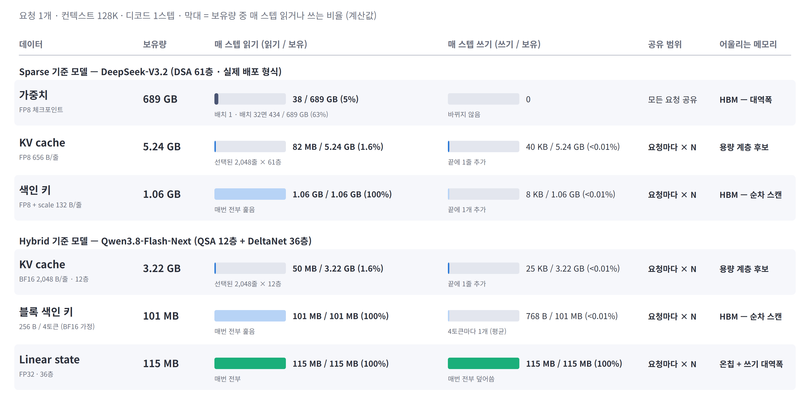

- **KV cache — 크지만 일부만 읽음:** 요청당 보유량이 가장 크고(V3.2 5.24 GB) 매 스텝 1.6%만 읽고 1줄만 추가 → 용량이 관건, 대용량 계층 배치 후보. 단, 어느 1.6%인지는 매 스텝 바뀌고 흩어져 있음(2.3)
- **색인 키 · state — 매번 전부 읽음:** 색인 키는 KV의 1/5 크기지만 매 스텝 100% 순차로 읽고, state는 115 MB를 100% 읽고 덮어씀 → HBM 대역폭 · 쓰기 대역폭 · 온칩이 관건. 요청마다 따로라 동시 요청 수만큼 증가
- **가중치 — 공유 · 일부만 읽음:** 689 GB 중 배치 1은 38 GB(5%), 배치 32면 expert 합집합이 커져 434 GB(63%) — 모든 요청이 나눠 쓰므로 요청당 부담은 배치가 클수록 감소

※ 기준: 요청 1개 · 128K · 디코드 1스텝 · 모델 전체 합계 계산값. V3.2는 실제 배포 형식(가중치 FP8, KV FP8 656 B/줄, 색인 132 B/줄), Qwen3.8은 KV BF16 · state FP32(config `mamba_ssm_dtype`) · 블록 키 BF16 가정. 막대 = 보유량 중 1스텝에 읽는 비율. 가중치 읽기는 균등 routing의 expert 합집합.

---

## 5.2 단계별 특성과 예상 제약

### 128K 디코드에서는 색인 키 훑기가 attention 단계 읽기의 60 ~ 90%로 최대 단계 — 단, 블록 색인(QSA · CSA)은 32K에서 1/3 수준이라 KV gather · top-k도 함께 봐야 함

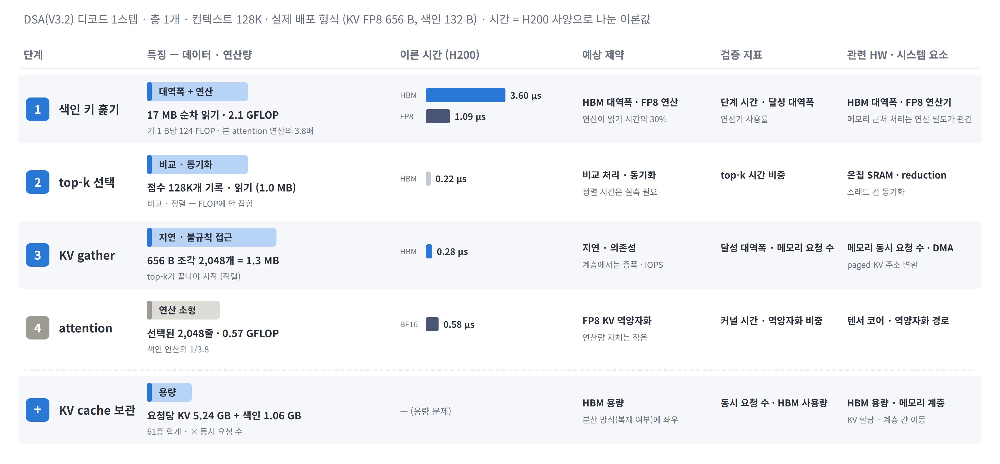

- **① 색인 키 훑기:** 층당 17 MB 순차 읽기 + 2.1 GFLOP — 이론 시간 3.6 µs로 나머지 단계 합(1.1 µs)의 3배. 대역폭과 FP8 연산을 함께 요구 (3.2)
- **② top-k 선택:** 점수 128K개(1.0 MB) 기록 · 읽기 — 바이트로는 0.2 µs지만 비교 · 정렬 · 스레드 간 동기화는 FLOP · 바이트에 잡히지 않아 실측 필요
- **③ KV gather:** 656 B 조각 2,048개(1.3 MB) — top-k가 끝나야 시작하는 흩어진 읽기라 바이트보다 지연 · 메모리 요청 처리 수가 관건 (2.3)
- **④ attention:** 선택된 2,048줄 · 0.57 GFLOP — 연산은 작지만 FP8 KV를 BF16으로 역양자화하는 처리량이 병목이 될 수 있음
- **KV cache 보관:** 요청당 KV 5.24 GB + 색인 1.06 GB(61층) × 동시 요청 수 — 시간이 아닌 용량 문제
- **모델 · 길이별 차이 (그림 아래):** 색인 훑기 비중(32K → 128K) DSA 73% → 88%, QSA 33% → 65%, CSA 30% → 59% — 토큰 단위 색인 · 긴 컨텍스트일수록 색인 훑기가 지배, 블록 색인은 KV gather 비중이 큼

※ 기준: 표는 DeepSeek-V3.2 층 1개 · 128K · 실제 배포 형식(KV FP8 656 B, 색인 132 B). 시간 = 바이트 ÷ 4.8 TB/s 또는 FLOP ÷ 피크(FP8 1,979 · BF16 989 TFLOPS)의 이론값 — top-k 정렬 · 동기화 시간은 미포함. 아래 비중은 attention 단계 읽기 바이트(색인 키 + top-k 점수 FP32 기록 · 읽기 + KV gather) 기준, QSA는 KV BF16 · 블록 키 BF16 가정, CSA는 KV BF16 · 색인 FP4 · 선택 1,024 + 최근 128줄(CSA 층만). attention은 FP8 KV를 BF16으로 역양자화해 계산하는 구현 기준 — 역양자화 처리량이 병목이 되는 사례가 FlashMLA 분석 문서에 보고됨.

---

## 5.3 Sparse · Hybrid 특성과 아키텍처 요구

### Sparse는 KV 읽기를 '고르는 비용'으로, Hybrid는 KV 용량을 'state 갱신'으로 맞바꿈 — 부담이 용량 · 읽기 대역폭에서 연산 · 지연 · 온칩 · 쓰기로 이동

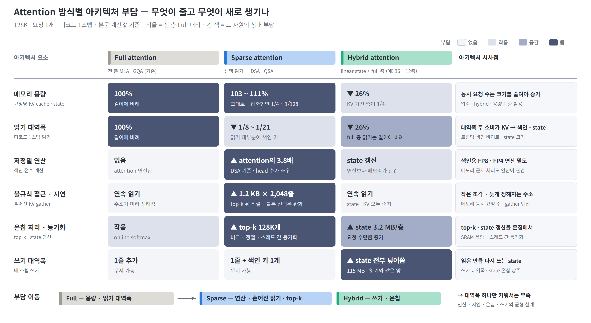

- **Sparse attention — 읽기 ↔ 고르는 비용:** KV 읽기 1/8 ~ 1/21로 감소, 크기는 그대로. 대신 색인 연산(본 attention의 3.8배) · top-k(128K개 비교 · 정렬) · 흩어진 gather(1.2 KB × 2,048줄)가 새 부담 → **저정밀 연산 밀도 · 온칩 정렬 · 불규칙 접근 처리**
- **Hybrid attention — 용량 ↔ state 갱신:** KV를 가진 층이 1/4로 줄어 크기 26%. 대신 고정 크기 state를 매 스텝 전부 읽고 덮어씀(115 MB) → **쓰기 대역폭 · state 온칩 상주**. full 층 읽기는 여전히 길이에 비례
- **결합 (Qwen3.8):** 읽기 + 쓰기 3% · 크기 27%로 둘 다 감소, 남는 부담은 색인 · state 갱신 — **대역폭 하나만 키우는 설계로는 부족**, 저정밀 연산 · 불규칙 접근 · 온칩 · 쓰기 대역폭을 함께 설계해야 함 (영역별 세부 요구는 Ⅵ장)

※ 기준: 128K · 요청 1개 · 디코드 1스텝 계산값(2.1 · 3.1 · 3.2 · 4.2 · 5.2장). 비율은 같은 회사의 전 층 Full 대비 — Sparse는 DSA(V3.2) · QSA(Qwen3.8) 선택 읽기, Hybrid는 Qwen3.8 차원의 state 36층 + full GQA 12층(4.2장 가정 구성). 칸 색은 해당 자원의 상대 부담을 4단계로 나눈 정성 구분이며, 압축형(CSA · HCA)은 크기도 1/4 ~ 1/128로 줄어 용량 칸이 hybrid에 가까움.

---

# Ⅵ. HW 요구 사항

### KV cache 읽기 감소 대신 색인 · 고정 지연 · 비정형 연산 · 불연속 접근이 새 제약 → dense FLOPS · 대역폭 증설보다 저정밀 연산 · top-k · hot / cold 메모리 · 저지연 통신 · PD 분리 같은 처리 구조 필요

6.1 Sparse attention의 주요 한계 · 6.2 Compute 요구 사항 · 6.3 Memory 요구 사항 · 6.4 통신 · 스케줄링 요구 사항 · 6.5 Prefill과 decode의 HW 요구 차이 · 6.6 HW 요구 사항 종합

---

## 6.1 Sparse attention의 주요 한계

### KV cache 읽기는 줄지만 GPU에서는 색인 탐색 · 고정 지연 · 비정형 연산 · 불연속 접근이 새로운 성능 제약으로 작용

| 한계 | 내용 | 관련 |
|---|---|---|
| **Indexer 대역폭** | 매 스텝 색인 키 전체를 순차로 읽어야 함 — 컨텍스트가 길수록 sparse attention 읽기의 대부분을 차지하고 절감 효과의 상한을 결정 | Ⅲ |
| **고정 지연** | KV 읽기 시간이 짧아지면서 top-k · kernel launch · 집합 통신 등 층마다 반복되는 고정 지연의 상대적 영향 증가 → 낮은 동시성에서는 메모리 대역폭보다 층별 고정 지연이 TPOT를 결정할 가능성 | 5.2 |
| **비정형 연산** | top-k 비교 · 정렬, head별 가중합, KV 역양자화 등 행렬곱 유닛이 처리하기 어려운 연산 비중 증가 | 3.2 · 5.2 |
| **불연속 접근** | 선택된 KV는 작은 조각으로 흩어져 있고 위치가 top-k 이후에야 정해짐 → 메모리 요청 수 증가 · 미리 읽기 불가 · 페이지 단위 이동 효율 저하 | 2.3 |

※ 앞 장(Ⅱ ~ Ⅴ) 분석을 바탕으로 한 정성 정리. 고정 지연 · 비정형 연산의 실제 비중은 실측 필요(부록 C).

---

## 6.2 Compute 요구 사항

### Attention decode에서는 dense FLOPS 증설보다 비정형 연산을 효율적으로 처리하는 구조가 중요

| 항목 | 현재 한계 | 요구 방향 |
|---|---|---|
| **Dense 연산 성능** | decode attention은 메모리 · 지연이 먼저 차서 FLOPS를 늘려도 효과가 제한적 | dense FLOPS 증설보다 저정밀 · 비정형 연산 효율 우선 |
| **Indexer 처리** | 색인 점수 계산이 본 attention보다 큰 저정밀(FP8 · FP4) 연산 | 저정밀 연산 밀도 확보 · 메모리 근처에서 색인을 훑으며 점수 계산 |
| **Top-k 전용 처리** | 비교 · 정렬 · 스레드 간 동기화 중심이라 행렬곱 유닛이 쉬고, 점수를 메모리에 기록했다 다시 읽음 | 점수 계산과 top-k를 한 번에 처리하는 전용 유닛 · 온칩 선택 |
| **Speculative decoding** | 검증 토큰 수만큼 색인 · attention 연산이 늘어 메모리 병목이 연산 병목으로 전환 가능 | speculative 이득을 유지할 저정밀 연산 여유 · 색인 연산 효율 |

※ 근거: 색인 연산 특성(3.2), 단계별 특성(5.2). MTP 2토큰에서 CSA 색인이 연산 병목에 도달하는 계산은 3.2 참조.

---

## 6.3 Memory 요구 사항

### Indexer는 높은 읽기 대역폭, KV cache는 대용량 저장과 불연속 접근 지원이 중요 → hot / cold 계층형 메모리 구조 검토

| 항목 | 데이터 특성 | 요구 방향 |
|---|---|---|
| **Indexer 경로 최적화** | 색인 키는 KV보다 작지만 매 스텝 전부 순차로 읽음 | 고대역 메모리에 배치 · 메모리 근처에서 색인 스캔 · top-k까지 처리해 이동량 감소 |
| **Hot / cold 분리** | KV cache는 크지만 매 스텝 일부만 읽고, 최근 · 자주 선택되는 KV에 접근이 몰리는 경향 | 자주 쓰는 KV는 HBM(hot), 나머지는 대용량 계층(cold) — 스텝 간 선택 재사용 활용 |
| **Gather 지원** | 작은 KV 조각을 흩어진 위치에서 모아야 함 | 작은 단위 gather 엔진 · 많은 메모리 동시 요청 처리 · 선택 단위에 맞춘 페이지 배치 |
| **State 처리** | 고정 크기 state를 매 스텝 전부 읽고 덮어씀 · 요청 수만큼 증가 | 쓰기 대역폭 · state를 담을 큰 온칩 SRAM · 메모리 근처 갱신 |

※ 근거: 데이터별 메모리 접근 특성(5.1), 읽기 패턴(2.3), hybrid state(4.1). 선택 위치의 집중도 · 스텝 간 재사용률은 실측 필요(부록 C).

---

## 6.4 통신 · 스케줄링 요구 사항

### GPU 간 데이터 전송량보다 통신 지연이 중요하며, 층별 이종 연산을 효율적으로 실행하는 구조가 필요

| 항목 | 배경 | 요구 방향 |
|---|---|---|
| **저지연 집합통신** | 층당 연산 시간이 짧아져 TP all-reduce · MoE all-to-all의 메시지당 지연이 층 시간의 큰 몫 — 층마다 매 스텝 반복 | 작은 메시지 지연 단축 · 통신과 연산 겹치기 · 네트워크 내 집계 |
| **동적 스케줄링** | 요청마다 비용 구성이 다름 — 색인 훑기는 길이에 비례, KV gather는 고정, state는 길이와 무관 | 길이 · 단계별 묶음 처리 · GPU 간 부하 분산 |
| **층별 이종 실행** | 한 모델 안에서 층마다 방식이 다름(V4 CSA · HCA, Qwen3.8 QSA · DeltaNet) — 층마다 병목이 색인 · gather · state 갱신으로 바뀜 | 층별 커널 · 자원 배분, 서로 다른 유닛을 겹쳐 쓰는 파이프라인 |
| **SW / HW co-design** | 색인 · top-k · gather가 별도 커널이면 중간 결과의 메모리 왕복과 커널 경계 지연 발생 | 커널 결합 · 서빙 SW(페이지 크기 · KV 배치 · 스케줄러)와 HW 기능을 함께 설계 |

※ 근거: 층 구성(1.3), 단계별 특성(5.2). 집합통신 지연은 구현 · 토폴로지에 따라 달라 정성 정리.

---

## 6.5 Prefill과 decode의 HW 요구 차이

### Prefill은 연산, decode는 메모리 · 지연 중심으로 요구가 갈림 → PD 분리 기반 이종 가속기 구성 검토

| 구분 | Prefill | Decode |
|---|---|---|
| **처리 단위** | 프롬프트 전체 토큰을 한 번에 | 매 스텝 토큰 1개 (speculative 시 수 개) |
| **색인** | 전 토큰 × 전 토큰 점수 계산 — 길이²로 늘어나는 대규모 저정밀 연산 | 매 스텝 색인 키 전체를 순차로 읽음 — 대역폭 위주 |
| **attention** | 대형 행렬곱 — 연산 효율 높음 | 선택된 KV를 흩어진 위치에서 gather — 연산은 작음 |
| **주 제약** | 연산 (FLOPS) | 메모리 대역폭 · 용량 · 지연 |
| **적합한 HW** | 고 FLOPS · FP8 · FP4 연산 밀도 | 고대역 · 대용량 메모리 · gather · top-k · 저지연 |

- **PD 분리 · 이종 가속기:** 요구가 다른 두 단계를 서로 다른 장치에 배치 — prefill은 연산 중심, decode는 메모리 · 지연 중심 가속기
- **고려 사항:** prefill → decode로 요청마다 KV cache · 색인 키 · state를 옮겨야 함 — 압축 · hybrid 구조는 전송량도 작아 PD 분리에 유리

---

## 6.6 HW 요구 사항 종합

### 차세대 HW는 '더 큰 FLOPS · 대역폭'보다 '색인 · 선택 · gather · state를 잘 처리하는 구조'가 관건 — compute · memory · 통신 · 시스템 구성을 함께 설계

| 영역 | 핵심 요구 | 주 대상 |
|---|---|---|
| **Compute** | 저정밀(FP8 · FP4) 색인 연산 밀도 · top-k 전용 처리 · speculative 대응 연산 여유 | Sparse |
| **Memory** | 색인 키 고대역 경로 · KV hot / cold 계층 · 작은 단위 gather · state용 쓰기 대역폭과 온칩 SRAM | Sparse · Hybrid |
| **통신 · 스케줄링** | 저지연 집합통신 · 동적 스케줄링 · 층별 이종 실행 · SW / HW co-design | Sparse · Hybrid |
| **시스템 구성** | PD 분리 + 이종 가속기 (prefill = 연산, decode = 메모리 · 지연) | 공통 |

- **한 줄 정리:** KV cache 읽기 문제는 sparse · hybrid가 상당 부분 해결 — 남은 문제는 **색인 · 고정 지연 · 비정형 연산 · 불연속 접근 · state 갱신**이며, 단일 자원 증설보다 각각을 처리하는 구조로 대응
- **우선 실측 항목:** 층별 고정 지연, top-k 시간, gather 달성 대역폭, 스텝 간 top-k 재사용률 (부록 C)

---

## 부록 A. 방식별 비교

| | 전부 읽기 (MLA · GQA) | 선택 읽기 (DSA · QSA) | 압축 저장 (CSA · HCA) | Sliding window | Linear state |
|---|---|---|---|---|---|
| 매 스텝 쓰기 | 1줄 | 1줄 + 색인 키 1개 | 4 · 128토큰마다 1줄 | 1줄 추가 · 1줄 폐기 | state 전체 |
| KV cache 크기 | `S` | `S` + 색인 키 (+3 ~ 11%) | `S/4` · `S/128` | `W` 고정 | 고정 (state) |
| 색인 비용 (쿼리당) | 없음 | 색인 키 `S`개 (QSA `S/4`) | CSA 색인 키 `S/4` · HCA 없음 | 없음 | 없음 |
| 색인 산술 강도 | — | DSA 124 · QSA 4 FLOP/B | CSA 256 FLOP/B | — | — |
| attention 계산 (쿼리당) | `S` | 2,048 고정 | CSA 1,024 + 최근 128 · HCA `S/128` + 128 | `W` | 고정 |
| 원본 KV 정확 조회 | 가능 | 가능 (선택 시) | 불가 (최근 128줄만 원본) | `W` 안만 가능 | 불가 |
| 디코드당 읽기 (128K, 층당) | 151 ~ 268 MB | 13 ~ 20 MB | 1.2 ~ 3.3 MB | `W`줄 (W = 128 ~ 2,048) | 3.2 MB + 동일량 쓰기 |
| 절감 상한 | — | DSA 9× · QSA 32× | CSA 72× · HCA 144× | `S/W` | — |
| 추가 연산 | — | 색인 훑기 · top-k · 흩어진 읽기 | 쓰기 시 압축 · top-k · 흩어진 읽기 | 없음 (full 층과 혼합) | 매 스텝 state 갱신 |
| 기존 모델 적용 | — | 추가 학습으로 전환 가능 (V3.1 → V3.2) | 설계 단계부터 적용 | 설계 단계부터 적용 | 설계 단계부터 적용 |

---

## 부록 B. 계산 기준

| 항목 | 기준 |
|---|---|
| 단위 | 층 1개 · 요청 1개 · 디코드 1스텝. 1M = 100만 토큰, 1 GB = 10⁹ B (1.4장만 메모리 보고서 기준 1M = 1,048,576) |
| 비교 길이 | 128K = 공통 비교 조건, 1M = 차세대 설계 시나리오. 지원 길이: V3 · V3.2 163,840 · Qwen3.8-Flash-Next 262,144 · V4-Pro 1,048,576 — 밖은 점선 · * 표시 |
| 구조 비교 (1.2 · 1.6 · Ⅱ ~ Ⅳ장) | KV cache BF16 통일. 색인 키는 공개 저장 형식 — DSA FP8 128 B + FP32 scale 4 B = 132 B, CSA FP4 64 B, QSA 블록 키는 정밀도 미표기로 BF16 256 B 가정 |
| 배포 형식 (5.1 · 5.2) | DeepSeek-V3.2 실제 형식 — 가중치 FP8 689 GB, KV FP8 656 B/줄(FlashMLA 형식), 색인 132 B/줄 |
| 이론 시간 (3.2 · 5.2) | H200 HBM 4.8 TB/s, FP8 1,979 · BF16 989 TFLOPS (dense). 바이트 ÷ 대역폭, FLOP ÷ 피크 |
| top-k 점수 | FP32로 HBM에 기록했다가 다시 읽는 구현 기준 (토큰당 8 B · 층) |
| 가중치 읽기 | 균등 routing에서 배치 N의 expert 합집합 (비 expert 17.1B + 58층 × 합집합 × 44 MB) |
| state | Qwen3.8-Flash-Next DeltaNet 층당 3.2 MB (FP32 state 48 × 128 × 128 + conv), 36층 115 MB |
| 페이지 (2.3) | 64토큰(FlashMLA paged KV 블록 크기), 선택 위치는 균등 분포 가정 |
| attention 단계 읽기 (5.2) | 층당 색인 키 + top-k 점수 FP32 기록 · 읽기 + KV gather |
| 미포함 | top-k · 흩어진 읽기의 커널 비효율, 활성값 · 통신 버퍼, FFN 연산 · 통신 시간. 읽기는 KV를 한 번씩 읽는 하한 |
| 정확도 | 분석 범위 외 |

---

## 부록 C. 확인이 필요한 항목

| 항목 | 현재 처리 | 확인 방법 |
|---|---|---|
| QSA 블록 키 정밀도 | BF16 256 B 가정 | Qwen3.8 기술 보고서 · 추론 코드 |
| top-k 점수 기록 방식 | FP32 HBM 기록 가정 | 실제 색인 커널(점수 계산 · top-k 결합 여부) 확인 |
| 흩어진 읽기 효율 (2.3) | 정성 분석 | 토큰 · 블록 단위 KV gather 커널의 달성 대역폭 실측 |
| 선택 위치 분포 (2.3) | 균등 분포 가정 | 실제 top-k 위치의 최근 토큰 · 페이지 집중도 측정 |
| 실측 비용 | 없음 (계산값만) | V3.2 기술 보고서의 토큰 위치별 prefill · decode 비용 그래프 확인 후 2.2장 옆 패널로 추가 |
| 단계별 시간 | 없음 (이론 시간만) | 128K에서 색인 훑기 / top-k / gather · attention 시간과 HBM 트래픽 실측 |
| 층별 고정 지연 (6.1) | 정성 분석 | 동시 요청 수별 decode 1스텝의 커널별 시간 · 커널 간 공백 · 집합통신 시간 측정 |
| 스텝 간 top-k 재사용률 (6.3) | 미반영 | 연속 스텝의 top-k 위치 중복률 측정 → 아래 계층 트래픽 추정 |
| speculative 색인 비용 (6.2) | MTP 2토큰 계산(3.2)만 | MTP · speculative 커널의 색인 단계 시간 실측 |
