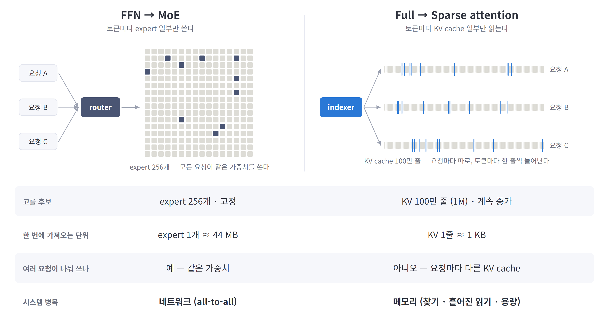
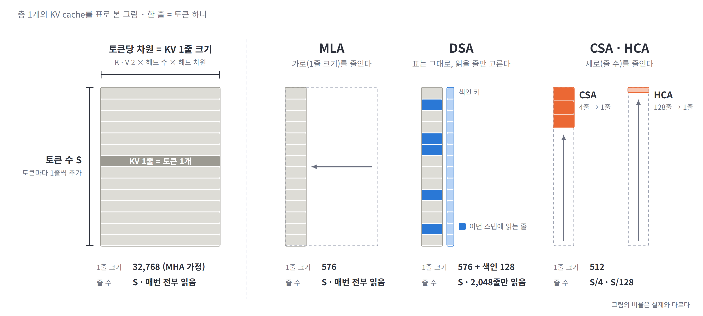
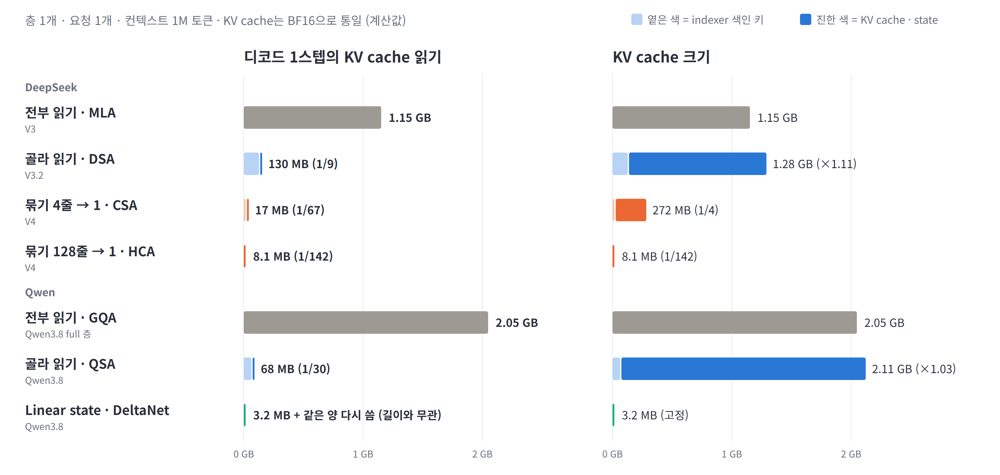
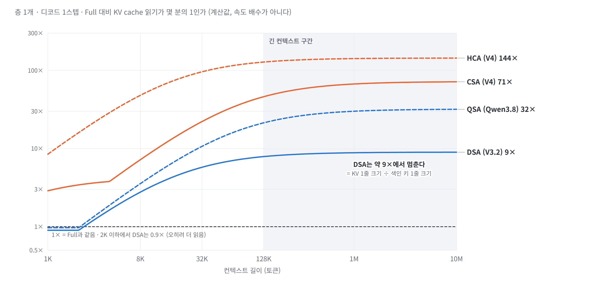
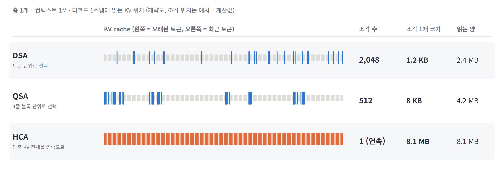
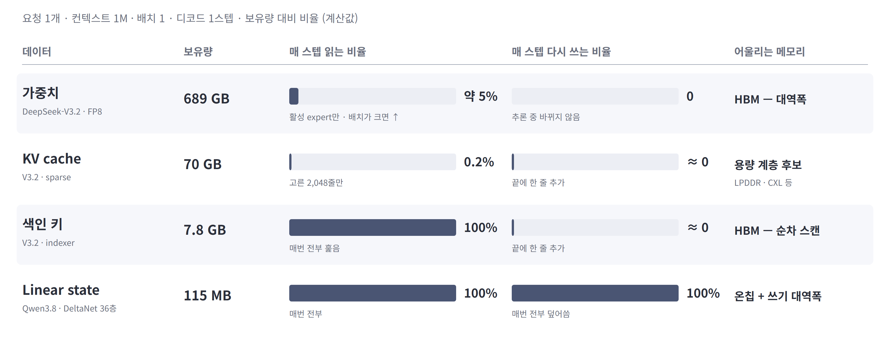
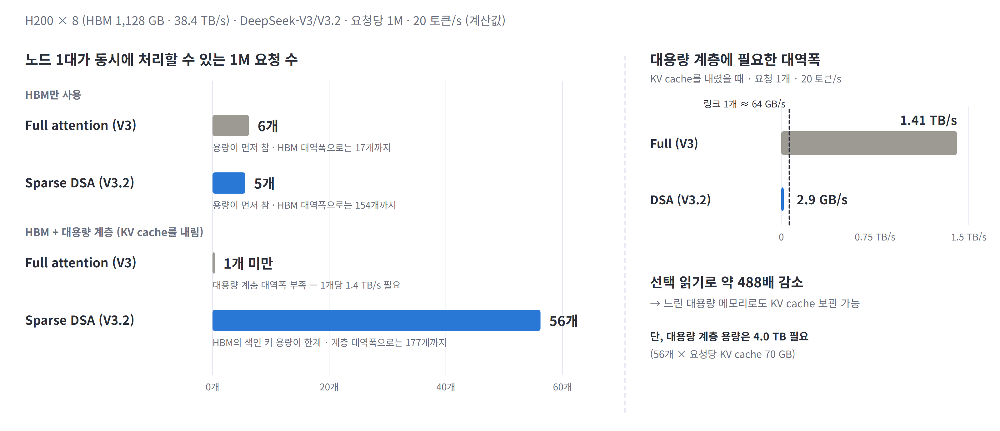
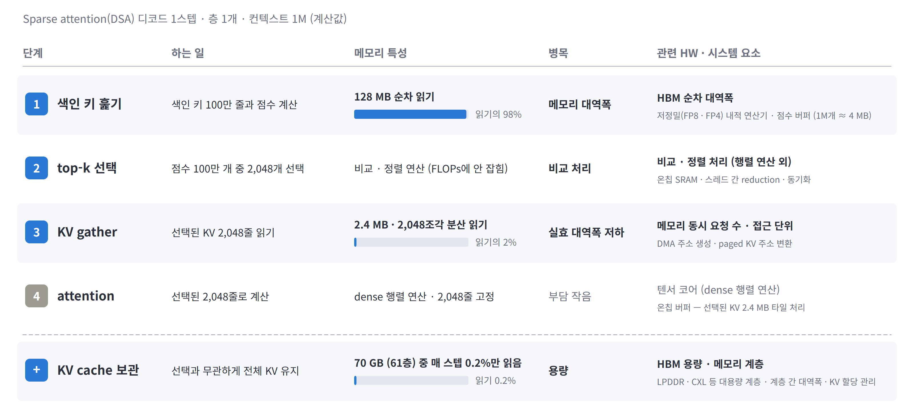
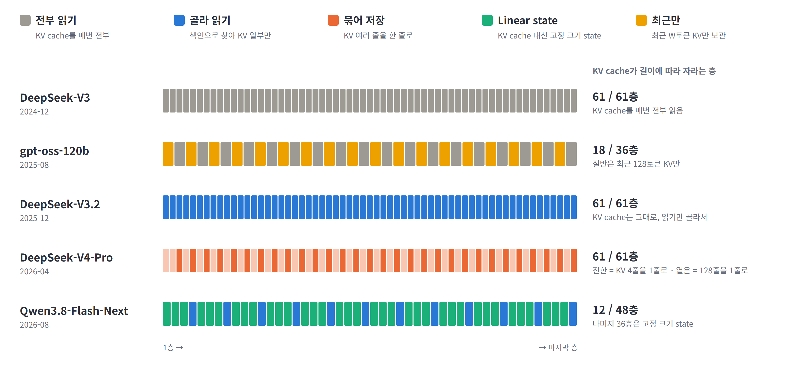

# Sparse · Hybrid Attention 구조 분석 및 아키텍처 시사점

차세대 아키텍처 탐색을 위한 KV cache 동작 특성 정량 분석 · 2026.11

> 슬라이드 원고 (Claude 버전). `---` 하나가 슬라이드 한 장이다. 그림은 [figures-claude/](figures-claude/)에 있고 `python arch_insight/figures-claude/make_figures.py`로 다시 만든다.
> 계획과 기준: [00-deck-plan-claude.md](00-deck-plan-claude.md)

---

## 요약

| 구분 | 핵심 내용 |
|---|---|
| **구조 변화** | 최신 모델은 KV cache 전부 읽기 구조에서 탈피 — 선택 읽기(sparse), 압축 저장, 일부 층의 고정 크기 state 대체(hybrid). 2026 하반기 공개 모델 15개 중 14개 |
| **절감 효과** | 디코드당 KV cache 읽기 **1/9 ~ 1/140** 감소. 단, KV cache 크기는 유지되는 방식이 다수이며 잔여 읽기의 대부분은 **색인 키 훑기** |
| **아키텍처 시사점** | 병목이 연산에서 **메모리 구조**로 이동 — KV cache · 색인 키 · state 특성별 메모리 계층, 색인 처리 및 분산 읽기 경로, state 갱신 지원 필요 |
| **용량 · 대역폭 분석** | HBM만 쓰면 sparse도 **용량이 먼저 찬다**(H200 × 8, 동시 1M 요청 5개). KV cache를 대용량 계층으로 내리면 **56개(약 11배)** — 선택 읽기로 계층에 필요한 대역폭이 요청당 2.9 GB/s까지 줄어 가능 |

---

## 1. Attention 구조 동향

### 2026 하반기 공개 모델 15개 중 14개, KV cache 전부 읽기 구조에서 탈피

- Full attention 단독 모델 비중: **2025 상반기 40% → 2026 하반기 7%** (15개 중 1개)
- 방식은 회사별로 상이 — sparse(선택 · 압축), linear state 혼합, sliding window 혼합
- 단일 방식 대신 **층마다 다른 방식을 혼합**(hybrid) — 예: Qwen3.8은 48층 중 12층만 KV cache 보유 ([부록 A](#부록-a-층-구성의-hybrid화))

※ 출처: 9개 시리즈 55개 공개 모델의 공식 config ([메모리 보고서](../reports/llm-memory-requirements.md) §1). 모델별로 가장 먼저 해당하는 분류 하나로 집계.

---

## 2. MoE와의 비교

### Sparse attention은 'KV cache의 MoE' — 단, 선택 대상과 병목이 다름

- 공통점: 소형 선택기(router / indexer)가 **일부만 선택해 사용**, 미선택 expert · KV도 **전부 보유**
- 차이점: MoE는 고정된 expert 256개를 **전 요청이 공유**, sparse는 계속 증가하는 KV 100만 줄을 **요청별로 따로** 선택
- 병목: MoE는 **네트워크**(all-to-all), sparse attention은 **메모리**(색인 훑기 · 분산 읽기 · 용량)

※ 기준: expert 1개 = DeepSeek-V3 3 × 7,168 × 2,048 파라미터 · FP8 ≈ 44 MB. KV 1줄 = MLA 576차원 · BF16 = 1,152 B (층당).

---

## 3. Sparse attention 동작 구조

### KV cache(토큰 수 × KV 1줄 크기) 중 방식별로 줄이는 축이 다름

- **MLA — 가로(KV 1줄 크기) 축소:** 32,768 → 576, 줄 수는 `S` 유지
- **DSA — 표는 유지, indexer가 읽을 줄만 선택:** `S`줄 중 2,048줄만 읽고, 선택용 색인 키 열 추가
- **CSA · HCA — 세로(줄 수) 축소:** 4줄 · 128줄을 1줄로 압축해 `S/4` · `S/128`. 두 축은 독립적이라 병행 가능

※ 출처: [세미나 자료](../seminar/01-attention-seminar_sum_ver.md) §4.3 그림을 재구성. 그림 비율은 실제와 다름. 32,768은 DeepSeek-V3 헤드 구성(128 × 128)을 MHA로 가정한 값.

---

## 4. KV cache 읽기 · 크기 절감 효과

### 디코드당 KV cache 읽기는 1/9 ~ 1/140로 감소, KV cache 크기는 유지되는 방식 다수

- 선택 읽기(DSA · QSA)는 **KV cache 읽기만** 감소 — DSA 읽기 1/9, KV cache 크기는 ×1.11 (색인 키 추가분)
- 잔여 읽기의 **93 ~ 98%가 색인 키 훑기** — 실제 KV 읽기는 수 MB 수준 (옅은 막대 = 색인 키)
- 압축(CSA · HCA) · linear state는 **KV cache 크기까지** 감소. 선택 읽기만으로는 수 M 토큰 KV cache 저장 **용량** 문제가 남음

※ 기준: 층 1개 · 1M 토큰 · KV cache BF16 통일 계산값. 비율은 동일 회사의 전부 읽기 구조(V3 MLA · Qwen3.8 full 층 GQA) 대비. QSA 블록 키는 정밀도 미표기로 BF16 가정. Qwen3.8-Flash-Next 공개 지원 길이는 256K로, 1M은 방식 자체의 계산값.

---

## 5. 컨텍스트 길이별 절감 효과와 한계

### 긴 컨텍스트에서만 효과적이며, 색인 키 훑기 비용으로 절감 배수에 상한 존재

- **짧은 컨텍스트는 효과 미미** — 8K에서 DSA 2.8×, 2K 이하는 0.9×로 오히려 증가
- **긴 컨텍스트도 일정 배수에서 포화** — DSA 9×, QSA 32×, CSA 71×. 색인 키는 계속 전부 훑기 때문 (상한 = KV 1줄 크기 ÷ 색인 키 1줄 크기)
- 차기 경쟁 포인트는 **색인 비용 절감** — 색인 키 압축(CSA), 블록 단위 색인(QSA), 선택 결과의 층 간 공유(GLM-5.2 · V4.1)

※ 기준: 층 1개 · 디코드 1스텝 계산값. 속도 배수 아님 — top-k · 분산 읽기 비효율, 가중치 읽기 · FFN · 통신 미포함. prefill은 연산 병목으로 별도 분석 필요.

---

## 6. KV 접근 패턴 특성

### 선택 읽기는 바이트는 적지만 분산 읽기 — 읽는 양보다 조각 수가 실효 대역폭을 결정

- **DSA:** KV 2,048줄을 **2,048조각**(조각당 1.2 KB)으로 분산 읽기 — 메모리 요청 수 최대
- **QSA:** 4줄 블록 단위로 **512조각**(조각당 8 KB) — 읽는 양은 DSA보다 많지만(4.2 MB vs 2.4 MB) 조각 수는 1/4
- **HCA:** 압축 KV 전체를 **연속 읽기** — 분산 읽기 · top-k 없음. 업계는 읽는 양보다 조각 수를 줄이는 방향으로 이동

※ 기준: 층 1개 · 1M 계산값. DSA는 MLA(1,152 B/줄), QSA는 Qwen3.8 GQA(2,048 B/줄) 기준으로 줄 크기가 다름. 조각 수에 따른 실효 대역폭 저하 폭은 실측 필요. top-k는 비교 연산으로 GPU 연산 성능 향상의 효과가 제한적.

---

## 7. 데이터별 메모리 접근 특성

### 가중치 · KV cache · 색인 키 · state의 읽기/쓰기 특성이 달라 적합한 메모리 계층이 다름

- **매 스텝 전부 읽음**(색인 키) → 고대역폭 메모리 필요
- **대용량이나 매 스텝 0.2%만 읽음**(sparse의 KV cache 70 GB) → **용량 계층** 배치 후보. 기록 후 변경되지 않아 계층 간 이동도 용이
- **소용량이나 매 스텝 전부 갱신**(linear state) → 용량보다 **온칩 처리 · 쓰기 대역폭**이 관건

※ 기준: 요청 1개 · 1M · 배치 1 계산값. 가중치 · KV cache · 색인 키는 DeepSeek-V3.2(가중치 FP8, KV BF16), linear state는 Qwen3.8-Flash-Next DeltaNet 36층(FP32). state는 층당 약 3 MB로 한 층 처리 중에는 온칩 수용 가능하나, 요청 전체 × 동시 요청 수는 HBM 보관 필요.

---

## 8. 메모리 용량 · 대역폭 제약 분석

### Sparse attention은 HBM 대역폭은 남기지만 용량이 먼저 참 — KV cache를 대용량 계층으로 내리면 동시 1M 요청 5개 → 56개

- **HBM만 사용:** DSA도 동시 1M 요청 **5개**에서 HBM 용량이 먼저 참 (요청당 KV cache 70 GB + 색인 키 7.8 GB). HBM 대역폭은 154개분까지 여유
- **KV cache를 대용량 계층으로 이동:** HBM에는 가중치와 색인 키만 남아 **56개(약 11배)**. 대용량 계층에 필요한 대역폭은 요청당 2.9 GB/s — 64 GB/s 링크 1개로 약 22개 요청분
- **Full attention은 같은 구성 불가:** 요청당 1.4 TB/s 필요(약 490배) → **선택 읽기가 메모리 계층화의 전제 조건**. 다음 한계는 HBM의 색인 키 용량으로, 색인 키 압축 · 저정밀화가 동시 처리 수에 직결

※ 기준 · 가정: H200 × 8 (HBM 1,128 GB · 38.4 TB/s), DeepSeek-V3.2 가중치 689 GB(FP8) HBM 상주, KV cache BF16 · 색인 키 FP8, 요청당 목표 20 토큰/s. HBM 대역폭은 가중치 전체를 매 스텝 읽는다고 보수적으로 가정. 대용량 계층은 GPU당 64 GB/s 링크 1개(총 512 GB/s), 용량 제한 없음으로 가정. 활성값 · 엔진 여유분 · 분산 읽기 비효율 미포함 — 바이트 기준 계산값.

---

## 9. Sparse attention 단계별 특성 및 관련 시스템 요소

### 병목은 연산이 아닌 색인 키 훑기 · 분산 KV 읽기 · KV cache 용량 — 행렬 연산기 외의 메모리 · 데이터 이동 요소가 좌우

- **색인 키 훑기(읽기의 98%):** HBM 순차 대역폭이 상한, 연산은 저정밀(FP8 · FP4) 내적으로 부담 작음
- **top-k · KV gather:** 비교 · 정렬 처리, 메모리 동시 요청 수, 주소 생성 · 변환 등 **행렬 연산 외 요소**가 지연 결정
- **KV cache 보관:** HBM 용량과 메모리 계층 구성 · 계층 간 대역폭이 동시 처리 가능한 요청 수를 결정

※ 기준: DSA(DeepSeek-V3.2) 층 1개 · 1M 토큰 계산값, KV cache BF16 · 색인 키 FP8 · 점수 FP32.

---

## 부록 A. 층 구성의 Hybrid화

### 단일 방식 대신 층마다 다른 방식을 혼합하는 hybrid 구조로 전환

- 2024년 모델은 전 층 동일 방식 → 2026년 모델은 **층마다 다른 방식을 교대 배치**
- DeepSeek-V4: 4줄 압축 층(선택 읽기)과 128줄 압축 층(전부 읽기)을 **1:1 교대** — 정밀한 부분 조회와 거친 전체 조회를 병행
- Qwen3.8: 48층 중 **12층만 KV cache 보유**, 나머지 36층은 고정 크기 linear state로 대체. gpt-oss는 절반 층이 최근 128토큰 KV만 보유

※ 출처: 각 모델 config의 층별 설정 — V4-Pro `compress_ratios`, Qwen3.8-Flash-Next · gpt-oss `layer_types`.

---

## 부록 B. 방식별 비교

| | 전부 읽기 (MLA · GQA) | 선택 읽기 (DSA · QSA) | 압축 저장 (CSA · HCA) | Linear state |
|---|---|---|---|---|
| 색인 비용 (쿼리당) | 없음 | 색인 키 `S`줄 (QSA `S/4`) | CSA 색인 키 `S/4` · HCA 없음 | 없음 |
| attention 계산 (쿼리당) | `S` | 2,048 고정 | CSA 1,024 · HCA `S/128` | 고정 |
| 원본 KV 정확 조회 | 가능 | 가능 (선택 시) | 불가 (최근 128줄만 원본) | 불가 |
| KV cache 크기 | `S` | `S` + 색인 키 (+3 ~ 11%) | `S/4` · `S/128` | 길이 무관 (state) |
| 디코드당 읽기 (1M, 층당) | 1.15 ~ 2.05 GB | 68 ~ 130 MB | 8 ~ 17 MB | 3.2 MB + 동일량 쓰기 |
| 추가 연산 | — | 색인 훑기 · top-k · 분산 읽기 | 쓰기 시 압축 · top-k · 분산 읽기 | 매 스텝 state 갱신 |
| 기존 모델 적용 | — | 추가 학습으로 전환 가능 (V3.1 → V3.2) | 설계 단계부터 적용 | 설계 단계부터 적용 |

---

## 부록 C. 계산 기준

| 항목 | 기준 |
|---|---|
| 단위 | 층 1개 · 요청 1개 · 디코드 1스텝. 1M = 100만 토큰, 1 GB = 10⁹ B |
| 정밀도 | KV cache는 BF16 통일 (구조 효과 비교). 색인 키는 공개 정밀도 — DSA FP8 128 B · CSA FP4 64 B · QSA는 미표기로 BF16 256 B 가정 |
| KV 1줄 크기 (층당) | MLA 1,152 B · GQA(Qwen3.8 full 층) 2,048 B · V4 엔트리 1,024 B · DeltaNet state 3.2 MB (FP32, 고정) |
| 선택량 | DSA 2,048줄 · QSA 512블록 × 4줄 · CSA 1,024엔트리 + 최근 128줄 · HCA는 전체 + 최근 128줄 |
| 미포함 | top-k · 분산 읽기 비효율, 페이지 단위 과다 읽기, 가중치 읽기 · FFN · 통신. KV cache를 1회씩 읽는 하한 기준 |
| 정확도 | 분석 범위 외 |
