# Sparse · Hybrid Attention 구조 분석 및 아키텍처 시사점

차세대 아키텍처 탐색을 위한 KV cache 동작 특성 정량 분석 · 2026.11

> 슬라이드 원고 (Claude 버전). `---` 하나가 슬라이드 한 장이다. 그림은 [figures-claude/](figures-claude/)에 있고 `python arch_insight/figures-claude/make_figures.py`로 다시 만든다 (계산 요약도 함께 출력).
> 계획과 기준: [00-deck-plan-claude.md](00-deck-plan-claude.md) · 비교 기준: **128K = 공통 비교 조건**, **1M = 차세대 설계 시나리오** (V3.2 · Qwen3.8은 지원 길이 밖 — 외삽)

---

## 요약

| 구분 | 핵심 내용 |
|---|---|
| **구조 변화** | 조사 대상 2026 하반기 15개 모델 중 전 층 full attention은 1개. 선택 읽기(sparse), 압축 저장, linear state 혼합(hybrid)이 주류 |
| **규모** | 1M 요청 1개의 KV cache는 3 ~ 344 GB. Full GQA는 요청 1개가 가중치 수준, 압축 · hybrid는 수십 개가 모여야 가중치와 같아짐 |
| **절감 효과 (128K, 층당)** | 디코드당 KV cache 읽기 **1/8 ~ 1/128**. 선택 읽기형은 KV cache 크기 유지, 남은 읽기의 64 ~ 88%가 색인 키 (1M에서는 93 ~ 98%) |
| **남는 비용** | 절감 상한은 토큰당 색인 바이트가 결정. DSA · CSA 색인은 HBM 속도로 훑으려면 FP8 피크의 30 ~ 60% 연산 필요. hybrid는 128K까지 디코드 I/O의 60% 이상이 state 읽기 · 쓰기 |
| **용량 · 대역폭 (H200 × 8)** | HBM만 쓰면 용량이 먼저 참 (128K 동시 51개 · 1M 6개). KV cache를 대용량 계층으로 내리면 **128K 173개 · 1M 40개** — 단, 약 3.5만 토큰 이상에서만 이득이고 읽기 단위 · 분산 방식에 크게 좌우 |
| **아키텍처 시사점** | Attention 읽기가 줄면서 **색인 처리 · 선택 · 불규칙 접근 · state 갱신 · 메모리 계층**을 별도로 최적화할 필요가 커짐. 우선순위는 단계별 실측으로 결정 |

---

## 1. Attention 구조 동향

### 조사 대상 2026 하반기 15개 모델 중 전 층 full attention은 1개

- 전 층 full attention 모델: 2025 하반기 7/14 → 2026 상반기 5/20 → **2026 하반기 1/15**
- 대체 방식은 회사별로 상이 — 선택 읽기(DSA 계열), 압축 저장(DeepSeek-V4), linear state 혼합(Qwen · Kimi · Nemotron), sliding window 혼합
- hybrid 모델도 일부 full 층은 KV cache를 전부 읽음 — "전부 읽기 탈피"는 층 단위로 진행 중

※ 출처: 주요 9개 시리즈 55개 공개 모델의 공식 config ([메모리 보고서](../reports/llm-memory-requirements.md) §1). 조사 대상 표본이며 '24 하반기 · '25 상반기는 모델 수가 적음. 모델별로 가장 먼저 해당하는 분류 하나로 집계.

---

## 2. 모델 계열별 가중치와 KV cache 규모

### 1M 요청 1개의 KV cache는 3 ~ 344 GB — 가중치와 같아지는 동시 요청 수는 1개 미만에서 90개까지

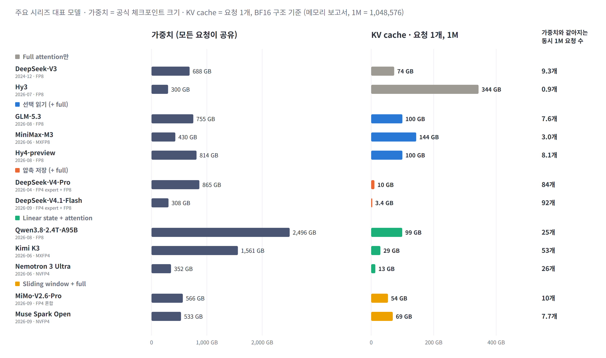

- **Full attention:** Hy3(GQA)는 1M 요청 1개의 KV cache(344 GB)가 가중치(300 GB)보다 큼 — 요청 하나가 GPU 메모리를 좌우
- **선택 읽기:** GLM-5.3 · Hy4는 1M당 100 GB로 7 ~ 8개면 가중치와 같아짐 — 읽기만 줄이고 **크기는 줄이지 않음**
- **압축 · linear state:** DeepSeek-V4 계열 3 ~ 10 GB(84 ~ 92개), Kimi K3 29 GB(53개) — **크기 자체를 줄인 방식만 동시 요청 수가 크게 늘어남**

※ 출처: [메모리 보고서](../reports/llm-memory-requirements.md) 데이터. 가중치는 공식 체크포인트 크기(정밀도는 모델마다 다름), KV cache는 구조 비교용 BF16 기준, 1M = 1,048,576. 가중치는 모든 요청이 공유, KV cache는 요청마다 따로 필요.

---

## 3. MoE와의 비교

### Sparse attention은 'KV cache의 MoE' — 단, 선택 대상과 제약이 다름

- 공통점: 소형 선택기(router / indexer)가 **일부만 선택해 사용**, 미선택 expert · KV도 **전부 보유**
- 차이점: MoE는 고정된 expert 256개를 **전 요청이 공유**, sparse는 계속 증가하는 KV 100만 줄을 **요청별로 따로** 선택
- 제약: MoE는 소배치에서 가중치 대역폭, 대규모 expert 병렬에서 토큰 activation의 all-to-all 통신. sparse attention은 색인 훑기 · 흩어진 KV 읽기 · KV cache 용량

※ 기준: expert 1개 = DeepSeek-V3 3 × 7,168 × 2,048 파라미터 · FP8 ≈ 44 MB (가중치 읽기 단위). KV 1줄 = MLA 576차원 · BF16 = 1,152 B (층당). all-to-all이 옮기는 것은 가중치가 아니라 토큰 activation.

---

## 4. Sparse attention 동작 구조

### KV cache(토큰 수 × KV 1줄 크기) 중 방식별로 줄이는 축이 다름

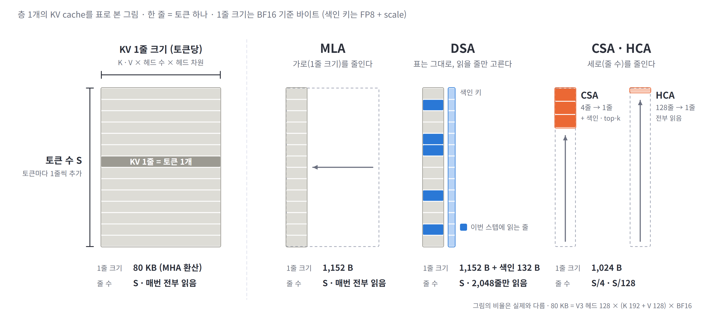

- **MLA — 가로(KV 1줄 크기) 축소:** MHA 환산 80 KB → 1,152 B, 줄 수는 `S` 유지
- **DSA — 표는 유지, indexer가 읽을 줄만 선택:** `S`줄 중 2,048줄만 읽음, 줄마다 색인 키 132 B 추가
- **CSA · HCA — 세로(줄 수) 축소:** 4줄 · 128줄을 1줄로 압축해 `S/4` · `S/128`. CSA는 압축 위에서 다시 색인 · top-k로 선택. 두 축은 병행 가능

※ 출처: [세미나 자료](../seminar/01-attention-seminar_sum_ver.md) §4.3 그림을 재구성. 그림 비율은 실제와 다름. 80 KB = V3 헤드 128 × (K 192 + V 128) × BF16. 1줄 크기는 BF16 기준 바이트, 색인 키는 FP8 128 B + scale 4 B.

---

## 5. 층 구성의 Hybrid화

### 단일 방식 대신 층마다 다른 방식을 혼합 — 한 모델 안에 서로 다른 메모리 접근 패턴이 공존

- 2024년 모델은 전 층 동일 방식 → 2026년 모델은 **층마다 다른 방식을 교대 배치**
- DeepSeek-V4: 4줄 압축 층(선택 읽기)과 128줄 압축 층(전부 읽기)을 **1:1 교대** — 정밀한 부분 조회와 거친 전체 조회를 병행
- Qwen3.8: 48층 중 **12층만 KV cache 보유**, 36층은 고정 크기 linear state — 모델 전체 비용은 11장에서 합산

※ 출처: 각 모델 config의 층별 설정 — V4-Pro `compress_ratios`, Qwen3.8-Flash-Next · gpt-oss `layer_types`.

---

## 6. KV cache 읽기 · 크기 절감 효과

### 128K에서 디코드당 KV cache 읽기 1/8 ~ 1/128 — 선택 읽기형은 KV cache 크기를 유지

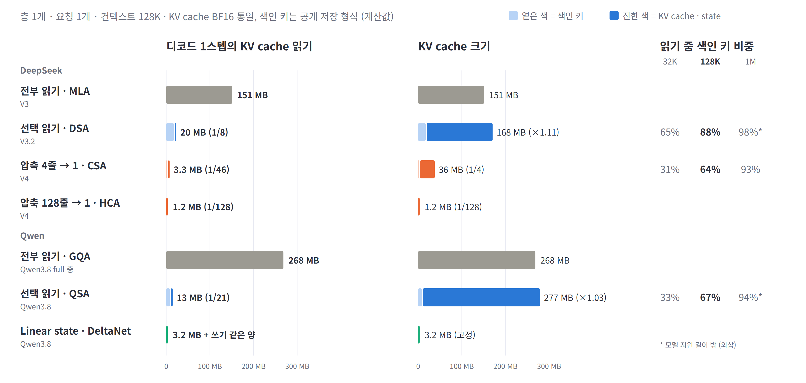

- 선택 읽기(DSA · QSA)는 **KV cache 읽기만** 감소 — DSA 1/8, KV cache 크기는 ×1.11 (색인 키 추가분)
- 남은 읽기의 상당 부분이 색인 키 — 128K에서 **64 ~ 88%**, 1M에서 93 ~ 98% (오른쪽 표, 길수록 커짐)
- 압축(CSA · HCA) · linear state는 **크기까지** 감소. 모델 전체로 보면 V4-Pro는 MLA 대비 128K 1/68, 1M 1/92 (CSA · HCA 층 교대 합산)

※ 기준: 층 1개 · 128K · KV cache BF16 통일(구조 효과 비교), 색인 키는 공개 저장 형식(DSA FP8 + scale 132 B, CSA FP4 64 B, QSA 블록 키는 정밀도 미표기로 BF16 256 B 가정). 비율은 동일 회사의 전부 읽기 구조(V3 MLA · Qwen3.8 full 층 GQA) 대비. 1M 값의 *는 지원 길이 밖.

---

## 7. 컨텍스트 길이별 절감 효과

### 선택형은 길어질수록 효과가 커지다 상한에서 멈춤 — 압축형은 짧은 컨텍스트에서도 효과

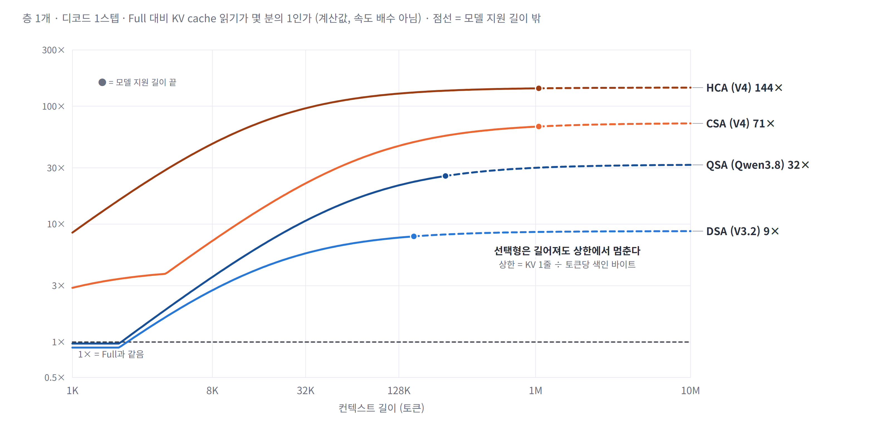

- **선택형(DSA · QSA):** 8K에서 DSA 2.7×, 128K 7.7× → 길어져도 **약 9×에서 포화** (QSA 32×)
- **압축형(CSA · HCA):** 1K에서도 CSA 2.9×, HCA 8.5× — KV cache 자체가 작아서 짧은 길이에서도 효과
- 상한 = **KV 1줄 바이트 ÷ 토큰당 색인 바이트** — 색인 키는 길이만큼 계속 훑어야 하기 때문 (8장)

※ 기준: 층 1개 · 디코드 1스텝 계산값, 속도 배수 아님. 실선 = 모델 지원 길이 안, 점선 = 밖(외삽), ● = 지원 길이 끝(V3.2 160K · Qwen3.8 256K · V4 1M). 2K 이하에서 DSA가 1× 아래인 것은 전부 선택되는 구간이라 실제로는 색인을 생략할 수 있음.

---

## 8. 절감 상한을 정하는 요인

### 절감 상한은 '토큰당 색인 바이트'가 결정 — 색인 정밀도와 블록 압축이 같은 역할

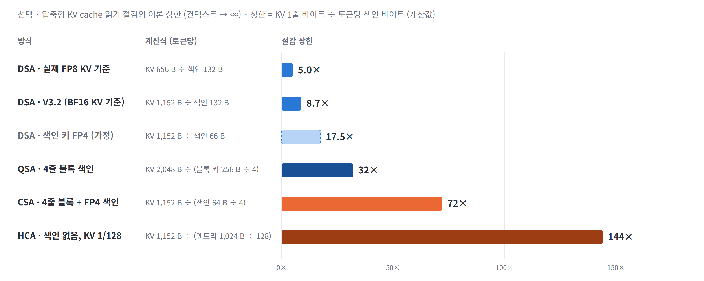

- **정밀도 효과:** 같은 DSA라도 KV를 실제 서빙 형식(FP8 656 B)으로 보면 상한 **5.0×**, BF16 기준이면 8.7× — 정밀도가 상한을 바꿈
- **색인 축소 효과:** 색인 키를 FP4로 줄이면 17.5×(가정), 4줄 블록 색인(QSA) 32×, 블록 + FP4(CSA) 72×
- 차기 경쟁 포인트는 **토큰당 색인 바이트 축소** — 구조 효과와 정밀도 효과를 분리해서 비교해야 함

※ 기준: 컨텍스트 → ∞ 극한의 이론 상한 계산값. 블록 색인은 블록 키 1개가 4토큰을 대표하므로 토큰당 색인 바이트 = 블록 키 ÷ 4. HCA는 색인이 없어 상한 = KV 압축률.

---

## 9. 색인 연산 특성

### 색인 훑기는 대역폭만의 문제가 아님 — DSA · CSA 색인은 FP8 피크의 30 ~ 60%를 요구, QSA는 1%

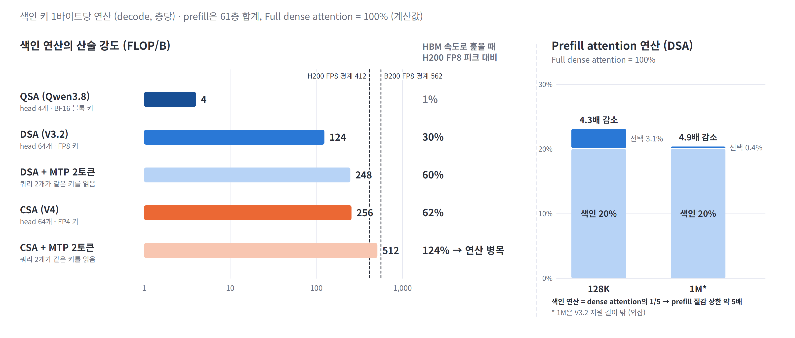

- **산술 강도:** 색인 키 1바이트당 DSA 124, CSA 256, QSA 4 FLOP — indexer head 수(64 vs 4)가 차이를 만듦. MTP로 쿼리 2개를 함께 처리하면 CSA는 H200 경계(412)를 넘어 **연산 병목**
- **메모리 근처 처리 적합성:** QSA형은 메모리 대역폭 1 TB/s당 4 TFLOPS면 충분(PIM에 적합), DSA · CSA형은 1 TB/s당 FP8 124 ~ 256 TFLOPS 필요
- **prefill:** 색인 연산이 dense attention의 1/5 → **prefill 절감 상한 약 5배**. 128K에서 색인이 attention 연산의 86%, 1M에서 98%

※ 기준: 색인 키 저장 바이트 기준(DSA 132 B, CSA 64 B, QSA 블록 키 256 B). H200 FP8 1,979 TFLOPS ÷ 4.8 TB/s = 412 FLOP/B, B200 FP8 4.5 PFLOPS ÷ 8 TB/s = 562 FLOP/B (dense 사양). prefill은 61층 합계, dense attention = 헤드 128 × (K 192 + V 128).

---

## 10. KV 접근 패턴과 읽기 증폭

### HBM에서는 흩어진 읽기의 바이트 손실이 거의 없음 — 문제는 지연 · 의존성이고, 증폭은 대용량 계층에서 커짐

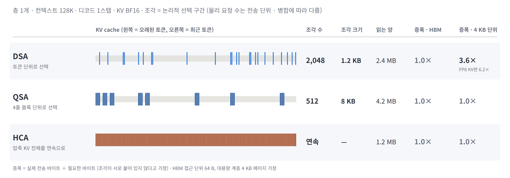

- **HBM:** DSA 조각(1.2 KB)은 HBM 접근 단위(64 B)보다 충분히 커서 증폭 1.0× — 2.4 MB를 읽는 시간은 1 µs 미만이라 **top-k 이후 직렬로 기다리는 지연**이 더 큰 문제
- **4 KB 단위 대용량 계층:** DSA는 3.6×(FP8 KV면 6.2×)로 증폭, QSA는 블록(8 KB)이 단위보다 커서 1.0× — **블록 단위 선택이 계층화에 유리**
- 조각 수는 논리적 선택 구간 수 — QSA는 조각이 1/4이지만 읽는 양은 1.8배. 실제 메모리 요청 수는 전송 단위 · 인접 병합에 따라 달라짐

※ 기준: 층 1개 · 128K · KV BF16 계산값. 증폭 = 실제 전송 바이트 ÷ 필요한 바이트, 조각이 서로 붙어 있지 않다고 가정. HBM 접근 단위 64 B, 대용량 계층 4 KB 페이지는 가정값.

---

## 11. Hybrid 모델 전체 합산

### 고정 크기 state도 갱신 비용은 남음 — Qwen3.8은 128K까지 디코드 I/O의 60% 이상이 state 읽기 · 쓰기

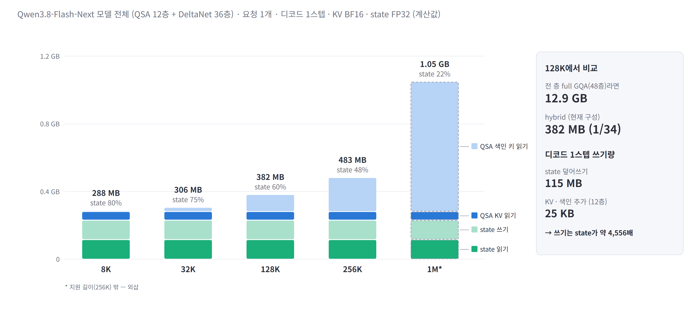

- **state 비중:** 8K 80%, 32K 75%, 128K 60% → 1M 22% — 짧은 컨텍스트일수록 KV cache보다 state가 주된 메모리 트래픽
- **전 층 full GQA 대비:** 128K에서 디코드당 읽기 12.9 GB → 382 MB (1/34)
- **쓰기:** state 덮어쓰기 115 MB vs KV · 색인 추가 25 KB — 쓰기 대역폭과 온칩 처리가 hybrid의 별도 요구 사항

※ 기준: Qwen3.8-Flash-Next 모델 전체(QSA 12층 + DeltaNet 36층), 요청 1개 · 디코드 1스텝, KV BF16 · state FP32(config `mamba_ssm_dtype`) 계산값. 1M은 지원 길이(256K) 밖.

---

## 12. 데이터별 메모리 접근 특성

### 가중치는 공유, KV cache · 색인 키 · state는 요청마다 — 읽는 비율과 쓰기 패턴도 모두 다름

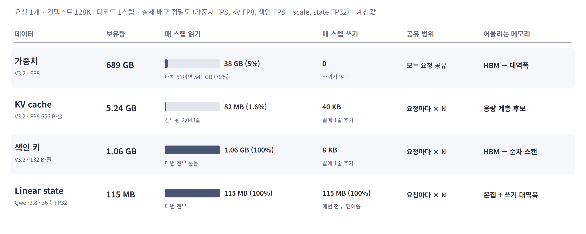

- **가중치(공유):** 배치 1이면 활성분 38 GB(5%)만 읽지만, 배치 51이면 expert 합집합이 커져 541 GB(79%)
- **KV cache(요청마다):** 5.2 GB 중 매 스텝 1.6%만 읽음 — 크지만 드물게 읽는 데이터. **색인 키**는 1.1 GB를 매번 전부 훑음
- **linear state(요청마다):** 115 MB를 매 스텝 전부 읽고 전부 덮어씀 — 요청당 크기는 작지만 동시 요청 수만큼 늘어남

※ 기준: 요청 1개 · 128K · 디코드 1스텝, 실제 배포 정밀도(가중치 FP8, KV FP8 656 B/줄, 색인 132 B/줄, state FP32) 계산값. 가중치 읽기는 균등 routing을 가정한 expert 합집합.

---

## 13. 접근 밀도 — 데이터와 메모리 기술의 매칭

### Sparse KV cache는 1M에서 CXL급, 128K에서 LPDDR급 메모리로도 대역폭 감당 가능 — state는 HBM으로도 부족한 밀도

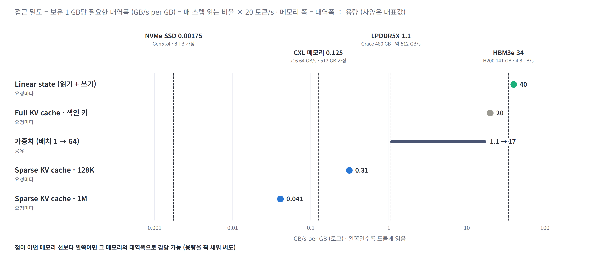

- **접근 밀도 = 보유 1 GB당 필요한 대역폭.** 데이터 점이 메모리 선보다 왼쪽이면, 그 메모리를 꽉 채워도 대역폭이 충분
- **sparse KV cache:** 128K 0.31 → LPDDR(1.1) 가능 · CXL(0.13) 부족, 1M 0.041 → CXL 가능 — 길어질수록 더 느린 계층으로 내릴 수 있음
- **full KV · 색인 키(20)는 HBM(34)만 가능, linear state(40)는 HBM 밀도도 초과** — state는 층 단위 온칩 처리가 필요

※ 기준: 20 토큰/s, 데이터 밀도 = 매 스텝 읽는 비율 × 20 (state는 읽기 + 쓰기). 메모리 밀도 = 대역폭 ÷ 용량의 대표값 — H200 HBM3e 141 GB · 4.8 TB/s, Grace LPDDR5X 480 GB · 약 512 GB/s, CXL x16 64 GB/s · 512 GB 모듈, NVMe Gen5 x4 약 14 GB/s · 8 TB (가정값 포함, 사양 확인 필요).

---

## 14. 동시 요청 수 × 컨텍스트 길이 제약 지도

### KV cache 계층화는 긴 컨텍스트에서만 이득 — 128K 3.4배(51 → 173), 1M 6.7배(6 → 40), 읽기 단위가 크면 오히려 손해

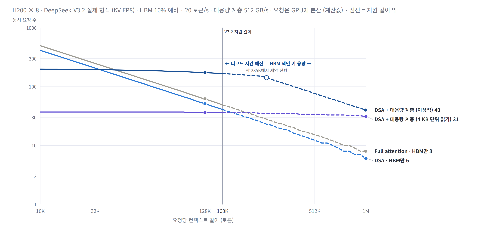

- **HBM만 사용:** 용량이 먼저 참 — DSA 128K 51개, 1M 6개. 색인 키가 더해져 Full(62개 · 8개)보다 적음
- **KV cache를 대용량 계층으로(이상적):** 128K 173개 — 계층 읽기가 top-k 이후 **직렬 경로**라 디코드 시간 예산이 한계. 약 285K부터는 HBM의 색인 키 용량이 한계 → 1M 40개
- **이득 구간:** 계층화가 HBM만보다 나은 것은 **약 3.5만 토큰 이상**. 4 KB 단위로 읽으면(증폭 6.2×) 128K 36개로 HBM만(51개)보다 적고, **약 19만 토큰 이상**에서만 이득

| 동시 요청 수 (먼저 막히는 곳) | 32K | 128K | 1M* |
|---|---:|---:|---:|
| Full · HBM만 | 248 (용량) | 62 (용량) | 8 (용량) |
| DSA · HBM만 | 207 (용량) | 51 (용량) | 6 (용량) |
| DSA + 계층 (이상적) | 195 (시간) | **173 (시간)** | **40 (색인 키 용량)** |
| DSA + 계층 (4 KB 단위) | 37 (시간) | 36 (시간) | 31 (시간) |

※ 기준 · 가정: H200 × 8 (HBM 1,128 GB · 38.4 TB/s), HBM 10% 예비, DeepSeek-V3.2 실제 형식(가중치 FP8 689 GB, KV FP8 656 B/줄, 색인 132 B/줄), 요청당 20 토큰/s(50 ms/스텝), 요청은 GPU에 분산(KV 복제 없음). 대용량 계층 = GPU당 64 GB/s 링크(총 512 GB/s), 용량 제한 없음. 시간 = 가중치 + 색인 HBM 읽기 + 계층 읽기의 직렬 합. 가중치 읽기는 균등 routing의 expert 합집합. 활성값 · 통신 · 커널 비효율 미포함 — 바이트 기준 상한. *1M은 V3.2 지원 길이 밖.

---

## 15. 병목 사다리 (1M 차세대 시나리오)

### 하나를 풀면 다음 병목이 드러남 — HBM 용량 → 색인 키 용량 → 계층 읽기 시간 순으로 이동

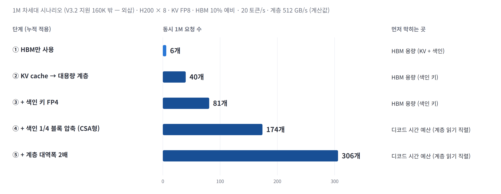

- **KV cache를 계층으로:** 6 → 40개, 이제 HBM에 남은 **색인 키 용량**이 한계
- **색인 키 축소(FP4 → 1/4 블록 압축):** 40 → 81 → 174개, 이제 **계층 읽기의 직렬 시간**이 한계
- **계층 대역폭 2배:** 174 → 306개 — 1M에서는 색인 키 크기와 계층 대역폭이 동시 처리 수를 정하는 두 변수

※ 기준: 14장과 같은 가정, 1M(V3.2 지원 길이 밖 — 외삽). 색인 키 FP4 = 66 B/줄(scale 포함 가정), 1/4 블록 압축 = 16.5 B/토큰(CSA형). 단계는 누적 적용.

---

## 16. 가정 민감도

### 결과를 가장 크게 바꾸는 변수는 분산 방식 · 계층 읽기 단위 · 목표 속도

| 조건 (나머지는 14장 기준) | 128K · HBM만 | 128K · 계층 | 1M · HBM만 | 1M · 계층 |
|---|---:|---:|---:|---:|
| **기준** (KV FP8 · 예비 10% · 20 토큰/s · 증폭 1 · 요청 분산) | 51 | 173 | 6 | 40 |
| KV BF16 (1,152 B/줄) | 31 | 107 | 4 | 40 |
| HBM 예비 0% | 69 | 173 | 9 | 54 |
| HBM 예비 20% | 33 | 173 | 4 | 26 |
| 목표 50 토큰/s | 51 | **39** | 6 | 26 |
| 계층 읽기 증폭 4× | 51 | 53 | 6 | 40 |
| 계층 4 KB 단위 읽기 (증폭 6.2×) | 51 | **36** | 6 | 31 |
| 계층 링크 실효 50% | 51 | 95 | 6 | 40 |
| 색인 scale 제외 (128 B) | 52 | 174 | 6 | 41 |
| **KV · 색인을 GPU마다 복제** (TP 참조 구현) | **6** | **26** | **0** | **5** |

- **분산 방식이 가장 큰 변수:** KV · 색인을 GPU마다 복제하면 동시 요청 수가 약 1/8 — 요청을 GPU에 나누는 방식(DP attention 등)이 전제
- **계층 쪽은 읽기 단위 · 목표 속도에 민감:** 증폭 6.2× 또는 50 토큰/s면 128K 계층 이득이 사라짐
- **HBM 쪽은 예비 용량 · KV 정밀도에 민감:** 1M 계층 시나리오는 색인 키 용량이 한계라 예비 용량에 비례

※ 모든 값은 바이트 기준 계산값. 실측 처리량이 아님. 복제 시나리오는 GPU 1장이 모든 요청의 KV · 색인을 들고 있는 경우.

---

## 17. 부분 최적화의 전체 효과

### Attention 경로만 빨라져도 전체 이득은 그 비중만큼 — 128K에서는 10배 가속해도 1.10배, 1M 계층 시나리오에서는 1.94배

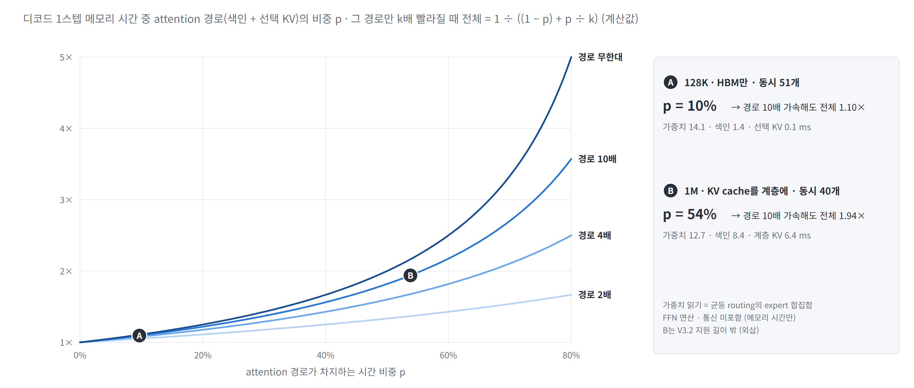

- **128K · 동시 51개(A):** 디코드 메모리 시간 15.6 ms 중 attention 경로(색인 + 선택 KV)는 10% — 나머지 90%는 가중치 읽기
- **1M · KV cache 계층 · 동시 40개(B):** attention 경로가 54% — 이 영역에서는 색인 · 계층 읽기 가속이 전체 속도에 직접 반영
- attention 전용 HW의 투자 가치는 **목표 컨텍스트 길이와 배치 크기**에 따라 달라짐 — 짧은 컨텍스트 · 큰 배치에서는 가중치 대역폭이 여전히 주 병목

※ 기준: 14장과 같은 가정. 메모리 시간만 계산(FFN 연산 · 통신 미포함), 가중치 읽기는 균등 routing의 expert 합집합. B는 V3.2 지원 길이 밖(외삽).

---

## 18. 단계별 특성과 검증할 제약

### Attention 읽기가 줄면서 색인 · 선택 · 불규칙 접근 · state 갱신을 별도로 최적화할 필요가 커짐

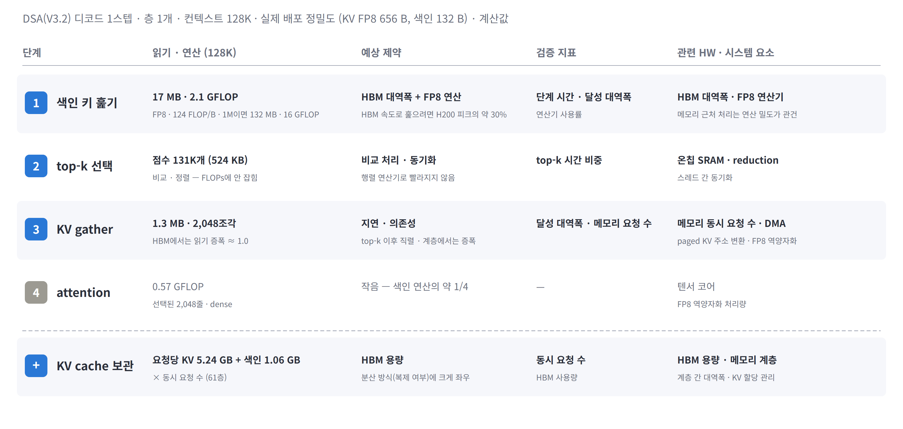

- **색인 키 훑기:** HBM 대역폭과 FP8 연산을 함께 요구(H200 피크의 약 30%) — 메모리 근처 처리 적합성은 indexer head 수가 결정
- **top-k · KV gather:** 행렬 연산기로 빨라지지 않는 비교 처리와, top-k 이후 직렬로 기다리는 지연 — 계층으로 내리면 읽기 증폭이 추가
- **검증 계획:** 128K에서 단계별 시간(색인 훑기 / top-k / gather · attention)과 실제 HBM 트래픽 실측 → 바이트 비중이 시간 병목으로 이어지는지 확인

※ 기준: DSA(V3.2) 층 1개 · 128K · 실제 배포 정밀도 계산값. FP8 KV 역양자화 처리량이 병목이 되는 사례가 FlashMLA 분석 문서에 보고됨 — 연산 외 처리 비용도 검증 대상.

---

## 부록 A. 방식별 비교

| | 전부 읽기 (MLA · GQA) | 선택 읽기 (DSA · QSA) | 압축 저장 (CSA · HCA) | Linear state |
|---|---|---|---|---|
| 색인 비용 (쿼리당) | 없음 | 색인 키 `S`줄 (QSA `S/4`) | CSA 색인 키 `S/4` · HCA 없음 | 없음 |
| 색인 산술 강도 | — | DSA 124 · QSA 4 FLOP/B | CSA 256 FLOP/B | — |
| attention 계산 (쿼리당) | `S` | 2,048 고정 | CSA 1,024 · HCA `S/128` | 고정 |
| 원본 KV 정확 조회 | 가능 | 가능 (선택 시) | 불가 (최근 128줄만 원본) | 불가 |
| KV cache 크기 | `S` | `S` + 색인 키 (+3 ~ 11%) | `S/4` · `S/128` | 길이 무관 (state) |
| 디코드당 읽기 (128K, 층당) | 151 ~ 268 MB | 13 ~ 20 MB | 1.2 ~ 3.3 MB | 3.2 MB + 동일량 쓰기 |
| 절감 상한 | — | DSA 9× · QSA 32× | CSA 72× · HCA 144× | — |
| 추가 연산 | — | 색인 훑기 · top-k · 흩어진 읽기 | 쓰기 시 압축 · top-k · 흩어진 읽기 | 매 스텝 state 갱신 |
| 기존 모델 적용 | — | 추가 학습으로 전환 가능 (V3.1 → V3.2) | 설계 단계부터 적용 | 설계 단계부터 적용 |

---

## 부록 B. 계산 기준

| 항목 | 기준 |
|---|---|
| 단위 | 층 1개 · 요청 1개 · 디코드 1스텝. 1M = 100만 토큰, 1 GB = 10⁹ B (2장만 메모리 보고서 기준 1M = 1,048,576) |
| 비교 길이 | 128K = 공통 비교 조건, 1M = 차세대 설계 시나리오. 지원 길이: V3 · V3.2 163,840 · Qwen3.8-Flash-Next 262,144 · V4-Pro 1,048,576 — 밖은 점선 · * 표시 |
| 구조 효과 (6 ~ 11장) | KV cache BF16 통일. 색인 키는 공개 저장 형식 — DSA FP8 128 B + FP32 scale 4 B = 132 B, CSA FP4 64 B, QSA 블록 키는 정밀도 미표기로 BF16 256 B 가정 |
| 배포 시나리오 (12 ~ 18장) | DeepSeek-V3.2 실제 형식 — 가중치 FP8 689 GB, KV FP8 656 B/줄(FlashMLA 형식), 색인 132 B/줄. H200 × 8, HBM 10% 예비, 20 토큰/s, 요청은 GPU에 분산 |
| 가중치 읽기 | 균등 routing에서 배치 N의 expert 합집합 (비 expert 17.1B + 58층 × 합집합 × 44 MB) |
| 계층 시나리오 | 대용량 계층 GPU당 64 GB/s(총 512 GB/s), 용량 제한 없음. 시간 = HBM 읽기 + 계층 읽기의 직렬 합 ≤ 50 ms |
| state | Qwen3.8-Flash-Next DeltaNet 층당 3.2 MB (FP32 state 48 × 128 × 128 + conv), 36층 115 MB |
| 미포함 | top-k · 흩어진 읽기의 커널 비효율, 활성값 · 통신 버퍼, FFN 연산 · 통신 시간. 읽기는 KV를 한 번씩 읽는 하한 |
| 정확도 | 분석 범위 외 |

---

## 부록 C. 확인이 필요한 항목

| 항목 | 현재 처리 | 확인 방법 |
|---|---|---|
| QSA 블록 키 정밀도 | BF16 256 B 가정 | Qwen3.8 기술 보고서 · 추론 코드 |
| 메모리 기술 사양 (13장) | 대표값 · 가정값 | 제품 사양서 (LPDDR5X · CXL 모듈 · NVMe) |
| 실측 비용 | 없음 (계산값만) | V3.2 기술 보고서의 토큰 위치별 prefill · decode 비용 그래프 확인 후 7장 옆 패널로 추가 |
| 단계별 시간 | 없음 | 128K에서 색인 훑기 / top-k / gather · attention 시간과 HBM 트래픽 실측 |
| KV · 색인 분산 방식 | 요청 분산 가정 | 실제 서빙 엔진(vLLM · SGLang)의 DP attention 구성 확인 |
