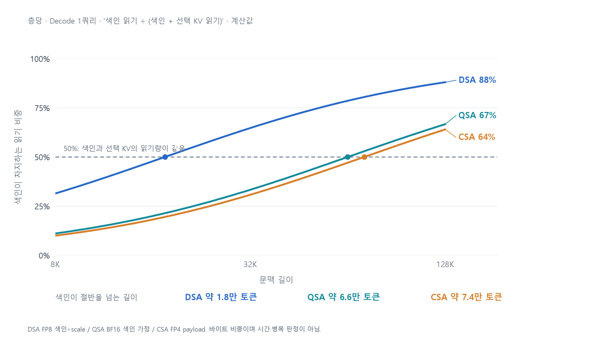
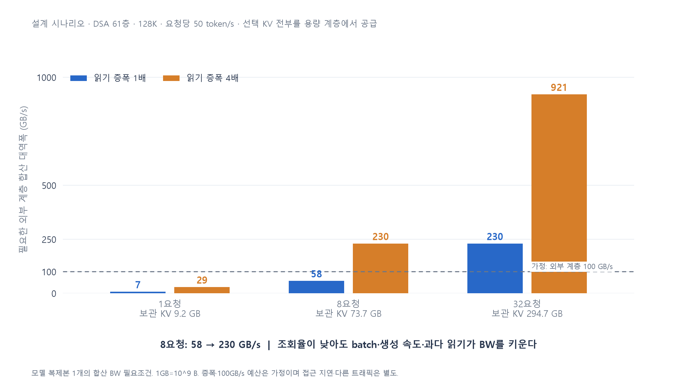
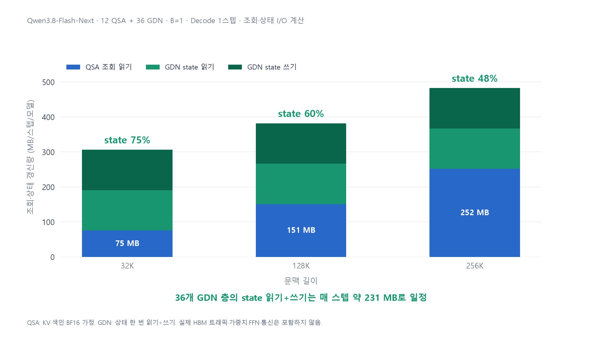
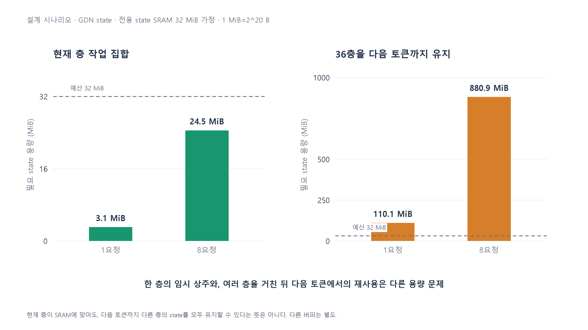

# Sparse·Hybrid Attention — 아키텍처 선택을 위한 네 가지 계산

**목표:** 문맥 길이·동시 요청·상태의 생존 범위를 숫자로 연결해, 어떤 설계 후보를 검토할지 좁힌다.

본문 6장 · 그래프 4개 · 수치는 공개 구성 기반 계산이며 실측 성능이 아니다. [계산·설계 가정](03-data-and-assumptions.md)

---

## 1. 같은 attention 계열이라도 HW가 맡을 동작은 다르다

| 계열 | 남기는 데이터 | 다음에 읽을 곳 | 먼저 살필 HW 동작 |
|---|---|---|---|
| **SWA** | 최근 구간의 KV | 미리 아는 최근 범위 | 원형 버퍼·순차 읽기 |
| **DSA** | 전체 KV + 토큰 색인 | query별 선택 뒤 확정 | 색인 스캔·top-k·토큰 gather |
| **QSA·블록 선택** | 전체 KV + 블록 색인/요약 | 선택한 블록 | 블록 gather·연속 전송 |
| **CSA** | 압축 KV + 색인 | 선택한 압축 엔트리 | 압축 생성·선택 조회 |
| **HCA** | 강하게 압축한 이력 | 압축 이력 전체 | 압축 생성·순차 읽기 |
| **GDN 등 고정 state** | 크기가 고정된 요약 상태 | 같은 state를 읽고 갱신 | 읽기-갱신-쓰기·온칩 재사용 |

- MoE처럼 **일부만 사용해도 전체 데이터를 보관**하는 구조가 있지만, KV는 요청마다 따로 쌓인다.
- Sparse는 **어디를 읽을지 찾는 비용**, Hybrid는 **요약 상태를 갱신하는 비용**을 함께 봐야 한다.
- 설계 질문은 세 가지다: **어느 길이에 맞출까? 몇 요청을 처리할까? 상태를 언제까지 유지할까?**

> 발표 멘트: “기법 이름마다 칩을 만들기보다, 실제로 수행해야 할 동작과 그 크기를 먼저 나누겠습니다.”

---

## 2. 계산 ① — 언제부터 KV보다 색인을 더 많이 읽나?

- 색인 읽기가 선택 KV보다 커지는 길이는 **DSA 약 1.8만, QSA 약 6.6만, CSA 약 7.4만 토큰**이다.
- 같은 **128K**에서도 색인 비중은 **DSA 88% / QSA 67% / CSA 64%**로 다르다.
- **설계 가설:** 목표 문맥 길이에 맞춰 selector와 KV 조회 경로의 자원을 배분하고, 단계별 시간으로 검증한다.

> 발표 멘트: “Sparse라고 모두 같은 병목은 아닙니다. 어느 길이를 주로 서비스하느냐에 따라 찾기와 가져오기 중 투자할 곳이 달라집니다.”

쿼리당 논리 읽기 바이트의 비교다. 50%는 시간 병목 전환점이 아니다. KV BF16, DSA FP8 색인+scale, QSA BF16 색인 가정, CSA FP4 payload.

---

## 3. 계산 ② — KV를 용량 계층으로 옮기려면 얼마의 BW가 필요한가?

- DSA·128K에서 요청 하나의 **본 KV는 9.2 GB**, 선택 KV 조회는 모델 전체에서 **약 144 MB/스텝**이다.
- **8요청 × 요청당 50 token/s**를 목표로 하면, 선택 KV 전부를 외부에서 공급하는 데 **58 GB/s**, 읽기 증폭 4배면 **230 GB/s**가 필요하다.
- 외부 계층 예산을 **100 GB/s**로 가정하면 후자의 경우 선택 KV 중 **최대 약 43%만 외부에서 공급 가능**하다.

> 발표 멘트: “큰 KV를 느린 메모리로 전부 내리자는 결론은 이릅니다. 동시 요청과 목표 속도로 필요한 대역폭을 먼저 계산하고, 일부 KV를 빠른 계층에 남길지 정해야 합니다.”

50 token/s·증폭 4배·100 GB/s는 설계 시나리오다. 단일 GPU 링크가 아닌 모델 복제본 전체의 합산 BW 필요조건이며, 접근 지연은 별도다. 43%는 보관 용량 비율이 아닌 선택 KV의 공급 비율이다.

---

## 4. 계산 ③ — Hybrid에서 줄지 않고 남는 I/O는 얼마인가?

- Qwen3.8-Flash-Next의 **128K·B=1** 사례에서 QSA 조회는 **151 MB**, GDN state 읽기+쓰기는 **231 MB/스텝**이다.
- 계산한 조회·상태 I/O 중 **약 60%가 state 갱신**이며, 32K에서는 이 비중이 **75%**다.
- **설계 가설:** KV 조회 최적화와 함께 state 갱신의 fusion·반복 읽기 감소를 별도 후보로 평가한다.

> 발표 멘트: “KV를 쌓는 층을 줄였다고 메모리 비용이 모두 줄어들지는 않습니다. 짧거나 중간 길이에서는 고정 state를 계속 고치는 일이 더 큰 데이터 이동이 될 수 있습니다.”

12 QSA + 36 GDN의 논리 I/O 모델. state를 한 번 읽고 한 번 쓰며, QSA KV·색인은 BF16 가정이다. 실제 HBM 트래픽·가중치·FFN·통신은 포함하지 않았다.

---

## 5. 계산 ④ — 한 층이 SRAM에 들어가면 다음 토큰도 공짜로 재사용하나?

- GDN state는 **층당 3.06 MiB/요청**이므로, 8요청의 현재 층 작업 집합은 **24.5 MiB**다.
- 하지만 36층을 거쳐 다음 토큰까지 모두 유지하려면 **1요청 110 MiB, 8요청 881 MiB**가 필요하다.
- **설계 가설:** 우선 현재 층의 갱신을 온칩에서 끝내고 한 번 기록하는 경로를 검토하며, 토큰 사이의 상주는 별도 용량으로 평가한다.

> 발표 멘트: “한 층을 처리하는 동안 SRAM에 맞는 것과, 다른 층을 모두 처리한 뒤 다음 토큰에서도 그대로 쓰는 것은 다른 문제입니다.”

32 MiB는 다른 activation·버퍼와 구분한 전용 state SRAM 예산의 가정이다. 양쪽 그래프의 세로축 범위가 다르다. 현재 층이 맞더라도 HBM 읽기·쓰기가 전부 사라지는 것은 아니다.

---

## 6. 제안 — 칩 이름보다 먼저 세 가지 설계 실험을 정한다

| 후보 | 구체적인 아이디어 | 이번 계산이 주는 조건 | 검증할 것 |
|---|---|---|---|
| **길이에 맞춘 선택 경로** | 스캔·점수 집계·top-k를 결합하고 selector/gather 자원을 따로 배분 | 색인 비중의 전환 길이가 방식별로 다름 | 길이별 선택 지연·중간 메모리 쓰기·연산 처리량 |
| **동시 요청에 맞춘 KV 계층** | 색인은 빠른 계층에 두고, KV 일부를 빠른 계층에 유지하며 선택 주소로 prefetch | 필요 BW는 **동시 요청 × 생성 속도 × 읽기 증폭**에 비례 | 외부 공급률·전송 지연·읽기 증폭·단계 간 중첩 |
| **수명에 맞춘 state 처리** | 현재 층 state 갱신을 SRAM에서 결합하고, 토큰 사이 유지용 공간은 별도 설계 | **현재 층 작업 집합 ≠ 전체 층의 상주량** | state 실제 HBM 왕복·SRAM 점유·요청 묶음 크기 |

- 같은 모델·선택 결과·정밀도를 고정하고, **일반 GPU 실행 대비 어떤 이동과 시간이 줄었는지** 비교한다.
- 외부 BW가 부족하면 KV를 더 남기고, state 예산이 부족하면 요청 묶음과 가중치 재사용의 균형을 조정한다.
- 최종 판단은 **attention/state 경로의 이득이 모델 전체 생성 시간에 얼마나 남는지**로 한다.

> 발표 멘트: “목표 길이, 동시 요청, 상태의 생존 범위를 먼저 정하면 설계 후보의 성립 조건과 기각 조건을 숫자로 좁힐 수 있습니다.”

---

근거·재현: [계산 노트](03-data-and-assumptions.md) · [계산 데이터](data/architecture-tradeoffs.json) · [분석 코드](analysis/architecture_tradeoffs.py) · [그래프 생성기](figures/make_tradeoff_figures.py). 네 그래프는 위 식과 공개 config에서 계산해 새로 작성했다.
