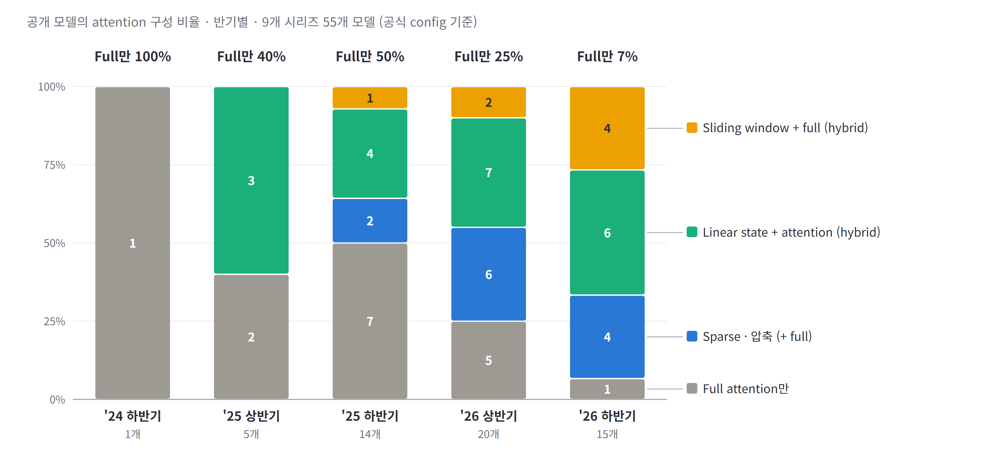
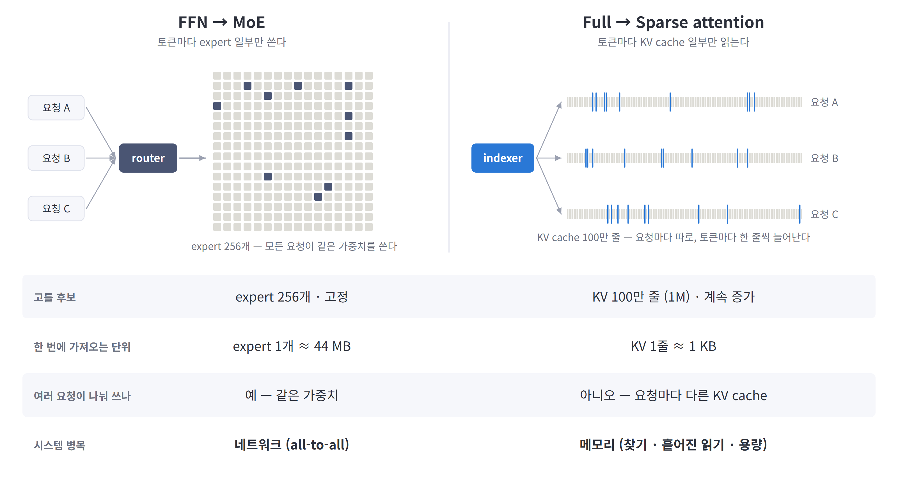
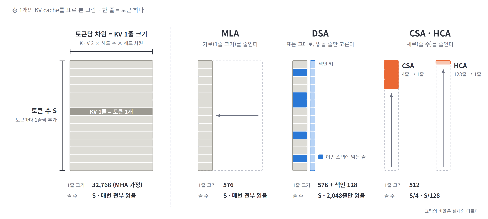
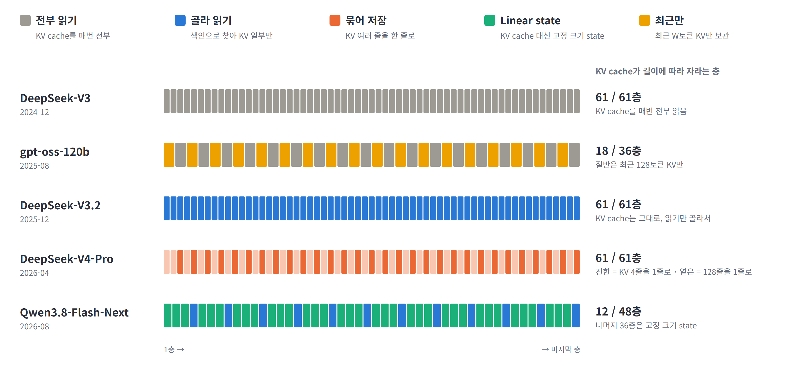
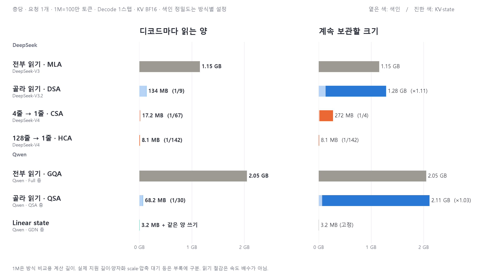
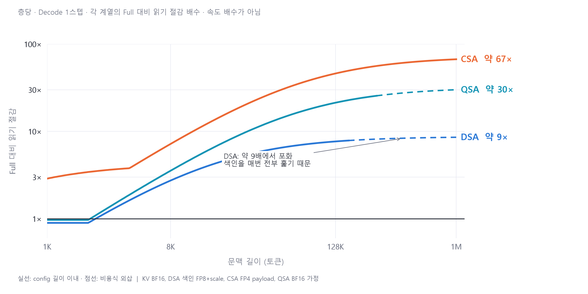
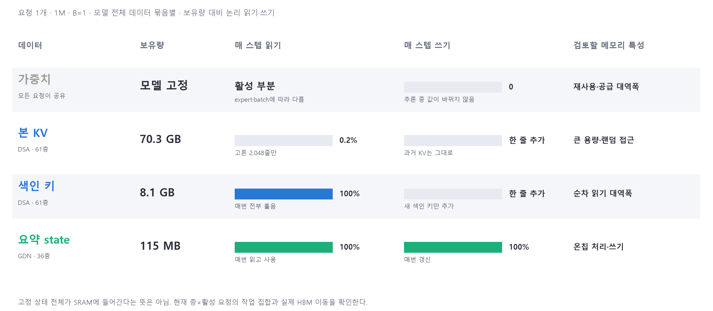

# Sparse · Hybrid Attention — KV cache의 변화가 요구하는 차세대 아키텍처

차세대 아키텍처 탐색을 위한 정량 분석 · 2026-11

> **요약 + 본문 8장.** `---`가 슬라이드 구분이다. 장마다 그림·핵심 문장 3개·짧은 발표 멘트로 구성했다. 계산식과 세부 조건은 [근거 노트](03-data-and-assumptions.md)에 두었다.

---

## 요약 · 무엇이 바뀌고, 무엇을 검토해야 하나

| 질문 | 핵심 인사이트 |
|---|---|
| **무엇이 바뀌었나?** | KV를 **골라 읽고, 묶어 저장하고, 일부 층은 요약 state로 대체**한다. 조사한 2026 하반기 공개 모델 15개 중 14개가 sparse·압축·window·state 혼합을 사용한다. |
| **무엇이 줄었나?** | **덜 읽기와 적게 보관하기는 별개**다. DSA·QSA는 읽기를 크게 줄여도 전체 KV와 색인을 보관한다. |
| **HW는 무엇을 봐야 하나?** | **큰 KV를 보관할 용량, 색인을 찾고 KV를 가져오는 경로, state를 읽고 갱신하는 경로**를 나눠 검토한다. |

---

## 1 · 왜 지금 이 구조를 봐야 하나?

### 조사 모델에서는 ‘모든 층에서 과거 전체 읽기’가 소수가 됐다

- 조사 표본의 Full-only 비중은 **2025 상반기 40% → 2026 하반기 7%**로 낮아졌다.
- 2026 하반기 15개 중 **sparse·압축 4개, state 혼합 6개, window 혼합 4개**다.
- 같은 GPU에서 돌려도 **색인 검색·선택 조회·고정 상태 갱신**이라는 서로 다른 동작을 지원해야 한다.

> 발표 멘트: “단순히 attention을 빠르게 계산하는 문제에서, 어떤 과거를 남기고 어떻게 읽을지의 문제로 바뀌고 있습니다.”

9개 시리즈 55개 공개 모델의 기존 조사 표본. 시장 전체 점유율은 아니다. [분류와 원본 데이터](../reports/llm-memory-requirements.md), [집계 검산](data/revised-deck-summary.json)

---

## 2 · 익숙한 MoE에 빗대면?

### MoE는 전문가를, Sparse attention은 읽을 KV를 고른다

- 공통점은 **일부만 골라 사용해도, 고르지 않은 데이터까지 보관**한다는 것이다.
- MoE의 전문가 가중치는 요청들이 공유하지만, **과거 KV는 요청마다 따로 쌓이고 길이에 따라 후보가 늘어난다.**
- 분산 MoE에서는 통신·부하 분산을, sparse attention에서는 **색인 검색·흩어진 읽기·용량**을 주요 부담으로 확인한다.

> 발표 멘트: “큰 전문가 몇 개를 함께 쓰는 구조에서, 요청마다 다른 작은 KV 조각을 수천 개 찾아오는 구조로 생각하시면 됩니다.”

그림은 DeepSeek-V3의 대표 구성 예시다. expert 1개 약 44 MB(FP8), MLA KV 한 줄 1,152 B(BF16·층당). 그림의 병목 표기는 대표적인 시스템 부담이며, 실제 지배 단계는 실행 조건에 따라 달라진다.

---

## 3 · KV cache를 어느 방향으로 줄이나?

### ‘한 줄의 폭’, ‘읽는 줄’, ‘저장하는 줄 수’를 각각 줄인다

- **MLA는 가로를 줄인다:** 헤드별로 펼친 KV 대신 작은 latent를 저장한다.
- **DSA는 읽는 줄만 고른다:** 전체 KV는 남기고, 색인으로 찾은 2,048줄만 본 attention에 사용한다.
- **CSA·HCA는 세로를 줄인다:** 4줄·128줄을 한 엔트리로 묶어, 쌓이는 이력 자체를 줄인다.

> 발표 멘트: “KV를 표로 보면 간단합니다. 폭을 줄이는 것, 읽을 줄을 고르는 것, 줄 수를 줄이는 것은 서로 다른 효과입니다.”

DSA의 색인은 별도 저장·조회한다. QSA는 KV 본체 대신 색인 키만 4토큰씩 묶고 원본 KV를 읽는다. [세미나 §4](../seminar/01-attention-seminar_sum_ver.md), [CSA/HCA 원문 §2.3](https://arxiv.org/html/2606.19348v1)

---

## 4 · 모델 전체에서는 어떻게 섞나?

### 한 모델 안에 ‘전부 읽기·골라 읽기·상태 갱신’이 함께 들어온다

- **DeepSeek-V3.2:** 61층 모두 KV를 보관하면서, 매번 읽을 위치만 고른다.
- **DeepSeek-V4-Pro:** CSA 30층과 HCA 31층으로, **촘촘하게 일부 조회와 거칠게 전체 조회**를 섞는다.
- **Qwen3.8-Flash-Next:** 48층 중 **12층만 원본 KV를 쌓고**, 36층은 고정 크기 state를 갱신한다.

> 발표 멘트: “막대 하나가 층 하나입니다. 이제 한 칩이 서로 다른 메모리 동작을 번갈아 처리해야 합니다.”

공식 config의 backbone 층만 집계, MTP 제외. V4의 HCA는 압축 이력에 대한 dense 조회다. [층별 파라미터 근거](03-data-and-assumptions.md)

---

## 5 · 실제로 얼마나 덜 읽고, 얼마나 덜 보관하나?

### 골라 읽기는 읽기를 줄이고, 묶어 저장은 용량까지 줄인다

- **DSA:** 읽기 **1.15 GB → 134 MB(약 1/9)**, 보관량은 색인 때문에 **1.28 GB로 증가**한다.
- **QSA:** 읽기 **2.05 GB → 68 MB(약 1/30)**, 보관량은 **2.11 GB로 거의 그대로**다.
- **CSA·HCA:** 압축 이력을 저장해 보관량도 줄이며, **고정 state는 길이와 무관하지만 매번 읽고 다시 쓴다.**

> 발표 멘트: “왼쪽의 읽기 막대가 짧아져도 오른쪽 용량 막대는 그대로일 수 있습니다. HBM 대역폭을 아꼈다고 긴 KV를 담을 메모리가 사라지지는 않습니다.”

층당·1M=100만 토큰·계산값. KV BF16, 색인은 방식별 정밀도. 옅은 부분은 색인이다. 1M은 구조 비교 길이이며 지원 길이 밖 계산도 포함한다. [수치·제외 항목](03-data-and-assumptions.md)

---

## 6 · 길어질수록 계속 이득이 커지나?

### 읽기 절감에도 ‘찾는 비용’이 정하는 천장이 있다

- **짧으면 선택 비용의 비중이 크다:** DSA는 8K에서 읽기 약 2.7배 절감, 2K 이하에서는 오히려 조금 더 읽는다.
- **길어도 일정 배수에서 포화한다:** 현재 가정의 상한은 DSA 약 9배·QSA 32배·CSA 72배이며, 색인을 계속 훑기 때문이다.
- 다음 개선 대상은 **색인 압축, 블록 색인, 여러 층의 선택 결과 재사용**이다.

> 발표 멘트: “오른쪽으로 갈수록 선이 평평해집니다. 본 KV를 적게 읽어도, 어디를 읽을지 찾는 비용은 계속 늘기 때문입니다.”

각 계열의 Full 대비 논리 읽기 절감이며 속도 배수가 아니다. 실선은 config 범위, 점선은 비용식 외삽. [비용식·정밀도](03-data-and-assumptions.md)

---

## 7 · 그래서 메모리를 어떻게 나눠 봐야 하나?

### 큰 KV·매번 훑는 색인·계속 고치는 state의 요구가 다르다

- **본 KV:** 70 GB를 보관하지만 매번 약 **0.2%만 조회**하므로, 큰 용량 계층과 랜덤 접근 경로를 함께 검토한다.
- **색인 키:** 약 8 GB를 **매번 전부 훑으므로**, 스캔 대역폭과 선택 처리량이 중요하다.
- **요약 state:** 길이는 고정이지만 **매번 읽고 갱신하므로**, 온칩 재사용과 쓰기 경로를 검토한다.

> 발표 멘트: “같은 읽기 위주 데이터라도, 매번 전부 읽는 색인과 일부만 읽는 큰 KV는 다르게 다룰 여지가 있습니다.”

본 KV·색인은 DSA 61층, state는 Qwen GDN 36층의 합이다. state 약 115 MB 전체가 SRAM에 들어간다는 뜻은 아니며 현재 층·활성 요청의 작업 집합을 산정한다. 비율은 물리 BW 사용률이 아니다.

---

## 8 · 차세대 아키텍처에서 무엇을 검토하나?

### 용량·찾기·가져오기·갱신을 분리해, 효과가 큰 경로부터 좁힌다

| 워크로드 | 주로 확인할 부담 | 아키텍처 검토 방향 |
|---|---|---|
| Prefill | 많은 쿼리의 행렬 연산 | 연산 처리량·타일 재사용 |
| Decode | 가중치·KV 데이터 공급 | 메모리 대역폭·요청 병렬성 |
| 분산 MoE | 전문가 간 전달·부하 불균형 | 네트워크·통신 중첩·스케줄링 |
| **Sparse attention** | **색인 검색·흩어진 KV 읽기·보관 용량** | **메모리 계층 + 선택·gather 경로** |
| **Hybrid state** | **상태 읽기·갱신·쓰기** | **온칩 재사용 + 갱신 연산 결합** |

1. **계층형 KV 메모리:** 색인은 빠른 계층에, 큰 KV는 용량 계층에 둘 때의 지연·전송량을 평가한다.
2. **메모리 근처 선택 처리:** 색인 스캔·점수 집계·top-k를 결합하고, 필요한 연산 처리량까지 산정한다.
3. **gather·state 경로:** 선택 주소 기반 DMA·prefetch와 state 읽기-갱신-쓰기를 지원한다.

> 발표 멘트: “어떤 칩이 무조건 맞는지보다, 네 가지 비용 중 무엇이 실제 시간을 쓰는지 재서 다음 설계 후보를 좁히는 것이 목표입니다.”

**다음 단계:** 색인 / top-k / gather / attention / state 갱신의 시간과 실제 메모리 이동량을 나눠 측정한다.

---

근거·재현: [계산 노트](03-data-and-assumptions.md) · [현재 수치 CSV](data/revised-deck-costs.csv) · [그림 생성기](figures/make_revised_figures.py). 추이·개념·층 구성 그림은 [Claude 자료](02-deck-draft-claude.md)의 표현을 재사용했고, 읽기·저장·메모리 동작 그림은 다시 구성했다.
