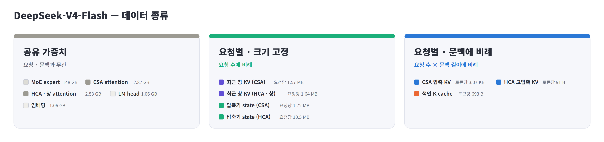
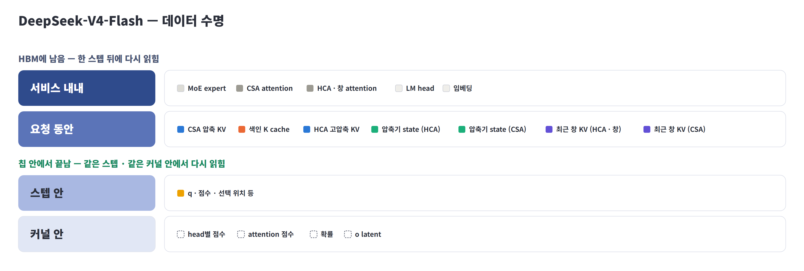
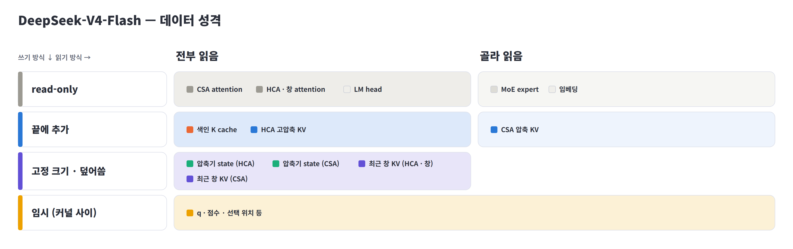
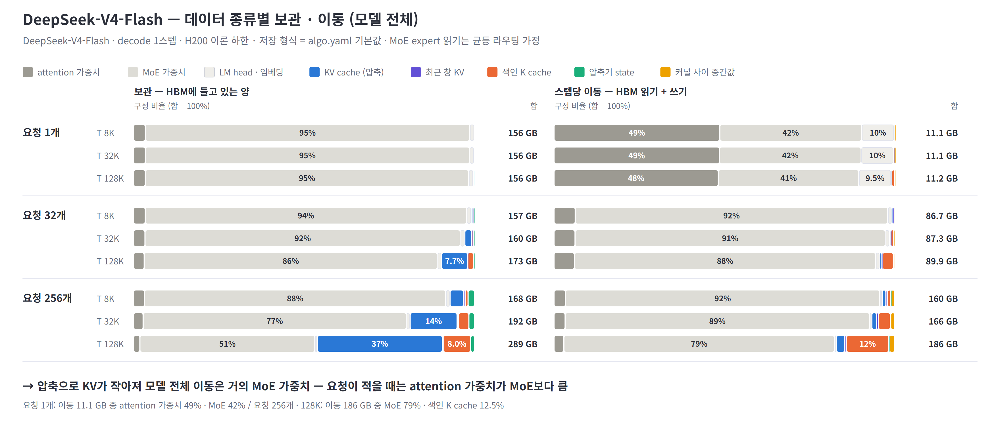
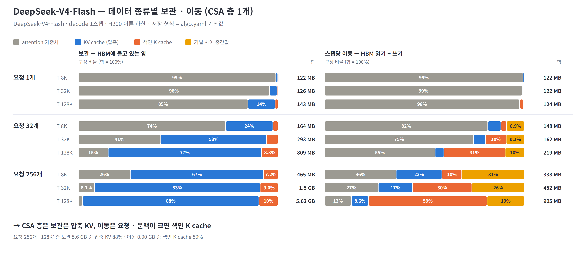
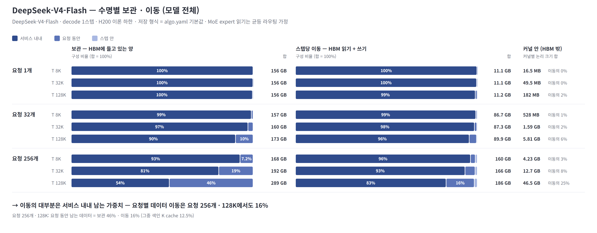
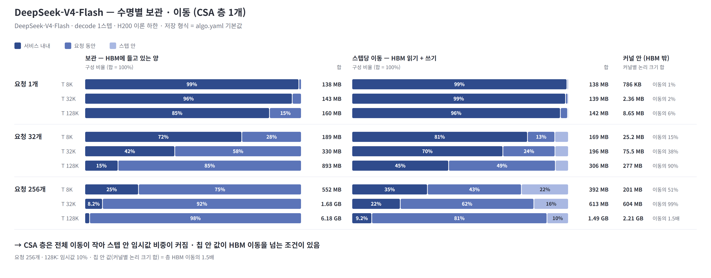
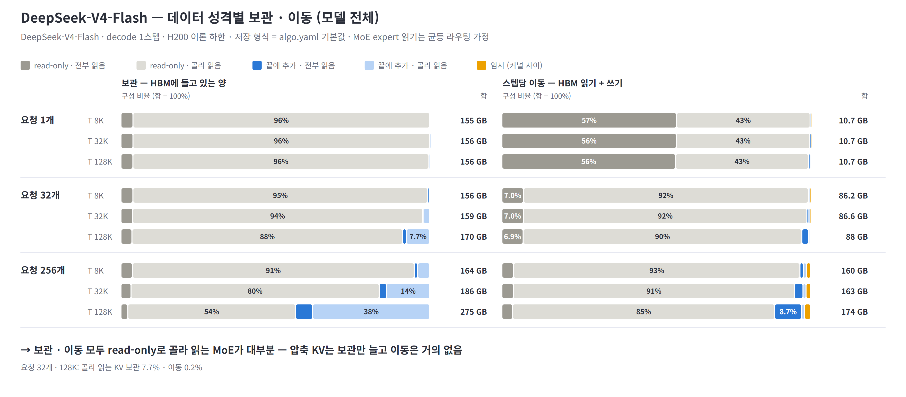
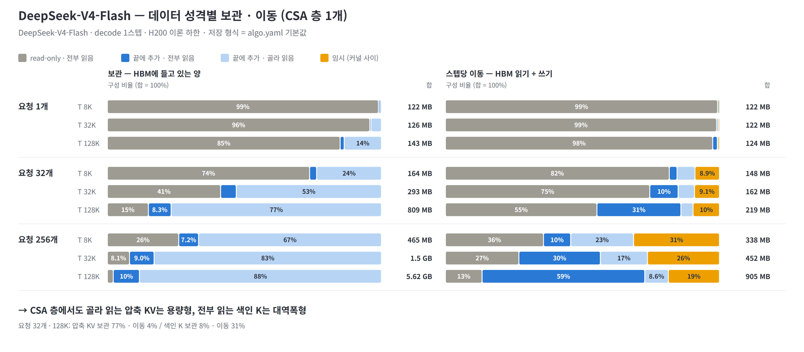
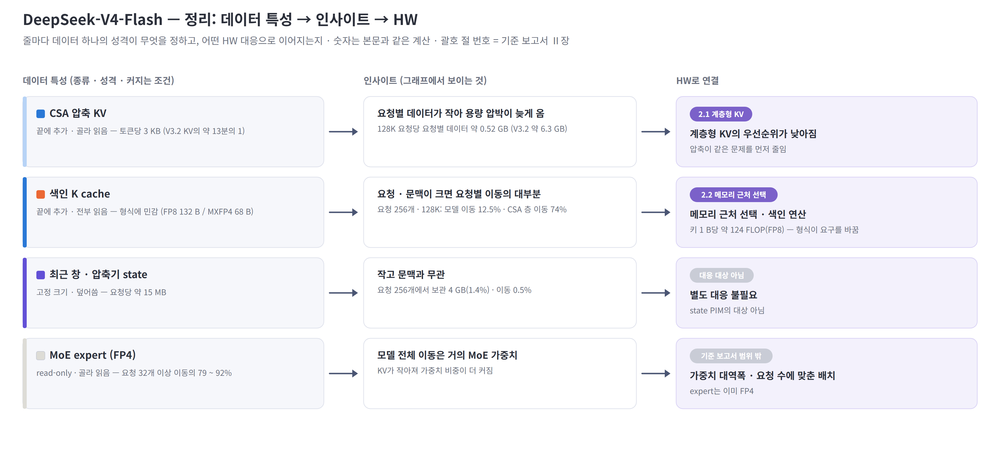

# DeepSeek-V4-Flash (CSA · HCA) — 데이터 성격으로 본 decode 1스텝

모델별 보고서 ② Sparse (압축 + 선택) · 2026.11 · 약식 화면 "데이터 성격 한눈에"를 요청 수 · 문맥 길이로 펼쳐 본 것

기준: H200 (HBM 4.8 TB/s · L2 50 MB) · decode 1스텝 · 43층 = 창 2 + CSA 21 + HCA 20 · attention FP8 · routed expert FP4 · KV 엔트리 584 B · 색인 키 FP8 132 B(vLLM 기본) · 압축기 wkv · wgate BF16 · 압축기 state FP32(공개 참조 구현 버퍼) · 이론 하한. 압축 엔트리 · 색인 키 쓰기는 4 · 128토큰마다 1줄이라 스텝당 몫(여러 스텝 평균)으로 나눠 셈. **참조 구현 검증 없음** — config · 체크포인트 shape · 공개 inference 코드로 세운 식. 요청 256개 · 128K는 보관 289 GB로 H200 2장(282 GB)을 넘음 — 이동량은 같은 조건의 바이트 비교로만 읽음. 화면: [CSA 약식](https://kimhyeon-ji.github.io/llm-arch-lineage-wiki/arch_insight/dataflow-claude/viewer/csa-v4flash-lite.html) · 수치: [tools/traits.py](../tools/traits.py) · 그림: [make_traits_report.py](make_traits_report.py) · HW 대응: [기준 보고서](../../sparse-hybrid-hw-report-v2-refined.md) Ⅱ장

---

## 요약

### KV를 4 · 128토큰 단위로 압축해 요청별 cache 이동이 작아짐 — 모델 전체 이동은 거의 MoE 가중치, CSA 층 안에서는 색인 K cache가 대역폭을 씀

| 조건 | HBM에 가장 많이 들고 있는 것 | 매 스텝 가장 많이 옮기는 것 (모델 전체) | CSA 층 안에서 가장 많이 옮기는 것 |
|---|---|---|---|
| **요청이 적을 때** | 가중치 (대부분 FP4 MoE expert) | attention 가중치와 MoE 가중치가 비슷 | attention 가중치 |
| **요청이 많을 때** | 가중치, 그다음 압축 KV | MoE 가중치 | attention 가중치, 문맥이 길면 색인 K cache |
| **요청 · 문맥이 모두 클 때** | 가중치, 압축 KV가 가중치에 가까워짐 | MoE 가중치, 그다음 색인 K cache | 색인 K cache |

- **요청이 적을 때:** FP4 expert 6개만 읽어 MoE 읽기가 작음 → FP8 attention 가중치와 BF16 압축기 가중치가 MoE보다 큼
- **요청이 늘수록:** 건드리는 expert가 늘어 MoE 가중치가 이동의 대부분. 요청 · 문맥이 모두 크면 요청별 데이터 이동이 커지는데, 그 대부분은 매 스텝 전부 읽는 색인 K cache
- **문맥이 길수록:** 압축 KV 보관은 커지지만 읽기는 거의 그대로 (CSA는 512엔트리만, HCA는 128토큰을 1줄로 압축)
- **CSA 층 안:** 보관은 압축 KV(용량형), 이동은 색인 K cache(대역폭형) — DSA와 같은 갈림이 훨씬 작은 크기로 남음
- **칩 안 값 · 임시값:** CSA 층의 HBM 이동이 작아져 상대 비중이 커짐 — 칩 안 값(커널별 논리 크기 합)이 층 HBM 이동보다 커지는 조건이 있음
- **HW 방향:** 모델 전체로는 MoE 가중치의 대역폭 · 배치, CSA 층 안 색인은 DSA보다 작지만 같은 대응 (각 절 끝 'HW로 발전시킬 포인트')

---

## 데이터를 나누는 세 가지 기준

### 같은 데이터를 '무엇인가 · 얼마나 오래 남나 · 어떻게 읽고 쓰나'로 나눔 — 각각 무엇이 자원을 쓰는지 · 어디에 둘 수 있는지 · 어떤 메모리 특성이 필요한지를 알려 줌

| 기준 | 묻는 것 | 나누는 값 | 이걸로 알 수 있는 것 |
|---|---|---|---|
| **데이터 종류** | 무엇인가 | 가중치 · 압축 KV · 최근 창 KV · 색인 K cache · 압축기 state · 중간값 | 어떤 데이터가 HBM 용량과 대역폭을 쓰는지 |
| **수명** | 얼마나 오래 남고, 언제 다시 읽히나 | 서비스 내내(가중치) · 요청 동안(cache) · 스텝 안(커널 사이 값) · 커널 안(칩 안에서만) | **어디에 둘 수 있는지.** 한 스텝 뒤에 다시 읽히는 값은 칩 안에 못 남음 → HBM이나 더 큰 메모리. 다음 커널이 바로 읽는 값은 칩 안에서 끝낼 수 있음 |
| **데이터 성격** | 어떻게 읽고 쓰나 | read-only · 끝에 추가 · 고정 크기 · 덮어씀 · 매 스텝 전부 다시 씀 · 임시, 그리고 전부 읽음 · 골라 읽음 | **어떤 메모리 특성이 필요한지.** 골라 읽는 데이터는 용량, 매번 전부 읽는 데이터는 대역폭, 다시 쓰는 데이터는 쓰기 대역폭이나 메모리 안 갱신 |

### 기준 1. 데이터 종류 — 무엇이 무엇에 비례해 커지나

- **나누는 법:** HBM에 남는 데이터를 커지는 조건으로 셋 — 공유 가중치(요청 · 문맥과 무관) · 요청별 크기 고정(요청 수에 비례) · 요청별 문맥 비례(요청 수 × 문맥 길이)
- **이 모델에서:** 공유 가중치 156 GB(그중 FP4 MoE 148 GB) · 크기 고정 = 최근 창 KV · 압축기 state 요청당 약 15 MB · 문맥 비례 = 압축 KV 토큰당 3.2 KB + 색인 K 0.7 KB → 128K면 요청당 약 0.5 GB
- **이걸로 알 수 있는 것:** 토큰당 바이트가 V3.2(48 KB)의 약 12분의 1 → 긴 문맥 · 많은 요청에서도 요청별 데이터가 작음. 크기 고정 데이터는 압축 때문에 생긴 작은 버퍼 (1장)

### 기준 2. 수명 — 얼마나 오래 남고, 언제 다시 읽히나

- **나누는 법:** 서비스 내내 · 요청 동안 · 스텝 안 · 커널 안. 다시 읽히기까지의 시간이 둘 곳을 정함 — 한 스텝 뒤에 다시 읽히는 값은 그사이 모델 전체(전 층 + MoE)가 지나가 칩 안(L2 50 MiB)에 못 남음
- **이 모델에서:** 요청 동안 = 압축 KV · 색인 K · 최근 창 · 압축기 state · 스텝 안 = q · 점수 · 선택 위치 · 커널 안 = head별 점수 · attention 점수 · 확률 · o latent
- **이걸로 알 수 있는 것:** 요청 동안 데이터가 작아 모델 이동의 대부분이 서비스 내내 가중치 → SRAM 증설로 줄일 몫이 작음. CSA 층 안에서는 커널 안 값이 상대적으로 큼 (2장)

### 기준 3. 데이터 성격 — 어떻게 쓰고 읽나

- **나누는 법:** 쓰기 방식 다섯(read-only / 끝에 추가 / 고정 크기 · 덮어씀 / 매 스텝 전부 다시 씀 / 임시) × 읽기 방식 둘(전부 읽음 / 골라 읽음). 칸마다 필요한 메모리 특성이 다름
- **이 모델에서:** 골라 읽음 = CSA 압축 KV · 전부 읽음 = 색인 K · HCA 고압축 KV · 고정 크기 · 덮어씀 = 최근 창 · 압축기 state · 매 스텝 다시 쓰는 데이터 없음
- **이걸로 알 수 있는 것:** DSA의 두 칸 갈림(용량형 KV · 대역폭형 색인)을 유지하고 '덮어씀' 칸이 새로 생김 — 작고 크기 고정이라 부담 적음 (3장)

### 그래프 읽는 법

- **그래프 막대:** 왼쪽 = 보관(용량 요구), 오른쪽 = 스텝당 이동(대역폭 요구). 보관에서 크고 이동에서 작으면 용량형, 반대면 대역폭형
- **조건:** 요청 1 · 32 · 256개 × 문맥 8K · 32K · 128K. 범위는 모델 전체(43층 + MoE · LM head) / CSA 층 1개
- **골라 읽음:** 요청 1개 · 128K에서 스텝당 읽기가 보관의 90% 미만인 데이터 — MoE expert · CSA 압축 KV · 임베딩. HCA KV · 색인 K는 전부 읽음. 기준 조건의 라벨이라 요청이 많으면 MoE도 대부분을 읽음 (화면 표에 지금 조건의 읽는 비율)
- **고정 크기 · 덮어씀:** 최근 창 KV(128줄 ring buffer) · 압축기 state — 매 스텝 1줄을 덮어쓰고, 창은 전부 · 압축기 state는 4 · 128토큰마다 읽음

---

## 1. 데이터 종류 — 무엇이 용량과 대역폭을 쓰나

### 1.1 모델 전체 — 압축 KV는 보관에서만 보이고, 이동은 거의 MoE 가중치

- **요청이 적을 때:** 이동의 절반이 attention 가중치(FP8 + 압축기 BF16), 4할이 MoE(FP4) — expert를 4비트로 줄인 효과
- **요청이 늘수록:** 건드리는 expert가 늘어 MoE 가중치가 이동의 79 ~ 92% (요청 32개 이상)
- **압축 KV는 보관에서만 커짐:** 요청 256개 · 128K에서 보관의 37%, 이동은 3% 미만
- **색인 K cache:** 요청 256개 · 128K에서 이동의 12.5% — DSA(27%)의 절반 수준. 색인 키 형식에 민감함(FP8 132 B 기준, MXFP4 68 B면 약 절반)
- **압축기 state:** 요청당 약 12 MB(FP32 버퍼) → 요청 256개에서 3.1 GB, 이동은 작음

### 1.2 CSA 층 1개 — 보관은 압축 KV, 이동은 요청 · 문맥이 크면 색인 K cache

- **요청이 적을 때:** attention 가중치가 층 이동의 거의 전부
- **요청 · 문맥이 커질수록:** 색인 K cache 이동 비중이 커짐 — 요청 256개 · 128K에서 74%
- **압축 KV는 요청 32개 이상 · 128K에서 층 보관의 69 ~ 79%이지만 이동은 작음**
- **요청별 데이터 이동이 가중치 이동을 넘는 시점이 늦음:** 문맥 128K에서 요청 29개부터 (DSA 12개)

**HW로 발전시킬 포인트**
- **모델 전체는 MoE 가중치 대역폭:** expert는 이미 FP4 → 남은 것은 요청 수에 따라 expert를 배치하는 계층형 가중치 (기준 보고서 범위 밖)
- **압축 KV는 용량형이지만 이미 작음:** 128K에서 요청당 요청별 데이터 약 0.52 GB(DSA는 약 6.3 GB) → 계층형 KV (2.1)의 우선순위가 낮아짐
- **색인 K cache는 대역폭형:** 메모리 근처 선택 (2.2) · 색인 연산 (2.3) 대상. 키 바이트 기준 내적 강도는 FP8 132 B에서 키 1 B당 약 124 FLOP(DSA와 같은 수준), MXFP4 68 B면 약 241 FLOP(기준 보고서의 256은 스케일을 뺀 64 B 기준) — top-k · gather 비용은 따로

---

## 2. 데이터 수명 — 어디에 둘 수 있나

> **읽는 법:** 수명과 '다시 읽히기까지 걸리는 시간'이 둘 곳을 정함. 한 스텝 뒤에 다시 읽히는 가중치 · cache는 칩 안에 못 남음 → HBM이나 그 아래 메모리. 다음 커널이 바로 읽는 스텝 안 임시값은 칩 안에서 끝낼 수 있는 몫. 커널 안 값은 지금 칩 안에서 처리해 HBM을 아끼고 있는 몫

### 2.1 모델 전체 — 이동은 서비스 내내 남는 가중치, 요청 동안 남는 cache는 보관에서만 커짐

- **서비스 내내 가중치가 이동의 83 ~ 100%:** 요청별 데이터 이동은 요청 256개 · 128K에서도 16% (그중 색인 K cache 12.5% · 압축 KV 2.5%)
- **요청 동안 남는 데이터는 보관에서 크게 커짐:** 요청 256개 · 128K에서 보관의 46%
- **칩 안 값은 작음:** 모델 전체 이동의 0.25배 이하 (커널별 논리 크기 합 — 동시 점유량 아님)

### 2.2 CSA 층 1개 — 층 이동이 작아 임시값 비중이 커지고, 칩 안 값이 HBM 이동을 넘는 조건이 있음

- **요청 32개 이상에서 스텝 안 임시값이 층 이동의 6 ~ 22%:** 층 이동 자체가 작아 q(head 64개 × 512) · 출력 벡터 · 점수가 상대적으로 커짐 (최근 창은 요청 동안 남는 데이터로 따로 셈)
- **칩 안 값이 층 HBM 이동의 최대 1.5배(요청 256개 · 128K):** 대부분 색인 head별 점수(head 64개 × 압축 엔트리)의 논리 크기

**HW로 발전시킬 포인트**
- **가중치가 이동의 대부분:** 한 스텝 뒤에 다시 읽히는 데이터라, 이 계산 범위에서는 SRAM을 늘려 줄일 수 있는 HBM 이동이 작음 → 가중치 대역폭 · 배치 (2.5)
- **임시값 비중이 큰 층:** 커널 합치기 · L2 상주 보장의 상대 효과가 DSA보다 큼
- **색인을 메모리 근처로 옮긴다면 head 가중합까지 같은 쪽에서:** head별 점수의 논리 크기가 층 HBM 이동보다 커지는 조건이 있음 → 나눠 처리하면 링크 부담이 커질 수 있음 (2.2 · 2.3). 실제 부담은 타일 크기 · 동시성으로 따로 계산 필요

---

## 3. 데이터 성격 — 어떤 메모리 특성이 필요한가

> **읽는 법:** 골라 읽는 데이터는 대부분 쉬고 있음 → 큰 용량에 두고 고른 것만 빠르게 가져오는 구조가 맞음. 매번 전부 읽는 데이터는 대역폭이 시간을 정함. 매 스텝 다시 쓰는 데이터는 쓰기 대역폭이나 메모리 안 갱신이 필요. read-only는 압축 · 복제 · 저정밀의 자유도가 큼

### 3.1 모델 전체 — 보관 · 이동 모두 read-only로 골라 읽는 MoE가 대부분

- **read-only · 골라 읽는 MoE가 보관 · 이동 모두 대부분**
- **CSA 압축 KV는 끝에 추가 · 골라 읽음:** 보관은 커져도 이동은 거의 없음 (요청 256개 · 128K: 보관 36% · 이동 0.9%)
- **HCA KV · 색인 K는 끝에 추가 · 전부 읽음:** 보관은 작아도 이동에서 커짐 (요청 256개 · 128K: 보관 9% · 이동 14%)
- **고정 크기 · 덮어씀(최근 창 · 압축기 state)이 새로 등장:** 요청 256개에서 약 4 GB(보관의 1.4%), 이동은 0.5%
- **매 스텝 전부 다시 쓰는 데이터는 없음**

### 3.2 CSA 층 1개 — 골라 읽는 압축 KV는 용량형, 전부 읽는 색인 K는 대역폭형

- **DSA와 같은 갈림:** 압축 KV는 보관의 대부분 · 이동은 작음, 색인 K는 보관은 작음 · 이동은 큼 (요청 32개 · 128K: 압축 KV 보관 69% · 이동 3% / 색인 K 보관 16% · 이동 45%)
- **요청이 적을 때는** read-only 가중치가 이동의 대부분

**HW로 발전시킬 포인트**
- **압축으로 용량형 KV가 작아짐:** 계층형 KV의 필요성이 줄어듦. HCA는 gather 없이 연속으로 읽어 대역폭만 필요
- **전부 읽는 색인 K:** 메모리 근처 선택 (2.2) · 색인 연산 (2.3). 색인 키를 FP4로 낮추면 이동이 약 절반 — 형식 선택이 HW 요구를 바꿈
- **MoE:** FP4로 이미 작아 계층형 가중치의 이득도 DSA보다 작음
- **덮어쓰는 압축기 state:** 요청당 약 12 MB · 이동이 작아 state 갱신 PIM(2.4)의 대상은 아님. 용량은 요청 수에 비례

---

## 정리 — 데이터 특성 → 인사이트 → HW

### 압축으로 요청별 데이터가 작아져 이동은 다시 가중치 문제 — 남는 것은 색인

| 데이터 | 특성 (성격 · 커지는 조건) | 근거 (조건 · 수치) | 인사이트 | HW로 연결 | 기준 보고서 Ⅱ장 |
|---|---|---|---|---|---|
| CSA 압축 KV | 끝에 추가 · 골라 읽음 · 토큰당 3.2 KB | 128K 요청당 요청별 데이터 약 0.52 GB (V3.2 약 6.3 GB) | 용량 압박이 늦게 옴 | 계층형 KV의 우선순위 낮음 | 2.1 |
| 색인 K cache | 끝에 추가 · 전부 읽음 · 형식에 민감 | 요청 256개 · 128K: 모델 이동 12.5% · CSA 층 이동 74% | 요청 · 문맥이 크면 요청별 이동의 대부분 | 메모리 근처 선택 · 색인 연산 (키 1 B당 약 124 FLOP, FP8) | 2.2 · 2.3 |
| 최근 창 · 압축기 state | 고정 크기 · 덮어씀 · 요청당 약 15 MB | 요청 256개: 보관 4 GB(1.4%) · 이동 0.5% | 작고 문맥과 무관 | 별도 대응 불필요 | — |
| MoE expert (FP4) | read-only · 골라 읽음 | 요청 32개 이상 이동의 79 ~ 92% | 모델 전체 이동은 거의 MoE | 가중치 대역폭 · 요청 수에 맞춘 배치 | 범위 밖 |

- **확인할 것:** 배포 엔진의 색인 키 형식(FP8 132 B / MXFP4 68 B)과 압축기 state 형식 — 둘 다 이동 · 용량 결론을 바꿈

---

## 부록 — 계산 기준

- **CSA 층:** [csa-v4flash/algo.yaml](../models/csa-v4flash/algo.yaml) · [map-gpu.yaml](../models/csa-v4flash/map-gpu.yaml). 압축기 wkv · wgate = 체크포인트 BF16 [1024 × 4096] · 색인 [256 × 4096] 각 2장. KV 584 B(448 FP8 + RoPE 64 BF16 + scale 7 + pad 1) · 색인 키 132 B는 vLLM 형식. 압축기 state(kv · score FP32 [8 × 1024] · 색인 [8 × 256], HCA [128 × 512])는 공개 참조 구현 버퍼 크기 — 엔진마다 다를 수 있음
- **모델 전체:** [model.yaml](../models/csa-v4flash/model.yaml). HCA 20층 · 창 2층은 식. MoE 43층(expert 256개 중 6개 + 공유 1개), routed FP4(+ scale) · shared FP8, LM head · 임베딩 BF16
- **수명 · 성격 판정:** [dsa-v32-traits.md](dsa-v32-traits.md) 부록과 같은 규칙. 최근 창 · 압축기 state는 model.yaml에 `mode: ring`으로 적어 '고정 크기 · 덮어씀'으로 분류
- **칩 안 값 · 임시값:** CSA 층만 셈 (HCA · 창 층은 식이라 빠짐)
- **용량:** 요청 256개 · 128K 보관 289 GB → H200 141 GB 기준 최소 3장 (배치 가정 2장 초과). 화면의 시간은 전체 바이트 ÷ 합산 대역폭의 이상적 환산
- **MoE 읽기:** 균등 · 독립 라우팅 기댓값 — 요청 32개에서 expert 136/256개 (쏠리면 6개까지 줄고, 겹치지 않으면 192개). 앞 3층 hash routing · EP · DP 복제는 반영 안 함
- **제외:** mHC 혼합 가중치(FP32 약 135 MB) · MTP 층 · hash routing 차이 · 잔차 · 정규화 값 · GPU 간 통신
