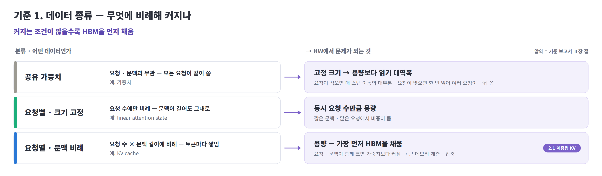
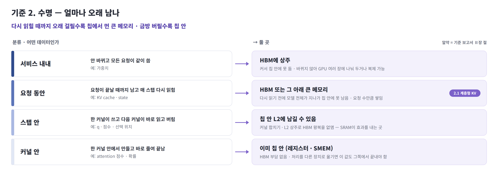
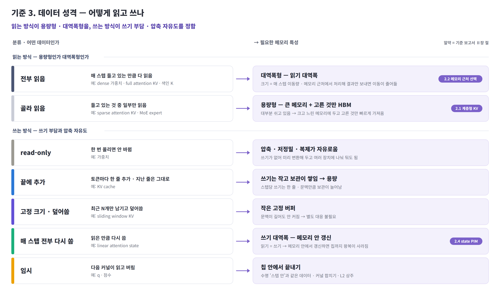
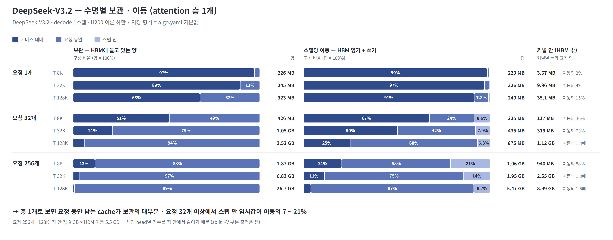
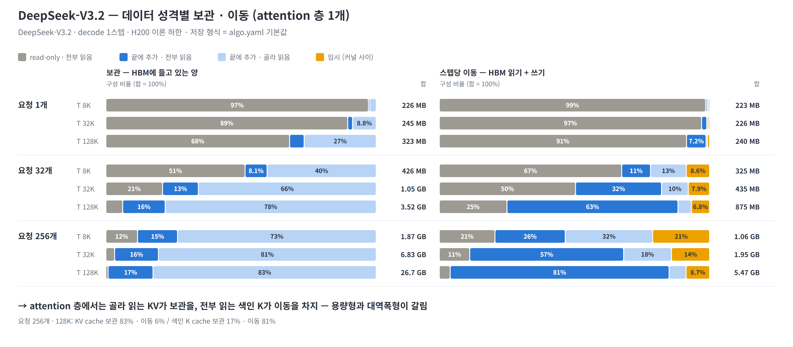
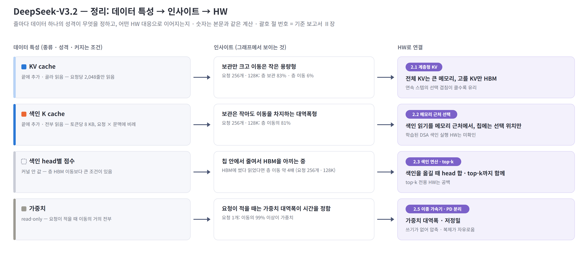

# DeepSeek-V3.2 (DSA) — 데이터 성격으로 본 decode 1스텝

모델별 보고서 ① Sparse · 2026.11 · 약식 화면 "데이터 성격 한눈에"를 요청 수 · 문맥 길이로 펼쳐 본 것

기준: H200 (HBM 4.8 TB/s · L2 50 MB) · decode 1스텝(새 토큰 1개 생성) · FP8 가중치 · KV cache 1줄 656 B · 색인 K 1줄 132 B · 이론 하한(모든 데이터를 한 번씩만 읽고 쓴다고 가정). split-KV 부분 출력은 모델 간 비교를 맞추려고 뺌(커널별 분석에는 남김). 요청 256개 · 128K는 보관 2.29 TB로 H200 8장(1.13 TB)을 넘음 — 이동량은 같은 조건의 바이트 비교로만 읽음. 화면: [DSA 약식](https://kimhyeon-ji.github.io/llm-arch-lineage-wiki/arch_insight/dataflow-claude/viewer/dsa-v32-lite.html) · 수치: [tools/traits.py](../tools/traits.py)(화면과 같은 규칙) · 그림: [make_traits_report.py](make_traits_report.py) · 커널별 분석: [dsa-v32.md](dsa-v32.md) · HW 대응: [기준 보고서](../../sparse-hybrid-hw-report-v2-refined.md) Ⅱ장

---

## 요약

### KV cache는 많이 들고 조금 읽고, 색인 K cache는 적게 들고 매번 전부 읽음 — 모델 전체로는 요청 수와 관계없이 MoE 가중치 읽기가 가장 큼

| 조건 | HBM에 가장 많이 들고 있는 것 | 매 스텝 가장 많이 옮기는 것 (모델 전체) | attention 층 안에서 가장 많이 옮기는 것 |
|---|---|---|---|
| **요청이 적을 때** | 가중치 (대부분 MoE expert) | 가중치 (attention + 고른 expert 몇 개) | attention 가중치 |
| **요청이 많을 때** | 가중치, 그다음 KV cache | MoE 가중치 — 요청마다 다른 expert를 건드림 | 색인 K cache |
| **요청 · 문맥이 모두 클 때** | KV cache가 가중치보다 많아짐 | MoE 가중치, 그다음 색인 K cache | 색인 K cache |

- **요청이 늘수록:** 요청마다 고르는 expert가 달라 MoE 가중치 읽기도 함께 커짐 → 모델 전체 이동은 끝까지 가중치가 가장 큼
- **문맥이 길수록:** KV cache 보관과 색인 K cache 읽기가 문맥에 비례해 커짐. KV cache 읽기는 요청당 2,048줄로 고정
- **두 cache의 성격이 반대:** KV cache는 보관만 크고 읽기는 작은 용량형, 색인 K cache는 보관은 작지만 매번 전부 읽는 대역폭형
- **칩 안에서만 생기는 값이 큼:** 색인 점수를 계산하며 생기는 값(커널별 논리 크기 합)이 요청 · 문맥과 함께 커져, HBM 이동보다 커지는 조건도 있음. 지금은 칩 안에서 바로 줄여 HBM 이동이 늘지 않음
- **HW 방향:** 용량형 KV는 아래 계층 메모리로 · 대역폭형 색인 K는 메모리 근처 처리로 · 임시값과 칩 안 값은 칩 안에서 끝내기 (각 절 끝 'HW로 발전시킬 포인트')

---

## 데이터를 나누는 세 가지 기준

### 같은 데이터를 '무엇에 비례해 커지나 · 얼마나 오래 남나 · 어떻게 읽고 쓰나'로 나눔 — 각각 'HBM을 얼마나 채우나 · 어디에 두나 · 어떤 메모리 특성이 필요한가'로 이어짐

| 기준 | 묻는 것 | 나누는 값 | 한 줄 규칙 |
|---|---|---|---|
| **1. 데이터 종류** | 무엇에 비례해 커지나 | 공유 가중치 · 요청별 크기 고정 · 요청별 문맥 비례 | 커지는 조건이 많을수록 HBM을 먼저 채움 |
| **2. 수명** | 얼마나 오래 남나 | 서비스 내내 · 요청 동안 · 스텝 안 · 커널 안 | 오래 남을수록 칩 밖 큰 메모리, 금방 버릴수록 칩 안 |
| **3. 데이터 성격** | 어떻게 읽고 쓰나 | 읽기: 전부 · 골라 / 쓰기: read-only · 끝에 추가 · 덮어씀 · 다시 씀 · 임시 | 전부 읽으면 대역폭, 골라 읽으면 용량, 다시 쓰면 쓰기 대역폭 |

- **그림 읽는 법 (기준 1 ~ 3 공통):** 왼쪽 = 분류와 그 뜻(예는 일반적인 LLM 데이터) → 오른쪽 = 그런 데이터면 필요한 HW 특성(알약 = 기준 보고서 Ⅱ장 절). 이 모델의 데이터가 어느 칸인지는 맨 아래 표

### 기준 1. 데이터 종류 — 무엇에 비례해 커지나

- **한 줄 규칙:** 커지는 조건이 많을수록 HBM을 먼저 채움 — 공유 가중치(고정) → 요청별 크기 고정(요청 수) → 요청별 문맥 비례(요청 수 × 문맥)
- **가중치는 용량보다 읽기가 문제:** 크기는 고정 · 요청이 적으면 매 스텝 이동의 대부분이 가중치 읽기

### 기준 2. 수명 — 얼마나 오래 남나

- **한 줄 규칙:** 다시 읽힐 때까지 오래 걸릴수록 칩에서 먼 큰 메모리, 금방 버릴수록 칩 안
- **칩 안에 남을 수 있는 경계 = 한 스텝:** 다음 스텝까지 모델 전체(전 층 + MoE)가 지나가 칩 안(L2 50 MB)이 다 덮임 → 서비스 내내 · 요청 동안 데이터는 SRAM을 늘려도 HBM 이동이 그대로
- **SRAM이 효과를 내는 곳 = 스텝 안 값:** 커널 합치기 · L2 상주로 HBM 왕복 제거. 커널 안 값은 이미 칩 안

### 기준 3. 데이터 성격 — 어떻게 읽고 쓰나

- **읽는 방식 → 용량형 · 대역폭형:** 전부 읽으면 크기가 곧 매 스텝 이동량(대역폭형), 골라 읽으면 보관만 크고 이동은 작음(용량형)
- **쓰는 방식 → 쓰기 부담 · 압축 자유도:** read-only는 미리 압축 · 복제 자유, 끝에 추가는 스텝당 쓰기가 한 줄, 매 스텝 다시 쓰면 읽은 만큼 쓰기 대역폭이 듦
- **두 축을 함께 읽음:** 같은 '끝에 추가'도 골라 읽으면 큰 메모리로(2.1), 전부 읽으면 메모리 근처 처리로(2.2)

### 이 모델의 데이터 — 종류별 수명 · 성격

| 데이터 (종류 · 크기) | 수명 → 둘 곳 | 데이터 성격 → 필요한 특성 |
|---|---|---|
| **attention · dense FFN · LM head 가중치** (공유 · 16 GB) | **서비스 내내** → HBM 상주 | **read-only · 전부 읽음** → 읽기 대역폭 · 저정밀 |
| **MoE expert · 임베딩** (공유 · 659 GB) | **서비스 내내** → HBM 상주 | **read-only · 골라 읽음** → 요청이 적을 때만 일부를 읽음 (MoE는 요청이 많으면 거의 전부) |
| **KV cache** (요청별 · 토큰당 40 KB) | **요청 동안** → HBM · 그 아래 큰 메모리 | **끝에 추가 · 골라 읽음** (요청당 2,048줄) → **용량형** |
| **색인 K cache** (요청별 · 토큰당 8 KB) | **요청 동안** → HBM · 그 아래 큰 메모리 | **끝에 추가 · 전부 읽음** → **대역폭형** |
| **q · 색인 점수 · 선택 위치** (커널 사이 값) | **스텝 안** → 칩 안 L2에 남길 수 있음 | **임시** → 커널 합치기 |
| **색인 head별 점수 · attention 점수 · 확률** (칩 안 값) | **커널 안** → 이미 칩 안 | HBM에 안 나옴 — 색인 처리를 옮기면 함께 옮겨야 함 |

- **두 cache는 읽는 방식 하나로 갈림:** 수명(요청 동안) · 쓰기(끝에 추가)는 같고 읽기만 다름 → KV는 큰 메모리(2.1), 색인 K는 메모리 근처 선택(2.2)
- **HBM에 남는 데이터는 모두 칩 밖 수명:** 가중치 · 두 cache 모두 한 스텝 뒤에 다시 읽힘 → SRAM 증설보다 용량 · 대역폭 쪽 대응
- **색인 head별 점수는 큰 커널 안 값:** 지금은 칩 안에서 줄여 HBM을 아낌 → 색인을 메모리 쪽으로 옮기면 head 합 · top-k까지 함께 (2.3)

### 그래프 읽는 법

- **그래프 막대:** 왼쪽 = 보관(HBM에 들고 있는 양 → 용량 요구), 오른쪽 = 스텝당 이동(읽기 + 쓰기 → 대역폭 요구). 보관에서 크고 이동에서 작으면 용량형, 반대면 대역폭형
- **조건:** 요청 1 · 32 · 256개 × 문맥 8K · 32K · 128K. 범위는 모델 전체(61층 + MoE · FFN · LM head) / attention 층 1개
- **골라 읽음:** 요청 1개 · 128K에서 스텝당 읽기가 보관의 90% 미만인 데이터 — MoE expert · KV cache · 임베딩

---

## 1. 데이터 종류 — 무엇이 용량과 대역폭을 쓰나

### 1.1 모델 전체 — 이동은 요청이 늘어도 MoE 가중치가 가장 크고, 보관은 요청 · 문맥이 크면 KV cache가 가중치를 넘음

- **요청이 적을 때:** 이동의 거의 전부가 가중치 읽기 — attention 가중치와 고른 expert 몇 개
- **요청이 늘수록:** 요청마다 다른 expert를 골라 MoE 가중치 읽기가 빠르게 커짐 → 요청 32개부터 이동의 대부분이 MoE 가중치
- **문맥이 길수록:** KV cache 보관이 커짐 → 요청 256개 · 128K에서는 KV cache 보관이 가중치보다 많음
- **KV cache는 보관만 큼:** 보관 비중이 커져도 이동 비중은 모든 조건에서 매우 작음(3% 이하)

※ MoE expert 읽기 = 요청 B개가 건드리는 expert 수 기댓값 256 × (1 − (1 − 8/256)^B) — 균등 라우팅 가정. 가중치 복제(DP attention) 제외

### 1.2 attention 층 1개 — 요청 · 문맥이 크면 보관은 KV cache, 이동은 색인 K cache가 가장 큼

- **요청이 적고 문맥이 짧을 때:** attention 가중치가 보관 · 이동 모두 가장 큼
- **요청 · 문맥이 커질수록:** 보관은 KV cache, 이동은 색인 K cache 비중이 커짐 — 같은 요청별 cache인데 하나는 쌓이기만 하고 하나는 매번 읽힘
- **문맥이 짧으면 KV 읽기 비중이 커짐:** 2,048줄을 고정으로 읽으므로 문맥이 짧을수록 고르는 비율이 커짐(8K에서는 4줄 중 1줄)
- **요청별 cache 이동이 가중치 이동을 넘는 시점:** 문맥이 길수록 빨리 옴(128K는 요청 12개, 32K는 39개, 8K는 91개부터)

#### HW로 발전시킬 포인트

| 대상 | 이 절에서 본 특성 | HW 방향 | 기준 보고서 Ⅱ장 |
|---|---|---|---|
| **KV cache** | 보관만 크고 거의 안 읽음 → 용량 문제 | 전체 KV는 대용량 메모리, 고를 KV만 HBM — 계층형 KV (HiSparse · ESS · SAC) | 2.1 |
| **색인 K cache** | attention 층 이동의 대부분 · 요청 × 문맥에 비례 → 대역폭 문제 | 색인 읽기를 메모리 근처에서, 칩에는 선택 위치만 — 메모리 근처 선택 (NELSSA · LongSight) | 2.2 |
| **가중치** | 요청이 적을 때 이동의 거의 전부 | 가중치 대역폭 · 저정밀 — 쓰기가 없어 압축 · 복제가 자유로움 | — |

※ 학습된 DSA 색인을 그대로 실행하는 HW는 아직 미확인

---

## 2. 데이터 수명 — 어디에 둘 수 있나

> **읽는 법:** 수명과 '다시 읽히기까지 걸리는 시간'이 둘 곳을 정함. 한 스텝 뒤에 다시 읽히는 가중치 · cache는 그사이 61층 전체가 지나가 칩 안에 못 남음 → HBM이나 그 아래 메모리. 다음 커널이 바로 읽는 스텝 안 임시값은 칩 안에서 끝낼 수 있는 몫. 커널 안 값은 지금 칩 안에서 처리해 HBM을 아끼고 있는 몫

### 2.1 모델 전체 — HBM 이동은 거의 전부 한 스텝 뒤에 다시 읽히는 데이터

- **서비스 내내 남는 가중치가 이동의 대부분:** 요청이 늘수록 비중이 천천히 줄지만 요청 256개에서도 가장 큼
- **요청 동안 남는 cache는 요청 · 문맥과 함께 커짐:** 요청 256개 · 128K에서는 보관의 대부분, 이동의 3분의 1 가까이
- **스텝 안 임시값은 모델 전체로는 작음:** 가중치 · cache 이동에 묻힘
- **칩 안에서만 생기는 값은 요청 · 문맥과 함께 빠르게 커짐:** 요청 256개 · 128K에서 HBM 이동의 절반을 넘는 크기 (커널별 논리 크기 합 — 동시 점유량 아님)

### 2.2 attention 층 1개 — 스텝 안 임시값이 무시 못 할 크기 · 칩 안 값이 HBM 이동을 넘어서는 조건이 있음

- **요청 32개 이상에서 스텝 안 임시값은 층 이동의 7 ~ 21%:** 요청이 많고 문맥이 짧으면 q · 출력 벡터, 문맥이 길면 색인 점수가 차지. 요청이 적을 때 SM들이 나눠 계산하며 생기는 split-KV 부분 출력은 H200 스케줄이 확인되지 않아 이 비교에서 뺌 (커널별 분석 참고)
- **칩 안 값이 HBM 이동보다 커짐:** 요청 32개는 문맥 128K, 요청 256개는 32K부터. 대부분이 색인 head별 점수
- **지금은 칩 안에서 줄여서 HBM을 아낌:** 색인 head별 점수를 HBM에 썼다 읽는 구조였다면 요청 256개 · 128K에서 층 이동이 약 4배로 늘어남

#### HW로 발전시킬 포인트

| 대상 | 이 절에서 본 특성 | HW 방향 | 기준 보고서 Ⅱ장 |
|---|---|---|---|
| **가중치 · cache** (칩 밖 수명) | HBM 이동의 거의 전부가 한 스텝 뒤에 다시 읽히는 데이터 | SRAM 증설로 줄일 몫이 작음 → 대역폭 · 배치로 대응 — 이종 가속기 · PD 분리 (DUET) | 2.5 |
| **스텝 안 임시값** | 요청 32개 이상에서 층 이동의 7 ~ 21% | 커널 합치기 · L2 상주 보장 · SM끼리 부분합 합치기로 HBM 왕복 제거 | 2.3 (GPU 커널 쪽) |
| **색인 head별 점수** (커널 안) | HBM에 썼다 읽었다면 층 이동 약 4배 → 지금은 칩 안에서 줄여 아낌 | 색인 처리를 옮길 때 head 가중합 · top-k까지 한 묶음으로 — 점수만 옮기면 큰 값이 링크로 나옴 | 2.2 · 2.3 |

※ 실제 링크 부담은 타일 크기 · 동시성으로 따로 계산 필요

---

## 3. 데이터 성격 — 어떤 메모리 특성이 필요한가

> **읽는 법:** 골라 읽는 데이터는 대부분 쉬고 있음 → 큰 용량에 두고 고른 것만 빠르게 가져오는 구조가 맞음. 매번 전부 읽는 데이터는 대역폭이 시간을 정함 → 대역폭을 늘리거나 메모리 근처에서 처리. 매 스텝 다시 쓰는 데이터는 쓰기 대역폭이나 메모리 안 갱신이 필요. read-only는 압축 · 복제 · 저정밀의 자유도가 큼

### 3.1 모델 전체 — 보관의 대부분은 골라 읽는 데이터, 매 스텝 전부 읽는 요청별 데이터는 색인 K cache뿐

- **골라 읽는 데이터(MoE · KV)가 보관의 대부분:** 요청 · 문맥이 작으면 MoE, 크면 KV cache
- **MoE는 요청이 늘면 '전부 읽음'으로 바뀜:** 요청 1개는 expert 일부만, 요청 256개는 사실상 전부 읽음 → 골라 읽는 효과는 요청이 적을 때만
- **KV cache는 계속 골라 읽음:** 요청 수와 무관하게 요청당 2,048줄 → 보관은 커져도 이동은 작음
- **전부 읽는 데이터의 이동 비중:** 요청이 적을 때는 dense 가중치(attention · FFN · LM head), 요청 · 문맥이 클 때는 색인 K cache가 커짐

### 3.2 attention 층 1개 — 골라 읽는 KV는 용량형, 전부 읽는 색인 K는 대역폭형으로 뚜렷이 갈림

- **요청 · 문맥이 크면:** 보관은 KV cache, 이동은 색인 K cache가 대부분 — 두 cache의 비중이 보관과 이동에서 거의 뒤집힘
- **요청이 적으면:** read-only 가중치가 이동의 대부분
- **매 스텝 전부 다시 쓰는 데이터는 없음:** 쓰기는 cache에 한 줄씩 추가하는 것과 임시값뿐 → 쓰기 대역폭 부담이 작음

#### HW로 발전시킬 포인트

| 대상 | 이 절에서 본 특성 | HW 방향 | 기준 보고서 Ⅱ장 |
|---|---|---|---|
| **골라 읽는 KV** | 보관은 크고 이동은 작음 (용량형) | 큰 용량 + 고른 KV의 빠른 전송 — 계층형 KV. 연속 스텝의 선택이 많이 겹치면 최근 KV를 HBM에 캐시하는 효과가 큼 | 2.1 |
| **전부 읽는 색인 K** | 보관은 작아도 매 스텝 전부 읽음 (대역폭형) | 대역폭 또는 메모리 근처 처리 + 색인 연산 · top-k. 메모리 쪽에 FP8 행렬 연산 필요, top-k 전용 HW는 공백 | 2.2 · 2.3 |
| **MoE expert** | 요청이 적으면 골라 읽음, 많으면 거의 전부 읽음 | 요청이 적을 때는 expert 일부만 HBM(계층형 가중치), 많을 때는 전부 HBM → 고정 배치 하나로는 둘 다 못 맞춤 | 범위 밖 (MoE offload 계열) |

※ HiSparse는 GLM-5.1의 LongBenchV2 trace를 k = 2,048 · LRU 4,096 슬롯으로 재생해 적중률 86.6%를 보고 — DSA · 다른 워크로드 · 캐시 크기에서는 따로 확인 필요

※ 해당 없음: state 갱신 PIM (2.4) — 매 스텝 다시 쓰는 데이터가 없음, Hybrid 모델 보고서에서 다룸

---

## 정리 — 데이터 특성 → 인사이트 → HW

### KV는 용량형, 색인 K는 대역폭형으로 갈림 — 대응도 둘로 나뉨

- **이 모델의 특성:** 요청 수 · 문맥이 커질수록 attention 층의 보관은 KV cache, 이동은 색인 K cache가 대부분을 차지 — 같은 요청별 cache가 용량형 · 대역폭형으로 갈림
- **모델 전체로는:** 요청이 늘어도 이동은 MoE 가중치가 가장 큼, 요청 · 문맥이 모두 크면 KV cache 보관이 가중치를 넘음

| 데이터 | 특성 (성격 · 커지는 조건) | 근거 (조건 · 수치) | 인사이트 | HW로 연결 | 기준 보고서 Ⅱ장 |
|---|---|---|---|---|---|
| KV cache | 끝에 추가 · 골라 읽음 · 토큰당 40 KB | 요청 256개 · 128K: 층 보관 83% · 층 이동 6% | 보관만 크고 이동은 작음 | 전체 KV는 큰 메모리, 고를 KV만 HBM | 2.1 |
| 색인 K cache | 끝에 추가 · 전부 읽음 · 토큰당 8 KB | 요청 256개 · 128K: 층 이동 81% · 모델 이동 27% | 보관은 작아도 이동을 차지 | 색인 읽기를 메모리 근처에서 | 2.2 |
| 색인 head별 점수 | 커널 안 값 | HBM에 썼다 읽었다면 층 이동 약 4배 (요청 256개 · 128K) | 지금은 칩 안에서 줄여 HBM을 아낌 | 색인을 옮길 때 head 합 · top-k까지 함께 | 2.3 |
| 가중치 | read-only | 요청 1개: 이동의 99% 이상 | 요청이 적을 때는 가중치 대역폭이 시간을 정함 | 가중치 대역폭 · 저정밀 | 2.5 |

- **확인할 것:** 연속 스텝의 선택 겹침(계층형 KV의 적중률), 학습된 색인을 메모리 쪽에서 실행할 연산 형식

---

## 부록 — 계산 기준

- **attention 블록:** [dsa-v32/algo.yaml](../models/dsa-v32/algo.yaml) · [map-gpu.yaml](../models/dsa-v32/map-gpu.yaml). 범위는 입력 RMSNorm 이후 ~ o_proj 출력
- **모델 전체:** [model.yaml](../models/dsa-v32/model.yaml). 61층 = dense FFN 3층(18,432) + MoE 58층(expert 2,048차원 × 256개, 8개 + 공유 1개 선택), FP8, router BF16, LM head · 임베딩 BF16 129,280 × 7,168
- **수명 판정:** 스텝당 쓰기 0 = 서비스 내내 · 쓰기가 있고 다음 스텝에도 남음 = 요청 동안 · 커널 사이 값 = 스텝 안 · map-gpu.yaml의 칩 안 항목 중 HBM 이동이 아닌 값 = 커널 안
- **성격 판정:** 쓰기 0 = read-only · 보관만큼 다시 쓰면 매 스텝 전부 다시 씀 · model.yaml에 `mode: ring`이면 고정 크기 · 덮어씀(V4 최근 창 · 압축기 state) · 그 밖 = 끝에 추가 · 커널 사이 = 임시. read-only · 끝에 추가는 요청 1개 · 128K에서 읽기 < 보관 × 90%이면 골라 읽음 — 기준 조건의 라벨이라 요청이 많으면 MoE도 대부분을 읽음(요청 256개에서 expert 기댓값 256개 중 255.9개). 쓰기는 여러 스텝 평균
- **칩 안 값:** map-gpu.yaml의 칩 안 항목 중 HBM 이동이 아닌 값의 커널별 논리 크기 합. 타일로 나눠 계산하므로 동시 점유량이 아님 — 온칩 용량은 타일 · 동시성 · 수명으로 따로 계산해야 함
- **split-KV 부분 출력:** FlashMLA SM100용 스케줄을 H200에 대입한 가정이라 모델 비교(이 보고서 · 화면의 데이터 성격 패널)에서는 뺌. 커널별 표에는 남김
- **기준 보고서 사례:** 괄호 숫자는 [sparse-hybrid-hw-report-v2-refined.md](../../sparse-hybrid-hw-report-v2-refined.md) Ⅱ장 절 번호. 성능 수치는 그쪽 저자 보고값이며, 사례의 모델 · 워크로드 · 설정에서 나온 값이라 이 모델에 그대로 옮길 수 없음
- **용량:** 요청 256개 · 128K 보관 2.29 TB → H200 141 GB 기준 최소 17장 (배치 가정 8장 초과). 화면의 시간은 전체 바이트 ÷ 합산 대역폭의 이상적 환산 — GPU별 배치(TP · EP · DP)와 가장 바쁜 GPU는 따로
- **MoE 읽기:** 균등 · 독립 라우팅 기댓값 — 요청 32개에서 expert 163/256개 (쏠리면 8개까지 줄고, 겹치지 않으면 256개). EP · DP 복제는 반영 안 함
- **형식:** W_Iw는 HF 실행 기준 FP32(공개 체크포인트는 BF16, 층당 1.8 MB 차이). FP8 가중치 블록 scale은 뺌
- **제외:** MTP 층 · 잔차 · 정규화 값 · GPU 간 통신 · 가중치 복제
