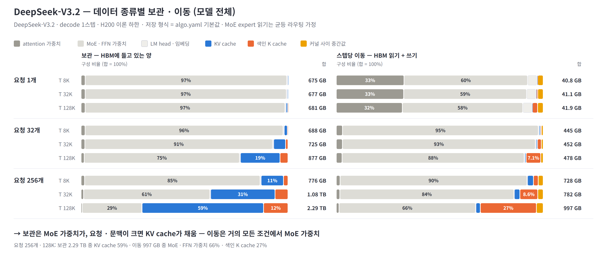
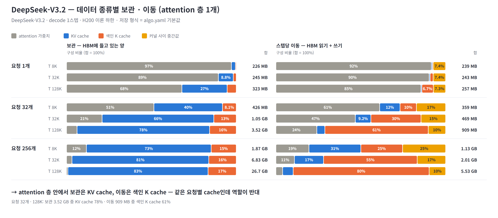
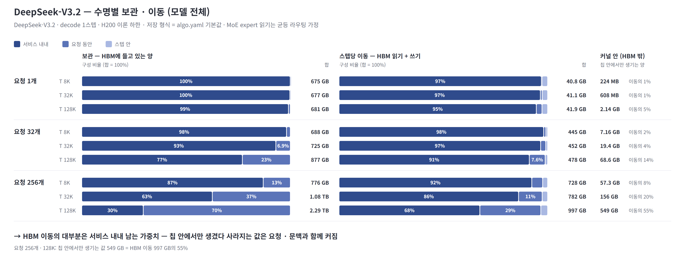
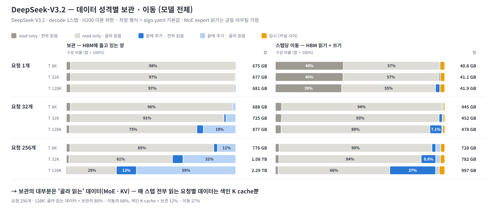

# DeepSeek-V3.2 (DSA) — 데이터 성격으로 본 decode 1스텝

모델별 보고서 ① Sparse · 2026.11 · 약식 화면 "데이터 성격 한눈에"를 요청 수 · 문맥 길이로 펼쳐 본 것

기준: H200 (HBM 4.8 TB/s · L2 50 MB) · decode 1스텝(새 토큰 1개 생성) · FP8 가중치 · KV cache 1줄 656 B · 색인 K 1줄 132 B · 이론 하한(모든 데이터를 한 번씩만 읽고 쓴다고 가정). 화면: [DSA 약식](https://kimhyeon-ji.github.io/llm-arch-lineage-wiki/arch_insight/dataflow-claude/viewer/dsa-v32-lite.html) · 수치: [tools/traits.py](../tools/traits.py)(화면과 같은 규칙) · 그림: [make_traits_report.py](make_traits_report.py) · 커널별 분석: [dsa-v32.md](dsa-v32.md) · HW 대응: [기준 보고서](../../sparse-hybrid-hw-report-v2-refined.md) Ⅱ장

---

## 요약

### 보관은 '골라 읽는' MoE · KV cache, 이동은 '전부 읽는' 가중치 · 색인 K cache — attention 층 안에서는 KV가 용량을, 색인 K가 대역폭을 씀

| 조건 (문맥 128K) | 보관 (모델 전체) | 스텝당 이동 (모델 전체) | attention 층 1개 이동 1위 | 칩 안에서만 생기는 값 (모델 전체) |
|---|---|---|---|---|
| **요청 1개** | 681 GB · MoE 가중치 97% | 41.9 GB · 가중치 95% | 가중치 85% | 2.14 GB (이동의 5%) |
| **요청 32개** | 877 GB · MoE 75% · KV 19% | 478 GB · MoE · FFN 88% | 색인 K cache 61% | 68.6 GB (이동의 14%) |
| **요청 256개** | 2.29 TB · KV 59% · MoE 29% | 997 GB · MoE · FFN 66% · 색인 K 27% | 색인 K cache 80% | 549 GB (이동의 55%) |

**그래프에서 보이는 것**
- **보관과 이동의 주인공이 다름:** 골라 읽는 데이터(MoE expert · KV cache)가 보관의 88 ~ 98%. KV cache는 이동의 3% 이하
- **attention 층 안:** KV cache = 보관 78 ~ 83% · 이동 5 ~ 6%, 색인 K cache = 보관 16 ~ 17% · 이동 61 ~ 80% (요청 32개 이상 · 128K)
- **수명:** HBM 이동의 97 ~ 99%가 한 스텝 뒤에 다시 읽히는 가중치 · cache. 스텝 안 임시값은 attention 층 이동의 7 ~ 25%
- **칩 안 값:** 칩 안에서만 생겼다 사라지는 값(96%가 색인 head별 점수)이 요청 · 문맥이 크면 attention 층 HBM 이동보다 큼

**HW로 발전시킬 포인트** (4절)
- 골라 읽는 KV → 계층형 KV 배치 (기준 보고서 2.1)
- 전부 읽는 색인 K → 메모리 근처 선택 · 색인 연산 (2.2 · 2.3) — 옮길 때 head 가중합까지 같이
- 스텝 안 임시값 · 커널 안 값 → 칩 안에서 끝내기 (커널 합치기 · L2 · SM끼리 합치기)

---

## 그래프 보는 법

- **막대:** 왼쪽 = 보관(HBM에 들고 있는 양), 오른쪽 = 스텝당 이동(HBM 읽기 + 쓰기). 막대 = 구성 비율, 오른쪽 숫자 = 합
- **조건:** 요청 1 · 32 · 256개 × 문맥 8K · 32K · 128K
- **범위:** 모델 전체(61층 + MoE · FFN · LM head) / attention 층 1개
- **나누는 기준 세 가지**
  - 데이터 종류: 가중치 · KV cache · 색인 K cache · 중간값
  - 수명: 서비스 내내(가중치) · 요청 동안(cache) · 스텝 안(커널 사이 값) · 커널 안(HBM 밖)
  - 데이터 성격: read-only / 끝에 추가 / 임시 × 전부 읽음 / 골라 읽음
- **골라 읽음:** 요청 1개 · 128K에서 스텝당 읽기가 보관의 90% 미만인 데이터 — MoE expert(3.5%) · KV cache(1.6%) · 임베딩

---

## 1. 데이터 종류

### 1.1 모델 전체 — 보관은 MoE 가중치, 요청 · 문맥이 크면 KV cache · 이동은 거의 모든 조건에서 MoE 가중치

- **보관:** 요청 1개는 가중치 675 GB가 99%. 요청 256개 · 128K는 KV cache 1.34 TB(59%)가 가중치보다 큼
- **이동:** 요청 1개는 attention 가중치 32% · MoE · FFN 58%. 요청 32개부터 MoE · FFN 88 ~ 95%
- **KV cache:** 보관은 최대 59%인데 이동은 모든 조건에서 3% 이하

※ MoE expert 읽기 = 요청 B개가 건드리는 expert 수 기댓값 256 × (1 − (1 − 8/256)^B) — 균등 라우팅 가정. 가중치 복제(DP attention) 제외

### 1.2 attention 층 1개 — 보관은 KV cache, 이동은 색인 K cache

- **보관:** 요청 · 문맥이 커지면 KV cache가 차지 — 요청 32개 · 128K 78%, 요청 256개 · 128K 83%
- **이동:** 요청 32개 · 128K에서 909 MB 중 색인 K cache 61% · 가중치 24% · 중간값 10% · KV cache 5%
- **문맥이 짧으면 KV 비중이 큼:** 요청 256개 · 8K에서 KV cache 이동 31% — 8,192줄 중 2,048줄(25%)을 읽기 때문
- **요청별 cache 이동 > 가중치 이동:** 문맥 128K는 요청 16개, 32K는 64개, 8K는 128개부터

---

## 2. 수명

### 2.1 모델 전체 — HBM 이동의 97 ~ 99%가 한 스텝 뒤에 다시 읽히는 데이터 · 칩 안에서만 생기는 값이 요청 · 문맥과 함께 커짐

- **서비스 내내(가중치):** 이동의 95%(요청 1개 · 128K) → 91%(32개) → 68%(256개)
- **요청 동안(cache):** 이동의 2.7% → 7.6% → 29%. 보관은 요청 256개 · 128K에서 71%
- **스텝 안(임시값):** 이동의 0.8 ~ 3.3%
- **커널 안(HBM 밖):** 요청 1개 · 128K 2.14 GB(이동의 5%) → 32개 68.6 GB(14%) → 256개 549 GB(55%)

### 2.2 attention 층 1개 — 스텝 안 임시값이 이동의 7 ~ 25% · 칩 안 값이 HBM 이동보다 커지는 조건이 있음

- **스텝 안 임시값 = 층 이동의 7 ~ 25%.** 조건마다 주인공이 다름
  - 요청 1개 · 128K: split 부분 출력 90%
  - 요청 256개 · 8K: q_full 26% · o_lat 23% · split 부분 출력 21%
  - 요청 256개 · 128K: 색인 점수 [T] 50%
- **커널 안 값 > HBM 이동:** 요청 32개 · 128K 1.12 GB vs 909 MB(1.2배), 요청 256개 · 128K 8.99 GB vs 5.53 GB(1.6배)
- **커널 안 값의 96%(문맥 128K)는 색인 head별 점수 [64 × T].** 이 값을 HBM에 썼다 읽었다면 요청 32개 · 128K 층 이동이 909 MB → 약 3.1 GB(3.4배)

---

## 3. 데이터 성격

### 3.1 모델 전체 — 보관의 대부분은 골라 읽는 데이터 · 매 스텝 전부 읽는 요청별 데이터는 색인 K cache뿐

- **read-only · 골라 읽음(MoE):** 보관 97%(요청 1개) → 29%(요청 256개 · 128K). 이동은 요청 1개 55%, 요청 32개 이상 66 ~ 94%
- **read-only · 전부 읽음(attention · dense FFN 가중치 · LM head):** 보관 2.4% 이하인데 요청 1개 이동의 39 ~ 40%
- **끝에 추가 · 골라 읽음(KV cache):** 보관 최대 59%, 이동 3% 이하
- **끝에 추가 · 전부 읽음(색인 K cache):** 보관 최대 12%, 이동 최대 27%
- **MoE의 실제 읽는 비율:** 요청 1개 3.5% → 32개 64% → 256개 100% — 요청이 많으면 '전부 읽음'처럼 동작

### 3.2 attention 층 1개 — 골라 읽는 KV가 보관을, 전부 읽는 색인 K가 이동을 차지

- **끝에 추가 · 골라 읽음(KV cache):** 요청 32개 이상 · 128K에서 보관 78 ~ 83%, 이동 5 ~ 6%
- **끝에 추가 · 전부 읽음(색인 K cache):** 같은 조건에서 보관 16 ~ 17%, 이동 61 ~ 80%
- **read-only · 전부 읽음(attention 가중치):** 요청 1개 이동의 86 ~ 92% → 요청 256개 · 128K 4%
- **매 스텝 전부 다시 씀:** 해당 데이터 없음

---

## 4. HW로 발전시킬 포인트

### 용량형 KV는 아래 계층으로, 대역폭형 색인 K는 메모리 근처로, 임시값 · 칩 안 값은 칩 안에서 끝내기

| 그래프에서 본 것 | HW 방향 | 붙일 수 있는 기존 아이디어 |
|---|---|---|
| **골라 읽는 KV cache:** 보관 최대 59% · 이동 3% 이하 (1.1 · 3.1) | 전체 KV는 대용량 메모리, 고를 KV만 HBM | **계층형 KV (2.1)** — HiSparse(SGLang 반영) · ESS(CPU 메모리) · SAC(CXL) |
| **전부 읽는 색인 K cache:** attention 층 이동 61 ~ 80%, 요청 · 문맥에 비례 (1.2 · 3.2) | 색인 읽기를 메모리 근처에서, 칩에는 선택 위치만 전달 | **메모리 근처 선택 (2.2)** — NELSSA · LongSight. 학습된 DSA 색인을 그대로 실행하는 HW는 미확인 |
| **칩 안에서만 생기는 색인 head별 점수가 HBM 이동보다 큼** (2.2) | 색인을 옮길 때 점수 계산 · head 가중합 · top-k를 한 묶음으로 — 쪼개면 링크로 3.4배 | **색인 연산 · top-k (2.3)** — 전용 HW 공백. 메모리 쪽에 FP8 행렬 연산기 필요(4.8 TB/s당 약 600 TFLOPS, 커널별 보고서 7절) |
| **스텝 안 임시값:** attention 층 이동 7 ~ 25% (2.2) | 커널 합치기 · L2 상주 보장 · SM끼리 부분합 합치기 | **GPU 커널 쪽 (2.3)** — cuDNN 결합 API 등. HW로는 분산 공유 메모리 · 큰 L2 |
| **MoE expert 읽는 비율이 요청 수에 따라 3.5% → 100%** (3.1) | 요청이 적을 때만 용량형 — 요청 수에 따라 expert 배치를 바꾸는 계층형 가중치 | 2.1의 계층형 배치를 가중치에 적용 — 기준 보고서 범위 밖(MoE offload 계열) |
| **이동의 97 ~ 99%가 한 스텝 뒤 재사용** (2.1) | 칩 안 SRAM 증설로는 이 몫이 안 줄어듦 → 대역폭 · 배치로 대응 | **이종 가속기 · PD 분리 (2.5)** — DUET(decode는 고대역 메모리 중심 장치) |

- **해당 없음:** state 갱신 PIM(2.4)은 '매 스텝 전부 다시 씀' 데이터가 없는 DSA와 무관 — Hybrid 모델 보고서에서 다룸
- **괄호 숫자:** 기준 보고서([sparse-hybrid-hw-report-v2-refined.md](../../sparse-hybrid-hw-report-v2-refined.md)) Ⅱ장 절 번호. 성능 수치는 그쪽 저자 보고값

---

## 부록 — 계산 기준

- **attention 블록:** [dsa-v32/algo.yaml](../models/dsa-v32/algo.yaml) · [map-gpu.yaml](../models/dsa-v32/map-gpu.yaml). 범위는 입력 RMSNorm 이후 ~ o_proj 출력
- **모델 전체:** [model.yaml](../models/dsa-v32/model.yaml). 61층 = dense FFN 3층(18,432) + MoE 58층(expert 2,048차원 × 256개, 8개 + 공유 1개 선택), FP8, router BF16, LM head · 임베딩 BF16 129,280 × 7,168
- **수명 판정:** 스텝당 쓰기 0 = 서비스 내내 · 쓰기가 있고 다음 스텝에도 남음 = 요청 동안 · 커널 사이 값 = 스텝 안 · map-gpu.yaml의 칩 안 항목 중 HBM 이동이 아닌 값 = 커널 안
- **성격 판정:** 쓰기 0 = read-only · 보관만큼 다시 쓰면 매 스텝 전부 다시 씀 · 그 밖 = 끝에 추가 · 커널 사이 = 임시. read-only · 끝에 추가는 요청 1개 · 128K에서 읽기 < 보관 × 90%이면 골라 읽음
- **제외:** MTP 층 · 잔차 · 정규화 값 · GPU 간 통신 · 가중치 복제
