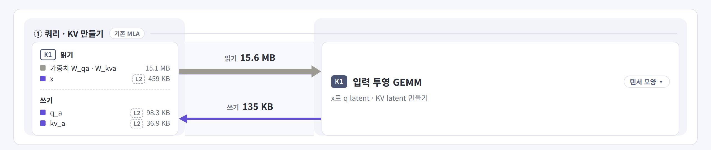
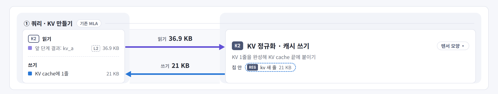
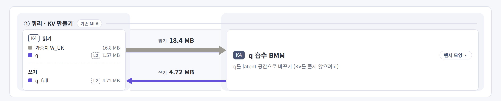
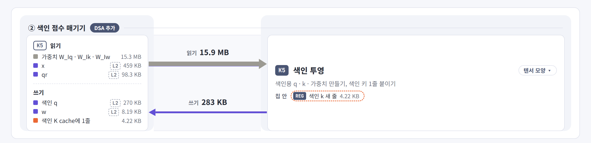
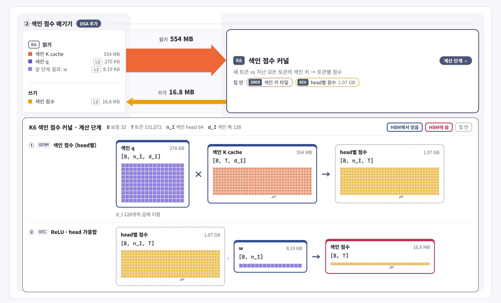
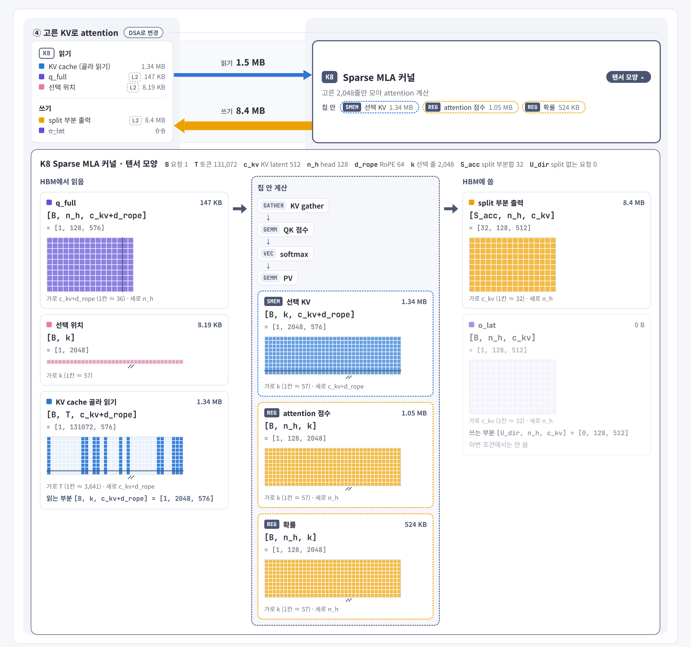
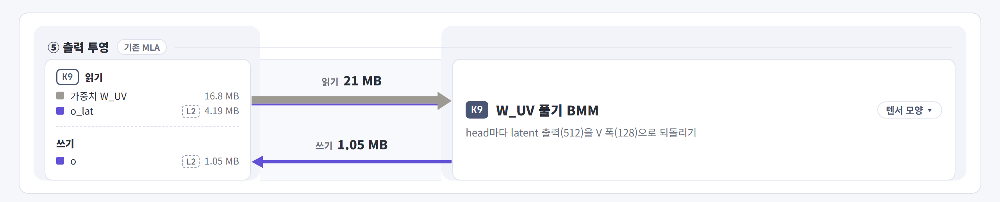
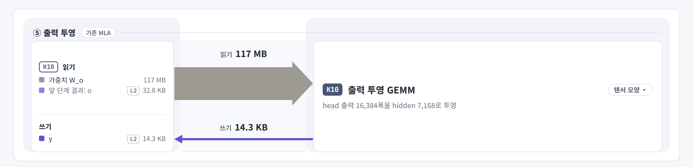

# DSA (DeepSeek-V3.2) decode 데이터 이동 — 모델 전체 비중 · 커널별 분석

sparse attention 데이터 플로우 정리 · 2026.11 · 약식 화면 스냅샷 기반

기준: H200 (HBM 4.8 TB/s · L2 50 MB) · decode 1스텝(새 토큰 1개를 만드는 한 번) · FP8 가중치 · KV cache 1줄 656 B · 이론 하한(모든 데이터를 딱 한 번씩만 읽고 쓴다고 본 값). 커널별 수치는 [약식 화면](https://kimhyeon-ji.github.io/llm-arch-lineage-wiki/arch_insight/dataflow-claude/viewer/dsa-v32-lite.html)과 같은 yaml에서, 모델 전체 수치는 [model_totals.py](model_totals.py)에서 계산했다. 그림은 [make_report.py](make_report.py)로 만든다. 커널을 나눈 방식은 SGLang · vLLM의 V3.2 경로를 단순화한 것이다.

---

## 요약

### DSA attention의 데이터 이동은 "요청이 적으면 가중치, 많으면 색인 K cache"가 좌우 — 정작 KV cache 읽기는 작다

| 조건 (문맥 128K) | 모델 전체 이동 중 attention 몫 | attention 층 1개에서 가장 많이 읽는 것 | KV cache 읽기 (층 1개) |
|---|---|---|---|
| **요청 1개** | 37% (15.7 / 41.9 GB) | 가중치 219 / 247 MB (89%) | 1.34 MB (0.5%) |
| **요청 32개** | 12% (55 / 478 GB) | 색인 K cache 554 / 863 MB (64%) | 43 MB (5%) |
| **요청 256개** | 34% (337 / 997 GB) | 색인 K cache 4.43 / 5.26 GB (84%) | 344 MB (7%) |

- **모델 전체:** 요청 1개에서는 attention이 전체 이동량의 37%, MoE가 58%를 차지한다. 요청 32개에서는 읽어야 할 expert가 약 163개로 늘어 MoE 비중이 90% 안팎까지 오른다. 요청 256개·문맥 128K에서는 attention 비중이 다시 34%로 커진다. 색인 K cache 읽기만으로 모델 전체 이동량의 27%를 차지하기 때문이다(1절).
- **층 1개 안에서 (요청 1개):** attention 한 층이 읽는 247 MB 중 219 MB가 가중치다. 출력 투영 가중치 하나가 117 MB로 가장 크다. 같은 층의 전체 쓰기량은 9.33 MB다(2절).
- **sparse가 바꾼 것:** 문맥 128K에서 KV cache 전체를 읽으면 86 MB지만, 상위 2,048줄만 읽으면 1.34 MB로 줄어든다(1/64). 이 줄을 고르려면 색인 K cache 17.3 MB를 먼저 훑어야 한다. 문맥이 약 10K 토큰을 넘으면 선택에 필요한 색인 읽기가 선택한 KV 읽기보다 커진다(3.2절).
- **요청이 늘면:** 한 배치의 요청들은 가중치를 공유하지만 각자의 cache를 읽는다. 문맥 128K에서는 요청 10개부터 요청별 데이터 이동량의 합이 가중치 읽기량을 넘어선다(3.3절).
- **커널별로 보면:** 요청이 늘면 가중치 GEMM과 Sparse MLA에서 연산 시간이 차지하는 비중이 커진다. 색인 점수 커널은 계속 메모리 대역폭의 제약을 받는다. 점수 계산을 메모리 가까이 옮기려면 FP8 행렬 연산기도 필요하다(4절).
- **실제와의 차이:** 중복 읽기와 패딩에 따른 추가 이동량은 추정상 1% 미만이다. 커널 사이의 중간값은 L2에 남아 HBM 접근을 줄일 수 있다. 약식 화면은 이런 값에 `L2`를 표시한다(5절).

---

## 구성

| 절 | 내용 |
|---|---|
| **1. 모델 전체 중 attention 비중** | 요청 수 · 문맥 길이별 한 스텝 HBM 이동량 구성 |
| **2. 커널별 이동 · 특성** | 커널마다 약식 화면 조각 → 바로 아래 이동 · 특성 · 병목 · 필요한 HW |
| **3. 분석** | 가중치 · 색인 K cache · 요청 수 · split 쓰기 |
| **4. 커널 종합** | 커널별 병목 위치(요청 1 → 256) 한 장 · 특성 → 필요한 HW 특성 표 |
| **5. 계산값과 실제의 차이** | 다시 읽기 · 패딩 · L2 |
| **6. 아키텍처 아이디어 후보** | 굵은 화살표별 현재 한계 · 방향 |
| **부록** | 계산 기준 |

---

## 1. 모델 전체 중 attention 비중

### 요청 1개면 attention 이동의 대부분이 가중치 — 요청과 문맥이 커질수록 색인 K cache가 그 자리를 차지

- **요청 1개:** 한 스텝에 약 42 GB. MoE · FFN 가중치 24 GB(58%), attention 가중치 13 GB(32%), LM head 1.9 GB(4%). 문맥을 늘려도 거의 안 바뀜
- **요청 32개:** expert가 고르게 선택된다고 가정하면 배치가 읽는 서로 다른 expert 수는 요청 1개일 때 8개에서 32개일 때 약 163개로 늘어난다. MoE 가중치만 420 GB이므로 문맥 길이에 따라 attention 비중은 5~12%다.
- **요청 256개:** 256개 expert를 모두 읽으면 MoE 가중치 읽기량은 656 GB에서 더 늘지 않는다. 반면 요청별 cache 읽기량은 계속 늘어난다. 문맥 128K에서 attention은 전체 이동량의 34%, 색인 K cache만으로도 270 GB(전체의 27%)다.
- **KV cache:** 어떤 조건에서도 3% 이하. 요청마다 2,048줄만 골라 읽기 때문
- **중간 결과 · 토큰 벡터:** 1 ~ 3%. 요청이 적을 때는 대부분 split 부분 출력(2절 K8 → K8b)

모델 전체 수치는 한 decode 스텝의 HBM 읽기와 쓰기를 합한 값이다. 여러 GPU에 나눠 실행해도 합계는 같다고 가정했다. 가중치 복제(DP attention), GPU 간 통신, MTP 층, 잔차와 정규화 값은 계산에서 제외했다. 요청 32개의 163개 expert는 균등 라우팅을 가정한 기댓값이다. 실제 요청이 일부 expert에 집중되면 이보다 적을 수 있다.

---

## 2. 커널별 이동 · 특성 — attention 층 1개 · 요청 1개 · 128K

### 굵은 화살표는 가중치 읽기와 색인 K cache 읽기 — 쓰기는 split 부분 출력 하나만 굵다

- **그림:** [약식 화면](https://kimhyeon-ji.github.io/llm-arch-lineage-wiki/arch_insight/dataflow-claude/viewer/dsa-v32-lite.html)의 커널 한 줄. 왼쪽은 HBM에서 읽고 쓰는 데이터, 가운데 화살표는 옮기는 양(굵기 ∝ √바이트, 모든 그림이 같은 눈금), 오른쪽은 커널과 칩 안 메모리(점선 = SMEM · 레지스터). `L2` 표시는 L2 캐시에서 끝날 수 있는 작은 값
- **1바이트당 연산:** HBM에서 읽고 쓴 바이트당 연산 횟수다. H200의 이론적 균형점은 FP8에서 412회, BF16에서 206회다. 이보다 낮으면 데이터를 옮기는 시간이 계산 시간보다 길다.
- **병목:** 요청 수를 1개에서 256개로 늘릴 때 메모리 이동 시간과 연산 시간 중 어느 쪽이 더 긴지 비교한다.
- **층 1개 합:** 읽기 247 MB · 쓰기 9.33 MB(읽기가 26배) · 이론 하한 53 µs, 61층이면 3.3 ms
- 핵심 커널(K6 · K8)은 커널 칸을 눌러 텐서 모양까지 펼친 그림

### ① 쿼리 · KV 만들기 (K1 ~ K4) — 가중치를 읽어 q와 KV 1줄을 만드는 단계

#### K1 입력 투영 GEMM

- **하는 일:** 입력 x를 두 개의 압축 벡터인 q latent(1,536차원)와 KV latent(576차원)로 투영한다.
- **이동:** 가중치 15 MB를 읽고 다음 커널에 전달할 벡터 4 KB를 쓴다.
- **특성:** 가중치를 연속해서 한 번 읽고 배치의 모든 요청에 재사용한다. 바이트당 연산은 요청 1개에서 2회, 256개에서 390회로 늘어난다.
- **병목 · HW:** 요청 1개에서는 메모리 이동 시간이 연산 시간의 약 200배다. 256개에서는 두 시간이 비슷해져 연산 처리량도 중요해진다.

#### K2 KV 정규화 · 캐시 쓰기

- **하는 일:** 새 토큰의 KV에 정규화, RoPE, FP8 양자화를 적용한 뒤 KV cache 끝에 한 줄을 추가한다.
- **이동:** 1 KB를 읽고 새 KV 한 줄(656 B)을 쓴다.
- **특성:** 계산량이 작고 모든 연산이 레지스터 안에서 끝난다.
- **병목 · HW:** 처리량이 작아 커널 실행을 시작하는 비용이 상대적으로 크다. K1과 합치면 이 비용을 줄일 수 있다. HBM에는 작은 단위의 쓰기가 필요하다.

#### K3 q 업투영 GEMM

- **하는 일:** 압축된 q latent를 펼쳐 128개 head의 쿼리를 만든다.
- **이동:** 가중치 38 MB를 읽고 head별 쿼리 52 KB를 쓴다. 가중치 읽기량은 출력 투영에 이어 두 번째로 크다.
- **특성:** K1처럼 가중치를 연속해서 읽고 요청 간에 공유한다. 바이트당 연산은 요청 1개에서 2회, 256개에서 372회로 늘어난다.
- **병목 · HW:** 요청 1개에서는 메모리 이동 시간이 연산 시간의 약 200배다. 256개에서는 두 시간이 비슷해져 K1처럼 대역폭과 연산 처리량이 모두 중요하다.

#### K4 q 흡수 BMM

- **하는 일:** 쿼리를 KV latent 공간으로 투영한다. MLA는 이렇게 쿼리 쪽에 변환을 흡수해 캐시의 KV를 head별로 펼치는 작업을 줄인다.
- **이동:** 가중치 17 MB를 읽고, latent 쿼리 q_full 147 KB를 씀
- **특성:** 128개 head가 각각 다른 128 × 512 행렬로 쿼리를 변환한다. 요청마다 결과 q_full을 HBM에 써야 하므로 요청 256개에서도 바이트당 연산은 64회에 그친다.
- **병목 · HW:** 요청 256개에서도 메모리 이동 시간이 연산 시간의 약 3배다. K4와 K8을 합쳐 q_full을 직접 넘기면 요청마다 147 KB의 중간값을 HBM에 쓰고 다시 읽는 과정을 줄일 수 있다.

### ② 색인 점수 매기기 (K5 · K6) — DSA가 더한 단계: 지난 토큰 전체에 점수 매기기

#### K5 색인 투영

- **하는 일:** 색인용 q와 head 가중치를 만들고, 새 토큰의 색인 키 1줄(132 B)을 색인 K cache에 붙임
- **이동:** 색인 가중치 15 MB를 읽고 9 KB를 씀
- **특성:** 여러 요청이 가중치를 공유한다. 바이트당 연산은 요청 1개에서 1.8회, 256개에서 324회로 늘어난다.
- **병목 · HW:** 요청 1개에서는 메모리 이동 시간이 연산 시간의 약 200배다. 256개에서는 두 시간이 비슷해진다.

#### K6 색인 점수 커널 — 핵심

- **하는 일:** 새 토큰의 색인 쿼리를 과거 모든 토큰의 색인 키와 비교한다. 여기서 구한 토큰별 점수로 다음 커널이 읽을 KV 위치를 고른다.
- **이동:** 과거 토큰 약 13만 개의 색인 키를 한 줄당 132 B씩, 총 17.3 MB 읽는다. 출력은 토큰당 4 B의 점수로 총 524 KB다.
- **특성:** 색인 키를 64토큰씩(약 8 KB) 연속으로 읽어 SMEM에 올리고 Tensor Core에서 곱한다. 한 키를 64개 head가 공유하지만 요청마다 별도의 cache를 읽으므로, 요청 수가 늘어도 바이트당 연산은 121회로 일정하다. head별 점수 33.6 MB는 레지스터에서 합산한다.
- **크기를 정하는 것:** 한 스텝의 색인 읽기량은 요청 수와 문맥 길이에 비례한다. 문맥 128K에서 요청 32개는 554 MB, 256개는 4.43 GB를 읽는다.
- **병목 · HW:** 메모리 이동 시간이 연산 시간의 약 3배이며, 요청을 모아도 이 비율은 유지된다. 메모리 가까이에서 점수를 계산하려면 4.8 TB/s의 대역폭에 맞춰 약 600 TFLOPS의 FP8 행렬 연산 성능이 필요하다.

### ③ 2,048개 고르기 (K7) — DSA가 더한 단계: 점수 상위만 남기기

#### K7 top-k 커널

- **하는 일:** 점수 13만 개 중 상위 2,048개의 위치를 고름
- **이동:** 점수 524 KB를 읽고, 위치 8 KB를 씀
- **특성:** 상위 위치를 확정하려면 모든 점수를 비교해야 한다. 따라서 K8은 K7이 끝난 뒤에 KV를 읽을 수 있다. 점수 읽기량은 요청 수와 문맥 길이에 비례하며 요청 256개·문맥 128K에서는 134 MB다.
- **병목 · HW:** 요청이 적을 때는 커널 실행 비용이, 많을 때는 대역폭이 중요하다. 전용 선택 연산기를 활용하거나 K6과 K7을 합칠 수 있다. 두 커널을 합치면 요청당 점수 524 KB를 HBM에 쓰고 다시 읽는 과정을 줄인다.

### ④ 고른 KV로 attention (K8 · K8b) — 2,048줄만 모아 attention 계산

#### K8 Sparse MLA 커널 — 핵심

- **하는 일:** 고른 2,048줄의 KV만 모아 attention 계산(QK → softmax → PV)
- **이동:** KV cache 2,048줄(1.34 MB)을 골라 읽고, split 부분 출력 8.4 MB를 씀
- **특성:** K7이 고른 2,048개 위치에서 656 B씩 읽는다. 문맥이 길어져도 선택하는 줄 수와 읽기량은 같다. 각 줄을 128개 head가 공유해 KV 1바이트당 약 425회의 연산을 수행한다.
- **병목 · HW:** 요청 1개에서는 split 부분 출력을 쓰는 시간이 크다. **요청 32개부터는 연산 시간이 더 길어져** Tensor Core 처리량이 중요해진다. KV 주소는 K7이 끝나야 알 수 있으므로 미리 읽기 어렵다. 주소 목록에 따라 수백 바이트씩 흩어진 데이터를 효율적으로 읽는 기능이 필요하다.

#### K8b split 합치기

- **하는 일:** SM들이 나눠 계산한 부분 결과 32조각을 하나로 합침
- **이동:** 부분 출력 8.4 MB를 다시 읽고 131 KB를 씀
- **특성:** 요청 1개에서도 132개 SM을 활용하려고 계산을 32조각으로 나누면서 생기는 왕복이다. 병합에는 바이트당 0.6회의 연산만 필요하다. 요청이 늘면 요청당 조각 수가 줄어, 요청 256개에서 부분 출력은 층 읽기량의 0.6%다.
- **병목 · HW:** 메모리 시간이 연산의 약 20배. SM끼리 칩 안에서 바로 합칠 수 있으면(클러스터 공유 메모리 등) HBM 왕복이 사라짐

### ⑤ 출력 투영 (K9 · K10) — 층에서 가장 굵은 화살표 W_o 117 MB

#### K9 W_UV 풀기 BMM

- **하는 일:** head마다 latent 출력(512폭)을 V 폭(128)으로 되돌림
- **이동:** 가중치 17 MB를 읽고 head 출력 33 KB를 씀
- **특성:** K4처럼 head마다 작은 행렬을 곱한다. 요청 수에 따라 입출력도 함께 늘어 요청 256개에서도 바이트당 연산은 73회다.
- **병목 · HW:** 요청 256개에서도 메모리 시간이 연산의 약 3배. K8b와 합치면 latent 출력 왕복이 사라짐

#### K10 출력 투영 GEMM

- **하는 일:** head 출력 16,384폭을 hidden 7,168폭으로 투영
- **이동:** 출력 투영 가중치 117 MB를 읽는다. 한 층의 전체 읽기량 중 47%로 단일 항목 중 가장 크다. 출력은 14 KB다.
- **특성:** 배치의 요청들이 같은 가중치를 재사용해 바이트당 연산이 요청 1개에서 2회, 256개에서 464회로 늘어난다.
- **병목 · HW:** 요청 1개에서는 메모리 이동 시간이 연산 시간의 약 200배지만, 256개에서는 연산 시간이 조금 더 길다. 요청이 적을 때 가중치 대역폭을 높이거나 정밀도를 낮추면 가장 큰 읽기 항목을 줄일 수 있다.

---

## 3. 분석

### 3.1 요청 1개 — 가중치가 화살표 굵기를 정한다

- **가중치가 89%:** 층 1개에서 읽는 247 MB 중 219 MB가 가중치. 출력 투영 가중치(K10) 하나가 47%, q 업투영(K3)이 그다음
- **DSA가 더한 색인 단계(K5 ~ K7):** 33 MB로 13%. 색인 가중치 15 MB + 색인 K cache 17 MB
- **본 attention(K8):** KV cache 1.34 MB로 0.5%뿐. sparse 덕분에 attention 계산 자체가 옮기는 양은 작음
- **시간:** 한 층의 이론 시간 하한은 53 µs이며 대부분이 메모리 이동 시간이다. 연산 시간이 가장 긴 색인 점수 커널도 계산에는 1.3 µs가 걸린다. 따라서 요청 1개의 decode 속도는 주로 가중치를 읽는 속도에 달려 있다.

### 3.2 sparse의 대가 — KV cache 읽기는 줄었지만, 색인 K cache를 매번 전부 읽는다

| 문맥 T | 색인 K cache 읽기 (K6) | KV cache 읽기 (K8, 2,048줄) | dense였다면 KV cache 읽기 |
|---|---:|---:|---:|
| 8K | 1.08 MB | 1.34 MB | 5.4 MB |
| 32K | 4.33 MB | 1.34 MB | 21.5 MB |
| 128K | 17.3 MB | 1.34 MB | 86 MB |

- **KV cache 읽기:** 선택한 2,048줄만 읽으므로 문맥 8K부터 128K까지 요청당 읽기량은 1.34 MB로 같다. 128K에서는 전체 KV를 읽는 dense 방식(86 MB)의 1/64이다.
- **색인 K cache 읽기:** 모든 토큰의 색인 키를 132 B씩 읽으므로 읽기량은 문맥 길이에 비례한다. 약 10K 토큰부터 선택한 KV의 읽기량을 앞서고, 128K에서는 그 13배에 이른다.
- **둘을 합치면:** 문맥 128K에서 두 cache를 읽는 양은 총 18.6 MB로 dense KV 읽기의 22%다. 이 18.6 MB 중 93%가 색인 K cache다.
- **줄어드는 정보량:** K6은 색인 키 17.3 MB를 읽어 점수 524 KB를 만든다. K7이 다음 커널에 넘기는 값은 상위 위치 목록 8 KB뿐이다. 두 단계를 메모리 가까이에서 처리하면 점수 전체를 칩으로 가져올 필요가 줄어든다.

### 3.3 요청이 늘면 — 가중치 커널은 그대로, 색인 · KV 커널만 커진다

| 커널 (128K) | 요청 1개 (읽기 / 쓰기) | 요청 32개 | 요청 256개 |
|---|---:|---:|---:|
| K1 · K3 · K5 · K10 (가중치 GEMM) | 185 MB / 80 KB | 187 MB / 2.5 MB | 203 MB / 20 MB |
| K4 · K9 (흡수 BMM) | 33.7 MB / 180 KB | 39.4 MB / 5.8 MB | 79.7 MB / 46 MB |
| **K6 색인 점수** | 17.3 MB / 524 KB | **554 MB** / 16.8 MB | **4.43 GB** / 134 MB |
| K7 top-k | 524 KB / 8 KB | 16.8 MB / 262 KB | 134 MB / 2.1 MB |
| K8 Sparse MLA | 1.5 MB / 8.4 MB | 48 MB / 16.8 MB | 384 MB / 56 MB |
| K8b split 합치기 | 8.4 MB / 131 KB | 16.8 MB / 4.2 MB | 30.5 MB / 7.6 MB |
| **층 1개 합** | 247 MB / 9.33 MB | 863 MB / 46 MB | 5.26 GB / 267 MB |

- **K6 색인 점수:** 요청마다 자기 색인 K cache 17.3 MB를 전부 읽어, 요청 32개면 층 읽기의 64%, 256개면 84%
- **가중치 커널:** 가중치 자체는 배치당 약 220 MB만 읽는다. 요청이 늘면 커널의 입력과 출력은 커지지만 가중치 읽기량은 일정해 전체에서 차지하는 비중이 줄어든다.
- **역전 지점:** 요청별 데이터가 가중치보다 많아지는 요청 수 — 32K는 27개, 128K는 10개
- **연산:** 요청 256개·문맥 128K에서 K6의 연산량은 층당 554 GFLOP로 가장 크다. 그래도 메모리 이동에 951 µs, 연산에 342 µs가 걸려 대역폭이 병목이다.

### 3.4 쓰기 — 요청 1개면 쓰기의 90%가 split 부분 출력

- **왜 생기나:** FlashMLA는 요청 1개에서도 132개 SM을 활용하려고 KV 2,048줄을 32조각으로 나눠 계산한다. 각 조각의 부분 결과([128 × 512], FP32)를 HBM에 쓰고 K8b가 다시 읽으므로, 읽기와 쓰기가 각각 8.4 MB씩 발생한다.
- **요청이 늘면:** 요청당 조각 수가 줄어듦. 요청 256개면 116조각만 나뉘고 198개 요청은 안 나뉨 → 부분 출력 30.5 MB, 층 읽기의 0.6%
- **의미:** 저장해 둘 데이터가 아니라 계산 방식 때문에 생긴 왕복. 칩 안에서 합치면 HBM까지 갈 필요가 없음

---

## 4. 커널 종합 — 병목 위치 · 필요한 HW 특성

### 요청이 늘면 가중치 GEMM · Sparse MLA는 연산이 바빠지지만, 색인 점수는 계속 메모리를 기다린다

- **그림 보는 법:** 가로축은 연산 시간을 메모리 이동 시간으로 나눈 값이다. 1보다 작으면 메모리 이동이, 1보다 크면 연산이 더 오래 걸린다. ●은 요청 1개, ○은 요청 256개를 나타낸다.
- **가중치 GEMM (K1 · K3 · K5 · K10):** 여러 요청이 같은 가중치를 재사용하므로 요청이 늘수록 연산 시간의 비중이 커진다. 약 200~250개에서 두 시간이 가까워진다.
- **흡수 BMM (K4 · K9):** 요청별 출력도 같이 늘어 256개에서도 0.3 ~ 0.4 — 메모리 쪽에 남음
- **K6 색인 점수:** 요청 수가 늘어도 시간 비율은 0.36이다. 요청마다 별도의 색인 K cache를 읽어 바이트당 연산이 121회로 일정하므로, 배치를 키워도 메모리 대역폭이 병목으로 남는다.
- **K8 Sparse MLA:** head 128개가 KV 1줄을 같이 써서 요청 32개부터 경계를 넘음. 요청 1개에서 왼쪽인 건 split 부분 출력 쓰기 때문
- **K2 · K7 · K8b:** 요청 1개에서는 이동량과 연산량이 작아 커널 실행과 동기화 비용의 영향이 크다. 이 비용은 그림의 시간 비율에 포함되지 않는다.

### 4.1 특성 → 필요한 HW 특성 (종합)

| 특성 | 해당 커널 | 수치 (128K) | 필요한 HW 특성 |
|---|---|---|---|
| **공유 가중치 연속 읽기** | K1 · K3 · K4 · K5 · K9 · K10 | 층마다 219 MB 고정 · 1바이트당 연산 = 2 × 요청 수 | 요청이 적으면 연속 읽기 대역폭, 약 200개부터는 연산 처리량 — 배치 크기에 맞는 연산 : 대역폭 비율 |
| **요청별 cache 전체 훑기 + 행렬 연산** | K6 | 토큰당 132 B × 요청 수 · 1바이트당 연산 121 고정 | 대역폭이 곧 속도. 메모리 가까이 옮긴다면 FP8 행렬 연산기도 함께(4.8 TB/s당 약 600 TFLOPS) — 비교기만으로는 부족 |
| **전체를 봐야 하는 선택 (top-k)** | K7 | 점수 4 B × 문맥 → 위치 2,048개 | 비교 · 선택 연산기. K6과 합쳐 점수를 HBM에 안 쓰면 요청당 524 KB 왕복 제거 |
| **앞 결과로 위치가 정해지는 흩어 읽기** | K8 | 656 B × 2,048곳 = 요청당 1.34 MB | 수백 B 단위 흩어 읽기 효율 · 주소 목록으로 읽기. K7이 끝나야 주소가 나와 미리 읽기 어려움 |
| **head 공유로 연산이 많음** | K8 | KV 1바이트당 연산 약 425 | 요청 32개부터 Tensor core 처리량이 병목 → 흩어 읽은 KV를 바로 행렬 연산기로 |
| **SM끼리 합치기** | K8b | 요청 1개에서 8.4 MB 왕복 | 칩 안에서 SM끼리 합치기(클러스터 공유 메모리 등) → HBM 왕복 제거 |
| **1줄 추가 쓰기** | K2 · K5 | 토큰 · 층마다 656 B + 132 B | 작은 단위 쓰기. 읽고-고쳐-쓰기는 없음 |
| **작은 커널** | K2 · K7 · K8b (요청 1개) | KB ~ 수 MB · 이론 시간 0.1 ~ 2 µs | 커널 띄우기 · 동기화 시간 줄이기 — 커널 합치기 · 계속 떠 있는(persistent) 커널 |

※ 1바이트당 연산 = 커널 FLOP ÷ HBM 읽기 · 쓰기 바이트. H200의 균형점은 FP8 412 · BF16 206이다. 그림의 경계(1)는 이론 최고 성능 기준이라, 실제로는 작은 GEMM의 효율과 실효 대역폭에 따라 조금씩 움직인다.

---

## 5. 계산값과 실제의 차이 — 다시 읽기 · 패딩 · L2

### 굵은 화살표(가중치 · 색인 K cache · KV cache)는 실제로도 거의 그대로 — 달라지는 건 L2에서 끝날 수 있는 작은 값뿐

| 효과 | 내용 | 크기 (요청 1개 · 128K, 층 1개) | 약식 화면 |
|---|---|---|---|
| **다시 읽기** | decode는 요청 수가 작아 가중치를 한 번만 읽음. 색인 키 1줄은 64 head가, KV 1줄은 128 head가 칩 안에서 같이 씀 | 거의 0 | 반영 안 함 |
| **패딩** | KV 1줄 656 B가 32 B의 배수가 아니라 줄 경계에서 최대 32 B를 더 읽음 · 64줄 묶음의 끝자리 | 최대 약 65 KB (층 읽기의 0.03%) | 반영 안 함 |
| **L2 (50 MB)** | 앞 커널이 쓰고 바로 다음 커널이 읽는 작은 값(토큰 벡터 · 색인 점수 · split 부분 출력)은 L2에서 끝날 수 있음 | 읽기 9.3 MB (3.8%) · 쓰기 9.3 MB (거의 전부) | **`L2` 표시 추가** |
| L2로 못 줄이는 것 | 가중치는 층마다 달라서, KV cache · 색인 K cache는 요청마다 달라서 한 스텝에 한 번씩만 쓰임 → 캐시에 남겨 둘 이유가 없음 | — | 화살표 그대로 |

- **`L2` 표시 기준:** 가중치 · cache가 아니고, L2의 절반(25 MB) 이하인 값. 요청 32개면 색인 점수(16.8 MB)까지 표시되고, 256개면 134 MB로 커져 표시가 사라짐
- **쓰기는 최대치로 볼 것:** 표시된 쓰기량은 L2로 줄일 수 있는 양의 상한이다. 중간값이 L2에서 밀려나면 HBM 쓰기가 발생할 수 있다.
- **정확한 값은 측정으로:** 실제 HBM 이동량은 Nsight Compute의 커널별 DRAM 읽기·쓰기 바이트로 확인할 수 있다. 위 추정 범위에서는 가중치와 색인 K cache가 가장 큰 읽기 항목이다.

---

## 6. 아키텍처 아이디어 후보

### 조건마다 굵은 화살표가 다르다 — 요청이 적으면 가중치, 요청 · 문맥이 크면 색인 K cache

| 항목 | 현재 한계 (근거) | 방향 |
|---|---|---|
| **가중치 읽기** | 요청 1개에서 층 읽기의 89%. 모델 전체로는 attention 가중치 32% · MoE 58% (1 · 3.1절) | 가중치 대역폭 늘리기 · 가중치 정밀도 낮추기 · 요청이 적을 때는 메모리 가까이에서 GEMV |
| **색인 K cache 훑기** | 요청 · 문맥에 비례해 요청 256개 · 128K에서 모델 전체의 27%. 요청을 모아도 메모리 대기가 그대로 (1 · 3.3 · 4절) | 색인 점수 · top-k를 메모리 가까이에서 → 칩으로는 요청당 위치 8 KB만 보냄 (3.2절). 단, 메모리 쪽에 FP8 행렬 연산기 필요(4.8 TB/s당 약 600 TFLOPS) |
| **고른 KV 흩어 읽기** | 656 B 줄 2,048개를 K7이 정한 위치에서 읽음 (2절) | 작은 단위 흩어 읽기 효율 · 주소 목록으로 읽기 · KV 줄 배치 |
| **Sparse MLA 연산** | head 128개가 KV 1줄을 같이 써서 요청 32개부터 연산이 병목 (4절) | Tensor core 처리량 · 더 낮은 정밀도의 행렬 연산 |
| **split 부분 출력** | 요청 1개에서 쓰기의 90%가 이 왕복 (3.4절) | 칩 안(SMEM · L2 · SM끼리)에서 합치기 |
| **작은 커널 · 선택** | K2 · K7 · K8b는 바이트도 연산도 작아 커널 띄우는 시간이 곧 실제 시간 (4절) | 커널 합치기 · K6 + K7을 한 번에(점수를 HBM에 안 씀) |

---

## 부록 — 계산 기준

- **attention 블록:** [dsa-v32/algo.yaml](../models/dsa-v32/algo.yaml) · [map-gpu.yaml](../models/dsa-v32/map-gpu.yaml). 약식 · 자세한 화면과 같은 식. 범위는 입력 RMSNorm 이후 ~ o_proj 출력
- **나머지 (config):** 61층 = dense FFN 3층(18,432) + MoE 58층(expert 2,048폭 × 256개, 8개 + 공유 1개 선택), FP8, router BF16, LM head BF16 129,280 × 7,168. 요청 B개가 건드리는 expert 수 = 256 × (1 − (1 − 8/256)^B)
- **제외:** MTP 층 · 임베딩 행 읽기 · 잔차 · 정규화 값 · GPU 간 통신 · 가중치 복제
- **가중치 형식:** FP8(block scale 생략). W_UK · W_UV는 BF16 가정(구현마다 다름), W_Iw는 FP32
- **이론 하한:** max(바이트 ÷ 4.8 TB/s, FLOP ÷ 피크). 커널 실행 지연 · 동기화 · 불규칙 접근 비효율 미포함
- ※ 출처: DeepSeek-V3.2 config.json (Hugging Face) · FlashMLA `get_decoding_sched_meta.cu` (split 스케줄) · SGLang / vLLM DeepSeek-V3.2 decode 경로
