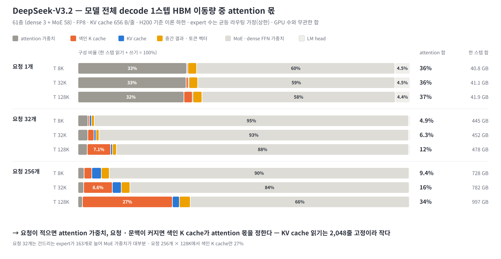
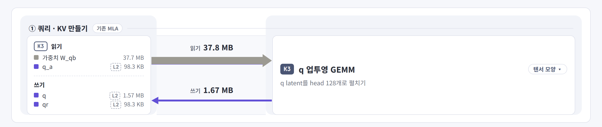
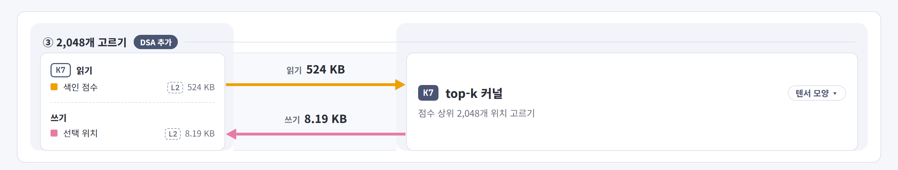
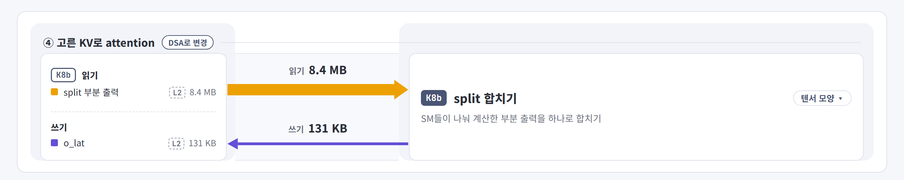
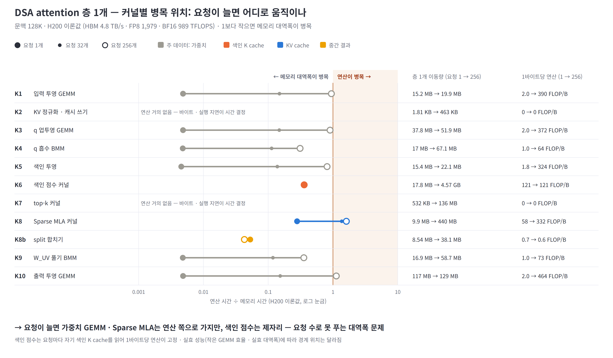

# DSA (DeepSeek-V3.2) decode 데이터 이동 — 모델 전체 비중 · 커널별 분석

sparse attention 데이터 플로우 정리 · 2026.11 · 약식 화면 스냅샷 기반

기준: H200 (HBM 4.8 TB/s · L2 50 MB) · decode 1스텝(새 토큰 1개를 만드는 한 번) · FP8 가중치 · KV cache 1줄 656 B · 이론 하한(모든 데이터를 딱 한 번씩만 읽고 쓴다고 본 값). 커널별 수치는 [약식 화면](https://kimhyeon-ji.github.io/llm-arch-lineage-wiki/arch_insight/dataflow-claude/viewer/dsa-v32-lite.html)과 같은 yaml에서, 모델 전체 수치는 [model_totals.py](model_totals.py)에서 계산했다. 그림은 [make_report.py](make_report.py)로 만든다. 커널을 나눈 방식은 SGLang · vLLM의 V3.2 경로를 단순화한 것이다.

---

## 요약

### DSA attention의 데이터 이동은 "요청이 적으면 가중치, 많으면 색인 K cache"가 좌우 — 정작 KV cache 읽기는 작다

| 조건 (문맥 128K) | 모델 전체 이동 중 attention 몫 | attention 층 1개에서 가장 많이 읽는 것 | KV cache 읽기 (층 1개) |
|---|---|---|---|
| **요청 1개** | 37% (15.7 / 41.9 GB) | 가중치 219 / 247 MB (89%) | 1.34 MB (0.5%) |
| **요청 32개** | 12% (55 / 478 GB) | 색인 K cache 554 / 863 MB (64%) | 43 MB (5%) |
| **요청 256개** | 34% (337 / 997 GB) | 색인 K cache 4.43 / 5.26 GB (84%) | 344 MB (7%) |

- **모델 전체:** 요청 1개면 attention 37% · MoE 58%. 요청 32개면 쓰는 expert가 163개로 늘어 MoE가 90% 안팎. 요청 256개 · 128K에서는 attention이 다시 34%로 커지고, 그 대부분(27%p)이 색인 K cache (1절)
- **층 1개 안에서 (요청 1개):** 247 MB를 읽는데 그중 219 MB가 가중치. 가장 큰 것은 출력 투영 가중치 117 MB. 쓰는 양은 9.33 MB뿐 (2절)
- **sparse가 바꾼 것:** KV cache는 2,048줄만 읽어 1/64로 줄었지만(86 → 1.34 MB), 대신 색인 K cache를 매번 전부 읽음(17.3 MB). 문맥이 약 10K 토큰을 넘으면 색인 쪽이 더 큼 (3.2)
- **요청이 늘면:** 가중치는 요청이 몇 개든 한 번만 읽고, 요청별 데이터는 요청 수만큼 늘어남. 128K에서는 요청 10개부터 요청별 데이터가 가중치보다 많음 (3.3)
- **커널별로 보면:** 요청이 늘면 가중치 GEMM과 Sparse MLA는 연산이 바빠지는 쪽으로 가지만, 색인 점수 커널은 요청이 몇 개든 메모리를 기다림. 이 커널을 메모리 가까이 옮기려면 행렬 연산기도 같이 가야 함 (4절)
- **실제와의 차이:** 다시 읽기 · 패딩 영향은 1% 미만. L2는 커널끼리 주고받는 작은 값에만 영향 → 약식 화면에 `L2` 표시 (5절)

---

## 구성

| 절 | 내용 |
|---|---|
| **1. 모델 전체 중 attention 비중** | 요청 수 · 문맥 길이별 한 스텝 HBM 이동량 구성 |
| **2. 커널별 이동 · 특성** | 커널마다 약식 화면 조각 → 바로 아래 이동 · 특성 · 병목 · 필요한 HW |
| **3. 분석** | 가중치 · 색인 K cache · 요청 수 · split 쓰기 |
| **4. 커널 종합** | 커널별 병목 위치(요청 1 → 256) 한 장 · 특성 → 필요한 HW 특성 표 |
| **5. 계산값과 실제의 차이** | 다시 읽기 · 패딩 · L2 |
| **6. 아키텍처 아이디어 후보** | 굵은 화살표별 현재 한계 · 방향 |
| **부록** | 계산 기준 |

---

## 1. 모델 전체 중 attention 비중

### 요청 1개면 attention 이동의 대부분이 가중치 — 요청과 문맥이 커질수록 색인 K cache가 그 자리를 차지

- **요청 1개:** 한 스텝에 약 42 GB. MoE · FFN 가중치 24 GB(58%), attention 가중치 13 GB(32%), LM head 1.9 GB(4%). 문맥을 늘려도 거의 안 바뀜
- **요청 32개:** 요청마다 다른 expert를 써서 읽는 expert가 8개 → 163개로 늘어남(고르게 나뉜다고 가정). MoE 가중치만 420 GB라 attention 몫은 5 ~ 12%로 작아 보임
- **요청 256개:** expert 256개를 전부 읽으면 MoE는 656 GB에서 더 안 늘어남. 그 뒤로는 요청별 데이터만 늘어 128K에서 attention 34%, 그중 색인 K cache 270 GB(27%)
- **KV cache:** 어떤 조건에서도 3% 이하. 요청마다 2,048줄만 골라 읽기 때문
- **중간 결과 · 토큰 벡터:** 1 ~ 3%. 요청이 적을 때는 대부분 split 부분 출력(2절 K8 → K8b)

※ 모델 전체가 한 스텝에 읽고 쓰는 바이트의 합이다. GPU 여러 장에 나눠도 합은 같다고 보고, 가중치 복제(DP attention) · GPU 간 통신 · MTP 층 · 잔차 · 정규화 값은 뺐다. 실제 라우팅은 몇몇 expert에 몰리므로 요청 32개의 expert 수(163개)는 최대치다.

---

## 2. 커널별 이동 · 특성 — attention 층 1개 · 요청 1개 · 128K

### 굵은 화살표는 가중치 읽기와 색인 K cache 읽기 — 쓰기는 split 부분 출력 하나만 굵다

- **그림:** [약식 화면](https://kimhyeon-ji.github.io/llm-arch-lineage-wiki/arch_insight/dataflow-claude/viewer/dsa-v32-lite.html)의 커널 한 줄. 왼쪽은 HBM에서 읽고 쓰는 데이터, 가운데 화살표는 옮기는 양(굵기 ∝ √바이트, 모든 그림이 같은 눈금), 오른쪽은 커널과 칩 안 메모리(점선 = SMEM · 레지스터). `L2` 표시는 L2 캐시에서 끝날 수 있는 작은 값
- **1바이트당 연산:** HBM에서 1바이트를 가져올 때 하는 연산 수. H200은 FP8 412번 · BF16 206번이 균형점 — 이보다 적으면 연산기가 메모리를 기다림
- **병목:** 요청 1개 → 256개일 때 메모리 시간과 연산 시간 중 어느 쪽이 긴지
- **층 1개 합:** 읽기 247 MB · 쓰기 9.33 MB(읽기가 26배) · 이론 하한 53 µs, 61층이면 3.3 ms
- 핵심 커널(K6 · K8)은 커널 칸을 눌러 텐서 모양까지 펼친 그림

### ① 쿼리 · KV 만들기 (K1 ~ K4) — 가중치를 읽어 q와 KV 1줄을 만드는 단계

#### K1 입력 투영 GEMM

- **하는 일:** 입력 x를 q latent(1,536폭)와 KV latent(576폭)로 줄이는 첫 투영
- **이동:** 가중치 15 MB를 읽고, 다음 커널에 넘길 작은 벡터 4 KB를 씀
- **특성:** 가중치를 처음부터 끝까지 연속으로 읽음. 같은 가중치를 모든 요청이 같이 쓰므로, 1바이트당 연산이 요청 1개면 2번 → 256개면 390번으로 늘어남
- **병목 · HW:** 요청 1개는 메모리 시간이 연산의 약 200배 → 256개면 둘이 비슷. 요청이 적을 땐 대역폭, 많을 땐 연산 처리량이 필요

#### K2 KV 정규화 · 캐시 쓰기

- **하는 일:** 새 토큰의 KV 1줄을 완성(정규화 · RoPE · FP8 양자화)해 KV cache 끝에 붙임
- **이동:** 1 KB를 읽고 656 B를 씀 — 사실상 0
- **특성:** 계산은 모두 레지스터 안에서 끝나고, 연산도 거의 없음
- **병목 · HW:** 옮길 것이 너무 작아 커널을 띄우는 시간이 실제 시간을 정함 → K1과 합치는 편이 이득. HBM 쪽은 작은 단위로 쓸 수 있으면 충분

#### K3 q 업투영 GEMM

- **하는 일:** q latent를 head 128개의 q로 펼침
- **이동:** 가중치 38 MB를 읽고(층에서 두 번째로 큼), head별 q 52 KB를 씀
- **특성:** K1과 같은 모양 — 가중치 연속 읽기, 요청끼리 공유. 1바이트당 연산 2번 → 372번
- **병목 · HW:** 메모리 시간이 연산의 약 200배 → 256개면 비슷. K1과 같은 요구

#### K4 q 흡수 BMM

- **하는 일:** q를 KV latent 공간으로 옮김. KV cache를 head별로 풀지 않으려는 MLA의 "흡수" 기법
- **이동:** 가중치 17 MB를 읽고, latent 쿼리 q_full 147 KB를 씀
- **특성:** head 128개가 각자 다른 작은 행렬([128 × 512])을 곱함. 요청마다 q_full을 HBM에 써야 해서 요청이 늘어도 1바이트당 연산이 64번에 그침
- **병목 · HW:** 요청 256개에서도 메모리 시간이 연산의 약 3배 → 끝까지 대역폭 쪽. q_full을 HBM에 쓰지 않고 K8로 바로 넘기면(커널 합치기) 요청당 147 KB 왕복이 사라짐

### ② 색인 점수 매기기 (K5 · K6) — DSA가 더한 단계: 지난 토큰 전체에 점수 매기기

#### K5 색인 투영

- **하는 일:** 색인용 q와 head 가중치를 만들고, 새 토큰의 색인 키 1줄(132 B)을 색인 K cache에 붙임
- **이동:** 색인 가중치 15 MB를 읽고 9 KB를 씀
- **특성:** 가중치 GEMM과 같은 모양. 1바이트당 연산 1.8번 → 324번
- **병목 · HW:** 메모리 시간이 연산의 약 200배 → 256개면 거의 비슷. 가중치 GEMM과 같은 요구

#### K6 색인 점수 커널 — 핵심

- **하는 일:** 새 토큰을 지난 모든 토큰의 색인 키와 비교해 토큰별 점수를 매김. DSA가 "어디를 볼지" 정하는 단계
- **이동:** 색인 K cache 17.3 MB(132 B × 13만 줄)를 전부 읽고, 토큰당 점수 4 B(524 KB)만 씀
- **특성:** 색인 K cache를 64토큰 묶음(약 8 KB)씩 연속으로 읽어 SMEM에 올리고 Tensor core로 곱함. 키 1줄을 64 head가 같이 써서 1바이트당 연산 121번 — 요청마다 자기 cache를 따로 읽으니 요청이 늘어도 그대로. head별 점수 33.6 MB는 레지스터에서 합쳐 바로 버림
- **크기를 정하는 것:** 요청 수 × 문맥. 요청 32개면 554 MB, 256개면 4.43 GB
- **병목 · HW:** 메모리 시간이 늘 연산의 약 3배 — 요청을 늘려도 안 바뀜. 대역폭이 곧 속도. 메모리 가까이 옮기려면 FP8 행렬 연산기도 같이 가야 함(대역폭 4.8 TB/s당 약 600 TFLOPS) — 단순 비교기로는 못 함

### ③ 2,048개 고르기 (K7) — DSA가 더한 단계: 점수 상위만 남기기

#### K7 top-k 커널

- **하는 일:** 점수 13만 개 중 상위 2,048개의 위치를 고름
- **이동:** 점수 524 KB를 읽고, 위치 8 KB를 씀
- **특성:** 행렬곱이 아니라 비교 · 선택 연산. 점수를 전부 봐야 결과가 나오므로 다음 단계(K8)가 이걸 기다림. 요청 수 × 문맥에 비례(256개 · 128K면 134 MB 읽기)
- **병목 · HW:** 요청이 적으면 커널 띄우는 시간, 많으면 대역폭. 선택 전용 연산기가 있으면 좋고, K6과 합쳐 점수를 칩 안에서 바로 고르면 요청당 524 KB 왕복이 사라짐

### ④ 고른 KV로 attention (K8 · K8b) — 2,048줄만 모아 attention 계산

#### K8 Sparse MLA 커널 — 핵심

- **하는 일:** 고른 2,048줄의 KV만 모아 attention 계산(QK → softmax → PV)
- **이동:** KV cache 2,048줄(1.34 MB)을 골라 읽고, split 부분 출력 8.4 MB를 씀
- **특성:** 읽을 위치를 K7 결과가 정하는 흩어 읽기 — 한 번에 656 B씩 2,048곳. 문맥이 길어도 읽는 양은 그대로. KV 1줄을 head 128개가 같이 써서 KV 1바이트당 연산이 약 425번으로 많음
- **병목 · HW:** 요청 1개는 split 쓰기 때문에 메모리 쪽이지만, **요청 32개부터는 연산이 더 오래 걸림**. 필요한 것: 수백 B 단위 흩어 읽기를 잘하는 메모리 · 주소 목록으로 읽는 기능 · (요청이 많을 때) Tensor core 처리량. K7이 끝나야 주소가 정해져 미리 읽어 두기 어려움

#### K8b split 합치기

- **하는 일:** SM들이 나눠 계산한 부분 결과 32조각을 하나로 합침
- **이동:** 부분 출력 8.4 MB를 다시 읽고 131 KB를 씀
- **특성:** 요청 1개로 SM 132개를 다 쓰려고 일을 32조각으로 나눈 탓에 생긴 왕복. 연산은 거의 없음(1바이트당 0.6번). 요청이 늘면 조각이 줄어 비중이 작아짐(256개에서 층 읽기의 0.6%)
- **병목 · HW:** 메모리 시간이 연산의 약 20배. SM끼리 칩 안에서 바로 합칠 수 있으면(클러스터 공유 메모리 등) HBM 왕복이 사라짐

### ⑤ 출력 투영 (K9 · K10) — 층에서 가장 굵은 화살표 W_o 117 MB

#### K9 W_UV 풀기 BMM

- **하는 일:** head마다 latent 출력(512폭)을 V 폭(128)으로 되돌림
- **이동:** 가중치 17 MB를 읽고 head 출력 33 KB를 씀
- **특성:** K4와 같은 모양 — head별 작은 행렬이고 요청별 입출력이 같이 늘어, 1바이트당 연산이 73번에 그침
- **병목 · HW:** 요청 256개에서도 메모리 시간이 연산의 약 3배. K8b와 합치면 latent 출력 왕복이 사라짐

#### K10 출력 투영 GEMM

- **하는 일:** head 출력 16,384폭을 hidden 7,168폭으로 투영
- **이동:** 가중치 117 MB를 읽음 — 층 전체 읽기의 47%, 가장 굵은 화살표. 쓰기는 14 KB
- **특성:** 가중치 연속 읽기, 요청끼리 공유. 1바이트당 연산 2번 → 464번
- **병목 · HW:** 메모리 시간이 연산의 약 200배 → 256개면 연산이 조금 더 김. 가중치 대역폭을 늘리거나 가중치 정밀도를 낮추면 효과가 가장 큰 커널

---

## 3. 분석

### 3.1 요청 1개 — 가중치가 화살표 굵기를 정한다

- **가중치가 89%:** 층 1개에서 읽는 247 MB 중 219 MB가 가중치. 출력 투영 가중치(K10) 하나가 47%, q 업투영(K3)이 그다음
- **DSA가 더한 색인 단계(K5 ~ K7):** 33 MB로 13%. 색인 가중치 15 MB + 색인 K cache 17 MB
- **본 attention(K8):** KV cache 1.34 MB로 0.5%뿐. sparse 덕분에 attention 계산 자체가 옮기는 양은 작음
- **시간:** 층마다 이론 하한 53 µs가 거의 다 메모리 시간(연산은 가장 큰 색인 점수도 1.3 µs) → 요청 1개 decode는 "가중치를 얼마나 빨리 읽나"의 문제

### 3.2 sparse의 대가 — KV cache 읽기는 줄었지만, 색인 K cache를 매번 전부 읽는다

| 문맥 T | 색인 K cache 읽기 (K6) | KV cache 읽기 (K8, 2,048줄) | dense였다면 KV cache 읽기 |
|---|---:|---:|---:|
| 8K | 1.08 MB | 1.34 MB | 5.4 MB |
| 32K | 4.33 MB | 1.34 MB | 21.5 MB |
| 128K | 17.3 MB | 1.34 MB | 86 MB |

- **KV cache 읽기:** 2,048줄만 읽으니 문맥이 길어도 1.34 MB 그대로. 128K에서 dense(86 MB)의 1/64
- **색인 K cache 읽기:** 토큰당 132 B를 전부 읽어 문맥에 비례. 약 10K 토큰부터 KV cache 읽기보다 커지고, 128K에서는 13배
- **둘을 합치면:** 128K에서 18.6 MB로 dense의 22%. 그중 93%가 색인 K cache
- **줄어드는 정보량:** 색인 K cache 17.3 MB를 읽어 점수 524 KB를 만들고(K6), 결국 위치 8 KB만 남김(K7) → 메모리 가까이에서 처리하기 좋은 모양

### 3.3 요청이 늘면 — 가중치 커널은 그대로, 색인 · KV 커널만 커진다

| 커널 (128K) | 요청 1개 (읽기 / 쓰기) | 요청 32개 | 요청 256개 |
|---|---:|---:|---:|
| K1 · K3 · K5 · K10 (가중치 GEMM) | 185 MB / 80 KB | 187 MB / 2.5 MB | 203 MB / 20 MB |
| K4 · K9 (흡수 BMM) | 33.7 MB / 180 KB | 39.4 MB / 5.8 MB | 79.7 MB / 46 MB |
| **K6 색인 점수** | 17.3 MB / 524 KB | **554 MB** / 16.8 MB | **4.43 GB** / 134 MB |
| K7 top-k | 524 KB / 8 KB | 16.8 MB / 262 KB | 134 MB / 2.1 MB |
| K8 Sparse MLA | 1.5 MB / 8.4 MB | 48 MB / 16.8 MB | 384 MB / 56 MB |
| K8b split 합치기 | 8.4 MB / 131 KB | 16.8 MB / 4.2 MB | 30.5 MB / 7.6 MB |
| **층 1개 합** | 247 MB / 9.33 MB | 863 MB / 46 MB | 5.26 GB / 267 MB |

- **K6 색인 점수:** 요청마다 자기 색인 K cache 17.3 MB를 전부 읽어, 요청 32개면 층 읽기의 64%, 256개면 84%
- **가중치 커널:** 요청 수와 상관없이 약 220 MB. 요청 1개일 땐 주인공, 요청이 많으면 조연
- **역전 지점:** 요청별 데이터가 가중치보다 많아지는 요청 수 — 32K는 27개, 128K는 10개
- **연산:** K6은 연산량도 가장 큼(요청 256개 · 128K에서 층마다 554 GFLOP). 그래도 연산 342 µs < 메모리 951 µs라 여전히 메모리 쪽

### 3.4 쓰기 — 요청 1개면 쓰기의 90%가 split 부분 출력

- **왜 생기나:** 요청 1개로 SM 132개를 다 쓰려고, FlashMLA가 2,048줄을 32조각으로 나눠 계산. 조각마다 부분 결과([128 × 512], FP32)를 HBM에 썼다가 K8b가 다시 읽음 → 8.4 MB 쓰기 + 8.4 MB 읽기
- **요청이 늘면:** 요청당 조각 수가 줄어듦. 요청 256개면 116조각만 나뉘고 198개 요청은 안 나뉨 → 부분 출력 30.5 MB, 층 읽기의 0.6%
- **의미:** 저장해 둘 데이터가 아니라 계산 방식 때문에 생긴 왕복. 칩 안에서 합치면 HBM까지 갈 필요가 없음

---

## 4. 커널 종합 — 병목 위치 · 필요한 HW 특성

### 요청이 늘면 가중치 GEMM · Sparse MLA는 연산이 바빠지지만, 색인 점수는 계속 메모리를 기다린다

- **그림 보는 법:** 점이 1보다 왼쪽이면 메모리를 기다리는 커널, 오른쪽이면 연산이 바쁜 커널. ● 요청 1개 → ○ 요청 256개로 얼마나 움직이는지가 핵심
- **가중치 GEMM (K1 · K3 · K5 · K10):** 요청이 늘수록 오른쪽으로 크게 이동 — 같은 가중치로 더 많은 요청을 계산하니까. 요청 약 200 ~ 250개에서 경계
- **흡수 BMM (K4 · K9):** 요청별 출력도 같이 늘어 256개에서도 0.3 ~ 0.4 — 메모리 쪽에 남음
- **K6 색인 점수:** 0.36에서 꼼짝 않음. 요청마다 자기 색인 K cache를 따로 읽어 1바이트당 연산이 121번으로 고정이기 때문 → 요청을 모아도 안 풀리는 대역폭 문제
- **K8 Sparse MLA:** head 128개가 KV 1줄을 같이 써서 요청 32개부터 경계를 넘음. 요청 1개에서 왼쪽인 건 split 부분 출력 쓰기 때문
- **K2 · K7 · K8b:** 연산도 바이트도 작아 그림에서 의미가 없음. 실제 시간은 커널을 띄우고 기다리는 시간이 정함

### 4.1 특성 → 필요한 HW 특성 (종합)

| 특성 | 해당 커널 | 수치 (128K) | 필요한 HW 특성 |
|---|---|---|---|
| **공유 가중치 연속 읽기** | K1 · K3 · K4 · K5 · K9 · K10 | 층마다 219 MB 고정 · 1바이트당 연산 = 2 × 요청 수 | 요청이 적으면 연속 읽기 대역폭, 약 200개부터는 연산 처리량 — 배치 크기에 맞는 연산 : 대역폭 비율 |
| **요청별 cache 전체 훑기 + 행렬 연산** | K6 | 토큰당 132 B × 요청 수 · 1바이트당 연산 121 고정 | 대역폭이 곧 속도. 메모리 가까이 옮긴다면 FP8 행렬 연산기도 함께(4.8 TB/s당 약 600 TFLOPS) — 비교기만으로는 부족 |
| **전체를 봐야 하는 선택 (top-k)** | K7 | 점수 4 B × 문맥 → 위치 2,048개 | 비교 · 선택 연산기. K6과 합쳐 점수를 HBM에 안 쓰면 요청당 524 KB 왕복 제거 |
| **앞 결과로 위치가 정해지는 흩어 읽기** | K8 | 656 B × 2,048곳 = 요청당 1.34 MB | 수백 B 단위 흩어 읽기 효율 · 주소 목록으로 읽기. K7이 끝나야 주소가 나와 미리 읽기 어려움 |
| **head 공유로 연산이 많음** | K8 | KV 1바이트당 연산 약 425 | 요청 32개부터 Tensor core 처리량이 병목 → 흩어 읽은 KV를 바로 행렬 연산기로 |
| **SM끼리 합치기** | K8b | 요청 1개에서 8.4 MB 왕복 | 칩 안에서 SM끼리 합치기(클러스터 공유 메모리 등) → HBM 왕복 제거 |
| **1줄 추가 쓰기** | K2 · K5 | 토큰 · 층마다 656 B + 132 B | 작은 단위 쓰기. 읽고-고쳐-쓰기는 없음 |
| **작은 커널** | K2 · K7 · K8b (요청 1개) | KB ~ 수 MB · 이론 시간 0.1 ~ 2 µs | 커널 띄우기 · 동기화 시간 줄이기 — 커널 합치기 · 계속 떠 있는(persistent) 커널 |

※ 1바이트당 연산 = 커널 FLOP ÷ HBM 읽기 · 쓰기 바이트. H200의 균형점은 FP8 412 · BF16 206이다. 그림의 경계(1)는 이론 최고 성능 기준이라, 실제로는 작은 GEMM의 효율과 실효 대역폭에 따라 조금씩 움직인다.

---

## 5. 계산값과 실제의 차이 — 다시 읽기 · 패딩 · L2

### 굵은 화살표(가중치 · 색인 K cache · KV cache)는 실제로도 거의 그대로 — 달라지는 건 L2에서 끝날 수 있는 작은 값뿐

| 효과 | 내용 | 크기 (요청 1개 · 128K, 층 1개) | 약식 화면 |
|---|---|---|---|
| **다시 읽기** | decode는 요청 수가 작아 가중치를 한 번만 읽음. 색인 키 1줄은 64 head가, KV 1줄은 128 head가 칩 안에서 같이 씀 | 거의 0 | 반영 안 함 |
| **패딩** | KV 1줄 656 B가 32 B의 배수가 아니라 줄 경계에서 최대 32 B를 더 읽음 · 64줄 묶음의 끝자리 | 최대 약 65 KB (층 읽기의 0.03%) | 반영 안 함 |
| **L2 (50 MB)** | 앞 커널이 쓰고 바로 다음 커널이 읽는 작은 값(토큰 벡터 · 색인 점수 · split 부분 출력)은 L2에서 끝날 수 있음 | 읽기 9.3 MB (3.8%) · 쓰기 9.3 MB (거의 전부) | **`L2` 표시 추가** |
| L2로 못 줄이는 것 | 가중치는 층마다 달라서, KV cache · 색인 K cache는 요청마다 달라서 한 스텝에 한 번씩만 쓰임 → 캐시에 남겨 둘 이유가 없음 | — | 화살표 그대로 |

- **`L2` 표시 기준:** 가중치 · cache가 아니고, L2의 절반(25 MB) 이하인 값. 요청 32개면 색인 점수(16.8 MB)까지 표시되고, 256개면 134 MB로 커져 표시가 사라짐
- **쓰기는 최대치로 볼 것:** L2에 남은 값도 밀려날 때 결국 HBM에 써질 수 있음
- **정확한 값은 측정으로:** Nsight Compute로 커널별 DRAM 바이트를 재면 확인 가능. 다만 "가중치 · 색인 K cache가 대부분"이라는 결론을 바꿀 크기는 아님

---

## 6. 아키텍처 아이디어 후보

### 조건마다 굵은 화살표가 다르다 — 요청이 적으면 가중치, 요청 · 문맥이 크면 색인 K cache

| 항목 | 현재 한계 (근거) | 방향 |
|---|---|---|
| **가중치 읽기** | 요청 1개에서 층 읽기의 89%. 모델 전체로는 attention 가중치 32% · MoE 58% (1 · 3.1절) | 가중치 대역폭 늘리기 · 가중치 정밀도 낮추기 · 요청이 적을 때는 메모리 가까이에서 GEMV |
| **색인 K cache 훑기** | 요청 · 문맥에 비례해 요청 256개 · 128K에서 모델 전체의 27%. 요청을 모아도 메모리 대기가 그대로 (1 · 3.3 · 4절) | 색인 점수 · top-k를 메모리 가까이에서 → 칩으로는 요청당 위치 8 KB만 보냄 (3.2절). 단, 메모리 쪽에 FP8 행렬 연산기 필요(4.8 TB/s당 약 600 TFLOPS) |
| **고른 KV 흩어 읽기** | 656 B 줄 2,048개를 K7이 정한 위치에서 읽음 (2절) | 작은 단위 흩어 읽기 효율 · 주소 목록으로 읽기 · KV 줄 배치 |
| **Sparse MLA 연산** | head 128개가 KV 1줄을 같이 써서 요청 32개부터 연산이 병목 (4절) | Tensor core 처리량 · 더 낮은 정밀도의 행렬 연산 |
| **split 부분 출력** | 요청 1개에서 쓰기의 90%가 이 왕복 (3.4절) | 칩 안(SMEM · L2 · SM끼리)에서 합치기 |
| **작은 커널 · 선택** | K2 · K7 · K8b는 바이트도 연산도 작아 커널 띄우는 시간이 곧 실제 시간 (4절) | 커널 합치기 · K6 + K7을 한 번에(점수를 HBM에 안 씀) |

---

## 부록 — 계산 기준

- **attention 블록:** [dsa-v32/algo.yaml](../models/dsa-v32/algo.yaml) · [map-gpu.yaml](../models/dsa-v32/map-gpu.yaml). 약식 · 자세한 화면과 같은 식. 범위는 입력 RMSNorm 이후 ~ o_proj 출력
- **나머지 (config):** 61층 = dense FFN 3층(18,432) + MoE 58층(expert 2,048폭 × 256개, 8개 + 공유 1개 선택), FP8, router BF16, LM head BF16 129,280 × 7,168. 요청 B개가 건드리는 expert 수 = 256 × (1 − (1 − 8/256)^B)
- **제외:** MTP 층 · 임베딩 행 읽기 · 잔차 · 정규화 값 · GPU 간 통신 · 가중치 복제
- **가중치 형식:** FP8(block scale 생략). W_UK · W_UV는 BF16 가정(구현마다 다름), W_Iw는 FP32
- **이론 하한:** max(바이트 ÷ 4.8 TB/s, FLOP ÷ 피크). 커널 실행 지연 · 동기화 · 불규칙 접근 비효율 미포함
- ※ 출처: DeepSeek-V3.2 config.json (Hugging Face) · FlashMLA `get_decoding_sched_meta.cu` (split 스케줄) · SGLang / vLLM DeepSeek-V3.2 decode 경로
