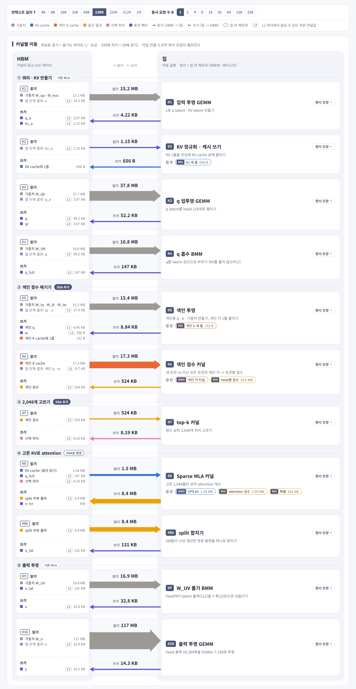

# DSA (DeepSeek-V3.2) decode 데이터 이동 — 모델 전체 비중 · 커널별 분석

sparse attention 데이터 플로우 정리 · 2026.11 · 약식 화면 스냅샷 기반

기준: H200 (HBM 4.8 TB/s · L2 50 MB) · decode 1스텝(새 토큰 1개) · FP8 가중치 · KV cache 1줄 656 B · 이론 하한(텐서를 한 번씩만 읽고 쓴다고 본 값). 커널별 수치는 [약식 화면](https://kimhyeon-ji.github.io/llm-arch-lineage-wiki/arch_insight/dataflow-claude/viewer/dsa-v32-lite.html)과 같은 yaml에서, 모델 전체 수치는 [model_totals.py](model_totals.py)에서 계산했다. 그림은 [make_report.py](make_report.py)로 만든다. 커널 묶음은 SGLang · vLLM의 V3.2 경로를 단순화한 것이다.

---

## 요약

### attention 이동량은 요청이 적으면 가중치가, 요청 · 문맥이 커지면 색인 K cache가 결정 — KV cache 읽기는 2,048줄 고정이라 작음

| 조건 (128K) | 모델 전체 중 attention | attention 층 1개 읽기 중 가장 큰 것 | KV cache 읽기 (층 1개) |
|---|---|---|---|
| **요청 1개** | 37% (15.7 / 41.9 GB) | 가중치 219 / 247 MB (89%) | 1.34 MB (0.5%) |
| **요청 32개** | 12% (55 / 478 GB) | 색인 K cache 554 / 863 MB (64%) | 43 MB (5%) |
| **요청 256개** | 34% (337 / 997 GB) | 색인 K cache 4.43 / 5.26 GB (84%) | 344 MB (7%) |

- **모델 전체:** 요청 1개는 attention 37% · MoE 58% · LM head 4%. 요청 32개는 건드리는 expert가 163개로 늘어 MoE가 88 ~ 95%. 요청 256개 × 128K에서 attention이 다시 34%, 그중 27%p가 색인 K cache (1절)
- **커널별 (요청 1개 · 128K):** 층 1개 읽기 247 MB 중 가중치 219 MB. 가장 굵은 화살표는 K10 출력 투영 117 MB. 쓰기는 9.33 MB뿐이고 그중 8.4 MB가 split 부분 출력 (2절)
- **sparse의 비용 구조:** KV cache 읽기는 1/64로 감소(86 → 1.34 MB), 대신 색인 K cache를 전부 읽음(17.3 MB). 문맥 약 10K 토큰부터 색인 K cache 읽기 > KV cache 읽기 (3.2)
- **요청 수 영향:** 가중치는 고정, 요청별 데이터는 요청 수에 비례. 128K에서 요청 10개부터 요청별 이동 > 가중치 (3.3)
- **커널별 특성:** 요청이 늘면 가중치 GEMM은 약 200개, Sparse MLA는 32개부터 연산 병목. 색인 점수(1바이트당 121 FLOP)는 요청 수와 무관하게 대역폭 쪽 → 메모리 가까이 옮기려면 FP8 행렬 연산이 같이 필요 (4절)
- **실제와의 차이:** 다시 읽기 · 패딩은 1% 미만. L2는 커널 사이 작은 전달값에만 영향 — 읽기의 4 ~ 5%, 쓰기는 거의 전부. 약식 화면에 L2 표시 추가 (5절)

---

## 구성

| 절 | 내용 |
|---|---|
| **1. 모델 전체 중 attention 비중** | 요청 수 · 문맥 길이별 한 스텝 HBM 이동량 구성 |
| **2. 커널별 이동 스냅샷** | 약식 화면 — attention 층 1개 · 요청 1개 · 128K |
| **3. 분석** | 가중치 · 색인 K cache · 요청 수 · split 쓰기 |
| **4. 커널별 특성 · 필요한 HW 특성** | 병목 위치(요청 1 → 256) · 접근 모양 · 재사용 → HW 요구 |
| **5. 계산값과 실제의 차이** | 다시 읽기 · 패딩 · L2 |
| **6. 아키텍처 아이디어 후보** | 굵은 화살표별 현재 한계 · 방향 |
| **부록** | 계산 기준 |

---

## 1. 모델 전체 중 attention 비중

### 요청 1개는 attention 가중치가 37% 중 32%p — 요청 · 문맥이 커지면 색인 K cache가 attention 몫의 대부분

- **요청 1개:** 한 스텝 약 41 ~ 42 GB. MoE · dense FFN 가중치 24.4 GB(58%) · attention 가중치 13.4 GB(32%) · LM head 1.85 GB(4%). 문맥 길이를 바꿔도 거의 그대로
- **요청 32개:** 건드리는 expert 8개 → 163개(균등 라우팅 가정)로 MoE 가중치가 420 GB. attention은 5 ~ 12%
- **요청 256개:** expert 256개를 모두 읽어 MoE가 656 GB로 상한. 이후는 요청별 데이터만 증가 → 128K에서 attention 34%, 색인 K cache 270 GB(27%)
- **KV cache:** 어느 조건에서도 3% 이하. 요청마다 2,048줄만 골라 읽기 때문
- **중간 결과 · 토큰 벡터:** 1 ~ 3%. 요청이 적을 때는 대부분 split 부분 출력(2절 K8 → K8b)

※ 모델 전체가 한 스텝에 읽고 쓰는 바이트의 합이다. GPU 여러 장에 나눠도 합은 같다고 보고, 가중치 복제(DP attention) · GPU 간 통신 · MTP 층 · 잔차 · 정규화 값은 뺐다. 실제 라우팅은 쏠리므로 요청 32개의 expert 수(163개)는 상한이다.

---

## 2. 커널별 이동 스냅샷 — attention 층 1개 · 요청 1개 · 128K

### 굵은 화살표 = 가중치 읽기(K1 · K3 · K4 · K5 · K9 · K10)와 색인 K cache 읽기(K6) — 쓰기 화살표는 split 부분 출력(K8) 하나만 굵음

| 커널 | HBM 읽기 | HBM 쓰기 | 굵은 화살표의 정체 |
|---|---:|---:|---|
| K1 입력 투영 GEMM | 15.2 MB | 4.22 KB | 가중치 W_qa · W_kva |
| K2 KV 정규화 · 캐시 쓰기 | 1.15 KB | 656 B | KV cache에 1줄 쓰기 |
| K3 q 업투영 GEMM | 37.8 MB | 52.2 KB | 가중치 W_qb |
| K4 q 흡수 BMM | 16.8 MB | 147 KB | 가중치 W_UK |
| K5 색인 투영 | 15.4 MB | 8.84 KB | 색인 가중치 W_Iq · W_Ik · W_Iw |
| **K6 색인 점수 커널** | **17.3 MB** | 524 KB | **색인 K cache 전부 (132 B × 131,072줄)** |
| K7 top-k 커널 | 524 KB | 8.19 KB | 색인 점수 → 선택 위치 2,048개 |
| K8 Sparse MLA 커널 | 1.5 MB | **8.4 MB** | KV cache 2,048줄 골라 읽기 · split 부분 출력 쓰기 |
| K8b split 합치기 | 8.4 MB | 131 KB | split 부분 출력 다시 읽기 |
| K9 W_UV 풀기 BMM | 16.9 MB | 32.8 KB | 가중치 W_UV |
| **K10 출력 투영 GEMM** | **117 MB** | 14.3 KB | **가중치 W_o** |
| **합계** | **247 MB** | **9.33 MB** | 이론 하한 53 µs/층 · 61층이면 3.3 ms |

- **읽기 ≫ 쓰기:** 읽기 247 MB : 쓰기 9.33 MB ≈ 26 : 1. 새 토큰의 KV cache 1줄(656 B) · 색인 키 1줄(132 B)만 상주 데이터로 남음
- **화면의 L2 표시:** 토큰 벡터 · 색인 점수 · split 부분 출력처럼 앞뒤 커널이 주고받는 작은 값. 실제로는 L2에서 끝날 수 있음(5절)

---

## 3. 분석

### 3.1 요청 1개 — 가중치가 화살표 굵기를 결정

- **가중치 219 MB / 읽기 247 MB (89%):** W_o 117 MB(K10) 하나가 읽기의 47%. W_qb 37.7 MB(K3)가 그다음
- **DSA가 더한 색인 단계(K5 ~ K7):** 33.2 MB로 읽기의 13%. 그중 색인 가중치 15.3 MB · 색인 K cache 17.3 MB
- **본 attention(K8):** KV cache 1.34 MB로 읽기의 0.5%. sparse 덕분에 attention 연산 자체의 이동은 작음
- **시간:** 층마다 이론 하한 53 µs 중 메모리 시간이 거의 전부(연산은 색인 점수 1.3 µs가 최대) → 요청 1개 decode는 가중치 대역폭 문제

### 3.2 sparse의 대가 — KV cache 읽기는 고정, 색인 K cache 읽기는 문맥에 비례

| 문맥 T | 색인 K cache 읽기 (K6) | KV cache 읽기 (K8, 2,048줄) | dense였다면 KV cache 읽기 |
|---|---:|---:|---:|
| 8K | 1.08 MB | 1.34 MB | 5.4 MB |
| 32K | 4.33 MB | 1.34 MB | 21.5 MB |
| 128K | 17.3 MB | 1.34 MB | 86 MB |

- **KV cache 읽기:** 128K에서 86 MB → 1.34 MB (1/64). 문맥과 무관하게 고정
- **색인 K cache 읽기:** 132 B × T로 문맥에 비례. 약 10K 토큰(132 × T = 656 × 2,048)부터 KV cache 읽기보다 큼. 128K에서 13배
- **합:** 128K에서 18.6 MB = dense KV 읽기의 22%. 남은 이동의 93%가 색인 K cache
- **K6이 칩으로 넘기는 결과:** 색인 점수 524 KB → K7이 선택 위치 8 KB로 줄임. 읽은 색인 K cache 17.3 MB 중 칩에 남는 정보는 8 KB

### 3.3 요청 수가 늘 때 — 가중치 커널은 그대로, 색인 · KV 커널만 증가

| 커널 (128K) | 요청 1개 (읽기 / 쓰기) | 요청 32개 | 요청 256개 |
|---|---:|---:|---:|
| K1 · K3 · K5 · K10 (가중치 GEMM) | 185 MB / 80 KB | 187 MB / 2.5 MB | 203 MB / 20 MB |
| K4 · K9 (흡수 BMM) | 33.7 MB / 180 KB | 39.4 MB / 5.8 MB | 79.7 MB / 46 MB |
| **K6 색인 점수** | 17.3 MB / 524 KB | **554 MB** / 16.8 MB | **4.43 GB** / 134 MB |
| K7 top-k | 524 KB / 8 KB | 16.8 MB / 262 KB | 134 MB / 2.1 MB |
| K8 Sparse MLA | 1.5 MB / 8.4 MB | 48 MB / 16.8 MB | 384 MB / 56 MB |
| K8b split 합치기 | 8.4 MB / 131 KB | 16.8 MB / 4.2 MB | 30.5 MB / 7.6 MB |
| **층 1개 합** | 247 MB / 9.33 MB | 863 MB / 46 MB | 5.26 GB / 267 MB |

- **K6:** 요청 32개면 층 읽기의 64%, 256개면 84%. 요청마다 자기 색인 K cache 17.3 MB를 전부 읽기 때문
- **가중치 커널:** 요청 수와 무관하게 약 220 MB. 요청 1개일 때의 주인공이 요청이 늘면 조연
- **교차점:** 요청별 이동이 가중치보다 커지는 요청 수 — 32K는 27개, 128K는 10개
- **연산:** K6은 FLOP도 가장 큼 — 요청 256개 × 128K에서 층마다 554 GFLOP. 연산 시간 342 µs < 메모리 시간 951 µs라 아직 대역폭 쪽

### 3.4 쓰기 — 요청 1개면 split 부분 출력이 쓰기의 90%

- **원인:** 요청 1개로 SM 132개를 채우려고 FlashMLA가 2,048줄을 32조각(split)으로 나눠 계산. 조각마다 FP32 부분 출력 [128 × 512]을 HBM에 쓰고 K8b가 다시 읽음 → 8.4 MB 쓰기 + 8.4 MB 읽기
- **요청이 늘면:** 요청당 조각 수 감소 → 요청 256개에서는 split 116조각 · split 없는 요청 198개, 부분 출력 30.5 MB (층 읽기의 0.6%)
- **의미:** 상주 데이터가 아닌 계산 방식 때문의 왕복. L2 · SMEM에서 합치면 HBM까지 안 가도 되는 이동

---

## 4. 커널별 특성 · 필요한 HW 특성

### 요청이 늘면 가중치 GEMM · Sparse MLA는 연산 쪽으로 이동, 색인 점수는 제자리 — 색인은 요청 수로 못 푸는 대역폭 문제

- **가중치 GEMM (K1 · K3 · K5 · K10):** 요청 1개는 1바이트당 2 FLOP(FP8). 가중치를 요청끼리 같이 쓰므로 요청 수에 비례해 증가 → 요청 약 200 ~ 250개에서 연산 경계
- **흡수 BMM (K4 · K9):** 요청별 출력(q_full 등) 쓰기가 같이 늘어 요청 256개에서도 0.3 ~ 0.4 — 대역폭 쪽에 남음
- **K6 색인 점수:** 1바이트당 121 FLOP(FP8)로 요청 수와 무관하게 고정 → 0.36에 머묾. 요청마다 자기 색인 K cache를 따로 읽기 때문
- **K8 Sparse MLA:** 128 head가 KV 1줄을 같이 써서 KV 1바이트당 약 425 FLOP(BF16) → 요청 32개부터 연산이 병목. 요청 1개에서 메모리 쪽인 것은 split 부분 출력 쓰기 8.4 MB 때문
- **K2 · K7 · K8b:** 연산이 거의 없고 바이트도 작음 → 실제 시간은 커널 실행 · 동기화 지연이 결정

### 4.1 커널별 데이터 이동 특성

| 커널 | 연산기 | 주 데이터 · 접근 모양 | 크기를 정하는 것 | 재사용 | 1바이트당 연산 (요청 1 → 256) | 병목 (요청 1 → 256) |
|---|---|---|---|---|---|---|
| K1 입력 투영 | GEMM FP8 | 가중치 15.1 MB · 연속 읽기 | 고정 | 가중치를 요청끼리 공유 | 2 → 390 | 대역폭 → 경계 |
| K2 KV 정규화 · 캐시 쓰기 | VEC · WRITE | KV cache에 1줄(656 B) 추가 | 요청 수 | — | 0 | 실행 지연 |
| K3 q 업투영 | GEMM FP8 | 가중치 37.7 MB · 연속 | 고정 | 공유 | 2 → 372 | 대역폭 → 경계 |
| K4 q 흡수 | BMM BF16 | 가중치 16.8 MB(head별) · 연속 | 고정 + 요청 수 | 공유 | 1 → 64 | 대역폭 |
| K5 색인 투영 | GEMM | 색인 가중치 15.3 MB · 색인 K cache에 1줄(132 B) 추가 | 고정 | 공유 | 1.8 → 324 | 대역폭 → 경계 근처 |
| **K6 색인 점수** | GEMM FP8 + VEC | **색인 K cache 132 B × T · 64토큰 block(약 8 KB) 단위 연속** | **요청 수 × 문맥** | 색인 키 1줄을 64 head가 칩 안에서 공유 | **121 고정** | **대역폭 (0.36 고정)** |
| K7 top-k | 선택 | 색인 점수 4 B × T · 연속 | 요청 수 × 문맥 | — | 0 | 대역폭 · 지연 (점수 T개를 다 봐야 결과) |
| **K8 Sparse MLA** | GATHER + GEMM BF16 | **KV cache 656 B × 2,048줄 · K7이 정한 위치로 흩어 읽기** | **요청 수 (문맥 무관)** | KV 1줄을 128 head가 공유 | 58 → 332 (KV만 425) | 대역폭(split 쓰기) → **연산** |
| K8b split 합치기 | VEC | FP32 부분 출력 · 연속 | split 수 | — | 0.6 | 대역폭 · 지연 |
| K9 W_UV 풀기 | BMM BF16 | 가중치 16.8 MB · 연속 | 고정 + 요청 수 | 공유 | 1 → 73 | 대역폭 |
| K10 출력 투영 | GEMM FP8 | 가중치 117 MB · 연속 | 고정 | 공유 | 2 → 464 | 대역폭 → 연산 |

### 4.2 특성 → 필요한 HW 특성

| 특성 | 해당 커널 | 수치 (128K) | 필요한 HW 특성 |
|---|---|---|---|
| **공유 가중치 연속 읽기** | K1 · K3 · K4 · K5 · K9 · K10 | 219 MB/층 고정, 1바이트당 2 × 요청 수 FLOP | 요청이 적으면 연속 읽기 대역폭, 요청 약 200개부터 연산 처리량 — 연산 : 대역폭 비율이 배치 크기에 맞아야 함 |
| **요청별 cache 전체 스캔 + 행렬 연산** | K6 | 132 B/토큰 × 요청 수, 1바이트당 121 FLOP 고정 | 연속 대역폭이 그대로 시간 결정 · 메모리 가까이 옮기려면 FP8 행렬 연산도 같이 필요(대역폭 4.8 TB/s당 약 600 TFLOPS) — 단순 비교기로는 부족 |
| **전역 선택 (top-k)** | K7 | 점수 4 B × T → 위치 2,048개 | 비교 · 선택 연산기 · K6과 붙여 점수를 HBM에 안 쓰기 → 요청당 524 KB 쓰기 + 읽기 제거 |
| **데이터로 정해지는 흩어 읽기** | K8 | 656 B 줄 × 2,048 = 요청당 1.34 MB | 수백 B 단위 접근 효율 · 주소 목록으로 읽기(간접 주소) · K7 결과가 나와야 주소가 정해져 미리 읽기 어려움 |
| **head 공유로 높은 연산 밀도** | K8 | KV 1바이트당 425 FLOP | 요청 32개부터 Tensor core 처리량이 병목 → 흩어 읽은 KV를 바로 MMA에 공급 |
| **SM 간 합치기** | K8b | 요청 1개에서 8.4 MB 왕복 | SM끼리 칩 안에서 합치기(클러스터 공유 메모리 등) → HBM 왕복 제거 |
| **1줄 추가 쓰기** | K2 · K5 | 656 B + 132 B/토큰/층 | 작은 쓰기 단위 · 읽기-수정-쓰기 없음 |
| **작은 커널** | K2 · K7 · K8b (요청 1개) | KB ~ 수 MB · 이론 시간 약 0.1 ~ 2 µs | 실행 · 동기화 지연 줄이기 — 커널 합치기 · 지속 실행(persistent) 커널 |

※ 1바이트당 연산 = 커널 FLOP ÷ (HBM 읽기 + 쓰기). H200에서 연산과 메모리 시간이 같아지는 값은 FP8 412 · BF16 206 FLOP/B다. 그림의 경계(1)는 이론 피크 기준이라, 작은 GEMM의 실제 효율 · 실효 대역폭에 따라 앞뒤로 움직인다.

---

## 5. 계산값과 실제의 차이 — 다시 읽기 · 패딩 · L2

### 굵은 화살표(가중치 · 색인 K cache · KV cache)는 실제로도 거의 그대로 — 달라지는 것은 L2에서 끝날 수 있는 작은 전달값

| 효과 | 내용 | 크기 (요청 1개 · 128K, 층 1개) | 약식 화면 |
|---|---|---|---|
| **다시 읽기** | decode GEMM은 M(요청 수)이 작아 가중치를 한 번만 읽음. 색인 커널은 64 head가 색인 키 1줄을, Sparse MLA는 128 head가 KV 1줄을 같이 씀 | 거의 0 | 반영 안 함 |
| **패딩** | KV 1줄 656 B는 32 B의 배수가 아님 → 줄 경계에서 최대 32 B 더 읽음. 64줄 block의 끝자리 · FP8 scale | 최대 약 65 KB (층 읽기의 0.03%) | 반영 안 함 |
| **L2 (50 MB)** | 앞뒤 커널이 주고받는 작은 값(토큰 벡터 · 색인 점수 · split 부분 출력)은 L2에서 처리될 수 있음 | 읽기 9.3 MB (3.8%) · 쓰기 9.3 MB (거의 전부) | **L2 표시 추가** |
| L2로 못 줄이는 것 | 가중치는 층마다 달라 한 스텝에 한 번, 색인 K cache · KV cache는 요청마다 달라 한 스텝에 한 번 | — | 화살표 그대로 |

- **L2 표시 규칙:** 가중치 · cache가 아니고 L2의 절반(25 MB) 이하인 값. 요청 32개는 색인 점수 16.8 MB까지 표시, 요청 256개는 색인 점수 134 MB라 표시 없음
- **쓰기의 L2 효과는 상한:** L2에 남은 쓰기 값도 밀려날 때 HBM에 써질 수 있음
- **정확한 값은 측정 필요:** Nsight Compute의 커널별 DRAM 바이트로 확인 가능. 이 문서의 결론(가중치 · 색인 K cache가 대부분)을 바꿀 크기는 아님

---

## 6. 아키텍처 아이디어 후보

### 조건마다 굵은 화살표가 다름 — 요청 적음은 가중치, 요청 · 문맥 큼은 색인 K cache 스캔

| 항목 | 현재 한계 (근거) | 방향 |
|---|---|---|
| **가중치 읽기** | 요청 1개에서 층 읽기의 89%, 모델 전체의 32%(attention) · 58%(MoE) (1 · 3.1절) | 가중치 대역폭 확보 · 저정밀 가중치 · 가중치 쪽 near-memory GEMV |
| **색인 K cache 스캔** | 요청 · 문맥에 비례, 요청 256개 × 128K에서 모델 전체의 27%. 1바이트당 121 FLOP 고정이라 요청을 늘려도 대역폭 쪽 (1 · 3.3 · 4절) | 색인 점수 · top-k를 메모리 가까이에서 수행 → 칩으로는 선택 위치 8 KB/요청만 전달 (3.2절). 단, FP8 행렬 연산(4.8 TB/s당 약 600 TFLOPS)이 메모리 쪽에 필요 (4.2) |
| **선택 KV 흩어 읽기** | 656 B 줄 2,048개를 K7 결과 주소로 흩어서 읽음 (2절 · 4.2) | 작은 단위 gather 효율 · 간접 주소 읽기 · KV 줄 배치 |
| **Sparse MLA 연산** | head 128개가 KV 1줄을 공유해 요청 32개부터 연산 병목 (4절) | Tensor core 처리량 · 저정밀 MMA 활용 |
| **split 부분 출력** | 요청 1개에서 쓰기의 90% 왕복 (3.4절) | 칩 안(SMEM · L2 · SM 간)에서 합치기 |
| **작은 커널 · 선택** | K2 · K7 · K8b는 바이트 · 연산 모두 작아 지연이 시간 결정 (4절) | 커널 합치기 · K6 + K7 한 번에(점수를 HBM에 안 씀) |

---

## 부록 — 계산 기준

- **attention 블록:** [dsa-v32/algo.yaml](../models/dsa-v32/algo.yaml) · [map-gpu.yaml](../models/dsa-v32/map-gpu.yaml). 약식 · 자세한 화면과 같은 식. 범위는 입력 RMSNorm 이후 ~ o_proj 출력
- **나머지 (config):** 61층 = dense FFN 3층(18,432) + MoE 58층(expert 2,048폭 × 256개, 8개 + 공유 1개 선택), FP8, router BF16, LM head BF16 129,280 × 7,168. 요청 B개가 건드리는 expert 수 = 256 × (1 − (1 − 8/256)^B)
- **제외:** MTP 층 · 임베딩 행 읽기 · 잔차 · 정규화 값 · GPU 간 통신 · 가중치 복제
- **가중치 형식:** FP8(block scale 생략). W_UK · W_UV는 BF16 가정(구현마다 다름), W_Iw는 FP32
- **이론 하한:** max(바이트 ÷ 4.8 TB/s, FLOP ÷ 피크). 커널 실행 지연 · 동기화 · 불규칙 접근 비효율 미포함
- ※ 출처: DeepSeek-V3.2 config.json (Hugging Face) · FlashMLA `get_decoding_sched_meta.cu` (split 스케줄) · SGLang / vLLM DeepSeek-V3.2 decode 경로
