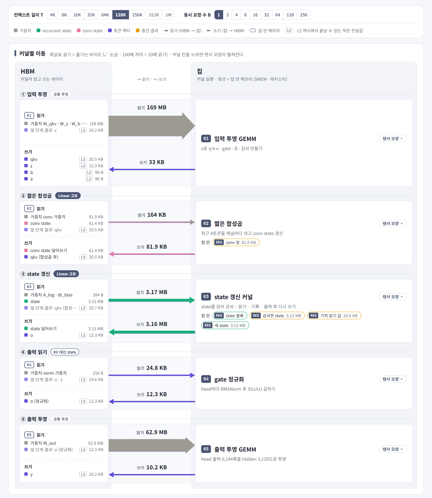

# Gated DeltaNet (Qwen3.6-27B) decode 데이터 이동 — 모델 전체 비중 · 커널별 분석

hybrid attention 데이터 플로우 정리 · 2026.11 · 약식 화면 스냅샷 기반

기준: H200 (HBM 4.8 TB/s · L2 50 MB) · decode 1스텝(새 토큰 1개) · BF16 가중치 · state FP32(배포 기본 mamba_ssm_dtype) · 이론 하한(텐서를 한 번씩만 읽고 쓴다고 본 값). linear 층 커널별 수치는 [약식 화면](https://kimhyeon-ji.github.io/llm-arch-lineage-wiki/arch_insight/dataflow-claude/viewer/gdn-qwen36-lite.html)과 같은 yaml에서, full 층 · FFN · 모델 전체 수치는 [model_totals.py](model_totals.py)에서 계산했다. 그림은 [make_report.py](make_report.py)로 만든다. 커널 묶음은 SGLang · vLLM의 Qwen3-Next / Qwen3.5 linear attention 경로를 단순화한 것이다.

---

## 요약

### hybrid attention의 요청별 이동은 state가 아니라 남은 full 16층의 KV cache가 대부분 — state는 작지만 읽은 만큼 다시 씀

| 조건 | 모델 전체 중 hybrid attention | 그중 가장 큰 것 | state 왕복 (48층) |
|---|---|---|---|
| **요청 1개 · 128K** | 39% (23.4 / 60.2 GB) | attention 가중치 14.5 GB (linear 11.1 + full 3.4) | 0.31 GB (0.5%) |
| **요청 32개 · 8K** | 53% (42 / 79 GB) | full 층 KV cache 17.2 GB (22%) | 9.8 GB (12.5%) |
| **요청 32개 · 128K** | 89% (299 / 336 GB) | full 층 KV cache 275 GB (82%) | 9.8 GB (2.9%) |

- **모델 전체:** 요청 1개는 FFN 57 ~ 66% · hybrid attention 29 ~ 39% · LM head 4 ~ 5%. 요청 · 문맥이 커지면 full 층 KV cache가 급증 → 요청 32개 × 128K에서 82% (1절)
- **커널별 (linear 층 1개 · 요청 1개):** 읽기 235 MB 중 가중치 232 MB(99%). K1 입력 투영 169 MB가 가장 굵음. state는 3.15 MB 읽고 3.15 MB 다시 씀 (2절)
- **state:** 층마다 요청당 6.3 MB 왕복, 문맥과 무관. 같은 자리가 full 층이었다면 128K에서 KV 537 MB 읽기 → 1.2% 수준 (3.2)
- **남은 full 층:** 16층 × 4 KB/토큰으로 문맥에 비례. 문맥 약 4.7K 토큰부터 full 층 KV 읽기 > 48층 state 왕복 (3.4)
- **요청 수 영향:** 요청 36개부터 요청별 이동 > 가중치. 요청 256개면 linear 층 이동의 84%가 state 왕복, 쓰기 844 MB로 읽기(1.08 GB)에 근접 (3.3)
- **커널별 특성:** 가중치 GEMM은 요청 약 200개부터 연산 병목, state 갱신은 1바이트당 0.9 FLOP로 늘 대역폭 쪽. 같은 자리 읽고-쓰기라 쓰기 대역폭이 읽기만큼 필요, 메모리 쪽 갱신에는 vector 연산기면 충분 (4절)
- **실제와의 차이:** 다시 읽기 · 패딩은 거의 0. L2는 작은 전달값만 해당(쓰기의 3%). state는 L2에 들어가는 크기지만 다음 스텝까지 남지 않음 (5절)

---

## 구성

| 절 | 내용 |
|---|---|
| **1. 모델 전체 중 hybrid attention 비중** | 요청 수 · 문맥 길이별 한 스텝 HBM 이동량 구성 (linear 48 + full 16) |
| **2. 커널별 이동 스냅샷** | 약식 화면 — linear 층 1개 · 요청 1개 |
| **3. 분석** | 가중치 · state · 요청 수 · 남은 full 층 |
| **4. 커널별 특성 · 필요한 HW 특성** | 병목 위치(요청 1 → 256) · 접근 모양 · 재사용 → HW 요구 |
| **5. 계산값과 실제의 차이** | 다시 읽기 · 패딩 · L2 |
| **6. 아키텍처 아이디어 후보** | 굵은 화살표별 현재 한계 · 방향 |
| **부록** | 계산 기준 |

---

## 1. 모델 전체 중 hybrid attention 비중

### 요청 1개는 attention 가중치가 대부분 — 요청 · 문맥이 커지면 full 16층의 KV cache가 모델 전체 이동을 지배

- **요청 1개:** 한 스텝 52 ~ 60 GB. FFN 가중치 34.2 GB · linear 층 가중치 11.1 GB · full 층 가중치 3.4 GB · LM head 2.5 GB. full 층 KV cache는 8K 0.5 GB → 128K 8.6 GB
- **요청 32개:** 8K에서는 state 12.5% · full 층 KV 22%가 비슷한 규모. 128K에서는 full 층 KV 82%, state 2.9%
- **요청 256개:** 8K에서도 full 층 KV 51% · state 29%. 32K부터 full 층 KV 81% 이상
- **state:** 요청당 48층 × 6.4 MB(recurrent + conv, 읽기 + 쓰기) = 308 MB/스텝. 문맥과 무관 → 문맥이 짧고 요청이 많을 때만 큰 몫
- **가중치:** 27B dense라 요청 수와 무관하게 약 51 GB/스텝 → 요청이 적을 때만 주인공

※ 모델 전체가 한 스텝에 읽고 쓰는 바이트의 합이다. GPU 여러 장에 나눠도 합은 같다고 보고, 가중치 복제 · GPU 간 통신 · MTP 층 · 비전 인코더 · 잔차 · 정규화 값은 뺐다. 요청 256개 × 128K는 full 층 KV cache만 2.2 TB라 GPU 여러 장이 필요한 조건이다.

---

## 2. 커널별 이동 스냅샷 — linear 층 1개 · 요청 1개

### 굵은 화살표 = 가중치 읽기(K1 · K5) — state 갱신(K3)은 읽기와 쓰기 화살표 굵기가 같음

| 커널 | HBM 읽기 | HBM 쓰기 | 굵은 화살표의 정체 |
|---|---:|---:|---|
| **K1 입력 투영 GEMM** | **169 MB** | 33 KB | **가중치 W_qkv 105 MB · W_z 63 MB** |
| K2 짧은 합성곱 | 164 KB | 81.9 KB | conv 가중치 · conv state (최근 3토큰) |
| **K3 state 갱신 커널** | **3.17 MB** | **3.16 MB** | **state 읽기 → 갱신 → 덮어쓰기 (48 head × 128 × 128 × FP32)** |
| K4 gate 정규화 | 24.8 KB | 12.3 KB | 출력 · gate 벡터 |
| **K5 출력 투영 GEMM** | **62.9 MB** | 10.2 KB | **가중치 W_out** |
| **합계** | **235 MB** | **3.3 MB** | 이론 하한 50 µs/층 · 48층이면 2.4 ms |

- **읽기 ≫ 쓰기:** 235 MB : 3.3 MB ≈ 71 : 1. 쓰기의 95%가 state 덮어쓰기
- **state는 상주 데이터인데 매 스텝 전부 바뀜:** KV cache는 1줄 추가, state는 전체를 다시 씀 → 읽기 화살표와 쓰기 화살표가 같은 굵기
- **화면의 L2 표시:** qkv · z · o 같은 토큰 벡터. 실제로는 L2에서 끝날 수 있음(5절)
- **화면에 없는 것:** full attention 16층 · FFN. 1 · 3.4절에서 config로 따로 계산

---

## 3. 분석

### 3.1 요청 1개 — 가중치가 화살표 굵기를 결정

- **가중치 232 MB / 읽기 235 MB (99%):** K1 169 MB(72%) · K5 62.9 MB(27%). linear 층의 투영 가중치가 full 층(210 MB)보다 큼 — q · k · v에 출력 gate z까지 투영
- **state 갱신(K3):** 읽기의 1.3%. 연산도 5.5 MFLOP로 작음 → 1.3 µs (메모리 시간)
- **시간:** 층마다 이론 하한 50 µs 중 메모리 시간이 거의 전부 → 요청 1개 decode는 가중치 대역폭 문제(DSA와 같음)

### 3.2 state — 크기 고정 · 매 스텝 전부 읽고 전부 씀

| 항목 | 값 (층 1개 · 요청 1개) | 문맥 영향 |
|---|---:|---|
| recurrent state 읽기 / 쓰기 | 3.15 MB / 3.15 MB | 없음 |
| conv state 읽기 / 쓰기 | 61.4 KB / 61.4 KB | 없음 |
| 같은 자리가 full 층이었다면 KV cache 읽기 | 537 MB (128K) | T에 비례 (4 KB/토큰) |
| state 왕복 ÷ full 층 KV 읽기 | 1.2% (128K) | 문맥이 길수록 작아짐 |

- **크기:** value head 48 × 128 × 128 × FP32 = 3.15 MB. 요청마다 고정 → 보관량 · 이동량 예측이 쉬움
- **읽기 = 쓰기:** 감쇠 · rank-1 갱신으로 state 전체가 바뀜. DSA의 KV cache(1줄 추가)와 달리 쓰기 대역폭도 읽기만큼 필요
- **정밀도:** BF16으로 두면 이동량 절반(1.59 MB). 자세한 화면에서 바꿔 볼 수 있음

### 3.3 요청 수가 늘 때 — 가중치 커널은 그대로, state 왕복만 증가

| 커널 (문맥 무관) | 요청 1개 (읽기 / 쓰기) | 요청 32개 | 요청 256개 |
|---|---:|---:|---:|
| K1 입력 투영 | 169 MB / 33 KB | 169 MB / 1.05 MB | 171 MB / 8.4 MB |
| K2 짧은 합성곱 | 164 KB / 82 KB | 2.7 MB / 2.6 MB | 21.1 MB / 21 MB |
| **K3 state 갱신** | 3.17 MB / 3.16 MB | **101 MB / 101 MB** | **811 MB / 808 MB** |
| K4 gate 정규화 | 25 KB / 12 KB | 787 KB / 393 KB | 6.3 MB / 3.2 MB |
| K5 출력 투영 | 62.9 MB / 10 KB | 63.3 MB / 328 KB | 66.1 MB / 2.6 MB |
| **층 1개 합** | 235 MB / 3.3 MB | 337 MB / 105 MB | 1.08 GB / 844 MB |

- **K3:** 요청 32개면 층 읽기의 30%, 256개면 75%. 읽기 + 쓰기로는 256개에서 층 이동의 84%
- **쓰기 비중 증가:** 읽기 : 쓰기가 요청 1개 71 : 1 → 256개 1.3 : 1. 읽기 위주인 DSA(256개에서도 20 : 1)와 다른 점
- **교차점:** 요청 36개부터 요청별 이동 > 가중치 (문맥과 무관)
- **연산:** 요청 256개에서도 K3은 1.4 GFLOP · 연산 21 µs < 메모리 337 µs. 산술 강도 약 0.9 FLOP/B로 완전한 대역폭 쪽

### 3.4 남은 full 16층 — 문맥이 길면 hybrid 모델 이동의 대부분

| 문맥 T | full 16층 KV cache 읽기 (요청 1개) | linear 48층 state 왕복 (요청 1개) | full ÷ state |
|---|---:|---:|---:|
| 8K | 0.54 GB | 0.31 GB | 1.7배 |
| 32K | 2.15 GB | 0.31 GB | 7배 |
| 128K | 8.59 GB | 0.31 GB | 28배 |

- **교차점:** 16 × T × 4,096 B = 308 MB → T ≈ 4.7K 토큰. 그보다 긴 문맥에서는 full 층 KV가 요청별 이동의 대부분
- **의미:** linear 층이 KV cache를 state로 바꿔 48층의 이동은 해결. 하지만 남은 1/4(16층)이 긴 문맥 이동을 지배 → hybrid만으로는 긴 문맥의 KV cache 읽기 문제가 남음
- **full 층 가중치:** 층마다 210 MB(q + gate 126 MB · k · v 21 MB · o 63 MB) — linear 층(232 MB)과 비슷

---

## 4. 커널별 특성 · 필요한 HW 특성

### 가중치 GEMM만 요청이 늘면 연산 쪽으로 이동 — linear 층 고유 커널(합성곱 · state 갱신 · gate 정규화)은 모두 제자리, 대역폭 · 지연 문제

- **가중치 GEMM (K1 · K5):** 요청 1개는 1바이트당 1 FLOP(BF16). 가중치를 요청끼리 같이 쓰므로 요청 수에 비례 → 요청 약 200개에서 연산 경계(256개에서 1.1 ~ 1.2)
- **K3 state 갱신:** 1바이트당 0.9 FLOP로 요청 수와 무관하게 고정 → 0.063에 머묾. 행렬곱이 아니라 GEMV · 원소별 연산(감쇠 · 기억 읽기 STk · rank-1 갱신 · 출력 STq)
- **K2 · K4:** 1바이트당 0.3 ~ 1.3 FLOP, 바이트도 작음 → 실제 시간은 커널 실행 · 동기화 지연이 결정
- **DSA와 차이:** DSA는 요청이 늘면 Sparse MLA가 연산 쪽으로 감. linear 층은 가중치 GEMM 말고는 끝까지 대역폭 쪽

### 4.1 커널별 데이터 이동 특성

| 커널 | 연산기 | 주 데이터 · 접근 모양 | 크기를 정하는 것 | 재사용 | 1바이트당 연산 (요청 1 → 256) | 병목 (요청 1 → 256) |
|---|---|---|---|---|---|---|
| K1 입력 투영 | GEMM BF16 | 가중치 169 MB · 연속 읽기 | 고정 | 가중치를 요청끼리 공유 | 1 → 240 | 대역폭 → 경계 |
| K2 짧은 합성곱 | VEC | conv state 3토큰 × 10,240채널(61 KB) 읽고 전부 다시 씀 · conv 가중치 82 KB | 요청 수 | conv 가중치만 공유 | 0.3 → 0.5 | 지연 · 대역폭 |
| **K3 state 갱신** | GEMV · VEC | **state 48 head × 64 KB 블록 · 읽은 자리에 그대로 다시 씀** | **요청 수 (문맥 무관)** | 없음 (요청 · 층마다 따로). 블록 하나를 칩 안에서 감쇠 → 읽기 → 갱신 → 출력까지 한 번에 | **0.9 고정** | **대역폭 (0.063 고정)** |
| K4 gate 정규화 | VEC | 출력 · gate 벡터 | 요청 수 | — | 1.3 | 지연 |
| K5 출력 투영 | GEMM BF16 | 가중치 63 MB · 연속 | 고정 | 공유 | 1 → 235 | 대역폭 → 경계 |

### 4.2 특성 → 필요한 HW 특성

| 특성 | 해당 커널 | 수치 | 필요한 HW 특성 |
|---|---|---|---|
| **공유 가중치 연속 읽기** | K1 · K5 | 232 MB/층 고정, BF16 1바이트당 요청 수 FLOP | 요청이 적으면 연속 읽기 대역폭, 요청 약 200개부터 연산 처리량 — DSA와 같은 요구 |
| **같은 자리 읽고-쓰기 (read-modify-write)** | K3 | 요청당 3.15 MB 읽기 = 3.15 MB 쓰기 | 쓰기 대역폭이 읽기만큼 필요 · 읽기 ↔ 쓰기 전환 비용 · 메모리 쪽에서 갱신하면 HBM ↔ 칩 왕복 제거 |
| **낮은 연산 밀도 (벡터 연산)** | K3 | 1바이트당 0.9 FLOP (FP32 vector) | 메모리 가까이 옮겨도 행렬 연산기 불필요 — 대역폭 4.8 TB/s당 약 4 TFLOPS FP32 vector면 충분 (DSA 색인 점수의 약 1/140) |
| **큰 블록 연속 · 크기 고정** | K3 | head마다 64 KB 연속 블록 · 요청마다 48층 × 3.15 MB | DRAM row를 끝까지 쓰는 큰 단위 접근 · 요청마다 같은 자리에 두는 고정 배치 가능 |
| **state 상주 용량** | K3 | 요청당 151 MB (48층 × 3.15 MB, FP32) · BF16이면 76 MB | 칩 안 SRAM(H200 SMEM 합 약 30 MB · L2 50 MB)에 요청 1개 분량도 안 들어감 → HBM 상주가 전제 |
| **밀어 쓰기 (sliding window)** | K2 | conv state 3토큰 읽고 3토큰 다시 씀 (61 KB) | 순환 버퍼로 두면 새 1토큰(20 KB)만 쓰기 → 쓰기 1/3 (작은 몫) |
| **작은 커널** | K2 · K4 | KB 단위 · 이론 시간 0.05 µs 이하 | 실행 지연 줄이기 — K3와 합치기 |
| (참고) **full 층 attention** | full 16층 | KV 4 KB/토큰 연속 읽기 · 1바이트당 약 6 FLOP (q head 6개가 KV head 1개 공유) | 연속 대역폭 — 문맥이 길면 모델 전체 이동의 대부분 (3.4) |

※ 1바이트당 연산 = 커널 FLOP ÷ (HBM 읽기 + 쓰기). H200에서 연산과 메모리 시간이 같아지는 값은 BF16 206 FLOP/B, FP32 vector 14 FLOP/B다. 그림의 경계(1)는 이론 피크 기준이라 실효 성능에 따라 앞뒤로 움직인다.

---

## 5. 계산값과 실제의 차이 — 다시 읽기 · 패딩 · L2

### 굵은 화살표(가중치 · state)는 실제로도 그대로 — state는 L2에 들어가는 크기지만 다시 쓰일 때까지 남지 않음

| 효과 | 내용 | 크기 (요청 1개, 층 1개) | 약식 화면 |
|---|---|---|---|
| **다시 읽기** | decode GEMM은 가중치를 한 번만 읽음. state 갱신은 (요청, head)마다 state 블록을 한 번 읽고 한 번 씀 | 거의 0 | 반영 안 함 |
| **패딩** | state 128 × 128 FP32 · conv state 모두 정렬된 크기 | 거의 0 | 반영 안 함 |
| **L2 (50 MB)** | qkv · z · o 같은 토큰 벡터는 L2에서 처리될 수 있음 | 읽기 88 KB (0.04%) · 쓰기 88 KB (2.7%) | **L2 표시 추가** |
| L2로 못 줄이는 것 | state 3.15 MB는 L2에 들어가지만, 같은 층 state를 다시 쓰는 것은 다음 스텝 — 그 사이 나머지 63층 · 약 60 GB가 지나감 | — | 화살표 그대로 |

- **요청이 많아도 같음:** 요청 256개에서 L2 후보는 읽기 2.1% · 쓰기 2.7%. state 왕복 1.6 GB/층은 L2(50 MB)보다 훨씬 큼
- **정확한 값은 측정 필요:** Nsight Compute의 커널별 DRAM 바이트로 확인 가능. 이 문서의 결론을 바꿀 크기는 아님

---

## 6. 아키텍처 아이디어 후보

### linear 층은 state 왕복, 모델 전체로는 남은 full 층 KV cache — 요청 적음은 가중치

| 항목 | 현재 한계 (근거) | 방향 |
|---|---|---|
| **가중치 읽기** | 요청 1개에서 linear 층 읽기의 99%, 모델 전체의 85 ~ 98%(FFN 포함) (1 · 3.1절) | 가중치 대역폭 확보 · 저정밀 가중치 · near-memory GEMV |
| **state 왕복** | 읽은 만큼 다시 씀, 요청 256개면 linear 층 이동의 84%. 1바이트당 0.9 FLOP 고정이라 요청을 늘려도 대역폭 쪽 (3.2 · 3.3 · 4절) | state를 메모리 쪽에서 갱신 → 층마다 state 6.3 MB 왕복 대신 q · k · v · 출력 약 33 KB만 이동. vector 연산기(4.8 TB/s당 약 4 TFLOPS)면 충분하고, 크기 고정이라 자리 고정 배치 가능 (4.2) |
| **남은 full 층 KV cache** | 문맥 4.7K부터 state보다 큼, 요청 32개 × 128K에서 모델 전체의 82% (1 · 3.4절) | full 층 KV 읽기 줄이기 — full 층에 sparse 적용 · KV 압축 |
| **쓰기 대역폭** | 요청이 많으면 쓰기가 읽기에 근접 (3.3절 · 4.2) | 읽기 위주 설계와 달리 쓰기 대역폭 · 읽기 ↔ 쓰기 전환 · 쓰기 전력 고려 |
| **작은 커널** | K2 · K4는 바이트 · 연산 모두 작아 지연이 시간 결정 (4절) | K2 · K3 · K4 합치기 |

---

## 부록 — 계산 기준

- **linear 층:** [gdn-qwen36/algo.yaml](../models/gdn-qwen36/algo.yaml) · [map-gpu.yaml](../models/gdn-qwen36/map-gpu.yaml). 약식 · 자세한 화면과 같은 식. 범위는 입력 RMSNorm 이후 ~ out_proj 출력
- **나머지 (config):** 64층 = linear 48 + full attention 16(4층마다), hidden 5,120, FFN 17,408 dense(SwiGLU), BF16. full 층 = q head 24 × 256 (+ 출력 gate) · KV head 4 × 256, KV cache BF16 4,096 B/토큰/층. LM head 248,320 × 5,120 BF16 (embedding과 따로)
- **제외:** MTP 층 · 비전 인코더 · 임베딩 행 읽기 · 잔차 · 정규화 값 · GPU 간 통신 · 가중치 복제
- **이론 하한:** max(바이트 ÷ 4.8 TB/s, FLOP ÷ 피크). 커널 실행 지연 · 동기화 · 불규칙 접근 비효율 미포함
- ※ 출처: Qwen3.6-27B config.json (Hugging Face) · fla `fused_recurrent_gated_delta_rule` · SGLang / vLLM Qwen3-Next · Qwen3.5 linear attention 경로
