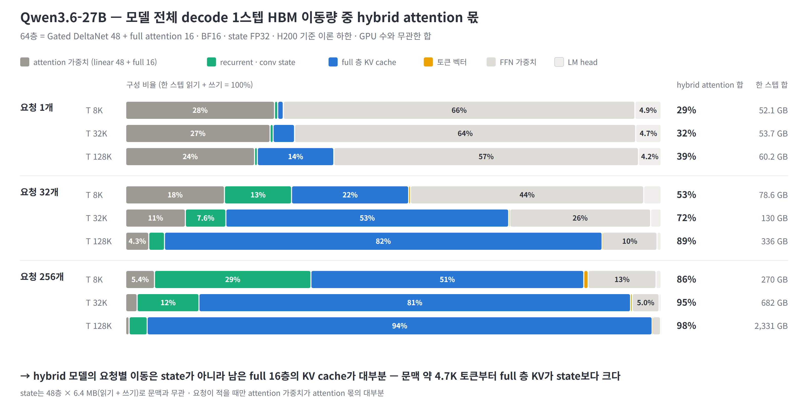
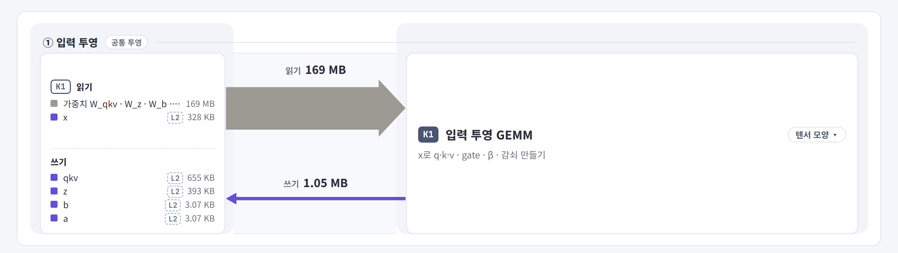
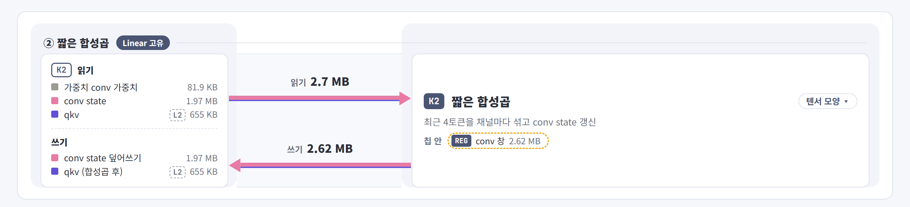
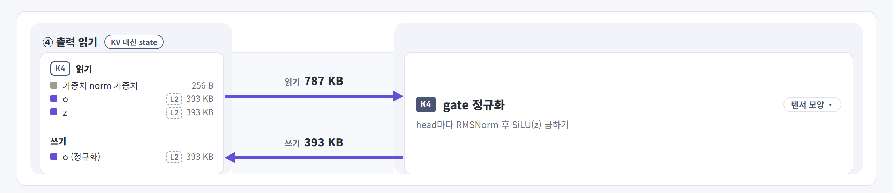
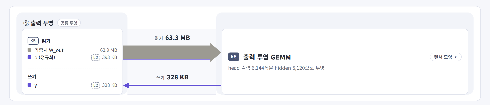
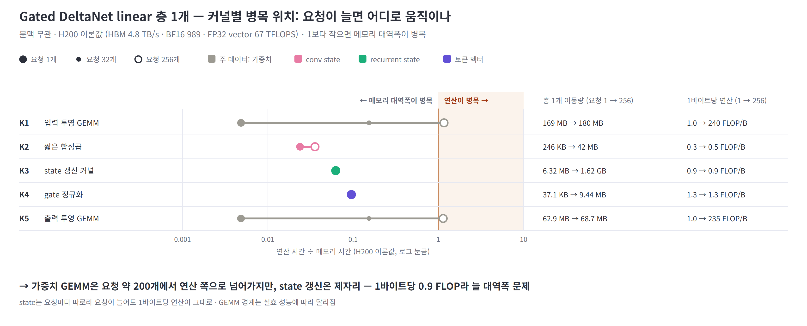

# Gated DeltaNet (Qwen3.6-27B) decode 데이터 이동 — 모델 전체 비중 · 커널별 분석

hybrid attention 데이터 플로우 정리 · 2026.11 · 약식 화면 스냅샷 기반

기준: H200 (HBM 4.8 TB/s · L2 50 MB) · decode 1스텝(새 토큰 1개를 만드는 한 번) · BF16 가중치 · state FP32(배포 기본 mamba_ssm_dtype) · 이론 하한(모든 데이터를 딱 한 번씩만 읽고 쓴다고 본 값). linear 층 커널별 수치는 [약식 화면](https://kimhyeon-ji.github.io/llm-arch-lineage-wiki/arch_insight/dataflow-claude/viewer/gdn-qwen36-lite.html)과 같은 yaml에서, full 층 · FFN · 모델 전체 수치는 [model_totals.py](model_totals.py)에서 계산했다. 그림은 [make_report.py](make_report.py)로 만든다. 커널을 나눈 방식은 SGLang · vLLM의 Qwen3-Next / Qwen3.5 linear attention 경로를 단순화한 것이다.

---

## 요약

### hybrid 모델에서 요청별 이동의 주인공은 state가 아니라 남아 있는 full 16층의 KV cache — state는 작지만 읽은 만큼 다시 써야 한다

| 조건 | 모델 전체 이동 중 hybrid attention 몫 | 그중 가장 큰 것 | state 왕복 (linear 48층) |
|---|---|---|---|
| **요청 1개 · 128K** | 39% (23.4 / 60.2 GB) | attention 가중치 14.5 GB (linear 11.1 + full 3.4) | 0.31 GB (0.5%) |
| **요청 32개 · 8K** | 53% (42 / 79 GB) | full 층 KV cache 17.2 GB (22%) | 9.8 GB (12.5%) |
| **요청 32개 · 128K** | 89% (299 / 336 GB) | full 층 KV cache 275 GB (82%) | 9.8 GB (2.9%) |

- **모델 전체:** 요청 1개면 FFN이 57 ~ 66%로 가장 크고 hybrid attention은 29 ~ 39%. 요청 · 문맥이 커지면 full 층 KV cache가 급격히 늘어 요청 32개 · 128K에서 82% (1절)
- **층 1개 안에서 (linear 층 · 요청 1개):** 235 MB를 읽는데 그중 232 MB(99%)가 가중치. 가장 큰 것은 입력 투영 가중치 169 MB. state는 3.15 MB를 읽고 같은 양을 다시 씀 (2절)
- **state:** 층마다 요청당 6.3 MB를 오가고, 문맥과 상관없음. 같은 자리가 full 층이었다면 128K에서 KV 537 MB를 읽어야 함 → state는 그 1.2% (3.2)
- **남은 full 층:** 16층이 토큰마다 4 KB씩 KV를 읽어 문맥에 비례. 문맥이 약 4.7K 토큰을 넘으면 48층 state 왕복보다 커짐 (3.4)
- **요청이 늘면:** 요청 36개부터 요청별 데이터가 가중치보다 많음. 요청 256개면 linear 층 이동의 84%가 state 왕복이고, 쓰기(844 MB)가 읽기(1.08 GB)와 거의 같아짐 (3.3)
- **커널별로 보면:** 가중치 GEMM은 요청 약 200개부터 연산이 바빠지지만, state 갱신은 요청이 몇 개든 메모리를 기다림. 같은 자리를 읽고 다시 쓰므로 쓰기 대역폭도 읽기만큼 필요하고, 메모리 쪽에서 갱신한다면 간단한 vector 연산기면 충분 (4절)
- **실제와의 차이:** 다시 읽기 · 패딩 영향은 거의 0. L2는 작은 전달값에만 영향(쓰기의 3%). state는 L2에 들어가는 크기지만 다음 스텝까지 남아 있지 않음 (5절)

---

## 구성

| 절 | 내용 |
|---|---|
| **1. 모델 전체 중 hybrid attention 비중** | 요청 수 · 문맥 길이별 한 스텝 HBM 이동량 구성 (linear 48 + full 16) |
| **2. 커널별 이동 · 특성** | 커널마다 약식 화면 조각 → 바로 아래 이동 · 특성 · 병목 · 필요한 HW |
| **3. 분석** | 가중치 · state · 요청 수 · 남은 full 층 |
| **4. 커널 종합** | 커널별 병목 위치(요청 1 → 256) 한 장 · 특성 → 필요한 HW 특성 표 |
| **5. 계산값과 실제의 차이** | 다시 읽기 · 패딩 · L2 |
| **6. 아키텍처 아이디어 후보** | 굵은 화살표별 현재 한계 · 방향 |
| **부록** | 계산 기준 |

---

## 1. 모델 전체 중 hybrid attention 비중

### 요청 1개면 가중치가 대부분 — 요청과 문맥이 커지면 full 16층의 KV cache가 모델 전체 이동을 차지

- **요청 1개:** 한 스텝에 52 ~ 60 GB. FFN 가중치 34 GB, linear 층 가중치 11 GB, full 층 가중치 3.4 GB, LM head 2.5 GB. full 층 KV cache는 문맥 8K면 0.5 GB, 128K면 8.6 GB
- **요청 32개:** 문맥 8K에서는 state(12.5%)와 full 층 KV(22%)가 비슷한 규모. 128K에서는 full 층 KV가 82%, state는 2.9%
- **요청 256개:** 문맥 8K에서도 full 층 KV 51% · state 29%. 32K부터는 full 층 KV가 81% 이상
- **state:** 요청 하나당 48층 × 6.4 MB(recurrent + conv, 읽기 + 쓰기) = 한 스텝 308 MB. 문맥과 상관없으므로 문맥이 짧고 요청이 많을 때만 큰 몫
- **가중치:** 27B dense라 요청 수와 상관없이 한 스텝 약 51 GB → 요청이 적을 때만 주인공

※ 모델 전체가 한 스텝에 읽고 쓰는 바이트의 합이다. GPU 여러 장에 나눠도 합은 같다고 보고, 가중치 복제 · GPU 간 통신 · MTP 층 · 비전 인코더 · 잔차 · 정규화 값은 뺐다. 요청 256개 · 128K는 full 층 KV cache만 2.2 TB라 GPU 여러 장이 필요한 조건이다.

---

## 2. 커널별 이동 · 특성 — linear 층 1개 · 요청 1개

### 굵은 화살표는 가중치 읽기(K1 · K5) — state 갱신(K3)은 읽는 화살표와 쓰는 화살표 굵기가 같다

- **그림:** [약식 화면](https://kimhyeon-ji.github.io/llm-arch-lineage-wiki/arch_insight/dataflow-claude/viewer/gdn-qwen36-lite.html)의 커널 한 줄. 왼쪽은 HBM에서 읽고 쓰는 데이터, 가운데 화살표는 옮기는 양(굵기 ∝ √바이트, 모든 그림이 같은 눈금), 오른쪽은 커널과 칩 안 메모리(점선 = SMEM · 레지스터). `L2` 표시는 L2 캐시에서 끝날 수 있는 작은 값
- **1바이트당 연산:** HBM에서 1바이트를 가져올 때 하는 연산 수. H200은 BF16 206번 · FP32 vector 14번이 균형점 — 이보다 적으면 연산기가 메모리를 기다림
- **병목:** 요청 1개 → 256개일 때 메모리 시간과 연산 시간 중 어느 쪽이 긴지
- **층 1개 합:** 읽기 235 MB · 쓰기 3.3 MB(읽기가 71배) · 이론 하한 50 µs, 48층이면 2.4 ms. 문맥과 상관없음
- **화면에 없는 것:** full attention 16층 · FFN (1 · 3.4절에서 config로 따로 계산)
- 핵심 커널(K3)은 커널 칸을 눌러 텐서 모양까지 펼친 그림

### ① 입력 투영 (K1) — q · k · v · gate를 한 번에 만드는 단계

#### K1 입력 투영 GEMM

- **하는 일:** 입력 x(5,120폭)로 q · k · v, 출력 gate z, 쓰기 강도 β, 감쇠 a를 한 번에 만듦(16,480폭)
- **이동:** 가중치 169 MB를 읽고(W_qkv 105 MB · W_z 63 MB), 다음 커널에 넘길 작은 벡터 33 KB를 씀
- **특성:** 가중치를 처음부터 끝까지 연속으로 읽음. 같은 가중치를 모든 요청이 같이 쓰므로, 1바이트당 연산이 요청 1개면 1번 → 256개면 240번으로 늘어남
- **병목 · HW:** 요청 1개는 메모리 시간이 연산의 약 200배 → 256개면 연산이 조금 더 김. 층 읽기의 72%로 가장 굵은 화살표 — 가중치 대역폭을 늘리거나 정밀도를 낮추면 효과가 가장 큼

### ② 짧은 합성곱 (K2) — linear 층에만 있는 단계: 최근 3토큰과 섞기

#### K2 짧은 합성곱

- **하는 일:** q · k · v 채널마다 최근 3토큰과 새 토큰을 4칸 합성곱으로 섞음
- **이동:** 164 KB를 읽고(conv 가중치 82 KB · conv state 61 KB · qkv 20 KB) 82 KB를 씀(conv state 61 KB · 섞은 qkv 20 KB)
- **특성:** 원소별 연산. conv state(최근 3토큰)를 한 칸씩 밀어 매번 전부 다시 씀. 1바이트당 연산 0.3번
- **병목 · HW:** 옮길 것이 작아 커널을 띄우는 시간이 실제 시간을 정함. conv state를 순환 버퍼로 두면 새 1토큰(20 KB)만 쓰면 됨(쓰기 1/3) · K1이나 K3와 합치는 편이 이득

### ③ state 갱신 (K3) — linear 층의 핵심: KV cache 대신 state를 고쳐 씀

#### K3 state 갱신 커널 — 핵심

- **하는 일:** state를 읽어 감쇠 → 기억 읽기(STk) → 새 기억 기록(rank-1 갱신) → 출력(STq)까지 한 번에 하고, 고친 state를 다시 씀
- **이동:** state 3.15 MB를 읽고, 고친 state 3.15 MB를 같은 자리에 다시 씀. 출력 벡터는 12 KB뿐
- **특성:** 행렬곱이 아니라 행렬 × 벡터와 원소별 연산. head마다 64 KB state 블록을 레지스터에 올려 한 번에 처리함. state는 요청 · 층마다 따로라 같이 쓸 데이터가 없음 → 1바이트당 연산 0.9번, 요청이 늘어도 그대로
- **크기를 정하는 것:** 요청 수(문맥과 상관없음). 요청 32개면 101 MB 읽고 101 MB 쓰기, 256개면 811 MB · 808 MB
- **병목 · HW:** 메모리 시간이 늘 연산의 약 16배 — 요청을 늘려도 안 바뀜. 읽은 만큼 써야 하므로 쓰기 대역폭도 읽기만큼 필요. 메모리 쪽에서 갱신한다면 간단한 vector 연산기(4.8 TB/s당 약 4 TFLOPS)로 충분하고, 6.3 MB 왕복 대신 벡터 약 33 KB만 오가면 됨. 다만 요청 하나의 state가 48층 합쳐 151 MB라 칩 안 SRAM에는 못 올림

### ④ 출력 읽기 (K4) — 출력을 gate로 다듬기

#### K4 gate 정규화

- **하는 일:** head마다 출력을 RMSNorm으로 정규화하고 SiLU(z)를 곱함
- **이동:** 25 KB를 읽고 12 KB를 씀 — 사실상 0
- **특성:** 원소별 연산. 1바이트당 연산 1.3번
- **병목 · HW:** 커널 띄우는 시간이 실제 시간. K3나 K5와 합치는 편이 이득

### ⑤ 출력 투영 (K5) — head 출력을 hidden 폭으로 되돌리기

#### K5 출력 투영 GEMM

- **하는 일:** head 출력 6,144폭을 hidden 5,120폭으로 투영
- **이동:** 가중치 63 MB를 읽고 10 KB를 씀
- **특성:** K1과 같은 모양 — 가중치 연속 읽기, 요청끼리 공유. 1바이트당 연산 1번 → 235번
- **병목 · HW:** 메모리 시간이 연산의 약 200배 → 256개면 연산이 조금 더 김. K1과 같은 요구

---

## 3. 분석

### 3.1 요청 1개 — 가중치가 화살표 굵기를 정한다

- **가중치가 99%:** 층 1개에서 읽는 235 MB 중 232 MB가 가중치. 입력 투영(K1) 169 MB가 72%, 출력 투영(K5) 63 MB가 27%. q · k · v에 출력 gate z까지 투영해서 full 층 가중치(210 MB)보다도 큼
- **state 갱신(K3):** 읽기의 1.3%. 연산도 5.5 MFLOP로 작아 1.3 µs면 끝남(메모리 시간)
- **시간:** 층마다 이론 하한 50 µs가 거의 다 메모리 시간 → 요청 1개 decode는 DSA와 똑같이 "가중치를 얼마나 빨리 읽나"의 문제

### 3.2 state — 크기는 고정, 매 스텝 전부 읽고 전부 다시 쓴다

| 항목 | 값 (층 1개 · 요청 1개) | 문맥 영향 |
|---|---:|---|
| recurrent state 읽기 / 쓰기 | 3.15 MB / 3.15 MB | 없음 |
| conv state 읽기 / 쓰기 | 61.4 KB / 61.4 KB | 없음 |
| 같은 자리가 full 층이었다면 KV cache 읽기 | 537 MB (128K) | 문맥에 비례 (토큰당 4 KB) |
| state 왕복 ÷ full 층 KV 읽기 | 1.2% (128K) | 문맥이 길수록 더 작아짐 |

- **크기:** value head 48개 × 128 × 128 × FP32 = 3.15 MB. 요청마다 크기가 같아 보관량 · 이동량을 미리 알 수 있음
- **읽은 만큼 다시 씀:** 감쇠와 갱신으로 state 전체가 매번 바뀜. 1줄만 덧붙이는 KV cache와 달리 쓰기 대역폭도 읽기만큼 필요
- **정밀도:** BF16으로 두면 이동량이 절반(1.59 MB). 자세한 화면에서 바꿔 볼 수 있음

### 3.3 요청이 늘면 — 가중치 커널은 그대로, state 왕복만 커진다

| 커널 (문맥 무관) | 요청 1개 (읽기 / 쓰기) | 요청 32개 | 요청 256개 |
|---|---:|---:|---:|
| K1 입력 투영 | 169 MB / 33 KB | 169 MB / 1.05 MB | 171 MB / 8.4 MB |
| K2 짧은 합성곱 | 164 KB / 82 KB | 2.7 MB / 2.6 MB | 21.1 MB / 21 MB |
| **K3 state 갱신** | 3.17 MB / 3.16 MB | **101 MB / 101 MB** | **811 MB / 808 MB** |
| K4 gate 정규화 | 25 KB / 12 KB | 787 KB / 393 KB | 6.3 MB / 3.2 MB |
| K5 출력 투영 | 62.9 MB / 10 KB | 63.3 MB / 328 KB | 66.1 MB / 2.6 MB |
| **층 1개 합** | 235 MB / 3.3 MB | 337 MB / 105 MB | 1.08 GB / 844 MB |

- **K3 state 갱신:** 요청 32개면 층 읽기의 30%, 256개면 75%. 읽기와 쓰기를 합치면 256개에서 층 이동의 84%
- **쓰기가 커짐:** 읽기 : 쓰기가 요청 1개 71 : 1 → 256개 1.3 : 1. 256개에서도 읽기가 20배인 DSA와 다른 점
- **역전 지점:** 요청 36개부터 요청별 데이터가 가중치보다 많음(문맥과 상관없음)
- **연산:** 요청 256개에서도 K3은 1.4 GFLOP — 연산 21 µs < 메모리 337 µs. 1바이트당 연산 0.9번이라 완전히 메모리 쪽

### 3.4 남은 full 16층 — 문맥이 길면 hybrid 모델 이동의 대부분

| 문맥 T | full 16층 KV cache 읽기 (요청 1개) | linear 48층 state 왕복 (요청 1개) | full ÷ state |
|---|---:|---:|---:|
| 8K | 0.54 GB | 0.31 GB | 1.7배 |
| 32K | 2.15 GB | 0.31 GB | 7배 |
| 128K | 8.59 GB | 0.31 GB | 28배 |

- **역전 지점:** 16층 × 문맥 × 4,096 B가 308 MB가 되는 곳 → 약 4.7K 토큰. 그보다 긴 문맥에서는 full 층 KV가 요청별 이동의 대부분
- **의미:** linear 층은 48층의 KV cache를 state로 바꿔 그 이동을 해결함. 하지만 남은 1/4(16층)이 긴 문맥의 이동을 차지 → hybrid만으로는 긴 문맥의 KV cache 읽기 문제가 남음
- **full 층 가중치:** 층마다 210 MB(q + gate 126 MB · k · v 21 MB · o 63 MB) — linear 층(232 MB)과 비슷

---

## 4. 커널 종합 — 병목 위치 · 필요한 HW 특성

### 요청이 늘면 가중치 GEMM만 연산이 바빠진다 — linear 층에만 있는 커널(합성곱 · state 갱신 · gate 정규화)은 모두 계속 메모리를 기다린다

- **그림 보는 법:** 점이 1보다 왼쪽이면 메모리를 기다리는 커널, 오른쪽이면 연산이 바쁜 커널. ● 요청 1개 → ○ 요청 256개로 얼마나 움직이는지가 핵심
- **가중치 GEMM (K1 · K5):** 요청이 늘수록 오른쪽으로 크게 이동 — 같은 가중치로 더 많은 요청을 계산하니까. 요청 약 200개에서 경계(256개에서 1.1 ~ 1.2)
- **K3 state 갱신:** 0.063에서 꼼짝 않음. state가 요청마다 따로라 1바이트당 연산이 0.9번으로 고정이기 때문 → 요청을 모아도 안 풀리는 대역폭 문제
- **K2 · K4:** 연산도 바이트도 작음 → 실제 시간은 커널을 띄우고 기다리는 시간이 정함
- **DSA와 다른 점:** DSA는 요청이 늘면 Sparse MLA가 연산 쪽으로 넘어감. linear 층은 가중치 GEMM 말고는 끝까지 메모리 쪽

### 4.1 특성 → 필요한 HW 특성 (종합)

| 특성 | 해당 커널 | 수치 | 필요한 HW 특성 |
|---|---|---|---|
| **공유 가중치 연속 읽기** | K1 · K5 | 층마다 232 MB 고정 · 1바이트당 연산 = 요청 수 (BF16) | 요청이 적으면 연속 읽기 대역폭, 약 200개부터는 연산 처리량 — DSA와 같은 요구 |
| **같은 자리를 읽고 다시 쓰기** | K3 | 요청당 3.15 MB 읽기 = 3.15 MB 쓰기 | 쓰기 대역폭이 읽기만큼 필요 · 읽기와 쓰기를 오가는 전환 비용 · 메모리 쪽에서 고치면 HBM ↔ 칩 왕복 제거 |
| **연산이 적음 (vector 연산)** | K3 | 1바이트당 연산 0.9 (FP32 vector) | 메모리 가까이 옮겨도 행렬 연산기는 필요 없음 — 4.8 TB/s당 약 4 TFLOPS vector면 충분 (DSA 색인 점수의 약 1/140) |
| **큰 덩어리 연속 · 크기 고정** | K3 | head마다 64 KB 연속 블록 · 요청마다 48층 × 3.15 MB | DRAM row를 끝까지 쓰는 큰 단위 읽기 · 요청마다 같은 자리에 두는 고정 배치 가능 |
| **state 상주 용량** | K3 | 요청당 151 MB (48층, FP32) · BF16이면 76 MB | 칩 안 SRAM(H200 SMEM 합 약 30 MB · L2 50 MB)에 요청 1개 분량도 안 들어감 → HBM에 두는 것이 전제 |
| **밀어 쓰기 (sliding window)** | K2 | conv state 3토큰을 읽고 3토큰을 다시 씀 (61 KB) | 순환 버퍼로 두면 새 1토큰(20 KB)만 쓰면 됨 → 쓰기 1/3 (몫은 작음) |
| **작은 커널** | K2 · K4 | KB 단위 · 이론 시간 0.05 µs 이하 | 커널 띄우는 시간 줄이기 — K3와 합치기 |
| (참고) **full 층 attention** | full 16층 | 토큰당 KV 4 KB 연속 읽기 · 1바이트당 연산 약 6 (q head 6개가 KV head 1개를 같이 씀) | 연속 대역폭 — 문맥이 길면 모델 전체 이동의 대부분 (3.4) |

※ 1바이트당 연산 = 커널 FLOP ÷ HBM 읽기 · 쓰기 바이트. H200의 균형점은 BF16 206 · FP32 vector 14다. 그림의 경계(1)는 이론 최고 성능 기준이라 실제 효율에 따라 조금씩 움직인다.

---

## 5. 계산값과 실제의 차이 — 다시 읽기 · 패딩 · L2

### 굵은 화살표(가중치 · state)는 실제로도 그대로 — state는 L2에 들어가는 크기지만 다시 쓰일 때까지 남아 있지 않다

| 효과 | 내용 | 크기 (요청 1개, 층 1개) | 약식 화면 |
|---|---|---|---|
| **다시 읽기** | decode GEMM은 가중치를 한 번만 읽음. state 갱신은 요청 · head마다 state 블록을 한 번 읽고 한 번 씀 | 거의 0 | 반영 안 함 |
| **패딩** | state(128 × 128 FP32)와 conv state 모두 딱 맞는 크기 | 거의 0 | 반영 안 함 |
| **L2 (50 MB)** | qkv · z · o 같은 토큰 벡터는 L2에서 끝날 수 있음 | 읽기 88 KB (0.04%) · 쓰기 88 KB (2.7%) | **`L2` 표시 추가** |
| L2로 못 줄이는 것 | state 3.15 MB는 L2에 들어가지만, 같은 층의 state를 다시 쓰는 건 다음 스텝 — 그 사이 나머지 63층이 약 60 GB를 지나가며 밀어냄 | — | 화살표 그대로 |

- **요청이 많아도 같음:** 요청 256개에서 L2 대상은 읽기 2.1% · 쓰기 2.7%. 층마다 state 왕복 1.6 GB는 L2(50 MB)보다 훨씬 큼
- **정확한 값은 측정으로:** Nsight Compute로 커널별 DRAM 바이트를 재면 확인 가능. 다만 이 문서의 결론을 바꿀 크기는 아님

---

## 6. 아키텍처 아이디어 후보

### linear 층 안에서는 state 왕복, 모델 전체로는 남은 full 층 KV cache — 요청이 적을 땐 가중치

| 항목 | 현재 한계 (근거) | 방향 |
|---|---|---|
| **가중치 읽기** | 요청 1개에서 linear 층 읽기의 99%, 모델 전체로는 FFN까지 합쳐 85 ~ 98% (1 · 3.1절) | 가중치 대역폭 늘리기 · 가중치 정밀도 낮추기 · 요청이 적을 때는 메모리 가까이에서 GEMV |
| **state 왕복** | 읽은 만큼 다시 써서 요청 256개면 linear 층 이동의 84%. 요청을 모아도 메모리 대기가 그대로 (3.2 · 3.3 · 4절) | state를 메모리 쪽에서 고치기 → 층마다 6.3 MB 왕복 대신 q · k · v · 출력 약 33 KB만 오감. vector 연산기(4.8 TB/s당 약 4 TFLOPS)면 충분하고, 크기가 고정이라 자리를 정해 두기 쉬움 (4.1) |
| **남은 full 층 KV cache** | 문맥 4.7K부터 state보다 크고, 요청 32개 · 128K에서 모델 전체의 82% (1 · 3.4절) | full 층의 KV 읽기 줄이기 — full 층에 sparse 적용 · KV 압축 |
| **쓰기 대역폭** | 요청이 많으면 쓰기가 읽기와 거의 같아짐 (3.3절 · 4.1) | 읽기 위주 설계와 달리 쓰기 대역폭 · 읽기 ↔ 쓰기 전환 · 쓰기 전력까지 고려 |
| **작은 커널** | K2 · K4는 바이트도 연산도 작아 커널 띄우는 시간이 곧 실제 시간 (4절) | K2 · K3 · K4 합치기 |

---

## 부록 — 계산 기준

- **linear 층:** [gdn-qwen36/algo.yaml](../models/gdn-qwen36/algo.yaml) · [map-gpu.yaml](../models/gdn-qwen36/map-gpu.yaml). 약식 · 자세한 화면과 같은 식. 범위는 입력 RMSNorm 이후 ~ out_proj 출력
- **나머지 (config):** 64층 = linear 48 + full attention 16(4층마다), hidden 5,120, FFN 17,408 dense(SwiGLU), BF16. full 층 = q head 24 × 256 (+ 출력 gate) · KV head 4 × 256, KV cache BF16 4,096 B/토큰/층. LM head 248,320 × 5,120 BF16 (embedding과 따로)
- **제외:** MTP 층 · 비전 인코더 · 임베딩 행 읽기 · 잔차 · 정규화 값 · GPU 간 통신 · 가중치 복제
- **이론 하한:** max(바이트 ÷ 4.8 TB/s, FLOP ÷ 피크). 커널 실행 지연 · 동기화 · 불규칙 접근 비효율 미포함
- ※ 출처: Qwen3.6-27B config.json (Hugging Face) · fla `fused_recurrent_gated_delta_rule` · SGLang / vLLM Qwen3-Next · Qwen3.5 linear attention 경로
