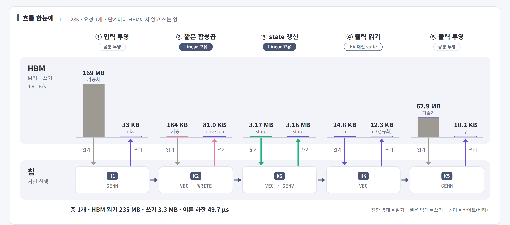
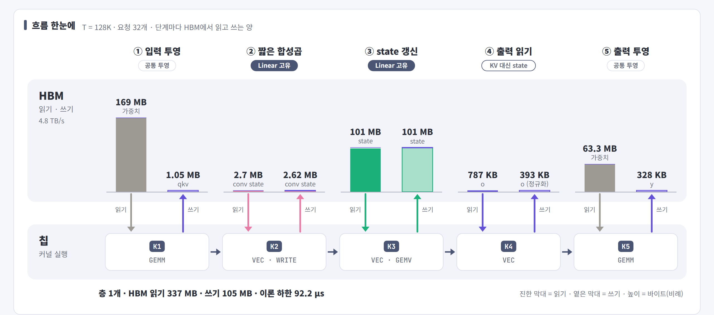
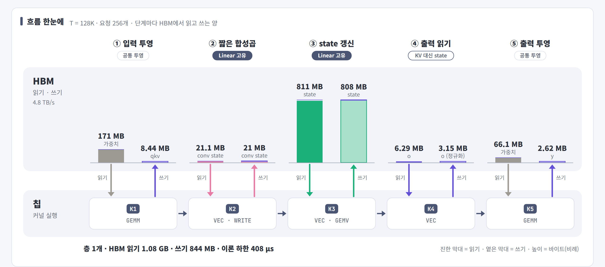
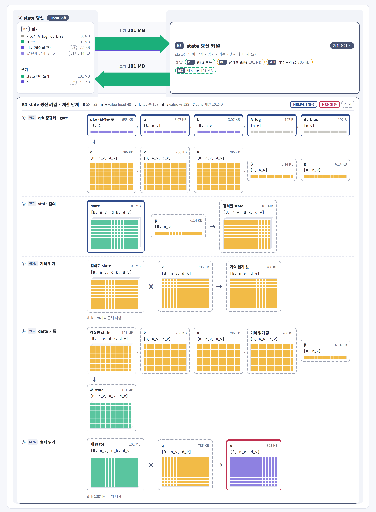

# Gated DeltaNet (Qwen3.6-27B) decode 데이터 이동 — 모델 전체 비중 · 커널별 분석

hybrid attention 데이터 플로우 정리 · 2026.11 · 약식 화면 스냅샷 기반

기준: H200 (HBM 4.8 TB/s · L2 50 MB) · decode 1스텝(새 토큰 1개 생성) · BF16 가중치 · state FP32(배포 기본 mamba_ssm_dtype) · 이론 하한(모든 데이터를 한 번씩만 읽고 쓴다고 가정). linear 층 커널별 수치: [약식 화면](https://kimhyeon-ji.github.io/llm-arch-lineage-wiki/arch_insight/dataflow-claude/viewer/gdn-qwen36-lite.html)과 같은 yaml · full 층 · FFN · 모델 전체 수치: [model_totals.py](model_totals.py) · 그림: [make_report.py](make_report.py). 커널 구분은 SGLang · vLLM의 Qwen3-Next / Qwen3.5 linear attention 경로를 단순화한 것

---

## 요약

### hybrid 모델에서 요청별 이동의 주인공은 state가 아니라 남아 있는 full 16층의 KV cache — state는 작지만 읽은 만큼 다시 써야 함

| 조건 | 모델 전체 이동 중 hybrid attention 몫 | 그중 가장 큰 것 | state 왕복 (linear 48층) |
|---|---|---|---|
| **요청 1개 · 128K** | 39% (23.4 / 60.2 GB) | attention 가중치 14.5 GB (linear 11.1 + full 3.4) | 0.31 GB (0.5%) |
| **요청 32개 · 8K** | 53% (42 / 79 GB) | full 층 KV cache 17.2 GB (22%) | 9.8 GB (12.5%) |
| **요청 32개 · 128K** | 89% (299 / 336 GB) | full 층 KV cache 275 GB (82%) | 9.8 GB (2.9%) |

- **모델 전체:** 요청 1개는 FFN이 전체 이동량의 57 ~ 66%, hybrid attention이 29 ~ 39% 차지. 요청 수 · 문맥 길이가 함께 늘면 full attention 층의 KV cache 읽기가 최대 → 요청 32개 · 문맥 128K에서 이 읽기만 전체의 82% (1절)
- **층 1개 안에서 (linear 층 · 요청 32개):** linear 한 층이 읽는 337 MB 중 가중치 232 MB(69%) · recurrent state 101 MB(30%). state는 읽은 101 MB를 갱신해 같은 양을 다시 씀 → 층 쓰기 105 MB의 96%. 요청 1개면 가중치가 99% (3절 · 4.1절)
- **attention 안의 흐름:** 요청이 늘수록 굵은 막대가 가중치 단계(① · ⑤)에서 state 갱신(③)으로 이동 — ③ 비중은 요청 1개 1% → 32개 30% → 256개 75% (2절)
- **state:** linear 한 층의 recurrent state 읽기 + 쓰기는 요청당 6.3 MB, 문맥 길이와 무관. 문맥 128K에서 full 층 하나의 KV cache 읽기는 537 MB → state 왕복은 그 약 1.2% (4.2절)
- **남은 full 층:** full 층은 층마다 과거 토큰 1개당 KV 4 KB 읽기. 문맥 약 4.7K 토큰부터 full 16개 층의 KV 읽기 > linear 48개 층의 state 왕복 (4.4절)
- **요청이 늘면:** linear 층은 요청 36개부터 요청별 데이터 이동량 합 > 가중치 읽기량. 요청 256개는 state 갱신이 층 전체 이동량의 84% 차지, 쓰기(844 MB)가 읽기(1.08 GB)에 근접 (4.3절)
- **커널별로 보면:** 가중치 GEMM은 요청 약 200개에서 연산 시간 ≈ 메모리 이동 시간. state 갱신은 요청 수와 관계없이 메모리 이동 시간이 더 김 → 메모리 가까이에서 갱신하려면 읽기 · 쓰기 양쪽 대역폭이 중요, 계산은 vector 연산기로 충분 (5절)
- **실제와의 차이:** 다시 읽기 · 패딩에 따른 추가 이동량은 추정상 거의 없음. L2에 남을 수 있는 중간값은 층 쓰기량의 약 3%. 한 층의 state는 L2에 들어가는 크기지만, 다음 스텝에서 다시 쓰기 전까지 다른 63개 층을 거침 (6절)

---

## 구성

| 절 | 내용 |
|---|---|
| **1. 모델 전체 중 hybrid attention 비중** | 요청 수 · 문맥 길이별 한 스텝 HBM 이동량 구성 (linear 48 + full 16) |
| **2. attention 안의 흐름** | 요청 수별 '흐름 한눈에' — 단계별 HBM 읽기 · 쓰기 (linear 층) |
| **3. 커널별 이동 · 특성** | 커널마다 약식 화면 조각 → 바로 아래 이동 · 특성 · 병목 · 필요한 HW |
| **4. 분석** | 가중치 · state · 요청 수 · 남은 full 층 |
| **5. 커널 종합** | 커널별 병목 위치(요청 1 → 256) 한 장 · 특성 → 필요한 HW 특성 표 |
| **6. 계산값과 실제의 차이** | 다시 읽기 · 패딩 · L2 |
| **7. 아키텍처 아이디어 후보** | 굵은 화살표별 현재 한계 · 방향 |
| **부록** | 계산 기준 |

---

## 1. 모델 전체 중 hybrid attention 비중

### 요청 1개면 가중치가 대부분 — 요청 · 문맥이 커지면 full 16층의 KV cache가 모델 전체 이동을 차지

- **요청 1개:** 한 스텝 52 ~ 60 GB. FFN 가중치 34 GB · linear 층 가중치 11 GB · full 층 가중치 3.4 GB · LM head 2.5 GB. full 층 KV cache는 문맥 8K 0.5 GB, 128K 8.6 GB
- **요청 32개:** 문맥 8K는 state(12.5%)와 full 층 KV(22%)가 비슷한 규모. 128K는 full 층 KV 82%, state 2.9%
- **요청 256개:** 문맥 8K에서 full 층 KV 읽기가 전체 이동량의 51%, linear 층 state 왕복이 29%. 문맥 32K부터 full 층 KV 읽기 비중 81% 이상
- **state:** recurrent state · conv state의 읽기 + 쓰기 합이 요청당 한 층 6.4 MB, 48개 층 합 스텝당 308 MB. 문맥이 길어져도 일정 → 짧은 문맥에서 요청이 많을 때 비중이 큼
- **가중치:** 27B dense라 요청 수와 관계없이 스텝당 약 51 GB 읽기. 요청이 적을수록 이 고정 비용의 비중이 큼

※ 모델 전체 수치 = 한 decode 스텝의 HBM 읽기 + 쓰기 합. 여러 GPU에 나눠도 합계는 같다고 가정 · 가중치 복제 · GPU 간 통신 · MTP 층 · 비전 인코더 · 잔차 · 정규화 값 제외. 요청 256개 · 128K는 full 층 KV cache만 2.2 TB라 GPU 여러 장이 필요한 조건

---

## 2. attention 안의 흐름 — 요청 수별 (linear 층)

### 요청이 늘수록 굵은 막대가 가중치 단계(① · ⑤)에서 state 갱신(③)으로 이동 — state는 읽기 막대와 쓰기 막대가 같은 높이

- **그림:** [약식 화면](https://kimhyeon-ji.github.io/llm-arch-lineage-wiki/arch_insight/dataflow-claude/viewer/gdn-qwen36-lite.html)의 '흐름 한눈에'. 단계 ① ~ ⑤마다 HBM 읽기(진한 막대) · 쓰기(옅은 막대), 막대 위 = 양과 가장 큰 데이터, 아래 칩 레인 = 그 단계의 커널
- **주의:** 막대 높이는 그림마다 그 조건의 최대값에 맞춤 → 그림끼리는 높이가 아니라 숫자로 비교
- **문맥 길이:** linear 층은 문맥과 무관해 그림이 같음 → 요청 수만 비교. 문맥에 따라 커지는 full 층 KV cache는 1절 · 4.4절

#### 요청 1개

- **층 읽기 235 MB:** 가중치가 99% → ① 입력 투영(169 MB · 72%)과 ⑤ 출력 투영(63 MB · 27%)이 막대의 거의 전부
- **③ state 갱신:** 읽기 3.17 MB · 쓰기 3.16 MB(1%) — 막대가 거의 안 보임
- **쓰기:** 3.3 MB로 읽기의 1/71

#### 요청 32개

- **층 읽기 337 MB:** ① 169 MB(50%) · ③ 101 MB(30%) · ⑤ 63 MB(19%)
- **③ state 갱신:** 읽기 101 MB와 쓰기 101 MB가 같은 높이 — 읽은 state를 갱신해 그대로 다시 씀
- **쓰기:** 105 MB로 읽기의 약 1/3, 거의 전부가 ③
- **3절:** 이 조건의 커널별 그림을 하나씩 설명

#### 요청 256개

- **층 읽기 1.08 GB:** ③ state 갱신이 811 MB(75%)로 가장 큰 막대, 쓰기도 808 MB
- **가중치 단계(① · ⑤):** 171 MB · 66 MB로 요청 1개와 거의 같음 → 비중 22%
- **쓰기 844 MB:** 읽기(1.08 GB)와 거의 같은 수준
- **이론 하한:** 층마다 408 µs, 대부분이 ③의 state 읽기 · 쓰기

---

## 3. 커널별 이동 · 특성 — linear 층 1개 · 요청 32개

### 굵은 화살표는 가중치 읽기(K1 · K5)와 state 읽기 · 쓰기(K3) — state는 읽는 화살표와 쓰는 화살표 굵기가 같음

- **위 그림:** 이 조건의 단계별 흐름(2절과 같은 그림). 아래에서 단계 ① ~ ⑤의 커널을 하나씩 설명
- **그림:** [약식 화면](https://kimhyeon-ji.github.io/llm-arch-lineage-wiki/arch_insight/dataflow-claude/viewer/gdn-qwen36-lite.html)(요청 32개 선택)의 커널 한 줄. 왼쪽 = HBM에서 읽고 쓰는 데이터, 가운데 화살표 = 옮기는 양(굵기 ∝ √바이트, 모든 그림 같은 눈금), 오른쪽 = 커널과 칩 안 메모리(점선 = SMEM · 레지스터). `L2` = L2 캐시에서 끝날 수 있는 작은 값
- **조건:** 요청 32개(linear 층은 문맥과 무관). 요청 1개는 가중치가 층 읽기의 99%라 state 특징이 잘 안 보임 → 여러 요청을 함께 처리하는 조건으로 표시. 요청 1개 · 256개와의 비교는 2절(흐름) · 4절 · 5절
- **바이트당 연산:** HBM에서 읽고 쓴 바이트당 연산 횟수. H200 이론 균형점 = BF16 206회 · FP32 vector 14회. 이보다 낮으면 데이터 이동 시간 > 계산 시간
- **병목:** 이 조건에서 메모리 이동 시간과 연산 시간 중 더 긴 쪽. 요청 1개 · 256개로 바꿨을 때의 변화도 함께 표시
- **층 1개 합:** 읽기 337 MB(가중치 232 MB · recurrent state 101 MB · conv state 2 MB · 토큰 벡터 3 MB) · 쓰기 105 MB(그중 state 101 MB) · 이론 하한 92 µs, 48층이면 4.4 ms
- **화면에 없는 것:** full attention 16층 · FFN (1 · 4.4절에서 config로 따로 계산)
- **핵심 커널(K3):** 커널 칸을 눌러 계산 단계를 펼친 그림 — 단계마다 텐서 그림 × 텐서 그림 → 텐서 그림(이름 · 모양 · 크기 · 격자), 테두리 남색 = HBM에서 읽음 · 진홍 = HBM에 씀 · 회색 점선 = 칩 안

### ① 입력 투영 (K1) — q · k · v · gate를 한 번에 만드는 단계

#### K1 입력 투영 GEMM

- **하는 일:** 5,120차원 입력 x를 한 번에 투영해 q · k · v, 출력 gate z, 쓰기 강도 β, 감쇠 a 생성. 출력 합 16,480차원
- **이동:** 가중치 169 MB(W_qkv 105 MB · W_z 63 MB) + 입력 x 328 KB 읽기 · 다음 커널에 넘길 벡터 1 MB 쓰기
- **특성:** 요청 32개가 같은 가중치를 공유 → 한 번 연속으로 읽은 가중치로 여러 입력 처리. 바이트당 연산 32회(요청 1개 1회 · 256개 240회)
- **병목 · HW:** 메모리 이동 시간이 연산의 약 6.5배, 256개면 연산 시간이 조금 더 김. 층 읽기의 50%로 가장 굵은 화살표 → 가중치 대역폭을 높이거나 정밀도를 낮출 때 효과 최대

### ② 짧은 합성곱 (K2) — linear 층에만 있는 단계: 최근 3토큰과 섞기

#### K2 짧은 합성곱

- **하는 일:** q · k · v의 채널마다 최근 3토큰과 새 토큰에 길이 4의 합성곱 적용
- **이동:** 2.7 MB 읽기(conv state 2 MB · qkv 655 KB · conv 가중치 82 KB) · 2.6 MB 쓰기(conv state 2 MB · 섞은 qkv 655 KB)
- **특성:** 최근 3토큰을 담은 conv state(요청당 61 KB)를 한 칸씩 밀며 매번 전체를 다시 씀. 원소별 연산, 바이트당 연산 0.5회
- **병목 · HW:** 메모리 이동 시간이 연산의 약 30배. 데이터가 작아 커널 실행 비용의 영향이 큼 → K1이나 K3와 합치면 감소. conv state를 순환 버퍼로 관리하면 새 토큰분(요청 32개 655 KB)만 기록 → state 쓰기량 1/3

### ③ state 갱신 (K3) — linear 층의 핵심: KV cache 대신 state를 고쳐 씀

#### K3 state 갱신 커널 — 핵심

- **하는 일:** 이전 state 감쇠 → 키 k로 기존 기억 읽기(STk) → rank-1 갱신으로 새 값 반영 → 갱신된 state로 쿼리 q의 출력(STq) 계산 후 state 저장. 모두 한 커널 안에서
- **이동:** 요청 32개의 recurrent state(요청당 3.15 MB), 총 101 MB 읽기 · 갱신한 101 MB를 같은 위치에 다시 쓰기 — 층 읽기의 30%, 층 쓰기의 96%. 출력 벡터 393 KB
- **특성:** head마다 64 KB state 블록을 레지스터에 올려 행렬 × 벡터 곱 · 원소별 연산 수행. 요청 · 층마다 별도의 state → 배치를 키워도 바이트당 연산 0.9회로 일정
- **칩 안 계산:** ① VEC q·k 정규화 · gate — qkv `[B, C]` · a · b → q · k `[B, n_v, d_k]` · v `[B, n_v, d_v]` · β · g `[B, n_v]` (key head 16개를 value head 48개에 3개씩 공유) ② VEC state 감쇠 — state `[B, n_v, d_k, d_v]`에 exp(g)를 곱함 ③ GEMV 기억 읽기 — 감쇠한 state × k → 기억 읽기 값 `[B, n_v, d_v]` (d_k 128개씩 곱해 더함) ④ VEC delta 기록 — (v − 기억 읽기 값) × β를 k 방향으로 더해 새 state (rank-1 갱신) ⑤ GEMV 출력 읽기 — 새 state × q → o `[B, n_v, d_v]`. state 블록을 레지스터에 올린 채 ② ~ ⑤를 모두 처리
- **크기를 정하는 것:** 요청 수에 비례, 문맥 길이와 무관. 읽기 기준 요청 1개 3.15 MB · 32개 101 MB · 256개 811 MB(쓰기도 같은 양)
- **병목 · HW:** 요청 수와 관계없이 메모리 이동 시간이 연산의 약 16배. 읽은 만큼 다시 써서 쓰기 대역폭도 중요. 메모리 가까이에서 갱신하면 칩과 주고받는 데이터가 요청 · 층마다 state 6.3 MB → 입출력 벡터 약 33 KB로 감소(요청 32개면 202 MB → 약 1 MB), 필요한 vector 연산 성능은 4.8 TB/s당 약 4 TFLOPS. 한 요청의 48개 층 state는 총 151 MB로 H200 칩 안 SRAM 용량 초과

### ④ 출력 읽기 (K4) — 출력을 gate로 다듬기

#### K4 gate 정규화

- **하는 일:** head마다 출력을 RMSNorm으로 정규화하고 SiLU(z)를 곱함
- **이동:** 787 KB 읽기(출력 o · gate z) · 정규화한 출력 393 KB 쓰기
- **특성:** 원소별 연산, 바이트당 연산 1.3회
- **병목 · HW:** 메모리 이동 시간이 연산의 약 10배. 데이터가 작아 커널 실행 비용의 영향이 큼 → K3나 K5와 합치면 감소

### ⑤ 출력 투영 (K5) — head 출력을 hidden 차원으로 되돌리기

#### K5 출력 투영 GEMM

- **하는 일:** head 출력 6,144차원을 hidden 5,120차원으로 투영
- **이동:** 가중치 63 MB + 입력 393 KB 읽기 · 출력 328 KB 쓰기
- **특성:** K1처럼 가중치를 연속으로 읽고 요청끼리 공유 → 바이트당 연산 32회(요청 1개 1회 · 256개 235회)
- **병목 · HW:** 메모리 이동 시간이 연산의 약 6.5배, 256개면 연산 시간이 조금 더 김 → K1과 같은 요구

---

## 4. 분석

### 4.1 요청 1개 — 가중치가 화살표 굵기를 정함

- **가중치가 99%:** 층 1개 읽기 235 MB 중 232 MB가 가중치. 입력 투영(K1) 169 MB가 72%, 출력 투영(K5) 63 MB가 27%. q · k · v에 출력 gate z까지 투영해 full 층 가중치(210 MB)보다도 큼
- **state 갱신(K3):** 층 읽기량의 1.3%. 연산량 5.5 MFLOP, 이론 하한은 state를 옮기는 데 필요한 1.3 µs
- **시간:** 한 층의 이론 하한 50 µs, 대부분이 메모리 이동 시간 → DSA와 마찬가지로 요청 1개 decode 시간은 가중치 읽는 속도가 좌우

### 4.2 state — 크기는 고정, 매 스텝 전부 읽고 전부 다시 씀

| 항목 | 값 (층 1개 · 요청 1개) | 문맥 영향 |
|---|---:|---|
| recurrent state 읽기 / 쓰기 | 3.15 MB / 3.15 MB | 없음 |
| conv state 읽기 / 쓰기 | 61.4 KB / 61.4 KB | 없음 |
| 같은 자리가 full 층이었다면 KV cache 읽기 | 537 MB (128K) | 문맥에 비례 (토큰당 4 KB) |
| state 왕복 ÷ full 층 KV 읽기 | 1.2% (128K) | 문맥이 길수록 더 작아짐 |

- **크기:** recurrent state = value head 48개 × 128 × 128 × FP32 = 3.15 MB. 요청마다 크기가 같아 필요한 저장 용량 · 스텝당 이동량을 미리 계산 가능
- **읽은 만큼 다시 씀:** 감쇠 · 갱신이 매 스텝 state 전체에 적용됨. KV cache는 새 토큰 1줄만 추가, state는 읽은 블록 전체를 다시 기록 → 쓰기에도 같은 대역폭 필요
- **정밀도:** recurrent state를 BF16으로 저장하면 한 번 읽기 · 쓰기 양이 약 절반(약 1.59 MB). 자세한 화면에서 정밀도별 이동량 비교 가능

### 4.3 요청이 늘면 — 가중치 커널은 그대로, state 왕복만 커짐

| 커널 (문맥 무관) | 요청 1개 (읽기 / 쓰기) | 요청 32개 | 요청 256개 |
|---|---:|---:|---:|
| K1 입력 투영 | 169 MB / 33 KB | 169 MB / 1.05 MB | 171 MB / 8.4 MB |
| K2 짧은 합성곱 | 164 KB / 82 KB | 2.7 MB / 2.6 MB | 21.1 MB / 21 MB |
| **K3 state 갱신** | 3.17 MB / 3.16 MB | **101 MB / 101 MB** | **811 MB / 808 MB** |
| K4 gate 정규화 | 25 KB / 12 KB | 787 KB / 393 KB | 6.3 MB / 3.2 MB |
| K5 출력 투영 | 62.9 MB / 10 KB | 63.3 MB / 328 KB | 66.1 MB / 2.6 MB |
| **층 1개 합** | 235 MB / 3.3 MB | 337 MB / 105 MB | 1.08 GB / 844 MB |

- **K3 state 갱신:** 요청 32개면 층 읽기의 30%, 256개면 75%. 읽기 + 쓰기로는 256개에서 층 이동의 84%
- **쓰기 비중 증가:** 읽기량이 요청 1개에서는 쓰기의 71배, 256개에서는 1.3배. 같은 256개 조건에서 DSA는 읽기가 쓰기의 약 20배
- **역전 지점:** 요청 36개부터 요청별 데이터 > 가중치 (문맥과 무관)
- **연산:** 요청 256개에서 K3 연산량 1.4 GFLOP. 바이트당 연산이 0.9회에 그쳐 메모리 이동 337 µs ≫ 연산 21 µs

### 4.4 남은 full 16층 — 문맥이 길면 hybrid 모델 이동의 대부분

| 문맥 T | full 16층 KV cache 읽기 (요청 1개) | linear 48층 state 왕복 (요청 1개) | full ÷ state |
|---|---:|---:|---:|
| 8K | 0.54 GB | 0.31 GB | 1.7배 |
| 32K | 2.15 GB | 0.31 GB | 7배 |
| 128K | 8.59 GB | 0.31 GB | 28배 |

- **역전 지점:** full 16개 층이 과거 토큰 1개당 16 × 4,096 B의 KV 읽기. 문맥 약 4.7K 토큰에서 linear 48개 층의 state 왕복(308 MB)과 같아지고, 그보다 길면 KV 읽기가 더 큼
- **의미:** linear 48개 층은 문맥이 길어져도 같은 양의 state만 옮김. 반면 남은 full 16개 층은 과거 KV를 모두 읽음 → 문맥 128K에서 16개 층 KV 읽기가 48개 층 state 왕복의 28배. hybrid만으로는 긴 문맥의 KV cache 읽기 문제가 남음
- **full 층 가중치:** 층마다 210 MB(q + gate 126 MB · k · v 21 MB · o 63 MB) — linear 층(232 MB)과 비슷

---

## 5. 커널 종합 — 병목 위치 · 필요한 HW 특성

### 요청이 늘면 가중치 GEMM만 연산 비중이 커짐 — linear 층에만 있는 커널(합성곱 · state 갱신 · gate 정규화)은 계속 메모리 대역폭에 묶임

- **그림 보는 법:** 가로축 = 연산 시간 ÷ 메모리 이동 시간. 1보다 작으면 메모리 이동이, 크면 연산이 더 오래 걸림. ● 요청 1개 · ○ 요청 256개
- **가중치 GEMM (K1 · K5):** 여러 요청이 같은 가중치를 재사용해 요청이 늘수록 연산 비중 증가. 약 200개에서 두 시간이 비슷, 256개에서 연산 시간이 메모리 이동 시간의 1.1 ~ 1.2배
- **K3 state 갱신:** 요청마다 별도의 state를 읽고 써 바이트당 연산 0.9회로 일정 → 배치를 키워도 시간 비율 0.063에 머묾
- **K2 · K4:** 이동량 · 연산량 모두 작아 실행 시간이 커널 시작 · 동기화 비용에 민감. 이 비용은 그림의 시간 비율에 포함되지 않음
- **DSA와 다른 점:** DSA는 요청이 늘면 Sparse MLA가 연산 쪽으로 넘어감. linear 층은 가중치 GEMM 말고는 끝까지 메모리 쪽

### 5.1 특성 → 필요한 HW 특성 (종합)

| 특성 | 해당 커널 | 수치 | 필요한 HW 특성 |
|---|---|---|---|
| **공유 가중치 연속 읽기** | K1 · K5 | 층마다 232 MB 고정 · 바이트당 연산 = 요청 수 (BF16) | 요청이 적으면 연속 읽기 대역폭, 약 200개부터는 연산 처리량 — DSA와 같은 요구 |
| **같은 자리를 읽고 다시 쓰기** | K3 | 요청당 3.15 MB 읽기 = 3.15 MB 쓰기 | 쓰기 대역폭이 읽기만큼 필요 · 읽기 ↔ 쓰기 전환 비용 · 메모리 쪽에서 고치면 HBM ↔ 칩 왕복 제거 |
| **연산이 적음 (vector 연산)** | K3 | 바이트당 연산 0.9 (FP32 vector) | 메모리 가까이 옮겨도 행렬 연산기 불필요 — 4.8 TB/s당 약 4 TFLOPS vector면 충분 (DSA 색인 점수의 약 1/140) |
| **큰 덩어리 연속 · 크기 고정** | K3 | head마다 64 KB 연속 블록 · 요청마다 48층 × 3.15 MB | DRAM row를 끝까지 쓰는 큰 단위 읽기 · 요청마다 같은 자리에 두는 고정 배치 가능 |
| **state 상주 용량** | K3 | 요청당 151 MB (48층, FP32) · BF16이면 76 MB | 칩 안 SRAM(H200 SMEM 합 약 30 MB · L2 50 MB)에 요청 1개 분량도 안 들어감 → HBM 상주가 전제 |
| **밀어 쓰기 (sliding window)** | K2 | conv state 3토큰 읽기 · 3토큰 다시 쓰기 (61 KB) | 순환 버퍼면 새 1토큰(20 KB)만 쓰기 → 쓰기 1/3 (몫은 작음) |
| **작은 커널** | K2 · K4 | KB 단위 · 이론 시간 0.05 µs 이하 | 커널 실행 비용 줄이기 — K3와 합치기 |
| (참고) **full 층 attention** | full 16층 | 토큰당 KV 4 KB 연속 읽기 · 바이트당 연산 약 6 (q head 6개가 KV head 1개 공유) | 연속 대역폭 — 문맥이 길면 모델 전체 이동의 대부분 (4.4) |

※ 바이트당 연산 = 커널 FLOP ÷ HBM 읽기 · 쓰기 바이트. H200 균형점 = BF16 206 · FP32 vector 14. 그림의 경계(1)는 이론 최고 성능 기준 — 실제 효율에 따라 조금씩 이동

---

## 6. 계산값과 실제의 차이 — 다시 읽기 · 패딩 · L2

### 굵은 화살표(가중치 · state)는 실제로도 그대로 — state는 L2에 들어가는 크기지만 다시 쓰일 때까지 남지 않음

| 효과 | 내용 | 크기 (요청 1개, 층 1개) | 약식 화면 |
|---|---|---|---|
| **다시 읽기** | decode GEMM은 가중치를 한 번만 읽음. state 갱신은 요청 · head마다 state 블록을 한 번 읽고 한 번 씀 | 거의 0 | 반영 안 함 |
| **패딩** | state(128 × 128 FP32) · conv state 모두 딱 맞는 크기 | 거의 0 | 반영 안 함 |
| **L2 (50 MB)** | qkv · z · o 같은 토큰 벡터는 L2에서 끝날 수 있음 | 읽기 88 KB (0.04%) · 쓰기 88 KB (2.7%) | **`L2` 표시 추가** |
| L2로 못 줄이는 것 | state 3.15 MB는 L2에 들어가지만 같은 층 state를 다시 쓰는 건 다음 스텝 — 그 사이 나머지 63층의 약 60 GB가 지나가며 밀어냄 | — | 화살표 그대로 |

- **요청이 많아도 같음:** 요청 256개에서도 L2에 남을 수 있는 값은 층 읽기량의 2.1% · 쓰기량의 2.7%. 이때 한 층의 state 왕복만 1.6 GB로 L2 용량(50 MB)을 크게 넘음
- **정확한 값은 측정으로:** 실제 HBM 이동량은 Nsight Compute의 커널별 DRAM 읽기 · 쓰기 바이트로 확인 가능. 위 추정 범위에서는 L2가 줄일 수 있는 이동량의 비중이 작음

---

## 7. 아키텍처 아이디어 후보

### linear 층 안에서는 state 왕복, 모델 전체로는 남은 full 층 KV cache — 요청이 적을 땐 가중치

| 항목 | 현재 한계 (근거) | 방향 |
|---|---|---|
| **가중치 읽기** | 요청 1개에서 linear 층 읽기의 99%, 모델 전체로는 FFN까지 합쳐 85 ~ 98% (1 · 4.1절) | 가중치 대역폭 확대 · 가중치 정밀도 낮추기 · 요청이 적을 때는 메모리 가까이에서 GEMV |
| **state 왕복** | 읽은 만큼 다시 써서 요청 256개면 linear 층 이동의 84%. 요청을 모아도 메모리 대역폭에 묶임 (4.2 · 4.3 · 5절) | state를 메모리 쪽에서 고치기 → 층마다 6.3 MB 왕복 대신 q · k · v · 출력 약 33 KB만 이동. vector 연산기(4.8 TB/s당 약 4 TFLOPS)면 충분, 크기 고정이라 자리 고정 배치 쉬움 (5.1) |
| **남은 full 층 KV cache** | 문맥 4.7K부터 state보다 크고, 요청 32개 · 128K에서 모델 전체의 82% (1 · 4.4절) | full 층의 KV 읽기 줄이기 — full 층에 sparse 적용 · KV 압축 |
| **쓰기 대역폭** | 요청이 많으면 쓰기가 읽기와 거의 같아짐 (4.3절 · 5.1) | 읽기 위주 설계와 달리 쓰기 대역폭 · 읽기 ↔ 쓰기 전환 · 쓰기 전력까지 고려 |
| **작은 커널** | K2 · K4는 이동량 · 연산량이 작아 커널 실행 비용이 실제 시간을 좌우 (5절) | K2 · K3 · K4 합치기 |

---

## 부록 — 계산 기준

- **linear 층:** [gdn-qwen36/algo.yaml](../models/gdn-qwen36/algo.yaml) · [map-gpu.yaml](../models/gdn-qwen36/map-gpu.yaml). 약식 · 자세한 화면과 같은 식. 범위는 입력 RMSNorm 이후 ~ out_proj 출력
- **나머지 (config):** 64층 = linear 48 + full attention 16(4층마다), hidden 5,120, FFN 17,408 dense(SwiGLU), BF16. full 층 = q head 24 × 256 (+ 출력 gate) · KV head 4 × 256, KV cache BF16 4,096 B/토큰/층. LM head 248,320 × 5,120 BF16 (embedding과 따로)
- **제외:** MTP 층 · 비전 인코더 · 임베딩 행 읽기 · 잔차 · 정규화 값 · GPU 간 통신 · 가중치 복제
- **이론 하한:** max(바이트 ÷ 4.8 TB/s, FLOP ÷ 피크). 커널 실행 지연 · 동기화 · 불규칙 접근 비효율 미포함
- ※ 출처: Qwen3.6-27B config.json (Hugging Face) · fla `fused_recurrent_gated_delta_rule` · SGLang / vLLM Qwen3-Next · Qwen3.5 linear attention 경로
