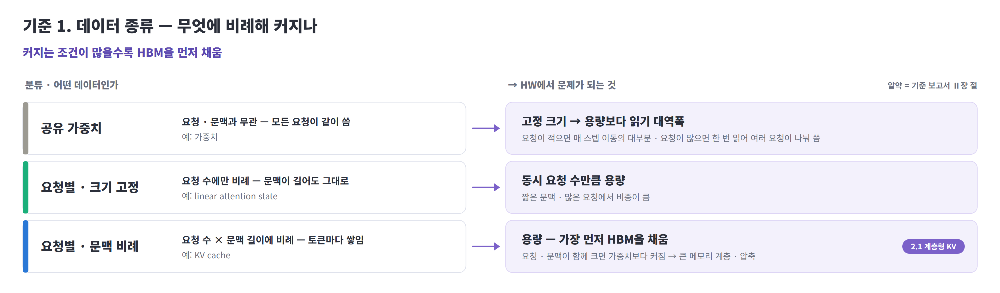
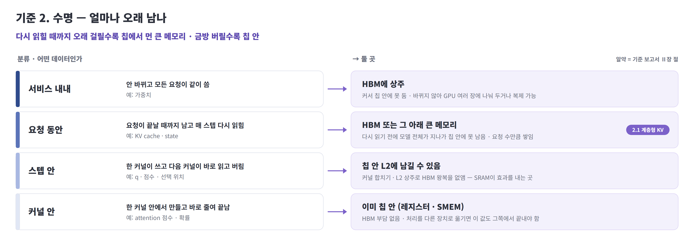
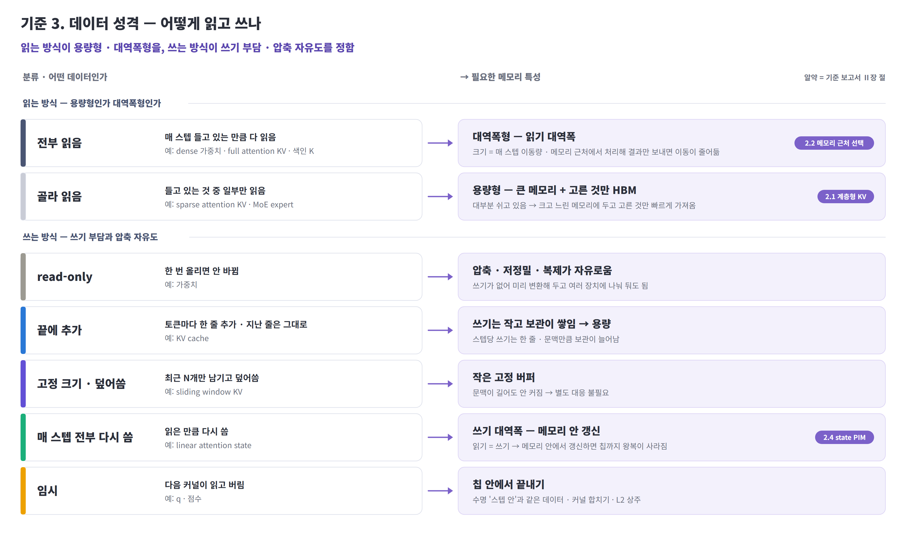
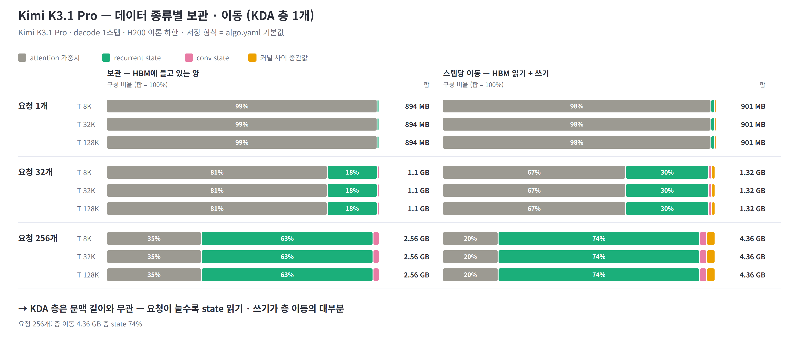
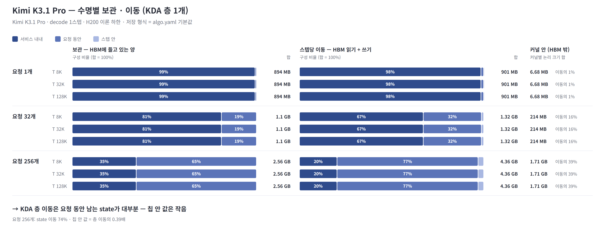
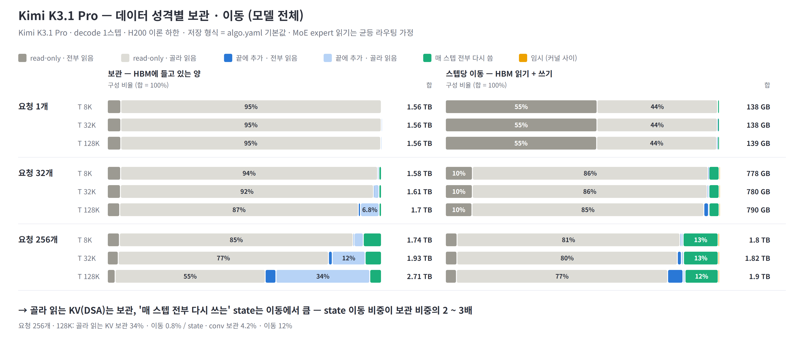
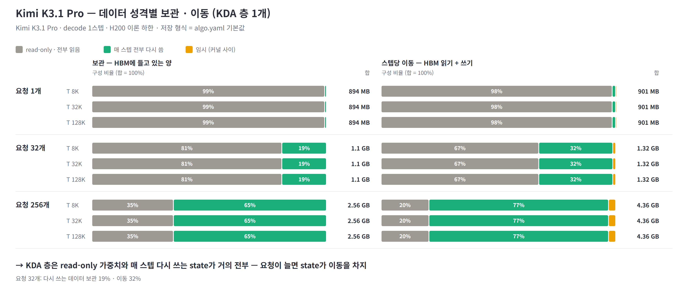
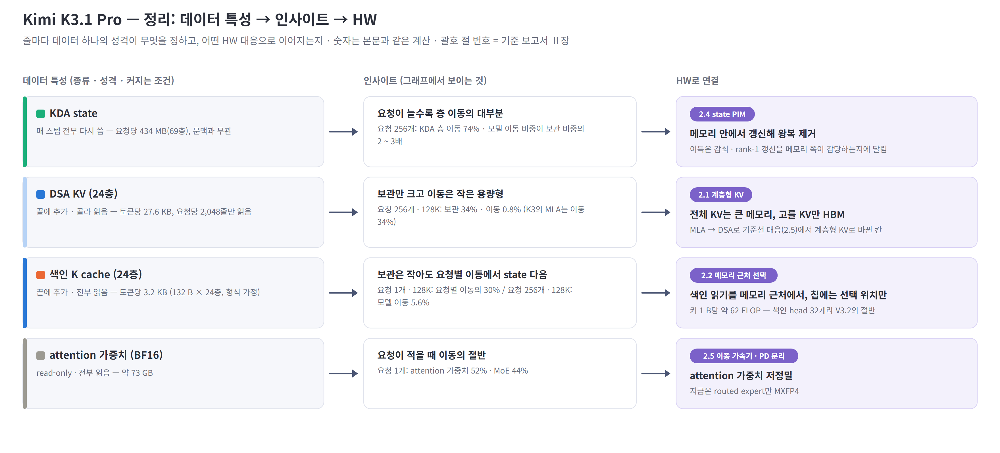

# Kimi K3.1 Pro (KDA + DSA) — 데이터 성격으로 본 decode 1스텝

모델별 보고서 ③ Hybrid (linear + sparse) · 2026.11 · 약식 화면 "데이터 성격 한눈에"를 요청 수 · 문맥 길이로 펼쳐 본 것

기준: H200 (HBM 4.8 TB/s · L2 50 MB) · decode 1스텝 · 93층 = KDA 69 + Gated DSA 24 · attention 가중치 BF16 · routed expert MXFP4 · KDA state FP32(가정 — vLLM은 BF16 경로도 있음) · DSA KV BF16 1,152 B/토큰/층(latent 512 + k_pe 64) · 색인 K 132 B/토큰/층(FP8 + scale, V3.2 형식 가정) · 이론 하한. K3.1 Pro = Kimi K3에서 full attention(Gated MLA) 24층을 Gated DSA(색인 head 32 × 128 · top-k 2,048)로 바꾼 모델 — KDA 층 · MoE는 K3와 같음. **참조 구현 검증 없음** — HuggingFace config(Kimi-K3.1-Pro) · K3 체크포인트 shape + 위키 02-linear-attention 2.3(KDA)으로 세운 식. 요청 256개 · 128K는 보관 2.71 TB로 H200 16장(2.26 TB)을 넘음 — 이동량은 같은 조건의 바이트 비교로만 읽음. 화면: [KDA 약식](https://kimhyeon-ji.github.io/llm-arch-lineage-wiki/arch_insight/dataflow-claude/viewer/kda-k3-lite.html) · 수치: [tools/traits.py](../tools/traits.py) · 그림: [make_traits_report.py](make_traits_report.py) · HW 대응: [기준 보고서](../../sparse-hybrid-hw-report-v2-refined.md) Ⅱ장

---

## 요약

### 요청이 적을 때는 BF16 attention 가중치가, 요청이 많을 때는 MoE와 함께 KDA state가 이동을 늘림 — DSA KV는 골라 읽어 보관만 크고, '매 스텝 전부 다시 쓰는' 데이터가 처음 등장

| 조건 | HBM에 가장 많이 들고 있는 것 | 매 스텝 가장 많이 옮기는 것 (모델 전체) | KDA 층 안에서 가장 많이 옮기는 것 |
|---|---|---|---|
| **요청이 적을 때** | 가중치 (대부분 MXFP4 MoE expert) | attention 가중치(BF16)가 MoE보다 큼 | attention 가중치 |
| **요청이 많을 때** | 가중치 | MoE 가중치, 그다음 attention 가중치 · KDA state | attention 가중치, 그다음 state |
| **요청 · 문맥이 모두 클 때** | 가중치, DSA KV가 3분의 1 | MoE 가중치, 그다음 KDA state · 색인 K | KDA state |

- **요청이 적을 때:** BF16 attention 가중치(약 73 GB)가 이동의 절반 — MoE는 MXFP4 expert 16개만 읽음
- **요청이 늘수록:** MoE 읽기가 커지고, 요청 수에 비례하는 KDA state 읽기 · 쓰기가 붙음. state는 문맥 길이와 무관
- **문맥이 길수록:** DSA 24층의 KV · 색인 K만 커짐 — KV는 요청당 2,048줄만 읽어 보관만 늘고, 이동은 전부 읽는 색인 K가 늘림. KDA 층은 그대로
- **KDA state는 다시 쓰는 데이터:** 보관은 작지만 매 스텝 전부 읽고 다시 써 이동 비중이 보관 비중의 2 ~ 3배
- **K3 대비 (MLA → DSA):** 128K 요청 1개의 요청별 이동 4.5 GB → 1.4 GB(약 3분의 1) · 보관 4.1 GB → 4.5 GB(색인 K만큼 늘어남)
- **칩 안 값 · 임시값은 작음:** state 갱신을 레지스터에서 한 번에 끝냄 (KDA 층만 센 값)
- **HW 방향:** attention 가중치 저정밀, state 갱신 PIM, DSA KV는 계층형 KV · 색인 K는 메모리 근처 선택 (각 절 끝 'HW로 발전시킬 포인트')

---

## 데이터를 나누는 세 가지 기준

### 같은 데이터를 '무엇에 비례해 커지나 · 얼마나 오래 남나 · 어떻게 읽고 쓰나'로 나눔 — 각각 'HBM을 얼마나 채우나 · 어디에 두나 · 어떤 메모리 특성이 필요한가'로 이어짐

| 기준 | 묻는 것 | 나누는 값 | 한 줄 규칙 |
|---|---|---|---|
| **1. 데이터 종류** | 무엇에 비례해 커지나 | 공유 가중치 · 요청별 크기 고정 · 요청별 문맥 비례 | 커지는 조건이 많을수록 HBM을 먼저 채움 |
| **2. 수명** | 얼마나 오래 남나 | 서비스 내내 · 요청 동안 · 스텝 안 · 커널 안 | 오래 남을수록 칩 밖 큰 메모리, 금방 버릴수록 칩 안 |
| **3. 데이터 성격** | 어떻게 읽고 쓰나 | 읽기: 전부 · 골라 / 쓰기: read-only · 끝에 추가 · 덮어씀 · 다시 씀 · 임시 | 전부 읽으면 대역폭, 골라 읽으면 용량, 다시 쓰면 쓰기 대역폭 |

- **그림 읽는 법 (기준 1 ~ 3 공통):** 왼쪽 = 분류와 그 뜻(예는 일반적인 LLM 데이터) → 오른쪽 = 그런 데이터면 필요한 HW 특성(알약 = 기준 보고서 Ⅱ장 절). 이 모델의 데이터가 어느 칸인지는 맨 아래 표

### 기준 1. 데이터 종류 — 무엇에 비례해 커지나

- **한 줄 규칙:** 커지는 조건이 많을수록 HBM을 먼저 채움 — 공유 가중치(고정) → 요청별 크기 고정(요청 수) → 요청별 문맥 비례(요청 수 × 문맥)
- **가중치는 용량보다 읽기가 문제:** 크기는 고정 · 요청이 적으면 매 스텝 이동의 대부분이 가중치 읽기

### 기준 2. 수명 — 얼마나 오래 남나

- **한 줄 규칙:** 다시 읽힐 때까지 오래 걸릴수록 칩에서 먼 큰 메모리, 금방 버릴수록 칩 안
- **칩 안에 남을 수 있는 경계 = 한 스텝:** 다음 스텝까지 모델 전체(전 층 + MoE)가 지나가 칩 안(L2 50 MB)이 다 덮임 → 서비스 내내 · 요청 동안 데이터는 SRAM을 늘려도 HBM 이동이 그대로
- **SRAM이 효과를 내는 곳 = 스텝 안 값:** 커널 합치기 · L2 상주로 HBM 왕복 제거. 커널 안 값은 이미 칩 안

### 기준 3. 데이터 성격 — 어떻게 읽고 쓰나

- **읽는 방식 → 용량형 · 대역폭형:** 전부 읽으면 크기가 곧 매 스텝 이동량(대역폭형), 골라 읽으면 보관만 크고 이동은 작음(용량형)
- **쓰는 방식 → 쓰기 부담 · 압축 자유도:** read-only는 미리 압축 · 복제 자유, 끝에 추가는 스텝당 쓰기가 한 줄, 매 스텝 다시 쓰면 읽은 만큼 쓰기 대역폭이 듦
- **두 축을 함께 읽음:** 같은 '끝에 추가'도 골라 읽으면 큰 메모리로(2.1), 전부 읽으면 메모리 근처 처리로(2.2)

### 이 모델의 데이터 — 종류별 수명 · 성격

| 데이터 (종류 · 크기) | 수명 → 둘 곳 | 데이터 성격 → 필요한 특성 |
|---|---|---|
| **attention 가중치 (KDA · DSA, BF16) · dense FFN · LM head** (공유 · 77 GB) | **서비스 내내** → HBM 상주 | **read-only · 전부 읽음** → 읽기 대역폭 · 저정밀 (attention이 BF16이라 여지 큼) |
| **MoE expert (MXFP4) · 임베딩** (공유 · 1.48 TB) | **서비스 내내** → HBM 상주 | **read-only · 골라 읽음** → 요청이 적을 때만 일부를 읽음 (MoE는 요청이 많으면 거의 전부) |
| **DSA KV (24층)** (요청별 · 토큰당 27.6 KB) | **요청 동안** → HBM · 그 아래 큰 메모리 | **끝에 추가 · 골라 읽음** → **용량형** — 요청당 2,048줄만 읽음 (K3의 MLA KV는 전부 읽음) |
| **색인 K cache (24층)** (요청별 · 토큰당 3.2 KB) | **요청 동안** → HBM | **끝에 추가 · 전부 읽음** → **대역폭형** — 보관은 KV의 약 9분의 1이지만 매 스텝 전부 읽음 |
| **KDA state · conv state** (요청별 · 요청당 449 MB, 문맥과 무관) | **요청 동안** → HBM (한 스텝 뒤에 다시 읽고 다시 씀) | **매 스텝 전부 다시 씀** → **쓰기 대역폭** · 메모리 안 갱신 |
| **q · k · v · gate** (커널 사이 값) | **스텝 안** → 칩 안 L2에 남길 수 있음 | **임시** → 커널 합치기 |
| **감쇠한 state · conv 창 · α** (칩 안 값) | **커널 안** → 이미 칩 안 | HBM에 안 나옴 — state 갱신을 레지스터에서 한 번에 끝냄 |

- **'매 스텝 전부 다시 씀'이 처음 등장:** KDA state는 수명이 KV와 같은 '요청 동안'이지만 읽은 만큼 다시 써 이동 비중이 보관 비중의 2 ~ 3배 → 메모리 안 갱신 (2.4)
- **요청 동안 데이터가 세 종류:** DSA KV는 문맥에 비례해 보관을, 색인 K는 문맥에 비례해 이동을, KDA state는 요청 수에만 비례해 이동을 늘림
- **골라 읽는 KV가 생김:** DSA KV가 계층형 KV (2.1)의 대상 — K3에서는 MLA KV를 전부 읽어 대상이 작았음

### 그래프 읽는 법

- **그래프 막대:** 왼쪽 = 보관(용량 요구), 오른쪽 = 스텝당 이동(대역폭 요구). 보관에서 크고 이동에서 작으면 용량형, 반대면 대역폭형
- **조건:** 요청 1 · 32 · 256개 × 문맥 8K · 32K · 128K. 범위는 모델 전체(93층 + MoE · LM head) / KDA 층 1개
- **골라 읽음:** 요청 1개 · 128K에서 스텝당 읽기가 보관의 90% 미만인 데이터 — MoE expert · 임베딩 · DSA KV(1.6%). 색인 K · state는 전부 읽음. 기준 조건의 라벨이라 요청이 많으면 MoE도 대부분을 읽음 (화면 표에 지금 조건의 읽는 비율)

---

## 1. 데이터 종류 — 무엇이 용량과 대역폭을 쓰나

### 1.1 모델 전체 — 요청이 적을 때는 attention 가중치, 요청 · 문맥이 크면 DSA KV는 보관에서, KDA state는 이동에서 커짐

- **요청 1개:** attention 가중치가 MoE보다 많이 옮겨짐 — attention은 BF16, routed expert는 MXFP4라서
- **요청이 늘수록:** MoE가 이동의 대부분 (요청 32개 · 8K 86%)
- **문맥 128K · 요청 256개:** DSA KV가 보관의 34%인데 이동은 0.8% — 이동은 KDA state 12% · 색인 K 5.6%
- **KDA state 비중은 문맥과 거의 무관:** 요청 256개에서 8K · 128K 모두 이동의 12% — KV를 골라 읽어 긴 문맥에서도 다른 이동이 크게 안 늘어남

### 1.2 KDA 층 1개 — 문맥과 무관하고, 요청이 늘수록 state가 층 이동을 차지

- **KDA 층은 문맥과 무관:** 같은 요청 수의 막대 3개가 모두 같음
- **요청이 늘수록 state가 층 이동을 차지:** 요청 1개 1.4% → 32개 31% → 256개 74%
- **층 가중치가 커서(약 0.9 GB) state가 가중치를 넘는 시점이 늦음:** 요청 69개부터

#### HW로 발전시킬 포인트

| 대상 | 이 절에서 본 특성 | HW 방향 | 기준 보고서 Ⅱ장 |
|---|---|---|---|
| **attention 가중치 (BF16)** | 요청이 적을 때 이동의 절반 | attention 가중치 저정밀이 바로 효과 (지금은 routed expert만 MXFP4) | — |
| **KDA state** | 층마다 요청당 6.3 MB를 읽고 같은 양을 다시 씀 | state 갱신 PIM (Pimba · NOVA · HyPIM) | 2.4 |
| **DSA KV (24층)** | 보관만 크고 요청당 2,048줄만 읽음 | 계층형 KV — 전체 KV는 큰 메모리, 고를 KV만 HBM | 2.1 |
| **색인 K (24층)** | 보관은 작아도 매 스텝 전부 읽음 | 메모리 근처 선택 — 칩에는 선택 위치만 | 2.2 |

---

## 2. 데이터 수명 — 어디에 둘 수 있나

> **읽는 법:** 수명과 '다시 읽히기까지 걸리는 시간'이 둘 곳을 정함. 한 스텝 뒤에 다시 읽히는 가중치 · KV · state는 그사이 93층 전체가 지나가 칩 안에 못 남음 → HBM이나 그 아래 메모리. 다음 커널이 바로 읽는 스텝 안 임시값은 칩 안에서 끝낼 수 있는 몫. 커널 안 값은 지금 칩 안에서 처리해 HBM을 아끼고 있는 몫

### 2.1 모델 전체 — 요청 동안 남는 데이터가 보관(DSA KV)과 이동(KDA state)으로 갈림

- **서비스 내내 가중치가 이동의 대부분:** 요청 256개 · 128K에서도 81%
- **요청 동안 남는 데이터가 세 종류:** DSA KV · 색인 K는 문맥에 비례(KV는 보관, 색인 K는 이동), KDA state는 요청 수에만 비례 — 요청 256개 · 128K에서 요청별 보관 42% 중 KV 34%, 요청별 이동 18% 중 state · conv 12%
- **칩 안 값은 작음:** 모델 전체 이동의 0.07배 이하 (커널별 논리 크기 합 · KDA 층만)

### 2.2 KDA 층 1개 — 요청이 늘면 이동이 서비스 내내 가중치에서 요청 동안 state로 넘어감

- **요청이 적을 때는 가중치, 많을 때는 state:** 요청 256개에서 state가 층 이동의 4분의 3
- **스텝 안 임시값(3% 안팎) · 칩 안 값 모두 작음:** state 블록을 레지스터에 올려 감쇠 · 읽기 · 기록 · 출력을 한 커널에서 끝냄

#### HW로 발전시킬 포인트

| 대상 | 이 절에서 본 특성 | HW 방향 | 기준 보고서 Ⅱ장 |
|---|---|---|---|
| **KDA state** (칩 밖 수명) | 한 스텝 뒤에 다시 읽힘 · SRAM에 두려면 요청 수 × 층당 6.3 MB — 요청 8개면 층 1개에 50 MB(L2 전체) | SRAM 상주는 요청 · 층 수에 비례해 어려움 → 메모리 안 갱신(PIM). 이득은 감쇠 · rank-1 갱신을 메모리 쪽이 감당하는지에 달림 | 2.4 |
| **가중치** | 요청이 적을 때 이동의 대부분 | 가중치 대역폭 — 이종 가속기 · PD 분리 | 2.5 |

---

## 3. 데이터 성격 — 어떤 메모리 특성이 필요한가

> **읽는 법:** 골라 읽는 데이터는 대부분 쉬고 있음 → 큰 용량에 두고 고른 것만 빠르게 가져오는 구조가 맞음. 매번 전부 읽는 데이터는 대역폭이 시간을 정함. 매 스텝 다시 쓰는 데이터는 읽은 만큼 쓰기 대역폭이 필요하고, 메모리 안에서 갱신하면 왕복이 사라짐. read-only는 압축 · 복제 · 저정밀의 자유도가 큼

### 3.1 모델 전체 — '매 스텝 전부 다시 씀'이 처음 등장 · 골라 읽는 KV는 보관, 다시 쓰는 state는 이동에서 큼

- **read-only · 골라 읽는 MoE가 보관 · 이동의 대부분**
- **매 스텝 전부 다시 쓰는 데이터(KDA state · conv):** 요청 1개에서는 보관 · 이동 모두 1% 미만, 요청 256개에서는 보관 4 ~ 7% · 이동 12 ~ 13% — 이동 비중이 보관 비중의 2 ~ 3배
- **DSA KV는 끝에 추가 · 골라 읽음:** 요청 256개 · 128K 보관 34% · 이동 0.8% — 용량형
- **색인 K는 끝에 추가 · 전부 읽음:** 같은 조건 보관 3.9% · 이동 5.6% — 대역폭형

### 3.2 KDA 층 1개 — read-only 가중치와 매 스텝 다시 쓰는 state가 거의 전부

- **거의 두 종류:** read-only 가중치와 매 스텝 전부 다시 쓰는 state · conv. 나머지는 커널 사이 임시값(3% 안팎)
- **요청이 늘수록 다시 쓰는 데이터가 이동을 차지:** 요청 32개 32%, 256개 77%

#### HW로 발전시킬 포인트

| 대상 | 이 절에서 본 특성 | HW 방향 | 기준 보고서 Ⅱ장 |
|---|---|---|---|
| **다시 쓰는 state** | 읽기와 같은 양의 쓰기 대역폭이 필요 | 메모리 안에서 갱신해 왕복 제거 | 2.4 |
| **골라 읽는 DSA KV** | 보관은 크고 이동은 작음 | 계층형 KV | 2.1 |
| **전부 읽는 색인 K** | 보관은 작아도 이동이 큼 · 키 1 B당 약 62 FLOP(색인 head 32 — V3.2의 절반) | 메모리 근처 선택 · 색인 연산 | 2.2 · 2.3 |

---

## 정리 — 데이터 특성 → 인사이트 → HW

### 매 스텝 다시 쓰는 state가 처음 등장 — 긴 문맥은 DSA KV가 용량을, 많은 요청은 state가 대역폭을 씀

- **이 모델의 특성:** 요청이 적을 때는 BF16 attention 가중치가 이동의 절반, 요청이 늘수록 KDA state 읽기 · 쓰기가 요청 수에 비례해 커짐(문맥과 무관)
- **문맥이 길수록:** DSA 24층의 KV · 색인 K만 커짐 → KV는 보관(용량), 색인 K는 이동(대역폭) · 많은 요청은 KDA state가 부담
- **K3에서 바뀐 것:** full attention 24층이 MLA → DSA로 바뀌어 KV가 '전부 읽음'에서 '골라 읽음' 칸으로 이동 → 기준선 대응(2.5) 대신 계층형 KV(2.1) · 메모리 근처 선택(2.2)

| 데이터 | 특성 (성격 · 커지는 조건) | 근거 (조건 · 수치) | 인사이트 | HW로 연결 | 기준 보고서 Ⅱ장 |
|---|---|---|---|---|---|
| KDA state | 매 스텝 전부 다시 씀 · 요청당 434 MB · 문맥과 무관 | 요청 256개: KDA 층 이동 74% · 모델 이동 비중이 보관 비중의 2 ~ 3배 | 요청이 늘수록 층 이동의 대부분 | 메모리 안 갱신(PIM) | 2.4 |
| DSA KV (24층) | 끝에 추가 · 골라 읽음 · 토큰당 27.6 KB · 요청당 2,048줄만 읽음 | 요청 256개 · 128K: 보관 34% · 이동 0.8% | 보관만 크고 이동은 작은 용량형 | 계층형 KV | 2.1 |
| 색인 K cache (24층) | 끝에 추가 · 전부 읽음 · 토큰당 3.2 KB | 요청 1개 · 128K: 요청별 이동의 30% / 요청 256개 · 128K: 모델 이동 5.6% | 보관은 작아도 매 스텝 전부 읽는 대역폭형 | 메모리 근처 선택 · 색인 연산 | 2.2 |
| attention 가중치 (BF16) | read-only · 약 73 GB | 요청 1개: 이동의 52% | 요청이 적을 때 이동의 절반 | attention 가중치 저정밀 | 2.5 |

- **확인할 것:** state 정밀도(FP32 / BF16)와 감쇠 · rank-1 갱신을 메모리 쪽에서 감당할 연산 능력 — PIM 이득의 전제. DSA KV · 색인 K의 배포 형식(config에 없음 — V3.2처럼 FP8 KV 656 B면 KV 보관 57%)과 K3.1 Pro 체크포인트의 색인기 shape

---

## 부록 — 계산 기준

- **KDA 층:** [kda-k3/algo.yaml](../models/kda-k3/algo.yaml) · [map-gpu.yaml](../models/kda-k3/map-gpu.yaml). Gated DeltaNet 커널 구조에 채널별 감쇠를 넣음. 체크포인트 shape대로 감쇠 low-rank(f_a [128 × 7168] → f_b [12288 × 128]) · 출력 gate full-rank(g_proj [12288 × 7168]), conv · o_norm · 감쇠 파라미터 FP32. state FP32는 가정
- **모델 전체:** [model.yaml](../models/kda-k3/model.yaml). Gated DSA 24층은 식 — MLA 부분(NoPE · 출력 gate · BF16)은 K3와 같게 두고, K3 체크포인트에 64차원 k_pe 분기(q_b [18432 × 1536] · kv_a [576 × 7168])가 있어 KV도 576차원으로 셈. 색인기는 config(head 32 × 128 · RoPE 없음 · top-k 2,048) + V3.2 색인기 구조 가정(q 투영 [4096 × 1536] · k 투영 [128 × 7168] · head 가중치 [32 × 7168], BF16). 색인 K 132 B는 V3.2 vLLM 형식 가정. MoE 92층 = routed 896개 중 16개(latent 3,584 · 폭 3,072 · MXFP4) + shared 2개(BF16) + latent 투영, 첫 1층 dense FFN
- **수명 · 성격 판정:** [dsa-v32-traits.md](dsa-v32-traits.md) 부록과 같은 규칙
- **칩 안 값 · 임시값:** KDA 층만 셈 (DSA 층은 식이라 색인 점수 · 선택 위치 등이 빠짐)
- **용량:** 요청 256개 · 128K 보관 2.71 TB → H200 141 GB 기준 최소 20장 (배치 가정 16장 초과). 화면의 시간은 전체 바이트 ÷ 합산 대역폭의 이상적 환산
- **MoE 읽기:** 균등 · 독립 라우팅 기댓값 — 요청 32개에서 expert 393/896개 (쏠리면 16개까지 줄고, 겹치지 않으면 512개). EP · DP 복제는 반영 안 함
- **제외:** AttnRes(블록 residual) · MTP · 잔차 · 정규화 값 · GPU 간 통신
