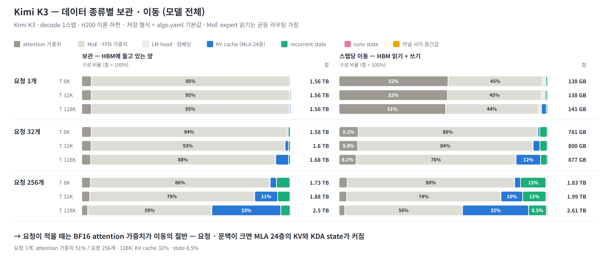
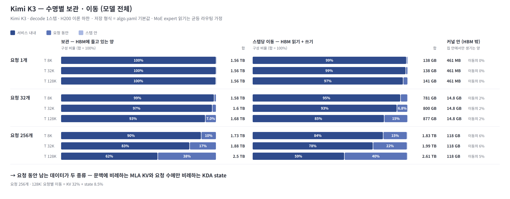

# Kimi K3 (KDA + MLA) — 데이터 성격으로 본 decode 1스텝

모델별 보고서 ③ Hybrid (linear + full) · 2026.11 · 약식 화면 "데이터 성격 한눈에"를 요청 수 · 문맥 길이로 펼쳐 본 것

기준: H200 (HBM 4.8 TB/s · L2 50 MB) · decode 1스텝 · 93층 = KDA 69 + MLA 24 · attention 가중치 BF16 · routed expert MXFP4 · KDA state FP32(가정) · MLA KV BF16 1,024 B/토큰/층 · 이론 하한. **참조 구현 검증 없음** — HuggingFace config 값 + 위키 02-linear-attention 2.3(KDA)으로 세운 식. 화면: [KDA 약식](https://kimhyeon-ji.github.io/llm-arch-lineage-wiki/arch_insight/dataflow-claude/viewer/kda-k3-lite.html) · 수치: [tools/traits.py](../tools/traits.py) · 그림: [make_traits_report.py](make_traits_report.py) · HW 대응: [기준 보고서](../../sparse-hybrid-hw-report-v2-refined.md) Ⅱ장

---

## 요약

### 요청이 적을 때는 BF16 attention 가중치가, 요청이 많을 때는 MoE와 함께 MLA KV · KDA state가 이동을 늘림 — '매 스텝 전부 다시 쓰는' 데이터가 처음 등장

| 조건 | HBM에 가장 많이 들고 있는 것 | 매 스텝 가장 많이 옮기는 것 (모델 전체) | KDA 층 안에서 가장 많이 옮기는 것 |
|---|---|---|---|
| **요청이 적을 때** | 가중치 (대부분 MXFP4 MoE expert) | attention 가중치(BF16)가 MoE보다 큼 | attention 가중치 |
| **요청이 많을 때** | 가중치 | MoE 가중치, 그다음 MLA KV · attention 가중치 | attention 가중치, 그다음 state |
| **요청 · 문맥이 모두 클 때** | 가중치, MLA KV가 3분의 1 | MoE 가중치, 그다음 MLA KV · KDA state | KDA state |

- **요청이 적을 때:** BF16 attention 가중치(약 72 GB)가 이동의 절반 — MoE는 MXFP4 expert 16개만 읽음
- **요청이 늘수록:** MoE 읽기가 커지고, 요청 수에 비례하는 KDA state 읽기 · 쓰기가 붙음. state는 문맥 길이와 무관
- **문맥이 길수록:** MLA 24층의 KV만 커짐 — KDA 층은 문맥이 길어져도 그대로
- **KDA state는 다시 쓰는 데이터:** 보관은 작지만 매 스텝 전부 읽고 다시 써 이동 비중이 보관 비중의 약 2배
- **칩 안 값 · 임시값은 작음:** state 갱신을 레지스터에서 한 번에 끝냄
- **HW 방향:** attention 가중치 저정밀, state 갱신 PIM, MLA KV는 기준선과 같은 대응 (각 절 끝 'HW로 발전시킬 포인트')

---

## 데이터를 나누는 세 가지 기준

### 같은 데이터를 '무엇인가 · 얼마나 오래 남나 · 어떻게 읽고 쓰나'로 나눔 — 각각 무엇이 자원을 쓰는지 · 어디에 둘 수 있는지 · 어떤 메모리 특성이 필요한지를 알려 줌

| 기준 | 묻는 것 | 나누는 값 | 이걸로 알 수 있는 것 |
|---|---|---|---|
| **데이터 종류** | 무엇인가 | 가중치 · MLA KV cache · KDA state · conv state · 중간값 | 어떤 데이터가 HBM 용량과 대역폭을 쓰는지 |
| **수명** | 얼마나 오래 남고, 언제 다시 읽히나 | 서비스 내내(가중치) · 요청 동안(KV · state) · 스텝 안(커널 사이 값) · 커널 안(칩 안에서만) | **어디에 둘 수 있는지.** 한 스텝 뒤에 다시 읽히는 값은 칩 안에 못 남음 → HBM이나 더 큰 메모리. 다음 커널이 바로 읽는 값은 칩 안에서 끝낼 수 있음 |
| **데이터 성격** | 어떻게 읽고 쓰나 | read-only · 끝에 추가 · 매 스텝 전부 다시 씀 · 임시, 그리고 전부 읽음 · 골라 읽음 | **어떤 메모리 특성이 필요한지.** 골라 읽는 데이터는 용량, 매번 전부 읽는 데이터는 대역폭, 다시 쓰는 데이터는 쓰기 대역폭이나 메모리 안 갱신 |

- **그래프 막대:** 왼쪽 = 보관(용량 요구), 오른쪽 = 스텝당 이동(대역폭 요구). 보관에서 크고 이동에서 작으면 용량형, 반대면 대역폭형
- **조건:** 요청 1 · 32 · 256개 × 문맥 8K · 32K · 128K. 범위는 모델 전체(93층 + MoE · LM head) / KDA 층 1개
- **골라 읽음:** 요청 1개 · 128K에서 스텝당 읽기가 보관의 90% 미만인 데이터 — MoE expert · 임베딩뿐. 요청별 데이터는 모두 전부 읽음

---

## 1. 데이터 종류 — 무엇이 용량과 대역폭을 쓰나

### 1.1 모델 전체 — 요청이 적을 때는 attention 가중치, 요청 · 문맥이 크면 MLA KV와 KDA state가 커짐

- **요청 1개:** attention 가중치가 MoE보다 많이 옮겨짐 — attention은 BF16, routed expert는 MXFP4라서
- **요청이 늘수록:** MoE가 이동의 대부분 (요청 32개 · 8K 86%)
- **문맥 128K · 요청 256개:** MLA KV가 보관의 3분의 1 · 이동의 3분의 1, KDA state가 이동의 8.5%
- **KDA state 비중은 문맥이 짧을 때 가장 큼:** 요청 256개 · 8K에서 이동의 12% — KV가 작아 state가 상대적으로 커짐

### 1.2 KDA 층 1개 — 문맥과 무관하고, 요청이 늘수록 state가 층 이동을 차지

- **KDA 층은 문맥과 무관:** 같은 요청 수의 막대 3개가 모두 같음
- **요청이 늘수록 state가 층 이동을 차지:** 요청 1개 1% → 32개 31% → 256개 74%
- **층 가중치가 커서(약 0.9 GB) state가 가중치를 넘는 시점이 늦음:** 요청 128개부터

**HW로 발전시킬 포인트**
- **요청이 적을 때는 attention 가중치:** BF16 attention이 이동의 절반 → attention 가중치 저정밀이 바로 효과 (지금은 routed expert만 MXFP4)
- **KDA state:** 층마다 요청당 6.3 MB를 읽고 같은 양을 다시 씀 → state 갱신 PIM (기준 보고서 2.4: Pimba · NOVA · HyPIM)
- **MLA KV(24층):** 매번 전부 읽는 KV → 기준선(V3.1)과 같은 대응 (HBM 용량 · 대역폭, KV 저정밀)

---

## 2. 데이터 수명 — 어디에 둘 수 있나

> **읽는 법:** 수명과 '다시 읽히기까지 걸리는 시간'이 둘 곳을 정함. 한 스텝 뒤에 다시 읽히는 가중치 · KV · state는 그사이 93층 전체가 지나가 칩 안에 못 남음 → HBM이나 그 아래 메모리. 다음 커널이 바로 읽는 스텝 안 임시값은 칩 안에서 끝낼 수 있는 몫. 커널 안 값은 지금 칩 안에서 처리해 HBM을 아끼고 있는 몫

### 2.1 모델 전체 — 요청 동안 남는 데이터가 두 종류로 갈림

- **서비스 내내 가중치가 이동의 대부분:** 요청 256개 · 128K에서도 60% 안팎
- **요청 동안 남는 데이터가 두 종류:** MLA KV는 문맥에 비례해 커지고, KDA state는 요청 수에만 비례
- **칩 안 값은 작음:** 모델 전체 이동의 0.06배 이하

### 2.2 KDA 층 1개 — 요청이 늘면 이동이 서비스 내내 가중치에서 요청 동안 state로 넘어감

- **요청이 적을 때는 가중치, 많을 때는 state:** 요청 256개에서 state가 층 이동의 4분의 3
- **스텝 안 임시값(3% 이하) · 칩 안 값 모두 작음:** state 블록을 레지스터에 올려 감쇠 · 읽기 · 기록 · 출력을 한 커널에서 끝냄

**HW로 발전시킬 포인트**
- **state는 한 스텝 뒤에 다시 읽힘:** 칩 안 SRAM에 두려면 요청 수 × 층당 6.3 MB가 들어가야 함 — 요청 8개만 돼도 층 1개에 50 MB(L2 전체) → SRAM 상주는 어렵고 PIM이 현실적 (2.4의 선택 기준)
- **요청이 적을 때는 가중치 대역폭:** 이종 가속기 · PD 분리 (2.5)

---

## 3. 데이터 성격 — 어떤 메모리 특성이 필요한가

> **읽는 법:** 골라 읽는 데이터는 대부분 쉬고 있음 → 큰 용량에 두고 고른 것만 빠르게 가져오는 구조가 맞음. 매번 전부 읽는 데이터는 대역폭이 시간을 정함. 매 스텝 다시 쓰는 데이터는 읽은 만큼 쓰기 대역폭이 필요하고, 메모리 안에서 갱신하면 왕복이 사라짐. read-only는 압축 · 복제 · 저정밀의 자유도가 큼

### 3.1 모델 전체 — '매 스텝 전부 다시 씀'이 처음 등장 · 보관보다 이동에서 2배 큼

- **read-only · 골라 읽는 MoE가 보관 · 이동의 대부분**
- **매 스텝 전부 다시 쓰는 데이터(KDA state · conv):** 보관은 1% 안팎인데 이동은 3 ~ 12%
- **MLA KV는 끝에 추가 · 전부 읽음:** 용량과 대역폭을 함께 씀
- **골라 읽는 요청별 데이터는 없음**

### 3.2 KDA 층 1개 — read-only 가중치와 매 스텝 다시 쓰는 state 두 종류뿐

- **두 종류뿐:** read-only 가중치와 매 스텝 전부 다시 쓰는 state · conv
- **요청이 늘수록 다시 쓰는 데이터가 이동을 차지:** 요청 32개 32%, 256개 77%

**HW로 발전시킬 포인트**
- **다시 쓰는 데이터:** 읽기와 같은 양의 쓰기 대역폭이 필요 → 메모리 안에서 갱신해 왕복 제거 (2.4)
- **전부 읽는 MLA KV:** 용량 · 대역폭을 함께 (기준선과 같음)
- **골라 읽는 KV가 없음:** 계층형 KV (2.1)를 적용할 대상이 작음 — MLA KV도 매번 전부 읽음
- **해당 없음:** 색인 처리(2.2 · 2.3)

---

## 부록 — 계산 기준

- **KDA 층:** [kda-k3/algo.yaml](../models/kda-k3/algo.yaml) · [map-gpu.yaml](../models/kda-k3/map-gpu.yaml). Gated DeltaNet 커널 구조에 채널별 감쇠(full-rank gate)를 넣음. 출력 gate low-rank · state FP32는 가정
- **모델 전체:** [model.yaml](../models/kda-k3/model.yaml). MLA 24층(NoPE · 출력 gate · BF16)은 식. MoE 92층 = routed 896개 중 16개(latent 3,584 · 폭 3,072 · MXFP4) + shared 2개(BF16) + latent 투영, 첫 1층 dense FFN
- **수명 · 성격 판정:** [dsa-v32-traits.md](dsa-v32-traits.md) 부록과 같은 규칙
- **칩 안 값 · 임시값:** KDA 층만 셈 (MLA 층은 식이라 빠짐)
- **제외:** AttnRes(블록 residual) · MTP · 잔차 · 정규화 값 · GPU 간 통신
