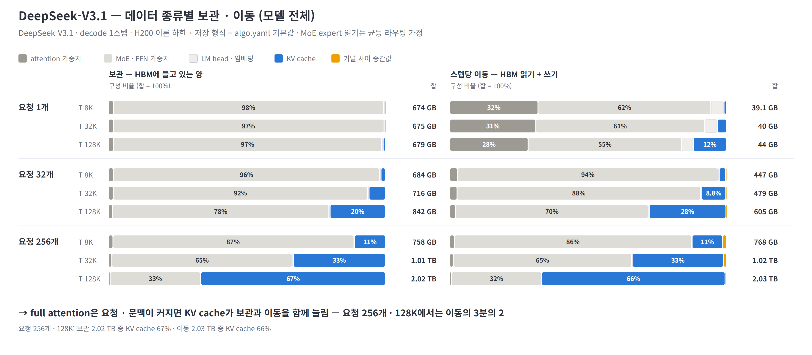
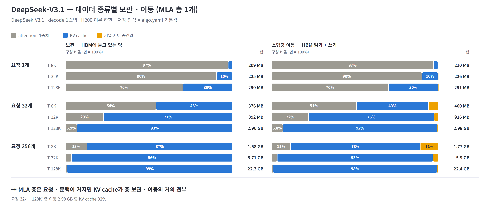
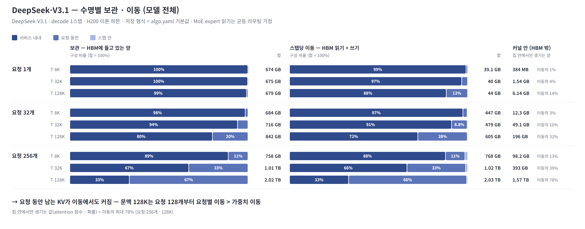
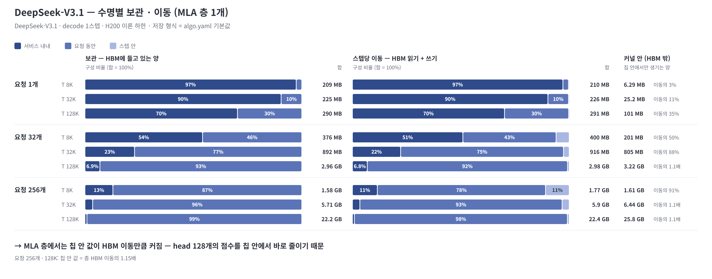
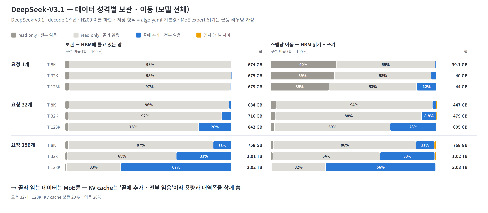
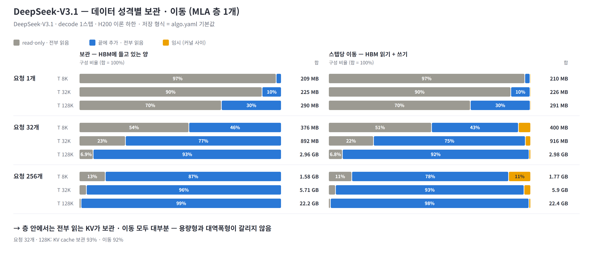

# DeepSeek-V3.1 (MLA · full attention) — 데이터 성격으로 본 decode 1스텝

모델별 보고서 ⓪ 기준선 · 2026.11 · 약식 화면 "데이터 성격 한눈에"를 요청 수 · 문맥 길이로 펼쳐 본 것

기준: H200 (HBM 4.8 TB/s · L2 50 MB) · decode 1스텝 · FP8 가중치 · KV cache 1줄 656 B(V3.2와 같은 형식으로 맞춤) · 이론 하한. V3.2와 MoE · FFN · 차원이 같고 색인만 없는 비교 기준. **참조 구현 검증 없음** — config 값으로 세운 식(MLA 부분은 dsa-v32에서 검증한 식과 같음). 화면: [MLA 약식](https://kimhyeon-ji.github.io/llm-arch-lineage-wiki/arch_insight/dataflow-claude/viewer/mla-v31-lite.html) · 수치: [tools/traits.py](../tools/traits.py) · 그림: [make_traits_report.py](make_traits_report.py) · HW 대응: [기준 보고서](../../sparse-hybrid-hw-report-v2-refined.md) Ⅱ장

---

## 요약

### KV cache를 매 스텝 전부 읽어, 요청 · 문맥이 커지면 KV가 용량과 대역폭을 함께 씀 — sparse · hybrid가 줄이려는 부담의 출발점

| 조건 | HBM에 가장 많이 들고 있는 것 | 매 스텝 가장 많이 옮기는 것 (모델 전체) | attention 층 안에서 가장 많이 옮기는 것 |
|---|---|---|---|
| **요청이 적을 때** | 가중치 (대부분 MoE expert) | 가중치. 문맥이 길면 KV cache도 눈에 띔 | attention 가중치, 문맥이 길면 KV cache |
| **요청이 많을 때** | 가중치, 그다음 KV cache | MoE 가중치, 그다음 KV cache | KV cache |
| **요청 · 문맥이 모두 클 때** | KV cache가 가중치보다 많아짐 | KV cache가 가중치보다 많아짐 | KV cache (거의 전부) |

- **요청이 늘수록:** MoE 가중치와 함께 KV cache 읽기도 요청 수에 비례해 커짐 → 문맥 128K에서는 요청 128개부터 요청별 이동이 가중치 이동을 넘음
- **문맥이 길수록:** KV cache 보관과 읽기가 같은 비율로 커짐 — 보관한 만큼 매 스텝 읽음
- **KV cache는 용량형이면서 대역폭형:** 보관 비중과 이동 비중이 거의 같음 → 한쪽만 늘려서는 해결되지 않음
- **칩 안 값:** head 128개의 attention 점수를 칩 안에서 바로 줄이는 양이 attention 층 HBM 이동만큼 큼
- **비교 기준으로서:** 이 보고서의 KV 이동이 V3.2(DSA)에서 2,048줄 고정 읽기로 바뀌는 몫. 모델 간 비교는 종합 보고서에서
- **HW 방향:** HBM 용량 · 대역폭과 KV 저정밀이 바로 효과. 계층형 KV는 매 스텝 전부 읽어 효과가 제한적 (각 절 끝 'HW로 발전시킬 포인트')

---

## 데이터를 나누는 세 가지 기준

### 같은 데이터를 '무엇인가 · 얼마나 오래 남나 · 어떻게 읽고 쓰나'로 나눔 — 각각 무엇이 자원을 쓰는지 · 어디에 둘 수 있는지 · 어떤 메모리 특성이 필요한지를 알려 줌

| 기준 | 묻는 것 | 나누는 값 | 이걸로 알 수 있는 것 |
|---|---|---|---|
| **데이터 종류** | 무엇인가 | 가중치 · KV cache · 중간값 | 어떤 데이터가 HBM 용량과 대역폭을 쓰는지 |
| **수명** | 얼마나 오래 남고, 언제 다시 읽히나 | 서비스 내내(가중치) · 요청 동안(cache) · 스텝 안(커널 사이 값) · 커널 안(칩 안에서만) | **어디에 둘 수 있는지.** 한 스텝 뒤에 다시 읽히는 값은 그사이 모델 전체가 지나가 칩 안에 못 남음 → HBM이나 더 큰 메모리. 다음 커널이 바로 읽는 값은 칩 안(L2 · SMEM)에서 끝낼 수 있음 |
| **데이터 성격** | 어떻게 읽고 쓰나 | read-only · 끝에 추가 · 매 스텝 전부 다시 씀 · 임시, 그리고 전부 읽음 · 골라 읽음 | **어떤 메모리 특성이 필요한지.** 골라 읽는 데이터는 용량, 매번 전부 읽는 데이터는 대역폭, 다시 쓰는 데이터는 쓰기 대역폭이나 메모리 안 갱신 |

- **그래프 막대:** 왼쪽 = 보관(HBM에 들고 있는 양 → 용량 요구), 오른쪽 = 스텝당 이동(읽기 + 쓰기 → 대역폭 요구). 보관에서 크고 이동에서 작으면 용량형, 반대면 대역폭형
- **조건:** 요청 1 · 32 · 256개 × 문맥 8K · 32K · 128K. 범위는 모델 전체(61층 + MoE · FFN · LM head) / MLA 층 1개
- **골라 읽음:** 요청 1개 · 128K에서 스텝당 읽기가 보관의 90% 미만인 데이터 — 이 모델에서는 MoE expert · 임베딩뿐

---

## 1. 데이터 종류 — 무엇이 용량과 대역폭을 쓰나

### 1.1 모델 전체 — 요청 · 문맥이 커지면 KV cache가 보관과 이동을 함께 늘려 결국 가중치를 넘음

- **요청이 적을 때:** 이동의 대부분이 가중치. 문맥 128K면 KV cache가 이동의 약 10분의 1
- **요청이 늘수록:** KV cache 이동이 요청 수에 비례해 커짐 → 요청 32개 · 128K에서 이동의 4분의 1 이상
- **요청 · 문맥이 모두 클 때:** KV cache가 보관 · 이동 모두 가장 큼 (약 3분의 2)
- **보관 비중 ≈ 이동 비중:** 보관한 KV를 매번 전부 읽기 때문

### 1.2 MLA 층 1개 — 요청 · 문맥이 커지면 층 보관 · 이동의 거의 전부가 KV cache

- **요청이 적고 문맥이 짧을 때만** attention 가중치가 큼
- **요청 · 문맥이 커질수록:** KV cache가 층 보관 · 이동의 거의 전부 (요청 32개 · 128K 92%, 요청 256개 · 128K 98%)
- **요청별 cache 이동이 가중치 이동을 넘는 시점이 빠름:** 문맥 128K는 요청 4개, 8K는 64개부터 (DSA는 각각 16개 · 128개)

**HW로 발전시킬 포인트**
- **KV가 용량과 대역폭을 함께 씀:** HBM 용량 · 대역폭 증설, KV 저정밀(FP8 이하)이 보관과 이동을 동시에 줄임
- **계층형 KV (기준 보고서 2.1)는 효과가 제한적:** 매 스텝 전부 읽어 아래 계층으로 내리면 링크 대역폭이 막힘 → 잠시 쉬는 요청의 KV만 대상
- **근본 대응은 구조 쪽:** 읽을 KV를 줄이는 sparse(DSA · CSA · QSA)나 KV를 없애는 linear(KDA · GDN) — 다른 모델 보고서

---

## 2. 데이터 수명 — 어디에 둘 수 있나

> **읽는 법:** 수명과 '다시 읽히기까지 걸리는 시간'이 둘 곳을 정함. 한 스텝 뒤에 다시 읽히는 가중치 · cache는 그사이 61층 전체가 지나가 칩 안에 못 남음 → HBM이나 그 아래 메모리. 다음 커널이 바로 읽는 스텝 안 임시값은 칩 안에서 끝낼 수 있는 몫. 커널 안 값은 지금 칩 안에서 처리해 HBM을 아끼고 있는 몫

### 2.1 모델 전체 — 요청 · 문맥이 크면 요청 동안 남는 KV가 서비스 내내 남는 가중치를 넘음

- **서비스 내내 가중치가 이동의 대부분이지만**, 문맥 128K · 요청 128개부터 요청 동안 남는 KV가 넘어섬
- **스텝 안 임시값은 작음:** 모델 전체 이동의 1.5% 이하
- **칩 안에서만 생기는 값이 요청 · 문맥과 함께 커짐:** 요청 256개 · 128K에서 이동의 약 4분의 3 크기

### 2.2 MLA 층 1개 — 칩 안 값이 HBM 이동만큼 커짐

- **KV가 층 이동의 대부분이라 임시값 비중은 작음:** 요청 256개 · 8K의 11%가 가장 큼
- **칩 안 값 ≈ HBM 이동:** 요청 32개 · 128K 1.1배, 요청 256개 · 128K 1.15배 — head 128개 점수를 블록마다 online softmax로 바로 줄임

**HW로 발전시킬 포인트**
- **한 스텝 뒤 재사용 데이터가 거의 전부:** SRAM을 늘려도 이동이 줄지 않음 → 대역폭으로 대응 — 이종 가속기 · PD 분리 (2.5: decode는 고대역 메모리 장치)
- **MLA attention은 연산도 큼:** head 128개가 KV 1줄을 공유해 KV 1 B당 연산이 많음(약 420 FLOP/B) → 요청 1개에서도 연산 한계. attention을 메모리 근처로 옮기는 방향은 메모리 쪽 연산 성능 요구가 커서 맞지 않음

---

## 3. 데이터 성격 — 어떤 메모리 특성이 필요한가

> **읽는 법:** 골라 읽는 데이터는 대부분 쉬고 있음 → 큰 용량에 두고 고른 것만 빠르게 가져오는 구조가 맞음. 매번 전부 읽는 데이터는 대역폭이 시간을 정함 → 대역폭을 늘리거나 메모리 근처에서 처리. 매 스텝 다시 쓰는 데이터는 쓰기 대역폭이나 메모리 안 갱신이 필요. read-only는 압축 · 복제 · 저정밀의 자유도가 큼

### 3.1 모델 전체 — 골라 읽는 데이터는 MoE뿐, KV cache는 전부 읽는 요청별 데이터

- **골라 읽는 데이터는 MoE expert뿐:** 요청이 늘면 이것도 사실상 전부 읽음
- **KV cache는 '끝에 추가 · 전부 읽음':** 보관이 늘면 이동도 같은 만큼 늘어남
- **매 스텝 전부 다시 쓰는 데이터는 없음**

### 3.2 MLA 층 1개 — 용량형과 대역폭형이 같은 데이터(KV)

- **보관 · 이동 모두 '끝에 추가 · 전부 읽음' KV가 대부분:** 용량형 · 대역폭형으로 나뉘지 않음
- **요청이 적을 때만** read-only 가중치가 이동에서 큼

**HW로 발전시킬 포인트**
- **전부 읽는 KV → 대역폭과 용량을 함께 갖춘 메모리:** 용량만 큰 아래 계층(CPU 메모리 · CXL)은 읽기 대역폭이 모자람
- **KV 압축 · 저정밀:** 보관과 이동을 동시에 줄임 — V4의 압축 KV(CSA · HCA)가 같은 방향
- **MoE는 DSA와 같음:** 요청 수에 따라 성격이 바뀌어 계층형 가중치 배치가 필요 (기준 보고서 범위 밖)
- **해당 없음:** 색인 처리(2.2 · 2.3), state 갱신 PIM(2.4)

---

## 부록 — 계산 기준

- **attention 블록:** [mla-v31/algo.yaml](../models/mla-v31/algo.yaml) · [map-gpu.yaml](../models/mla-v31/map-gpu.yaml). 흡수형 MLA + FlashMLA dense decode. split-KV 부분 출력은 넣지 않음
- **모델 전체:** [model.yaml](../models/mla-v31/model.yaml). 61층 = dense FFN 3층 + MoE 58층(expert 256개 중 8개 + 공유 1개), FP8, LM head · 임베딩 BF16
- **수명 · 성격 판정:** [dsa-v32-traits.md](dsa-v32-traits.md) 부록과 같은 규칙 · [tools/traits.py](../tools/traits.py)
- **제외:** MTP 층 · 잔차 · 정규화 값 · GPU 간 통신 · 가중치 복제
