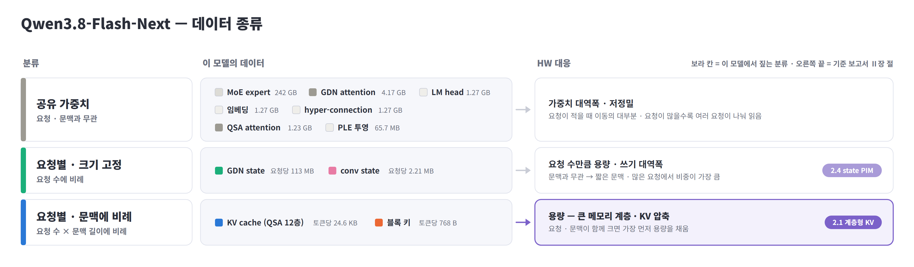
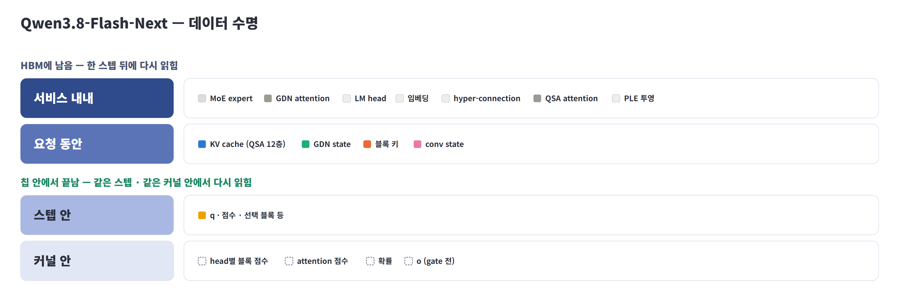
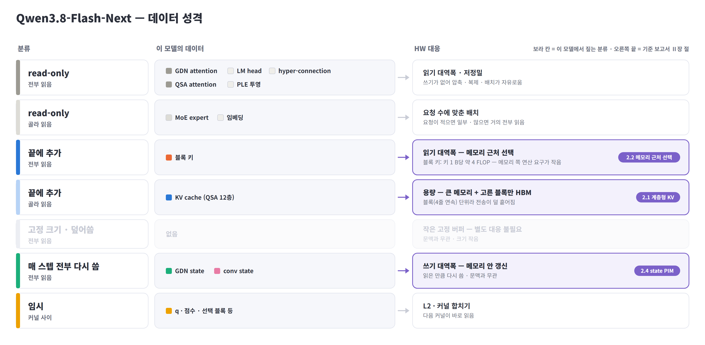
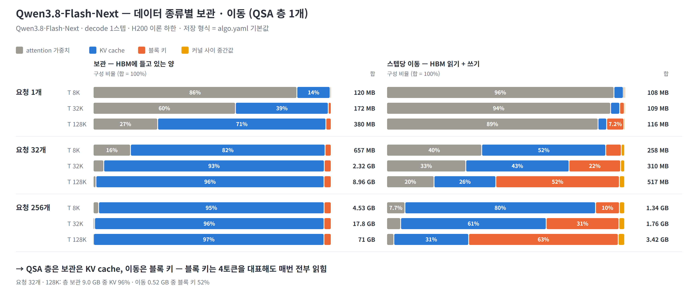
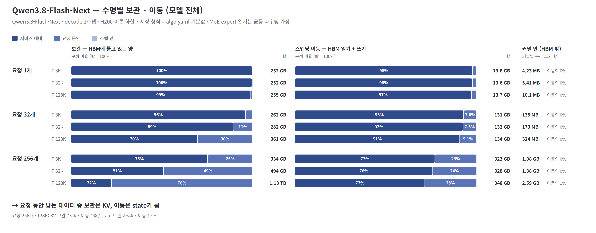
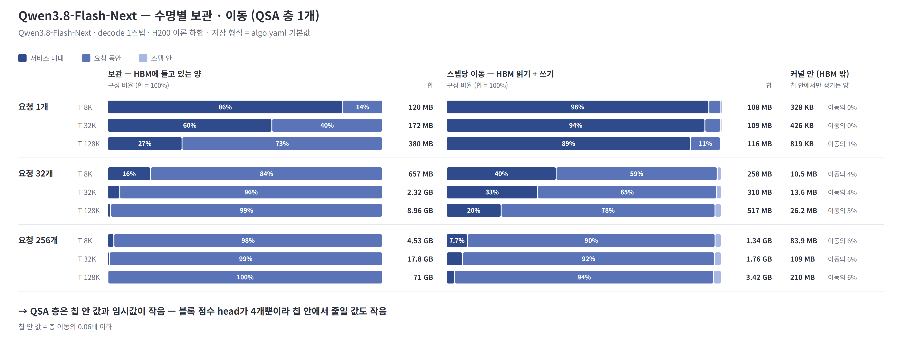
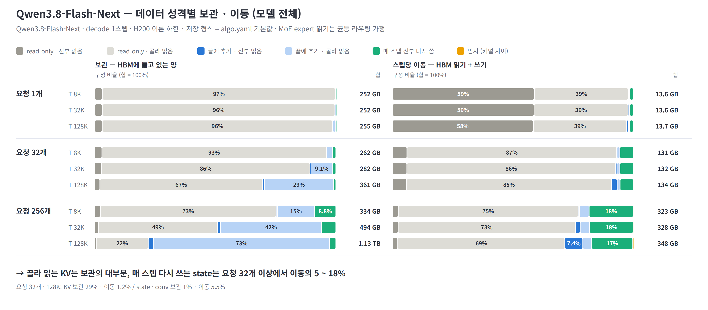
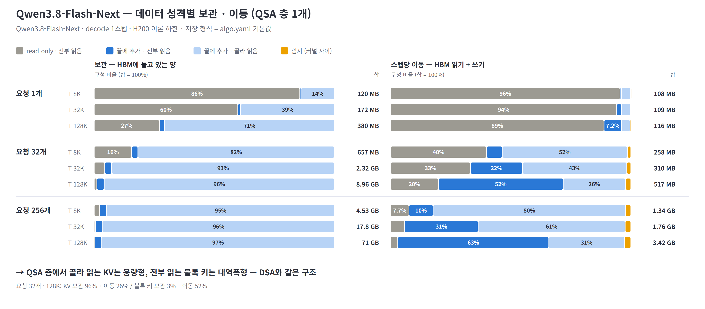
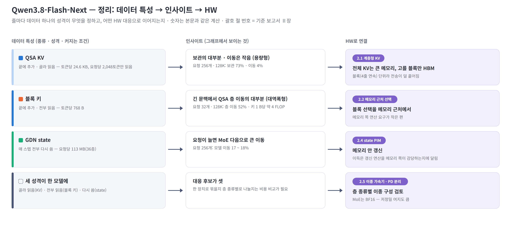

# Qwen3.8-Flash-Next (GDN + QSA) — 데이터 성격으로 본 decode 1스텝

모델별 보고서 ④ Hybrid (linear + sparse) · 2026.11 · 약식 화면 "데이터 성격 한눈에"를 요청 수 · 문맥 길이로 펼쳐 본 것

기준: H200 (HBM 4.8 TB/s · L2 50 MB) · decode 1스텝 · 48층 = GDN 36 + QSA 12 · 가중치 · KV BF16 · KV 2,048 B/토큰/층 · 블록 키 BF16 256 B/4토큰(배포 선택) · GDN state FP32 · hyper-connection · PLE 투영 포함 · n-gram 표(102 GB)는 host · 이론 하한. 블록 키 쓰기는 4토큰마다 1줄이라 스텝당 몫(여러 스텝 평균)으로 나눠 셈. **참조 구현 검증 없음** — config · 체크포인트 shape + 위키 01-attention 3.5(QSA)로 세운 식. 요청 32개 · 128K(361 GB)부터 H200 2장(282 GB)을 넘음 — 이동량은 같은 조건의 바이트 비교로만 읽음. 화면: [QSA 약식](https://kimhyeon-ji.github.io/llm-arch-lineage-wiki/arch_insight/dataflow-claude/viewer/qsa-qwen38-lite.html) · 수치: [tools/traits.py](../tools/traits.py) · 그림: [make_traits_report.py](make_traits_report.py) · HW 대응: [기준 보고서](../../sparse-hybrid-hw-report-v2-refined.md) Ⅱ장

---

## 요약

### 보관은 QSA 12층의 KV, 이동은 MoE 다음으로 GDN state — QSA 층 안에서는 블록 키가 대역폭을 씀 (sparse와 linear의 부담이 한 모델에 함께)

| 조건 | HBM에 가장 많이 들고 있는 것 | 매 스텝 가장 많이 옮기는 것 (모델 전체) | QSA 층 안에서 가장 많이 옮기는 것 |
|---|---|---|---|
| **요청이 적을 때** | 가중치 (대부분 BF16 MoE expert) | attention 가중치와 MoE 가중치가 비슷 | attention 가중치 |
| **요청이 많을 때** | 가중치, 그다음 KV cache | MoE 가중치, 그다음 GDN state | 짧은 문맥은 KV cache, 긴 문맥은 블록 키 |
| **요청 · 문맥이 모두 클 때** | KV cache가 가중치보다 많아짐 | MoE 가중치, 그다음 GDN state · 블록 키 | 블록 키 |

- **요청이 적을 때:** expert 10개(폭 640)만 읽어 MoE 읽기가 작음 → attention 가중치(GDN 36층 + QSA 12층)가 MoE만큼 큼. hyper-connection · LM head도 각각 이동의 9%
- **요청이 늘수록:** MoE 다음으로 GDN state 읽기 · 쓰기가 커짐 — 요청 256개에서 이동의 6분의 1 안팎
- **문맥이 길수록:** QSA KV 보관이 빠르게 커지지만 KV 읽기는 요청당 2,048토큰으로 고정 → 이동에서는 작음
- **QSA 층 안:** 블록 키는 4토큰을 대표해도 매번 전부 읽혀 대역폭형, KV는 용량형 — DSA와 같은 갈림
- **칩 안 값 · 임시값은 작음:** 블록 점수 head가 4개뿐 (QSA 층만 센 값)
- **HW 방향:** 계층형 KV · state PIM · 블록 키 메모리 근처 처리 — 세 대응 후보가 한 모델에 함께 걸림 (각 절 끝 'HW로 발전시킬 포인트')

---

## 데이터를 나누는 세 가지 기준

### 같은 데이터를 '무엇인가 · 얼마나 오래 남나 · 어떻게 읽고 쓰나'로 나눔 — 각각 무엇이 자원을 쓰는지 · 어디에 둘 수 있는지 · 어떤 메모리 특성이 필요한지를 알려 줌

| 기준 | 묻는 것 | 나누는 값 | 이걸로 알 수 있는 것 |
|---|---|---|---|
| **데이터 종류** | 무엇인가 | 가중치 · KV cache · 블록 키 · GDN state · conv state · 중간값 | 어떤 데이터가 HBM 용량과 대역폭을 쓰는지 |
| **수명** | 얼마나 오래 남고, 언제 다시 읽히나 | 서비스 내내(가중치) · 요청 동안(KV · 블록 키 · state) · 스텝 안(커널 사이 값) · 커널 안(칩 안에서만) | **어디에 둘 수 있는지.** 한 스텝 뒤에 다시 읽히는 값은 칩 안에 못 남음 → HBM이나 더 큰 메모리. 다음 커널이 바로 읽는 값은 칩 안에서 끝낼 수 있음 |
| **데이터 성격** | 어떻게 읽고 쓰나 | read-only · 끝에 추가 · 매 스텝 전부 다시 씀 · 임시, 그리고 전부 읽음 · 골라 읽음 | **어떤 메모리 특성이 필요한지.** 골라 읽는 데이터는 용량, 매번 전부 읽는 데이터는 대역폭, 다시 쓰는 데이터는 쓰기 대역폭이나 메모리 안 갱신 |

- **그림 읽는 법 (기준 1 ~ 3 공통):** 왼쪽 분류 · 가운데 이 모델의 데이터 · 오른쪽 그 분류에 맞는 HW 대응(끝의 알약 = 기준 보고서 Ⅱ장 절). 보라 칸 = 이 모델에서 짚는 분류 → 각 소절의 '이걸로 알 수 있는 것 → HW'와 하나씩 연결. 데이터가 없는 분류도 흐리게 남겨 모델끼리 같은 줄로 비교

### 기준 1. 데이터 종류 — 무엇이 무엇에 비례해 커지나

- **나누는 법:** HBM에 남는 데이터를 커지는 조건으로 셋 — 공유 가중치(요청 · 문맥과 무관) · 요청별 크기 고정(요청 수에 비례) · 요청별 문맥 비례(요청 수 × 문맥 길이)
- **이 모델에서:** 공유 가중치 252 GB(그중 BF16 MoE 242 GB) · 크기 고정 = GDN state 요청당 113 MB + conv 2 MB · 문맥 비례 = QSA KV 토큰당 24.6 KB + 블록 키 768 B
- **이걸로 알 수 있는 것 → HW:**
  - **요청별 · 문맥 비례 → 큰 메모리 계층 (2.1):** 가중치가 작아 128K에서 요청 74개면 요청별 보관이 가중치를 넘음 — 다섯 모델 중 가장 빠름 → 용량이 먼저 막히는 모델 (1장)

### 기준 2. 수명 — 얼마나 오래 남고, 언제 다시 읽히나

- **나누는 법:** 서비스 내내 · 요청 동안 · 스텝 안 · 커널 안. 다시 읽히기까지의 시간이 둘 곳을 정함 — 한 스텝 뒤에 다시 읽히는 값은 그사이 모델 전체(전 층 + MoE)가 지나가 칩 안(L2 50 MiB)에 못 남음
- **이 모델에서:** 요청 동안 = QSA KV · 블록 키 · GDN state · conv · 스텝 안 = q · 점수 · 선택 블록 · 커널 안 = head별 블록 점수 · attention 점수 · 확률
- **이걸로 알 수 있는 것 → HW:**
  - **스텝 안 → L2 · 커널 합치기:** 임시값이 작음 → 칩 안으로 끌어올 몫이 작음
  - **커널 안 → 처리를 옮기면 함께 옮김 (2.3):** head별 블록 점수 등 칩 안 값도 작음 → 블록 선택을 메모리 쪽으로 옮겨도 밖으로 나올 중간값이 작을 가능성 (2장)

### 기준 3. 데이터 성격 — 어떻게 쓰고 읽나

- **나누는 법:** 쓰기 방식 다섯(read-only / 끝에 추가 / 고정 크기 · 덮어씀 / 매 스텝 전부 다시 씀 / 임시) × 읽기 방식 둘(전부 읽음 / 골라 읽음). 칸마다 필요한 메모리 특성이 다름
- **이 모델에서:** 골라 읽음 = QSA KV · 전부 읽음 = 블록 키 · 매 스텝 다시 씀 = GDN state · conv · 가중치 = read-only
- **이걸로 알 수 있는 것 → HW:**
  - **끝에 추가 · 골라 읽음 → 용량 (2.1):** QSA KV — 블록(4줄 연속) 단위라 전송이 덜 흩어짐
  - **끝에 추가 · 전부 읽음 → 메모리 근처 선택 (2.2):** 블록 키 — 키 1 B당 약 4 FLOP, 메모리 쪽 연산 요구가 작음
  - **매 스텝 전부 다시 씀 → 메모리 안 갱신 (2.4):** GDN state · conv
  - sparse의 두 칸과 linear의 다시 쓰는 칸이 한 모델에 → 대응 후보도 셋 (3장)

### 그래프 읽는 법

- **그래프 막대:** 왼쪽 = 보관(용량 요구), 오른쪽 = 스텝당 이동(대역폭 요구). 보관에서 크고 이동에서 작으면 용량형, 반대면 대역폭형
- **조건:** 요청 1 · 32 · 256개 × 문맥 8K · 32K · 128K. 범위는 모델 전체(48층 + MoE · LM head) / QSA 층 1개
- **골라 읽음:** 요청 1개 · 128K에서 스텝당 읽기가 보관의 90% 미만인 데이터 — MoE expert · QSA KV · 임베딩. 기준 조건의 라벨이라 요청이 많으면 MoE도 대부분을 읽고, 문맥이 짧으면 KV도 많이 읽음(8K에서 예산 2,048토큰 = 4분의 1)

---

## 1. 데이터 종류 — 무엇이 용량과 대역폭을 쓰나

### 1.1 모델 전체 — 보관은 요청 · 문맥이 크면 KV가 가장 크고, 이동은 MoE 다음이 GDN state

- **요청 1개:** attention 가중치 ≈ MoE 가중치(각각 이동의 약 4할), LM head 9% (어휘 약 25만 · hidden 2,560이라 상대적으로 큼), hyper-connection 9% (층마다 2개 · 합계 1.3 GB를 매 스텝 전부 읽음)
- **요청이 늘수록:** MoE 가중치가 이동의 69 ~ 87%, 그다음 GDN state (요청 32개 5%, 256개 17 ~ 18%)
- **문맥이 길수록:** KV cache 보관이 커짐 (요청 256개 · 128K에서 보관의 73%) — 이동은 4% 안팎
- **블록 키:** 요청 256개 · 128K에서 이동 7% — 보관(2%)보다 이동 비중이 큼

### 1.2 QSA 층 1개 — 보관은 KV cache, 이동은 긴 문맥에서 블록 키

- **요청이 적을 때:** attention 가중치가 층 이동의 대부분
- **요청이 늘면:** 짧은 문맥은 KV cache, 긴 문맥은 블록 키가 층 이동에서 가장 큼
- **KV cache는 요청 32개 이상에서 층 보관의 82 ~ 97%:** 이동 비중은 문맥이 길수록 작아짐 (읽는 양이 2,048토큰으로 고정)
- **요청별 데이터 이동이 가중치를 넘는 시점이 빠름:** 요청 9 ~ 22개(문맥 128K ~ 8K) — 층 가중치가 약 0.1 GB로 작아서

**HW로 발전시킬 포인트**
- **KV cache는 용량형:** 계층형 KV (기준 보고서 2.1: HiSparse · ESS · SAC)
- **GDN state는 이동의 두 번째:** state 갱신 PIM (2.4: Pimba · NOVA · HyPIM)
- **블록 키는 대역폭형:** 메모리 근처 선택 (2.2). 키 바이트 기준 내적 강도가 작음(키 1 B당 약 4 FLOP, 기준 보고서) → 메모리 근처 연산기의 연산 요구는 작은 편. top-k · gather · 결과 전송 비용은 따로 따져야 함

---

## 2. 데이터 수명 — 어디에 둘 수 있나

> **읽는 법:** 수명과 '다시 읽히기까지 걸리는 시간'이 둘 곳을 정함. 한 스텝 뒤에 다시 읽히는 가중치 · KV · state는 그사이 48층 전체가 지나가 칩 안에 못 남음 → HBM이나 그 아래 메모리. 다음 커널이 바로 읽는 스텝 안 임시값은 칩 안에서 끝낼 수 있는 몫. 커널 안 값은 지금 칩 안에서 처리해 HBM을 아끼고 있는 몫

### 2.1 모델 전체 — 요청 동안 남는 데이터 중 보관은 KV, 이동은 state

- **서비스 내내 가중치가 이동의 대부분:** 요청 256개에서도 71 ~ 77%
- **요청 동안 남는 데이터가 둘로 갈림:** KV는 쌓이기만 해서 보관을 차지, state는 매번 읽고 써서 이동을 차지
- **칩 안 값 · 임시값은 매우 작음** (QSA 층만 센 값 · GDN 층 중간값은 빠짐)

### 2.2 QSA 층 1개 — 요청이 늘면 요청 동안 남는 KV · 블록 키가 층 이동의 대부분

- **요청이 늘면 요청 동안 남는 cache가 층 이동의 대부분**
- **임시값 3% 이하 · 칩 안 값 0.07배 이하:** 블록 점수 head가 4개뿐이라 칩 안에서 줄일 값도 작음

**HW로 발전시킬 포인트**
- **state는 한 스텝 뒤에 다시 읽힘:** 칩 안 SRAM에 두려면 요청 16개만 돼도 층 1개에 50 MB(L2 전체), 36층이면 그 36배 → SRAM 상주는 요청 · 층 수에 비례해 어려워짐. 메모리 안 갱신(PIM)이 후보 (2.4) — 이득은 갱신 연산을 메모리 쪽에서 감당할 수 있는지에 달림
- **칩 안 값이 작음:** 블록 선택을 메모리 근처로 옮겨도 밖으로 내보낼 중간값이 작을 가능성이 큼 → DSA · CSA보다 옮기기 쉬운 후보 (2.2). 실제 링크 부담은 타일 크기 · 동시성으로 따로 계산 필요

---

## 3. 데이터 성격 — 어떤 메모리 특성이 필요한가

> **읽는 법:** 골라 읽는 데이터는 대부분 쉬고 있음 → 큰 용량에 두고 고른 것만 빠르게 가져오는 구조가 맞음. 매번 전부 읽는 데이터는 대역폭이 시간을 정함. 매 스텝 다시 쓰는 데이터는 읽은 만큼 쓰기 대역폭이 필요하고, 메모리 안에서 갱신하면 왕복이 사라짐. read-only는 압축 · 복제 · 저정밀의 자유도가 큼

### 3.1 모델 전체 — 덮어쓰기를 뺀 성격 여섯 가지가 모두 등장: sparse의 골라 읽기와 linear의 다시 쓰기가 한 모델에

- **read-only · 골라 읽는 MoE가 대부분**
- **그다음은 보관에서는 골라 읽는 KV, 이동에서는 매 스텝 다시 쓰는 state**
- **여섯 가지가 모두 등장:** read-only(전부 · 골라) · 끝에 추가(전부 · 골라) · 매 스텝 다시 씀 · 임시. 매 스텝 다시 쓰는 state · conv는 요청 32개 이상에서 이동의 5 ~ 18%

### 3.2 QSA 층 1개 — 골라 읽는 KV는 용량형, 전부 읽는 블록 키는 대역폭형

- **DSA · CSA와 같은 갈림:** KV는 보관의 대부분 · 이동은 작아짐, 블록 키는 보관은 작음 · 이동은 큼
- **요청이 적을 때는** read-only 가중치가 이동의 대부분

**HW로 발전시킬 포인트**
- **세 성격에 세 대응 후보:** 골라 읽는 KV → 계층형 KV (2.1), 전부 읽는 블록 키 → 메모리 근처 선택 (2.2), 다시 쓰는 state → PIM (2.4). 한 장치로 묶을지 층 종류별 이종 구성(2.5)으로 나눌지는 각 대응의 비용을 따로 따져야 정할 수 있음
- **MoE는 BF16:** 저정밀만으로도 이동이 크게 줄 여지

---

## 정리 — 데이터 특성 → 인사이트 → HW

### 세 성격(골라 읽는 KV · 전부 읽는 블록 키 · 다시 쓰는 state)이 한 모델에 — 대응 후보도 셋

- **이 모델의 특성:** 문맥이 길수록 보관은 QSA KV가 차지(요청 256개 · 128K 보관의 73%), 요청이 늘수록 이동은 MoE 다음으로 GDN state가 커짐(요청 256개 이동의 17 ~ 18%)
- **QSA 층 안:** 긴 문맥에서는 4토큰을 대표하는 블록 키가 층 이동의 대부분 — KV는 보관만 큼

| 데이터 | 특성 (성격 · 커지는 조건) | 근거 (조건 · 수치) | 인사이트 | HW로 연결 | 기준 보고서 Ⅱ장 |
|---|---|---|---|---|---|
| QSA KV | 끝에 추가 · 골라 읽음 · 토큰당 24.6 KB | 요청 256개 · 128K: 보관 73% · 이동 4% | 보관의 대부분 · 이동은 작음 | 전체 KV는 큰 메모리, 고를 블록만 HBM | 2.1 |
| 블록 키 | 끝에 추가 · 전부 읽음 · 토큰당 768 B | 요청 32개 · 128K: 층 이동 52% · 키 1 B당 약 4 FLOP | 긴 문맥에서 QSA 층 이동의 대부분 | 블록 선택을 메모리 근처에서 | 2.2 |
| GDN state | 매 스텝 전부 다시 씀 · 요청당 113 MB | 요청 256개: 모델 이동 17 ~ 18% | 요청이 늘면 MoE 다음으로 큰 이동 | 메모리 안 갱신 | 2.4 |
| 세 성격 함께 | 골라 읽음 · 전부 읽음 · 다시 씀 | 128K에서 요청 74개면 요청별 보관 > 가중치 보관 | 대응 후보가 셋 · 용량이 먼저 막힘 | 층 종류별 이종 구성 검토 · MoE BF16 저정밀 | 2.5 |

- **확인할 것:** 블록 키의 실제 저장 형식, n-gram 표의 host ↔ GPU 전송 경로

---

## 부록 — 계산 기준

- **QSA 층:** [qsa-qwen38/algo.yaml](../models/qsa-qwen38/algo.yaml) · [map-gpu.yaml](../models/qsa-qwen38/map-gpu.yaml). 색인 = index_qk_proj [640 × 2560](색인 q 4 × 128 + 색인 k 128) · Q/K RMSNorm, head 가중치 없이 ReLU 점수 합. 블록 키 = 색인 k 4개 평균 → RMSNorm → 부분 RoPE, BF16 256 B는 배포 선택. 출력 gate는 attention 커널 끝에서 곱함. 블록 수 = floor(T/4) — 미완성 꼬리 0 ~ 3토큰은 이번 조건에서 0
- **모델 전체:** [model.yaml](../models/qsa-qwen38/model.yaml). GDN 36층(state FP32 · conv)은 식. MoE 48층(expert 512개 중 10개 + 공유 1개, 폭 640, BF16). hyper-connection(층마다 2개 · BF16 1.3 GB) · PLE 투영(1층 · 약 66 MB) 포함
- **HBM 밖:** n-gram 임베딩 표 128개 × [2.5M × 160] BF16 = 102.4 GB(약 51B 파라미터)는 host에 두고 토큰마다 행 128개(40 KB)만 보낸다고 봄 — 보관 · 이동 합계에 안 넣음
- **수명 · 성격 판정:** [dsa-v32-traits.md](dsa-v32-traits.md) 부록과 같은 규칙
- **칩 안 값 · 임시값:** QSA 층만 셈 (GDN 층은 식이라 빠짐)
- **용량:** 요청 256개 · 128K 보관 1.13 TB → H200 141 GB 기준 최소 9장 (배치 가정 2장 초과, 요청 32개 · 128K도 3장). 화면의 시간은 전체 바이트 ÷ 합산 대역폭의 이상적 환산
- **MoE 읽기:** 균등 · 독립 라우팅 기댓값 — 요청 32개에서 expert 240/512개 (쏠리면 10개까지 줄고, 겹치지 않으면 320개)
- **제외:** MTP · 잔차 · 정규화 값 · GPU 간 통신 · host ↔ GPU 전송 시간
