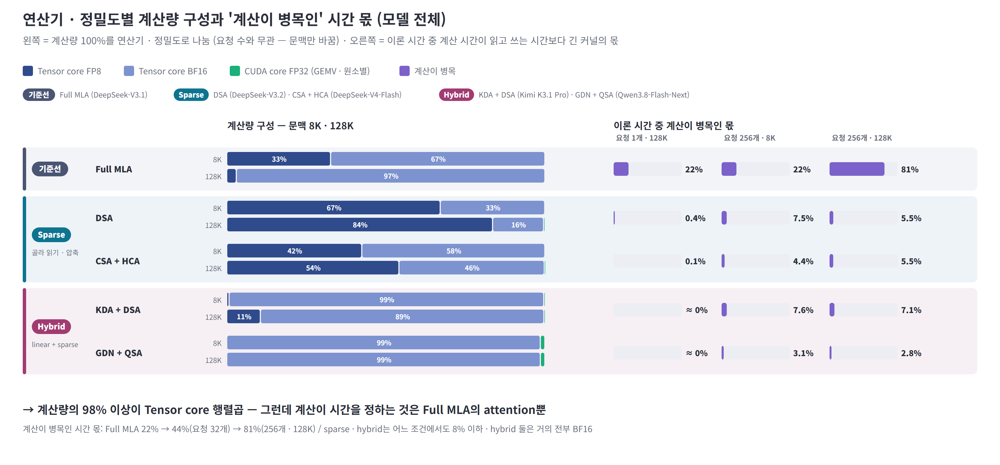

# Sparse · Hybrid attention 종합 — 연산 쪽에서 본 decode 1스텝

종합 보고서 · 2026.11 · [메모리 종합](synthesis-traits.md)의 짝 — 같은 모델 5개, 같은 조건을 연산 쪽에서 비교

| 이 보고서의 이름 | 모델 | 구조 |
|---|---|---|
| **Full MLA** (기준선) | DeepSeek-V3.1 | 저장한 KV를 매 스텝 전부 읽음 |
| **DSA** | DeepSeek-V3.2 | sparse — 작은 색인 키로 고를 위치를 정하고, 고른 KV 2,048줄만 읽음 |
| **CSA + HCA** | DeepSeek-V4-Flash | sparse + 압축 — KV를 압축해 저장하고, 일부 층은 골라 읽음 |
| **KDA + DSA** | Kimi K3.1 Pro | hybrid — linear attention(KDA) 69층 + DSA 24층 |
| **GDN + QSA** | Qwen3.8-Flash-Next | hybrid — linear attention(GDN) 36층 + 블록 단위로 골라 읽는 QSA 12층 |

> **이 보고서에서 쓰는 말**
> - **계산량(FLOP):** 곱셈 · 덧셈 횟수
> - **이론 시간:** 커널마다 '계산에 걸리는 시간'과 'HBM에서 읽고 쓰는 시간' 중 긴 쪽을 골라 더한 값. 실제 실행 지연은 빠짐
> - **계산이 병목 / 메모리 읽기가 병목:** 그 커널의 이론 시간을 계산 시간이 정하나, 읽기 시간이 정하나
> - **1바이트당 계산 횟수:** HBM에서 1바이트 읽을 때 하는 계산 수(산술 강도). H200은 1바이트 읽는 동안 BF16로 약 206번, FP8로 약 412번 계산할 수 있음 — 이보다 적게 계산하면 메모리 읽기가 병목
> - **색인 키 · state:** 색인 키는 DSA 계열이 고를 KV를 정하려고 따로 저장하는 작은 키, state는 linear attention이 요청마다 들고 있는 고정 크기 상태값

그림 범례에도 attention 이름과 모델 이름이 함께 표시됨. H200 1장 기준 · decode 1스텝 · 이론 하한. 계산 방법과 출처는 부록 C

---

## 요약

**1. 계산이 많은 곳과 시간이 걸리는 곳이 다름**

- DSA는 색인 계산이 전체 계산량의 절반 이상(55%)이지만, 시간으로는 4분의 1 남짓(28%)
- 시간의 3분의 2(65%)는 MoE 가중치를 읽는 데 듦 (요청 256개, 문맥 128K)
- 예외는 Full MLA뿐 — attention이 계산량과 시간을 모두 차지함(시간의 80%)

**2. 시간을 잡아먹는 연산은 계산이 많아서가 아니라 메모리 읽기가 느려서 오래 걸림**

- 색인, state, MoE는 읽는 데이터에 비해 계산이 적음 — H200이 1바이트 읽는 동안 할 수 있는 계산의 1/3 ~ 1/50만 함
- 그래서 sparse와 hybrid에서 계산이 병목인 커널은 전체 시간의 8% 이하
- 이 계산 기준으로는 Tensor core를 키워도 줄어드는 시간이 크지 않음

**3. 색인 점수를 낸 뒤 KV를 가져오기까지의 비용은 이론 계산에 거의 안 잡힘**

- 상위 k개 고르기(top-k)와 흩어진 KV 가져오기(gather)는 계산량이 0이라 앞의 계산에 나타나지 않음
- 이 두 과정 때문에 sparse 층은 차례로 기다리는 단계가 2개 늘어남 — DSA는 모델 전체로 33% 증가
- 실제 비용은 커널을 직접 재 봐야 알 수 있음

요청 256개 · 128K는 다섯 모델 모두 가정한 H200 장수의 메모리를 넘는 조건. 실제 배포 지연이 아니라 같은 입력에서의 비교로만 읽음

**구성** — 1장 대표 비교(계산량 vs 시간) → 2장 이유(문맥이 길수록 늘어나는 읽기, 1바이트당 계산 횟수) → 3장 색인 뒤 비용(top-k, gather, 단계 수) → 4장 HW 검토

---

## 1. 대표 비교 — 계산량과 이론 시간

> **읽는 법:** 같은 모델을 계산량(왼쪽)과 이론 시간(오른쪽)으로 나란히 놓음. 두 막대의 색 구성이 다르면 '계산이 많은 곳'과 '시간이 걸리는 곳'이 다르다는 뜻

### 1.1 DSA는 색인이 계산량의 55%지만 시간은 28%

- **DSA (요청 256개, 문맥 128K):** 색인(주황)이 계산량의 55%로 가장 크지만, 시간에서는 28%
- **같은 조건에서 시간이 가장 많이 드는 곳:** MoE 가중치 읽기(연회색), 시간의 65%
- **Full MLA만 예외:** attention(파랑)이 계산량의 97%, 시간의 80% — 계산량과 시간이 같은 곳을 가리킴
- **hybrid는 계산량부터 가중치 쪽:** 토큰 1개 · 128K 기준 계산량의 85%(KDA + DSA), 92%(GDN + QSA)가 가중치 행렬곱
- **요청 1개일 때:** 다섯 모델 모두 시간 대부분이 가중치 읽기. KDA + DSA는 BF16 attention 투영 하나가 시간의 절반

요청 256개 · 128K는 다섯 모델 모두 가정한 H200 장수의 메모리를 넘는 조건 — 구성 비교로만 읽음

---

## 2. 이유 — 문맥이 길수록 늘어나는 읽기, 1바이트당 적은 계산

> **읽는 법:** 색인은 문맥이 길수록 더 많은 키를 읽고, hybrid의 state는 요청마다 전부 읽고 다시 씀. 읽는 양에 비해 계산이 적으면 시간은 메모리 읽기 속도가 정함

### 2.1 색인은 문맥이 길어질수록 계산과 읽기가 함께 늘어남

- **보는 법:** 선 = 요청마다 하는 계산(attention, 색인, state) ÷ 가중치 행렬곱 계산. 점선(1)을 넘으면 요청 쪽 계산이 더 많아짐
- **Full MLA:** 문맥 약 4천 토큰부터 넘고, 128K에서는 30배
- **sparse:** attention은 고른 줄 수만큼으로 고정되고, 늘어나는 것은 색인(지난 모든 키와 비교) — 넘는 지점이 DSA 약 4만, CSA + HCA 약 23만 토큰으로 10 ~ 50배 늦어짐
- **hybrid:** 색인을 쓰는 층이 적어 더 늦음 — KDA + DSA 약 100만 토큰, GDN + QSA는 지원 길이(26만) 안에서 넘지 않음

### 2.2 색인, state, MoE는 1바이트당 계산이 적어 메모리 읽기가 시간을 정함

> **읽는 법:** 가로 = 읽은 데이터 1바이트당 계산 횟수(로그 눈금). 보라 점선 = H200의 균형점(BF16 206번, FP8 412번). 점선보다 왼쪽이면 메모리 읽기가, 오른쪽이면 계산이 시간을 정함

- **색인:** 균형점보다 3 ~ 50배 적게 계산함 → 문맥이 길수록 읽는 키가 늘어 시간도 늘어남
- **state:** 1바이트 읽을 때 1번도 계산하지 않음 — 요청마다 state 전체를 읽고 거의 그대로 다시 씀
- **MoE:** 요청이 256개로 늘어도 균형점보다 8 ~ 36배 적음 — expert마다 요청이 나뉘어 한 번 읽은 가중치를 여러 요청이 함께 쓰지 못함. 같은 가중치라도 투영과 LM head는 균형점 가까이 오름
- **attention:** 균형점과 비슷하거나 2배 많이 계산함 → Full MLA가 긴 문맥에서 계산에 묶이는 이유 (GDN + QSA만 낮음)
- 색인, state, attention은 요청마다 자기 데이터를 읽어서, 요청을 모아도 이 횟수가 안 바뀜(왼쪽 판)

### 2.3 계산이 병목인 커널은 sparse · hybrid 시간의 8% 이하

- **sparse와 hybrid:** 비교한 세 조건 모두 계산이 병목인 커널이 전체 시간의 8% 이하 (오른쪽 보라)
- → 이 계산 기준으로는 Tensor core를 키워도 줄어드는 시간이 크지 않음
- **Full MLA만 다름:** 요청이 많아질수록 커져, 요청 256개 · 128K에서 81%
- **정밀도(왼쪽):** DSA와 CSA + HCA는 계산의 42 ~ 84%가 이미 FP8, hybrid 둘은 거의 전부 BF16 → 저정밀로 바꿀 여지는 hybrid가 큼

---

## 3. 색인 점수 뒤 KV를 가져오기까지 — top-k, gather, 기다리는 단계

> **읽는 법:** sparse 층은 '색인 점수 계산 → 상위 k개 고르기(top-k) → 고른 KV를 흩어진 위치에서 가져오기(gather) → attention' 순서로 돎. 이론 시간은 바이트 ÷ 대역폭만 세서, 고르는 처리 속도, 잘게 나뉜 읽기의 비효율, 단계마다 붙는 실행 지연이 거의 안 잡힘

### 3.1 top-k와 gather는 계산량은 0이지만 처리할 개수가 많음

- **top-k:** 층마다 후보의 1.6%만 고름 — 나머지 98% 이상을 버리려고 후보 전부에 점수를 매기고 비교함
- **양 (요청 256개, 문맥 128K):** DSA는 스텝마다 후보 약 20억 개를 비교하고, 흩어진 덩어리 약 3,200만 개를 가져옴
- **덩어리 크기:** DSA와 CSA는 KV 한 줄씩, GDN + QSA는 4토큰 블록 단위 — DSA의 덩어리는 GDN + QSA의 1/12 크기라, 같은 양을 읽어도 12배 잘게 나눠 읽음
- → 덩어리가 클수록 HBM과 아래 계층 메모리 전송에 유리

### 3.2 sparse 층은 차례로 기다리는 단계가 2개 더 많음

- **보는 법:** 가로 한 칸 = 앞 커널의 결과를 기다려야 하는 한 단계. 같은 칸의 커널은 동시에 돌 수 있음
- **sparse 층:** 색인 점수와 top-k 두 단계가 늘어남 (Full MLA 6단계 → DSA 8단계)
- **모델 전체:** DSA는 Full MLA보다 33%, KDA + DSA는 47% 많음. CSA + HCA와 GDN + QSA는 층이 적어 오히려 적음
- **요청이 적을 때:** sparse와 hybrid는 층마다 아주 짧은 커널(이론상 1 µs 미만)이 3 ~ 4개 — 실행과 동기화 지연이 계산 시간보다 큼
- → 커널을 직접 재 보고, 어디까지 합칠 수 있는지 확인 필요

---

## 4. HW 검토 — 모델 · 조건별 우선순위

| HW 대응 (기준 보고서 Ⅱ장) | 무엇을 줄이나 | Full MLA | DSA | CSA + HCA | KDA + DSA | GDN + QSA | 먼저 검토할 모델 · 조건 |
|---|---|---|---|---|---|---|---|
| **2.2 · 2.3 메모리 근처 색인 계산** — 색인 키를 메모리 쪽에서 읽고 점수까지 계산 | 색인 계산이 모델 전체 시간에서 차지하는 비중 | — | 7.3% → **28%** | 3.3% → 13% | 1.7% → 5.7% | 2.4% → 7.5% | DSA — 요청이 많고 문맥이 길 때. 메모리 쪽 연산기는 읽기 속도 1 TB/s마다 FP8 약 121 TFLOP/s 필요 |
| **2.4 state PIM** — state 갱신을 메모리 안에서 처리 | state 갱신이 모델 전체 시간에서 차지하는 비중 | — | — | — | 3.7% → 12% (8K 13%) | 5.5% → **17%** (8K 18%) | GDN + QSA, KDA + DSA — 요청이 많고 문맥이 짧을 때. 연산기는 1 TB/s마다 FP32 약 1 TFLOP/s면 충분 |
| **2.3 top-k 전용 유닛** | 스텝마다 비교하는 후보 수 (요청 256개 · 128K) | — | **20.5억** | 1.76억 | 8.05억 | 1.01억 | DSA, KDA + DSA — 실제 top-k 처리 속도부터 측정 |
| **2.1 · 2.2 블록 단위 gather** | 스텝마다 가져오는 덩어리 수 × 덩어리 크기 (요청 256개 · 128K) | — | **3,198만 × 656 B** | 275만 × 584 B | 1,258만 × 1,152 B | 157만 × 8 KB | DSA(한 줄씩) vs GDN + QSA(블록) — 덩어리 크기별 전송 효율 측정 |
| **커널 합치기** | 모델 전체에서 차례로 기다리는 단계 수 | 366 | 488 | 214 | **537** | 240 | KDA + DSA, DSA — 요청이 적을 때(아주 짧은 커널이 많음) |
| **2.5 attention 연산 분리** — 계산이 병목인 attention을 따로 처리 | attention이 모델 전체 시간에서 차지하는 비중 | 44% → **80%** | 1.1% → 4.3% | 0.9% → 3.5% | 0.2% → 0.8% | 1.2% → 3.7% | Full MLA만 — 요청이 많고 문맥이 길 때. sparse와 hybrid는 5% 미만 |
| **가중치 읽기 · 배치** (기준 보고서 범위 밖) | MoE 가중치 읽기가 모델 전체 시간에서 차지하는 비중 | 54% → 19% | 88% → 65% | 88% → **79%** | 85% → 76% | 85% → 69% | 전 모델 — 요청이 적거나 중간일 때 가장 큰 몫 |

비중 칸 = 요청 32개 · 128K → 요청 256개 · 128K(다섯 모델 모두 가정 장수의 메모리 초과). 그 대응으로 줄일 수 있는 이론 시간의 상한이며, 실제 이득은 연산기 성능, 전송 비용, 커널을 합칠 수 있는지에 달림. 메모리 쪽 연산기 크기 = 1바이트당 계산 횟수 × 메모리 쪽 읽기 속도(예: 121번 × 1 TB/s = 121 TFLOP/s)

- **모델별로 먼저 볼 것:** Full MLA는 attention 연산 분리, DSA는 메모리 근처 색인 계산, GDN + QSA는 state PIM, KDA + DSA는 state 다음 색인, CSA + HCA는 가중치 쪽
- **상한:** sparse와 hybrid에서 가장 큰 몫은 여전히 MoE 가중치 읽기 — 요청 256개 · 128K에서도 시간의 65 ~ 79%

#### 논의 · 확인할 점

- **어떤 서빙 조건을 기준으로 볼지:** attention 쪽 대응의 몫은 요청과 문맥 크기에 따라 몇 배씩 달라짐(DSA 색인 계산 비중이 요청 32개에서 7%, 256개에서 28%). 기준 조건 합의 필요
- **top-k와 gather의 실제 처리 속도:** 이론 시간에 없음. 커널 측정 필요
- **FP4 expert의 실행 정밀도:** CSA + HCA와 KDA + DSA의 expert를 H200에서 어떤 정밀도로 돌리는지 (지금은 BF16로 풀어 계산한다고 가정)
- **커널을 어디까지 합치는지:** 배포 엔진이 색인, top-k, gather를 합치는 범위에 따라 기다리는 단계 수가 바뀜

---

## 부록

### A. 연산을 나누는 세 가지 기준

| 기준 | 묻는 것 | 나누는 값 | 한 줄 규칙 |
|---|---|---|---|
| **1. 연산기** | 무엇으로 계산하나 | 행렬곱(GEMM) · 행렬 × 벡터(GEMV) · 원소별 · top-k · gather | 계산량은 거의 행렬곱 — 나머지는 계산량이 작아도 따로 유닛과 시간이 필요 |
| **2. 커지는 축** | 토큰 1개의 계산량이 무엇에 비례하나 | 고정 · 문맥에 비례 · 문맥과 상관없이 정해진 양 | 문맥에 비례하는 연산이 긴 문맥의 계산량을 정함 |
| **3. 1바이트당 계산 횟수** | HBM에서 1바이트 읽을 때 몇 번 계산하나 | 요청 수에 따라 커짐 · 구조로 고정 · 1번 이하 | H200 균형점(BF16 206번 · FP8 412번)보다 많으면 계산이, 적으면 메모리 읽기가 병목 |

- 계산량의 98% 이상이 Tensor core 행렬곱
- state 갱신, top-k, gather는 계산량이 작거나 없지만 데이터 왕복과 기다리는 단계를 만듦

- 문맥에 비례하는 연산 = full attention과 색인. 압축, 블록 키, head 수는 늘어나는 기울기만 줄임
- 요청 수는 모든 연산을 똑같이 늘림 → 계산량의 구성은 문맥 길이로만 바뀜

- 요청마다 자기 데이터를 읽는 연산(attention, 색인, state)은 1바이트당 계산 횟수가 구조로 고정됨
- 가중치 행렬곱만 요청 수에 따라 커짐 — MoE는 expert로 나뉘어 천천히 커짐

#### 모델 5개의 연산 — 묶음별 토큰당 계산량과 1바이트당 계산 횟수 (문맥 128K)

| 연산 묶음 | 연산기 · 커지는 축 | 병목 (1바이트당 계산 횟수) | Full MLA | DSA | CSA + HCA | KDA + DSA | GDN + QSA |
|---|---|---|---|---|---|---|---|
| **가중치 행렬곱 · 투영 · 기타** | 행렬곱 · 고정 | 요청 수에 따라 커짐 (1 ~ 2 → 250 ~ 390) | 22.8 G | 24.5 G | 10.2 G | 72.7 G (BF16) | 6.7 G (BF16) |
| **가중치 행렬곱 · MoE · FFN** | 행렬곱 · 고정 | 요청 수에 따라 천천히 (1 ~ 3 → 6 ~ 26) | 48.6 G | 48.6 G | 15.2 G | 134 G | 5.3 G |
| **attention 본체** | 행렬곱 BF16 · 문맥에 비례(full) / 고정(sparse) | 균형점 근처 ~ 계산 병목 (GDN + QSA만 12) | 2,230 G · 423 | 34.8 G · 350 | 4.8 G · 199 | 10.3 G · 181 | 0.6 G · 12 |
| **색인 · 블록 점수** | 행렬곱 FP8 · BF16 · 문맥에 비례 | 메모리 읽기 병목 (4 ~ 121) | — | 132 G · 121 | 11.4 G · 121 | 26 G · 61 | 0.41 G · 4 |
| **top-k** | 비교 · 선택 · 후보가 문맥에 비례 | 계산량 0 | — | 13만 → 2,048 | 3.3만 → 512 | 13만 → 2,048 | 3.3만 블록 → 512 |
| **state · conv 갱신** | 행렬 × 벡터 · 원소별 FP32 · 고정 | 메모리 읽기 병목 (1 이하) | — | — | — | 0.79 G · 0.8 | 0.20 G · 0.9 |

칸 = 토큰 1개 · 모델 전체 계산량(G = GFLOP) · 1바이트당 계산 횟수. 가중치 행렬곱은 요청 1개 → 256개. top-k 칸 = 층 1개의 후보 → 고르는 개수

- full → sparse: attention 계산량이 1/64로 줄고, 색인 계산이 새로 생김(DSA는 attention 본체의 3.8배)
- hybrid: 문맥 쪽 연산이 일부 층에만 있어 계산량 대부분이 가중치 행렬곱. state 갱신 행이 새로 생김

### B. 메모리 종합과 이어 읽기

| 메모리 종합의 결론 | 연산 종합에서 본 것 | 이어지는 점 |
|---|---|---|
| 색인 키는 토큰마다 추가되고 매 스텝 전부 읽힘 | 색인 계산은 1바이트당 4 ~ 121번 · 문맥에 비례 | 메모리 쪽으로 옮길 때 필요한 연산기 크기가 모델마다 약 30배 차이 |
| state는 매 스텝 전부 다시 씀 | state 갱신은 1바이트당 약 0.9번 · 계산량 1.4% 이하 | PIM에 필요한 연산은 행렬 × 벡터와 원소별 연산뿐 |
| 골라 읽는 KV는 저장 공간만 크게 차지 | sparse attention 본체: 고른 줄의 1바이트당 계산은 수백 번 · 시간 비중 5% 미만 | 고른 줄이 오면 계산은 문제가 아님 — 가져오는 단위(584 B ~ 8 KB)가 관건 |
| full KV는 저장 공간과 읽기 속도 모두 필요 | full attention 본체는 계산이 병목(1바이트당 423번) | KV 압축 · 저정밀로 바이트를 줄여도 시간이 덜 줄어듦 — FP8 attention 같은 계산 쪽 대응도 필요 |
| 요청 데이터 읽기가 줄어 다시 MoE 가중치 | MoE는 요청 256개에서도 1바이트당 6 ~ 26번 · 시간의 대부분 | 연산 쪽에서도 attention HW 이득의 상한은 같음 |

### C. 분석 조건

- **모델:** 맨 위 표
- **기준:** H200 (HBM 4.8 TB/s · FP8 1,979 · BF16 989 · FP32 CUDA core 67 TFLOP/s), decode 1스텝, 이론 하한
- **이론 시간:** 커널마다 max(HBM 바이트 ÷ 대역폭, 계산량 ÷ 그 연산기 피크)의 합, H200 1장 환산(여러 장에 나눠 담으면 장수만큼 줄어듦)
- **조건:** 요청 1개 · 128K / 요청 256개 · 8K / 요청 256개 · 128K (4장 표는 요청 32개 · 128K도)
- **범위:** 그린 층은 각 모델 약식 화면의 커널 그대로, 그린 층 밖(다른 층 종류 · MoE · LM head)은 `models/*/ops.yaml` 식
- **수치 · 그림:** [tools/ops.py](../tools/ops.py) · [make_compute_report.py](make_compute_report.py)

### D. 비교의 한계

- **이론 시간:** H200 1장 환산 합. 실행 지연, 동기화, gather 비효율, top-k 처리 속도는 빠짐 (top-k와 gather는 바이트 ÷ 대역폭만)
- **메모리 초과 조건:** 요청 256개 · 128K는 다섯 모델 모두 가정 장수의 메모리를 넘음(메모리 종합 4.2 표) — 같은 입력의 구성 비교로만 읽음
- **그린 층 밖 연산:** KDA + DSA의 DSA 24층, GDN + QSA의 GDN 36층, CSA + HCA의 HCA · 창 층, MoE는 `ops.yaml` 식 (model.yaml과 같은 형식 가정). 단계 수는 같은 구조 모델의 배치로 대신 셈(KDA + DSA의 DSA 층 ← DSA, GDN 층 ← Qwen3.6, HCA ← CSA에서 색인 · top-k를 뺀 것)
- **정밀도:** CSA + HCA와 KDA + DSA의 FP4 · MXFP4 expert는 H200에 FP4 Tensor core가 없어 BF16로 풀어 계산한다고 가정
- **MoE:** 균등 · 독립 라우팅 기댓값 (메모리 종합과 같음)
- **제외:** 잔차, RMSNorm, 임베딩 조회, MTP, GPU 간 통신, DSA split-KV 합치기(메모리 종합과 같은 처리)
- **CSA + HCA 출력 LoRA 계산량 수정:** 그룹 8개를 모두 세도록 algo.yaml 식을 고침(2026-11-23). 층 계산량 0.818 → 0.877 G, 이 커널은 메모리 읽기가 시간을 정해 시간은 그대로
- **검증:** 참조 구현 검증은 DSA(DeepSeek-V3.2)와 Qwen3.6 GDN만. 나머지는 config와 공개 코드로 세운 식
