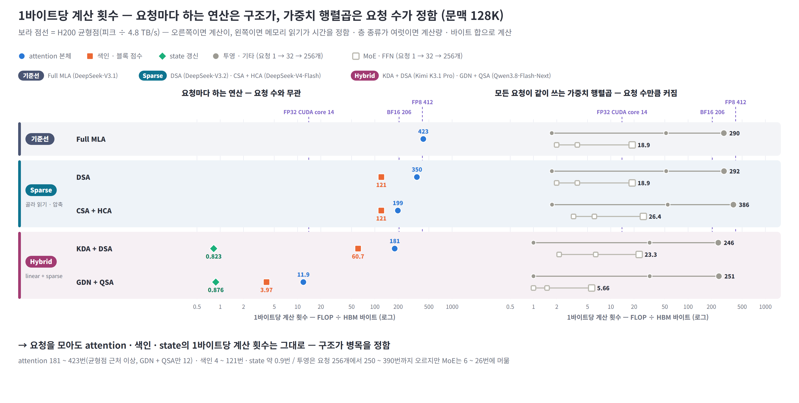
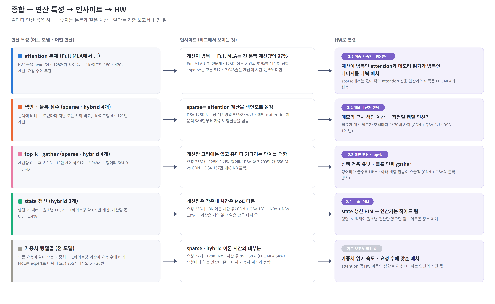
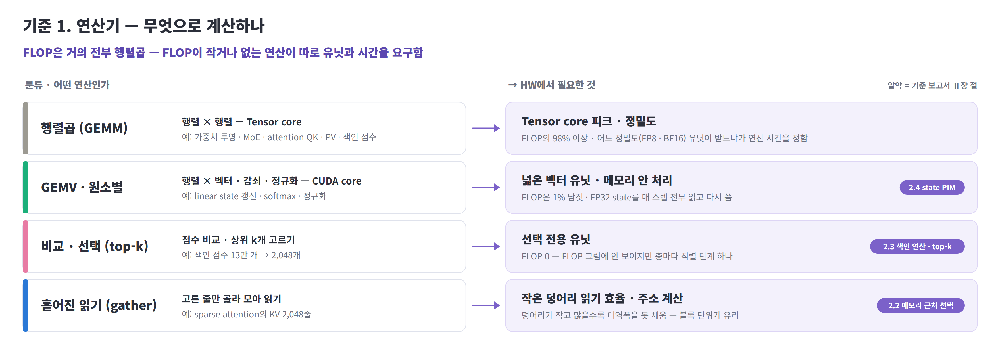

# Sparse · Hybrid attention 종합 — 연산으로 본 decode 1스텝

종합 보고서 · 2026.11 · [메모리 종합](synthesis-traits.md)의 짝 — 같은 모델 5개 · 같은 조건을 연산 쪽에서 비교

모델: DeepSeek-V3.1(기준선 · full MLA) · V3.2(sparse · DSA) · V4-Flash(sparse + 압축 · CSA · HCA) · Kimi K3.1 Pro(hybrid · KDA + DSA) · Qwen3.8-Flash-Next(hybrid · GDN + QSA). H200 1장 환산 · decode 1스텝 · 이론 하한. 계산 방법 · 출처는 부록 C

---

## 요약

1. **FLOP 비중과 이론 시간 비중이 갈림**
   - V3.2 · 요청 256개 · 128K: 색인 = 모델 전체 FLOP의 55% · 이론 시간의 28%
   - 같은 조건 MoE 가중치 = 이론 시간의 65%
   - 예외는 V3.1뿐: attention 본체 = 같은 조건 이론 시간의 80%
2. **시간이 드는 연산은 대역폭형**
   - 색인 4 ~ 121 · state 약 0.9 · MoE 6 ~ 26 FLOP/B — 모두 H200 경계(BF16 206 · FP8 412)보다 낮음
   - 비교한 세 조건에서 sparse · hybrid는 연산 성능이 한계인 커널이 이론 시간의 8% 이하
   - → 이 계산에서 Tensor core 피크만 높여 줄일 수 있는 시간은 제한적
3. **색인 점수 뒤 KV를 가져오기까지의 비용은 이론 하한에 거의 안 잡힘**
   - top-k · gather는 FLOP 0 · sparse 층마다 직렬 2단계 추가
   - V3.2 · 요청 256개 · 128K: 스텝당 gather 덩어리 3,198만 개(덩어리당 656 B)
   - → 선택 · 전송 비용은 측정으로 확인 필요

요청 256개 · 128K = 다섯 모델 모두 가정한 H200 장수의 HBM 용량을 넘는 조건 — 같은 입력에서의 구성 비교로만 읽음(실제 배포 지연 아님)

**구성:** 1 대표 비교(FLOP vs 시간) → 2 이유(문맥 비례 읽기 · 산술 강도) → 3 색인 뒤 비용(top-k · gather · 직렬 단계) → 4 HW 검토(모델 · 조건별) · 부록 = 분류 기준 · 조건 · 한계

---

## 1. 대표 비교 — FLOP과 이론 시간

> **읽는 법:** 같은 모델을 FLOP(왼쪽)과 이론 시간(오른쪽)으로 나란히 놓음. 이론 시간 = 커널마다 'HBM 바이트 ÷ 대역폭'과 'FLOP ÷ 연산기 피크' 중 긴 쪽의 합

### 1.1 V3.2는 색인이 FLOP의 55%지만 이론 시간은 28%

- **V3.2 · 요청 256개 · 128K:** 색인(주황) = 모델 전체 FLOP의 55% · 이론 시간의 28%
- **같은 조건 MoE 가중치(연회색):** FLOP 몫은 작지만 이론 시간의 65%
- **V3.1 · 같은 조건:** attention 본체(파랑) = FLOP의 97% · 이론 시간의 80% — FLOP과 시간이 같은 곳을 가리키는 유일한 경우
- **hybrid:** FLOP부터 가중치 GEMM이 대부분 — 토큰 1개 · 128K FLOP의 85%(K3.1) · 92%(Q3.8)
- **요청 1개 · 128K:** 다섯 모델 모두 이론 시간의 대부분이 가중치 읽기 — K3.1은 BF16 attention 투영만으로 53%

요청 256개 · 128K는 다섯 모델 모두 가정한 H200 장수의 HBM 용량을 넘는 조건 — 구성 비교로만 읽음

---

## 2. 이유 — 문맥 비례 읽기와 산술 강도

> **읽는 법:** 색인은 문맥이 길수록 더 많은 키를 읽고, hybrid state는 요청마다 전부 읽고 다시 씀. 읽는 바이트에 비해 계산이 적으면(산술 강도가 낮으면) 이론 시간은 HBM 대역폭이 정함

### 2.1 색인은 문맥이 길어질수록 계산과 읽기가 함께 늚

- **보는 법:** 선 = 요청별 연산(attention · 색인 · state) FLOP ÷ 가중치 GEMM FLOP. 점선(= 1)을 넘는 문맥부터 요청별 연산이 더 큼
- **full(V3.1):** 약 4천 토큰에서 넘음 · 128K에서 30배
- **sparse:** attention 본체는 고른 줄 수로 고정 · 기울기는 색인이 만듦(지난 모든 키와 내적) — V3.2 약 4만 · V4 약 23만 토큰에서 넘음
- **hybrid:** 색인이 있는 층이 적음(K3.1 24층 · Q3.8 12층) — K3.1 약 100만 토큰 · Q3.8은 지원 길이(26만) 안에서 안 넘음

### 2.2 색인 · state · MoE는 대역폭형

> **산술 강도** = HBM 1 B를 읽을 때 계산 횟수(FLOP/B). H200 경계(BF16 206 · FP8 412)보다 낮으면 대역폭형 — HBM 대역폭이 이론 시간을 정함

- **색인 4 ~ 121 FLOP/B:** 경계보다 낮음 → 문맥이 길수록 읽는 키가 늘어 이론 시간도 늚
- **state 약 0.9 FLOP/B:** 요청마다 state 전체를 읽고 다시 씀(K3.1 요청당 스텝마다 899 MB)
- **MoE 6 ~ 26 FLOP/B (요청 256개):** 투영 · LM head는 250 ~ 390까지 오르지만 MoE는 expert로 나뉘어 낮게 머묾
- **attention 본체 181 ~ 423 FLOP/B (Q3.8만 12):** 경계 근처 이상 — V3.1 긴 문맥이 연산에 묶이는 이유
- 색인 · state · attention은 요청마다 자기 데이터를 읽음 → 요청을 모아도 강도가 그대로(왼쪽 판)

### 2.3 연산 성능이 한계인 커널은 sparse · hybrid 이론 시간의 8% 이하

- **비교한 세 조건(오른쪽 보라):** sparse · hybrid는 연산 성능이 한계인 커널이 이론 시간의 8% 이하
- → 이 계산에서 Tensor core 피크만 높여 줄일 수 있는 시간은 제한적
- **V3.1만 예외:** 요청이 늘수록 커짐 — 22%(요청 1개 · 128K) → 81%(요청 256개 · 128K)
- **정밀도(왼쪽):** V3.2 · V4는 FLOP의 42 ~ 84%가 FP8 · K3.1 · Q3.8은 거의 전부 BF16 → 저정밀 여지는 hybrid가 큼

---

## 3. 색인 점수 뒤 KV를 가져오기까지 — top-k · gather · 직렬 단계

> **읽는 법:** 색인 점수 → top-k로 고름 → 고른 KV를 gather로 가져옴 → attention. 이론 하한은 바이트 ÷ 대역폭만 세므로 선택 처리량 · 작은 덩어리 전송 · 단계별 실행 지연이 거의 안 잡힘

### 3.1 top-k · gather는 FLOP 0이지만 개수가 큼

- **top-k(왼쪽):** 층마다 후보의 1.6%만 고름 — 13만 → 2,048(DSA) · 3.3만 → 512(V4 · Q3.8, 압축 엔트리 · 블록 단위)
- **스텝당 양(오른쪽, 요청 256개 · 128K):** V3.2 top-k 후보 20.5억 개 · gather 덩어리 3,198만 개
- **덩어리 크기(가운데):** DSA · CSA는 KV 1줄(584 ~ 1,152 B) · QSA는 4토큰 블록(8 KB)
- → 같은 바이트를 몇 번에 나눠 읽나가 달라짐 — 덩어리가 클수록 HBM · 아래 계층 전송에 유리

### 3.2 sparse 층은 직렬 단계가 2개 더 많음

- **보는 법:** 가로 한 칸 = 앞 커널 결과를 기다리는 한 단계 · 같은 칸에 쌓인 커널은 서로 기다리지 않음
- **sparse 층:** 색인 점수 → top-k로 2단계 추가 — V3.1 6 → V3.2 8
- **모델 전체 직렬 단계:** V3.1 366 → V3.2 488 · K3.1 537 · Q3.8 240 · V4 214
- **요청 1개 · 128K:** sparse · hybrid는 층마다 커널 3 ~ 4개가 이론상 1 µs 미만(V3.1은 1개)
- → 이 구간은 실행 · 동기화 지연이 이론 하한보다 큼 — 커널 측정 · 융합 범위로 확인 필요

---

## 4. HW 검토 — 모델 · 조건별 우선순위

| 대응 (기준 보고서 Ⅱ장) | 겨냥하는 연산 · 지표 | V3.1 | V3.2 | V4 | K3.1 | Q3.8 | 우선 검토 (모델 · 조건) |
|---|---|---|---|---|---|---|---|
| **2.2 · 2.3 메모리 근처 색인 연산** | 색인 · 블록 점수 · 모델 전체 이론 시간 비중 | — | 7.3% → **28%** | 3.3% → 13% | 1.7% → 5.7% | 2.4% → 7.5% | V3.2 · 많은 요청 · 긴 문맥 — 연산기 크기는 내부 대역폭 1 TB/s당 FP8 약 121 TFLOP/s |
| **2.4 state PIM** | state · conv 갱신 · 모델 전체 이론 시간 비중 | — | — | — | 3.7% → 12% (8K 13%) | 5.5% → **17%** (8K 18%) | Q3.8 · K3.1 · 많은 요청 · 짧은 문맥 — 연산기는 1 TB/s당 FP32 약 1 TFLOP/s면 충분 |
| **2.3 top-k 유닛** | 스텝당 top-k 후보 수 (요청 256개 · 128K) | — | **20.5억** | 1.76억 | 8.05억 | 1.01억 | V3.2 · K3.1 — 실제 top-k 처리량 측정 먼저 |
| **2.1 · 2.2 블록 단위 gather** | 스텝당 gather 덩어리 (요청 256개 · 128K) | — | **3,198만 × 656 B** | 275만 × 584 B | 1,258만 × 1,152 B | 157만 × 8 KB | V3.2(줄 단위) vs Q3.8(블록) — 덩어리 크기별 전송 효율 측정 |
| **커널 합치기** | 모델 전체 직렬 단계 | 366 | 488 | 214 | **537** | 240 | K3.1 · V3.2 · 요청이 적을 때 — 1 µs 미만 커널 비중이 큼 |
| **2.5 연산형 attention 분리** | attention 본체 · 모델 전체 이론 시간 비중 | 44% → **80%** | 1.1% → 4.3% | 0.9% → 3.5% | 0.2% → 0.8% | 1.2% → 3.7% | V3.1만 · 긴 문맥 · 많은 요청 — sparse · hybrid는 5% 미만 |
| **가중치 대역폭 · 배치** (범위 밖) | MoE · FFN · 모델 전체 이론 시간 비중 | 54% → 19% | 88% → 65% | 88% → **79%** | 85% → 76% | 85% → 69% | 전 모델 · 요청이 적거나 중간 — 가장 큰 단일 몫 |

비중 칸 = 요청 32개 · 128K → 요청 256개 · 128K(다섯 모델 모두 가정 장수의 HBM 용량 초과). 그 대응으로 줄일 수 있는 이론 시간의 상한 — 실제 이득은 연산기 성능 · 전송 비용 · 커널 융합 가능 여부에 달림. 연산기 크기 = 강도 × 메모리 내부 대역폭(예: 121 FLOP/B × 1 TB/s = 121 TFLOP/s)

- **모델별 첫 검토:** V3.1 → 연산형 attention · V3.2 → 메모리 근처 색인 · Q3.8 → state PIM · K3.1 → state, 그다음 색인 · V4 → 가중치 쪽
- **상한:** sparse · hybrid에서 가장 큰 단일 몫은 MoE 가중치 읽기 — 요청 256개 · 128K에서도 모델 전체 이론 시간의 65 ~ 79%

#### 논의 · 확인할 점

- **기준 서빙 조건:** attention 쪽 대응의 몫은 요청 · 문맥 크기에 따라 몇 배씩 달라짐(V3.2 색인 이론 시간 비중 7.3% → 28%) — 어느 조건을 기준으로 볼지 합의 필요
- **top-k · gather 실제 처리량:** 이론 하한에 없음 — 커널 측정 필요
- **FP4 expert 정밀도:** V4 · K3.1 expert를 H200에서 어떤 정밀도로 돌리는지(현재 BF16로 풀어 계산한다고 가정)
- **커널 융합 경계:** 배포 엔진이 색인 · top-k · gather를 어디까지 합치는지에 따라 직렬 단계 수가 바뀜

---

## 부록

### A. 연산을 나누는 세 가지 기준

| 기준 | 묻는 것 | 나누는 값 | 한 줄 규칙 |
|---|---|---|---|
| **1. 연산기** | 무엇으로 계산하나 | 행렬곱(GEMM) · GEMV · 원소별 · top-k · gather | FLOP은 거의 행렬곱 — 나머지는 FLOP이 작아도 유닛 · 시간을 요구 |
| **2. 커지는 축** | 토큰 1개의 FLOP이 무엇에 비례하나 | 고정 · 문맥 비례 · 고정 예산 | 문맥 비례 연산이 긴 문맥 FLOP을 정함 |
| **3. 산술 강도** | HBM 1 B를 읽을 때 몇 번 계산하나 | 요청 수로 커짐 · 구조로 고정 · 1 이하 | H200 경계(BF16 206 · FP8 412)보다 높으면 연산형, 낮으면 대역폭형 |

- FLOP의 98% 이상이 Tensor core 행렬곱
- state 갱신 · top-k · gather는 FLOP이 작거나 없지만 데이터 왕복 · 직렬 단계를 만듦

- 문맥 비례 = full attention · 색인 — 압축 · 블록 키 · head 수는 기울기만 줄임
- 요청 수는 모든 연산을 똑같이 늘림 → FLOP 구성은 문맥 길이로만 바뀜

- 요청마다 자기 데이터를 읽는 연산(attention · 색인 · state)은 강도가 구조로 고정
- 가중치 GEMM만 요청 수로 커짐 — MoE는 expert로 나뉘어 느리게

#### 모델 5개의 연산 — 묶음별 토큰당 FLOP · 강도 (문맥 128K)

| 연산 묶음 | 연산기 · 커지는 축 | 성격 (강도) | V3.1 · 기준선 | V3.2 · Sparse | V4 · Sparse | K3.1 · Hybrid | Q3.8 · Hybrid |
|---|---|---|---|---|---|---|---|
| **가중치 GEMM · 투영 · 기타** | GEMM · 고정 | 요청 수로 커짐 (1 ~ 2 → 250 ~ 390) | 22.8 G | 24.5 G | 10.2 G | 72.7 G (BF16) | 6.7 G (BF16) |
| **가중치 GEMM · MoE · FFN** | GEMM · 고정 | 요청 수로 느리게 (1 ~ 3 → 6 ~ 26) | 48.6 G | 48.6 G | 15.2 G | 134 G | 5.3 G |
| **attention 본체** | GEMM BF16 · 문맥 비례(full) / 고정 예산(sparse) | 경계 근처 ~ 연산형 (Q3.8만 12) | 2,230 G · 423 | 34.8 G · 350 | 4.8 G · 199 | 10.3 G · 181 | 0.6 G · 12 |
| **색인 · 블록 점수** | GEMM FP8 · BF16 · 문맥 비례 | 대역폭형 (4 ~ 121) | — | 132 G · 121 | 11.4 G · 121 | 26 G · 61 | 0.41 G · 4 |
| **top-k** | 비교 · 선택 · 후보가 문맥 비례 | FLOP 0 | — | 13만 → 2,048 | 3.3만 → 512 | 13만 → 2,048 | 3.3만 블록 → 512 |
| **state · conv 갱신** | GEMV · 원소별 FP32 · 고정 예산 | 대역폭만 (1 이하) | — | — | — | 0.79 G · 0.8 | 0.20 G · 0.9 |

칸 = 토큰 1개 · 모델 전체 FLOP(G = GFLOP) · 산술 강도(FLOP/B). 가중치 GEMM 강도는 요청 1개 → 256개. top-k 칸 = 층 1개의 후보 → 고르는 개수

- full → sparse: attention 본체 FLOP 1/64 · 색인 FLOP이 새로 생김(V3.2는 본체의 3.8배)
- hybrid: 문맥 쪽 연산이 일부 층에만 있음 → FLOP 대부분이 가중치 GEMM · state 갱신 행이 새로 생김

### B. 메모리 종합과 이어 읽기

| 메모리 종합의 결론 | 연산 종합에서 본 것 | 이어지는 점 |
|---|---|---|
| 색인 키 = 끝에 추가 · 전부 읽음 (대역폭형) | 색인 점수 4 ~ 121 FLOP/B · 문맥 비례 FLOP | 메모리 근처로 옮길 때 필요한 연산기 크기가 모델마다 약 30배 차이 |
| state = 매 스텝 전부 다시 씀 | state 갱신 약 0.9 FLOP/B · FLOP 1.4% 이하 | PIM에 필요한 연산은 GEMV · 원소별뿐 |
| 골라 읽는 KV = 용량형 | sparse attention 본체: 줄당 강도는 수백 · 이론 시간 비중 5% 미만 | 고른 줄이 오면 연산은 문제가 아님 — 전송 단위(덩어리 584 B ~ 8 KB)가 관건 |
| full KV = 용량 + 대역폭 | full attention 본체는 연산형(423 FLOP/B) | KV 압축 · 저정밀로 바이트를 줄여도 시간이 덜 줄어듦 — 연산 쪽(FP8 attention)도 필요 |
| 요청별 이동이 줄어 다시 MoE 가중치 | MoE GEMM은 요청 256개에서도 6 ~ 26 FLOP/B · 이론 시간의 대부분 | 연산 쪽에서도 attention HW 이득의 상한은 같음 |

### C. 분석 조건

- **모델:** DeepSeek-V3.1(기준선 · full MLA) · V3.2(sparse · DSA) · V4-Flash(sparse + 압축 · CSA · HCA) · Kimi K3.1 Pro(hybrid · KDA + DSA) · Qwen3.8-Flash-Next(hybrid · GDN + QSA)
- **기준:** H200 (HBM 4.8 TB/s · FP8 1,979 · BF16 989 · FP32 CUDA core 67 TFLOP/s) · decode 1스텝 · 이론 하한
- **이론 시간:** 커널마다 max(HBM 바이트 ÷ 대역폭, FLOP ÷ 그 연산기 피크)의 합, H200 1장 환산(여러 장에 나눠 담으면 장수만큼 줄어듦)
- **조건:** 요청 1개 · 128K / 요청 256개 · 8K / 요청 256개 · 128K (4장 표는 요청 32개 · 128K도)
- **범위:** 그린 층은 각 모델 약식 화면의 커널 그대로, 그린 층 밖(다른 층 종류 · MoE · LM head)은 `models/*/ops.yaml` 식
- **수치 · 그림:** [tools/ops.py](../tools/ops.py) · [make_compute_report.py](make_compute_report.py)

### D. 비교의 한계

- **이론 시간:** H200 1장 환산 합 · 실행 지연 · 동기화 · gather 비효율 · top-k 처리량 미포함 (top-k · gather는 바이트 ÷ 대역폭만)
- **용량 초과 조건:** 요청 256개 · 128K는 다섯 모델 모두 가정 장수의 HBM 용량 초과(메모리 종합 4.2 표) — 같은 입력의 구성 비교로만 읽음
- **그린 층 밖 연산:** K3.1 DSA 24층 · Q3.8 GDN 36층 · V4 HCA · 창 층 · MoE는 `ops.yaml` 식 (model.yaml과 같은 형식 가정). 직렬 깊이는 같은 구조 모델의 배치로 대신 셈(K3.1 DSA ← V3.2, Q3.8 GDN ← Qwen3.6, V4 HCA ← CSA에서 색인 · top-k 뺀 것)
- **정밀도:** V4 · K3.1의 FP4 · MXFP4 expert는 H200에 FP4 Tensor core가 없어 BF16로 풀어 계산한다고 가정
- **MoE:** 균등 · 독립 라우팅 기댓값 (메모리 종합과 같음)
- **제외:** 잔차 · RMSNorm · 임베딩 조회 · MTP · GPU 간 통신 · V3.2 split-KV 합치기(메모리 종합과 같은 처리)
- **V4 출력 LoRA FLOP 수정:** 그룹 8개를 모두 세도록 algo.yaml 식을 고침(2026-11-23) — 층 FLOP 0.818 → 0.877 G, 이 커널은 메모리가 시간을 정해 시간은 그대로
- **검증:** 참조 구현 검증은 V3.2 · Qwen3.6 GDN만 — 나머지는 config · 공개 코드로 세운 식
