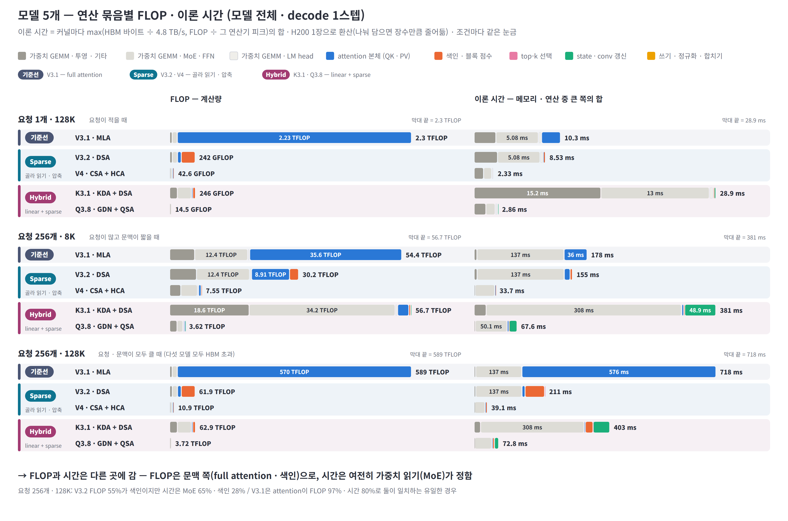
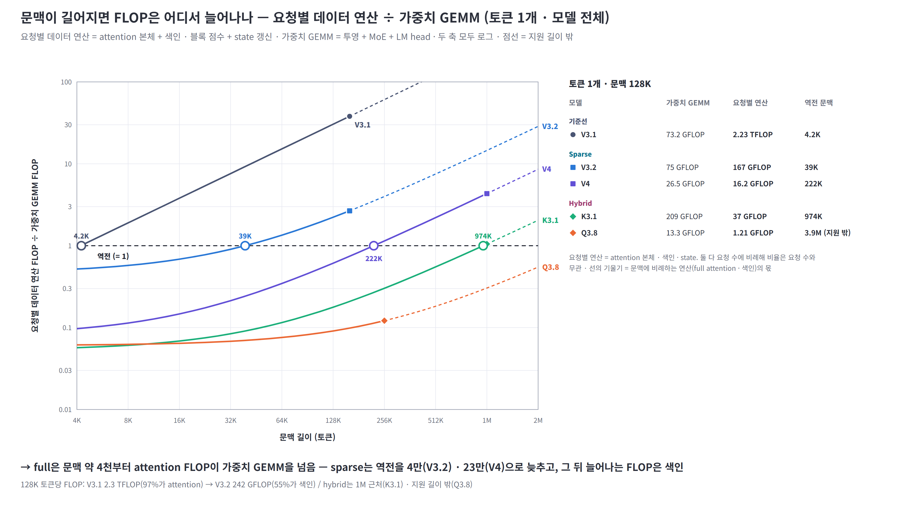
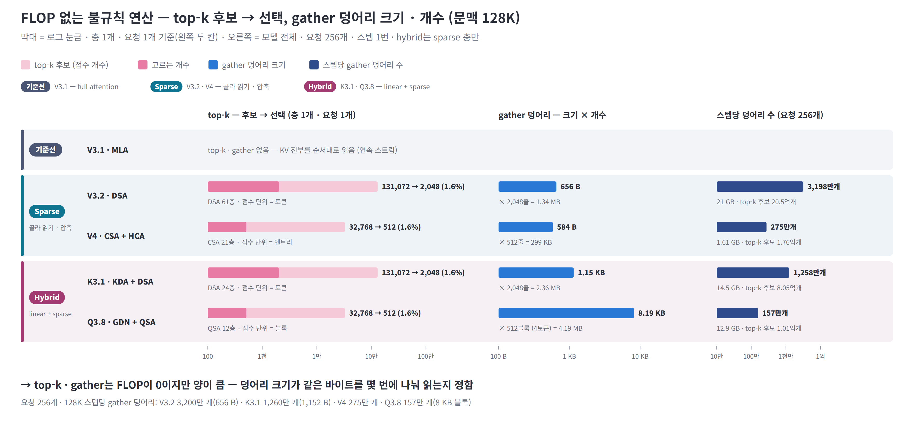
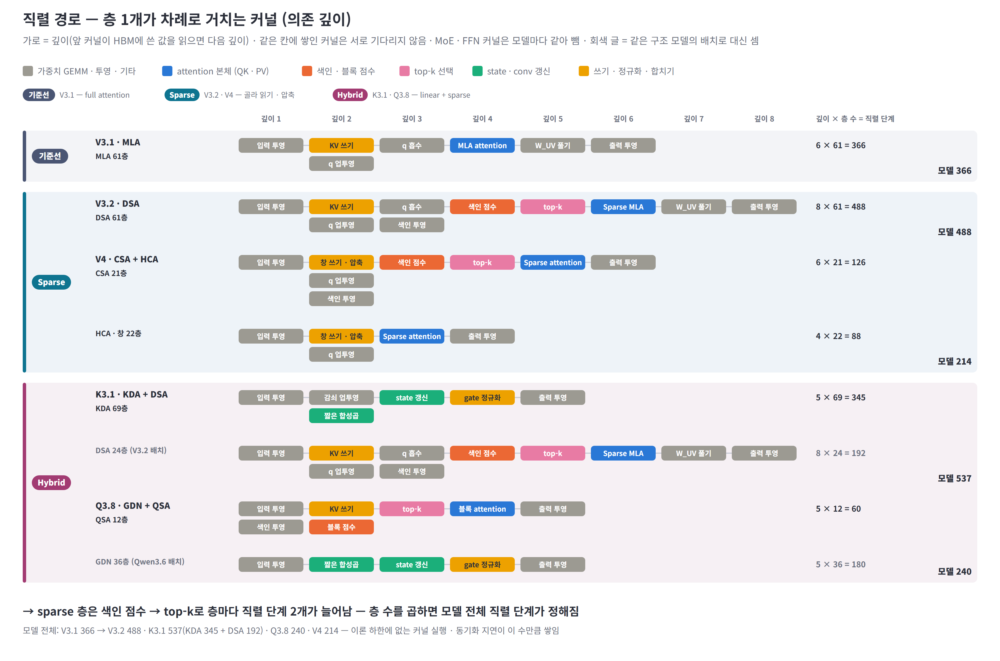

# Sparse · Hybrid attention 종합 — 연산으로 본 decode 1스텝

종합 보고서 · 2026.11 · [메모리 종합](synthesis-traits.md)과 같은 모델 5개 · 같은 조건을 연산 쪽(연산기 · 커지는 축 · 산술 강도 · 불규칙 연산 · 직렬 경로)에서 비교

대상: DeepSeek-V3.1(기준선 · full MLA) · V3.2(sparse · DSA) · V4-Flash(sparse + 압축 · CSA · HCA) · Kimi K3.1 Pro(hybrid · KDA + DSA) · Qwen3.8-Flash-Next(hybrid · GDN + QSA). 기준: H200 (HBM 4.8 TB/s · FP8 1,979 · BF16 989 · FP32 CUDA core 67 TFLOP/s) · decode 1스텝 · 이론 하한. 이론 시간 = 커널마다 max(HBM 바이트 ÷ 대역폭, FLOP ÷ 그 연산기 피크)의 합, H200 1장 환산. 조건 = 요청 1개 · 128K / 요청 256개 · 8K / 요청 256개 · 128K. 그린 층은 각 모델 약식 화면의 커널 그대로, 그린 층 밖(다른 층 종류 · MoE · LM head)은 `models/*/ops.yaml` 식. 수치: [tools/ops.py](../tools/ops.py) · 그림: [make_compute_report.py](make_compute_report.py)

---

## 요약

### FLOP은 문맥 쪽(full attention → 색인)으로 옮겨 가지만, 시간은 여전히 가중치 읽기가 정함 — 연산이 시간을 정하는 것은 full의 attention 본체뿐

| 조건 | 기준선 · full (V3.1) | Sparse (V3.2 · V4) | Hybrid (K3.1 · Q3.8) |
|---|---|---|---|
| **요청 1개 · 128K** | FLOP은 attention 본체가 거의 전부 — 시간은 가중치 읽기가 더 큼 | FLOP은 색인이 큰 몫 — 시간은 가중치 읽기 | FLOP · 시간 모두 가중치 GEMM |
| **요청 256개 · 8K** | FLOP은 attention, 시간은 MoE 가중치 | FLOP은 가중치 GEMM과 attention이 나눔 — 시간은 MoE | 시간은 MoE, 그다음 state 갱신 |
| **요청 256개 · 128K** | attention이 연산형으로 시간의 대부분 | 시간은 MoE, 그다음 색인 | 시간은 MoE, 그다음 state · 색인 |

- **FLOP은 문맥 쪽으로:** full은 긴 문맥 FLOP의 97%가 attention 본체 · sparse는 그 FLOP을 색인으로 옮김 · hybrid는 가중치 GEMM이 대부분
- **시간은 가중치 읽기:** 연산형 시간 몫이 큰 것은 V3.1뿐(최대 81%) — sparse · hybrid는 어느 조건에서도 8% 이하
- **강도는 구조가 정함:** attention 본체 180 ~ 420 · 색인 4 ~ 121 · state 약 0.9 FLOP/B — 요청을 모아도 그대로, 가중치 GEMM만 요청 수로 커짐
- **FLOP 없는 연산:** top-k · gather는 FLOP 0 — 층마다 직렬 단계 +2, gather 덩어리 584 B ~ 8 KB
- **HW 방향:** 색인 → 메모리 근처 저정밀 행렬 연산기(2.2 · 2.3) · top-k → 선택 유닛(2.3) · state → 작은 연산기의 PIM(2.4) · full attention → 연산형 장치 분리(2.5)

---

## 연산을 나누는 세 가지 기준

| 기준 | 묻는 것 | 나누는 값 | 한 줄 규칙 |
|---|---|---|---|
| **1. 연산기** | 무엇으로 계산하나 | GEMM · GEMV · 원소별 · top-k · gather | FLOP은 거의 GEMM — 나머지는 FLOP 밖에서 유닛과 시간을 요구 |
| **2. 커지는 축** | 토큰 1개의 FLOP이 무엇에 비례하나 | 고정 · 문맥 비례 · 고정 예산 | 문맥 비례 연산이 긴 문맥 FLOP을 정함 |
| **3. 산술 강도** | HBM 1 B당 몇 번 계산하나 | 요청 수로 커짐 · 구조로 고정(수백 / 수 ~ 수십) · 1 이하 | 경계(BF16 206 · FP8 412)보다 높으면 연산형 |

### 기준 1. 연산기

- **FLOP 98% 이상이 Tensor core 행렬곱** — 정밀도(FP8 · BF16)가 연산 시간을 정함
- **FLOP이 작거나 없는 연산:** state 갱신(GEMV · 원소별) · top-k · gather — FLOP 그림에 안 보여도 데이터 왕복 · 직렬 단계를 만듦

### 기준 2. 커지는 축

- **문맥 비례 = full attention · 색인:** 긴 문맥 FLOP의 대부분 — 압축 · 블록 키 · head 수는 기울기만 줄임
- **요청 수는 모든 연산에 똑같이 곱해짐** → FLOP 구성은 문맥만으로 정해지고, 시간 구성은 요청 수로도 바뀜(가중치 공유)

### 기준 3. 산술 강도

- **요청별 데이터 연산의 강도는 구조가 정함:** KV · 키 1줄을 head 몇 개가 함께 쓰나
- **공유 가중치만 요청 수로 커짐** — MoE는 expert로 나뉘어 느리게 커짐

### 모델 5개의 연산 — 묶음별 토큰당 FLOP (128K) · 산술 강도

| 연산 묶음 | 연산기 → 커지는 축 | 강도 → 성격 | V3.1 · 기준선 | V3.2 · Sparse | V4 · Sparse | K3.1 · Hybrid | Q3.8 · Hybrid |
|---|---|---|---|---|---|---|---|
| **가중치 GEMM · 투영 · 기타** | GEMM → 고정 | 요청 수로 커짐 (1 ~ 2 → 250 ~ 390) | 22.8 G | 24.5 G | 10.2 G | 72.7 G (BF16) | 6.7 G (BF16) |
| **가중치 GEMM · MoE · FFN** | GEMM → 고정 | 요청 수로 느리게 (1 ~ 3 → 6 ~ 26) | 48.6 G | 48.6 G | 15.2 G | 134 G | 5.3 G |
| **attention 본체** | GEMM BF16 → 문맥 비례(full) · 고정 예산(sparse) | 구조로 고정 · 수백 → 연산형 | 2,230 G · 423 | 34.8 G · 350 | 4.8 G · 199 | 10.3 G · 181 | 0.6 G · 12 |
| **색인 · 블록 점수** | GEMM FP8 · BF16 → 문맥 비례 | 구조로 고정 · 수 ~ 수십 → 대역폭형 | — | 132 G · 121 | 11.4 G · 121 | 26 G · 61 | 0.41 G · 4 |
| **top-k** | 비교 · 선택 → 후보가 문맥 비례 | FLOP 0 | — | 13만 → 2,048 | 3.3만 → 512 | 13만 → 2,048 | 3.3만 블록 → 512 |
| **state · conv 갱신** | GEMV · 원소별 FP32 → 고정 예산 | 1 이하 → 대역폭만 | — | — | — | 0.79 G · 0.8 | 0.20 G · 0.9 |

칸 = 토큰 1개 · 모델 전체 FLOP(G = GFLOP) · 산술 강도(FLOP/B). 가중치 GEMM 강도는 요청 1개 → 256개

- **full → sparse:** attention 본체 FLOP이 1/64로 줄고 색인 FLOP이 새로 생김 — V3.2는 색인이 본체의 3.8배
- **hybrid:** 문맥 쪽 연산이 24 · 12층에만 있어 가중치 GEMM이 FLOP의 대부분 · state 칸이 새로 생김

---

## 1. 연산기 구성 — FLOP과 시간이 어디에 가나

### 1.1 FLOP은 문맥 쪽에, 시간은 가중치 읽기에

- **FLOP ≠ 시간:** 둘이 같은 곳을 가리키는 것은 full의 긴 문맥뿐 (V3.1 attention FLOP 97% · 시간 80%)
- **요청이 적을 때:** 다섯 모델 모두 시간은 가중치 읽기 — K3.1은 BF16 attention 투영이 시간의 절반
- **요청 · 문맥이 모두 클 때:** V3.2는 색인이 FLOP 55% · 시간 28% · hybrid는 state 갱신이 시간 12 ~ 17%로 MoE 다음

### 1.2 연산기 · 정밀도 — Tensor core가 FLOP을 받지만 시간을 정하지는 않음

- **정밀도:** V3.2 · V4는 FP8이 42 ~ 84%(색인 · 투영, 문맥이 길수록 큼) · K3.1 · Q3.8은 거의 전부 BF16 — 저정밀 여지가 큼
- **연산형 시간 몫:** V3.1만 요청 수와 함께 커짐(22% → 81%) — sparse · hybrid는 Tensor core 피크를 늘려도 decode 시간이 거의 그대로
- **CUDA core FP32:** state · softmax 등 FLOP 1.4% 이하 — 연산량보다 데이터 왕복이 문제(3장)

#### HW로 발전시킬 포인트

| 대상 | 이 절에서 본 특성 | HW 방향 | 기준 보고서 Ⅱ장 |
|---|---|---|---|
| **attention 본체** (V3.1) | 연산형 · 요청 256개 · 128K 시간의 81% | FP8 attention 연산 · 연산형 장치로 분리 | 2.5 |
| **색인 점수** (V3.2 · V4) | 128K FLOP의 27 ~ 55% · FP8 행렬곱 | 저정밀 행렬 연산기 | 2.3 |
| **가중치 GEMM** (전 모델) | sparse · hybrid 시간의 대부분 · K3.1 · Q3.8 BF16 | 가중치 대역폭 · 저정밀 가중치 | — |

---

## 2. 커지는 축 — FLOP은 어디서 늘어나나

### 2.1 문맥 몇부터 요청별 데이터 연산이 가중치 GEMM을 넘나

- **full:** attention FLOP이 문맥에 비례 — 약 4천 토큰부터 가중치 GEMM을 넘고, 128K에서 30배
- **sparse:** 본체는 고른 줄 수로 고정, 기울기는 색인이 만듦 — 역전이 V3.2 약 4만 · V4 약 23만 토큰으로 밀림
- **hybrid:** 색인을 가진 층이 적어(24 · 12층) 기울기가 작음 — K3.1 약 100만 토큰 · Q3.8은 지원 길이(26만) 안에서 안 넘음

#### HW로 발전시킬 포인트

| 대상 | 이 절에서 본 특성 | HW 방향 | 기준 보고서 Ⅱ장 |
|---|---|---|---|
| **색인 · 블록 점수** (sparse · hybrid) | 문맥에 비례하는 유일한 FLOP · V3.2 128K 토큰당 132 GFLOP | 색인 연산기 규모를 지원 문맥 길이에 맞춤 | 2.3 |
| **full attention** (V3.1) | 4천 토큰부터 가중치 GEMM 초과 | sparse 선택 · 연산형 장치 | 2.5 |

---

## 3. 산술 강도 — 연산형인가 대역폭형인가

### 3.1 요청별 데이터 연산은 구조가, 공유 가중치 GEMM은 요청 수가 강도를 정함

- **요청을 모아도 그대로:** 요청마다 자기 KV · 키 · state — head 몇 개가 한 줄을 쓰나가 강도를 정함
- **세 부류:** attention 본체 180 ~ 420 → 연산형(Q3.8 GQA만 12) · 색인 4 ~ 121 → 대역폭형 · state 약 0.9 → 대역폭만
- **가중치 GEMM:** 투영 · LM head는 요청 256개에 250 ~ 390까지 · MoE는 6 ~ 26에 머물러 많은 요청에서도 대역폭형

#### HW로 발전시킬 포인트

| 대상 | 이 절에서 본 특성 | HW 방향 | 기준 보고서 Ⅱ장 |
|---|---|---|---|
| **색인 · 블록 점수** | 4 ~ 121 FLOP/B · 요청 수와 무관 | 메모리 근처 연산기 — 내부 대역폭 1 TB/s당 FP8 약 121 TFLOP/s(V3.2) ~ BF16 약 4 TFLOP/s(Q3.8) | 2.2 |
| **state 갱신** | 약 0.9 FLOP/B | 내부 대역폭 1 TB/s당 FP32 약 1 TFLOP/s — 작은 연산기로 충분 | 2.4 |
| **attention 본체** | 180 ~ 420 FLOP/B · 연산형 | 메모리 근처로 옮기면 연산기가 모자람 → 칩 쪽에 둠 | 2.5 |

---

## 4. 불규칙 연산 — top-k · gather

### 4.1 FLOP은 0이지만 양이 큼 — 덩어리 크기가 같은 바이트를 몇 번에 나눠 읽는지 정함

- **top-k:** 네 모델 모두 1.6%만 고름 — V4 · Q3.8은 압축 엔트리 · 블록 점수라 후보가 1/4
- **gather 덩어리:** 줄 단위 584 ~ 1,152 B(DSA · CSA) vs 4토큰 블록 8 KB(QSA)
- **스텝당 양:** 요청 256개 · 128K에서 V3.2 덩어리 3,198만 개 · top-k 후보 20.5억 개

#### HW로 발전시킬 포인트

| 대상 | 이 절에서 본 특성 | HW 방향 | 기준 보고서 Ⅱ장 |
|---|---|---|---|
| **top-k** (sparse 4개) | 층마다 후보 3.3 ~ 13만 · 스텝당 1 ~ 20억 개 | 선택 전용 유닛 · 색인 점수와 합친 커널 | 2.3 |
| **gather** (sparse 4개) | 덩어리 584 B ~ 8 KB · 스텝당 157만 ~ 3,198만 개 | 블록 단위 전송 · 메모리 근처 gather — 계층형 KV 전송 단위와 직결 | 2.1 · 2.2 |

---

## 5. 직렬 경로 — 층 1개가 차례로 거치는 커널

### 5.1 sparse 층은 색인 점수 → top-k로 깊이 +2 — 층 수를 곱한 값이 모델 전체 직렬 단계

- **sparse 층 = 깊이 +2:** V3.1 6 → V3.2 8 · V4 CSA 6 vs HCA 4 — 색인 투영은 q 흡수와 같은 깊이라 안 늘림
- **모델 전체:** V3.1 366 → V3.2 488 · K3.1 537(DSA 24층이 192) · Q3.8 240 · V4 214
- **작은 커널:** 요청 1개 · 128K에서 sparse · hybrid 층마다 3 ~ 4개가 이론 하한 1 µs 미만(V3.1은 1개) — 실행 · 동기화 지연이 하한보다 큼

#### HW로 발전시킬 포인트

| 대상 | 이 절에서 본 특성 | HW 방향 | 기준 보고서 Ⅱ장 |
|---|---|---|---|
| **색인 → top-k → attention 사슬** | 층마다 직렬 2단계 · 1 µs 미만 커널 3 ~ 4개 | 색인 점수 · top-k · gather를 한 커널(또는 한 장치)로 | 2.3 |
| **hybrid의 두 층 종류** | KDA · GDN 층과 DSA · QSA 층의 깊이 · 연산기가 다름 | 층 종류별 장치 분담 시 직렬 경로 길이를 함께 비교 | 2.5 |

---

## 정리 — 연산 특성 → 인사이트 → HW

### sparse · hybrid는 FLOP을 줄이고 옮겼지만 시간은 가중치 읽기에 남음 — 남은 연산은 강도가 낮거나 FLOP이 없어 '연산기를 키우기'보다 '어디서 계산하나'가 문제

| 연산 특성 | 해당 모델 | 근거 (조건 · 수치) | 인사이트 | HW로 연결 | 기준 보고서 Ⅱ장 |
|---|---|---|---|---|---|
| attention 본체 — 구조로 고정 · 수백 FLOP/B | V3.1 · V3.2 · V4 · K3.1 | 180 ~ 423 FLOP/B · V3.1 요청 256개 · 128K 시간 81% 연산형 | full은 연산형 · sparse는 시간 몫 5% 미만 | 연산형 장치 분리 · FP8 attention | 2.5 |
| 색인 · 블록 점수 — 문맥 비례 | V3.2 · V4 · K3.1 · Q3.8 | V3.2 128K 토큰당 FLOP 55% · 강도 4 ~ 121 | sparse가 FLOP을 색인으로 옮김 · 대역폭형 | 메모리 근처 저정밀 행렬 연산기 | 2.2 · 2.3 |
| top-k · gather — FLOP 0 | V3.2 · V4 · K3.1 · Q3.8 | 후보 3.3 ~ 13만 → 1.6% · 덩어리 584 B ~ 8 KB | 직렬 단계 +2 · 덩어리 크기가 전송 효율을 정함 | 선택 유닛 · 블록 단위 gather | 2.3 · 2.1 |
| state 갱신 — 1 이하 | K3.1 · Q3.8 | 0.8 ~ 0.9 FLOP/B · FLOP 1.4% 이하 · 요청 256개 · 8K 시간 13 ~ 18% | FLOP은 작은데 시간은 MoE 다음 | 작은 연산기의 state PIM | 2.4 |
| 가중치 GEMM — 요청 수로 커짐 | 전 모델 | MoE 요청 256개에서도 6 ~ 26 FLOP/B · 요청 32개 · 128K 시간 85 ~ 88% | 요청별 연산이 줄어 다시 가중치 읽기가 정함 | 가중치 대역폭 · 저정밀 · 배치 | 범위 밖 |

### 대응 × 모델 — 각 대응이 겨냥할 수 있는 몫

| 대응 (기준 보고서 Ⅱ장) | 겨냥하는 연산 · 지표 | V3.1 | V3.2 | V4 | K3.1 | Q3.8 |
|---|---|---|---|---|---|---|
| **2.2 · 2.3 메모리 근처 색인 연산** | 색인 · 블록 점수 · 이론 시간 몫 | — | 7.3% → **28%** | 3.3% → 13% | 1.7% → 5.7% | 2.4% → 7.5% |
| **2.3 top-k 유닛** | 스텝당 top-k 후보 (요청 256개 · 128K) | — | **20.5억** | 1.76억 | 8.05억 | 1.01억 |
| **2.1 · 2.2 블록 단위 gather** | 스텝당 gather 덩어리 (요청 256개 · 128K) | — | **3,198만 × 656 B** | 275만 × 584 B | 1,258만 × 1,152 B | 157만 × 8 KB |
| **2.4 state PIM** | state · conv 갱신 · 이론 시간 몫 | — | — | — | 3.7% → 12% (8K 13%) | 5.5% → **17%** (8K 18%) |
| **2.5 연산형 attention 분리** | attention 본체 · 이론 시간 몫 | 44% → **80%** | 1.1% → 4.3% | 0.9% → 3.5% | 0.2% → 0.8% | 1.2% → 3.7% |
| **커널 합치기** | 모델 전체 직렬 단계 | 366 | 488 | 214 | **537** | 240 |
| **가중치 대역폭 · 배치** (범위 밖) | MoE · FFN · 이론 시간 몫 | 54% → 19% | 88% → 65% | 88% → **79%** | 85% → 76% | 85% → 69% |

시간 몫 칸 = 요청 32개 · 128K → 요청 256개 · 128K. 그 대응으로 줄일 수 있는 몫의 상한(실제 이득은 연산기 성능 · 전송 비용 · 융합 가능 여부에 달림). 요청 256개 · 128K는 다섯 모델 모두 HBM 용량 초과 조건(메모리 종합 2.2 표)

- **요청 · 문맥이 클수록 attention 쪽 몫이 커짐** — 그래도 sparse · hybrid에서 가장 큰 단일 몫은 MoE 가중치 읽기
- **모델별 첫 대응:** V3.1 → 연산형 attention · V3.2 → 메모리 근처 색인(시간 28%) · Q3.8 → state PIM(17%) · K3.1 → state(12%), 그다음 색인(5.7%) · V4 → 대부분 가중치
- **확인할 것:** 실제 top-k · gather 커널 처리량(이론 하한에 없음), FP4 expert의 H200 실행 정밀도, 배포 엔진의 커널 융합 경계(직렬 단계 수가 바뀜)

---

## 부록 — 메모리 종합과 이어 읽기 · 비교의 한계

### 메모리 종합과 이어 읽기 — 같은 데이터를 연산 쪽에서 보면

| 메모리 종합의 결론 | 연산 종합에서 본 것 | 이어지는 점 |
|---|---|---|
| 색인 키 = 끝에 추가 · 전부 읽음 (대역폭형) | 색인 점수 4 ~ 121 FLOP/B · 문맥 비례 FLOP | 메모리 근처로 옮길 때 필요한 연산기 크기가 모델마다 약 30배 차이 |
| state = 매 스텝 전부 다시 씀 | state 갱신 약 0.9 FLOP/B · FLOP 1.4% 이하 | PIM에 필요한 연산은 GEMV · 원소별뿐 |
| 골라 읽는 KV = 용량형 | sparse attention 본체: 줄당 강도는 그대로 수백 · 시간 몫 5% 미만 | 고른 줄이 오면 연산은 문제가 아님 — 전송 단위(덩어리 584 B ~ 8 KB)가 관건 |
| full KV = 용량 + 대역폭 | full attention 본체는 연산형(423 FLOP/B) | KV 압축 · 저정밀로 바이트를 줄여도 시간이 덜 줄어듦 — 연산 쪽(FP8 attention)도 필요 |
| 요청별 이동이 줄어 다시 MoE 가중치 | MoE GEMM은 요청 256개에서도 6 ~ 26 FLOP/B · 시간의 대부분 | 연산 쪽에서도 attention HW 이득의 상한은 같음 |

### 비교의 한계

- **이론 시간:** H200 1장 환산 합 · 실행 지연 · 동기화 · gather 비효율 · top-k 처리량 미포함 (top-k · gather는 바이트 ÷ 대역폭만)
- **그린 층 밖 연산:** K3.1 DSA 24층 · Q3.8 GDN 36층 · V4 HCA · 창 층 · MoE는 `ops.yaml` 식 (model.yaml과 같은 형식 가정). 직렬 깊이는 같은 구조 모델의 배치로 대신 셈(K3.1 DSA ← V3.2, Q3.8 GDN ← Qwen3.6, V4 HCA ← CSA에서 색인 · top-k 뺀 것)
- **정밀도:** V4 · K3.1의 FP4 · MXFP4 expert는 H200에 FP4 Tensor core가 없어 BF16로 풀어 계산한다고 가정
- **MoE:** 균등 · 독립 라우팅 기댓값 (메모리 종합과 같음)
- **제외:** 잔차 · RMSNorm · 임베딩 조회 · MTP · GPU 간 통신 · V3.2 split-KV 합치기(메모리 종합과 같은 처리)
- **V4 출력 LoRA FLOP 수정:** 그룹 8개를 모두 세도록 algo.yaml 식을 고침(2026-11-23) — 층 FLOP 0.818 → 0.877 G, 이 커널은 메모리가 시간을 정해 시간은 그대로
- **검증:** 참조 구현 검증은 V3.2 · Qwen3.6 GDN만 — 나머지는 config · 공개 코드로 세운 식
