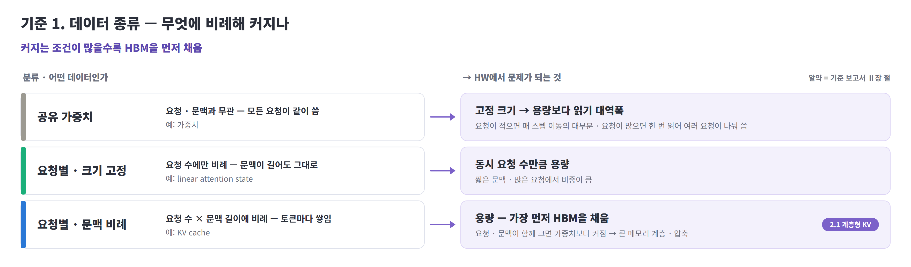
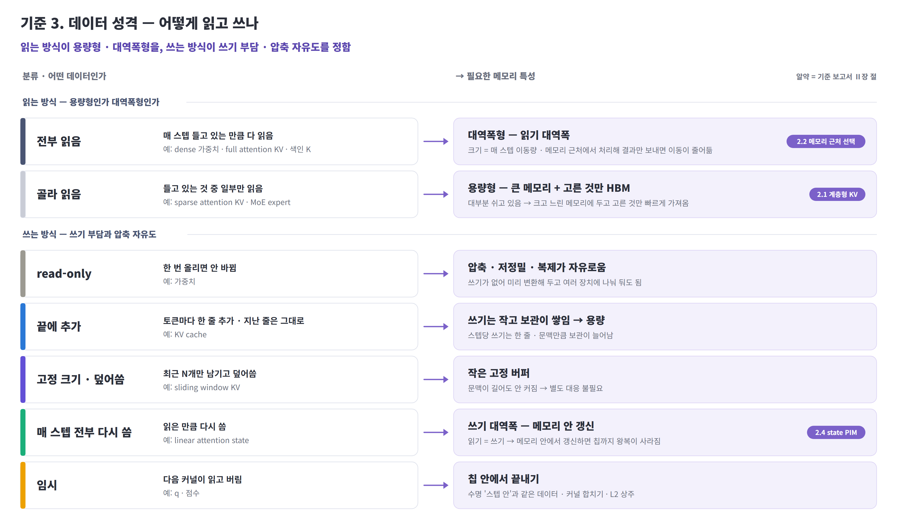
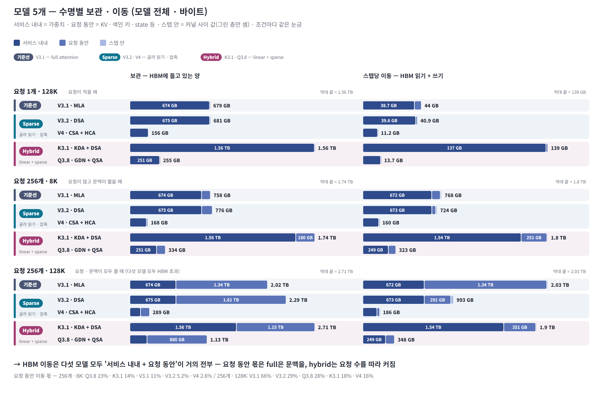
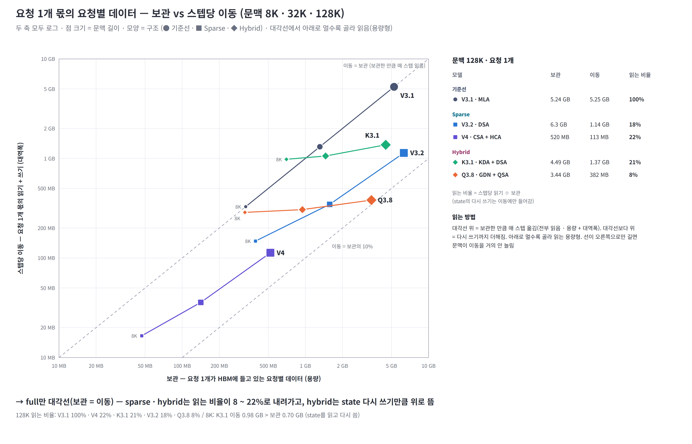

# Sparse · Hybrid attention 종합 — 데이터 성격으로 본 decode 1스텝

종합 보고서 · 2026.11 · 모델별 보고서 5개(기준선 full 1 · sparse 2 · hybrid 2)를 같은 틀로 놓고 모델끼리 비교한 것

대상: [DeepSeek-V3.1](mla-v31-traits.md)(기준선 · full MLA) · [DeepSeek-V3.2](dsa-v32-traits.md)(sparse · DSA) · [DeepSeek-V4-Flash](csa-v4flash-traits.md)(sparse + 압축 · CSA · HCA) · [Kimi K3.1 Pro](kda-k3-traits.md)(hybrid · KDA + DSA) · [Qwen3.8-Flash-Next](qsa-qwen38-traits.md)(hybrid · GDN + QSA). 기준: H200 (HBM 4.8 TB/s · 141 GB · L2 50 MB) · decode 1스텝 · 이론 하한 · 저장 형식 = 각 algo.yaml 기본값. 모델별 보고서는 구성 비율(합 = 100%)로 그렸지만 이 보고서는 **바이트 그대로** 그려 모델끼리의 크기 차이까지 보임. 조건은 셋만 — 요청 1개 · 128K / 요청 256개 · 8K / 요청 256개 · 128K. V3.1과 V3.2는 attention만 다른 같은 모델이라 직접 비교가 가능한 유일한 쌍. K3.1 Pro = Kimi K3의 full attention(MLA) 24층을 Gated DSA로 바꾼 모델(폴더 이름은 kda-k3 그대로). 출발점: [기준 보고서](../../sparse-hybrid-hw-report-v2-refined.md) — 대비는 부록. 수치: [tools/traits.py](../tools/traits.py) · 그림: [make_synthesis_report.py](make_synthesis_report.py) · [make_criteria_figs.py](make_criteria_figs.py)

---

## 요약

### sparse는 이동만 · 압축은 보관과 이동을 함께 줄임 · linear는 문맥과 무관한 state를 남김 — 요청별 이동이 줄어든 만큼 모델 전체 이동은 다시 MoE 가중치가 정함

| 조건 | 기준선 · full (V3.1) | Sparse (V3.2 · V4) | Hybrid (K3.1 · Q3.8) |
|---|---|---|---|
| **요청 1개 · 128K** (요청이 적을 때) | 가중치가 이동의 대부분, KV가 10분의 1 | 가중치 — 요청별 이동은 3% 이하 | 가중치 — K3.1은 BF16 attention 가중치가 이동의 절반 |
| **요청 256개 · 8K** (요청이 많고 문맥이 짧을 때) | MoE 가중치, 그다음 KV | MoE 가중치가 90% 이상 | MoE 가중치, 그다음 문맥과 무관한 state |
| **요청 256개 · 128K** (요청 · 문맥이 모두 클 때) | KV가 보관 · 이동 모두 가중치를 넘음 | 보관은 KV가 가중치를 넘지만(V3.2) 이동은 MoE, 그다음 전부 읽는 색인 키 · V4는 압축으로 둘 다 작음 | 요청별 보관은 골라 읽는 KV(Q3.8은 가중치도 넘음), 이동은 MoE 다음 state |

- **sparse 선택:** 이동만 줄이고 보관은 그대로 → 용량이 대역폭보다 먼저 막힘
- **sparse에 남는 대역폭:** 매 스텝 전부 읽는 색인 · 블록 키 — 문맥에 비례하고 키 형식에 민감
- **linear state:** 문맥과 무관 · 요청 수에 비례 · 읽은 만큼 다시 씀 → 짧은 문맥에서는 요청당 이동이 full보다 큼
- **압축(V4):** 보관과 이동을 함께 줄이는 유일한 구조 — 남는 것은 색인과 가중치
- **모델 전체:** 요청별 이동이 줄어 다시 MoE 가중치가 이동의 대부분 → attention 쪽 HW로 줄일 수 있는 몫에 상한이 생김
- **HW 방향:** 성격마다 대응이 다르고(2.1 · 2.2 · 2.3 · 2.4) 모델마다 걸리는 조합과 몫이 다름 (각 절 끝 'HW로 발전시킬 포인트' · 맨 아래 대응 × 모델 표)
---

## 데이터를 나누는 세 가지 기준

### 같은 데이터를 '무엇에 비례해 커지나 · 얼마나 오래 남나 · 어떻게 읽고 쓰나'로 나눔 — 각각 'HBM을 얼마나 채우나 · 어디에 두나 · 어떤 메모리 특성이 필요한가'로 이어짐

| 기준 | 묻는 것 | 나누는 값 | 한 줄 규칙 |
|---|---|---|---|
| **1. 데이터 종류** | 무엇에 비례해 커지나 | 공유 가중치 · 요청별 크기 고정 · 요청별 문맥 비례 | 커지는 조건이 많을수록 HBM을 먼저 채움 |
| **2. 수명** | 얼마나 오래 남나 | 서비스 내내 · 요청 동안 · 스텝 안 · 커널 안 | 오래 남을수록 칩 밖 큰 메모리, 금방 버릴수록 칩 안 |
| **3. 데이터 성격** | 어떻게 읽고 쓰나 | 읽기: 전부 · 골라 / 쓰기: read-only · 끝에 추가 · 덮어씀 · 다시 씀 · 임시 | 전부 읽으면 대역폭, 골라 읽으면 용량, 다시 쓰면 쓰기 대역폭 |

- **그림 읽는 법 (기준 1 ~ 3 공통):** 왼쪽 = 분류와 그 뜻(예는 일반적인 LLM 데이터) → 오른쪽 = 그런 데이터면 필요한 HW 특성(알약 = 기준 보고서 Ⅱ장 절). 모델 5개의 데이터가 어느 칸인지는 맨 아래 표

### 기준 1. 데이터 종류 — 무엇에 비례해 커지나

- **한 줄 규칙:** 커지는 조건이 많을수록 HBM을 먼저 채움 — 공유 가중치(고정) → 요청별 크기 고정(요청 수) → 요청별 문맥 비례(요청 수 × 문맥)
- **가중치는 용량보다 읽기가 문제:** 크기는 고정 · 요청이 적으면 매 스텝 이동의 대부분이 가중치 읽기

### 기준 2. 수명 — 얼마나 오래 남나

- **한 줄 규칙:** 다시 읽힐 때까지 오래 걸릴수록 칩에서 먼 큰 메모리, 금방 버릴수록 칩 안
- **칩 안에 남을 수 있는 경계 = 한 스텝:** 다음 스텝까지 모델 전체(전 층 + MoE)가 지나가 칩 안(L2 50 MB)이 다 덮임 → 서비스 내내 · 요청 동안 데이터는 SRAM을 늘려도 HBM 이동이 그대로
- **SRAM이 효과를 내는 곳 = 스텝 안 값:** 커널 합치기 · L2 상주로 HBM 왕복 제거. 커널 안 값은 이미 칩 안

### 기준 3. 데이터 성격 — 어떻게 읽고 쓰나

- **읽는 방식 → 용량형 · 대역폭형:** 전부 읽으면 크기가 곧 매 스텝 이동량(대역폭형), 골라 읽으면 보관만 크고 이동은 작음(용량형)
- **쓰는 방식 → 쓰기 부담 · 압축 자유도:** read-only는 미리 압축 · 복제 자유, 끝에 추가는 스텝당 쓰기가 한 줄, 매 스텝 다시 쓰면 읽은 만큼 쓰기 대역폭이 듦
- **두 축을 함께 읽음:** 같은 '끝에 추가'도 골라 읽으면 큰 메모리로(2.1), 전부 읽으면 메모리 근처 처리로(2.2)

### 모델 5개의 데이터 — 종류별 수명 · 성격

| 데이터 종류 | 수명 → 둘 곳 | 데이터 성격 → 필요한 특성 | V3.1 · 기준선 | V3.2 · Sparse | V4 · Sparse | K3.1 · Hybrid | Q3.8 · Hybrid |
|---|---|---|---|---|---|---|---|
| **attention · dense FFN · LM head 등 가중치** | **서비스 내내** → HBM 상주 | **read-only · 전부 읽음** → 읽기 대역폭 · 저정밀 | 15 GB | 16 GB | 6.5 GB | 77 GB (BF16) | 8 GB (BF16) |
| **MoE expert · 임베딩** | **서비스 내내** → HBM 상주 | **read-only · 골라 읽음** → 요청이 적을 때만 일부를 읽음 | 659 GB | 659 GB | 149 GB (FP4) | 1.48 TB (MXFP4) | 243 GB (BF16) |
| **전부 읽는 KV** | **요청 동안** → HBM · 그 아래 큰 메모리 | **끝에 추가 · 전부 읽음** → 용량 + 대역폭 함께 | 토큰당 40 KB | — | 토큰당 91 B (HCA 고압축) | — | — |
| **골라 읽는 KV** | **요청 동안** → HBM · 그 아래 큰 메모리 | **끝에 추가 · 골라 읽음** → 용량형 | — | 토큰당 40 KB (2,048줄) | 토큰당 3.1 KB (CSA · 512엔트리) | 토큰당 27.6 KB (DSA 24층 · 2,048줄) | 토큰당 24.6 KB (QSA 12층 · 2,048토큰) |
| **색인 · 블록 키** | **요청 동안** → HBM · 그 아래 큰 메모리 | **끝에 추가 · 전부 읽음** → 대역폭형 | — | 토큰당 8 KB | 토큰당 0.7 KB | 토큰당 3.2 KB | 토큰당 768 B (블록 키) |
| **state · conv** | **요청 동안** → HBM | **매 스텝 전부 다시 씀** → 쓰기 대역폭 | — | — | — | 요청당 449 MB | 요청당 115 MB |
| **최근 창 · 압축기 state** | **요청 동안** → HBM | **고정 크기 · 덮어씀** → 작은 고정 버퍼 | — | — | 요청당 15 MB | — | — |
| **커널 사이 값** | **스텝 안** → 칩 안 L2에 남길 수 있음 | **임시** → 커널 합치기 | q · 출력 벡터 | q · 점수 · 선택 위치 | q · 점수 · 선택 위치 | q · k · v · gate | q · 점수 · 선택 블록 |
| **커널 안 값** | **커널 안** → 이미 칩 안 | HBM에 안 나옴 | attention 점수 · 확률 | + 색인 head별 점수 (큼) | + 색인 head별 점수 | + 감쇠한 state | 블록 점수 (head 4개라 작음) |

- **full → sparse:** KV 한 칸(끝에 추가 · 전부 읽음)이 '골라 읽는 큰 KV + 전부 읽는 작은 키' 두 칸으로 갈림 — V3.2 · V4 · K3.1 · Q3.8 모두
- **hybrid는 칸이 하나 더:** '매 스텝 전부 다시 씀(state)' — 문맥과 무관 · 요청 수에 비례. K3.1 · Q3.8 모두 linear + sparse라 칸 조합이 같고 크기만 다름
- **압축(V4):** 칸은 sparse와 같고 크기만 훨씬 작음, 여기에 작은 '덮어씀' 칸 하나

### 그래프 읽는 법

- **바이트 그대로:** 막대 길이 = 바이트. 조건마다 다섯 모델이 같은 눈금(요청 1개 몫 그림은 두 문맥도 같은 눈금) → 모델 크기 차이까지 보임. 구성 비율은 모델별 보고서에서
- **구조 띠:** 줄을 기준선(full) · Sparse · Hybrid로 묶어 칠함 — 알약 색 = 구조
- **조건 셋:** 요청 1개 · 128K(요청이 적을 때) / 요청 256개 · 8K(요청이 많고 문맥이 짧을 때) / 요청 256개 · 128K(둘 다 클 때 — 다섯 모델 모두 배치 가정 장수 초과, 바이트 비교로만 읽음)
- **각 절의 두 번째 그림:** 모델별 보고서의 'attention 층 1개' 자리. 층 구성이 모델마다 달라 층 1개끼리는 비교가 어려워, 요청별 데이터(전 층 합)를 요청 1개 기준으로 비교하거나(1.2 · 3.2) 역전점으로 봄(2.2)

---

## 1. 데이터 종류 — 무엇이 용량과 대역폭을 쓰나

### 1.1 모델 전체 — 이동 차이는 가중치 크기가 가장 크게 만들고, 요청 · 문맥이 모두 커져야 attention 구조의 차이가 드러남

- **요청이 적을 때:** 다섯 모델 모두 이동은 거의 가중치 — 모델 간 차이는 attention 구조보다 가중치 크기와 정밀도가 정함
- **요청이 많고 문맥이 짧을 때:** MoE 가중치가 대부분이고, hybrid만 그다음으로 state가 보임
- **요청 · 문맥이 모두 클 때:** 보관은 어느 모델이든 KV가 차지하지만, KV가 이동까지 차지하는 것은 full뿐 — sparse · hybrid에서는 그 자리를 색인 키와 state가 대신함
- **attention만 바꾼 V3.1 ↔ V3.2:** 이동은 크게 줄고 보관은 오히려 늘어남 — sparse 선택의 효과와 대가가 같은 그림에 보임

### 1.2 요청 1개 몫 — sparse는 KV를 그대로 들고 읽기만 줄이고, hybrid는 문맥과 무관한 state가 남음

- **보관:** 골라 읽어도 KV는 그대로 들고 있음 — sparse는 색인 키만큼 full보다 보관이 큼. 보관을 줄이는 것은 압축(V4)과 KV 층 수를 줄인 hybrid
- **이동:** full만 들고 있는 KV를 전부 옮김. 나머지는 KV 이동이 거의 사라지고, 남는 이동의 주성분은 sparse는 색인 키 · hybrid는 state
- **문맥이 짧을 때:** KV가 작아져 hybrid의 state가 요청당 이동을 정함 — 이때는 hybrid의 요청당 이동이 full보다 큼
- **문맥이 길어질 때:** KV · 색인 키는 문맥을 따라 커지고 state는 그대로

#### 모델 크기를 덜어 낸 값

| 모델 | 층 수 | 가중치 | 토큰당 요청별 보관 (전 층 합) | 층당 평균 | 요청당 크기 고정 | 128K 요청 1개 보관 ÷ 가중치 |
|---|---|---|---|---|---|---|
| V3.1 | 61 (MLA 61) | 674 GB | 40.0 KB | 656 B | — | 0.78% |
| V3.2 | 61 (DSA 61) | 675 GB | 48.1 KB | 788 B | — | 0.93% |
| V4 | 43 (CSA 21 · HCA 20 · SWA 2) | 156 GB | 3.85 KB | 90 B | 15 MB | 0.33% |
| K3.1 | 93 (DSA 24 · KDA 69) | 1.56 TB | 30.8 KB | 331 B (DSA 층만 1,284 B) | 449 MB | 0.29% |
| Q3.8 | 48 (QSA 12 · GDN 36) | 251 GB | 25.3 KB | 528 B (QSA 층만 2,112 B) | 115 MB | 1.37% |

- **크기 차이가 섞여 있음:** hybrid의 요청당 보관이 full보다 작은 것은 KV를 가진 층이 적어서 — KV를 가진 층만 보면 오히려 full보다 큼(BF16 형식)
- **크기와 무관한 비교:** 마지막 열(요청 1개가 가중치 대비 차지하는 몫)이 클수록 요청별 데이터가 상대적으로 무거움 — 가중치가 작은 Q3.8이 가장 큼

#### HW로 발전시킬 포인트

| 대상 | 이 절에서 본 특성 | HW 방향 | 기준 보고서 Ⅱ장 |
|---|---|---|---|
| **골라 읽는 KV** (V3.2 · V4 · K3.1 · Q3.8) | 보관은 full과 같거나 큼(V3.2 6.3 GB > V3.1 5.2 GB) · 이동은 작음 | 전체 KV는 큰 메모리, 고를 KV만 HBM — 계층형 KV | 2.1 |
| **색인 · 블록 키** (같은 4개) | 요청 1개 몫 이동의 큰 몫 (V3.2 93% · V4 80% · K3.1 30%) | 색인 읽기를 메모리 근처에서, 칩에는 선택 위치만 — 메모리 근처 선택 | 2.2 |
| **state** (K3.1 · Q3.8) | 문맥과 무관 — 8K에서 K3.1 요청당 이동이 V3.1의 3배 | state 갱신 PIM | 2.4 |
| **전부 읽는 KV** (V3.1) | 요청 256개 · 128K 이동의 66% | HBM 용량 · 대역폭, KV 압축 · 저정밀 | — |
| **가중치** (전 모델) | 요청이 적을 때 이동의 거의 전부 · 모델 크기 차이(V4 11 GB ~ K3.1 139 GB)가 그대로 | 가중치 대역폭 · 저정밀 — K3.1 attention · Q3.8 전체가 BF16이라 여지가 큼 | — |

---

## 2. 데이터 수명 — 어디에 둘 수 있나

> **읽는 법:** 수명과 '다시 읽히기까지 걸리는 시간'이 둘 곳을 정함. 한 스텝 뒤에 다시 읽히는 가중치 · KV · state는 그사이 모델 전체가 지나가 칩 안에 못 남음 → HBM이나 그 아래 메모리. 다음 커널이 바로 읽는 스텝 안 임시값은 칩 안에서 끝낼 수 있는 몫

### 2.1 모델 전체 — 다섯 모델 모두 HBM 이동은 '서비스 내내 + 요청 동안'이 거의 전부 · 요청 동안 몫은 full은 문맥을, hybrid는 요청 수를 따라 커짐

- **어느 모델이든** HBM 이동은 '서비스 내내 + 요청 동안'이 거의 전부 — 칩 안에서 끝낼 수 있는 스텝 안 몫은 작음
- **요청이 적을 때:** 서비스 내내 남는 가중치가 사실상 전부
- **많은 요청 · 짧은 문맥:** 요청 동안 몫이 가장 큰 것은 state를 가진 hybrid
- **많은 요청 · 긴 문맥:** 요청 동안 몫이 가장 큰 것은 KV를 전부 읽는 full — 요청 동안 데이터가 문맥에 비례하나 요청 수에 비례하나가 모델 순서를 바꿈

### 2.2 역전점 — 요청 몇 개부터 '요청 동안' 데이터가 '서비스 내내' 가중치를 넘나

- **full은 보관과 이동이 함께 역전:** 용량과 대역폭이 같은 시점에 막힘
- **골라 읽는 KV가 있는 모델은 보관 역전이 훨씬 먼저:** 이동은 늦게 역전 → 용량이 대역폭보다 먼저 막히고, 그 사이 구간이 계층형 KV가 쓸 수 있는 여유
- **압축(V4)은 둘 다 뒤로 밀림:** 요청별 데이터 자체가 작음
- **가중치 크기도 순서를 바꿈:** 가중치가 작은 Q3.8은 보관 역전이 가장 이르고, 가중치가 큰 K3.1은 둘 다 늦음

| 모델 (배치 가정) | 요청 1개 | 요청 32개 · 128K | 요청 256개 · 8K | 요청 256개 · 32K | 요청 256개 · 128K |
|---|---|---|---|---|---|
| V3.1 (8장) | 5장 | 6장 | 6장 | 8장 | **15장** |
| V3.2 (8장) | 5장 | 7장 | 6장 | 8장 | **17장** |
| V4-Flash (2장) | 2장 | 2장 | 2장 | 2장 | **3장** |
| Kimi K3.1 Pro (16장) | 12장 | 13장 | 13장 | 14장 | **20장** |
| Qwen3.8 (2장) | 2장 | **3장** | **3장** | **4장** | **9장** |

H200 141 GB에 보관 합계를 균등히 나눈 최소 장수. 굵게 = 배치 가정 장수 초과. GPU별 배치(TP · EP · DP) · 복제 · 작업 공간은 반영 안 함

- **용량 판정이 먼저:** 요청 · 문맥이 모두 크면 다섯 모델 모두 배치 가정 장수를 넘음 → 그 조건의 이동 비교는 바이트 비교로만 의미가 있음
- **넘는 순서:** V3.2는 색인 키만큼 V3.1보다 먼저 넘고, 가중치가 작은 Q3.8은 가장 이른 조건부터 넘음

#### HW로 발전시킬 포인트

| 대상 | 이 절에서 본 특성 | HW 방향 | 기준 보고서 Ⅱ장 |
|---|---|---|---|
| **가중치 · 요청별 데이터** (칩 밖 수명, 전 모델) | HBM 이동의 97% 이상이 한 스텝 뒤에 다시 읽히는 데이터 | SRAM 증설로 줄일 몫이 작음 → HBM 용량 · 대역폭과 그 아래 계층 — 이종 가속기 · PD 분리 | 2.5 |
| **보관 역전 ~ 이동 역전 구간** (V3.2 · K3.1 · Q3.8) | 용량은 막히는데 대역폭은 남는 구간 (3.3 ~ 8.9배) | 계층형 KV — 이 간격이 아래 계층과 주고받을 대역폭 여유 | 2.1 |
| **state** (K3.1 · Q3.8) | 한 스텝 뒤에 다시 읽고 다시 씀 · 요청 수에 비례 | 칩 안 상주는 요청 · 층 수에 비례해 어려움 → 메모리 안 갱신 | 2.4 |
| **스텝 안 임시값** | 모델 이동의 3% 이하 | 커널 합치기 · L2 상주 — 모델 비교에서는 작은 몫 | — |

---

## 3. 데이터 성격 — 어떤 메모리 특성이 필요한가

> **읽는 법:** 골라 읽는 데이터는 대부분 쉬고 있음 → 큰 용량에 두고 고른 것만 빠르게 가져오는 구조가 맞음. 매번 전부 읽는 데이터는 대역폭이 시간을 정함. 매 스텝 다시 쓰는 데이터는 읽은 만큼 쓰기 대역폭이 필요하고, 메모리 안에서 갱신하면 왕복이 사라짐. read-only는 압축 · 복제 · 저정밀의 자유도가 큼

### 3.1 모델 전체 — 골라 읽는 KV는 보관만 크고, 이동 차이는 전부 읽는 데이터와 다시 쓰는 state가 만듦

- **요청이 적을 때:** 이동은 거의 read-only 가중치 — 성격 차이는 full의 KV에서만 조금 보임
- **골라 읽는 KV:** 보관은 크게 차지하면서 이동은 거의 없음 — sparse · hybrid 모두 같은 모양 (용량형)
- **전부 읽는 요청별 데이터:** full은 KV, sparse · hybrid는 작은 색인 · 블록 키 — 이 칸의 크기가 모델 간 이동 차이를 만듦 (대역폭형)
- **매 스텝 전부 다시 씀:** hybrid에만 있고 문맥과 무관 — 짧은 문맥에서 상대 비중이 커짐
- **고정 크기 · 덮어씀:** V4에만 있고 작아 비교에서는 무시할 수준

### 3.2 요청 1개 몫 — full만 '보관 = 이동' 대각선, sparse · hybrid는 일부만 읽어 대각선 아래로

- **full은 대각선 위:** 보관한 만큼 매 스텝 읽음 → 용량과 대역폭이 함께 커짐
- **sparse · hybrid는 대각선 아래:** 요청당 고정 예산만 골라 읽어, 문맥이 길수록 대각선에서 더 멀어짐(읽는 비율이 떨어짐)
- **hybrid는 대각선 위로 뜰 수 있음:** state를 읽고 같은 양을 다시 써 짧은 문맥에서는 이동이 보관보다 큼
- **선이 누운 정도 = 문맥에 대한 민감도:** full이 가장 가파르고, sparse는 색인 키만큼 기울고, hybrid는 거의 수평 — 긴 문맥에서도 이동이 거의 안 늘어남

#### HW로 발전시킬 포인트

| 대상 | 이 절에서 본 특성 | HW 방향 | 기준 보고서 Ⅱ장 |
|---|---|---|---|
| **끝에 추가 · 골라 읽음** (V3.2 · V4 · K3.1 · Q3.8의 KV) | 보관은 크고 이동은 작음 (용량형) | 계층형 KV — 연속 스텝의 선택 겹침(적중률)이 효과를 정함 | 2.1 |
| **끝에 추가 · 전부 읽음 — 키** (같은 4개) | 보관은 작아도 매 스텝 전부 읽음 (대역폭형) · 키 1 B당 연산 V3.2 · V4 약 124 · K3.1 약 62 · Q3.8 약 4 FLOP | 메모리 근처 선택 · 색인 연산 · top-k — 필요한 연산기 크기가 최대 약 30배 차이 | 2.2 · 2.3 |
| **끝에 추가 · 전부 읽음 — KV** (V3.1) | 용량형이면서 대역폭형 | HBM 용량 · 대역폭을 함께, KV 압축 · 저정밀 — 아래 계층은 읽기 대역폭이 모자람 | 2.5 |
| **매 스텝 전부 다시 씀** (K3.1 · Q3.8) | 읽기 = 쓰기 · 이동 비중이 보관 비중의 약 2배 | 메모리 안 갱신으로 왕복 제거 | 2.4 |
| **read-only · 골라 읽음** (전 모델의 MoE) | 요청이 늘면 사실상 전부 읽음 | 요청 수에 맞춘 expert 배치 | 범위 밖 |

※ 키 1 B당 연산은 각 모델 보고서 기준 — K3.1은 색인 head 32개라 V3.2의 절반. 형식이 바뀌면 달라짐(V4 색인 키 MXFP4 68 B면 약 241 FLOP)

---

## 정리 — 데이터 특성 → 인사이트 → HW

### sparse · hybrid가 바꾼 것은 '요청별 데이터의 성격' — 성격마다 대응이 다르고, 모델마다 걸리는 조합과 겨냥할 수 있는 몫이 다름

- **모델 5개의 특성:** full(V3.1)은 KV 한 칸이 용량과 대역폭을 함께 씀 · 골라 읽기(V3.2 · K3.1의 DSA · Q3.8의 QSA)는 그 칸을 '골라 읽는 큰 KV + 전부 읽는 작은 키'로 쪼갬 · 압축(V4)은 칸 자체를 작게 함 · linear(K3.1의 KDA · Q3.8의 GDN)는 문맥과 무관한 '다시 쓰는 state' 칸을 새로 씀
- **요청 수 · 문맥이 커질수록:** 보관은 골라 읽는 KV(sparse · hybrid)와 전부 읽는 KV(full)가, 이동은 MoE 가중치 다음으로 색인 키(sparse)와 state(hybrid)가 차지

| 데이터 특성 | 해당 모델 | 근거 (조건 · 수치) | 인사이트 | HW로 연결 | 기준 보고서 Ⅱ장 |
|---|---|---|---|---|---|
| 끝에 추가 · 전부 읽는 KV | V3.1 | 128K 읽는 비율 100% · 보관 · 이동 역전 129 · 126개 | 용량과 대역폭이 같이 커짐 | HBM 용량 · 대역폭, KV 압축 · 저정밀 | 2.5 |
| 끝에 추가 · 골라 읽는 KV | V3.2 · V4 · K3.1 · Q3.8 | 128K 읽는 비율 8 ~ 22% · 보관 역전이 이동 역전보다 3.3 ~ 8.9배 빠름 | 이동은 줄지만 용량이 먼저 막힘 | 계층형 KV | 2.1 |
| 끝에 추가 · 전부 읽는 색인 · 블록 키 | V3.2 · V4 · K3.1 · Q3.8 | 요청 256개 · 128K 모델 이동: V3.2 27% · V4 12.5% · Q3.8 7.4% · K3.1 5.6% | 골라 읽는 모델의 요청별 이동 중 큰 몫 · 형식에 민감 | 메모리 근처 선택 · 색인 연산 · top-k | 2.2 · 2.3 |
| 매 스텝 전부 다시 쓰는 state | K3.1 · Q3.8 | state · conv 요청당 449 · 115 MB · 요청 256개 · 8K 이동 13% · 18% | 문맥과 무관 · 요청 수에 비례 · 짧은 문맥에서도 남음 | state PIM | 2.4 |
| read-only · 골라 읽는 MoE | 전 모델 | 요청 32개 · 128K: sparse · hybrid 이동의 85 ~ 88% | 요청별 이동이 줄어 다시 이동의 대부분 | 가중치 대역폭 · 요청 수에 맞춘 배치 | 2.5 · 범위 밖 |

### 대응 × 모델 — 각 대응이 겨냥할 수 있는 몫

| 대응 (기준 보고서 Ⅱ장) | 겨냥하는 데이터 · 지표 | V3.1 | V3.2 | V4 | K3.1 | Q3.8 |
|---|---|---|---|---|---|---|
| **2.1 계층형 KV** | 골라 읽는 KV · 보관 비중 | — (KV를 전부 읽음) | 19% → **59%** | 7.5% → 36% | 6.8% → 34% | 29% → **73%** |
| **2.2 메모리 근처 선택** | 전부 읽는 색인 · 블록 키 · 이동 비중 | — | 7.1% → **27%** | 3.2% → 13% | 1.7% → 5.6% | 2.4% → 7.4% |
| **2.3 색인 연산 · top-k** | 같은 키 · 키 1 B당 연산 | — | 약 124 FLOP | 약 124 FLOP (FP8) | 약 62 FLOP | 약 4 FLOP |
| **2.4 state PIM** | 다시 쓰는 state · 이동 비중 | — | — | — (창 · 압축기 0.5% 이하) | 3.6% → 12% (8K 13%) | 5.5% → **17%** (8K 18%) |
| **KV 압축 · 저정밀** | 전부 읽는 KV · 이동 비중 | 28% → **66%** | — | (이미 압축) | — | — |
| **가중치 대역폭 · 배치** (2.5 · 범위 밖) | 골라 읽는 MoE · 이동 비중 | 69% → 32% | 88% → 66% | 88% → **79%** | 85% → 77% | 85% → 69% |

칸 = 그 대응이 겨냥하는 데이터가 모델 전체 보관 또는 이동에서 차지하는 몫, 요청 32개 · 128K → 요청 256개 · 128K. 그 대응으로 줄일 수 있는 몫의 상한으로 읽음(실제 이득은 적중률 · 연산 능력 · 전송 비용에 달림). 용량 대응은 보관, 대역폭 대응은 이동 비중. 요청 256개 · 128K는 다섯 모델 모두 배치 가정 장수 초과(2.2 표)

- **요청이 많을수록 attention 쪽 몫이 커짐:** 2.1 · 2.2 · 2.4 칸이 모두 함께 커짐 — attention 쪽 대응은 많은 요청 · 긴 문맥 서빙에서 의미가 커짐
- **한 모델에 걸리는 대응 수:** full은 KV 압축과 가중치 둘 → sparse는 2.1 · 2.2 · 2.3이 더해짐 → hybrid는 2.4까지. 구조가 섞일수록 대응도 섞임 → 층 종류별로 장치를 나눌지(2.5), 한 장치에 묶을지는 각 대응의 비용 비교가 필요
- **가장 큰 단일 몫:** 용량은 Q3.8 · V3.2의 골라 읽는 KV(2.1), 대역폭은 V3.1의 KV(압축)와 V3.2의 색인 키(2.2) · 그 밖에는 MoE 가중치
- **확인할 것:** 실제 라우팅 trace로 MoE 읽기 범위, 연속 스텝의 KV 선택 겹침(계층형 KV 적중률), 배포 엔진의 색인 키 · state 형식(K3.1은 config에 없어 V3.2 형식 가정), GPU별 배치에서 가장 바쁜 GPU의 이동
---

## 부록 — 출발 보고서 대비 · 비교의 한계

### 출발 보고서 대비 — 결론은 그대로, 범위를 모델 5개 · 요청 수 · 모델 전체로 넓히니 '상한'과 '먼저 막히는 순서'가 새로 보임

| 출발 보고서의 결론 (절) | 이번 분석 | 달라진 점 |
|---|---|---|
| Sparse + Hybrid 결합이면 이동량 3% · 보관량 27% (1.3) | attention 요청별 데이터끼리의 비교. 모델 전체로 보면 요청 32개 · 128K에서 요청별 이동이 전체의 4 ~ 9%(V3.1 28%), 나머지는 가중치 | attention 쪽 HW 이득의 **상한**이 생김 (1.1 · 정리) |
| Sparse는 전체 KV를 보관해 용량 부담 유지 (1.3 · 2.1) | 보관 역전이 이동 역전보다 3.3 ~ 8.9배 빨리 옴 (V3.2 108 vs 592 · Q3.8 74 vs 656 · K3.1 348 vs 1,137) | 용량이 먼저 막힌다는 **순서를 정량화** → 계층형 KV가 첫 대응 (2.2) |
| 색인 키 읽기는 길이에 비례, 128K에서 84% (1.4) | 요청당 이동 중 색인 키 V3.2 93%(KV FP8 656 B 기준) · V4 80% · K3.1 30%(state 다음) | 색인 키 **형식**(FP8 132 B / MXFP4 68 B)과 색인 head 수가 대역폭 · 연산 결론을 바꿈 (1.2 · 3.2) |
| state 왕복 약 230 MB, 32K에서 이동의 75% (1.6) | 문맥과 무관 · 요청 수에 비례 → 요청 256개 · 8K에서 모델 이동의 13%(K3.1) · 18%(Q3.8) | **요청 수 축**을 더하고 모델 전체 기준 비중으로 (1.1 · 3.1) |
| 압축형 V4는 Full 대비 읽기 1.5% · 보관 12% (1.3 주석) | 같은 FP8 형식의 V3.1 대비 요청당 이동 ×0.022 · 보관 ×0.099 · 역전점 300 / 1,372개 | 압축이 용량과 대역폭을 **함께** 줄이는 유일한 구조 (1.2) |
| KV는 용량형, 색인 키 · state는 반복 접근 (1.7) | 세 기준(종류 · 수명 · 성격)으로 모델 5개를 같은 칸에 놓음 | 모델마다 걸리는 칸의 **조합**이 다름 (기준 표 · 정리) |
| — | 요청 256개 · 128K는 다섯 모델 모두 배치 가정 장수 초과 | 이동을 비교하기 전에 **HBM에 들어가는지부터** 판정 (2.2 표) |

### 비교의 한계

- **모델 크기 · 층 수가 다름:** 가중치 156 GB(V4) ~ 1.56 TB(K3.1), 층 43 ~ 93개. 바이트 막대에는 이 차이가 그대로 들어감 → 크기를 덜어 낸 비교는 1.2의 표 · 읽는 비율 · 역전점으로. attention만 다른 직접 비교는 V3.1 ↔ V3.2뿐
- **형식:** V3.1 KV 656 B는 V3.2와 같은 형식으로 맞춘 대조 조건(BF16 1,152 B면 요청별 데이터가 1.76배). V4 KV 584 B · 색인 키 132 B(vLLM), K3.1 DSA KV BF16 1,152 B · 색인 키 132 B(V3.2 형식 가정) · state FP32, Q3.8 KV BF16 2,048 B · 블록 키 BF16 256 B · state FP32
- **MoE:** 균등 · 독립 라우팅 기댓값. 쏠리면 expert 수가 k개까지 줄고, 요청마다 다 다르면 min(E, 요청 수 × k)개 — 모델별 범위는 각 보고서 부록
- **스텝 안 · 커널 안 값:** 그린 층 1개만 셈(V3.1 · V3.2는 전 층이 같은 구조라 전부). 커널 안 값은 커널별 논리 크기 합 — 동시 점유량 아님
- **V3.2 split-KV 부분 출력:** H200 스케줄이 확인되지 않아 모델 비교에서 뺌 (커널별 표에는 남김)
- **검증:** 참조 구현 검증은 V3.2(DSA)와 Qwen3.6(GDN)만. 나머지는 config · 체크포인트 shape · 공개 코드로 세운 식이며 ChatGPT 검토 의견을 반영함
- **용량 초과 조건:** 이동량은 같은 입력 조건의 바이트 비교. 시간 비교는 GPU별 배치가 필요
- **제외:** MTP · 잔차 · 정규화 값 · GPU 간 통신 · 가중치 복제(DP attention) · Qwen3.8 n-gram 표(host 102 GB) · K3.1 DSA 층 중간값
