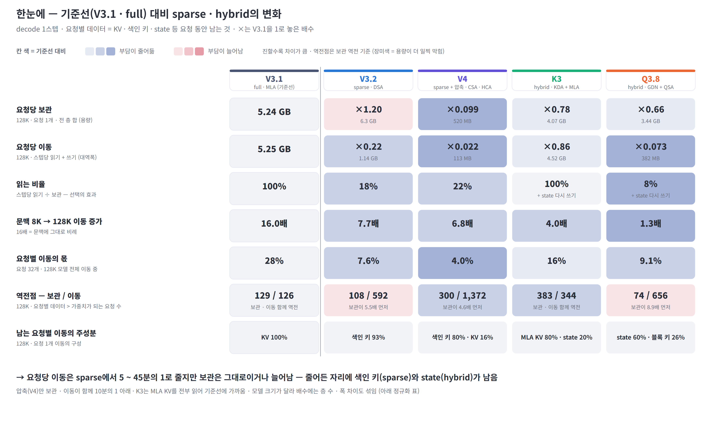
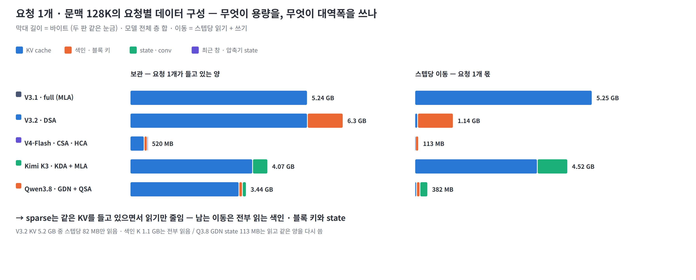
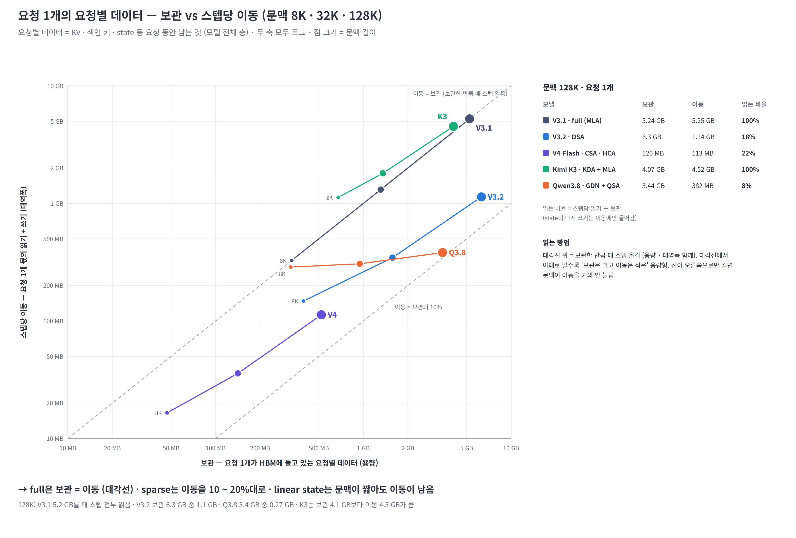
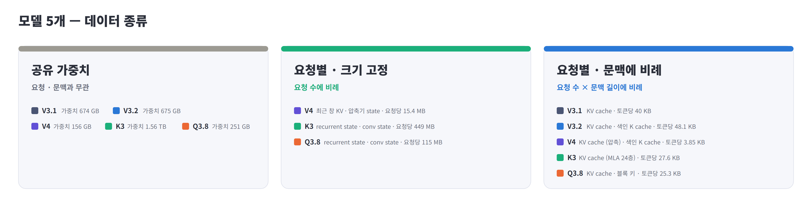
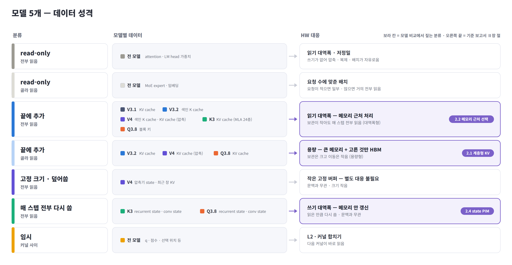

# Sparse · Hybrid attention 종합 — 데이터 성격으로 본 decode 1스텝

종합 보고서 · 2026.11 · 모델별 보고서 5개(기준선 full · sparse 2 · hybrid 2)를 같은 지표로 비교한 것

대상: [DeepSeek-V3.1](mla-v31-traits.md)(full · MLA, 기준선) · [DeepSeek-V3.2](dsa-v32-traits.md)(DSA) · [DeepSeek-V4-Flash](csa-v4flash-traits.md)(CSA · HCA) · [Kimi K3](kda-k3-traits.md)(KDA + MLA) · [Qwen3.8-Flash-Next](qsa-qwen38-traits.md)(GDN + QSA). 기준: H200 (HBM 4.8 TB/s · 141 GB · L2 50 MiB) · decode 1스텝 · 이론 하한 · 저장 형식 = 각 algo.yaml 기본값. 모델 크기가 서로 달라(가중치 156 GB ~ 1.56 TB) 절댓값보다 **배수 · 읽는 비율 · 역전점 · 문맥에 따른 기울기**를 비교함. V3.1과 V3.2는 attention만 다른 같은 모델이라 직접 비교가 가능한 유일한 쌍. 출발점: [기준 보고서](../../sparse-hybrid-hw-report-v2-refined.md) — 이 보고서는 그 결론을 모델 5개 · 요청 수 · 모델 전체로 넓혀 본 것(3절). 수치: [tools/traits.py](../tools/traits.py) · 그림: [make_synthesis_report.py](make_synthesis_report.py) · [make_criteria_figs.py](make_criteria_figs.py)

---

## 요약

### sparse는 이동만 · 압축은 보관과 이동을 함께 줄임 · linear는 문맥과 무관한 state를 남김 — 요청별 이동이 줄어든 만큼 모델 전체 이동은 다시 MoE 가중치가 정함

| 조건 | full (V3.1) | sparse (V3.2 · V4) | hybrid (K3 · Q3.8) |
|---|---|---|---|
| **요청이 적을 때** | 가중치가 이동의 거의 전부 | 같음 — 가중치 | 가중치, linear state가 조금 붙음 |
| **요청이 많을 때** | MoE 가중치, 문맥이 길면 KV가 빠르게 따라옴 | MoE 가중치 — 요청별 이동은 대부분 전부 읽는 색인 키 | MoE 가중치, 그다음 문맥과 무관한 state |
| **요청 · 문맥이 모두 클 때** | KV가 보관 · 이동 모두 가중치를 넘음 | 보관은 KV가 가중치를 넘지만(V3.2) 이동은 여전히 MoE · 압축(V4)은 둘 다 작음 | K3는 MLA KV가 보관 · 이동의 3분의 1, Q3.8은 보관은 KV · 이동 둘째는 state |

- **F1 sparse 선택:** 이동만 줄이고 보관은 그대로 → 용량이 대역폭보다 먼저 막힘
- **F2 sparse에 남는 대역폭:** 매 스텝 전부 읽는 색인 · 블록 키 — 문맥에 비례하고 키 형식에 민감
- **F3 linear state:** 문맥과 무관 · 요청 수에 비례 · 읽은 만큼 다시 씀 → 짧은 문맥 · 많은 요청에서 비중이 큼
- **F4 압축(V4):** 보관과 이동을 함께 줄이는 유일한 구조 — 남는 것은 색인과 가중치
- **F5 모델 전체:** 요청별 이동이 줄어 다시 MoE 가중치가 이동의 대부분 → attention 쪽 HW로 줄일 수 있는 몫에 상한
- **HW 방향:** 성격마다 대응이 다르고(2.1 · 2.2 · 2.3 · 2.4) 모델마다 걸리는 조합과 몫이 다름 — 맨 아래 '정리'의 대응 × 모델 표

---

## 1. 한눈에 — 기준선(V3.1) 대비 변화

### 요청당 이동은 sparse에서 5 ~ 45분의 1로 줄지만 보관은 그대로이거나 늘어남 — 줄어든 자리에 색인 키와 state가 남음

- **읽는 법:** 줄마다 지표 하나, 칸마다 모델 하나. V3.1 칸은 실제 값, 나머지는 V3.1 대비 배수 · 비율. 회청 = 부담 감소 · 장미 = 부담 증가, 진할수록 차이가 큼
- **보관과 이동이 따로 움직임:** V3.2는 보관 ×1.20 · 이동 ×0.22, Q3.8은 ×0.66 · ×0.073 — 선택(sparse)은 이동 줄만 진하게 칠함
- **압축(V4)만 두 줄 모두 진함:** 보관 ×0.099 · 이동 ×0.022 — 토큰당 요청별 보관 자체를 줄임
- **K3는 기준선에 가까움:** MLA KV를 전부 읽어 읽는 비율 100%, 여기에 state 다시 쓰기가 더해져 이동이 보관보다 큼
- **문맥에 따른 기울기:** 8K → 128K 이동이 V3.1 16배 → V3.2 7.7배 · V4 6.8배 · K3 4.0배 · Q3.8 1.3배 — Q3.8은 긴 문맥에서도 이동이 거의 안 늘어남(state와 고정 예산 KV)
- **역전점만 장미색이 나옴:** V3.2 · Q3.8은 보관 역전이 V3.1보다 이름 → 용량이 더 일찍 막힘 (F1)

#### 모델 크기를 덜어 낸 값

| 모델 | 층 수 | 가중치 | 토큰당 요청별 보관 (전 층 합) | 층당 평균 | 요청당 크기 고정 | 128K 요청 1개 보관 ÷ 가중치 |
|---|---|---|---|---|---|---|
| V3.1 | 61 (MLA 61) | 674 GB | 40.0 KB | 656 B | — | 0.78% |
| V3.2 | 61 (DSA 61) | 675 GB | 48.1 KB | 788 B | — | 0.93% |
| V4 | 43 (CSA 21 · HCA 20 · SWA 2) | 156 GB | 3.85 KB | 90 B | 15 MB | 0.33% |
| K3 | 93 (MLA 24 · KDA 69) | 1.56 TB | 27.6 KB | 297 B (MLA 층만 1,152 B) | 449 MB | 0.26% |
| Q3.8 | 48 (QSA 12 · GDN 36) | 251 GB | 25.3 KB | 528 B (QSA 층만 2,112 B) | 115 MB | 1.37% |

- **배수에 섞인 크기 차이:** K3 · Q3.8의 요청당 보관이 V3.1보다 작은 것은 KV 층 수가 24 · 12개뿐이라서 — KV를 가진 층만 보면 층당 1,152 · 2,112 B로 V3.1(656 B)보다 큼(BF16 형식)
- **크기와 무관한 비교:** 마지막 열(요청 1개가 가중치 대비 차지하는 몫) = 1 ÷ 보관 역전점. Q3.8이 가장 큼 → 가중치가 작아 요청별 데이터가 상대적으로 무거움

---

## 2. 특징 5가지 — 무엇이 다른가 → 특성 → HW 요구 → 대응

> **읽는 법:** 블록마다 같은 순서 — 비교 그림 → 무엇이 다른가 → 특성(성격 · 커지는 조건) → HW 요구(수치) → 대응(기준 보고서 Ⅱ장 절)

### F1. sparse 선택은 이동만 줄이고 보관은 그대로 — 용량이 먼저 막힘

- **무엇이 다른가:** V3.1은 128K에서 보관 · 이동이 요청 129 · 126개로 함께 역전 → V3.2는 108 · 592개, Q3.8은 74 · 656개 — 보관 역전이 이동 역전보다 5.5 ~ 8.9배 빨리 옴
- **특성:** 끝에 추가 · 골라 읽는 KV — 128K 읽는 비율 V3.2 18% · V4 22% · Q3.8 8%. 고르는 양이 요청당 고정 예산(2,048토큰 · 512엔트리)이라 문맥이 길수록 비율이 떨어짐
- **HW 요구 — 용량:** 요청 256개 · 128K에서 골라 읽는 KV가 모델 보관의 59%(V3.2) · 73%(Q3.8)인데 이동은 2% · 4%
- **대응 → 계층형 KV (2.1):** 전체 KV는 큰 메모리, 고를 KV만 HBM. 보관 역전 ~ 이동 역전 사이 간격이 아래 계층과 주고받을 대역폭 여유. 연속 스텝의 선택 겹침(적중률)이 효과를 정함

| 모델 (배치 가정) | 요청 1개 | 요청 32개 · 128K | 요청 256개 · 8K | 요청 256개 · 32K | 요청 256개 · 128K |
|---|---|---|---|---|---|
| V3.1 (8장) | 5장 | 6장 | 6장 | 8장 | **15장** |
| V3.2 (8장) | 5장 | 7장 | 6장 | 8장 | **17장** |
| V4-Flash (2장) | 2장 | 2장 | 2장 | 2장 | **3장** |
| Kimi K3 (16장) | 12장 | 12장 | 13장 | 14장 | **19장** |
| Qwen3.8 (2장) | 2장 | **3장** | **3장** | **4장** | **9장** |

H200 141 GB에 보관 합계를 균등히 나눈 최소 장수. 굵게 = 배치 가정 장수 초과. GPU별 배치(TP · EP · DP) · 복제 · 작업 공간은 반영 안 함

- **용량 판정이 먼저:** 요청 256개 · 128K는 다섯 모델 모두 배치 가정 장수를 넘음 → 이 조건의 이동 비교는 바이트 비교로만 의미가 있음
- **V3.2는 V3.1보다 먼저 넘음:** 색인 키만큼 보관이 큼. Q3.8은 가중치가 작아(251 GB) 요청 32개 · 128K부터 넘음

### F2. sparse에 남는 대역폭 부담은 전부 읽는 색인 · 블록 키

- **무엇이 다른가:** 128K 요청당 이동 중 색인 키가 V3.2 93% · V4 80%, Q3.8은 블록 키 26%(state 다음). 골라 읽는 KV 이동은 V3.2 5.2 GB 중 82 MB · Q3.8 3.2 GB 중 50 MB
- **특성:** 끝에 추가 · 전부 읽음 — 토큰당 0.7 ~ 8 KB, 문맥에 비례해 매 스텝 전부 읽음 → 8K → 128K 이동 증가가 V3.2 7.7배 · V4 6.8배로 여전히 문맥을 따라감
- **HW 요구 — 대역폭 + 메모리 쪽 연산:** 요청 256개 · 128K 모델 이동의 27%(V3.2) · 13%(V4) · 7%(Q3.8). 키 1 B당 연산이 DSA · CSA 약 124 FLOP(FP8) vs QSA 약 4 FLOP → 메모리 근처로 옮길 때 필요한 연산기 크기가 약 30배 차이
- **형식에 민감:** V4 색인 키가 FP8 132 B → MXFP4 68 B면 색인 이동이 약 절반 — 배포 형식이 결론을 바꿈
- **대응 → 메모리 근처 선택 (2.2) · 색인 연산 · top-k (2.3):** 색인 읽기를 메모리 근처에서 하고 칩에는 선택 위치만. 학습된 색인을 그대로 실행하는 HW는 기준 보고서 검색 범위에서 미확인

### F3. linear state는 문맥과 무관 · 요청 수에 비례 · 읽은 만큼 다시 씀

| state의 모델 이동 비중 | 8K | 32K | 128K |
|---|---|---|---|
| K3 · 요청 1개 | 0.7% | 0.6% | 0.6% |
| K3 · 요청 32개 | 3.7% | 3.6% | 3.2% |
| K3 · 요청 256개 | **12.5%** | 11.4% | 8.5% |
| Q3.8 · 요청 1개 | 1.7% | 1.7% | 1.7% |
| Q3.8 · 요청 32개 | 5.6% | 5.6% | 5.5% |
| Q3.8 · 요청 256개 | **18.3%** | 18.0% | 17.0% |

- **무엇이 다른가:** 요청별 데이터에 '크기 고정' 칸이 새로 생김 — 요청당 K3 449 MB · Q3.8 115 MB(state 434 · 113 MB + conv) (V4의 창 · 압축기 15 MB는 작아 무시 가능)
- **특성:** 매 스텝 전부 다시 씀 — 읽기 = 쓰기, 그래서 이동 비중이 보관 비중의 약 2 ~ 6.5배(요청 256개 · 128K: K3 4.4% → 8.5% · Q3.8 2.6% → 17%)
- **HW 요구 — 쓰기 대역폭 + 메모리 쪽 갱신:** 요청 수에 비례해 커지고 문맥이 짧을수록 비중이 큼 → 요청 256개 · 8K에서 K3 12.5% · Q3.8 18%
- **대응 → state 갱신 PIM (2.4):** 메모리 안에서 갱신해 왕복 제거. 긴 문맥 대응(2.1 · 2.2)과 겹치지 않는 별도 축. 감쇠 · rank-1 갱신을 메모리 쪽이 감당하는지가 이득의 전제

### F4. 압축(V4)은 보관과 이동을 함께 줄임

- **무엇이 다른가:** 128K 요청당 보관 ×0.099 · 이동 ×0.022(V3.1 대비) — 그림에서 선 전체가 왼쪽 아래로 이동
- **특성:** CSA는 4토큰, HCA는 128토큰을 KV 1줄로 압축 → 토큰당 요청별 보관 3.85 KB(V3.1 40 KB). 남는 요청별 이동의 80%는 색인 키
- **HW 요구:** 역전점이 보관 300 · 이동 1,372개로 뒤로 → 요청 32개 · 128K에서 요청별 이동은 모델 이동의 4.0%
- **대응:** 계층형 KV의 우선순위가 낮아짐 — 모델 구조가 HW 대응 일부를 대신한 사례. 남는 것은 색인(2.2 · 2.3)과 가중치

### F5. 모델 전체로 보면 MoE 가중치가 다시 이동의 대부분

- **무엇이 다른가:** 요청 32개 · 128K 모델 이동 중 요청별 몫이 V3.1 28% → V3.2 7.6% · V4 4.0% · Q3.8 9.1% · K3 16%
- **특성:** read-only · 골라 읽는 MoE — 요청이 늘면 건드리는 expert가 늘어 사실상 전부 읽음(균등 라우팅 가정)
- **HW 요구 — attention 쪽 이득의 상한:** attention 쪽 대응으로 줄일 수 있는 이동 ≤ 요청별 몫 → 요청 32개 · 128K에서 4 ~ 16%, 요청 256개 · 128K에서 16 ~ 43%
- **대응:** 가중치 대역폭 · 요청 수에 맞춘 expert 배치 · 이종 가속기 · PD 분리 (2.5, 일부는 기준 보고서 범위 밖). 실제 라우팅 trace로 MoE 읽기 범위 확인 필요

---

## 3. 출발 보고서 대비 — 무엇을 더하고 바꿨나

### 출발 보고서의 결론은 그대로 — 범위를 모델 5개 · 요청 수 · 모델 전체로 넓히니 '상한'과 '먼저 막히는 순서'가 새로 보임

| 출발 보고서의 결론 (절) | 이번 분석 | 달라진 점 |
|---|---|---|
| Sparse + Hybrid 결합이면 이동량 3% · 보관량 27% (1.3) | attention 요청별 데이터끼리의 비교. 모델 전체로 보면 요청 32개 · 128K에서 요청별 이동이 전체의 4 ~ 16%, 나머지는 가중치 | attention 쪽 HW 이득의 **상한**이 생김 (F5) |
| Sparse는 전체 KV를 보관해 용량 부담 유지 (1.3 · 2.1) | 보관 역전이 이동 역전보다 5.5 ~ 8.9배 빨리 옴 (V3.2 108 vs 592 · Q3.8 74 vs 656) | 용량이 먼저 막힌다는 **순서를 정량화** → 계층형 KV가 첫 대응 (F1) |
| 색인 키 읽기는 길이에 비례, 128K에서 84% (1.4) | 요청당 이동 중 색인 키 V3.2 93%(KV FP8 656 B 기준) · V4 80% | 색인 키 **형식**(FP8 132 B / MXFP4 68 B)이 대역폭 결론을 바꿈 (F2) |
| state 왕복 약 230 MB, 32K에서 이동의 75% (1.6) | 문맥과 무관 · 요청 수에 비례 → 요청 256개 · 8K에서 모델 이동의 12.5%(K3) · 18%(Q3.8) | **요청 수 축**을 더하고 모델 전체 기준 비중으로 (F3) |
| 압축형 V4는 Full 대비 읽기 1.5% · 보관 12% (1.3 주석) | 같은 FP8 형식의 V3.1 대비 요청당 이동 ×0.022 · 보관 ×0.099 · 역전점 300 / 1,372개 | 압축이 용량과 대역폭을 **함께** 줄이는 유일한 구조 (F4) |
| KV는 용량형, 색인 키 · state는 반복 접근 (1.7) | 세 기준(종류 · 수명 · 성격)으로 모델 5개를 같은 칸에 놓음 | 모델마다 걸리는 칸의 **조합**이 다름 (4절 · 정리) |
| — | 요청 256개 · 128K는 다섯 모델 모두 배치 가정 장수 초과 | 이동을 비교하기 전에 **HBM에 들어가는지부터** 판정 (F1 표) |

---

## 4. 데이터를 나누는 세 가지 기준 — 모델 5개를 같은 칸에

### 모델별 보고서와 같은 세 기준 — 칸마다 어느 모델의 어떤 데이터가 있는지를 나란히 놓으면 sparse · linear가 무엇을 바꿨는지 보임

| 기준 | 묻는 것 | 나누는 값 | 이걸로 알 수 있는 것 |
|---|---|---|---|
| **데이터 종류** | 무엇이 무엇에 비례해 커지나 | 공유 가중치 · 요청별 크기 고정 · 요청별 문맥 비례 | 요청 수 · 문맥 길이를 바꿀 때 무엇이 용량 · 대역폭을 차지하는지 |
| **수명** | 얼마나 오래 남고, 언제 다시 읽히나 | 서비스 내내 · 요청 동안 · 스텝 안 · 커널 안 | **어디에 둘 수 있는지.** HBM에 남아야 하는 몫과 칩 안에서 끝낼 수 있는 몫 |
| **데이터 성격** | 어떻게 쓰고 읽나 | 쓰기 방식 다섯 × 읽기 방식 둘 | **어떤 메모리 특성이 필요한지.** 용량 · 대역폭 · 쓰기 대역폭 · 칩 안 처리 |

- **그림 읽는 법 (기준 1 ~ 3 공통):** 왼쪽 분류 · 가운데 모델별 데이터 · 오른쪽 그 분류에 맞는 HW 대응(끝의 알약 = 기준 보고서 Ⅱ장 절). 보라 칸 = 모델 비교에서 짚는 분류 → 각 소절의 '이걸로 알 수 있는 것 → HW'와 하나씩 연결

### 기준 1. 데이터 종류 — 무엇이 무엇에 비례해 커지나

- **나누는 법:** 공유 가중치(요청 · 문맥과 무관) · 요청별 크기 고정(요청 수에 비례) · 요청별 문맥 비례(요청 수 × 문맥 길이)
- **모델 비교:** full · DSA는 요청별 데이터가 전부 '문맥 비례'. 토큰당 바이트는 V3.2 48 KB > V3.1 40 KB > K3 28 KB > Q3.8 25 KB > V4 3.9 KB. 크기 고정 데이터는 K3(state 449 MB) · Q3.8(115 MB) · V4(창 · 압축기 15 MB)에만 있음
- **이걸로 알 수 있는 것 → HW:**
  - **요청별 · 문맥 비례 → 큰 메모리 계층 · KV 압축 (2.1):** sparse 선택(DSA · QSA)은 토큰당 바이트를 줄이지 않음 → 용량 대응이 그대로 필요. 토큰당 바이트를 줄이는 것은 압축(V4)과 linear 층(K3 · Q3.8)
  - **요청별 · 크기 고정 → 요청 수만큼 용량 · 쓰기 대역폭 (2.4):** K3 · Q3.8의 state는 짧은 문맥 · 많은 요청에서도 부담. V4의 창 · 압축기 버퍼는 작아 대응 불필요

### 기준 2. 수명 — 얼마나 오래 남고, 언제 다시 읽히나

- **나누는 법:** 다시 읽히기까지의 시간 — 한 스텝 뒤(서비스 내내 · 요청 동안)는 그사이 모델 전체가 지나가 칩 안에 못 남고, 같은 스텝 · 같은 커널 안은 칩 안에서 끝낼 수 있음
- **모델 비교:** 다섯 모델 모두 HBM 이동은 위 두 줄이 거의 전부. 달라지는 것은 '요청 동안' 줄에 무엇이 있나 — full은 KV 하나, sparse는 KV + 색인 키, hybrid는 KV + state
- **이걸로 알 수 있는 것 → HW:**
  - **요청 동안 → HBM 또는 그 아래 큰 메모리 (2.1):** 다섯 모델 모두 HBM 이동은 서비스 내내 · 요청 동안이 거의 전부 → sparse · linear의 HW 문제는 칩 안 용량보다 HBM과 그 아래 계층의 문제
  - SRAM · 커널 합치기로 줄일 몫(스텝 안 임시값)은 모델 전체 이동의 3% 이하. 단 스텝 안 · 커널 안 값은 그린 층 1개만 세어 모델 간 비교는 정성적

### 기준 3. 데이터 성격 — 어떻게 쓰고 읽나

- **나누는 법:** 쓰기 방식 다섯(read-only / 끝에 추가 / 고정 크기 · 덮어씀 / 매 스텝 전부 다시 씀 / 임시) × 읽기 방식 둘(전부 읽음 / 골라 읽음). 골라 읽음 = 요청 1개 · 128K에서 스텝당 읽기 < 보관의 90%
- **모델 비교:** full의 KV는 '끝에 추가 · 전부 읽음' 한 칸. sparse는 이를 '골라 읽음(큰 KV) + 전부 읽음(작은 색인 · 블록 키)' 두 칸으로 쪼갬. linear는 '매 스텝 전부 다시 씀(state)' 칸을 새로 씀. V4는 작은 '덮어씀' 칸이 추가
- **이걸로 알 수 있는 것 → HW:**
  - **끝에 추가 · 골라 읽음 → 용량 (2.1):** V3.2 · V4 · Q3.8의 큰 KV
  - **끝에 추가 · 전부 읽음 → 메모리 근처 선택 (2.2):** sparse의 색인 · 블록 키. V3.1 · K3의 KV도 이 칸이지만 커서 용량 + 대역폭을 함께 (2.5)
  - **매 스텝 전부 다시 씀 → 메모리 안 갱신 (2.4):** K3 · Q3.8의 state
  - 대응 수: full 하나(용량 + 대역폭) · sparse 둘(용량형 · 대역폭형) · hybrid 셋까지(Q3.8)

### 그래프 읽는 법

- **조건:** 요청 1 · 32 · 256개 × 문맥 8K · 32K · 128K. 요청별 지표는 요청 1개 기준(요청 수와 무관한 값)
- **이동:** 스텝당 HBM 읽기 + 쓰기. state처럼 다시 쓰는 데이터는 보관보다 이동이 큼
- **용량 초과:** 요청 256개 · 128K처럼 HBM에 안 들어가는 조건의 이동량은 같은 입력 조건의 바이트 비교로만 읽음

---

---

## 정리 — 데이터 특성 → 인사이트 → HW

### sparse · hybrid가 바꾼 것은 '요청별 데이터의 성격' — 성격마다 대응이 다르고, 모델마다 걸리는 조합과 겨냥할 수 있는 몫이 다름

- **모델 5개의 특성:** full(V3.1)은 KV 한 칸이 용량과 대역폭을 함께 씀 · sparse(V3.2 · Q3.8의 QSA)는 그 칸을 '골라 읽는 큰 KV + 전부 읽는 작은 키'로 쪼갬 · 압축(V4)은 칸 자체를 작게 함 · linear(K3 · Q3.8의 GDN)는 문맥과 무관한 '다시 쓰는 state' 칸을 새로 씀
- **요청 수 · 문맥이 커질수록:** 보관은 골라 읽는 KV(sparse)와 전부 읽는 KV(full · K3)가, 이동은 MoE 가중치 다음으로 색인 키(sparse)와 state(hybrid)가 차지

| 데이터 특성 | 해당 모델 | 근거 (조건 · 수치) | 인사이트 | HW로 연결 | 기준 보고서 Ⅱ장 |
|---|---|---|---|---|---|
| 끝에 추가 · 전부 읽는 KV | V3.1 · K3(MLA 24층) | 128K 읽는 비율 100% · V3.1 보관 · 이동 역전 129 · 126개 | 용량과 대역폭이 같이 커짐 | HBM 용량 · 대역폭, KV 압축 · 저정밀 | 2.5 |
| 끝에 추가 · 골라 읽는 KV | V3.2 · V4 · Q3.8 | 128K 읽는 비율 8 ~ 22% · 보관 역전이 이동 역전보다 5.5 ~ 8.9배 빠름 | 이동은 줄지만 용량이 먼저 막힘 | 계층형 KV | 2.1 |
| 끝에 추가 · 전부 읽는 색인 · 블록 키 | V3.2 · V4 · Q3.8 | 요청 256개 · 128K 모델 이동: V3.2 27% · V4 13% · Q3.8 7% | sparse의 요청별 이동 중 가장 큰 몫 · 형식에 민감 | 메모리 근처 선택 · 색인 연산 · top-k | 2.2 · 2.3 |
| 매 스텝 전부 다시 쓰는 state | K3 · Q3.8 | state 요청당 434 · 113 MB · 요청 256개 · 8K 이동 12.5% · 18% | 문맥과 무관 · 요청 수에 비례 · 짧은 문맥에서도 남음 | state PIM | 2.4 |
| read-only · 골라 읽는 MoE | 전 모델 | 요청 32개 · 128K: sparse · hybrid 이동의 75 ~ 88% | 요청별 이동이 줄어 다시 이동의 대부분 | 가중치 대역폭 · 요청 수에 맞춘 배치 | 2.5 · 범위 밖 |

### 대응 × 모델 — 각 대응이 겨냥할 수 있는 몫

| 대응 (기준 보고서 Ⅱ장) | 겨냥하는 데이터 · 지표 | V3.1 | V3.2 | V4 | K3 | Q3.8 |
|---|---|---|---|---|---|---|
| **2.1 계층형 KV** | 골라 읽는 KV · 보관 비중 | — (KV를 전부 읽음) | 19% → **59%** | 7.5% → 36% | — (MLA KV 전부 읽음) | 29% → **73%** |
| **2.2 메모리 근처 선택** | 전부 읽는 색인 · 블록 키 · 이동 비중 | — | 7.1% → **27%** | 3.2% → 13% | — | 2.4% → 7.4% |
| **2.3 색인 연산 · top-k** | 같은 키 · 키 1 B당 연산 | — | 약 124 FLOP | 약 124 FLOP (FP8) | — | 약 4 FLOP |
| **2.4 state PIM** | 다시 쓰는 state · 이동 비중 | — | — | — (창 · 압축기 0.5% 이하) | 3.2% → 8.5% (8K 12.5%) | 5.5% → **17%** (8K 18%) |
| **KV 압축 · 저정밀** | 전부 읽는 KV · 이동 비중 | 28% → **66%** | — | (이미 압축) | 13% → 34% | — |
| **가중치 대역폭 · 배치** (2.5 · 범위 밖) | 골라 읽는 MoE · 이동 비중 | 69% → 32% | 88% → 66% | 88% → **79%** | 75% → 54% | 85% → 69% |

칸 = 그 대응이 겨냥하는 데이터가 모델 전체 보관 또는 이동에서 차지하는 몫, 요청 32개 · 128K → 요청 256개 · 128K. 그 대응으로 줄일 수 있는 몫의 상한으로 읽음(실제 이득은 적중률 · 연산 능력 · 전송 비용에 달림). 용량 대응은 보관, 대역폭 대응은 이동 비중. 요청 256개 · 128K는 다섯 모델 모두 배치 가정 장수 초과(F1 표)

- **요청이 많을수록 attention 쪽 몫이 커짐:** 요청 32개 → 256개에서 2.1 · 2.2 · 2.4 칸이 모두 약 2.5 ~ 5배 — attention 쪽 대응은 많은 요청 · 긴 문맥 서빙에서 의미가 커짐
- **한 모델에 걸리는 대응 수:** V3.1 2개(KV 압축 · 가중치) → K3 3개 → V3.2 · V4 4개 → Q3.8 5개. 구조가 섞일수록 대응도 섞임 → 층 종류별로 장치를 나눌지(2.5), 한 장치에 묶을지는 각 대응의 비용 비교가 필요
- **가장 큰 단일 몫:** 용량은 Q3.8 · V3.2의 골라 읽는 KV(2.1), 대역폭은 V3.1의 KV(압축)와 V3.2의 색인 키(2.2) · 그 밖에는 MoE 가중치
- **확인할 것:** 실제 라우팅 trace로 MoE 읽기 범위, 연속 스텝의 KV 선택 겹침(계층형 KV 적중률), 배포 엔진의 색인 키 · state 형식, GPU별 배치에서 가장 바쁜 GPU의 이동

---

## 부록 — 비교의 한계

- **모델 크기 · 층 수가 다름:** 가중치 156 GB(V4) ~ 1.56 TB(K3), 층 43 ~ 93개. 절댓값 대신 읽는 비율 · 역전점 · 기울기를 비교. attention만 다른 직접 비교는 V3.1 ↔ V3.2뿐
- **형식:** V3.1 KV 656 B는 V3.2와 같은 형식으로 맞춘 대조 조건(BF16 1,152 B면 요청별 데이터가 1.76배). V4 KV 584 B · 색인 키 132 B(vLLM), K3 MLA KV BF16 1,152 B · state FP32, Q3.8 KV BF16 2,048 B · 블록 키 BF16 256 B · state FP32
- **MoE:** 균등 · 독립 라우팅 기댓값. 쏠리면 expert 수가 k개까지 줄고, 요청마다 다 다르면 min(E, 요청 수 × k)개 — 모델별 범위는 각 보고서 부록
- **스텝 안 · 커널 안 값:** 그린 층 1개만 셈(V3.1 · V3.2는 전 층이 같은 구조라 전부). 커널 안 값은 커널별 논리 크기 합 — 동시 점유량 아님
- **V3.2 split-KV 부분 출력:** H200 스케줄이 확인되지 않아 모델 비교에서 뺌 (커널별 표에는 남김)
- **검증:** 참조 구현 검증은 V3.2(DSA)와 Qwen3.6(GDN)만. 나머지는 config · 체크포인트 shape · 공개 코드로 세운 식이며 ChatGPT 검토 의견을 반영함
- **용량 초과 조건:** 이동량은 같은 입력 조건의 바이트 비교. 시간 비교는 GPU별 배치가 필요
- **제외:** MTP · 잔차 · 정규화 값 · GPU 간 통신 · 가중치 복제(DP attention) · Qwen3.8 n-gram 표(host 102 GB)
