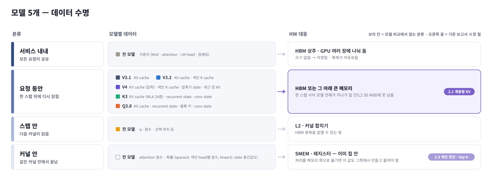
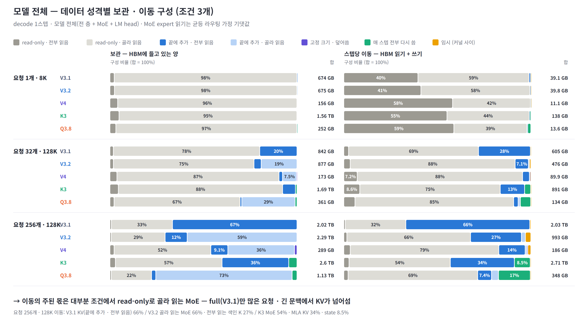
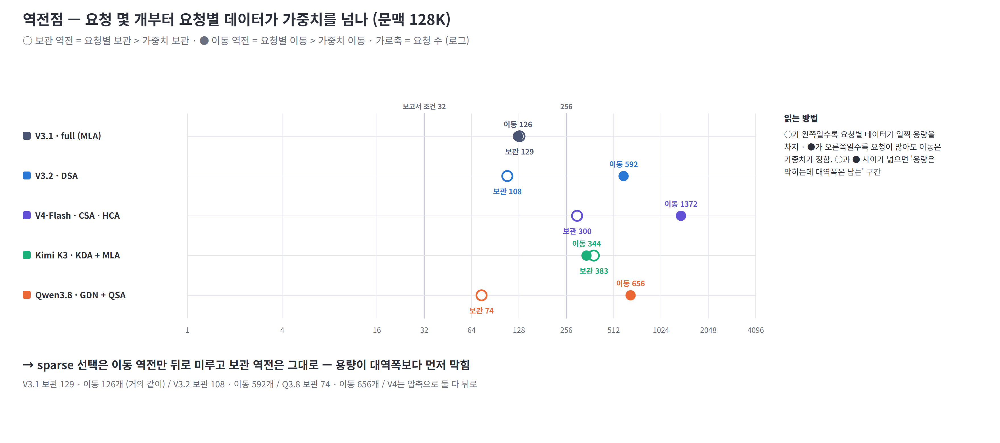
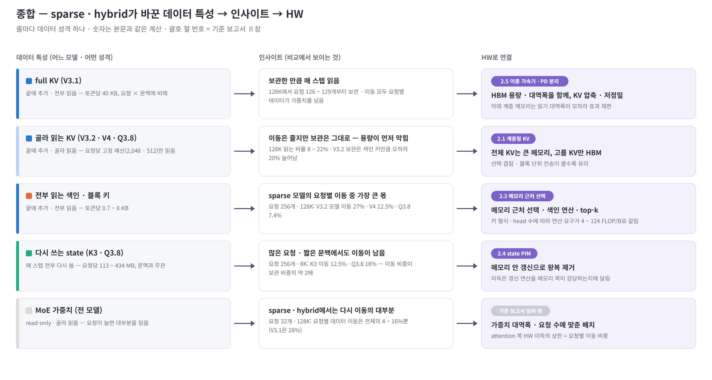

# Sparse · Hybrid attention 종합 — 데이터 성격으로 본 decode 1스텝

종합 보고서 · 2026.11 · 모델별 보고서 5개(기준선 full · sparse 2 · hybrid 2)를 같은 지표로 비교한 것

대상: [DeepSeek-V3.1](mla-v31-traits.md)(full · MLA, 기준선) · [DeepSeek-V3.2](dsa-v32-traits.md)(DSA) · [DeepSeek-V4-Flash](csa-v4flash-traits.md)(CSA · HCA) · [Kimi K3](kda-k3-traits.md)(KDA + MLA) · [Qwen3.8-Flash-Next](qsa-qwen38-traits.md)(GDN + QSA). 기준: H200 (HBM 4.8 TB/s · 141 GB · L2 50 MiB) · decode 1스텝 · 이론 하한 · 저장 형식 = 각 algo.yaml 기본값. 모델 크기가 서로 달라(가중치 156 GB ~ 1.56 TB) 절댓값보다 **읽는 비율 · 역전점 · 문맥에 따른 기울기**를 비교함. V3.1과 V3.2는 attention만 다른 같은 모델이라 직접 비교가 가능한 유일한 쌍. 수치: [tools/traits.py](../tools/traits.py) · 그림: [make_synthesis_report.py](make_synthesis_report.py) · [make_criteria_figs.py](make_criteria_figs.py) · HW 대응: [기준 보고서](../../sparse-hybrid-hw-report-v2-refined.md) Ⅱ장

---

## 요약

### sparse는 KV를 '골라 읽어' 이동만 줄이고 보관은 그대로 · 압축(V4)은 둘 다 줄임 · linear는 문맥과 무관한 '매 스텝 다시 쓰는 state'를 남김 — 요청별 이동이 줄어 이동은 다시 MoE 가중치가 정함

| 조건 | full (V3.1) | sparse (V3.2 · V4) | hybrid (K3 · Q3.8) |
|---|---|---|---|
| **요청이 적을 때** | 가중치가 이동의 거의 전부 | 같음 — 가중치 | 가중치, linear state가 조금 붙음 |
| **요청이 많을 때** | MoE 가중치, 문맥이 길면 KV가 빠르게 따라옴 | MoE 가중치 — 요청별 이동은 대부분 전부 읽는 색인 키 | MoE 가중치, 그다음 문맥과 무관한 state |
| **요청 · 문맥이 모두 클 때** | KV가 보관 · 이동 모두 가중치를 넘음 | 보관은 KV가 가중치를 넘지만(V3.2) 이동은 여전히 MoE · 압축(V4)은 둘 다 작음 | K3는 MLA KV가 보관 · 이동의 3분의 1, Q3.8은 보관은 KV · 이동 둘째는 state |

- **골라 읽으면 대역폭 요구는 문맥과 거의 무관해지지만 용량 요구는 그대로:** sparse 모델은 용량이 대역폭보다 먼저 막힘
- **sparse의 남은 대역폭 부담은 전부 읽는 색인 · 블록 키:** 작아도 문맥에 비례하고 매 스텝 전부 읽힘
- **linear state는 성격이 다른 부담:** 문맥과 무관, 요청 수에 비례, 읽은 만큼 다시 씀 — 짧은 문맥에서도 남음
- **요청별 이동이 줄어든 만큼 MoE 가중치가 다시 이동의 대부분:** attention 쪽 HW로 줄일 수 있는 몫의 상한이 작아짐
- **많은 요청 · 긴 문맥은 모든 모델이 배치 가정 장수를 넘음:** HBM에 들어가는지부터 판정해야 이동 비교가 의미를 가짐
- **HW 방향:** 성격마다 대응이 다르고(2.1 · 2.2 · 2.3 · 2.4), 모델마다 걸리는 성격의 조합이 다름 — 맨 아래 '정리'의 대응 × 모델 표

---

## 비교 지표

### 크기가 다른 모델을 같은 눈금으로 보려고 '요청 1개' · '비율' · '역전점'으로 비교

| 지표 | 묻는 것 | 계산 | 이걸로 알 수 있는 것 | 그림 |
|---|---|---|---|---|
| **요청당 보관 · 이동** | 요청 하나가 얼마나 들고 얼마나 옮기나 | 요청 1개의 요청별 데이터(KV · 색인 키 · state 등), 전 층 합 | 용량형인지 대역폭형인지, 문맥이 길어질 때의 기울기 | 1.1 |
| **읽는 비율** | 들고 있는 것 중 매 스텝 몇 %를 읽나 | 스텝당 읽기 ÷ 보관 | 모델 크기와 무관한 '선택'의 효과 | 1.1 |
| **요청별 구성** | 무엇이 용량을, 무엇이 대역폭을 쓰나 | 요청 1개 · 128K를 종류 묶음별로 | sparse · linear 뒤에 남는 부담의 출처 | 1.2 |
| **성격 구성** | 모델 전체 이동을 무엇이 정하나 | 모델 전체를 성격별 비중으로 | attention 쪽 HW 이득의 상한 | 2 |
| **역전점** | 요청 몇 개부터 요청별 데이터가 가중치를 넘나 | 문맥 128K, 보관 · 이동 따로 | 용량과 대역폭 중 무엇이 먼저 막히나 (크기 정규화된 비교) | 3 |
| **최소 장수** | HBM에 들어가나 | 보관 ÷ H200 141 GB | 이동 비교가 유효한 조건의 범위 | 3 |

---

## 데이터를 나누는 세 가지 기준 — 모델 5개를 같은 칸에

### 모델별 보고서와 같은 세 기준 — 칸마다 어느 모델의 어떤 데이터가 있는지를 나란히 놓으면 sparse · linear가 무엇을 바꿨는지 보임

| 기준 | 묻는 것 | 나누는 값 | 이걸로 알 수 있는 것 |
|---|---|---|---|
| **데이터 종류** | 무엇이 무엇에 비례해 커지나 | 공유 가중치 · 요청별 크기 고정 · 요청별 문맥 비례 | 요청 수 · 문맥 길이를 바꿀 때 무엇이 용량 · 대역폭을 차지하는지 |
| **수명** | 얼마나 오래 남고, 언제 다시 읽히나 | 서비스 내내 · 요청 동안 · 스텝 안 · 커널 안 | **어디에 둘 수 있는지.** HBM에 남아야 하는 몫과 칩 안에서 끝낼 수 있는 몫 |
| **데이터 성격** | 어떻게 쓰고 읽나 | 쓰기 방식 다섯 × 읽기 방식 둘 | **어떤 메모리 특성이 필요한지.** 용량 · 대역폭 · 쓰기 대역폭 · 칩 안 처리 |

- **그림 읽는 법 (기준 1 ~ 3 공통):** 왼쪽 분류 · 가운데 모델별 데이터 · 오른쪽 그 분류에 맞는 HW 대응(끝의 알약 = 기준 보고서 Ⅱ장 절). 보라 칸 = 모델 비교에서 짚는 분류 → 각 소절의 '이걸로 알 수 있는 것 → HW'와 하나씩 연결

### 기준 1. 데이터 종류 — 무엇이 무엇에 비례해 커지나

- **나누는 법:** 공유 가중치(요청 · 문맥과 무관) · 요청별 크기 고정(요청 수에 비례) · 요청별 문맥 비례(요청 수 × 문맥 길이)
- **모델 비교:** full · DSA는 요청별 데이터가 전부 '문맥 비례'. 토큰당 바이트는 V3.2 48 KB > V3.1 40 KB > K3 28 KB > Q3.8 25 KB > V4 3.9 KB. 크기 고정 데이터는 K3(state 449 MB) · Q3.8(115 MB) · V4(창 · 압축기 15 MB)에만 있음
- **이걸로 알 수 있는 것 → HW:**
  - **요청별 · 문맥 비례 → 큰 메모리 계층 · KV 압축 (2.1):** sparse 선택(DSA · QSA)은 토큰당 바이트를 줄이지 않음 → 용량 대응이 그대로 필요. 토큰당 바이트를 줄이는 것은 압축(V4)과 linear 층(K3 · Q3.8)
  - **요청별 · 크기 고정 → 요청 수만큼 용량 · 쓰기 대역폭 (2.4):** K3 · Q3.8의 state는 짧은 문맥 · 많은 요청에서도 부담. V4의 창 · 압축기 버퍼는 작아 대응 불필요

### 기준 2. 수명 — 얼마나 오래 남고, 언제 다시 읽히나

- **나누는 법:** 다시 읽히기까지의 시간 — 한 스텝 뒤(서비스 내내 · 요청 동안)는 그사이 모델 전체가 지나가 칩 안에 못 남고, 같은 스텝 · 같은 커널 안은 칩 안에서 끝낼 수 있음
- **모델 비교:** 다섯 모델 모두 HBM 이동은 위 두 줄이 거의 전부. 달라지는 것은 '요청 동안' 줄에 무엇이 있나 — full은 KV 하나, sparse는 KV + 색인 키, hybrid는 KV + state
- **이걸로 알 수 있는 것 → HW:**
  - **요청 동안 → HBM 또는 그 아래 큰 메모리 (2.1):** 다섯 모델 모두 HBM 이동은 서비스 내내 · 요청 동안이 거의 전부 → sparse · linear의 HW 문제는 칩 안 용량보다 HBM과 그 아래 계층의 문제
  - SRAM · 커널 합치기로 줄일 몫(스텝 안 임시값)은 모델 전체 이동의 3% 이하. 단 스텝 안 · 커널 안 값은 그린 층 1개만 세어 모델 간 비교는 정성적

### 기준 3. 데이터 성격 — 어떻게 쓰고 읽나

- **나누는 법:** 쓰기 방식 다섯(read-only / 끝에 추가 / 고정 크기 · 덮어씀 / 매 스텝 전부 다시 씀 / 임시) × 읽기 방식 둘(전부 읽음 / 골라 읽음). 골라 읽음 = 요청 1개 · 128K에서 스텝당 읽기 < 보관의 90%
- **모델 비교:** full의 KV는 '끝에 추가 · 전부 읽음' 한 칸. sparse는 이를 '골라 읽음(큰 KV) + 전부 읽음(작은 색인 · 블록 키)' 두 칸으로 쪼갬. linear는 '매 스텝 전부 다시 씀(state)' 칸을 새로 씀. V4는 작은 '덮어씀' 칸이 추가
- **이걸로 알 수 있는 것 → HW:**
  - **끝에 추가 · 골라 읽음 → 용량 (2.1):** V3.2 · V4 · Q3.8의 큰 KV
  - **끝에 추가 · 전부 읽음 → 메모리 근처 선택 (2.2):** sparse의 색인 · 블록 키. V3.1 · K3의 KV도 이 칸이지만 커서 용량 + 대역폭을 함께 (2.5)
  - **매 스텝 전부 다시 씀 → 메모리 안 갱신 (2.4):** K3 · Q3.8의 state
  - 대응 수: full 하나(용량 + 대역폭) · sparse 둘(용량형 · 대역폭형) · hybrid 셋까지(Q3.8)

### 그래프 읽는 법

- **조건:** 요청 1 · 32 · 256개 × 문맥 8K · 32K · 128K. 요청별 지표는 요청 1개 기준(요청 수와 무관한 값)
- **이동:** 스텝당 HBM 읽기 + 쓰기. state처럼 다시 쓰는 데이터는 보관보다 이동이 큼
- **용량 초과:** 요청 256개 · 128K처럼 HBM에 안 들어가는 조건의 이동량은 같은 입력 조건의 바이트 비교로만 읽음

---

## 1. 요청별 데이터 — 요청 하나가 얼마나 들고, 얼마나 옮기나

> **읽는 법:** 요청별 데이터는 요청 수만큼 늘어나는 몫. 보관 = 용량 요구, 이동 = 대역폭 요구. 보관한 만큼 매 스텝 옮기면(대각선) 용량과 대역폭이 같이 필요하고, 대각선에서 아래로 멀수록 용량형. 문맥이 길어질 때 선이 어느 방향으로 늘어나는지가 긴 문맥의 부담을 정함

### 1.1 보관 vs 이동 — full은 대각선, sparse는 대각선 아래로, linear state는 대각선 위로

- **full(V3.1)은 문맥과 함께 대각선을 따라 올라감:** 보관한 KV를 매 스텝 전부 읽음 — 128K에서 요청당 5.2 GB 보관 = 5.2 GB 이동
- **sparse는 문맥이 길수록 대각선에서 멀어짐:** 읽는 양이 요청당 고정 예산이라 읽는 비율이 문맥과 함께 떨어짐 — V3.2 38% → 18%, Q3.8 53% → 8% (8K → 128K)
- **같은 모델 비교(V3.1 → V3.2):** 128K에서 요청당 이동 5.2 → 1.1 GB(22%), 보관 5.2 → 6.3 GB(120%) — DSA는 대역폭을 5분의 1로 줄이고 용량은 오히려 늘림
- **압축(V4)은 선 전체를 왼쪽 아래로 옮김:** 128K 보관 0.52 GB · 이동 0.11 GB — V3.1의 10분의 1 · 46분의 1
- **linear state는 대각선 위:** K3는 8K에서 보관 0.68 GB보다 이동 1.1 GB가 큼 — state를 읽고 같은 양을 다시 쓰기 때문. 문맥이 짧을수록 이 몫이 두드러짐

### 1.2 요청 1개 · 128K 구성 — sparse 뒤에 남는 대역폭 부담은 전부 읽는 색인 · 블록 키와 state

- **sparse는 같은 KV를 들고 읽기만 줄임:** V3.2 KV 5.2 GB 중 스텝당 82 MB(2,048줄 × 61층)만 읽음, Q3.8 KV 3.2 GB 중 50 MB
- **남는 이동의 대부분은 전부 읽는 색인 · 블록 키:** V3.2 요청당 이동 1.14 GB 중 색인 K 1.06 GB(93%), V4 113 MB 중 91 MB(81%)
- **hybrid는 state가 이동의 큰 몫:** Q3.8 요청당 이동 382 MB 중 GDN state 231 MB(60%) — 블록 키(101 MB)보다 큼. K3는 MLA KV 3.6 GB가 대부분이고 state 0.9 GB가 붙음
- **V4는 모든 막대가 작음:** 압축 KV 414 MB · 색인 K 91 MB · 창 · 압축기 state 15 MB

**HW로 발전시킬 포인트**
- **골라 읽는 큰 KV → 계층형 KV (2.1):** V3.2 · Q3.8 대상. 큰 메모리에 두고 고른 것만 HBM으로 — 연속 스텝의 선택 겹침 · 블록 단위 전송이 효과를 정함
- **전부 읽는 색인 · 블록 키 → 메모리 근처 선택 (2.2) · 색인 연산 (2.3):** sparse의 요청별 이동 중 가장 큰 몫. 키 형식 · head 수에 따라 키 1 B당 연산이 4(QSA) ~ 124(DSA · CSA FP8) FLOP로 달라 메모리 쪽 연산 요구가 크게 갈림
- **다시 쓰는 state → state PIM (2.4):** K3 · Q3.8 대상. 문맥과 무관해 긴 문맥 대응(2.1 · 2.2)과 겹치지 않는 별도 축

---

## 2. 모델 전체 — 무엇이 이동을 정하나

> **읽는 법:** 요청별 데이터가 줄어도 모델 전체 이동이 줄지는 따로 봐야 함. 가중치(특히 MoE)는 요청 수가 늘면 읽는 expert가 늘어 이동이 커짐 — 모델 전체에서 요청별 데이터가 차지하는 몫이 attention 쪽 HW로 줄일 수 있는 이동의 상한

### 2.1 성격 구성 — 대부분 조건에서 이동의 주된 몫은 read-only로 골라 읽는 MoE

- **요청 1개 · 8K:** 다섯 모델 모두 이동의 97% 이상이 read-only 가중치
- **요청 32개 · 128K:** 요청별 데이터의 이동 비중 = V3.1 28% · K3 16% · Q3.8 9% · V3.2 7.6% · V4 4.0% — sparse · hybrid에서는 나머지 84 ~ 96%가 가중치
- **요청 256개 · 128K:** full(V3.1)만 KV(끝에 추가 · 전부 읽음)가 이동의 66%로 가중치를 넘음. V3.2는 MoE 66% · 색인 K 27%, K3는 MoE 54% · MLA KV 34% · state 8.5%, Q3.8은 MoE 69% · state 17%
- **보관은 반대로 요청별 데이터가 커짐:** 요청 256개 · 128K에서 골라 읽는 KV가 V3.2 보관의 59% · Q3.8 73% — 이동에서는 각각 2% · 4%

**HW로 발전시킬 포인트**
- **attention 쪽 HW 이득의 상한:** 요청 32개 · 128K에서 요청별 이동은 sparse · hybrid 전체 이동의 4 ~ 16% → 색인 · state 대응만으로는 스텝 시간이 크게 줄지 않음. 요청 256개 · 128K에서 15 ~ 43%로 커짐
- **MoE 가중치 대역폭 · 배치가 공통 과제:** expert를 요청 수에 맞춰 두는 계층형 가중치 · 이종 가속기 · PD 분리 (2.5, 일부는 기준 보고서 범위 밖). MoE 읽기는 균등 라우팅 가정 기댓값이라 실제 라우팅 trace로 확인 필요

---

## 3. 용량과 역전점 — 무엇이 먼저 막히나

> **읽는 법:** 역전점은 요청별 데이터가 가중치를 넘는 요청 수 — 모델 크기와 무관하게 비교할 수 있는 지표. 보관 역전이 이른 모델은 용량이, 이동 역전이 이른 모델은 대역폭이 요청 수를 제한함. 최소 장수는 그 조건이 HBM에 들어가는지

### 3.1 역전점 — sparse 선택은 이동 역전만 뒤로 미루고 보관 역전은 그대로

- **full(V3.1)은 보관 · 이동이 함께 역전:** 128K에서 요청 129개 · 126개 — 용량과 대역폭이 같은 시점에 막힘
- **sparse 선택은 둘을 떼어 놓음:** V3.2 보관 108개 · 이동 592개, Q3.8 보관 74개 · 이동 656개 — '용량은 막히는데 대역폭은 남는' 구간이 넓음
- **압축(V4)은 둘 다 뒤로:** 보관 300개 · 이동 1,372개
- **K3는 full과 비슷하게 함께 역전:** 보관 383개 · 이동 344개 — 가중치가 커서(1.56 TB) 늦지만 MLA KV를 전부 읽어 간격이 좁음

### 3.2 최소 장수 — 많은 요청 · 긴 문맥은 모든 모델이 배치 가정을 넘음

| 모델 (배치 가정) | 요청 1개 | 요청 32개 · 128K | 요청 256개 · 8K | 요청 256개 · 32K | 요청 256개 · 128K |
|---|---|---|---|---|---|
| V3.1 (8장) | 5장 | 6장 | 6장 | 8장 | **15장** |
| V3.2 (8장) | 5장 | 7장 | 6장 | 8장 | **17장** |
| V4-Flash (2장) | 2장 | 2장 | 2장 | 2장 | **3장** |
| Kimi K3 (16장) | 12장 | 12장 | 13장 | 14장 | **19장** |
| Qwen3.8 (2장) | 2장 | **3장** | **3장** | **4장** | **9장** |

H200 141 GB에 보관 합계를 균등히 나눈 하한. 굵게 = 배치 가정 장수 초과. GPU별 배치(TP · EP · DP) · 복제 · 작업 공간은 반영 안 함

- **요청 256개 · 128K는 다섯 모델 모두 배치 가정을 넘음:** 이 조건의 이동 비교는 바이트 비교로만 의미가 있음
- **Q3.8은 가중치가 작아(252 GB) 요청 32개 · 128K부터 넘음:** 요청당 KV 3.2 GB가 가중치에 비해 큼
- **V3.2는 V3.1보다 먼저 넘음:** 색인 키만큼 보관이 큼 — sparse 선택은 용량을 줄이지 않음

**HW로 발전시킬 포인트**
- **용량이 먼저 막히는 sparse 모델 → 계층형 KV (2.1)가 첫 대응:** 골라 읽는 KV를 HBM 밖에 두면 보관 역전을 뒤로 미룸. 대역폭 여유(이동 역전까지의 간격)가 있어 HBM ↔ 아래 계층 전송을 감당할 여지
- **full · K3 → HBM 용량과 대역폭을 함께:** 전부 읽는 KV는 아래 계층으로 내리면 읽기 대역폭이 모자람 — KV 압축 · 저정밀이 둘을 같이 줄이는 대응 (V4가 보여 준 방향)

---

## 정리 — 데이터 특성 → 인사이트 → HW

### sparse · hybrid가 바꾼 것은 '요청별 데이터의 성격' — 성격마다 대응이 다르고, 모델마다 조합이 다름

| 데이터 특성 | 해당 모델 | 근거 (조건 · 수치) | 인사이트 | HW로 연결 | 기준 보고서 Ⅱ장 |
|---|---|---|---|---|---|
| 끝에 추가 · 전부 읽는 KV | V3.1 · K3(MLA 24층) | 128K 읽는 비율 100% · V3.1 보관 · 이동 역전 129 · 126개 | 용량과 대역폭이 같이 커짐 | HBM 용량 · 대역폭, KV 압축 · 저정밀 | 2.5 |
| 끝에 추가 · 골라 읽는 KV | V3.2 · V4 · Q3.8 | 128K 읽는 비율 8 ~ 22% · V3.2 보관은 V3.1의 120% | 이동은 줄지만 용량이 먼저 막힘 | 계층형 KV | 2.1 |
| 끝에 추가 · 전부 읽는 색인 · 블록 키 | V3.2 · V4 · Q3.8 | 요청 256개 · 128K 모델 이동: V3.2 27% · V4 12.5% · Q3.8 7.4% | sparse의 요청별 이동 중 가장 큰 몫 | 메모리 근처 선택 · 색인 연산 · top-k | 2.2 · 2.3 |
| 매 스텝 전부 다시 쓰는 state | K3 · Q3.8 | 요청당 434 · 113 MB · 요청 256개 · 8K 이동 12.5% · 18% | 문맥과 무관 · 요청 수에 비례 · 짧은 문맥에서도 남음 | state PIM | 2.4 |
| read-only · 골라 읽는 MoE | 전 모델 | 요청 32개 · 128K: sparse · hybrid 이동의 84 ~ 96%가 가중치 | 요청별 이동이 줄어 다시 이동의 대부분 | 가중치 대역폭 · 요청 수에 맞춘 배치 | 2.5 · 범위 밖 |

### 대응 × 모델 — 어느 대응이 어느 모델에 걸리나

| 대응 (기준 보고서 Ⅱ장) | 겨냥하는 성격 | V3.1 | V3.2 | V4 | K3 | Q3.8 |
|---|---|---|---|---|---|---|
| **2.1 계층형 KV** | 골라 읽는 큰 KV (용량형) | — | ● KV 5.2 GB/요청 | ○ 압축 KV 0.4 GB/요청 | — | ● KV 3.2 GB/요청 |
| **2.2 메모리 근처 선택** | 전부 읽는 색인 · 블록 키 (대역폭형) | — | ● 색인 K 1.1 GB/요청 | ● 색인 K 0.09 GB/요청 | — | ● 블록 키 0.1 GB/요청 |
| **2.3 색인 연산 · top-k** | 색인 점수 · 선택 | — | ● 키 1 B당 약 124 FLOP | ● 약 124 FLOP (FP8) | — | ○ 약 4 FLOP |
| **2.4 state PIM** | 매 스텝 전부 다시 쓰는 state | — | — | — | ● 434 MB/요청 | ● 113 MB/요청 |
| **2.5 이종 가속기 · PD 분리** | read-only 가중치 · 전부 읽는 KV | ● KV + 가중치 | ● 가중치 | ● 가중치 | ● MLA KV + 가중치 | ● 가중치 |
| **KV 압축 · 저정밀** | 전부 읽는 KV | ● | ○ | (이미 압축) | ● MLA KV | ○ |

● 주 대상 · ○ 부 대상(작거나 이미 줄어 있음) · — 해당 없음. 요청당 값은 문맥 128K

- **한 모델에 걸리는 대응 수:** V3.1 1개(용량 + 대역폭) → V3.2 · V4 2 ~ 3개 → Q3.8 4개. 모델 구조가 섞일수록 대응도 섞임 → 층 종류별로 장치를 나눌지(2.5), 한 장치에 묶을지는 각 대응의 비용 비교가 필요
- **확인할 것:** 실제 라우팅 trace로 MoE 읽기 범위, 연속 스텝의 KV 선택 겹침(계층형 KV 적중률), 배포 엔진의 색인 키 · state 형식, GPU별 배치에서 가장 바쁜 GPU의 이동

---

## 부록 — 비교의 한계

- **모델 크기 · 층 수가 다름:** 가중치 156 GB(V4) ~ 1.56 TB(K3), 층 43 ~ 93개. 절댓값 대신 읽는 비율 · 역전점 · 기울기를 비교. attention만 다른 직접 비교는 V3.1 ↔ V3.2뿐
- **형식:** V3.1 KV 656 B는 V3.2와 같은 형식으로 맞춘 대조 조건(BF16 1,152 B면 요청별 데이터가 1.76배). V4 KV 584 B · 색인 키 132 B(vLLM), K3 MLA KV BF16 1,152 B · state FP32, Q3.8 KV BF16 2,048 B · 블록 키 BF16 256 B · state FP32
- **MoE:** 균등 · 독립 라우팅 기댓값. 쏠리면 expert 수가 k개까지 줄고, 요청마다 다 다르면 min(E, 요청 수 × k)개 — 모델별 범위는 각 보고서 부록
- **스텝 안 · 커널 안 값:** 그린 층 1개만 셈(V3.1 · V3.2는 전 층이 같은 구조라 전부). 커널 안 값은 커널별 논리 크기 합 — 동시 점유량 아님
- **V3.2 split-KV 부분 출력:** H200 스케줄이 확인되지 않아 모델 비교에서 뺌 (커널별 표에는 남김)
- **검증:** 참조 구현 검증은 V3.2(DSA)와 Qwen3.6(GDN)만. 나머지는 config · 체크포인트 shape · 공개 코드로 세운 식이며 ChatGPT 검토 의견을 반영함
- **용량 초과 조건:** 이동량은 같은 입력 조건의 바이트 비교. 시간 비교는 GPU별 배치가 필요
- **제외:** MTP · 잔차 · 정규화 값 · GPU 간 통신 · 가중치 복제(DP attention) · Qwen3.8 n-gram 표(host 102 GB)
