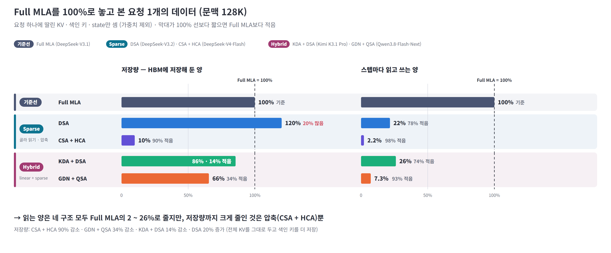
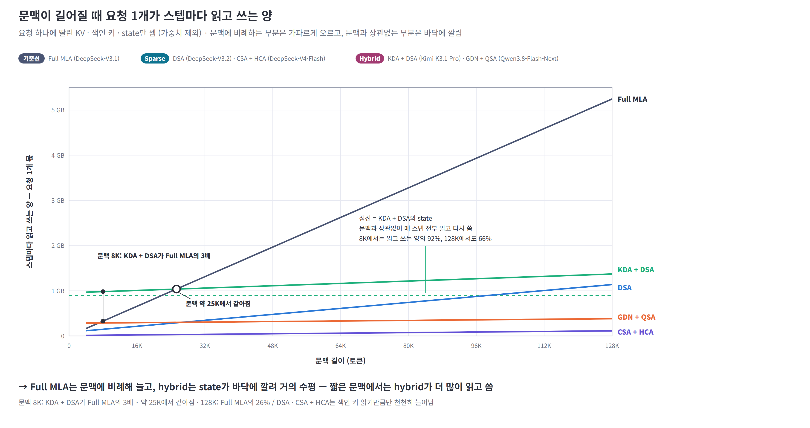
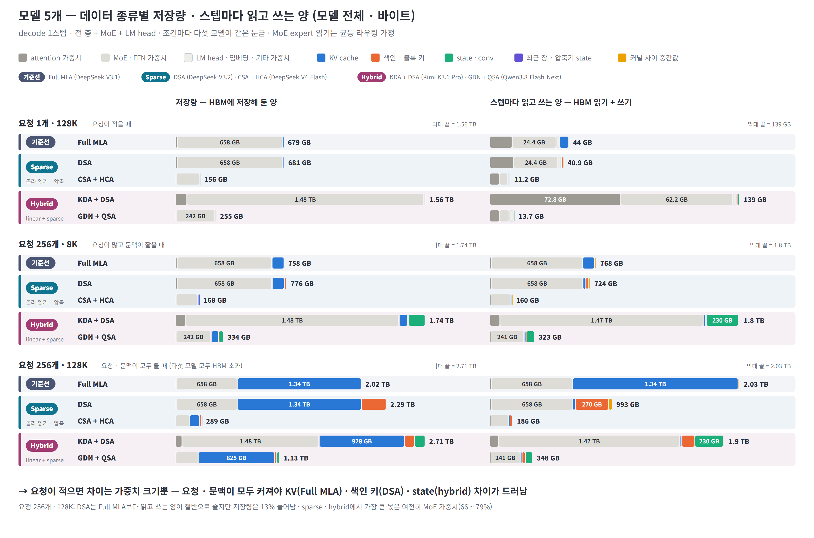
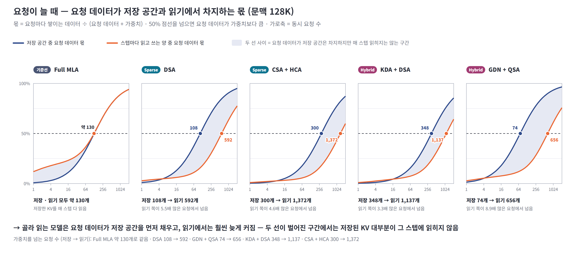
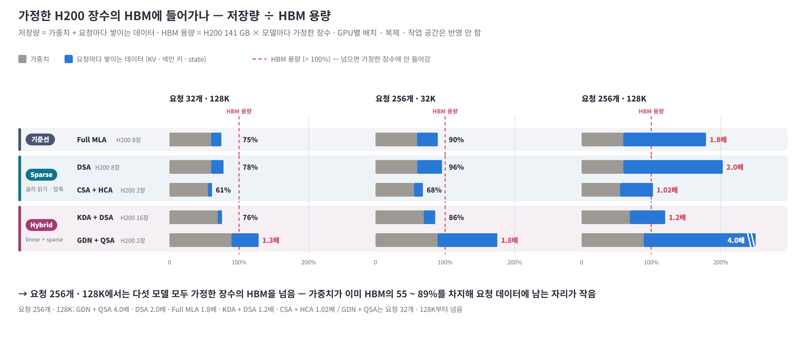
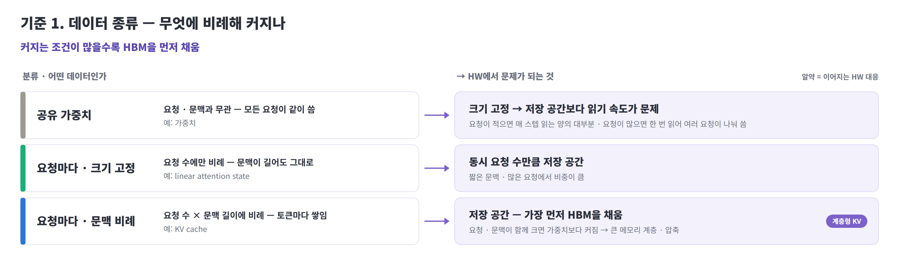
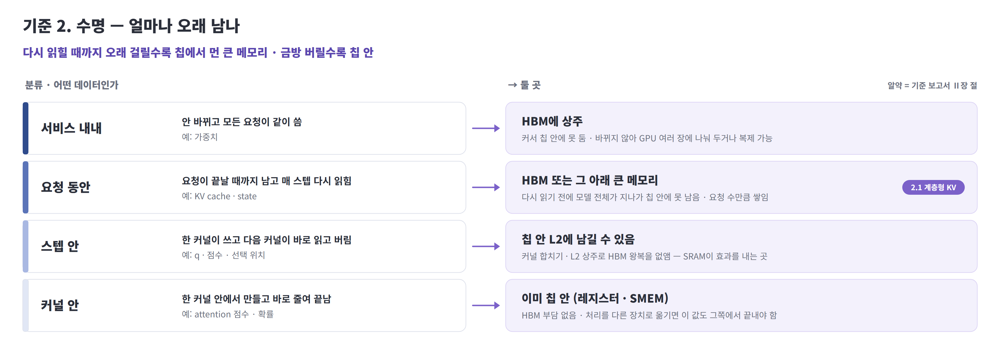
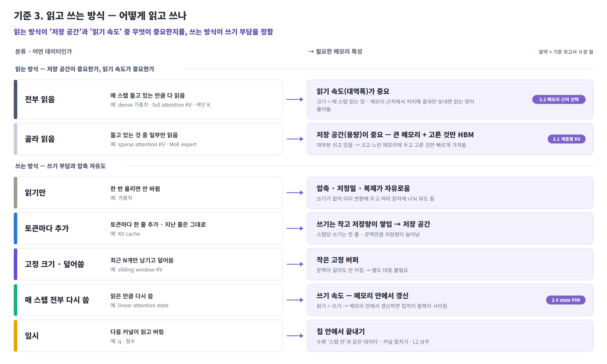

# Sparse · Hybrid attention 종합 — 메모리 쪽에서 본 decode 1스텝

종합 보고서 · 2026.11 · 모델별 보고서 5개를 같은 틀로 놓고 비교 · 짝 보고서: [연산 종합](synthesis-compute.md)

| 이 보고서의 이름 | 모델 | 구조 |
|---|---|---|
| **Full MLA** (기준선) | [DeepSeek-V3.1](mla-v31-traits.md) | 저장한 KV를 매 스텝 전부 읽음 |
| **DSA** | [DeepSeek-V3.2](dsa-v32-traits.md) | sparse — 작은 색인 키로 고를 위치를 정하고, 고른 KV 2,048줄만 읽음 |
| **CSA + HCA** | [DeepSeek-V4-Flash](csa-v4flash-traits.md) | sparse + 압축 — KV를 압축해 저장하고, 일부 층은 골라 읽음 |
| **KDA + DSA** | [Kimi K3.1 Pro](kda-k3-traits.md) | hybrid — linear attention(KDA) 69층 + DSA 24층 |
| **GDN + QSA** | [Qwen3.8-Flash-Next](qsa-qwen38-traits.md) | hybrid — linear attention(GDN) 36층 + 블록 단위로 골라 읽는 QSA 12층 |

> **이 보고서에서 쓰는 말**
> - **저장량:** HBM에 저장해 둔 양
> - **읽기·쓰기량:** 스텝마다 HBM에서 읽고 쓰는 양
> - **색인 키:** DSA 계열이 어떤 KV를 고를지 정하려고 따로 저장하는 작은 키
> - **state:** linear attention이 요청마다 들고 있는 고정 크기의 상태값. 매 스텝 읽고 다시 씀
> - **요청마다 쌓이는 데이터:** KV, 색인 키, state처럼 요청 하나에 딸린 데이터. 가중치는 모든 요청이 함께 씀

그림 범례에도 attention 이름과 모델 이름이 함께 표시됨. H200 · decode 1스텝 · 이론 하한 기준. 계산 방법과 출처는 부록 E

---

## 요약

**1. sparse attention은 KV를 읽는 양은 줄이지만, 저장하는 양은 오히려 늘림**

- DSA는 Full MLA보다 스텝마다 읽는 양이 78% 적음 (문맥 128K 토큰, 요청 1개)
- 대신 전체 KV를 그대로 저장하고 색인 키까지 더 저장해서, 저장량은 20% 많음
- 남은 읽기의 93%는 색인 키 — 어떤 KV를 고를지 정하려고 매 스텝 전부 읽기 때문

**2. 압축(CSA + HCA)은 저장과 읽기를 함께 줄이고, hybrid에는 문맥 길이와 상관없는 state 부담이 남음**

- CSA + HCA는 Full MLA보다 저장량이 90%, 읽는 양이 98% 적음
- hybrid는 요청마다 state를 매 스텝 읽고 다시 씀
- 그래서 문맥이 짧으면(8K) KDA + DSA가 요청 하나당 읽고 쓰는 양이 Full MLA의 3배

**3. 모델 전체로 보면, 매 스텝 읽는 양의 대부분은 다시 MoE 가중치**

- 요청 32개, 문맥 128K에서 sparse와 hybrid 모델은 읽기·쓰기량의 85 ~ 88%가 MoE 가중치
- KV, 색인 키, state를 다 합쳐도 4 ~ 9%
- 그래서 attention 쪽을 개선해 줄일 수 있는 몫은 요청이 많고 문맥이 길 때에만 커짐

**구성** — 1장 대표 비교(Full MLA ↔ DSA) → 2장 압축과 hybrid → 3장 모델 전체 → 4장 요청이 늘 때 → 5장 HW 검토

---

## 1. 대표 비교 — Full MLA ↔ DSA

> **읽는 법:** Full MLA와 DSA는 같은 모델(DeepSeek-V3.1 ↔ V3.2)에 attention만 다르고 KV 형식도 같음. 그래서 '골라 읽기'의 효과와 대가를 그대로 볼 수 있는 유일한 쌍. 왼쪽 막대는 요청 1개의 저장량, 오른쪽 막대는 스텝마다 읽고 쓰는 양

### 1.1 DSA는 KV 읽기를 줄여도 저장량은 늘어남

- **읽는 양:** DSA가 Full MLA보다 78% 적음 (문맥 128K, 요청 1개)
- **저장량:** 오히려 20% 많음 — 전체 KV를 그대로 두고 색인 키(주황)를 더 저장하기 때문
- **남은 읽기:** 93%가 색인 키. 어떤 KV를 고를지 정하려고 매 스텝 전부 읽음
- **짧은 문맥(8K)도 같은 방향:** 읽는 양은 55% 줄고, 저장량은 20% 늘어남

---

## 2. 다른 구조 — 압축과 hybrid

> **읽는 법:** 요청 1개에 딸린 데이터만 비교. 2.1은 문맥 128K에서 Full MLA를 100%로 놓은 막대, 2.2는 문맥을 늘려 가며 본 선

### 2.1 읽는 양은 네 구조 모두 크게 줄지만, 저장량까지 크게 줄인 것은 압축뿐

- **읽고 쓰는 양:** 네 구조 모두 Full MLA의 2 ~ 26% — CSA + HCA 98% · GDN + QSA 93% · DSA 78% · KDA + DSA 74% 감소
- **저장량:** CSA + HCA만 90% 줄어듦. GDN + QSA는 34%, KDA + DSA는 14% 줄고, DSA는 오히려 20% 늘어남
- **압축은 둘 다 줄임:** KV와 색인 키를 압축한 채로 저장하므로 저장하는 양과 읽는 양이 함께 작아짐
- **나머지 셋은 전체 KV를 그대로 저장:** 골라 읽어 읽는 양만 줄어듦. hybrid의 저장량이 조금 작은 것은 linear attention 층에 KV가 없기 때문

---

### 2.2 hybrid는 state가 바닥에 깔려, 짧은 문맥에서는 오히려 Full MLA보다 많이 읽고 씀

- **Full MLA:** 문맥에 비례해 늘어남. 저장한 KV를 매 스텝 전부 읽기 때문
- **hybrid:** 선이 거의 수평. state를 문맥 길이와 상관없이 매 스텝 읽고 다시 쓰기 때문 — KDA + DSA는 8K에서 읽고 쓰는 양의 92%가 state
- **짧은 문맥에서는 순서가 뒤집힘:** 8K에서 KDA + DSA는 Full MLA의 3배. 약 25K에서 같아지고, 128K에서는 Full MLA의 26%
- **GDN + QSA:** state가 KDA + DSA의 약 1/4이라 약 7K부터 Full MLA보다 적음
- **DSA, CSA + HCA:** 문맥이 길어져도 천천히 늘어남. 고르는 KV 수는 고정이고, 문맥에 비례해 늘어나는 것은 색인 키 읽기뿐

---

## 3. 모델 전체 — 다시 MoE 가중치

> **읽는 법:** 모든 층과 MoE, LM head를 합친 모델 전체의 바이트. 조건마다 다섯 모델을 같은 눈금으로 그려 모델 크기 차이까지 보임

### 3.1 요청마다 읽는 양이 줄어든 만큼, MoE 가중치가 읽기의 대부분이 됨

- **요청 1개:** 다섯 모델 모두 읽는 양 대부분이 가중치(회색). 모델 간 차이도 attention 구조보다 가중치 크기에서 나옴 — 가장 큰 KDA + DSA가 가장 작은 CSA + HCA의 12배
- **요청 32개, 문맥 128K (그림에는 없음):** sparse와 hybrid 모델은 읽기·쓰기량의 85 ~ 88%가 MoE 가중치. 요청마다 쌓이는 데이터는 4 ~ 9%뿐 (Full MLA는 28%)
- **요청 256개, 문맥 128K:** MoE 몫이 66 ~ 79%로 줄고, 그다음을 색인 키(DSA 27%)와 state(KDA + DSA 12%, GDN + QSA 17%)가 차지. KV(파랑)가 읽기·쓰기량의 66%를 차지하는 것은 Full MLA뿐
- **같은 조건에서 DSA는 Full MLA보다** 모델 전체 읽기·쓰기량이 절반으로 줄지만, 저장량은 13% 늘어남
- → 요청이 많고 문맥이 길수록 attention 쪽 개선으로 줄일 몫이 커지지만, 가장 큰 몫은 여전히 MoE 가중치

요청 256개 · 128K는 다섯 모델 모두 가정한 H200 장수의 HBM을 넘는 조건(4.2). 같은 입력에서의 바이트 비교로만 읽음

---

## 4. 요청이 늘 때 — 저장 공간이 먼저 차고, HBM을 넘는 조건

> **읽는 법:** 4.1은 요청 수를 늘리며 요청 데이터가 '저장 공간'과 '읽기'에서 차지하는 몫을 비교. 4.2는 가정한 H200 장수의 HBM에 다 들어가는지 확인

### 4.1 골라 읽는 모델은 요청 데이터가 저장 공간을 먼저 채우고, 읽기에서는 훨씬 늦게 커짐

- **보는 법(문맥 128K):** 남색 선은 저장 공간에서, 주황 선은 스텝마다 읽고 쓰는 양에서 요청 데이터가 차지하는 몫. 50% 점선을 넘으면 요청 데이터가 가중치보다 커짐
- **Full MLA:** 두 선이 거의 겹침. 저장한 KV를 매 스텝 다 읽기 때문 — 요청 약 130개에서 둘 다 50%를 넘음
- **골라 읽는 모델:** 남색 선이 먼저 올라감. DSA는 요청 108개에서 저장 공간의 절반이 요청 데이터가 되지만, 읽기에서는 592개가 되어야 절반이 됨
- **얼마나 늦게 넘나:** 읽기 쪽은 저장 쪽보다 3 ~ 9배 많은 요청에서 넘음 (KDA + DSA 3.3배 · CSA + HCA 4.6배 · DSA 5.5배 · GDN + QSA 8.9배)
- → 두 선이 벌어진 구간에서는 저장된 KV 대부분이 그 스텝에 읽히지 않음. 이런 KV는 HBM 아래 계층 메모리에 내려 두고 고른 것만 올릴 수 있음(계층형 KV)

---

### 4.2 요청 256개 · 128K에서는 다섯 모델 모두 가정한 장수의 HBM을 넘음

- **가중치가 이미 자리를 많이 차지:** 가정한 장수의 HBM 중 55 ~ 89%가 가중치. 요청 데이터에 남는 자리가 작음
- **요청 256개 · 128K:** 다섯 모델 모두 넘음 — GDN + QSA 4.0배 · DSA 2.0배 · Full MLA 1.8배 · KDA + DSA 1.2배 · CSA + HCA 1.02배
- **GDN + QSA:** 가중치가 작아 2장을 가정했지만, 가중치가 그 89%를 차지해 요청 32개 · 128K부터 넘음
- **DSA:** 색인 키를 더 저장해서 Full MLA보다 더 많이 넘음 (2.0배 vs 1.8배)

저장량 ÷ (H200 141 GB × 가정한 장수). GPU별 배치(TP · EP · DP), 복제, 작업 공간은 반영 안 함. 필요한 최소 장수 표는 부록 G

---

## 5. HW 검토 — 모델 · 조건별 우선순위

| HW 대응 (기준 보고서 Ⅱ장) | 무엇을 줄이나 | Full MLA | DSA | CSA + HCA | KDA + DSA | GDN + QSA | 먼저 검토할 모델 · 조건 |
|---|---|---|---|---|---|---|---|
| **2.1 계층형 KV** — 전체 KV는 아래 계층 메모리에, 고른 것만 HBM으로 | 골라 읽는 KV가 모델 전체 저장량에서 차지하는 비중 | — (KV를 전부 읽음) | 19% → **59%** | 7.5% → 36% | 6.8% → 34% | 29% → **73%** | GDN + QSA, DSA — 긴 문맥에서 요청이 70 ~ 110개를 넘을 때. 효과는 연속 스텝에서 고르는 KV가 얼마나 겹치는지에 달림 |
| **2.2 메모리 근처 선택** — 색인 키를 메모리 쪽에서 읽고, 고른 위치만 칩으로 | 색인 키가 모델 전체 읽기·쓰기량에서 차지하는 비중 | — | 7.1% → **27%** | 3.2% → 13% | 1.7% → 5.6% | 2.4% → 7.4% | DSA — 요청이 많고 문맥이 길 때 |
| **2.3 색인 연산 · top-k 유닛** — 색인 점수 계산과 상위 k개 고르기 전용 | 색인 키 1바이트당 계산 횟수 (메모리 쪽에 둘 연산기 크기의 기준) | — | 약 124번 | 약 124번 (FP8) | 약 62번 | 약 4번 | DSA, CSA + HCA — 모델 간 필요한 연산기 크기가 최대 약 30배 차이 |
| **2.4 state PIM** — state 갱신을 메모리 안에서 처리 | state가 모델 전체 읽기·쓰기량에서 차지하는 비중 | — | — | — (창 · 압축기 0.5% 이하) | 3.6% → 12% (8K 13%) | 5.5% → **17%** (8K 18%) | GDN + QSA, KDA + DSA — 요청이 많고 문맥이 짧을 때 |
| **KV 압축 · 저정밀** | 전부 읽는 KV가 모델 전체 읽기·쓰기량에서 차지하는 비중 | 28% → **66%** | — | (이미 압축) | — | — | Full MLA — 요청이 많고 문맥이 길 때 |
| **가중치 읽기 · 배치** (2.5 · 기준 보고서 범위 밖) | MoE 가중치가 모델 전체 읽기·쓰기량에서 차지하는 비중 | 69% → 32% | 88% → 66% | 88% → **79%** | 85% → 77% | 85% → 69% | 전 모델 — 요청이 적거나 중간일 때 가장 큰 몫 |

비중 칸 = 요청 32개 · 128K → 요청 256개 · 128K(다섯 모델 모두 가정 장수 초과). 그 대응으로 줄일 수 있는 몫의 상한이며, 실제 이득은 고른 KV의 재사용률, 연산 능력, 전송 비용에 달림. SRAM 증설이나 커널 합치기가 줄이는 커널 사이 임시값은 모델 전체 읽기·쓰기량의 3% 이하라 표에서 뺌(부록 B). 키 1바이트당 계산 횟수는 저장 형식이 바뀌면 달라짐(CSA + HCA 색인 키를 MXFP4 68 B로 두면 약 241번)

- **모델별로 먼저 볼 것:** Full MLA는 KV 압축 · 저정밀, DSA는 계층형 KV와 메모리 근처 선택, GDN + QSA는 계층형 KV와 state PIM, KDA + DSA는 state PIM, CSA + HCA는 가중치 쪽
- **요청이 많아지면 계층형 KV는 모두에게 의미가 커짐:** KDA + DSA와 CSA + HCA도 요청 256개 · 128K에서는 저장량의 3분의 1 이상이 골라 읽는 KV
- **구조가 섞일수록 필요한 대응도 섞임:** full은 KV 압축과 가중치, sparse는 여기에 2.1 · 2.2 · 2.3이 더해지고, hybrid는 2.4까지 필요. 층 종류별로 장치를 나눌지(2.5)는 대응별 비용 비교가 필요

#### 논의 · 확인할 점

- **어떤 서빙 조건을 기준으로 볼지:** attention 쪽 대응의 몫은 요청과 문맥 크기에 따라 몇 배씩 달라짐(DSA 색인 키 비중이 요청 32개에서 7%, 256개에서 27%). 기준 조건 합의 필요
- **연속 스텝에서 고르는 KV가 얼마나 겹치는지:** 계층형 KV의 효과를 정하는 값. 실측 필요
- **MoE에서 실제로 읽는 expert 범위:** 지금은 균등 라우팅 가정. 실제 라우팅 기록으로 확인 필요
- **배포 형식과 배치:** 색인 키와 state의 저장 형식(KDA + DSA는 config에 없어 DSA 형식으로 가정), GPU별 배치에서 가장 바쁜 GPU의 읽기·쓰기량

---

## 부록

### A. 데이터를 나누는 세 가지 기준

| 기준 | 묻는 것 | 나누는 값 | 한 줄 규칙 |
|---|---|---|---|
| **1. 데이터 종류** | 무엇에 비례해 커지나 | 모든 요청이 함께 쓰는 가중치 · 요청마다 크기 고정 · 요청마다 문맥에 비례 | 커지는 조건이 많을수록 HBM을 먼저 채움 |
| **2. 수명** | 얼마나 오래 남나 | 서비스 내내 · 요청 동안 · 한 스텝 안 · 한 커널 안 | 오래 남을수록 칩 밖 큰 메모리, 금방 버릴수록 칩 안 |
| **3. 읽고 쓰는 방식** | 어떻게 읽고 쓰나 | 읽기: 전부 · 골라 / 쓰기: 읽기만 · 토큰마다 한 줄 추가 · 덮어씀 · 매 스텝 다시 씀 · 임시 | 전부 읽으면 읽기 속도(대역폭), 골라 읽으면 저장 공간(용량), 다시 쓰면 쓰기 속도가 중요 |

그림 공통: 왼쪽 = 분류와 뜻(예는 일반적인 LLM 데이터) → 오른쪽 = 필요한 HW 특성(알약 = 기준 보고서 Ⅱ장 절)

- 가중치(크기 고정) → 요청마다 크기가 고정된 데이터(요청 수에 비례) → 요청마다 문맥에 비례하는 데이터(요청 수 × 문맥) 순으로 HBM을 먼저 채움
- 가중치는 크기가 고정이지만, 요청이 적으면 스텝마다 읽는 양의 대부분을 차지함

- 다음 스텝까지 모델 전체가 칩을 지나가 칩 안 캐시(L2 50 MB)가 다 덮임. 그래서 가중치, KV, state는 SRAM을 늘려도 HBM에서 다시 읽어야 함
- SRAM이 효과를 내는 곳은 한 스텝 안에서 쓰고 버리는 값뿐(커널 합치기, L2에 남기기)

- 전부 읽는 데이터는 크기가 곧 스텝마다 읽는 양이라 읽기 속도가 중요하고, 골라 읽는 데이터는 저장 공간만 크게 차지함
- 같은 '토큰마다 한 줄 추가'라도 골라 읽으면 큰 메모리에 두는 쪽(2.1), 전부 읽으면 메모리 쪽에서 처리하는 쪽(2.2)이 맞음

#### 모델 5개의 데이터 — 종류별 수명과 읽고 쓰는 방식

| 데이터 종류 | 수명 → 둘 곳 | 읽고 쓰는 방식 → 필요한 특성 | Full MLA | DSA | CSA + HCA | KDA + DSA | GDN + QSA |
|---|---|---|---|---|---|---|---|
| **attention · dense FFN · LM head 등 가중치** | **서비스 내내** → HBM 상주 | **읽기만 · 전부 읽음** → 읽기 속도 · 저정밀 | 15 GB | 16 GB | 6.5 GB | 77 GB (BF16) | 8 GB (BF16) |
| **MoE expert · 임베딩** | **서비스 내내** → HBM 상주 | **읽기만 · 골라 읽음** → 요청이 적을 때만 일부를 읽음 | 659 GB | 659 GB | 149 GB (FP4) | 1.48 TB (MXFP4) | 243 GB (BF16) |
| **전부 읽는 KV** | **요청 동안** → HBM · 그 아래 큰 메모리 | **토큰마다 추가 · 전부 읽음** → 저장 공간과 읽기 속도 모두 | 토큰당 40 KB | — | 토큰당 91 B (HCA 고압축) | — | — |
| **골라 읽는 KV** | **요청 동안** → HBM · 그 아래 큰 메모리 | **토큰마다 추가 · 골라 읽음** → 저장 공간 | — | 토큰당 40 KB (2,048줄) | 토큰당 3.1 KB (CSA · 512개) | 토큰당 27.6 KB (DSA 24층 · 2,048줄) | 토큰당 24.6 KB (QSA 12층 · 2,048토큰) |
| **색인 · 블록 키** | **요청 동안** → HBM · 그 아래 큰 메모리 | **토큰마다 추가 · 전부 읽음** → 읽기 속도 | — | 토큰당 8 KB | 토큰당 0.7 KB | 토큰당 3.2 KB | 토큰당 768 B (블록 키) |
| **state · conv** | **요청 동안** → HBM | **매 스텝 전부 다시 씀** → 쓰기 속도 | — | — | — | 요청당 449 MB | 요청당 115 MB |
| **최근 창 · 압축기 state** | **요청 동안** → HBM | **고정 크기 · 덮어씀** → 작은 고정 버퍼 | — | — | 요청당 15 MB | — | — |
| **커널 사이 값** | **한 스텝 안** → 칩 안 L2에 남길 수 있음 | **임시** → 커널 합치기 | q · 출력 벡터 | q · 점수 · 선택 위치 | q · 점수 · 선택 위치 | q · k · v · gate | q · 점수 · 선택 블록 |
| **커널 안 값** | **한 커널 안** → 이미 칩 안 | HBM에 안 나옴 | attention 점수 · 확률 | + 색인 head별 점수 (큼) | + 색인 head별 점수 | + 감쇠한 state | 블록 점수 (head 4개라 작음) |

- full → sparse: 전부 읽던 KV 하나가 '골라 읽는 큰 KV'와 '전부 읽는 작은 색인 키' 둘로 갈림
- hybrid에는 하나가 더 있음: 매 스텝 전부 다시 쓰는 state. 문맥과 상관없고 요청 수에 비례
- 압축(CSA + HCA): sparse와 같은 조합인데 크기만 훨씬 작고, 작은 '덮어씀' 버퍼가 하나 더 있음

### B. 기준별 모델 전체 그림 — 수명, 읽고 쓰는 방식

- 어느 모델, 어느 조건이든 모델 전체 읽기·쓰기량의 97% 이상이 다음 스텝에 다시 읽힐 데이터(가중치, KV, 색인 키, state). 그래서 SRAM을 늘려도 줄일 몫이 작음
- '요청 동안' 데이터(KV, 색인 키, state)의 몫이 가장 큰 모델은 조건에 따라 바뀜: 요청 256개 · 8K에서는 hybrid(GDN + QSA 23%, KDA + DSA 14%), 요청 256개 · 128K에서는 Full MLA(66%)

- 골라 읽는 KV(연파랑): 저장량은 크지만 매 스텝 읽는 것은 약 1.6%뿐 (128K에서 2,048줄)
- 전부 읽는 요청 데이터(진파랑): Full MLA는 KV, DSA는 색인 키. DSA가 색인 키를 읽는 양은 Full MLA가 KV를 읽는 양의 약 1/5
- 매 스텝 다시 쓰는 state(초록): hybrid에만 있고, KDA + DSA는 문맥 8K와 128K에서 같은 양

### C. 출발 보고서 대비 — 결론은 그대로, 범위를 넓혀 '상한'과 '시점'이 새로 보임

| 출발 보고서의 결론 (절) | 이번 분석 | 달라진 점 |
|---|---|---|
| Sparse + Hybrid 결합이면 읽기 3% · 저장 27% (1.3) | attention의 요청 데이터끼리 비교한 값. 모델 전체로 보면 요청 32개 · 128K에서 요청 데이터 읽기·쓰기는 전체의 4 ~ 9%(Full MLA 28%), 나머지는 가중치 | attention 쪽 HW 이득의 **상한**이 생김 (3장 · 5장) |
| Sparse는 전체 KV를 저장해 용량 부담 유지 (1.3 · 2.1) | 저장량이 가중치를 넘는 요청 수가 읽기·쓰기량 기준의 1/3 ~ 1/9 (DSA 108 vs 592 · GDN + QSA 74 vs 656 · KDA + DSA 348 vs 1,137) | 저장 부담이 먼저 커지는 **시점을 수치로** → 계층형 KV 검토 근거 (4장) |
| 색인 키 읽기는 길이에 비례, 128K에서 84% (1.4) | 128K 요청 하나의 읽기·쓰기 중 색인 키 DSA 93%(KV FP8 656 B 기준) · CSA + HCA 80% · KDA + DSA 30%(state 다음) | 색인 키 **형식**(FP8 132 B / MXFP4 68 B)과 색인 head 수가 결론을 바꿈 (1장 · 5장) |
| state 왕복 약 230 MB, 32K에서 읽기·쓰기의 75% (1.6) | 문맥과 상관없고 요청 수에 비례 → 요청 256개 · 8K에서 모델 전체 읽기·쓰기의 13%(KDA + DSA) · 18%(GDN + QSA) | **요청 수**를 더하고 모델 전체 기준 비중으로 (2장 · 5장) |
| 압축형(CSA + HCA)은 Full 대비 읽기 1.5% · 저장 12% (1.3 주석) | 같은 FP8 형식의 Full MLA 대비 요청 하나의 읽기·쓰기 98% 감소 · 저장 90% 감소 · 넘는 요청 수 300 / 1,372개 | 압축이 저장과 읽기를 **함께** 줄이는 유일한 구조 (2장) |
| KV는 용량 부담, 색인 키 · state는 반복 접근 (1.7) | 세 기준(종류 · 수명 · 읽고 쓰는 방식)으로 모델 5개를 같은 분류에 놓음 | 모델마다 걸리는 분류의 **조합**이 다름 (부록 A · 5장) |
| — | 요청 256개 · 128K는 다섯 모델 모두 가정 장수 초과 | 읽기·쓰기를 비교하기 전에 **HBM에 들어가는지부터** 판정 (4.2 · 부록 G) |

### D. 모델 크기를 덜어 낸 값

| 모델 | 층 수 | 가중치 | 토큰당 요청 데이터 저장량 (전 층 합) | 층당 평균 | 요청당 고정 크기 | 128K 요청 1개 저장량 ÷ 가중치 |
|---|---|---|---|---|---|---|
| Full MLA | 61 (MLA 61) | 674 GB | 40.0 KB | 656 B | — | 0.78% |
| DSA | 61 (DSA 61) | 675 GB | 48.1 KB | 788 B | — | 0.93% |
| CSA + HCA | 43 (CSA 21 · HCA 20 · SWA 2) | 156 GB | 3.85 KB | 90 B | 15 MB | 0.33% |
| KDA + DSA | 93 (DSA 24 · KDA 69) | 1.56 TB | 30.8 KB | 331 B (DSA 층만 1,284 B) | 449 MB | 0.29% |
| GDN + QSA | 48 (QSA 12 · GDN 36) | 251 GB | 25.3 KB | 528 B (QSA 층만 2,112 B) | 115 MB | 1.37% |

- hybrid의 요청당 저장량이 Full MLA보다 작은 것은 KV를 가진 층이 적어서. KV를 가진 층만 보면 오히려 Full MLA보다 큼(BF16 형식)
- 모델 크기와 무관한 비교는 마지막 열(요청 1개가 가중치 대비 차지하는 몫). 가중치가 작은 GDN + QSA가 가장 큼

### E. 분석 조건

- **모델:** 맨 위 표. Full MLA와 DSA는 attention만 다른 같은 모델. KDA + DSA(Kimi K3.1 Pro)는 Kimi K3의 full attention(MLA) 24층을 Gated DSA로 바꾼 모델(폴더 이름은 kda-k3 그대로)
- **기준:** H200 (HBM 4.8 TB/s · 141 GB · L2 50 MB), decode 1스텝, 이론 하한, 저장 형식은 각 algo.yaml 기본값
- **그림:** 모델별 보고서는 구성 비율(합 = 100%), 이 보고서는 바이트 그대로 그려 모델끼리의 크기 차이까지 보임. 줄은 기준선 · Sparse · Hybrid로 묶음
- **조건:** 요청 1개 · 128K / 요청 256개 · 8K / 요청 256개 · 128K (5장 표는 요청 32개 · 128K도)
- **출발점:** [기준 보고서](../../sparse-hybrid-hw-report-v2-refined.md) — 대비는 부록 C
- **수치 · 그림:** [tools/traits.py](../tools/traits.py) · [make_synthesis_report.py](make_synthesis_report.py) · [make_criteria_figs.py](make_criteria_figs.py)

### F. 비교의 한계

- **모델 크기와 층 수가 다름:** 가중치 156 GB(CSA + HCA) ~ 1.56 TB(KDA + DSA), 층 43 ~ 93개. 바이트 막대에는 이 차이가 그대로 들어감. 크기를 덜어 낸 비교는 부록 D, 저장한 것 중 읽는 비율, 넘는 요청 수로 봄. attention만 다른 직접 비교는 Full MLA ↔ DSA뿐
- **형식:** Full MLA KV 656 B는 DSA와 같은 형식으로 맞춘 대조 조건(BF16 1,152 B면 요청 데이터가 1.76배). CSA + HCA는 KV 584 B · 색인 키 132 B(vLLM), KDA + DSA는 DSA 층 KV BF16 1,152 B · 색인 키 132 B(DSA 형식 가정) · state FP32, GDN + QSA는 KV BF16 2,048 B · 블록 키 BF16 256 B · state FP32
- **MoE:** 균등 · 독립 라우팅 기댓값. 쏠리면 읽는 expert 수가 k개까지 줄고, 요청마다 다 다르면 min(E, 요청 수 × k)개. 모델별 범위는 각 보고서 부록
- **한 스텝 안 · 한 커널 안 값:** 그린 층 1개만 셈(Full MLA와 DSA는 전 층이 같은 구조라 전부). 커널 안 값은 커널별 논리 크기의 합이며 동시 점유량이 아님
- **DSA split-KV 부분 출력:** H200 스케줄이 확인되지 않아 모델 비교에서 뺌 (커널별 표에는 남김)
- **검증:** 참조 구현 검증은 DSA(DeepSeek-V3.2)와 Qwen3.6 GDN만. 나머지는 config, 체크포인트 shape, 공개 코드로 세운 식이며 ChatGPT 검토 의견을 반영함
- **용량 초과 조건:** 읽기·쓰기량은 같은 입력 조건의 바이트 비교. 시간 비교는 GPU별 배치가 필요
- **제외:** MTP, 잔차, 정규화 값, GPU 간 통신, 가중치 복제(DP attention), GDN + QSA의 n-gram 표(host 102 GB), KDA + DSA의 DSA 층 중간값

### G. 가정한 H200 장수 — 필요한 최소 장수

| 모델 (배치 가정) | 요청 1개 | 요청 32개 · 128K | 요청 256개 · 8K | 요청 256개 · 32K | 요청 256개 · 128K |
|---|---|---|---|---|---|
| Full MLA (8장) | 5장 | 6장 | 6장 | 8장 | **15장** |
| DSA (8장) | 5장 | 7장 | 6장 | 8장 | **17장** |
| CSA + HCA (2장) | 2장 | 2장 | 2장 | 2장 | **3장** |
| KDA + DSA (16장) | 12장 | 13장 | 13장 | 14장 | **20장** |
| GDN + QSA (2장) | 2장 | **3장** | **3장** | **4장** | **9장** |

H200 141 GB에 저장량 합계를 균등히 나눈 최소 장수(올림). 굵게 = 가정한 장수 초과. 4.2 그림의 배수는 올림 전 값(저장량 ÷ 가정한 장수의 HBM)
