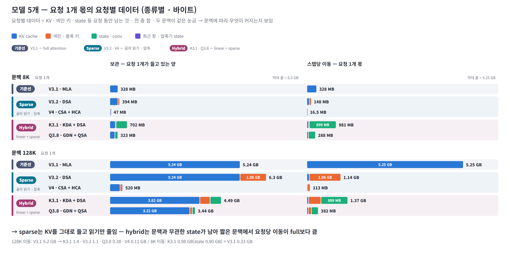
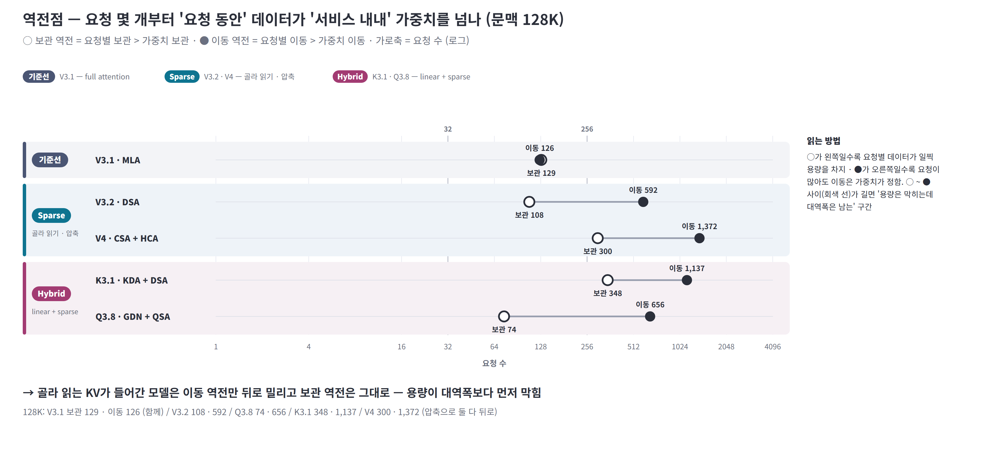
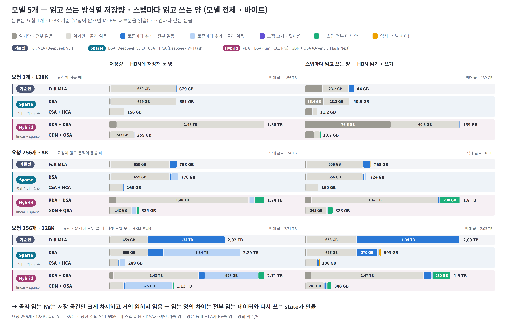

# Sparse · Hybrid attention 종합 — 데이터 성격으로 본 decode 1스텝

종합 보고서 · 2026.11 · 모델별 보고서 5개(기준선 full 1 · sparse 2 · hybrid 2)를 같은 틀로 놓고 비교 · 짝 보고서: [연산 종합](synthesis-compute.md)

모델: [DeepSeek-V3.1](mla-v31-traits.md)(기준선 · full MLA) · [V3.2](dsa-v32-traits.md)(sparse · DSA) · [V4-Flash](csa-v4flash-traits.md)(sparse + 압축 · CSA · HCA) · [Kimi K3.1 Pro](kda-k3-traits.md)(hybrid · KDA + DSA) · [Qwen3.8-Flash-Next](qsa-qwen38-traits.md)(hybrid · GDN + QSA). H200 · decode 1스텝 · 이론 하한. 계산 방법 · 출처는 부록 E

---

## 요약

1. **sparse 선택은 KV 읽기를 줄이지만 보관량은 늘림**
   - V3.1 → V3.2(같은 KV 형식 · 128K · 요청 1개): 스텝당 이동 5.25 → 1.14 GB
   - 같은 조건 보관: 5.24 → 6.30 GB — 전체 KV를 그대로 두고 색인 키를 더 보관
   - V3.2에 남는 이동의 93%가 색인 키(128K 요청별 데이터 이동량 기준)
2. **압축(V4)만 보관 · 이동을 함께 줄이고, hybrid는 문맥과 무관한 state 읽기 · 쓰기가 남음**
   - V4(128K · 요청 1개): 보관 520 MB · 이동 113 MB — V3.1의 1/10 · 1/45
   - K3.1: state를 매 스텝 읽고 다시 써 8K 요청당 이동 0.98 GB — V3.1(0.33 GB)의 3배
3. **모델 전체로 보면 이동은 다시 MoE 가중치가 대부분**
   - 요청 32개 · 128K: sparse · hybrid 모델 전체 이동량의 85 ~ 88%가 MoE 가중치
   - 같은 조건 요청별 데이터(KV · 색인 키 · state)는 모델 전체 이동량의 4 ~ 9%(V3.1은 28%)
   - → 요청당 절감이 커도 attention 쪽 HW가 겨냥하는 이동량 몫은 작음 — 많은 요청 · 긴 문맥에서만 커짐

**용어:** 보관 = HBM에 들고 있는 양(용량) · 이동 = 스텝마다 HBM에서 읽고 쓰는 양(대역폭) · 요청별 데이터 = 요청마다 따로 갖는 KV · 색인 키 · state

**구성:** 1 대표 비교(V3.1 ↔ V3.2) → 2 압축 · hybrid → 3 모델 전체 → 4 요청 수가 늘 때(보관 시점 · HBM 용량) → 5 HW 검토(모델 · 조건별) · 부록 = 분류 기준 · 조건 · 한계

---

## 1. 대표 비교 — V3.1 ↔ V3.2

> **읽는 법:** V3.1과 V3.2는 같은 모델 · 같은 KV 형식(KV 1줄 656 B)에 attention만 다름 → sparse 선택의 효과와 대가를 그대로 볼 수 있는 유일한 쌍. 왼쪽 막대 = 요청 1개 보관, 오른쪽 막대 = 스텝당 이동

### 1.1 V3.2는 KV 읽기를 줄여도 보관량은 늘어남

- **스텝당 이동(128K · 요청 1개):** V3.1 5.25 GB → V3.2 1.14 GB
- **보관(같은 조건):** 5.24 GB → 6.30 GB
- 보관이 느는 이유: 전체 KV(5.24 GB)를 그대로 들고 색인 키(1.06 GB, 주황)를 더 보관
- V3.2에 남는 이동 1.14 GB 중 93%가 색인 키 — 고를 위치를 정하려고 매 스텝 전부 읽음
- **8K도 같은 방향:** 이동 328 → 148 MB · 보관 328 → 394 MB

---

## 2. 다른 구조 — 압축(V4)과 hybrid

> **읽는 법:** 가로 = 요청 1개 보관 · 세로 = 스텝당 이동(둘 다 로그). 위쪽 점선 대각선 = 보관한 만큼 매 스텝 읽음 · 아래로 멀수록 일부만 읽음 · 선 위 점 3개 = 문맥 8K · 32K · 128K

### 2.1 V4는 보관 · 이동을 함께 줄이고, hybrid는 state를 매 스텝 읽고 씀

- **V3.1:** 대각선 위 — 문맥이 길어지면 보관과 이동이 함께 커짐
- **V4(128K):** 보관 520 MB · 이동 113 MB — 압축으로 KV · 색인 키가 함께 작아져 왼쪽 아래
- **hybrid:** state(요청당 K3.1 449 MB · Q3.8 115 MB)를 문맥과 무관하게 매 스텝 읽고 다시 씀 → 선이 거의 수평
- **짧은 문맥에서는 역전:** 8K에서 K3.1 요청당 이동 0.98 GB > 보관 0.70 GB(대각선 위) · V3.1 이동 0.33 GB의 3배
- **128K 읽는 비율(스텝당 읽기 ÷ 보관):** V3.1 100% · V4 22% · K3.1 21% · V3.2 18% · Q3.8 8%

---

## 3. 모델 전체 — 다시 MoE 가중치

> **읽는 법:** 전 층 + MoE + LM head를 합친 모델 전체 바이트. 조건마다 다섯 모델이 같은 눈금 → 모델 크기 차이까지 보임

### 3.1 요청별 이동이 줄어든 만큼 MoE 가중치가 이동의 대부분

- **요청 1개 · 128K:** 다섯 모델 모두 모델 전체 이동량의 대부분이 가중치(회색) — 모델 간 차이는 가중치 크기 · 정밀도(이동 V4 11 GB ~ K3.1 139 GB)
- **요청 32개 · 128K(그림 밖):** sparse · hybrid 모델 전체 이동량의 85 ~ 88%가 MoE 가중치 · 요청별 데이터는 4 ~ 9%(V3.1 28%)
- **요청 256개 · 128K:** MoE 몫이 모델 전체 이동량의 66 ~ 79%로 줄고, 그다음이 색인 키(V3.2 27%) · state(K3.1 12% · Q3.8 17%)
- 이 조건에서 이동까지 KV(파랑)가 차지하는 것은 V3.1뿐 — 모델 전체 이동량의 66%
- → attention 쪽 HW가 겨냥하는 몫은 많은 요청 · 긴 문맥에서 커지지만, sparse · hybrid에서 가장 큰 단일 몫은 여전히 MoE 가중치

요청 256개 · 128K = 다섯 모델 모두 가정한 H200 장수의 HBM 용량을 넘는 조건(4.2 표) — 같은 입력의 바이트 비교로만 읽음

---

## 4. 요청 수가 늘 때 — 보관 시점과 HBM 용량

> **읽는 법:** 두 질문을 나눠 봄. ① 요청별 데이터가 가중치보다 커지는 요청 수 — 보관 · 이동 각각(4.1) ② 가정한 H200 장수에 다 들어가나(4.2)

### 4.1 요청별 보관량이 가중치 보관량을 넘는 시점이 이동량보다 이름

- **보는 법(문맥 128K):** ○ = 요청별 보관량이 가중치 보관량을 넘는 요청 수 · ● = 요청별 이동량이 가중치 이동량을 넘는 요청 수
- **V3.1:** ○ 129 · ● 126 — 거의 같은 요청 수
- **골라 읽는 KV가 있는 모델:** ○가 ●보다 3.3 ~ 8.9배 작음 — V3.2 108 vs 592 · Q3.8 74 vs 656 · K3.1 348 vs 1,137
- **V4:** 압축으로 둘 다 뒤로 — 300 · 1,372
- → ○ ~ ● 사이: 보관은 요청별 데이터가 가중치보다 크지만 스텝당 읽는 양은 가중치보다 작음
- → 대부분 쉬는 KV를 아래 계층에 둘 근거(계층형 KV) · ●까지 남은 이동 여유가 아래 계층과 주고받을 대역폭 여유

### 4.2 HBM 용량 — 가정한 H200 장수에 들어가나

| 모델 (배치 가정) | 요청 1개 | 요청 32개 · 128K | 요청 256개 · 8K | 요청 256개 · 32K | 요청 256개 · 128K |
|---|---|---|---|---|---|
| V3.1 (8장) | 5장 | 6장 | 6장 | 8장 | **15장** |
| V3.2 (8장) | 5장 | 7장 | 6장 | 8장 | **17장** |
| V4-Flash (2장) | 2장 | 2장 | 2장 | 2장 | **3장** |
| Kimi K3.1 Pro (16장) | 12장 | 13장 | 13장 | 14장 | **20장** |
| Qwen3.8 (2장) | 2장 | **3장** | **3장** | **4장** | **9장** |

H200 141 GB에 보관 합계를 균등히 나눈 최소 장수. 굵게 = 배치 가정 장수 초과. GPU별 배치(TP · EP · DP) · 복제 · 작업 공간은 반영 안 함

- **요청 256개 · 128K:** 다섯 모델 모두 가정 장수 초과 → 이 조건의 수치는 같은 입력의 바이트 비교로만 읽음
- **Q3.8:** 가중치가 작아 2장을 가정 → 요청 32개 · 128K부터 초과
- **V3.2:** 색인 키를 더 보관해 V3.1보다 장수가 많음(요청 256개 · 128K에서 17장 vs 15장)

---

## 5. HW 검토 — 모델 · 조건별 우선순위

| 대응 (기준 보고서 Ⅱ장) | 겨냥하는 데이터 · 지표 | V3.1 | V3.2 | V4 | K3.1 | Q3.8 | 우선 검토 (모델 · 조건) |
|---|---|---|---|---|---|---|---|
| **2.1 계층형 KV** | 골라 읽는 KV · 모델 전체 보관량 비중 | — (KV를 전부 읽음) | 19% → **59%** | 7.5% → 36% | 6.8% → 34% | 29% → **73%** | Q3.8 · V3.2 · 긴 문맥 — 요청 수가 ○(74 · 108개)를 넘을 때 · 선택 겹침(적중률)이 효과를 정함 |
| **2.2 메모리 근처 선택** | 전부 읽는 색인 · 블록 키 · 모델 전체 이동량 비중 | — | 7.1% → **27%** | 3.2% → 13% | 1.7% → 5.6% | 2.4% → 7.4% | V3.2 · 많은 요청 · 긴 문맥 |
| **2.3 색인 연산 · top-k** | 같은 키 · 키 1 B당 연산 | — | 약 124 FLOP | 약 124 FLOP (FP8) | 약 62 FLOP | 약 4 FLOP | V3.2 · V4 — 메모리 근처 연산기 크기의 기준(최대 약 30배 차이) |
| **2.4 state PIM** | 다시 쓰는 state · 모델 전체 이동량 비중 | — | — | — (창 · 압축기 0.5% 이하) | 3.6% → 12% (8K 13%) | 5.5% → **17%** (8K 18%) | Q3.8 · K3.1 · 많은 요청 · 짧은 문맥 |
| **KV 압축 · 저정밀** | 전부 읽는 KV · 모델 전체 이동량 비중 | 28% → **66%** | — | (이미 압축) | — | — | V3.1 · 긴 문맥 · 많은 요청 |
| **가중치 대역폭 · 배치** (2.5 · 범위 밖) | MoE 가중치 · 모델 전체 이동량 비중 | 69% → 32% | 88% → 66% | 88% → **79%** | 85% → 77% | 85% → 69% | 전 모델 · 요청이 적거나 중간 — 가장 큰 단일 몫 |

비중 칸 = 요청 32개 · 128K → 요청 256개 · 128K(다섯 모델 모두 가정 장수 초과). 용량 대응은 보관량, 대역폭 대응은 이동량 비중. 그 대응으로 줄일 수 있는 몫의 상한 — 실제 이득은 적중률 · 연산 능력 · 전송 비용에 달림. SRAM 증설 · 커널 합치기가 겨냥하는 스텝 안 임시값은 모델 전체 이동량의 3% 이하라 표에서 뺌(부록 B). 키 1 B당 연산은 형식이 바뀌면 달라짐(V4 색인 키 MXFP4 68 B면 약 241 FLOP)

- **모델별 첫 검토:** V3.1 → KV 압축 · 저정밀 · V3.2 → 계층형 KV · 메모리 근처 선택 · Q3.8 → 계층형 KV · state PIM · K3.1 → state PIM, 많은 요청에서 계층형 KV · V4 → 가중치 쪽, 많은 요청에서 계층형 KV
- **구조가 섞일수록 대응도 섞임:** full은 KV 압축 · 가중치 → sparse는 2.1 · 2.2 · 2.3이 더해짐 → hybrid는 2.4까지. 층 종류별로 장치를 나눌지(2.5)는 대응별 비용 비교가 필요

#### 논의 · 확인할 점

- **기준 서빙 조건:** attention 쪽 대응의 몫은 요청 · 문맥 크기에 따라 몇 배씩 달라짐(V3.2 색인 키 이동량 비중 7.1% → 27%) — 어느 조건을 기준으로 볼지 합의 필요
- **계층형 KV 적중률:** 연속 스텝의 KV 선택 겹침이 효과를 정함 — 실측 필요
- **MoE 읽기 범위:** 균등 라우팅 가정 — 실제 라우팅 trace로 확인
- **배포 형식 · 배치:** 색인 키 · state 형식(K3.1은 config에 없어 V3.2 형식 가정) · GPU별 배치에서 가장 바쁜 GPU의 이동

---

## 부록

### A. 데이터를 나누는 세 가지 기준

| 기준 | 묻는 것 | 나누는 값 | 한 줄 규칙 |
|---|---|---|---|
| **1. 데이터 종류** | 무엇에 비례해 커지나 | 공유 가중치 · 요청별 크기 고정 · 요청별 문맥 비례 | 커지는 조건이 많을수록 HBM을 먼저 채움 |
| **2. 수명** | 얼마나 오래 남나 | 서비스 내내 · 요청 동안 · 스텝 안 · 커널 안 | 오래 남을수록 칩 밖 큰 메모리, 금방 버릴수록 칩 안 |
| **3. 데이터 성격** | 어떻게 읽고 쓰나 | 읽기: 전부 · 골라 / 쓰기: read-only · 끝에 추가 · 덮어씀 · 다시 씀 · 임시 | 전부 읽으면 대역폭, 골라 읽으면 용량, 다시 쓰면 쓰기 대역폭 |

그림 공통: 왼쪽 = 분류와 뜻(예는 일반적인 LLM 데이터) → 오른쪽 = 필요한 HW 특성(알약 = 기준 보고서 Ⅱ장 절)

- 공유 가중치(고정) → 요청별 크기 고정(요청 수) → 요청별 문맥 비례(요청 수 × 문맥) 순으로 HBM을 먼저 채움
- 가중치는 크기는 고정이지만, 요청이 적으면 스텝당 이동의 대부분

- 다음 스텝까지 모델 전체가 칩을 지나가 칩 안(L2 50 MB)이 다 덮임 → 가중치 · KV · state는 SRAM을 늘려도 HBM 이동이 그대로
- SRAM이 효과를 내는 곳 = 스텝 안 값(커널 합치기 · L2 상주)

- 전부 읽으면 크기가 곧 스텝당 이동(대역폭형) · 골라 읽으면 보관만 크고 이동은 작음(용량형)
- 같은 '끝에 추가'도 골라 읽으면 큰 메모리로(2.1), 전부 읽으면 메모리 근처 처리로(2.2)

#### 모델 5개의 데이터 — 종류별 수명 · 성격

| 데이터 종류 | 수명 → 둘 곳 | 데이터 성격 → 필요한 특성 | V3.1 · 기준선 | V3.2 · Sparse | V4 · Sparse | K3.1 · Hybrid | Q3.8 · Hybrid |
|---|---|---|---|---|---|---|---|
| **attention · dense FFN · LM head 등 가중치** | **서비스 내내** → HBM 상주 | **read-only · 전부 읽음** → 읽기 대역폭 · 저정밀 | 15 GB | 16 GB | 6.5 GB | 77 GB (BF16) | 8 GB (BF16) |
| **MoE expert · 임베딩** | **서비스 내내** → HBM 상주 | **read-only · 골라 읽음** → 요청이 적을 때만 일부를 읽음 | 659 GB | 659 GB | 149 GB (FP4) | 1.48 TB (MXFP4) | 243 GB (BF16) |
| **전부 읽는 KV** | **요청 동안** → HBM · 그 아래 큰 메모리 | **끝에 추가 · 전부 읽음** → 용량 + 대역폭 함께 | 토큰당 40 KB | — | 토큰당 91 B (HCA 고압축) | — | — |
| **골라 읽는 KV** | **요청 동안** → HBM · 그 아래 큰 메모리 | **끝에 추가 · 골라 읽음** → 용량형 | — | 토큰당 40 KB (2,048줄) | 토큰당 3.1 KB (CSA · 512엔트리) | 토큰당 27.6 KB (DSA 24층 · 2,048줄) | 토큰당 24.6 KB (QSA 12층 · 2,048토큰) |
| **색인 · 블록 키** | **요청 동안** → HBM · 그 아래 큰 메모리 | **끝에 추가 · 전부 읽음** → 대역폭형 | — | 토큰당 8 KB | 토큰당 0.7 KB | 토큰당 3.2 KB | 토큰당 768 B (블록 키) |
| **state · conv** | **요청 동안** → HBM | **매 스텝 전부 다시 씀** → 쓰기 대역폭 | — | — | — | 요청당 449 MB | 요청당 115 MB |
| **최근 창 · 압축기 state** | **요청 동안** → HBM | **고정 크기 · 덮어씀** → 작은 고정 버퍼 | — | — | 요청당 15 MB | — | — |
| **커널 사이 값** | **스텝 안** → 칩 안 L2에 남길 수 있음 | **임시** → 커널 합치기 | q · 출력 벡터 | q · 점수 · 선택 위치 | q · 점수 · 선택 위치 | q · k · v · gate | q · 점수 · 선택 블록 |
| **커널 안 값** | **커널 안** → 이미 칩 안 | HBM에 안 나옴 | attention 점수 · 확률 | + 색인 head별 점수 (큼) | + 색인 head별 점수 | + 감쇠한 state | 블록 점수 (head 4개라 작음) |

- full → sparse: KV 하나(전부 읽음)가 '골라 읽는 큰 KV + 전부 읽는 작은 색인 키' 둘로 갈림
- hybrid는 하나 더: 매 스텝 전부 다시 쓰는 state — 문맥과 무관 · 요청 수에 비례
- 압축(V4): sparse와 같은 조합에 크기만 훨씬 작음 + 작은 '덮어씀' 버퍼

### B. 기준별 모델 전체 그림 — 수명 · 성격

- 어느 모델 · 조건이든 모델 전체 이동량의 97% 이상이 '서비스 내내(가중치) + 요청 동안(KV · 색인 키 · state)' → SRAM을 늘려도 줄일 몫이 작음
- 요청 동안 몫(모델 전체 이동량 기준): 요청 256개 · 8K에서는 hybrid가 가장 큼(Q3.8 23% · K3.1 14%) · 요청 256개 · 128K에서는 full이 가장 큼(V3.1 66%)

- 골라 읽는 KV(연파랑): 요청 256개 · 128K 보관 V3.2 1.34 TB · K3.1 928 GB · Q3.8 825 GB → 이동은 13 ~ 21 GB
- 전부 읽는 요청별 데이터(진파랑): full은 KV(이동 1.34 TB) · V3.2는 색인 키(이동 270 GB)
- 매 스텝 다시 씀(초록): hybrid에만 있음 · K3.1 230 GB가 8K · 128K에서 같음

### C. 출발 보고서 대비 — 결론은 그대로, 범위를 모델 5개 · 요청 수 · 모델 전체로 넓혀 '상한'과 '시점'이 새로 보임

| 출발 보고서의 결론 (절) | 이번 분석 | 달라진 점 |
|---|---|---|
| Sparse + Hybrid 결합이면 이동량 3% · 보관량 27% (1.3) | attention 요청별 데이터끼리의 비교. 모델 전체로 보면 요청 32개 · 128K에서 요청별 이동이 모델 전체 이동량의 4 ~ 9%(V3.1 28%), 나머지는 가중치 | attention 쪽 HW 이득의 **상한**이 생김 (3장 · 5장) |
| Sparse는 전체 KV를 보관해 용량 부담 유지 (1.3 · 2.1) | 요청별 보관량이 가중치를 넘는 요청 수가 이동량보다 3.3 ~ 8.9배 작음 (V3.2 108 vs 592 · Q3.8 74 vs 656 · K3.1 348 vs 1,137) | 보관 부담이 먼저 커지는 **시점을 정량화** → 계층형 KV 검토 근거 (4장) |
| 색인 키 읽기는 길이에 비례, 128K에서 84% (1.4) | 128K 요청별 데이터 이동량 중 색인 키 V3.2 93%(KV FP8 656 B 기준) · V4 80% · K3.1 30%(state 다음) | 색인 키 **형식**(FP8 132 B / MXFP4 68 B)과 색인 head 수가 대역폭 · 연산 결론을 바꿈 (1장 · 5장) |
| state 왕복 약 230 MB, 32K에서 이동의 75% (1.6) | 문맥과 무관 · 요청 수에 비례 → 요청 256개 · 8K에서 모델 전체 이동량의 13%(K3.1) · 18%(Q3.8) | **요청 수 축**을 더하고 모델 전체 기준 비중으로 (2장 · 5장) |
| 압축형 V4는 Full 대비 읽기 1.5% · 보관 12% (1.3 주석) | 같은 FP8 형식의 V3.1 대비 요청당 이동 ×0.022 · 보관 ×0.099 · 역전 요청 수 300 / 1,372개 | 압축이 보관과 이동을 **함께** 줄이는 유일한 구조 (2장) |
| KV는 용량형, 색인 키 · state는 반복 접근 (1.7) | 세 기준(종류 · 수명 · 성격)으로 모델 5개를 같은 분류에 놓음 | 모델마다 걸리는 분류의 **조합**이 다름 (부록 A · 5장) |
| — | 요청 256개 · 128K는 다섯 모델 모두 배치 가정 장수 초과 | 이동을 비교하기 전에 **HBM에 들어가는지부터** 판정 (4.2 표) |

### D. 모델 크기를 덜어 낸 값

| 모델 | 층 수 | 가중치 | 토큰당 요청별 보관 (전 층 합) | 층당 평균 | 요청당 크기 고정 | 128K 요청 1개 보관 ÷ 가중치 |
|---|---|---|---|---|---|---|
| V3.1 | 61 (MLA 61) | 674 GB | 40.0 KB | 656 B | — | 0.78% |
| V3.2 | 61 (DSA 61) | 675 GB | 48.1 KB | 788 B | — | 0.93% |
| V4 | 43 (CSA 21 · HCA 20 · SWA 2) | 156 GB | 3.85 KB | 90 B | 15 MB | 0.33% |
| K3.1 | 93 (DSA 24 · KDA 69) | 1.56 TB | 30.8 KB | 331 B (DSA 층만 1,284 B) | 449 MB | 0.29% |
| Q3.8 | 48 (QSA 12 · GDN 36) | 251 GB | 25.3 KB | 528 B (QSA 층만 2,112 B) | 115 MB | 1.37% |

- hybrid의 요청당 보관이 full보다 작은 것은 KV를 가진 층이 적어서 — KV를 가진 층만 보면 오히려 full보다 큼(BF16 형식)
- 크기와 무관한 비교 = 마지막 열(요청 1개가 가중치 대비 차지하는 몫) — 가중치가 작은 Q3.8이 가장 큼

### E. 분석 조건

- **모델:** DeepSeek-V3.1(기준선 · full MLA) · V3.2(sparse · DSA) · V4-Flash(sparse + 압축 · CSA · HCA) · Kimi K3.1 Pro(hybrid · KDA + DSA) · Qwen3.8-Flash-Next(hybrid · GDN + QSA). V3.1과 V3.2는 attention만 다른 같은 모델. K3.1 Pro = Kimi K3의 full attention(MLA) 24층을 Gated DSA로 바꾼 모델(폴더 이름은 kda-k3 그대로)
- **기준:** H200 (HBM 4.8 TB/s · 141 GB · L2 50 MB) · decode 1스텝 · 이론 하한 · 저장 형식 = 각 algo.yaml 기본값
- **그림:** 모델별 보고서는 구성 비율(합 = 100%), 이 보고서는 바이트 그대로 — 모델끼리의 크기 차이까지 보임 · 줄 묶음 = 기준선 · Sparse · Hybrid
- **조건:** 요청 1개 · 128K / 요청 256개 · 8K / 요청 256개 · 128K (5장 표는 요청 32개 · 128K도)
- **출발점:** [기준 보고서](../../sparse-hybrid-hw-report-v2-refined.md) — 대비는 부록 C
- **수치 · 그림:** [tools/traits.py](../tools/traits.py) · [make_synthesis_report.py](make_synthesis_report.py) · [make_criteria_figs.py](make_criteria_figs.py)

### F. 비교의 한계

- **모델 크기 · 층 수가 다름:** 가중치 156 GB(V4) ~ 1.56 TB(K3.1), 층 43 ~ 93개. 바이트 막대에는 이 차이가 그대로 들어감 → 크기를 덜어 낸 비교는 부록 D · 읽는 비율 · 역전 요청 수로. attention만 다른 직접 비교는 V3.1 ↔ V3.2뿐
- **형식:** V3.1 KV 656 B는 V3.2와 같은 형식으로 맞춘 대조 조건(BF16 1,152 B면 요청별 데이터가 1.76배). V4 KV 584 B · 색인 키 132 B(vLLM), K3.1 DSA KV BF16 1,152 B · 색인 키 132 B(V3.2 형식 가정) · state FP32, Q3.8 KV BF16 2,048 B · 블록 키 BF16 256 B · state FP32
- **MoE:** 균등 · 독립 라우팅 기댓값. 쏠리면 expert 수가 k개까지 줄고, 요청마다 다 다르면 min(E, 요청 수 × k)개 — 모델별 범위는 각 보고서 부록
- **스텝 안 · 커널 안 값:** 그린 층 1개만 셈(V3.1 · V3.2는 전 층이 같은 구조라 전부). 커널 안 값은 커널별 논리 크기 합 — 동시 점유량 아님
- **V3.2 split-KV 부분 출력:** H200 스케줄이 확인되지 않아 모델 비교에서 뺌 (커널별 표에는 남김)
- **검증:** 참조 구현 검증은 V3.2(DSA)와 Qwen3.6(GDN)만. 나머지는 config · 체크포인트 shape · 공개 코드로 세운 식이며 ChatGPT 검토 의견을 반영함
- **용량 초과 조건:** 이동량은 같은 입력 조건의 바이트 비교. 시간 비교는 GPU별 배치가 필요
- **제외:** MTP · 잔차 · 정규화 값 · GPU 간 통신 · 가중치 복제(DP attention) · Qwen3.8 n-gram 표(host 102 GB) · K3.1 DSA 층 중간값
