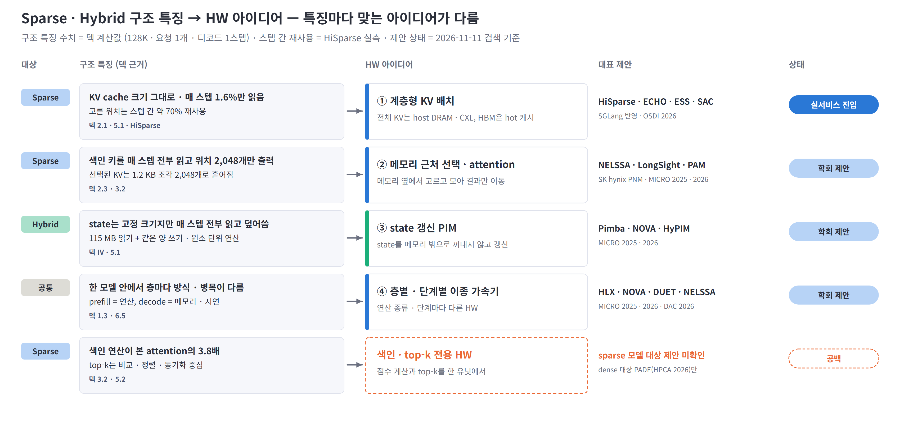
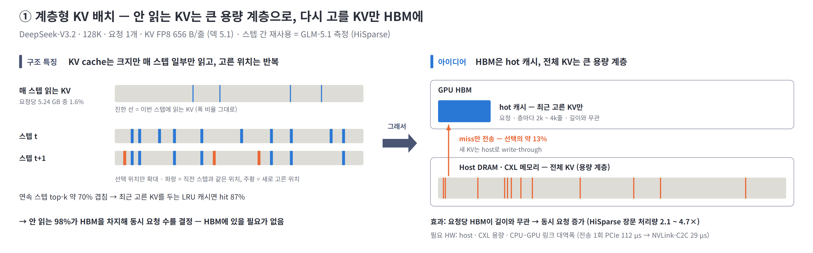
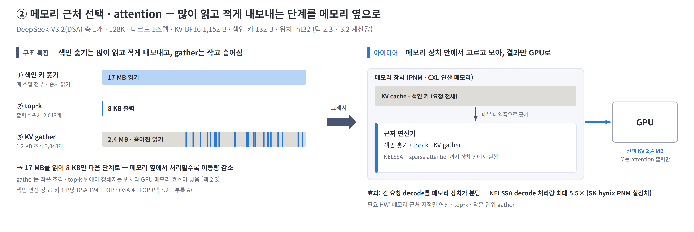
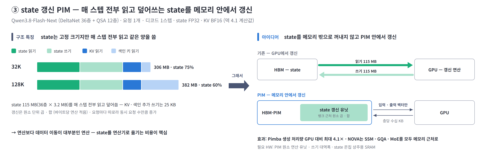
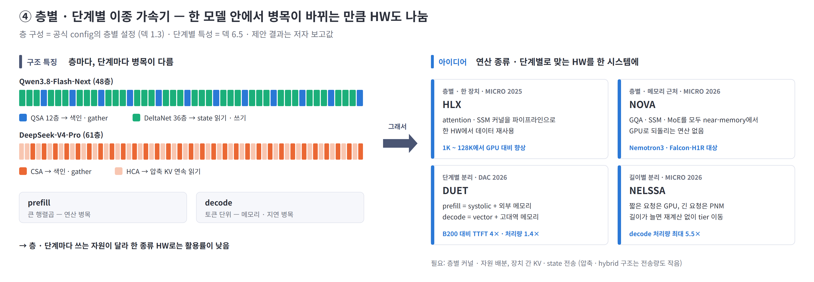

# Sparse · Hybrid Attention을 위한 HW · 시스템 아이디어 정리

기준일 2026-11-11 · 구조 특징 근거: [02-deck-draft-claude.md](02-deck-draft-claude.md) · HiSparse 상세: [paper-hisparse-claude.md](paper-hisparse-claude.md) · 그림: [figures-claude/hw-ideas/](figures-claude/hw-ideas/) (`python arch_insight/figures-claude/hw-ideas/make_hw_ideas_figures.py`)

> 읽는 법: 장마다 **구조 특징**(덱에서 정량화한 sparse · hybrid의 성질)을 먼저 두고, 그 특징 때문에 가능해지는 **아이디어**와 대표 제안을 이어서 정리. 그림 왼쪽 = 특징, 오른쪽 = 아이디어.

---

## 요약

### 구조 특징마다 맞는 HW 아이디어가 갈림 — 용량(계층형 KV)은 실서비스 진입, 대역폭 · state · 이종 가속기는 학회 제안, 색인 · top-k 전용 HW는 공백

- **Sparse — KV cache 크기는 그대로인데 매 스텝 1.6%만 읽음:** 안 읽는 KV를 HBM 밖으로 → ① 계층형 KV 배치. SGLang 반영(HiSparse) · OSDI 채택(ECHO)으로 가장 성숙
- **Sparse — 색인은 많이 읽고 적게 내보내고, gather는 작고 흩어짐:** 고르고 모으는 단계를 메모리 옆으로 → ② 메모리 근처 선택 · attention. SK hynix 실제 PNM 장치 기반 제안(NELSSA)
- **Hybrid — state를 매 스텝 전부 읽고 덮어씀 · 층마다 병목이 다름:** ③ state 갱신 PIM, ④ 층별 · 단계별 이종 가속기 — MICRO 2025 · 2026에 집중
- **공백:** 덱이 가장 큰 새 부담으로 본 색인 연산(본 attention의 3.8배) · top-k를 직접 처리하는 sparse 모델용 HW는 미확인 — 현재는 GPU 커널에서만 다룸

※ 범위: 이미 sparse attention(DSA · NSA 등 top-k 선택) 또는 hybrid attention(SSM · linear + full)을 쓰는 모델을 위한 HW · 시스템 제안 — 메모리 계층, 메모리 근처 연산(PIM · PNM · CXL), 전용 가속기, 이종 구성. 새 attention 알고리즘 · 일반 GPU 커널 최적화는 제외. 표기: 🏛 학회 · 🔧 프레임워크 반영 · 🏭 산업체 참여 · 📄 프리프린트. 결과는 모두 저자 보고값.

---

## 1. 계층형 KV 배치 — Sparse의 용량 문제

### KV cache는 크지만 매 스텝 1.6%만 읽고 고른 위치도 반복됨 → 전체 KV는 큰 용량 계층에, HBM은 hot 캐시로

**구조 특징**
- **KV cache 크기 그대로 · 읽기는 1.6%** (덱 2.1 · 5.1) — 안 읽는 98%가 HBM을 차지해 동시 요청 수를 결정
- **고른 위치는 연속 스텝 약 70% 겹침** (HiSparse 실측) — 최근 고른 KV만 HBM에 두면 대부분 hit

**그래서 가능한 아이디어** — 전체 KV는 host DRAM · CXL, HBM은 요청별 hot 캐시. host 전송은 선택의 약 13%뿐이고, 요청당 HBM이 길이와 무관해져 같은 HBM에 더 큰 배치

| 제안 | 발표 | 핵심 | 결과 |
|---|---|---|---|
| **HiSparse** (Stanford 외) | 🔧 SGLang · 📄 2026-08 | LRU 캐시 관리를 GPU graph 안 커널 1개로, 층간 색인 공유 모델은 정확한 prefetch | 장문 처리량 2.1 ~ 4.7× |
| **ECHO** (SJTU · Huawei) | 🏛 OSDI 2026 · 🏭 | 색인 점수의 예측성으로 가져올 KV를 미리 recall (NSA 계열) | 생성 처리량 최대 2.1× |
| **ESS** (Baidu) | 📄 2025-12 · 🏭 | V3.2 latent cache 일부를 CPU로, 지연 민감 요소는 GPU 유지 | 128K 처리량 +123% (시뮬레이션) |
| **SAC** | 📄 2026-06 | 아래 계층을 CXL 분리 메모리로 확장 (HiSparse 구조 기반) | — |

- **한계 · 요구:** host · CXL 용량과 CPU–GPU 링크가 새 병목(전송 1회 PCIe 112 µs → NVLink-C2C 29 µs). Grace 계열처럼 host 메모리가 HBM보다 크지 않으면 이득 축소. host에서 CPU가 일부 attention을 직접 계산하는 변형(Fluxion · HGCA)도 있음

※ 출처: HiSparse(arXiv 2608.07009) §3 ~ §5, ECHO(OSDI 2026) abstract, ESS(arXiv 2512.10576), SAC(arXiv 2606.19746).

---

## 2. 메모리 근처 선택 · attention — Sparse의 대역폭 문제

### 색인 훑기는 17 MB를 읽어 8 KB만 내보내고, gather는 작고 흩어짐 → 고르고 모으는 단계를 메모리 옆에서, GPU로는 결과만

**구조 특징**
- **색인은 많이 읽고 적게 내보냄** (덱 3.2) — 128K 층당 색인 키 17 MB를 매 스텝 전부 읽고, 출력은 위치 2,048개(8 KB)
- **선택된 KV는 작고 흩어진 조각** (덱 2.3) — 1.2 KB × 2,048개, top-k 뒤에야 위치가 정해져 GPU 메모리 효율이 가장 낮은 형태

**그래서 가능한 아이디어** — 색인 훑기 · top-k · gather(· attention)를 메모리 장치 안에서 처리. 메모리 내부 대역폭으로 훑고, 링크로는 선택된 KV나 attention 출력만 이동 — KV를 GPU 밖 용량 계층에 둘 때 특히 유효

| 제안 | 발표 | 핵심 | 결과 |
|---|---|---|---|
| **NELSSA** (SK hynix · KAIST) | 🏛 MICRO 2026 · 🏭 | GPU + 실제 PNM 장치 — 긴 요청 decode는 PNM에서 장치 내 sparse attention | decode 처리량 최대 5.5×, P99 지연 최대 15× 감소 |
| **LongSight** (Cornell) | 🏛 MICRO 2025 | CXL 연산 메모리에서 부호 비트 필터 → top-k, 선택된 KV만 GPU로 | GPU 1장 + CXL 1개로 1M 컨텍스트 |
| **PAM** (ICT CAS) | 📄 2026-02 | HBM-PIM(hot) · DDR-PIM · SSD-PIM(cold) 계층 + PIM 간 병렬 attention | vLLM 대비 12.9 ~ 26.4× |

- **공백:** 위 제안은 자체 선택(부호 비트 필터 · 접근 지역성)을 씀 — DSA처럼 모델이 학습한 색인을 그대로 메모리 근처에서 실행하는 설계는 미확인. DSA 색인은 키 1 B당 124 FLOP이라 얕은 PIM 연산기에는 부담이고, 블록 색인(QSA 4 FLOP/B)이 메모리 근처 실행에 더 적합 (덱 부록 A 기준 추정)
- **참고:** decode attention 전체를 PNM HBM cube로 옮긴 AMMA(MICRO 2026, 시뮬레이션 H100 대비 attention 지연 15.5× 감소) — 1M decode는 연산 die보다 HBM 대역폭 + 근처 연산이 결정

※ 출처: NELSSA(arXiv 2607.26633), LongSight(MICRO 2025, DOI 10.1145/3725843.3756062), PAM(arXiv 2602.11521), AMMA(arXiv 2604.26103). 구조 특징 수치는 DeepSeek-V3.2 층 1개 · 128K · KV BF16 계산값.

---

## 3. state 갱신 PIM — Hybrid의 state 문제

### state는 고정 크기지만 매 스텝 전부 읽고 덮어쓰는 단순 연산 → 메모리 밖으로 꺼내지 않고 PIM 안에서 갱신

**구조 특징**
- **state를 매 스텝 전부 읽고 같은 양을 씀** (덱 4.1) — Qwen3.8 36층 115 MB, 128K까지 decode I/O의 60% 이상
- **갱신은 원소 단위 곱 · 합** (덱 Ⅳ · 5.1) — 바이트당 연산이 적고, 요청마다 따로라 동시 요청 수만큼 증가

**그래서 가능한 아이디어** — HBM-PIM 안의 state 갱신 유닛에서 처리. 메모리 버스를 오가는 것은 입력 · 출력 벡터(층당 수십 KB)뿐이고, 연산이 단순해 얕은 PIM 연산기로도 충분

| 제안 | 발표 | 핵심 | 결과 |
|---|---|---|---|
| **Pimba** (KAIST) | 🏛 MICRO 2025 | HBM-PIM 안에 State-update Processing Unit (뱅크 2개당 1개, MX 양자화 원소 곱 · 합) | 생성 처리량 GPU 대비 최대 4.1× · GPU + PIM 대비 2.1× |
| **NOVA** (KAIST) | 🏛 MICRO 2026 | decode의 GQA · SSM · MoE를 모두 near-memory에서 — 기존 PIM은 일부를 GPU로 되돌림 | 원문 확인 필요 |
| **HyPIM** (SNU) | 🏛 MICRO 2026 | Mamba–Transformer hybrid용 통합 PIM | 원문 미공개 |

- **덱 연결:** 6.3 'State 처리 — 메모리 근처 갱신'의 구현. 대안은 state를 큰 온칩 SRAM에 상주시키는 방향

※ 출처: Pimba(arXiv 2507.10178), NOVA(arXiv 2608.22613), HyPIM(MICRO 2026 프로그램). 입력 · 출력 벡터 크기는 Qwen3.8 DeltaNet 층의 q · k · v · gate · 출력 BF16 기준 추정(약 33 KB).

---

## 4. 층별 · 단계별 이종 가속기 — 한 모델 안의 서로 다른 병목

### 층마다 방식이 다르고 prefill · decode의 병목도 다름 → 연산 종류 · 단계별로 맞는 HW를 한 시스템에

**구조 특징**
- **방식이 다른 층이 교대** (덱 1.3) — Qwen3.8은 QSA 12층 + DeltaNet 36층, V4는 CSA · HCA 1:1 → 층마다 병목이 색인 · gather · state 갱신으로 바뀜
- **단계마다 병목이 다름** (덱 6.5) — prefill은 큰 행렬곱(연산), decode는 토큰 단위(메모리 · 지연)

**그래서 가능한 아이디어** — 층별로는 한 장치에서 파이프라인으로 묶거나 전부 메모리 근처로, 단계별로는 prefill · decode 패키지 분리, 길이별로는 짧은 요청 GPU · 긴 요청 PNM

| 제안 | 발표 | 핵심 | 결과 |
|---|---|---|---|
| **HLX** (KAIST) | 🏛 MICRO 2025 | attention · SSM 커널이 GPU에서 모두 활용률이 낮음 → 파이프라인화해 한 HW에서 실행 | 1K ~ 128K에서 GPU 대비 향상 |
| **DUET** | 🏛 DAC 2026 | prefill = systolic chiplet + 외부 메모리, decode = vector unit + 패키지 내 고대역 메모리 | B200 대비 TTFT 4×, 처리량 1.4× |
| **NOVA** · **NELSSA** | 🏛 MICRO 2026 | 층별: GQA · SSM · MoE 모두 near-memory (3장) · 길이별: GPU / PNM 분담 (2장) | 3장 · 2장 참조 |

- **요구:** 층별 커널 · 자원 배분, 장치 간 KV · state 전송 — 압축 · hybrid 구조는 전송량도 작아 분리에 유리 (덱 6.5)

※ 출처: HLX(MICRO 2025, DOI 10.1145/3725843.3756115), DUET(arXiv 2603.15530). MICRO 2026 채택은 프로그램 분석 자료 기준.

---

## 5. 아직 비어 있는 영역 — 색인 · top-k 전용 HW

### 덱이 가장 큰 새 부담으로 본 '고르는 비용'을 직접 처리하는 sparse 모델용 HW는 미확인

**구조 특징**
- **색인 연산이 본 attention의 3.8배** (덱 3.2) — 키 1 B당 124 FLOP(DSA), 색인 키를 줄일수록 대역폭 문제가 연산 문제로 이동
- **top-k는 비교 · 정렬 · 동기화 중심** (덱 5.2) — 행렬곱 유닛이 쉬고, FLOP · 바이트로 잡히지 않는 시간

**현황**
- sparse 모델 대상 전용 HW 제안은 검색 범위에서 미확인 — GPU 커널(cuDNN 결합 API · GVR)에서만 다룸
- dense 대상 **PADE**(🏛 HPCA 2026): 예측기와 attention 실행을 bit-serial로 융합 → H100 대비 7.43×. 8-bit에서 예측기가 전체 비용의 63% — '고르는 비용이 HW에서도 지배적'이라는 덱 Ⅲ 결론을 확인

---

## 출처

| 분야 | 링크 |
|---|---|
| 계층형 KV | [HiSparse](https://arxiv.org/abs/2608.07009) · [SGLang HiSparse 블로그](https://www.lmsys.org/blog/2026-04-10-sglang-hisparse/) · [ECHO (OSDI 2026)](https://www.usenix.org/conference/osdi26/presentation/liu-guangda) · [ESS](https://arxiv.org/abs/2512.10576) · [SAC](https://arxiv.org/abs/2606.19746) · [Fluxion](https://arxiv.org/abs/2605.07719) · [HGCA](https://arxiv.org/abs/2507.03153) |
| 메모리 근처 | [NELSSA](https://arxiv.org/abs/2607.26633) · [LongSight (MICRO 2025)](https://dl.acm.org/doi/10.1145/3725843.3756062) · [PAM](https://arxiv.org/abs/2602.11521) · [AMMA](https://arxiv.org/abs/2604.26103) |
| Hybrid | [Pimba](https://arxiv.org/abs/2507.10178) · [HLX (MICRO 2025)](https://dl.acm.org/doi/10.1145/3725843.3756115) · [NOVA](https://arxiv.org/abs/2608.22613) · [DUET](https://arxiv.org/abs/2603.15530) |
| 공백 · 참고 | [PADE](https://arxiv.org/abs/2512.14322) · [MICRO 2026 프로그램 분석](https://semihub.io/en/blog/micro-2026-guide.html) |

※ 수치는 각 논문의 저자 보고값. MICRO 2026 채택(NELSSA · NOVA · HyPIM · AMMA)은 프로그램 분석 자료 기준이며 공식 proceedings로 재확인 필요. '공백' 판단은 2026-11-11 검색 범위 기준.
