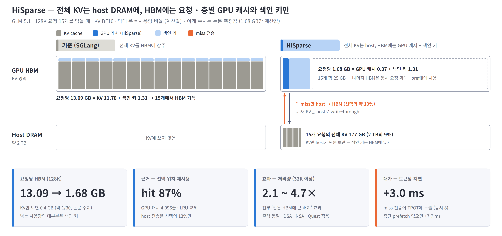
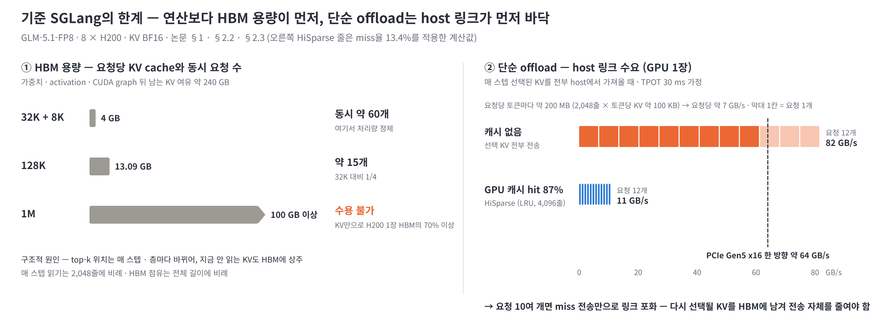
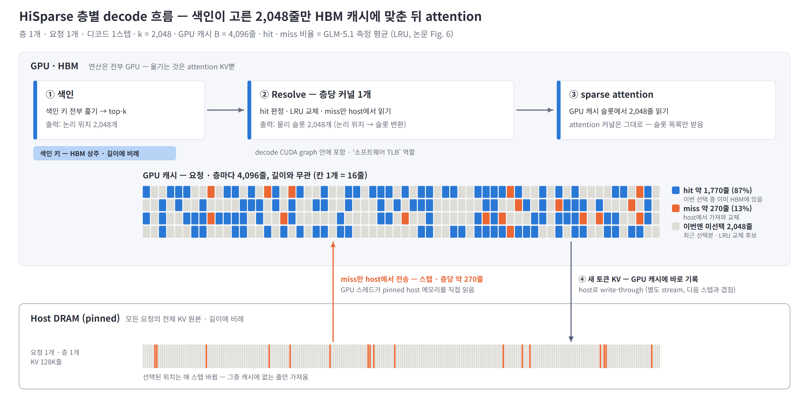
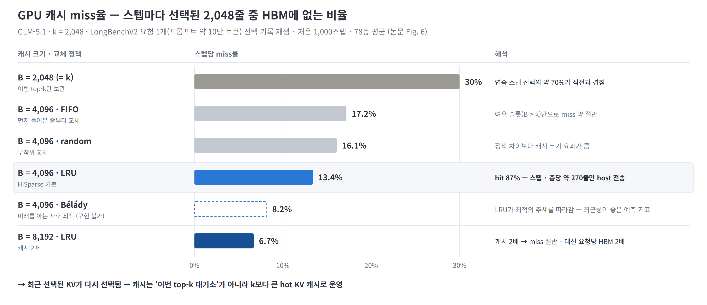
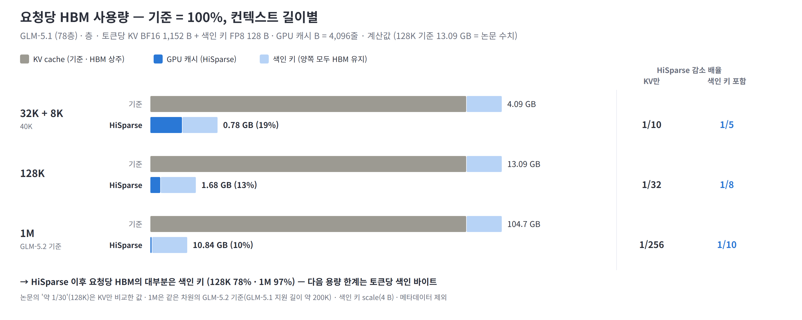
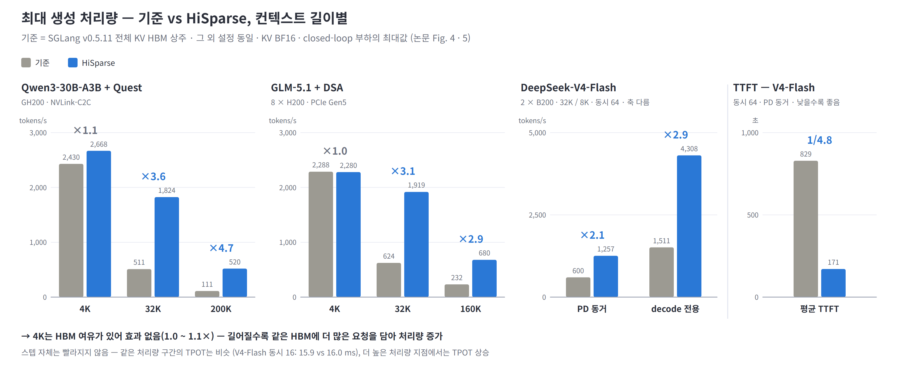
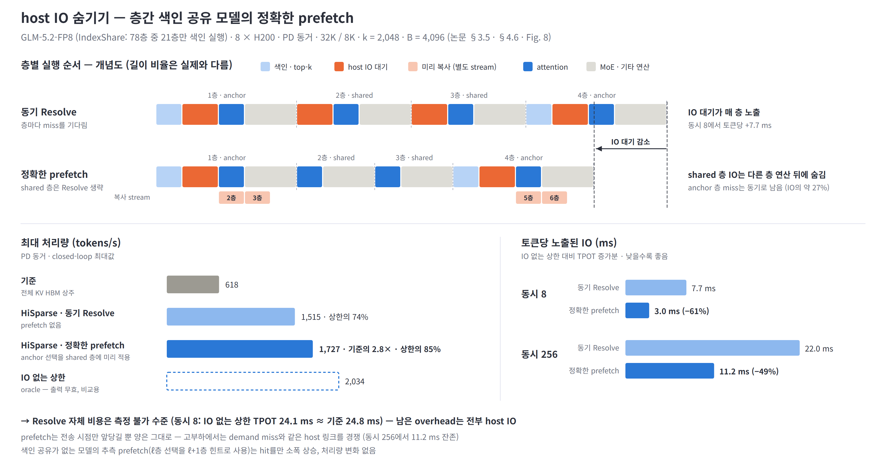

# HiSparse 논문 정리 — Sparse attention 디코드의 계층형 KV cache 관리

| 항목 | 내용 |
|---|---|
| 논문 | HiSparse: Scaling Sparse-Attention Decoding with Hierarchical KV Cache Management |
| 저자 · 소속 | Zhiqiang Xie 외 5명 — Stanford · Meta · Alibaba · Ant Group · SJTU · PKU · NVIDIA Research (Christos Kozyrakis) |
| 공개 · 구현 | arXiv 2608.07009v1 (cs.DC, 2026-08-07) · SGLang upstream 병합, 정식 기능 (`--enable-hisparse`) |
| 링크 | [arXiv](https://arxiv.org/abs/2608.07009) · [SGLang 가이드](https://docs.sglang.io/advanced_features/hisparse_guide.html) |

> 그림은 [figures-claude/hisparse/](figures-claude/hisparse/)에 있고 `python arch_insight/figures-claude/hisparse/make_hisparse_figures.py`로 다시 만든다. 수치는 논문 측정값이 기본이며, 요청당 HBM 분해(색인 키 포함)처럼 직접 계산한 값은 그림 · 출처 줄에 '계산값'으로 표기.

---

## 요약

### Sparse attention은 KV cache 읽기만 줄이고 크기는 그대로 → HiSparse는 전체 KV를 host DRAM에 두고 HBM에는 최근 선택된 KV만 — 장문 처리량 2.1 ~ 4.7×, 대가는 host 링크 IO

- **문제:** 매 스텝 읽는 KV는 2,048줄인데 HBM에는 전체 KV가 상주 → 연산 여유가 남아도 HBM이 차서 동시 요청 수 포화 (GLM-5.1 128K 약 15개)
- **해법 · 근거:** 전체 KV는 host DRAM, HBM에는 요청 · 층별 GPU 캐시(4,096줄)만 — 선택 위치의 시간 지역성 덕분에 선택의 87%가 HBM에서 hit, host 전송은 13%
- **효과:** 요청당 KV HBM 약 1/30 → 같은 HBM에 큰 배치 → 32K 이상 처리량 2.1 ~ 4.7× · 출력 동일. 단, 색인 키는 HBM에 남아 **색인 키 포함 요청당 HBM은 약 1/8** (계산값)
- **대가 · 시사점:** miss 전송이 TPOT에 노출(토큰당 +7.7 ms → 층간 prefetch로 +3.0 ms) — decode 처리량의 결정 요인이 HBM 용량에서 **host 메모리 용량 · CPU–GPU 링크 대역폭**으로 이동

※ 출처: 논문 Abstract · §1 · §3 · §4 (KV BF16, k = 2,048). 요청당 HBM 1.68 GB(색인 키 포함)는 GLM-5.1 config로 분해한 계산값 — 4.1 · 부록 C.

---

## 구성

| 장 | 내용 |
|---|---|
| **1. 문제** | HBM 용량 한계 · 단순 offload의 링크 병목 |
| **2. 구조** | 데이터 배치 · 층별 decode 흐름 · Resolve 커널 |
| **3. 근거** | 선택 위치의 시간 지역성 · 캐시 크기와 교체 정책 |
| **4. 효과** | 요청당 HBM 사용량 · 처리량 · TTFT |
| **5. 대가** | host IO · 층간 prefetch |
| **6. 한계와 시사점** | 적용 조건 · 모델 · HW co-design |
| **부록** | 관련 연구 비교 · 구현 · 설정 · 계산 기준 |

---

## 1. 문제 — HBM 용량 한계

### Sparse attention 디코드는 연산보다 HBM 용량이 먼저 바닥 — 전체 KV를 host로 내리는 단순 offload는 링크가 먼저 바닥

- **HBM 용량:** GLM-5.1 128K 요청 1개 KV 13.09 GB — 8 × H200의 KV 여유(약 240 GB)에 동시 약 15개. 32K는 약 60개에서 처리량 정체, 1M은 요청 1개가 H200 1장 HBM(141 GB)의 100 GB 이상
- **구조적 원인:** top-k 위치가 매 스텝 · 층마다 바뀌어 지금 안 읽는 KV도 다음 스텝에 선택될 수 있음 → 서빙 시스템은 전체 KV를 HBM에 상주. PD 동거 시에는 decode KV가 prefill용 HBM을 잠식해 TTFT도 급증
- **단순 offload 불가:** 매 스텝 선택된 KV를 전부 host에서 가져오면 요청당 약 7 GB/s — GPU당 요청 10여 개면 PCIe Gen5 x16(한 방향 약 64 GB/s)이 포화 → **다시 선택될 KV를 HBM에 남겨 전송 자체를 줄이는 것**이 핵심

※ 출처: 논문 §1 · §2.2 · §2.3 · Fig. 1. GLM-5.1-FP8(가중치 FP8, KV BF16) · 8 × H200 · 입력 32K / 출력 8K. 오른쪽 아래 줄(GPU 캐시 hit 87%)은 요청당 전송량에 miss율 13.4%(3장)를 곱한 계산값.

---

## 2. 구조 — 계층형 KV cache

### '언젠가 선택될 수 있음'과 'HBM에 있어야 함'을 분리 — 색인이 매 층 확정하는 top-k 위치만 attention 직전에 HBM 캐시로 맞춤

- **데이터 배치:** 전체 KV는 host DRAM(pinned), HBM에는 색인 키 · 요청 · 층별 GPU 캐시(B = 2k ~ 4k줄) · 페이지 테이블만 — decode용 KV HBM이 전체 길이 대신 캐시 크기 B에 비례
- **Resolve 커널:** hit 판정 · LRU 교체 · miss 가져오기 · 슬롯 목록 출력을 층당 커널 1개로 결합(decode CUDA graph 안) — miss는 GPU 스레드가 pinned host 메모리를 직접 읽어 흩어진 주소를 DMA 없이 처리
- **selector 무관:** DSA(토큰) · NSA(블록) · Quest(페이지) 모두 '색인 상태가 작아 HBM 상주 · KV 읽기 전에 선택 확정 · 출력이 층별 위치 집합' → 위치만 받아 KV 배치만 바꾸므로 재학습 · 모델 변경 불필요

※ 출처: 논문 §2.1 · §3.1 ~ §3.4 · Fig. 2 · Fig. 3 · Table 1 · 2. 새 토큰 KV는 GPU 캐시의 예약 슬롯에 기록(항상 hit) 후 별도 stream으로 host에 write-through. LRU는 한 스텝 안에서 hit을 새로 가져온 miss보다 위로 승격 — 여러 스텝 재사용된 KV가 남고 1회성 선택이 먼저 밀려남.

---

## 3. 근거 — 선택 위치의 시간 지역성

### 이번 top-k만 두면 miss 30%, 2배 캐시 + LRU면 13.4% — 최근 선택된 KV가 다시 선택됨

- **지역성:** 연속 스텝 top-k의 약 70%가 직전과 겹침 → 이번 top-k만 보관(B = k)해도 miss 30%, 여유 슬롯을 두면(B = 2k) 16 ~ 17%
- **교체 정책:** 같은 크기에서 LRU가 13.4%로 가장 낮고 사후 최적(Bélády, 8.2%)의 추세를 따라감 — 최근성이 좋은 예측 지표. 남은 격차가 예측형 정책의 개선 여지
- **캐시 크기:** B = 8,192면 miss 6.7%로 절반 — 대신 요청당 HBM 2배 · 탐색 비용 증가 → 적정 B = 2k ~ 4k, host 링크가 빠를수록 2k 쪽 (B는 배포 시 고정, 동적 조정은 향후 과제)

※ 출처: 논문 §4.3 · §4.4 · Fig. 6 · Fig. 7. GLM-5.1(k = 2,048)의 LongBenchV2 요청 1개(프롬프트 100,384토큰, 78층) 선택 기록을 재생, 처음 1,000스텝 · 전 층 평균. 요청 1개 trace 기준이라 워크로드별 편차는 논문에 없음.

---

## 4.1 효과 — 요청당 HBM 사용량

### KV는 1/10 ~ 1/256로 감소 — 단 색인 키는 HBM에 남아 요청당 HBM은 1/5 ~ 1/10, 남는 사용량의 대부분이 색인 키

- **KV 기준 (논문):** decode용 KV HBM = 요청 수 × 층 수 × B × 줄당 KV 바이트 — 길이와 무관. GLM-5.1 128K에서 요청당 13.09 → 약 0.4 GB(약 1/30)
- **색인 키 포함 (계산값):** 색인 키(층 · 토큰당 128 B)는 이동하지 않고 HBM에 남아 길이에 비례 → 128K 요청당 1.68 GB(1/8) 중 78%가 색인 키, 1M은 10.8 GB(1/10) 중 97%
- **시사점:** HiSparse 이후 요청당 HBM은 색인 키 크기가 결정 — 토큰당 색인 바이트를 줄이는 설계(FP4 · 블록 색인)가 동시 요청 수로 직결 ([덱](02-deck-draft-claude.md) Ⅲ장 색인 키 포화와 같은 축)

※ 기준: GLM-5.1 config(78층, MLA 512 + 64차원) · 층 · 토큰당 KV BF16 1,152 B + 색인 키 FP8 128 B — 합 1,280 B × 78층 × 128K = 13.09 GB로 논문 수치와 일치. GPU 캐시 B = 4,096줄. 1M은 같은 차원의 GLM-5.2 기준. 색인 키 scale · 페이지 테이블 · 메타데이터 제외. 논문은 색인 상태를 '토큰당 수백 B 이하'로만 기술하고 요청당 합계는 제시하지 않음.

---

## 4.2 효과 — 처리량 · TTFT

### 짧은 컨텍스트는 효과 없음, 길수록 커짐 — 32K 이상 처리량 2.1 ~ 4.7×, 전부 '같은 HBM에 더 큰 배치' 효과

- **길이별:** 4K는 1.0 ~ 1.1×(HBM 여유) → 32K 2.1 ~ 3.6× → 160K · 200K 2.9 · 4.7× — selector(Quest · DSA · CSA) · HW(GH200 · H200 · B200)와 관계없이 같은 경향
- **TTFT:** V4-Flash 동시 64에서 829 s → 171 s — decode KV가 비운 HBM만큼 prefill 대기 감소
- **TPOT:** 같은 처리량 구간에서는 비슷(V4-Flash 동시 16: 15.9 vs 16.0 ms) — 스텝이 빨라지는 것이 아니라 배치가 커지는 것. 같은 배치를 유지하면 HBM 절감으로도 사용 가능 (GLM-5.1 32K · 60요청 KV 약 240 → 25 GB, 색인 키 별도)

※ 출처: 논문 §4.2 · Fig. 4 · Fig. 5. 기준 = SGLang v0.5.11 전체 KV HBM 상주, 그 외 설정 동일. KV는 모두 BF16(모델명의 FP8은 가중치). 동시 요청 수는 closed-loop 기준. V4-Flash는 압축 KV(CSA, 4토큰 압축 KV에서 top-512)만 계층 관리. 물리적 PD 분리 배포는 실험하지 않음 — decode 전용 처리량을 decode pool 성능의 대리 지표로 사용. 다른 offload 시스템과 직접 비교 없음.

---

## 5. 대가 — host IO와 층간 prefetch

### 처리량 이득의 대가는 miss 전송 — 층간 색인 공유 모델은 선택을 미리 알 수 있어 '정확한' prefetch로 IO를 숨김 (IO 없는 상한의 74% → 85%)

- **IO가 유일한 overhead:** Resolve 자체(탐색 · 스캔 · LRU 갱신)는 측정 불가 수준, 노출되는 것은 host 전송 — 토큰당 +7.7 ms(동시 8) ~ +22 ms(동시 256). Resolve 1회 IO는 PCIe Gen5 112 µs → NVLink-C2C 29 µs로, 층당 attention 커널(약 60 µs)과 비교되는 크기
- **정확한 prefetch:** IndexShare(GLM-5.2: 78층 중 21층만 색인)에서 anchor 층의 Resolve가 'host의 어느 KV를 어느 슬롯으로' 계획 → 복사 전용 커널이 별도 stream에서 다음 shared 층 캐시를 미리 채우고 shared 층은 Resolve 생략 → 노출 IO 7.7 → 3.0 ms, 처리량 1,515 → 1,727 tokens/s(기준의 2.8×)
- **한계:** anchor 층 miss는 동기로 남고(IO의 약 27%), prefetch는 전송 시점만 앞당길 뿐 양은 그대로라 고부하에서 링크 경쟁. 공유 없는 모델의 추측 prefetch는 효과 없음 → 논문 결론: 선택을 층간 공유 · 조기 공개하는 **모델 co-design**이 IO 숨기기의 전제

※ 출처: 논문 §3.5 · §4.4 ~ §4.6 · Fig. 7 · Fig. 8. GLM-5.2-FP8 · 8 × H200 · PD 동거 · 32K / 8K · k = 2,048 · B = 4,096. IO 없는 상한(oracle)은 전송을 생략해 출력이 무효인 비교용 구성. Resolve IO 시간은 GLM-5.1 · B = 2k · 배치 16 기준. prefill 적재 비용은 없음(동시 8 TTFT 기준 10.7 s vs HiSparse 10.7 ~ 10.8 s).

---

## 6. 한계와 시사점

### HBM 용량 병목을 host 링크 대역폭 · 지연 문제로 전환 — 이득은 장문 · 고부하에서만, 용량이 병목이 아니면 끄는 것이 맞음

| 한계 | 내용 |
|---|---|
| **TPOT overhead** | 용량을 host 트래픽과 맞바꿈 — 저부하에서 토큰당 +3 ~ 8 ms. 짧은 컨텍스트 · 저부하에서는 이득 없이 overhead만 |
| **host 메모리 용량** | host DRAM ≫ HBM 전제 — PCIe H200 서버(TB급)는 성립, GB200 · GB300은 Grace당 LPDDR 약 480 GB가 GPU HBM 합과 비슷해 배율 축소. NVMe · 네트워크 계층은 지연 증가로 지역성 · 겹치기 부담 증가 |
| **색인 키 잔존** | 색인 키는 HBM에 남아 길이에 비례 — 128K 요청당 HBM의 78%, 1M 97% (4.1, 계산값) |
| **적용 조건** | pipeline parallel · speculative decoding은 prefetch 없이 동기 Resolve로 후퇴. 현재 PD 분리 모드의 decode 인스턴스 전용, 지원 모델 DSA 계열(V3.2 · GLM-5.1) · V4 · MiniMax M3 |
| **평가 범위** | 물리적 PD 분리 · 1M 컨텍스트 직접 실험 없음, 지역성은 요청 1개 trace 기준, 다른 offload 시스템과 직접 비교 없음 |

**시사점**

- **병목 이동:** decode 처리량의 결정 요인이 HBM 용량 → host 메모리 용량 · CPU–GPU 링크 대역폭 · 선택 지역성으로 이동 — NVLink-C2C급 링크는 Resolve IO를 약 1/4로 줄여 작은 GPU 캐시 · 큰 배치로 직결
- **용량 이득의 사용처:** 같은 HBM에 큰 배치(처리량) 또는 같은 배치를 적은 HBM으로(HW 절감) — decode용 KV HBM이 길이와 무관해져 최대 서빙 길이는 host 용량과 색인 키 크기가 결정
- **모델 co-design:** 선택을 층간 공유하거나 일찍 공개하는 구조(IndexShare)는 KV 배치를 '지연 문제'에서 '스케줄링 문제'로 바꿈. 색인 키 축소(FP4 · 블록)는 HBM 바닥을 낮춤
- **덱과의 연결:** [덱](02-deck-draft-claude.md) 6.3의 KV hot / cold 분리를 서빙 SW가 host DRAM으로 구현한 사례 — 스텝 간 top-k 재사용 약 70% · LRU hit 87%는 덱 부록 C의 미확인 항목(스텝 간 top-k 재사용률)에 대한 실측값

※ 출처: 논문 §5 · §7, SGLang HiSparse 가이드. 색인 키 잔존은 4.1 계산값.

---

## 부록 A. 관련 연구와의 차이

| 계열 | 대표 | 방식 | HiSparse와 차이 |
|---|---|---|---|
| KV 축출 · 양자화 | H2O · StreamingLLM · SnapKV · KV 양자화 | 덜 중요한 KV를 버리거나 근사 | 출력 변화 — HiSparse는 버리지 않고 위치만 옮김(정확) |
| 계층형 KV (요청 간 재사용) | FlexGen · HiCache · CachedAttention · Mooncake | GPU · host · storage에 KV · 가중치 배치 | 대화 간 prefix 재사용 — HiSparse는 요청 내부의 decode 작업 집합 |
| 선택적 offload (자체 selector) | InfiniGen · ShadowKV · MagicPIG · ArkVale · PQCache | dense 모델에 근사 selector를 붙여 host KV 선택 | 출력이 원 모델과 달라짐 — HiSparse는 모델 자체 top-k 사용 |
| CPU attention | NEO · FastDecode | attention 연산을 CPU로 | 정확하지만 연산이 CPU — HiSparse는 연산 전부 GPU |
| 동시기 연구 | ESS · ECHO | V3.2 latent cache offload(시뮬레이션) · NSA 전용 prefetch | HiSparse는 selector 무관 · 지역성 우선(IO 감소) · prefetch는 공유 선택에서만(정확) |

- **HiCache와의 관계:** 같은 host 계층 인프라(pinned host KV pool · IO backend)를 공유하되 대상이 다름 — HiCache는 prefill 노드에서 prefix 재사용으로 prefill 연산 감소, HiSparse는 decode 노드에서 요청당 상주량 제한으로 decode 배치 확대 → PD 분리에서 짝을 이룸

※ 출처: 논문 §6 · 부록 A.

---

## 부록 B. 구현 · 설정

| 항목 | 내용 |
|---|---|
| 코드 규모 | Python 약 2,200줄(모듈 6개) + CUDA 커널 — scheduler · model runner · attention backend · PD 전송 경로에 통합 |
| 병렬 처리 | 적재 · write-through · prefetch를 각자 CUDA stream에서 실행, event로 순서 보장 |
| 호환 | AMD GPU용 HIP 커널 제공, PD 분리 시 prefill이 decode 노드 host DRAM pool에 직접 기록 |
| 설정 예시 | `--enable-hisparse --hisparse-config '{"top_k": 2048, "device_buffer_size": 6144, "host_to_device_ratio": 10, "swap_in_block_size": 960}'` |
| `host_to_device_ratio` | host pool 크기 / device KV 예산 — host 약 1 TB면 5, 약 2 TB면 10 권장 |
| prefetch | 층간 색인 공유를 선언한 모델에서 자동 활성, `SGLANG_DISABLE_HISPARSE_PREFETCH=1`로 비활성 |

※ 출처: 논문 부록 A, SGLang HiSparse 가이드.

---

## 부록 C. 계산 기준 (그림 0 · 1 · 4)

| 항목 | 기준 |
|---|---|
| 요청당 KV (기준) | GLM-5.1 78층 × (KV BF16 1,152 B + 색인 키 FP8 128 B) × 길이 — 128K = 13.09 GB로 논문 수치와 일치 |
| 요청당 HBM (HiSparse) | GPU 캐시 78층 × 4,096줄 × 1,152 B = 0.37 GB + 색인 키 전체. 논문의 '약 0.4 GB'는 줄당 1,280 B로 계산하면 0.41 GB |
| 길이 | 32K + 8K = 40,960 · 128K = 131,072 · 1M = 1,048,576 (1M은 같은 차원의 GLM-5.2 기준) |
| 단순 offload 전송량 | 2,048줄 × 토큰당 KV 약 100 KB(78층 합) = 토큰당 약 200 MB, TPOT 30 ms → 요청당 약 7 GB/s (논문 §2.3). HiSparse 줄은 여기에 miss율 13.4% 적용 |
| 미포함 | 색인 키 scale(층 · 토큰당 4 B) · 페이지 테이블 · LRU 메타데이터 · activation |
