# Sparse · Hybrid Attention 구조 특징과 HW 아키텍처 방향

KV cache 부담 이동에 따른 HW 요구 사항과 대응 아이디어 · 2026.11

근거: 구조 분석 [02-deck-draft-claude.md](02-deck-draft-claude.md)(계산값) · HW 아이디어 [hw-arch-ideas-claude.md](hw-arch-ideas-claude.md) · HiSparse 상세 [paper-hisparse-claude.md](paper-hisparse-claude.md). 그림: 요약은 [figures-claude/hw-report/](figures-claude/hw-report/)(`python arch_insight/figures-claude/hw-report/make_hw_report_figures.py`), 나머지는 덱 · HW 아이디어 그림 재사용. 비교 기준: 128K · 요청 1개 · 디코드 1스텝.

---

## 요약

### KV cache 부담은 줄지만 Sparse는 '고르는 비용', Hybrid는 'state 갱신'이 새 부담 → HW는 대역폭 증설보다 데이터별 배치 · 메모리 근처 처리 · 이종 구성으로 대응, 용량 대응만 실서비스 진입

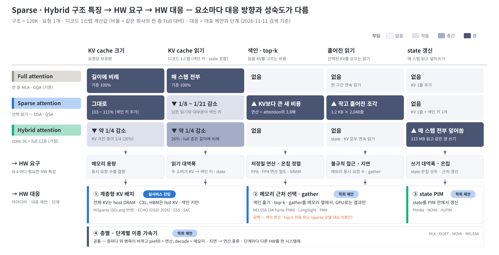

- **구조:** Sparse는 KV cache **읽기 감소**(1/8 ~ 1/21) · **크기는 그대로**, Hybrid는 **크기 · 읽기 약 1/4 감소** → 대신 색인 연산(본 attention의 3.8배) · 흩어진 gather(1.2 KB × 2,048줄) · state 덮어쓰기(매 스텝 115 MB)가 새 부담
- **HW 요구:** 데이터마다 필요한 메모리가 갈림 — KV cache는 **용량형**(매 스텝 1.6%만 읽음), 색인 키 · state는 **대역폭형**(매 스텝 전부 읽음) → 대역폭 하나로는 해결 불가, 연산 · 지연 · 온칩 · 쓰기를 함께 설계
- **HW 대응:** ① 계층형 KV가 가장 성숙(SGLang 반영 · OSDI 채택), ② 메모리 근처 선택 · ③ state PIM · ④ 이종 가속기는 MICRO 2025 · 2026 중심의 학회 제안
- **공백:** 가장 큰 새 부담인 색인 연산 · top-k를 직접 처리하는 sparse 모델용 HW는 미확인 — 현재는 GPU 커널에서만 다룸

※ 기준: 구조 수치는 덱 계산값, 비율은 같은 회사의 전 층 Full 대비(Sparse = DSA(V3.2) · QSA(Qwen3.8), Hybrid = Qwen3.8 차원의 state 36층 + full GQA 12층 가정 구성). 칸 색은 상대 부담을 4단계로 나눈 정성 구분. 제안 단계는 2026-11-11 검색 기준, 결과는 모두 저자 보고값.

---

## 구성

| 장 | 내용 |
|---|---|
| **Ⅰ. 구조 특징** | Attention 구조 동향 · 방식별 KV cache 쓰기 · 읽기 · Sparse와 Hybrid의 절감 효과 · 데이터별 메모리 접근 특성 · 디코드 단계별 제약 |
| **Ⅱ. HW 부담과 대응** | KV cache 용량 · 색인 훑기와 gather · 색인 연산과 top-k · state 갱신 · 층별 · 단계별 혼합 — 요소마다 구조 특징 → HW 요구 → 대응 아이디어 |
| **Ⅲ. 종합** | 영역별 HW 요구와 대응 현황 · 시사점과 확인 필요 항목 |
| **부록** | 방식별 비교 · 계산 기준 · 출처 |

---

# Ⅰ. 구조 특징

### 전 층 full attention은 15개 중 1개로 감소 — Sparse는 KV cache 읽기를, Hybrid는 크기를 줄이지만, 남은 색인 키 · state는 매 스텝 전부 읽힘

1.1 Attention 구조 동향 · 1.2 방식별 KV cache 쓰기 · 읽기 · 1.3 Sparse와 Hybrid의 절감 효과 · 1.4 데이터별 메모리 접근 특성 · 1.5 디코드 attention 단계별 제약

---

## 1.1 Attention 구조 동향

### 조사 대상 2026 하반기 15개 모델 중 전 층 full attention은 1개 — 층마다 방식을 섞는 구조가 주류

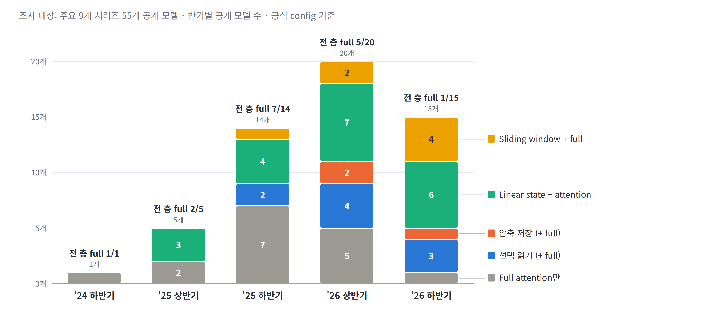

- **전 층 full attention 모델:** 2025 하반기 7/14 → 2026 상반기 5/20 → **2026 하반기 1/15**
- **대체 방식:** 선택 읽기(DSA 계열) · 압축 저장(DeepSeek-V4) · linear state 혼합(Qwen · Kimi · Nemotron) · sliding window 혼합 — 회사별로 상이
- **층 단위 혼합:** DeepSeek-V4는 4줄 압축(선택 읽기)과 128줄 압축(전부 읽기) 층을 1:1 교대, Qwen3.8은 48층 중 12층만 KV cache 보유 → **한 모델 안에 서로 다른 메모리 접근 패턴이 공존** (2.5)

※ 출처: 주요 9개 시리즈 55개 공개 모델의 공식 config([메모리 보고서](../reports/llm-memory-requirements.md) §1), 층 구성은 V4-Pro `compress_ratios` · Qwen3.8-Flash-Next `layer_types`. 조사 대상 표본이며 모델별로 가장 먼저 해당하는 분류 하나로 집계.

---

## 1.2 방식별 KV cache 쓰기 · 읽기

### 선택 읽기는 읽기만, 압축 · window는 크기까지, linear state는 크기 고정 대신 쓰기가 큼 — 방식마다 줄이는 대상이 다름

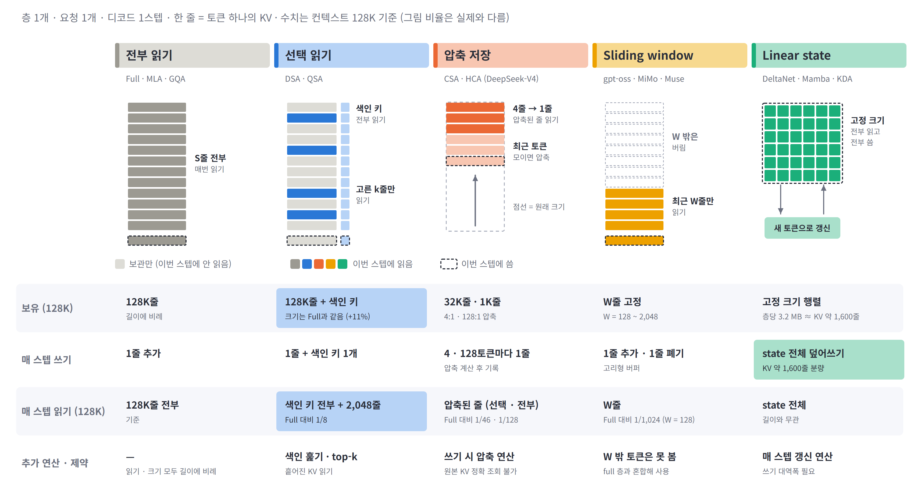

- **선택 읽기 (Sparse):** 'KV cache의 MoE' — 작은 색인기(indexer)가 KV 2,048줄만 골라 읽음. 단, MoE의 expert와 달리 선택 대상이 요청마다 따로이고 길이에 비례해 늘어남 → KV cache 크기는 Full과 같음(색인 키 +11%)
- **압축 저장 · sliding window:** 보관하는 줄 수 자체를 줄여 크기 · 읽기 모두 감소 — 압축은 쓰기 시 압축 연산 추가, window는 W 밖 토큰 조회 불가
- **Linear state (Hybrid):** 크기는 길이와 무관하게 고정, 대신 매 스텝 state 전체(층당 3.2 MB)를 읽고 덮어씀 — 쓰기가 가장 큰 방식

※ 기준: 층 1개 · 128K. 선택 읽기 = DSA(V3.2), 압축 = CSA 4:1 · HCA 128:1(DeepSeek-V4), state = Qwen3.8 DeltaNet 층당 3.2 MB. 그림 비율은 실제와 다름. MoE와의 비교는 덱 1.5.

---

## 1.3 Sparse와 Hybrid의 절감 효과

### Sparse는 읽기를, Hybrid는 크기를 줄임 — 128K에서 둘을 합쳐야 읽기 + 쓰기 3% · 크기 27%

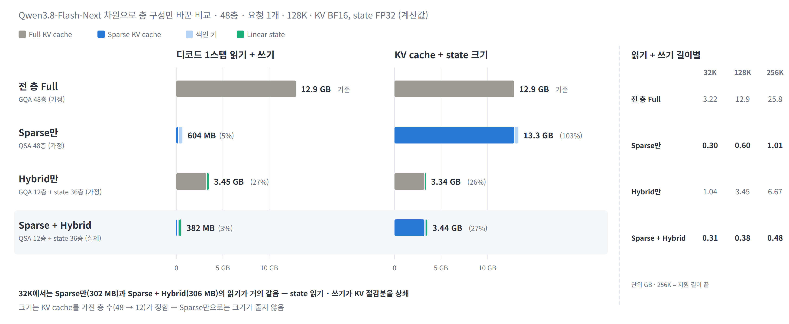

- **Sparse만:** 읽기 + 쓰기 5%로 크게 감소, KV cache 크기는 103% — 색인 키만큼 오히려 증가 → **용량 문제는 그대로** (2.1)
- **Hybrid만:** 크기 26% · 읽기 + 쓰기 27% — KV cache를 가진 층이 1/4로 줄어든 만큼 감소, full 층 읽기는 여전히 길이에 비례
- **결합 (Qwen3.8):** 둘 다 감소. 단, 32K에서는 state 읽기 · 쓰기(231 MB)가 KV 절감분을 상쇄해 Sparse만과 비슷 → **짧은 길이에서는 state가 주된 메모리 트래픽** (2.4)

※ 기준: Qwen3.8-Flash-Next 차원(48층)으로 층 구성만 바꾼 계산값, 요청 1개 · 디코드 1스텝 · KV BF16 · state FP32. Sparse만 · Hybrid만은 가정 구성, %는 전 층 Full 대비.

---

## 1.4 데이터별 메모리 접근 특성

### KV cache는 크지만 매 스텝 1.6%만, 색인 키 · state는 작지만 매번 전부 읽음 — 데이터마다 필요한 메모리가 용량형 · 대역폭형으로 갈림

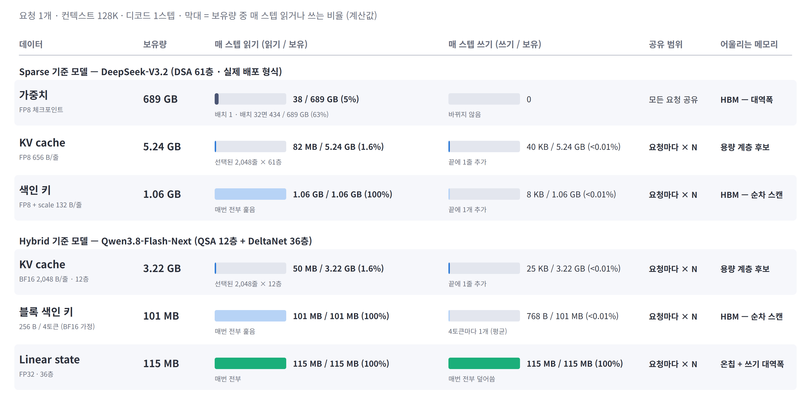

- **KV cache — 용량형:** 요청당 5.24 GB(V3.2) 보유, 매 스텝 1.6%만 읽고 1줄 추가 → 큰 용량 계층 배치 후보. 단, 어느 1.6%인지는 매 스텝 바뀌고 흩어져 있음
- **색인 키 · state — 대역폭형:** 색인 키는 KV의 1/5 크기지만 매 스텝 100% 순차 읽기, state는 115 MB를 100% 읽고 덮어씀 → HBM 대역폭 · 쓰기 대역폭 · 온칩이 관건. 요청마다 따로라 동시 요청 수만큼 증가
- **HW 관점:** 지금은 한 HBM에 섞여 있는 데이터를 **성격별로 다른 메모리 · 처리 위치에 배치**하는 것이 Ⅱ장 아이디어의 공통 출발점

※ 기준: 요청 1개 · 128K · 디코드 1스텝 · 모델 전체 합계 계산값. V3.2는 실제 배포 형식(KV FP8 656 B/줄, 색인 132 B/줄), Qwen3.8은 KV BF16 · state FP32 · 블록 키 BF16 가정.

---

## 1.5 디코드 attention 단계별 제약

### 128K 디코드에서 색인 키 훑기가 attention 단계 읽기의 60 ~ 90% — 단, 블록 색인(QSA · CSA)은 32K에서 1/3 수준이라 gather · top-k도 함께 봐야 함

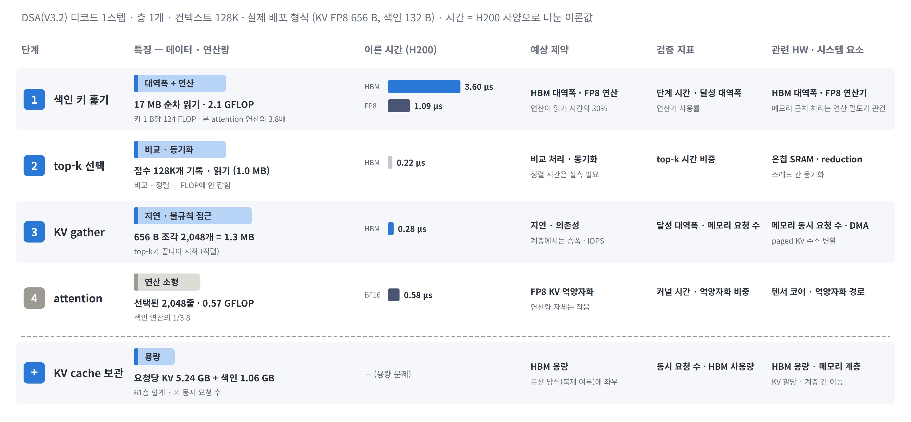

- **① 색인 키 훑기:** 층당 17 MB 순차 읽기 + 2.1 GFLOP — 이론 시간 3.6 µs로 나머지 단계 합(1.1 µs)의 3배, 대역폭과 FP8 연산을 함께 요구 (2.2 · 2.3)
- **② top-k · ③ KV gather:** 바이트로는 작지만(0.2 · 0.3 µs) 비교 · 정렬 · 동기화와 흩어진 읽기의 지연이 관건 — FLOP · 바이트에 잡히지 않는 시간이라 실측 필요 (2.2 · 2.3)
- **모델 · 길이별 차이:** 색인 훑기 비중(32K → 128K) DSA 73% → 88%, QSA 33% → 65%, CSA 30% → 59% — 토큰 색인 · 긴 컨텍스트일수록 색인 훑기, 블록 색인은 KV gather 비중이 큼

※ 기준: DeepSeek-V3.2 층 1개 · 128K · 실제 배포 형식(KV FP8 656 B, 색인 132 B). 시간 = 바이트 ÷ 4.8 TB/s 또는 FLOP ÷ 피크(H200)의 이론값, top-k 정렬 · 동기화 시간 미포함. 아래 비중은 attention 단계 읽기 바이트 기준(덱 5.2).

---

# Ⅱ. HW 부담과 대응

### 부담이 KV cache 용량 · 읽기 대역폭에서 색인 · gather · state · 층별 혼합으로 이동 → 요소마다 HW 대응이 갈리고, 용량 대응(계층형 KV)만 실서비스 진입

2.1 KV cache 용량 · 2.2 색인 훑기와 KV gather · 2.3 색인 연산과 top-k · 2.4 state 갱신 · 2.5 층별 · 단계별 혼합

각 절은 **구조 특징**(덱 근거) → **HW 요구** → **대응 아이디어**와 대표 제안 순서. 그림 왼쪽 = 구조 특징, 오른쪽 = 아이디어. 표기: 🏛 학회 · 🔧 프레임워크 반영 · 🏭 산업체 참여 · 📄 프리프린트, 결과는 저자 보고값.

---

## 2.1 KV cache 용량 — 계층형 KV 배치

### KV cache는 크지만 매 스텝 1.6%만 읽고 고른 위치도 반복 → 전체 KV는 큰 용량 계층에, HBM은 hot KV 캐시로

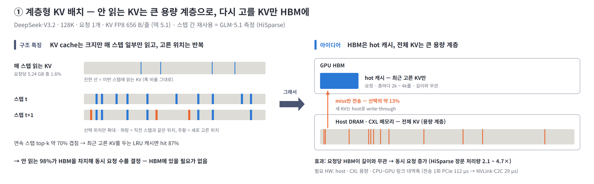

**구조 특징**
- **KV cache 크기 그대로 · 매 스텝 1.6%만 읽음** (1.3 · 1.4) — 안 읽는 98%가 HBM을 차지해 동시 요청 수를 결정
- **고른 위치는 연속 스텝 약 70% 겹침** (HiSparse 실측) — 최근 고른 KV만 HBM에 두면 대부분 hit(87%), host 전송은 선택의 약 13%

**HW 요구** — HBM 밖 대용량 계층(host DRAM · CXL)과 넓은 CPU–GPU 링크, HBM은 대역폭형 데이터(색인 키 · hot KV)에 집중

**대응 아이디어**

| 제안 | 발표 | 핵심 | 결과 |
|---|---|---|---|
| **HiSparse** (Stanford 외) | 🔧 SGLang · 📄 2026-08 | 요청 · 층별 LRU 캐시 관리를 GPU graph 안 커널 1개로, 층간 색인 공유 모델은 정확한 prefetch | 장문 처리량 2.1 ~ 4.7× |
| **ECHO** (SJTU · Huawei) | 🏛 OSDI 2026 · 🏭 | 색인 점수의 예측성으로 가져올 KV를 미리 recall (NSA 계열) | 생성 처리량 최대 2.1× |
| **ESS** (Baidu) | 📄 2025-12 · 🏭 | V3.2 latent cache 일부를 CPU로, 지연 민감 요소는 GPU 유지 | 128K 처리량 +123% (시뮬레이션) |
| **SAC** | 📄 2026-06 | 아래 계층을 CXL 분리 메모리로 확장 (HiSparse 구조 기반) | — |

- **한계:** 색인 키는 HBM에 남아 요청당 HBM의 대부분을 차지(128K 78% · 1M 97%) → 용량 문제가 **색인 키로 이동**. CPU–GPU 링크가 새 병목(전송 1회 PCIe 112 µs → NVLink-C2C 29 µs), host 메모리가 HBM보다 크지 않은 구성은 이득 축소

※ 출처: HiSparse(arXiv 2608.07009) §3 ~ §5, ECHO(OSDI 2026) abstract, ESS(arXiv 2512.10576), SAC(arXiv 2606.19746). 색인 키 비중은 GLM-5.1 78층 요청당 HBM 분해 계산값([HiSparse 정리](paper-hisparse-claude.md) 4.1). host에서 CPU가 일부 attention을 계산하는 변형(Fluxion · HGCA)도 있음.

---

## 2.2 색인 훑기와 KV gather — 메모리 근처 선택

### 색인 훑기는 17 MB를 읽어 8 KB만 내보내고, gather는 작고 흩어짐 → 고르고 모으는 단계를 메모리 옆에서, GPU로는 결과만

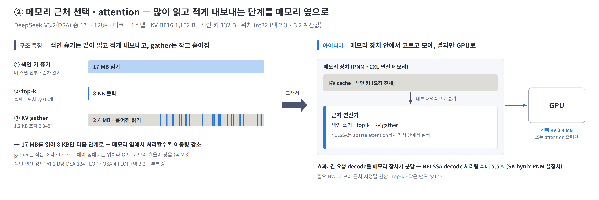

**구조 특징**
- **색인은 많이 읽고 적게 내보냄** (덱 1.6 · 3.1) — 128K 층당 색인 키 17 MB를 매 스텝 전부 읽고 출력은 위치 2,048개(8 KB). 128K에서 sparse attention 읽기의 84%, KV cache 읽기 절감의 상한(DSA 8.7×)을 결정
- **선택된 KV는 작고 흩어진 조각** (덱 2.3) — 1.2 KB × 2,048개, top-k 뒤에야 위치가 정해져 미리 읽기 불가 · 메모리 요청 수 증가

**HW 요구** — 메모리 내부 대역폭으로 색인을 훑는 근처 연산, 작은 단위 gather 엔진 · 많은 메모리 동시 요청 처리, 선택 단위에 맞춘 페이지 배치

**대응 아이디어**

| 제안 | 발표 | 핵심 | 결과 |
|---|---|---|---|
| **NELSSA** (SK hynix · KAIST) | 🏛 MICRO 2026 · 🏭 | GPU + 실제 PNM 장치, 긴 요청 decode는 PNM에서 장치 내 sparse attention | decode 처리량 최대 5.5×, P99 지연 최대 15× 감소 |
| **LongSight** (Cornell) | 🏛 MICRO 2025 | CXL 연산 메모리에서 부호 비트 필터 → top-k, 선택된 KV만 GPU로 | GPU 1장 + CXL 1개로 1M 컨텍스트 |
| **PAM** (ICT CAS) | 📄 2026-02 | HBM-PIM(hot) · DDR-PIM · SSD-PIM(cold) 계층 + PIM 간 병렬 attention | vLLM 대비 12.9 ~ 26.4× |

- **한계:** 위 제안은 자체 선택(부호 비트 필터 · 접근 지역성)을 씀 — 모델이 학습한 색인(DSA)을 그대로 메모리 근처에서 실행하는 설계는 미확인. DSA 색인은 키 1 B당 124 FLOP이라 얕은 PIM 연산기에 부담, 블록 색인(QSA 4 FLOP/B)이 더 적합 (부록 A 기준 추정)

※ 출처: NELSSA(arXiv 2607.26633), LongSight(MICRO 2025, DOI 10.1145/3725843.3756062), PAM(arXiv 2602.11521). 참고: decode attention 전체를 PNM HBM cube로 옮긴 AMMA(MICRO 2026, 시뮬레이션 H100 대비 attention 지연 15.5× 감소, arXiv 2604.26103). 구조 수치는 DeepSeek-V3.2 층 1개 · 128K · KV BF16 계산값.

---

## 2.3 색인 연산과 top-k — 고르는 비용

### 색인 연산은 본 attention의 3.8배, top-k는 비교 · 정렬 중심 → 저정밀 연산 밀도와 전용 선택 유닛이 필요하지만 sparse 모델용 HW 제안은 미확인

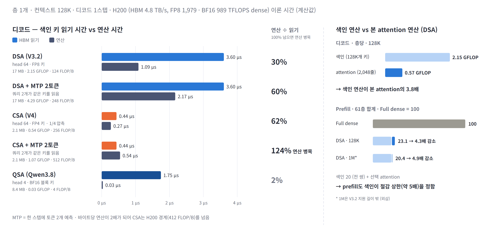

**구조 특징**
- **색인 연산이 본 attention보다 큼** (덱 3.2) — indexer head 64개가 같은 키를 각각 곱해 키 1 B당 124 FLOP(DSA), 본 attention 대비 128K 3.8배 → 1M 29배. 색인 키를 FP4 · 블록으로 줄이면 읽기는 줄지만 바이트당 연산이 커져 **대역폭 문제가 연산 문제로 이동**
- **top-k는 행렬곱이 아님** (덱 5.2) — 점수 128K개의 비교 · 정렬 · 스레드 간 동기화, 점수를 HBM에 기록했다 다시 읽음. FLOP · 바이트에 잡히지 않는 시간

**HW 요구**

| 항목 | 현재 한계 | 요구 방향 |
|---|---|---|
| **색인 연산** | 저정밀(FP8 · FP4) 연산이 본 attention보다 큼 | 저정밀 연산 밀도 확보 · 메모리 근처에서 훑으며 점수 계산 |
| **top-k** | 행렬곱 유닛이 쉬고, 점수가 메모리를 왕복 | 점수 계산과 top-k를 한 번에 처리하는 전용 유닛 · 온칩 선택 |
| **speculative decoding** | 검증 토큰 수만큼 색인 연산 증가 — MTP 2토큰에서 CSA 색인은 연산 병목(124%) | speculative 이득을 지킬 저정밀 연산 여유 |

**현황 — 공백**
- sparse 모델 대상 전용 HW 제안은 검색 범위에서 미확인 — GPU 커널(cuDNN 결합 API · GVR)에서만 다룸
- dense 대상 **PADE**(🏛 HPCA 2026): 예측기와 attention 실행을 bit-serial로 융합해 H100 대비 7.43×. 8-bit에서 예측기가 전체 비용의 63% → **고르는 비용이 HW에서도 지배적**

※ 기준: 층 1개 · 128K 디코드 1스텝 이론 시간, H200 HBM 4.8 TB/s · FP8 1,979 · BF16 989 TFLOPS(dense). 출처: PADE(arXiv 2512.14322). '공백'은 2026-11-11 검색 범위 기준.

---

## 2.4 state 갱신 — state 갱신 PIM

### state는 고정 크기지만 매 스텝 전부 읽고 덮어쓰는 단순 연산 → 메모리 밖으로 꺼내지 않고 PIM 안에서 갱신

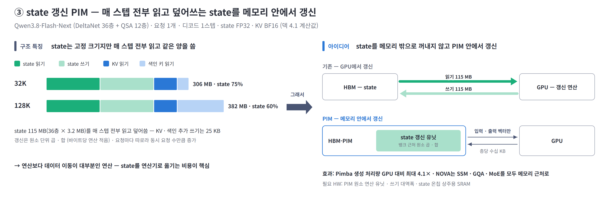

**구조 특징**
- **state를 매 스텝 전부 읽고 같은 양을 씀** (덱 4.1) — Qwen3.8 36층 115 MB, 128K까지 디코드 I/O의 60% 이상
- **갱신은 원소 단위 곱 · 합** (덱 5.1) — 바이트당 연산이 적고, 요청마다 따로라 동시 요청 수만큼 증가

**HW 요구** — 쓰기 대역폭, state를 담을 큰 온칩 SRAM 또는 메모리 근처 갱신 — 연산보다 데이터 이동이 비용의 대부분

**대응 아이디어**

| 제안 | 발표 | 핵심 | 결과 |
|---|---|---|---|
| **Pimba** (KAIST) | 🏛 MICRO 2025 | HBM-PIM 안에 State-update Processing Unit(뱅크 2개당 1개, MX 양자화 원소 곱 · 합) | 생성 처리량 GPU 대비 최대 4.1× · GPU + PIM 대비 2.1× |
| **NOVA** (KAIST) | 🏛 MICRO 2026 | decode의 GQA · SSM · MoE를 모두 near-memory에서 — 기존 PIM은 일부를 GPU로 되돌림 | 원문 확인 필요 |
| **HyPIM** (SNU) | 🏛 MICRO 2026 | Mamba–Transformer hybrid용 통합 PIM | 원문 미공개 |

- **메모리 버스 이동:** GPU에서 갱신하면 층당 state 3.2 MB를 읽고 같은 양을 씀, PIM이면 입력 · 출력 벡터(층당 수십 KB)만 이동. 대안은 state를 큰 온칩 SRAM에 상주시키는 방향

※ 출처: Pimba(arXiv 2507.10178), NOVA(arXiv 2608.22613), HyPIM(MICRO 2026 프로그램). 입력 · 출력 벡터 크기는 Qwen3.8 DeltaNet 층의 q · k · v · gate · 출력 BF16 기준 추정.

---

## 2.5 층별 · 단계별 혼합 — 이종 가속기

### 층마다 방식이 다르고 prefill · decode의 병목도 다름 → 연산 종류 · 단계별로 맞는 HW를 한 시스템에

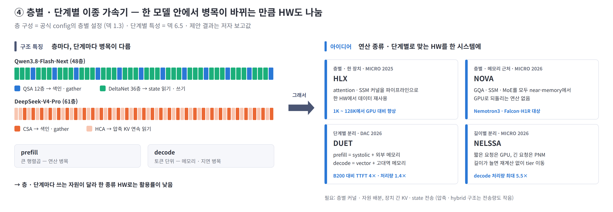

**구조 특징**
- **방식이 다른 층이 교대** (1.1) — Qwen3.8 QSA 12층 + DeltaNet 36층, V4 CSA · HCA 1:1 → 층마다 병목이 색인 · gather · state 갱신으로 바뀜
- **단계마다 병목이 다름** (덱 6.5) — prefill은 전 토큰 색인(길이²) · 큰 행렬곱으로 연산 병목, decode는 토큰 단위 색인 훑기 · gather로 메모리 · 지연 병목
- **고정 지연 비중 증가** (덱 6.1) — KV 읽기 시간이 짧아질수록 층마다 반복되는 top-k · 커널 경계 · 집합통신 지연이 TPOT를 좌우할 가능성

**HW 요구**

| 구분 | Prefill | Decode |
|---|---|---|
| **주 제약** | 연산 (FLOPS) | 메모리 대역폭 · 용량 · 지연 |
| **적합한 HW** | 고 FLOPS · FP8 · FP4 연산 밀도 | 고대역 · 대용량 메모리 · gather · top-k · 저지연 |

- **공통 요구:** 층별 커널 · 자원 배분, 저지연 집합통신 · 커널 결합, 장치 간 KV cache · state 전송

**대응 아이디어**

| 제안 | 발표 | 핵심 | 결과 |
|---|---|---|---|
| **HLX** (KAIST) | 🏛 MICRO 2025 | attention · SSM 커널이 GPU에서 모두 활용률이 낮음 → 파이프라인화해 한 HW에서 실행 | 1K ~ 128K에서 GPU 대비 향상 |
| **DUET** | 🏛 DAC 2026 | prefill = systolic chiplet + 외부 메모리, decode = vector unit + 패키지 내 고대역 메모리 | B200 대비 TTFT 4×, 처리량 1.4× |
| **NOVA** · **NELSSA** | 🏛 MICRO 2026 | 층별: GQA · SSM · MoE 모두 near-memory (2.4) · 길이별: 짧은 요청 GPU / 긴 요청 PNM (2.2) | 2.4 · 2.2 참조 |

- **PD 분리:** prefill → decode로 요청마다 KV cache · 색인 키 · state를 옮겨야 함 — 압축 · hybrid 구조는 전송량도 작아 분리에 유리

※ 출처: HLX(MICRO 2025, DOI 10.1145/3725843.3756115), DUET(arXiv 2603.15530). MICRO 2026 채택은 프로그램 분석 자료 기준. 고정 지연 · 집합통신의 실제 비중은 실측 필요(3.2).

---

# Ⅲ. 종합

### 차세대 HW는 '더 큰 FLOPS · 대역폭'보다 '데이터 성격별 배치 · 메모리 근처 처리 · 이종 실행'이 관건 — 용량은 해결 단계, 고르는 비용은 공백

3.1 영역별 HW 요구와 대응 현황 · 3.2 시사점과 확인 필요 항목

---

## 3.1 영역별 HW 요구와 대응 현황

### 메모리 용량 대응만 실서비스 진입, 대역폭 · state · 이종 실행은 학회 단계, 색인 연산 · top-k는 공백

| 영역 | 구조 원인 | 요구 방향 | 대응 아이디어 | 단계 |
|---|---|---|---|---|
| **메모리 용량** | KV cache 크기 그대로 · 매 스텝 1.6%만 읽음 | 용량 계층 · CPU–GPU 링크 대역폭 | 계층형 KV (HiSparse · ECHO) | 실서비스 진입 |
| **메모리 대역폭 · 접근** | 색인 키 전부 훑기 · 작고 흩어진 gather | 메모리 근처 색인 · gather · 많은 동시 요청 처리 | 메모리 근처 선택 (NELSSA · LongSight) | 학회 (실제 PNM 장치 기반 포함) |
| **연산** | 색인 연산 3.8배 · top-k 정렬 · 동기화 | 저정밀 연산 밀도 · top-k 전용 유닛 | — (dense 대상 PADE만) | 공백 |
| **쓰기 · 온칩** | state 115 MB를 매 스텝 덮어씀 | 쓰기 대역폭 · 근처 갱신 · 온칩 SRAM | state 갱신 PIM (Pimba · NOVA) | 학회 |
| **시스템 · 통신** | 층 · 단계마다 병목이 다름 · 고정 지연 | 이종 실행 · PD 분리 · 저지연 통신 · 커널 결합 | 이종 가속기 (HLX · DUET) | 학회 |

- **한 줄 정리:** KV cache 읽기 문제는 sparse · hybrid가 상당 부분 해결 — 남은 문제는 **데이터 성격(용량형 · 대역폭형)의 분리**와 새로 생긴 **고르는 비용 · state 갱신**이며, 단일 자원 증설보다 각각을 처리하는 구조로 대응

※ 근거: 2.1 ~ 2.5. '단계'는 대표 제안 기준 — 실서비스 진입 = 오픈소스 서빙 프레임워크 반영, 학회 = 채택 논문(시뮬레이션 포함), 공백 = sparse 모델 대상 제안 미확인.

---

## 3.2 시사점과 확인 필요 항목

### 우선 검토 대상은 '색인 · top-k를 어디서 처리할지' — 가장 큰 새 부담인데 HW 대응이 비어 있음

- **메모리 계층:** 계층형 KV가 실서비스에 들어오면서 HBM에 남는 데이터의 중심이 KV → 색인 키 · state(대역폭형)로 이동 — HBM은 용량보다 대역폭 · 근처 연산의 가치가 커지는 방향 (추정)
- **색인 · top-k:** 블록 색인(QSA 계열)은 바이트당 연산이 작아 메모리 근처 실행에 유리, 토큰 색인(DSA 계열)은 저정밀 연산 밀도가 필요 — **모델의 색인 설계에 따라 HW 방향이 갈림** (추정)
- **Hybrid 확산:** state 비중이 큰 짧은 · 중간 길이(32K까지 디코드 I/O의 75% 이상)에서는 state 갱신 처리가 KV 처리보다 우선 — PIM과 온칩 SRAM 중 선택이 과제

| 확인 필요 항목 | 현재 상태 | 확인 방법 |
|---|---|---|
| 스텝 간 top-k 재사용률 | HiSparse 실측 70%(GLM-5.1) — 덱 부록 C 미확인 항목을 채움 | DSA · QSA 모델과 작업 종류별 재현 |
| top-k · 층별 고정 지연 | 정성 분석 (이론 시간 없음) | 동시 요청 수별 커널 시간 · 커널 간 공백 · 집합통신 시간 측정 |
| gather 달성 대역폭 | 정성 분석 | 토큰 · 블록 단위 KV gather 커널의 달성 대역폭 실측 |
| 학습된 색인의 메모리 근처 실행 | 제안 미확인 | DSA · QSA 색인을 PNM · PIM에서 실행할 때 연산기 요구 추정 |
| MICRO 2026 채택 · 결과 | 프로그램 분석 자료 기준 | 공식 proceedings로 NELSSA · NOVA · HyPIM · AMMA 재확인 |

---

## 부록 A. 방식별 비교

| | 전부 읽기 (MLA · GQA) | 선택 읽기 (DSA · QSA) | 압축 저장 (CSA · HCA) | Linear state |
|---|---|---|---|---|
| KV cache 크기 | `S` | `S` + 색인 키 (+3 ~ 11%) | `S/4` · `S/128` | 고정 (state) |
| 매 스텝 쓰기 | 1줄 | 1줄 + 색인 키 1개 | 4 · 128토큰마다 1줄 | state 전체 |
| 디코드당 읽기 (128K, 층당) | 151 ~ 268 MB | 13 ~ 20 MB | 1.2 ~ 3.3 MB | 3.2 MB + 동일량 쓰기 |
| 색인 산술 강도 | — | DSA 124 · QSA 4 FLOP/B | CSA 256 FLOP/B | — |
| 절감 상한 | — | DSA 9× · QSA 32× | CSA 72× · HCA 144× | — |
| 추가 연산 | — | 색인 훑기 · top-k · 흩어진 읽기 | 쓰기 시 압축 · top-k · 흩어진 읽기 | 매 스텝 state 갱신 |
| 주 HW 부담 | 용량 · 읽기 대역폭 | 색인 연산 · top-k · gather · 용량 | CSA 색인 연산 · gather (HCA는 연속 읽기) | 쓰기 대역폭 · 온칩 |
| 관련 HW 대응 (Ⅱ장) | — | 계층형 KV · 메모리 근처 선택 | 메모리 근처 선택 (CSA) | state 갱신 PIM |

※ sliding window는 `W`줄만 보관 · 읽기(full 층과 혼합), 세부는 덱 부록 A.

---

## 부록 B. 계산 기준

| 항목 | 기준 |
|---|---|
| 단위 | 층 1개 · 요청 1개 · 디코드 1스텝. 1M = 100만 토큰, 1 GB = 10⁹ B |
| 비교 길이 | 128K = 공통 비교 조건, 1M = 차세대 설계 시나리오 (V3.2 · Qwen3.8은 지원 길이 밖 — 외삽) |
| 구조 비교 (1.2 · 1.3 · 2.2 · 2.3) | KV cache BF16 통일. 색인 키는 공개 저장 형식 — DSA FP8 + scale 132 B, CSA FP4 64 B, QSA 블록 키 BF16 256 B 가정 |
| 배포 형식 (1.4 · 2.1) | DeepSeek-V3.2 실제 형식 — KV FP8 656 B/줄, 색인 132 B/줄 |
| 이론 시간 (2.3) | H200 HBM 4.8 TB/s, FP8 1,979 · BF16 989 TFLOPS (dense) |
| state | Qwen3.8-Flash-Next DeltaNet 층당 3.2 MB (FP32), 36층 115 MB |
| 제안 결과 | 각 논문의 저자 보고값 (측정 조건 · 기준선이 서로 달라 직접 비교 불가) |
| 미포함 | top-k · 흩어진 읽기의 커널 비효율, 활성값 · 통신 버퍼, 정확도 |

---

## 부록 C. 출처

| 분야 | 링크 |
|---|---|
| 구조 분석 | [덱 원고](02-deck-draft-claude.md) · [메모리 보고서](../reports/llm-memory-requirements.md) |
| 계층형 KV | [HiSparse](https://arxiv.org/abs/2608.07009) · [SGLang HiSparse 블로그](https://www.lmsys.org/blog/2026-04-10-sglang-hisparse/) · [ECHO (OSDI 2026)](https://www.usenix.org/conference/osdi26/presentation/liu-guangda) · [ESS](https://arxiv.org/abs/2512.10576) · [SAC](https://arxiv.org/abs/2606.19746) · [Fluxion](https://arxiv.org/abs/2605.07719) · [HGCA](https://arxiv.org/abs/2507.03153) |
| 메모리 근처 | [NELSSA](https://arxiv.org/abs/2607.26633) · [LongSight (MICRO 2025)](https://dl.acm.org/doi/10.1145/3725843.3756062) · [PAM](https://arxiv.org/abs/2602.11521) · [AMMA](https://arxiv.org/abs/2604.26103) |
| Hybrid · 이종 | [Pimba](https://arxiv.org/abs/2507.10178) · [HLX (MICRO 2025)](https://dl.acm.org/doi/10.1145/3725843.3756115) · [NOVA](https://arxiv.org/abs/2608.22613) · [DUET](https://arxiv.org/abs/2603.15530) |
| 공백 · 참고 | [PADE](https://arxiv.org/abs/2512.14322) · [MICRO 2026 프로그램 분석](https://semihub.io/en/blog/micro-2026-guide.html) |

※ MICRO 2026 채택(NELSSA · NOVA · HyPIM · AMMA)은 프로그램 분석 자료 기준이며 공식 proceedings로 재확인 필요. '공백' 판단은 2026-11-11 검색 범위 기준.
