# Sparse · Hybrid Attention 구조 특징과 HW 아키텍처 방향

KV cache 부담 이동에 따른 HW 요구 사항과 대응 아이디어 · 2026.11 · 2차본

근거: 구조 분석 [deck-draft-claude.md](deck-draft-claude.md)(계산값) · HW 아이디어 [hw-arch-ideas-claude.md](hw-arch-ideas-claude.md) · HiSparse 상세 [paper-hisparse-claude.md](paper-hisparse-claude.md) · 1차 초안 [sparse-hybrid-hw-report-claude.md](sparse-hybrid-hw-report-claude.md). 그림: 요약과 Ⅰ장은 [figures-claude/hw-report/](figures-claude/hw-report/)(`python arch_insight/figures-claude/hw-report/make_hw_report_figures.py`, 덱 계산 함수 그대로 사용), Ⅱ장은 덱 · HW 아이디어 그림 재사용. 비교 기준: 128K · 요청 1개 · 디코드 1스텝.

---

## 요약

### KV cache 부담은 줄지만 Sparse는 '고르는 비용', Hybrid는 'state 갱신'이 새 부담 → HW는 대역폭 증설보다 데이터별 배치 · 메모리 근처 처리 · 이종 구성으로 대응, 실서비스에 들어온 것은 용량 대응뿐

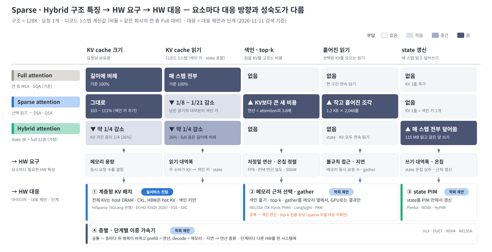

- **구조:** Sparse는 매 스텝 **읽는 KV를 1/8 ~ 1/21로** 줄이지만 **보관량은 그대로**, Hybrid는 **보관량 · 이동량을 약 1/4로** 줄임 → 대신 색인 연산(본 attention의 3.8배) · 흩어진 KV 모으기(1.2 KB × 2,048개) · state 왕복(매 스텝 115 MB 읽고 115 MB 다시 씀)이 새 부담
- **HW 요구:** 데이터마다 맞는 메모리가 다름 — KV cache는 **용량형**(매 스텝 1.6%만 읽음), 색인 키 · state는 **대역폭형**(매 스텝 전부 읽음) → 대역폭만 늘려서는 해결되지 않고 연산 · 지연 · 온칩 · 쓰기를 함께 설계해야 함
- **HW 대응:** ① 계층형 KV만 실서비스 진입(SGLang 반영 · OSDI 채택). ② 메모리 근처 선택 · ③ state PIM · ④ 이종 가속기는 MICRO 2025 · 2026 중심의 학회 제안
- **공백:** 가장 큰 새 부담인 색인 연산 · top-k를 직접 처리하는 sparse 모델용 HW는 찾지 못함 — 지금은 GPU 커널로만 대응

※ 기준: 구조 수치는 덱 계산값, 비율은 같은 회사의 전 층 Full 대비(Sparse = DSA(V3.2) · QSA(Qwen3.8), Hybrid = Qwen3.8 차원의 state 36층 + full GQA 12층 가정 구성). 칸 색은 상대 부담을 4단계로 나눈 정성 구분. 제안 단계는 2026-11-11 검색 기준, 결과는 모두 저자 보고값.

---

## 구성

| 장 | 내용 |
|---|---|
| **Ⅰ. 구조 특징** | 구조가 어떻게 바뀌었나(1.1 · 1.2) → 무엇이 줄었나(1.3) → Sparse에 남는 것(1.4 · 1.5) → Hybrid에 남는 것(1.6) → 왜 HW 대응이 달라야 하나(1.7 · 1.8) |
| **Ⅱ. HW 부담과 대응** | KV cache 용량 · 색인 키 읽기와 gather · 색인 연산과 top-k · state 갱신 · 층별 · 단계별 차이 — 절마다 부담 원인 → HW 요구 → 대응 원리와 사례 → 남은 과제 |
| **Ⅲ. 종합** | 영역별 HW 요구와 대응 현황 · 시사점과 확인 필요 항목 |
| **부록** | 방식별 비교 · 계산 기준 · 출처 |

| 용어 | 뜻 |
|---|---|
| **읽기 · 쓰기 · 이동량** | 디코드 한 스텝에 메모리에서 읽는 양 · 쓰는 양 · 둘의 합 |
| **보관량 (보유량)** | 요청 하나가 메모리에 계속 들고 있는 KV cache · 색인 키 · state의 합 |
| **색인 키** | Sparse에서 읽을 KV를 고르려고 토큰마다 따로 저장하는 작은 키 (DSA 132 B/토큰) |
| **top-k** | 색인 점수가 높은 k개 위치를 고르는 단계 (DSA 2,048개) |
| **gather (KV 모으기)** | 고른 KV 조각을 흩어진 위치에서 모아 읽기 |
| **state** | linear 층이 KV cache 대신 갖는 고정 크기 행렬 — 매 스텝 전부 갱신 |
| **PIM · PNM · CXL** | 메모리 칩 안에서 하는 연산 · 메모리 옆에 붙인 연산 장치 · 메모리를 확장해 붙이는 연결 규격 |

---

# Ⅰ. 구조 특징

### Sparse는 매 스텝 읽는 KV를, Hybrid는 보관하는 KV를 줄임 — 대신 Sparse에는 '고르는 비용', Hybrid에는 'state 왕복'이 남음

1.1 구조 동향 · 1.2 작동 원리 · 1.3 줄어드는 것 · 1.4 Sparse에 남는 것 ① 색인 키 읽기 · 1.5 Sparse에 남는 것 ② 고르는 과정 · 1.6 Hybrid에 남는 것 — state · 1.7 데이터별 성격 · 1.8 정리 — 남은 부담과 Ⅱ장

그림 하나에 메시지 하나. 절 마지막 줄 **→ Ⅱ장**이 그 특징을 다루는 Ⅱ장 절. 기준: Sparse 읽기 구조(1.4 · 1.5)는 KV BF16 비교 기준, 데이터 성격(1.7)은 DeepSeek-V3.2 실제 배포 형식(KV FP8) — 그래서 KV 1줄이 1.2 KB(BF16) · 656 B(FP8)로 다르게 나옴.

---

## 1.1 구조 동향

### 반기별 공개 모델 중 전 층 full attention 비중은 '25 하반기 50% → '26 하반기 7% — 층마다 다른 방식을 섞는 구조가 주류

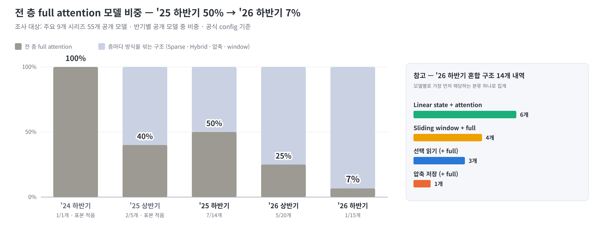

- **전 층 Full:** '25 하반기 7/14 → '26 상반기 5/20 → '26 하반기 1/15
- **대신 쓰는 구조:** '26 하반기 혼합 구조 14개 중 linear state 혼합(Hybrid) 6 · sliding window 혼합 4 · 선택 읽기(Sparse) 3 · 압축 저장 1
- **→ Ⅱ장:** 한 모델 안에 방식이 다른 층이 섞여 층마다 병목이 바뀜 → 2.5 층별 · 단계별 차이

※ 출처: 주요 9개 시리즈 55개 공개 모델의 공식 config([메모리 보고서](../reports/llm-memory-requirements.md) §1). 조사 대상 표본이며 '24 하반기 · '25 상반기는 모델 수가 적음. 모델별로 가장 먼저 해당하는 분류 하나로 집계.

---

## 1.2 작동 원리 — Full · Sparse · Hybrid

### Full은 전부 보관 · 전부 읽기, Sparse는 전부 보관 · 일부만 읽기, Hybrid는 대부분 층을 고정 크기 state로 바꿔 보관량 자체를 줄임

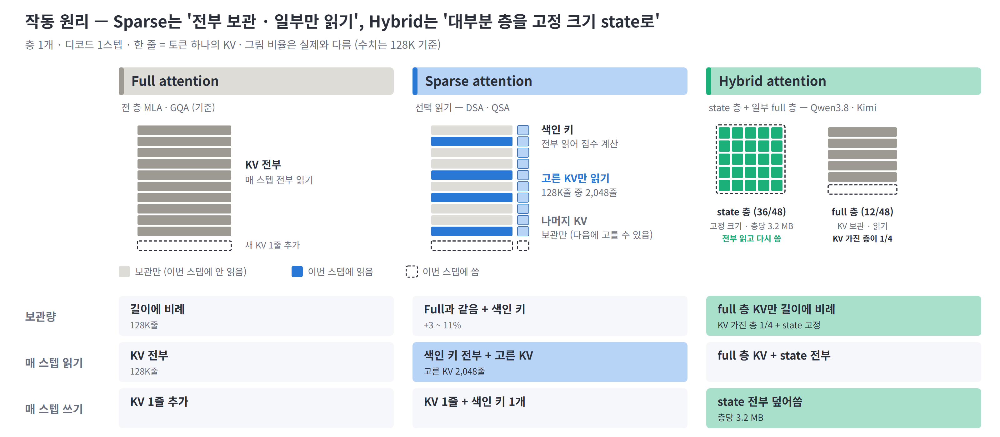

- **Sparse (선택 읽기):** 작은 색인기가 색인 키를 모두 훑어 점수를 매기고, 점수가 높은 KV 2,048줄만 읽음 — 고르지 않은 KV도 다음 스텝에 고를 수 있어 **전부 보관**
- **Hybrid (linear state 혼합):** Qwen3.8은 48층 중 36층이 KV cache 대신 고정 크기 state(층당 3.2 MB)를 둠 — 길이가 늘어도 크기는 그대로지만 **매 스텝 전부 읽고 다시 씀**
- **그 밖의 방식:** 압축 저장(DeepSeek-V4)은 4줄 · 128줄을 1줄로 합쳐 보관하고, sliding window는 최근 W줄만 보관 — 비교는 부록 A

※ 그림 비율은 실제와 다름. Hybrid의 full 층은 Qwen3.8처럼 Sparse(QSA)일 수도 있음. MoE와 비교하면 Sparse는 'KV cache의 MoE' — 단, 고를 대상이 요청마다 따로이고 길이에 비례해 늘어남(덱 1.5).

---

## 1.3 줄어드는 것 — 이동량과 보관량

### 같은 모델 조건에서 Sparse는 이동량만 5%로, Hybrid는 이동량 · 보관량을 약 1/4로 줄임 — 둘을 합친 Qwen3.8은 이동량 3% · 보관량 27%

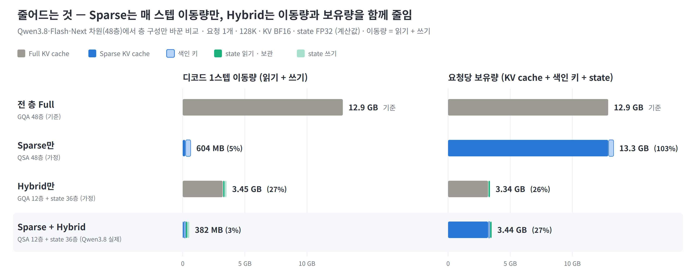

- **Sparse만:** 매 스텝 이동량은 5%로 크게 줄지만 보관량은 103% — 색인 키만큼 오히려 늘어 **용량 문제는 그대로**
- **Hybrid만:** KV cache를 가진 층이 1/4이 되어 보관량 26% · 이동량 27%
- **결합 (Qwen3.8):** 이동량 3% · 보관량 27% — 남은 이동량 382 MB의 87%가 색인 키와 state (1.4 · 1.6)
- **→ Ⅱ장:** Sparse는 보관량이 그대로 → 2.1 KV cache 용량

※ 기준: Qwen3.8-Flash-Next 차원(48층)에서 층 구성만 바꾼 계산값, KV BF16 · state FP32, % = 전 층 Full 대비. Sparse만 · Hybrid만은 가정 구성. 참고로 압축형 DeepSeek-V4(CSA · HCA 층 1:1)는 같은 회사 Full(MLA) 대비 읽기 1.5% · 보관량 12% — 보관하는 줄 수 자체를 줄여 둘 다 감소(덱 2.1).

---

## 1.4 Sparse에 남는 것 ① 색인 키 읽기

### 고른 KV 읽기는 2,048줄로 고정이지만 색인 키 읽기는 길이에 비례 — 128K에서 Sparse 읽기의 84%가 색인 키

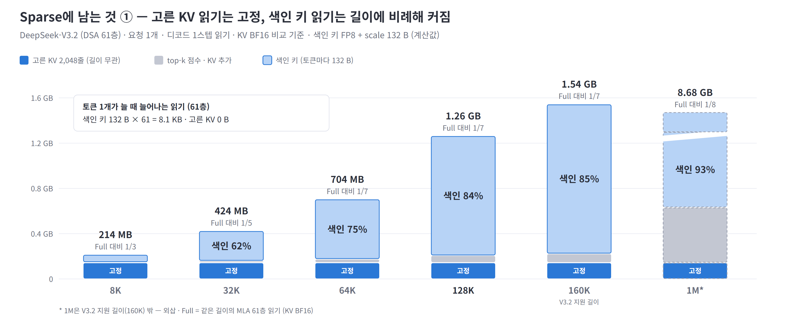

- **고정되는 것:** 고른 KV는 길이와 무관하게 2,048줄 — 61층 합계 144 MB
- **커지는 것:** 색인 키는 토큰이 하나 늘 때마다 61층 합계 8.1 KB씩 늘어 색인 몫이 8K 31% → 128K 84% → 1M 93%
- **그 결과:** Full 대비 절감이 1/3 → 1/7 → 1/8로 커지다 멈춤 — 끝까지 남는 것은 색인 키뿐이라 상한은 KV 1줄 ÷ 색인 키 = 1,152 B ÷ 132 B ≈ 8.7× (블록 색인은 32 ~ 72×, 부록 A)
- **→ Ⅱ장:** 색인 키를 매 스텝 전부 옮기는 비용 → 2.2 색인 키 읽기와 gather

※ 기준: DeepSeek-V3.2 61층 · 요청 1개 · 디코드 1스텝 읽기 · KV BF16 비교 기준 · 색인 키 FP8 + scale 132 B · top-k 점수 FP32 계산값. 1M은 지원 길이(160K) 밖 외삽(덱 1.6 · 3.1).

---

## 1.5 Sparse에 남는 것 ② 고르는 과정

### 고르는 과정은 점수 계산 → top-k → KV 모으기 → attention의 직렬 4단계 — 점수 계산이 가장 무겁고, top-k · 모으기는 작지만 앞 단계를 기다림

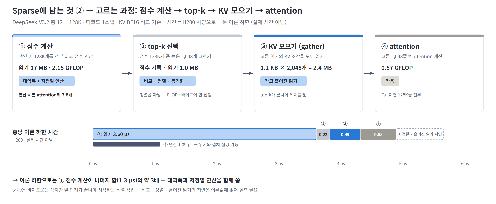

- **① 점수 계산:** 색인 키 17 MB를 전부 읽고 2.15 GFLOP 계산 — 연산이 본 attention의 3.8배(1M 29배)라 대역폭과 저정밀 연산을 함께 씀
- **② top-k · ③ KV 모으기:** 바이트로는 작지만, 점수 128K개를 비교 · 정렬하고 1.2 KB 조각 2,048개를 흩어진 위치에서 모아야 함 — 이 지연은 이론 하한에 잡히지 않아 실측 필요
- **모델 · 길이별 차이:** 블록 색인(QSA · CSA)은 32K에서 attention 단계 읽기 중 색인 몫이 1/3 수준 — 짧은 길이에서는 ③ 모으기 비중이 큼
- **→ Ⅱ장:** ①③ 데이터 이동 → 2.2 색인 키 읽기와 gather, ①② 연산 · 선택 → 2.3 색인 연산과 top-k

※ 기준: DeepSeek-V3.2 층 1개 · 128K · KV BF16 비교 기준. 시간 = 바이트 ÷ 4.8 TB/s 또는 FLOP ÷ 피크(H200)의 이론 하한이며 실제 커널 시간이 아님. 블록 색인 비중은 덱 5.2(KV BF16 기준).

---

## 1.6 Hybrid에 남는 것 — state 왕복

### state는 크기가 고정이지만 매 스텝 115 MB를 읽고 115 MB를 다시 써서 약 230 MB를 옮김 — Qwen3.8 128K 이동량의 60%

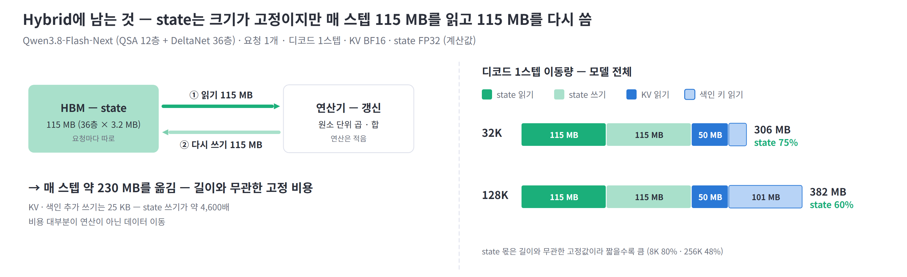

- **왕복:** 36층 × 3.2 MB = 115 MB를 읽어 갱신한 뒤 같은 양을 다시 씀 — KV · 색인 추가 쓰기(25 KB)의 약 4,600배
- **길이별:** 이동량 중 state 몫 32K 75% · 128K 60% — 길이와 무관한 고정 비용이라 짧을수록 비중이 큼
- **연산:** 원소 단위 곱 · 합이라 연산은 적음 — 비용 대부분이 데이터 이동
- **→ Ⅱ장:** state를 옮기는 비용 → 2.4 state 갱신

※ 기준: Qwen3.8-Flash-Next 모델 전체(QSA 12층 + DeltaNet 36층) 합계, 요청 1개 · 디코드 1스텝, KV BF16 · state FP32 계산값(덱 4.1).

---

## 1.7 데이터별 성격 — 용량형과 대역폭형

### KV cache는 많이 보관하고 조금 읽는 '용량형', 색인 키 · state는 매 스텝 전부 읽는 '대역폭형' — 지금은 한 HBM에 두 성격이 섞여 있음

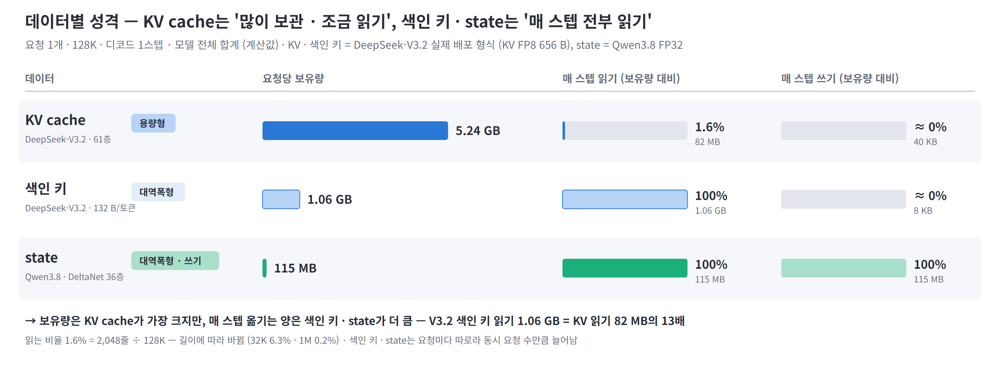

- **KV cache — 용량형:** 요청당 5.24 GB 중 매 스텝 1.6%만 읽음 → 더 크고 느린 메모리에 둘 후보. 단, 다음 스텝에 다시 고를 KV를 HBM에 남기는 캐시와, 없는 KV를 가져오는 링크 성능이 조건
- **색인 키 — 대역폭형:** 크기는 KV의 1/5이지만 매 스텝 전부 읽음 → 읽기 대역폭과 처리 위치가 관건
- **state — 대역폭형 + 쓰기:** 매 스텝 전부 읽고 전부 다시 씀 → 쓰기 대역폭까지 필요
- **→ Ⅱ장:** 두 성격의 데이터를 나눠 두고 각각 다르게 처리하는 것이 Ⅱ장 대응의 공통 출발점 (2.1 · 2.2 · 2.4)

※ 기준: 요청 1개 · 128K · 디코드 1스텝 · 모델 전체 합계 계산값. KV · 색인 키는 DeepSeek-V3.2 실제 배포 형식(KV FP8 656 B/줄, 색인 132 B/줄), state는 Qwen3.8 FP32. 읽는 비율 1.6% = 2,048줄 ÷ 128K로 길이에 따라 바뀜. 색인 키 · state는 요청마다 따로라 동시 요청 수만큼 늘어남.

---

## 1.8 정리 — 남은 부담과 Ⅱ장

### KV 읽기가 줄어든 대신 다섯 가지 부담이 남음 — 부담마다 필요한 HW 특성이 달라 Ⅱ장에서 하나씩 다룸

| 남은 부담 | 근거 | 필요한 HW 특성 | Ⅱ장 |
|---|---|---|---|
| **KV cache 보관량** — Sparse는 줄이지 않고, 매 스텝 1.6%만 읽음 | 1.3 · 1.7 | 큰 용량 메모리 · 넓은 CPU–GPU 링크 | 2.1 |
| **색인 키 이동 · 흩어진 KV 모으기** — 매 스텝 전부 읽고, 고른 KV는 작고 흩어짐 | 1.4 · 1.5 | 메모리 근처 처리 · 작은 단위 gather | 2.2 |
| **점수 계산 · top-k** — 연산이 본 attention의 3.8배, 선택은 비교 · 정렬 | 1.5 | 저정밀 연산 밀도 · 선택 전용 유닛 | 2.3 |
| **state 왕복** — 매 스텝 115 MB를 읽고 다시 씀 | 1.6 | 쓰기 대역폭 · 옮기지 않는 갱신 | 2.4 |
| **층 · 단계별 차이** — 층마다, prefill · decode마다 병목이 다름 | 1.1 · 1.5 | 층 · 단계에 맞춘 서로 다른 HW | 2.5 |

---

# Ⅱ. HW 부담과 대응

### 부담이 KV cache 용량 · 읽기에서 '대역폭형 데이터 · 고르는 비용 · state 갱신 · 층별 차이'로 옮겨 감 → 부담마다 대응이 다르고, 실서비스에 들어온 것은 용량 대응(계층형 KV)뿐

2.1 KV cache 용량 — 계층형 KV · 2.2 색인 키 읽기와 gather — 메모리 근처 선택 · 2.3 색인 연산과 top-k — 공백 · 2.4 state 갱신 — state PIM · 2.5 층별 · 단계별 차이 — 이종 가속기

절마다 **부담 원인**(Ⅰ장 근거) → **HW 요구** → **대응 아이디어**(원리 → 대표 사례 → 다른 제안) → **남은 과제** 순서. 그림 왼쪽 = 구조 특징, 오른쪽 = 아이디어. 결과는 모두 저자 보고값이며 측정 조건 · 기준선이 서로 달라 직접 비교할 수 없음.

---

## 2.1 KV cache 용량 — 계층형 KV 배치

### 안 읽는 KV는 큰 용량 메모리로, 다시 고를 KV만 HBM에 — 가장 먼저 실서비스에 들어온 대응

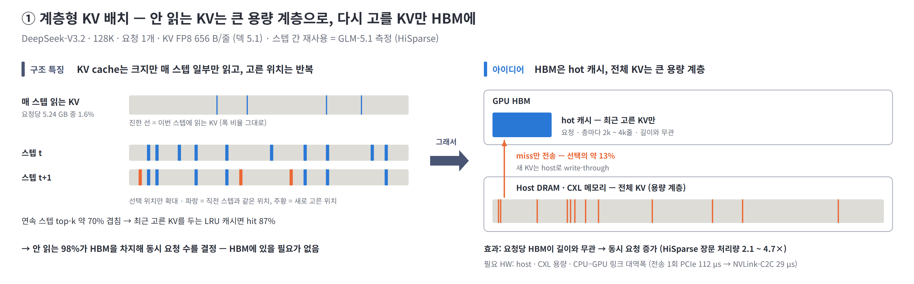

**부담 원인**
- Sparse는 KV cache 보관량을 줄이지 않음 — 매 스텝 1.6%만 읽는데도 전부 HBM에 있어 동시 요청 수를 막음 (1.3 · 1.7)
- 고르는 위치는 스텝마다 크게 바뀌지 않음 — 연속 스텝에서 약 70%가 겹침 (HiSparse 측정, GLM-5.1)

**HW 요구**
- HBM 밖의 큰 용량 메모리(host DRAM · CXL)와, 거기서 HBM으로 KV를 빠르게 가져올 CPU–GPU 링크

**대응 아이디어 — HBM은 캐시, 전체 KV는 큰 용량 메모리**
- 전체 KV는 host DRAM · CXL에 두고, HBM에는 최근 고른 KV와 매 스텝 읽는 색인 키만 남김
- 고른 위치가 스텝마다 70% 겹치므로 최근 고른 KV만 두어도 87%는 HBM에서 바로 읽음 → 요청당 HBM 사용량이 길이와 무관해져 동시 요청 수가 늘어남
- 캐시에 없는 KV(선택의 약 13%)는 매 스텝 host에서 가져와야 함 → **링크 대역폭 · 지연이 성능을 좌우**
- **대표 사례 — HiSparse (Stanford 외):** 요청 · 층별 캐시 관리를 GPU 커널 하나로 처리해 SGLang에 반영 — 장문 처리량 2.1 ~ 4.7×

| 다른 제안 · 발표 | 아이디어 | 결과 (저자 보고) |
|---|---|---|
| **ECHO** (SJTU · Huawei) · OSDI 2026 | 다음에 고를 KV를 색인 점수로 미리 예측해 가져옴 (NSA 계열) | 생성 처리량 최대 2.1× |
| **ESS** (Baidu) · 2025-12 프리프린트 | V3.2 KV 일부를 CPU 메모리로, 지연에 민감한 부분은 GPU에 유지 | 128K 처리량 +123% (시뮬레이션) |
| **SAC** · 2026-06 프리프린트 | 아래 계층을 CXL 분리 메모리로 확장 (HiSparse 구조 기반) | — |

**남은 과제**
- 색인 키는 HBM에 남아 128K에서 요청당 HBM의 78%, 1M에서 97% → **용량 문제가 색인 키로 옮겨 감**
- 링크가 새 병목 — 1회 전송 PCIe 112 µs, NVLink-C2C 29 µs. host 메모리가 HBM보다 크지 않은 구성은 이득이 줄어듦

※ 출처: HiSparse(arXiv 2608.07009) §3 ~ §5, ECHO(OSDI 2026) abstract, ESS(arXiv 2512.10576), SAC(arXiv 2606.19746). 색인 키 비중은 GLM-5.1 78층 요청당 HBM 분해 계산값([HiSparse 정리](paper-hisparse-claude.md) 4.1). host CPU가 attention 일부를 계산하는 변형(Fluxion · HGCA)도 있음.

---

## 2.2 색인 키 읽기와 KV gather — 메모리 근처 선택

### 색인은 17 MB를 읽어 8 KB만 내보내고, 고른 KV는 작고 흩어짐 → 고르고 모으는 일을 메모리 옆에서 하고 GPU로는 결과만

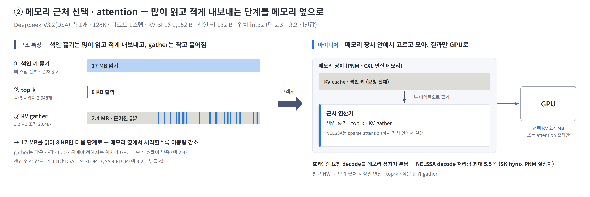

**부담 원인** — 서로 다른 두 가지
- **색인 키 이동:** 어떤 KV를 고를지 정하려면 색인 키를 매 스텝 전부 읽어야 함 — 128K 층당 17 MB를 읽어 내보내는 결과는 위치 2,048개(8 KB)뿐. KV 읽기를 줄여도 이 비용은 남음 (1.4)
- **흩어진 KV 모으기:** 고른 KV는 1.2 KB 조각 2,048개 — top-k가 끝나야 위치를 알아 미리 읽을 수 없고, 작은 요청이 많아 메모리 효율이 낮음 (1.5)

**HW 요구**
- 색인 키 이동 → 메모리 안쪽 대역폭으로 색인을 훑는 근처 연산기
- 흩어진 모으기 → 작은 조각을 모으는 gather 엔진 · 많은 동시 메모리 요청 처리 · 선택 단위에 맞춘 페이지 배치

**대응 아이디어 — 고르고 모으는 일을 메모리 옆에서**
- 점수 계산과 top-k를 메모리 근처에서 하면, GPU로 보낼 것은 색인 키 전체(17 MB) 대신 고른 위치(8 KB)나 고른 KV(2.4 MB)뿐 → 메모리와 GPU 사이 이동량이 크게 줆
- 모으기까지 메모리 쪽에서 하면, 작은 조각 2,048개를 흩어진 위치에서 읽는 일도 메모리 장치 안에서 끝남
- 조건: 메모리 근처 장치가 색인 연산(DSA는 키 1 B당 124 FLOP)과 선택을 HBM 속도만큼 빠르게 처리해야 함
- **대표 사례 — NELSSA (SK hynix · KAIST, MICRO 2026):** GPU와 실제 PNM 장치를 묶어, 긴 요청의 decode는 PNM 안에서 sparse attention까지 처리하고 짧은 요청은 GPU에서 처리 — decode 처리량 최대 5.5×, P99 지연 최대 15× 감소

| 다른 제안 · 발표 | 아이디어 | 결과 (저자 보고) |
|---|---|---|
| **LongSight** (Cornell) · MICRO 2025 | CXL 연산 메모리가 부호 비트로 후보를 거르고 top-k까지 → 고른 KV만 GPU로 | GPU 1장 + CXL 1개로 1M 컨텍스트 |
| **PAM** (ICT CAS) · 2026-02 프리프린트 | HBM · DDR · SSD에 각각 PIM을 두고 hot / cold KV를 나눠 병렬 attention | vLLM 대비 12.9 ~ 26.4× |

**남은 과제**
- 위 제안은 모두 자체 선택 방식(부호 비트 필터 · 접근 지역성)을 씀 — 모델이 학습한 색인(DSA)을 메모리 옆에서 그대로 돌리는 설계는 찾지 못함
- 블록 색인(QSA, 키 1 B당 4 FLOP)은 연산이 적어 메모리 근처 실행에 더 맞음 (추정)

※ 출처: NELSSA(arXiv 2607.26633), LongSight(MICRO 2025, DOI 10.1145/3725843.3756062), PAM(arXiv 2602.11521). 참고: decode attention 전체를 PNM HBM cube로 옮긴 AMMA(MICRO 2026, 시뮬레이션 H100 대비 attention 지연 15.5× 감소, arXiv 2604.26103). 구조 수치는 DeepSeek-V3.2 층 1개 · 128K · KV BF16 계산값.

---

## 2.3 색인 연산과 top-k — 고르는 비용

### 점수 계산은 본 attention의 3.8배, top-k는 비교 · 정렬 위주 → 저정밀 연산과 전용 선택 유닛이 필요하지만 sparse 모델용 HW 제안은 아직 찾지 못함

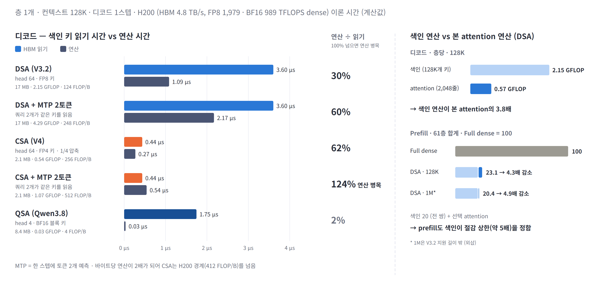

**부담 원인** — 점수를 계산하는 비용과 고르는 비용
- **점수 계산:** indexer head 64개가 같은 키를 각각 곱해 128K에서 본 attention 연산의 3.8배, 1M에서 29배 (1.5)
- **고르기 (top-k):** 점수 128K개를 비교 · 정렬하고 스레드끼리 맞춰야 함 — 행렬곱이 아니라 GPU 연산기가 쉬고, 점수를 메모리에 썼다가 다시 읽음 (1.5)

**HW 요구**
- 점수 계산 → 저정밀(FP8 · FP4) 연산 밀도
- 고르기 → 점수 계산과 선택을 칩 안에서 한 번에 끝내는 선택 유닛 — 점수가 메모리를 오가지 않게

**대응 아이디어 — 현황: 공백**
- sparse 모델용 전용 HW 제안은 검색 범위에서 찾지 못함 — 지금은 GPU 커널(cuDNN 결합 API · GVR)로만 대응
- **참고 사례 — PADE (HPCA 2026, dense 모델):** 고르는 단계(예측기)와 attention 실행을 bit-serial로 합쳐 H100 대비 7.43× — 8-bit에서 예측기가 전체 비용의 63%로, **HW에서도 고르는 비용이 가장 큼**

**심화 — 색인 키를 줄일수록 연산이 병목**
- 색인 키를 FP4 · 블록으로 줄이면 읽기는 줄지만 키 1 B당 연산은 커짐 — 대역폭 문제가 연산 문제로 옮겨 감
- speculative decoding은 검증 토큰 수만큼 점수 계산이 늘어남 — MTP 2토큰이면 CSA 색인은 연산 시간이 읽기 시간을 넘음(124%) → speculative 이득을 지킬 연산 여유가 필요

※ 기준: 층 1개 · 128K 디코드 1스텝 이론 시간, H200 HBM 4.8 TB/s · FP8 1,979 · BF16 989 TFLOPS(dense). 출처: PADE(arXiv 2512.14322). '공백'은 2026-11-11 검색 범위 기준.

---

## 2.4 state 갱신 — state 갱신 PIM

### state는 고정 크기지만 매 스텝 전부 읽고 다시 쓰는 단순 연산 → 메모리 밖으로 꺼내지 않고 PIM 안에서 갱신

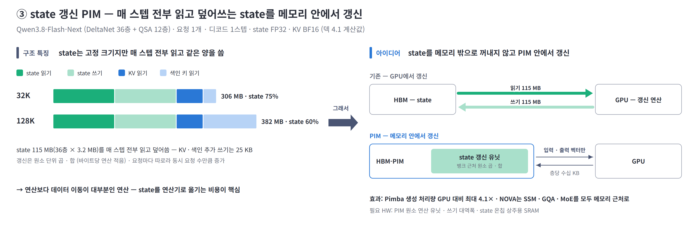

**부담 원인**
- state는 크기가 고정이지만 매 스텝 115 MB를 읽고 갱신한 115 MB를 다시 씀 → **매 스텝 약 230 MB를 옮김**, Qwen3.8 128K 이동량의 60% (1.6)
- 갱신은 원소 단위 곱 · 합이라 연산은 적음 — 비용 대부분이 이동이고, 요청마다 따로라 동시 요청 수만큼 늘어남

**HW 요구**
- 읽기만큼 큰 쓰기 대역폭, 또는 state를 아예 옮기지 않는 처리 위치

**대응 아이디어 — state를 메모리 밖으로 꺼내지 않고 갱신**
- GPU에서 갱신하면 층당 3.2 MB를 읽고 같은 양을 다시 씀 → PIM 안에서 갱신하면 메모리 버스로는 입력 · 출력 벡터(층당 수십 KB)만 오감
- 연산이 단순한 원소 곱 · 합이라 메모리 뱅크 옆의 작은 연산기로도 처리 가능
- **대표 사례 — Pimba (KAIST, MICRO 2025):** HBM-PIM 안에 state 갱신 유닛을 뱅크 2개당 1개 배치(MX 양자화 원소 곱 · 합) — 생성 처리량 GPU 대비 최대 4.1×, GPU + PIM 대비 2.1×

| 다른 제안 · 발표 | 아이디어 | 결과 (저자 보고) |
|---|---|---|
| **NOVA** (KAIST) · MICRO 2026 | decode의 GQA · SSM · MoE를 모두 메모리 근처에서 — 기존 PIM처럼 일부를 GPU로 되돌리지 않음 | 원문 확인 필요 |
| **HyPIM** (SNU) · MICRO 2026 | Mamba–Transformer hybrid용 통합 PIM | 원문 미공개 |

**남은 과제**
- 대안은 state를 큰 온칩 SRAM에 상주시키는 방향 — 동시 요청 수 × state 크기가 온칩 용량을 넘는지가 갈림길 (추정)

※ 출처: Pimba(arXiv 2507.10178), NOVA(arXiv 2608.22613), HyPIM(MICRO 2026 프로그램). 입력 · 출력 벡터 크기는 Qwen3.8 DeltaNet 층의 q · k · v · gate · 출력 BF16 기준 추정.

---

## 2.5 층별 · 단계별 차이 — 이종 가속기

### 층마다 방식이 다르고 prefill · decode의 병목도 다름 → 연산 종류 · 단계별로 맞는 HW를 한 시스템에

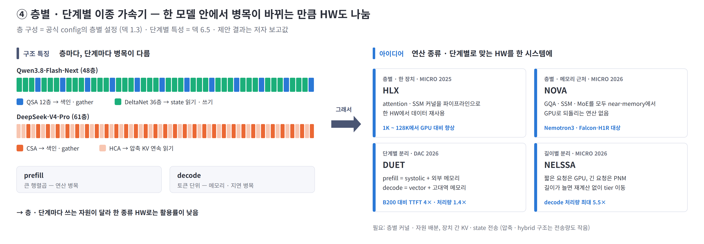

**부담 원인** — 층 종류의 차이와 단계의 차이
- **층 종류:** 한 모델 안에서 방식이 다른 층이 교대 — Qwen3.8은 QSA 12층 + DeltaNet 36층, V4는 CSA · HCA 1:1 → 층마다 병목이 색인 · 모으기 · state로 바뀌어, 한 종류 HW에서는 일부 연산기가 늘 쉼 (1.1)
- **단계:** prefill은 전 토큰을 한 번에 처리해 큰 행렬곱 · 전 토큰 색인으로 연산 병목, decode는 토큰 하나씩 처리해 색인 키 읽기 · 모으기로 메모리 · 지연 병목 (1.5)

**HW 요구**

| 구분 | Prefill | Decode |
|---|---|---|
| **주 제약** | 연산 (FLOPS) | 메모리 대역폭 · 용량 · 지연 |
| **맞는 HW** | 높은 FLOPS · FP8 · FP4 연산 밀도 | 고대역 · 대용량 메모리 · gather · top-k · 저지연 |

**대응 아이디어 — 연산 종류 · 단계마다 맞는 HW를 한 시스템에**
- 층별: 서로 다른 층의 연산을 한 HW 안에서 파이프라인으로 묶거나, state 층 · attention 층을 각각 맞는 유닛에 배치
- 단계별: prefill은 연산 밀도가 높은 장치, decode는 고대역 메모리 장치에 나눠 배치(PD 분리) — 그 사이에 KV cache · 색인 키 · state를 옮겨야 하며, 압축 · hybrid 구조는 옮길 양이 작아 유리
- **대표 사례 — DUET (DAC 2026):** prefill은 systolic chiplet + 외부 메모리, decode는 vector unit + 패키지 내 고대역 메모리 — B200 대비 TTFT 4×, 처리량 1.4×

| 다른 제안 · 발표 | 아이디어 | 결과 (저자 보고) |
|---|---|---|
| **HLX** (KAIST) · MICRO 2025 | GPU에서 활용률이 낮은 attention · SSM 커널을 파이프라인으로 묶어 한 HW에서 실행 | 1K ~ 128K에서 GPU 대비 향상 |
| **NOVA** · **NELSSA** · MICRO 2026 | 층별로 GQA · SSM · MoE 모두 메모리 근처(2.4) · 요청 길이별로 짧은 요청 GPU / 긴 요청 PNM(2.2) | 2.4 · 2.2 참조 |

**남은 과제**
- KV 읽기 시간이 짧아질수록 층마다 반복되는 top-k · 커널 경계 · 집합통신 지연의 비중이 커질 가능성 — 실제 비중은 실측 필요 (3.2)

※ 출처: HLX(MICRO 2025, DOI 10.1145/3725843.3756115), DUET(arXiv 2603.15530). MICRO 2026 채택은 프로그램 분석 자료 기준.

---

# Ⅲ. 종합

### 다음 HW의 관건은 'FLOPS · 대역폭 증설'보다 '데이터 성격별 배치 · 메모리 근처 처리 · 이종 실행' — 용량은 해결 단계, 고르는 비용은 공백

3.1 영역별 HW 요구와 대응 현황 · 3.2 시사점과 확인 필요 항목

---

## 3.1 영역별 HW 요구와 대응 현황

### 메모리 용량 대응만 실서비스 진입, 대역폭 · state · 이종 실행은 학회 단계, 색인 연산 · top-k는 공백

| 영역 | 구조 원인 | 요구 방향 | 대응 아이디어 | 단계 |
|---|---|---|---|---|
| **메모리 용량** | KV cache 보관량 그대로 · 매 스텝 1.6%만 읽음 | 큰 용량 계층 · CPU–GPU 링크 대역폭 | 계층형 KV (HiSparse · ECHO) | 실서비스 진입 |
| **메모리 대역폭 · 접근** | 색인 키를 매 스텝 전부 읽음 · 작고 흩어진 KV 모으기 | 메모리 근처 색인 · gather · 많은 동시 요청 처리 | 메모리 근처 선택 (NELSSA · LongSight) | 학회 (실제 PNM 장치 기반 포함) |
| **연산** | 점수 계산 3.8배 · top-k 비교 · 정렬 | 저정밀 연산 밀도 · top-k 전용 유닛 | — (dense 대상 PADE만) | 공백 |
| **쓰기 · 온칩** | state 115 MB를 매 스텝 읽고 다시 씀 | 쓰기 대역폭 · 메모리 안 갱신 · 온칩 SRAM | state 갱신 PIM (Pimba · NOVA) | 학회 |
| **시스템 · 통신** | 층 · 단계마다 병목이 다름 · 고정 지연 | 이종 실행 · PD 분리 · 저지연 통신 · 커널 결합 | 이종 가속기 (HLX · DUET) | 학회 |

- **한 줄 정리:** KV cache 읽기 문제는 sparse · hybrid가 상당 부분 해결 — 남은 문제는 **데이터 성격(용량형 · 대역폭형)의 분리**와 새로 생긴 **고르는 비용 · state 갱신**이며, 자원 하나를 늘리기보다 각각을 처리하는 구조로 대응

※ 근거: 2.1 ~ 2.5. '단계'는 대표 제안 기준 — 실서비스 진입 = 오픈소스 서빙 프레임워크 반영, 학회 = 채택 논문(시뮬레이션 포함), 공백 = sparse 모델 대상 제안 미확인.

---

## 3.2 시사점과 확인 필요 항목

### 우선 검토 대상은 '색인 · top-k를 어디서 처리할지' — 가장 큰 새 부담인데 HW 대응이 비어 있음

- **메모리 계층:** 계층형 KV가 실서비스에 들어오면서 HBM에 남는 데이터의 중심이 KV → 색인 키 · state(대역폭형)로 옮겨 감 — HBM은 용량보다 대역폭 · 근처 연산의 가치가 커지는 방향 (추정)
- **색인 · top-k:** 블록 색인(QSA 계열)은 키 1 B당 연산이 작아 메모리 근처 실행에 유리, 토큰 색인(DSA 계열)은 저정밀 연산 밀도가 필요 — **모델의 색인 설계에 따라 HW 방향이 갈림** (추정)
- **Hybrid 확산:** state 비중이 큰 짧은 · 중간 길이(32K까지 이동량의 75% 이상)에서는 state 갱신 처리가 KV 처리보다 우선 — PIM과 온칩 SRAM 중 선택이 과제

| 확인 필요 항목 | 현재 상태 | 확인 방법 |
|---|---|---|
| 스텝 간 top-k 재사용률 | HiSparse 측정 70%(GLM-5.1) | DSA · QSA 모델과 작업 종류별 재현 |
| top-k · 층별 고정 지연 | 정성 분석 (이론 시간 없음) | 동시 요청 수별 커널 시간 · 커널 간 공백 · 집합통신 시간 측정 |
| gather 달성 대역폭 | 정성 분석 | 토큰 · 블록 단위 KV gather 커널의 달성 대역폭 실측 |
| 학습된 색인의 메모리 근처 실행 | 제안 미확인 | DSA · QSA 색인을 PNM · PIM에서 실행할 때 연산기 요구 추정 |
| MICRO 2026 채택 · 결과 | 프로그램 분석 자료 기준 | 공식 proceedings로 NELSSA · NOVA · HyPIM · AMMA 재확인 |

---

## 부록 A. 방식별 비교

| | 전부 읽기 (MLA · GQA) | 선택 읽기 (DSA · QSA) | 압축 저장 (CSA · HCA) | Linear state |
|---|---|---|---|---|
| 보관량 | `S` | `S` + 색인 키 (+3 ~ 11%) | `S/4` · `S/128` | 고정 (state) |
| 매 스텝 쓰기 | 1줄 | 1줄 + 색인 키 1개 | 4 · 128토큰마다 1줄 | state 전체 |
| 디코드당 읽기 (128K, 층당) | 151 ~ 268 MB | 13 ~ 20 MB | 1.2 ~ 3.3 MB | 3.2 MB + 같은 양 쓰기 |
| 색인 산술 강도 (키 1 B당) | — | DSA 124 · QSA 4 FLOP | CSA 256 FLOP | — |
| 읽기 절감 상한 = KV 1줄 ÷ 토큰당 색인 바이트 | — | DSA 1,152 ÷ 132 ≈ 9× · QSA 2,048 ÷ 64 = 32× | CSA 1,152 ÷ 16 = 72× · HCA 144× | — |
| 추가 연산 | — | 점수 계산 · top-k · 흩어진 읽기 | 쓰기 시 압축 · top-k · 흩어진 읽기 | 매 스텝 state 갱신 |
| 주 HW 부담 | 용량 · 읽기 대역폭 | 색인 연산 · top-k · gather · 용량 | CSA 색인 연산 · gather (HCA는 연속 읽기) | 쓰기 대역폭 · 온칩 |
| 관련 HW 대응 (Ⅱ장) | — | 계층형 KV · 메모리 근처 선택 | 메모리 근처 선택 (CSA) | state 갱신 PIM |

※ 블록 색인은 블록 키 1개가 4토큰을 대표하므로 토큰당 색인 바이트 = 블록 키 ÷ 4 (QSA 256 ÷ 4 = 64 B, CSA 64 ÷ 4 = 16 B). HCA는 색인 없이 압축 KV를 전부 읽어 128줄 → 1줄 압축비가 곧 상한. sliding window는 `W`줄만 보관 · 읽기(full 층과 혼합), 세부는 덱 부록 A.

---

## 부록 B. 계산 기준

| 항목 | 기준 |
|---|---|
| 단위 | 층 1개 · 요청 1개 · 디코드 1스텝. 1M = 100만 토큰, 1 GB = 10⁹ B. 이동량 = 읽기 + 쓰기 |
| 비교 길이 | 128K = 공통 비교 조건, 1M = 차세대 설계 시나리오 (V3.2 · Qwen3.8은 지원 길이 밖 — 외삽) |
| 구조 비교 (1.3 ~ 1.6 · 2.2 · 2.3) | KV cache BF16 통일 (KV 1줄 MLA 1,152 B · GQA 2,048 B). 색인 키는 공개 저장 형식 — DSA FP8 + scale 132 B, CSA FP4 64 B, QSA 블록 키 BF16 256 B 가정 |
| 배포 형식 (1.7 · 2.1) | DeepSeek-V3.2 실제 형식 — KV FP8 656 B/줄, 색인 132 B/줄 |
| 이론 시간 (1.5 · 2.3) | H200 HBM 4.8 TB/s, FP8 1,979 · BF16 989 TFLOPS (dense) — 바이트 ÷ 대역폭, FLOP ÷ 피크의 하한 |
| state | Qwen3.8-Flash-Next DeltaNet 층당 3.2 MB (FP32), 36층 115 MB |
| 제안 결과 | 각 논문의 저자 보고값 (측정 조건 · 기준선이 서로 달라 직접 비교 불가) |
| 미포함 | top-k · 흩어진 읽기의 커널 비효율, 활성값 · 통신 버퍼, 정확도 |

---

## 부록 C. 출처

| 분야 | 링크 |
|---|---|
| 구조 분석 | [덱 원고](deck-draft-claude.md) · [메모리 보고서](../reports/llm-memory-requirements.md) |
| 계층형 KV | [HiSparse](https://arxiv.org/abs/2608.07009) · [SGLang HiSparse 블로그](https://www.lmsys.org/blog/2026-04-10-sglang-hisparse/) · [ECHO (OSDI 2026)](https://www.usenix.org/conference/osdi26/presentation/liu-guangda) · [ESS](https://arxiv.org/abs/2512.10576) · [SAC](https://arxiv.org/abs/2606.19746) · [Fluxion](https://arxiv.org/abs/2605.07719) · [HGCA](https://arxiv.org/abs/2507.03153) |
| 메모리 근처 | [NELSSA](https://arxiv.org/abs/2607.26633) · [LongSight (MICRO 2025)](https://dl.acm.org/doi/10.1145/3725843.3756062) · [PAM](https://arxiv.org/abs/2602.11521) · [AMMA](https://arxiv.org/abs/2604.26103) |
| Hybrid · 이종 | [Pimba](https://arxiv.org/abs/2507.10178) · [HLX (MICRO 2025)](https://dl.acm.org/doi/10.1145/3725843.3756115) · [NOVA](https://arxiv.org/abs/2608.22613) · [DUET](https://arxiv.org/abs/2603.15530) |
| 공백 · 참고 | [PADE](https://arxiv.org/abs/2512.14322) · [MICRO 2026 프로그램 분석](https://semihub.io/en/blog/micro-2026-guide.html) |

※ MICRO 2026 채택(NELSSA · NOVA · HyPIM · AMMA)은 프로그램 분석 자료 기준이며 공식 proceedings로 재확인 필요. '공백' 판단은 2026-11-11 검색 범위 기준.
