# Sparse · Hybrid Attention 구조 특징과 HW 아키텍처 방향

KV cache 부담 변화에 따른 HW 요구와 대응 방향 · 2026.11 · 불릿 정리본

기반: [v2 보고서](sparse-hybrid-hw-report-v2-claude.md). 근거: [구조 분석](deck-draft-claude.md) · [HW 대응 아이디어](hw-arch-ideas-claude.md) · [HiSparse 상세](paper-hisparse-claude.md). 구성과 그림은 v2를 유지했다. 수치와 연구 현황은 원본의 계산·조사 기준을 따른다. 기본 비교 조건은 128K · 요청 1개 · 디코드 1스텝이다.

---

## 요약

### Sparse는 KV 선택 비용, Hybrid는 state 갱신 비용이 남는다

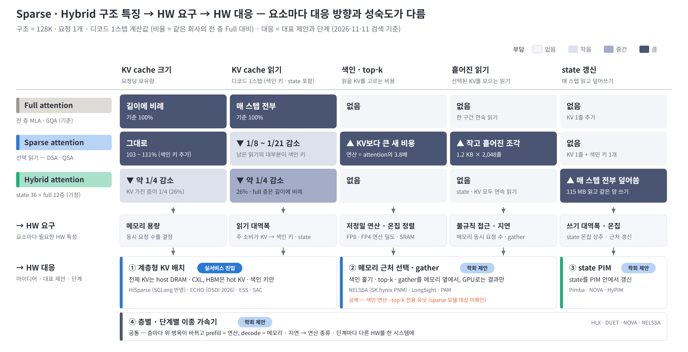

- **Sparse:** 선택한 KV만 읽어 읽기량 감소. 전체 KV 보관과 색인·top-k·KV 모으기 비용은 유지.
- **Hybrid:** 일부 층의 KV를 고정 크기 state로 바꿔 보관량 감소. 매 스텝 state 전체 읽기·쓰기 필요.
- **HW 대응:** KV는 대용량 메모리에 분산, 색인·state는 메모리 근처 처리, 층·단계별로 자원 배분.
- **대응 현황:** 계층형 KV는 서빙 프레임워크 반영. 메모리 근처 처리와 이종 가속기는 논문 제안 중심.
- **미확인 영역:** 학습된 Sparse 색인·top-k를 직접 처리하는 전용 HW는 원본 검색 범위에서 미확인.

※ 그림의 비율은 같은 회사의 전 층 Full 대비 계산값이다. Sparse는 DSA(V3.2) · QSA(Qwen3.8), Hybrid는 Qwen3.8 차원의 state 36층 + full GQA 12층 가정 구성이다. 그림의 ‘약 1/4 감소’는 약 1/4로 줄어든다는 뜻이다. 칸 색은 상대 부담을 나타낸다. 그림의 ‘실서비스 진입’은 서빙 프레임워크 반영을 뜻하며, 연구 현황은 원본의 2026-11-11 검색 기준이다.

---

## 구성

| 장 | 내용 |
|---|---|
| **Ⅰ. 구조 특징** | 구조 동향과 작동 원리(1.1 · 1.2) → 이동량·보관량 감소(1.3) → Sparse와 Hybrid의 남은 부담(1.4 ~ 1.6) → 데이터 특성과 HW 요구(1.7 · 1.8) |
| **Ⅱ. HW 부담과 대응** | KV cache 용량 · 색인 키 읽기와 gather · 색인 연산과 top-k · state 갱신 · 층별·단계별 차이 |
| **Ⅲ. 종합** | 영역별 HW 요구와 대응 현황 · 시사점과 확인 필요 항목 |
| **부록** | 방식별 비교 · 계산 기준 · 출처 |

| 용어 | 뜻 |
|---|---|
| **읽기 · 쓰기 · 이동량** | 디코드 한 스텝에 메모리에서 읽는 양, 쓰는 양, 둘의 합. 본문의 구조 비교는 KV cache · 색인 · state를 대상으로 한다. |
| **보관량 (보유량)** | 요청 하나의 KV cache · 색인 키 · state를 저장하는 데 필요한 메모리 용량 |
| **색인 키** | 읽을 KV를 고르기 위해 저장하는 작은 키. DSA는 토큰당 132 B를 저장한다. |
| **top-k** | 색인 점수가 높은 k개 위치를 고르는 단계. DSA의 예시에서는 2,048개를 고른다. |
| **gather (KV 모으기)** | 선택한 KV 조각을 흩어진 메모리 위치에서 모아 읽는 작업 |
| **state** | linear 층이 KV cache 대신 유지하는 고정 크기 행렬. 매 스텝 갱신한다. |
| **PIM · PNM · CXL** | PIM은 메모리 내부 연산, PNM은 메모리 근처 연산이다. CXL은 메모리를 확장해 연결하는 규격이다. |

---

# Ⅰ. 구조 특징

### KV 부담은 줄어들고, 색인 선택과 state 갱신이 주요 과제로 남는다

1.1 구조 동향 · 1.2 작동 원리 · 1.3 이동량과 보관량 · 1.4 색인 키 읽기 · 1.5 KV 선택 과정 · 1.6 state 갱신 · 1.7 데이터별 성격 · 1.8 HW 요구 정리

절 마지막의 **→ Ⅱ장**은 해당 부담을 다루는 HW 대응 절이다. 1.4 · 1.5는 KV BF16 비교 기준, 1.7은 DeepSeek-V3.2의 KV FP8 배포 기준이다. 이에 따라 KV 한 줄의 크기가 약 1.2 KB와 656 B로 다르다.

---

## 1.1 구조 동향

### 조사 대상에서 전 층 Full 모델의 비중은 50%에서 7%로 줄었다

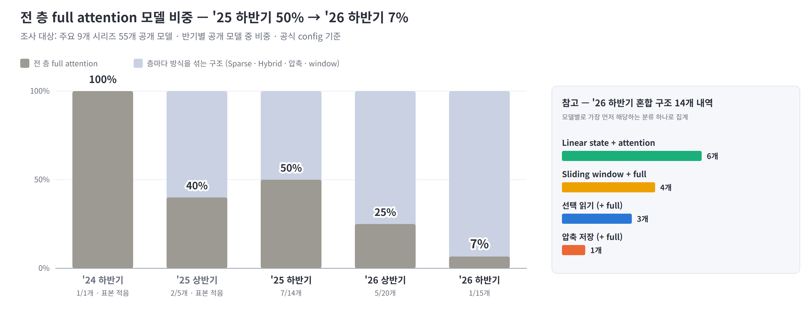

- **전 층 Full 감소:** 2025 하반기 7/14개 → 2026 상반기 5/20개 → 2026 하반기 1/15개.
- **2026 하반기 대체 구조:** state 혼합 6개 · window 혼합 4개 · 선택 읽기 3개 · 압축 저장 1개.
- **HW 영향:** 층마다 읽고 쓰는 데이터가 달라 필요한 자원도 달라짐.

**→ Ⅱ장:** 층별 특성에 맞는 자원 배분과 실행 구조가 필요하다(2.5).

※ 출처: 주요 9개 시리즈 55개 공개 모델의 공식 config([메모리 보고서](../reports/llm-memory-requirements.md) §1). 조사 표본의 변화이며, 2024년 하반기와 2025년 상반기는 모델 수가 적다. 모델마다 가장 먼저 해당하는 분류 하나로 집계했다.

---

## 1.2 작동 원리 — Full · Sparse · Hybrid

### Sparse는 읽는 KV를 줄이고, Hybrid는 KV를 보관하는 층을 줄인다

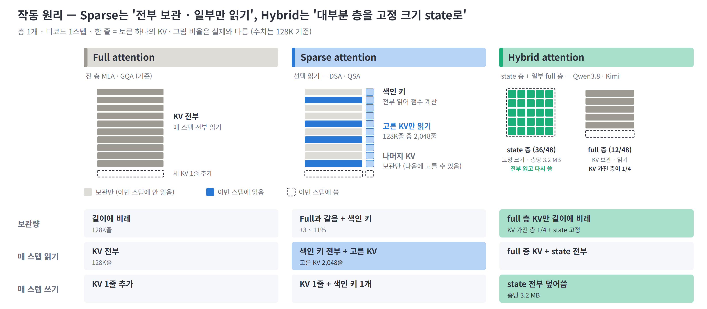

- **Full:** 전체 KV 보관·읽기 → 길이에 따라 보관량과 읽기량 증가.
- **Sparse:** 전체 KV를 보관하되 선택한 2,048줄만 읽기. 다음 스텝에는 다른 KV를 선택할 수 있음.
- **Hybrid:** 일부 층을 고정 크기 state로 대체 → 보관량 감소, 매 스텝 state 전체 읽기·쓰기 필요.
- **기타 방식:** 압축 저장은 여러 토큰의 KV를 합치고, sliding window는 최근 W줄만 보관(부록 A).

※ 그림 비율은 실제와 다르다. state 크기는 층당 약 3.2 MB다. Hybrid에서 KV cache를 유지하는 층에는 Full 또는 Sparse를 사용할 수 있다. Qwen3.8은 Sparse(QSA)와 state를 결합한다.

---

## 1.3 줄어드는 것 — 이동량과 보관량

### Sparse와 Hybrid를 결합하면 이동량은 3%, 보관량은 27%가 된다

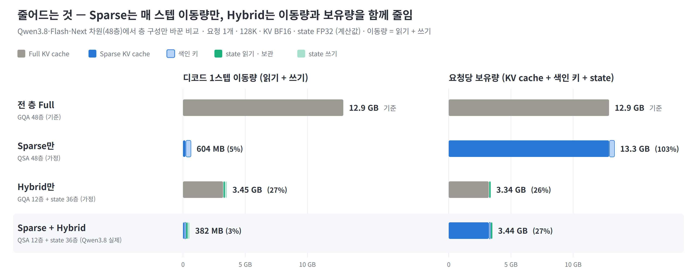

- **비교 기준:** 같은 모델 차원에서 층 구성만 변경. 전 층 Full = 100%.
- **Sparse만:** 이동량 5% · 보관량 103% → 색인 키가 추가돼 용량 부담은 유지.
- **Hybrid만:** KV 보관 층 48개 → 12개. 이동량 27% · 보관량 26%.
- **결합:** 이동량 3% · 보관량 27%. 남은 이동량 382 MB의 약 87%는 색인 키와 state.

**→ Ⅱ장:** Sparse의 KV 보관량은 별도의 메모리 배치로 줄여야 한다(2.1).

※ 기준: Qwen3.8-Flash-Next 차원 48층 · 128K · 요청 1개 · 디코드 1스텝, KV BF16 · state FP32 계산값. Sparse만·Hybrid만은 가정 구성이다. 압축형 DeepSeek-V4(CSA · HCA 층 1:1)는 같은 회사 Full(MLA) 대비 읽기 1.5%, 보관량 12%다(덱 2.1).

---

## 1.4 Sparse에 남는 것 ① 색인 키 읽기

### 선택한 KV는 일정하지만, 색인 키 읽기량은 길이에 비례한다

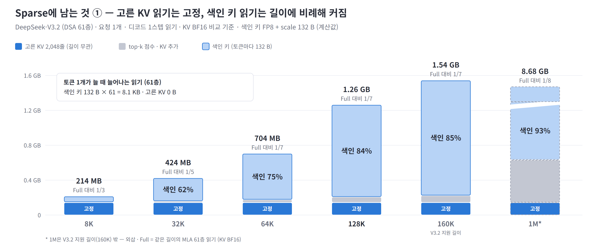

- **선택 KV:** 매 스텝 2,048줄로 고정 → 읽기량 일정.
- **색인 키:** 전체 토큰의 키를 읽음 → 길이에 비례해 읽기량 증가.
- **색인 비중:** 8K 31% → 128K 84% → 1M 93%. KV 읽기를 줄여도 색인 읽기는 남음.
- **절감 상한:** 색인 키 기준 약 8.7배 = KV 1,152 B ÷ 색인 132 B. 블록 색인은 부록 A 참조.

**→ Ⅱ장:** 색인 키를 처리하는 위치를 바꿔 데이터 이동을 줄이는 방향이다(2.2).

※ 기준: DeepSeek-V3.2 61층 · 요청 1개 · 디코드 1스텝, KV BF16 · 색인 키 FP8 + scale 132 B · top-k 점수 FP32 계산값. 선택 KV의 읽기는 61층 합계 약 144 MB다. 1M은 지원 길이 160K 밖의 외삽이다(덱 1.6 · 3.1).

---

## 1.5 Sparse에 남는 것 ② 고르는 과정

### KV 선택에는 점수 계산, top-k, 흩어진 읽기가 필요하다

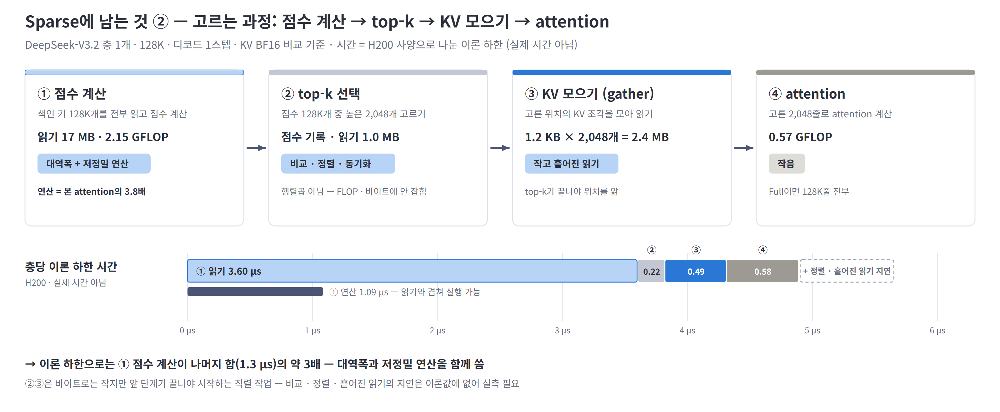

- **처리 순서:** 점수 계산 → top-k → KV 모으기 → attention. 다음 단계는 앞 단계 결과를 기다림.
- **점수 계산:** 색인 키 17 MB 읽기 + 2.15 GFLOP 계산. 연산량은 본 attention의 약 3.8배.
- **top-k:** 128K개 점수 중 2,048개 선택 → 비교·선택·동기화 비용 발생.
- **KV 모으기:** top-k 이후 확정된 위치에서 1.2 KB × 2,048개 읽기 → 불규칙 접근 부담.
- **블록 색인:** QSA·CSA는 32K에서 색인 읽기 비중이 약 1/3 → KV 모으기도 중요.

**→ Ⅱ장:** 데이터 이동은 2.2, 점수 계산과 top-k 처리는 2.3에서 다룬다.

※ 기준: DeepSeek-V3.2 층 1개 · 128K · KV BF16. 시간 계산은 바이트 ÷ 대역폭 또는 FLOP ÷ 피크 성능의 이론 하한이다. 실제 커널 시간에는 비교·동기화와 불규칙 접근의 지연이 추가되므로 실측이 필요하다. 블록 색인 비중은 덱 5.2 기준이다.

---

## 1.6 Hybrid에 남는 것 — state 왕복

### state는 크기가 고정이어도 매 스텝 약 230 MB를 읽고 쓴다

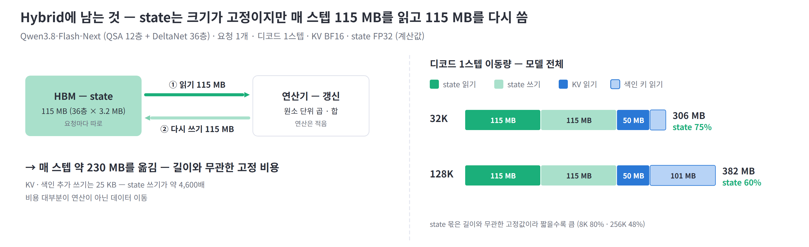

- **매 스텝 이동량:** 115 MB 읽기 + 115 MB 쓰기 = 약 230 MB(Qwen3.8, 36층).
- **길이별 비중:** 32K 75% · 128K 60%. 고정 비용이라 짧은 길이에서 비중이 큼.
- **HW 부담:** 계산에 비해 데이터 이동이 큼 → 갱신 위치와 쓰기 대역폭이 중요.

**→ Ⅱ장:** state 전체를 GPU로 옮기지 않고 갱신하는 방안을 다룬다(2.4).

※ 기준: Qwen3.8-Flash-Next의 QSA 12층 + DeltaNet 36층, 요청 1개 · 디코드 1스텝, KV BF16 · state FP32 계산값. 이동량 비중은 KV·색인·state의 합계 기준이다(덱 4.1).

---

## 1.7 데이터별 성격 — 용량형과 대역폭형

### KV는 보관 용량, 색인 키와 state는 반복 접근이 주요 부담이다

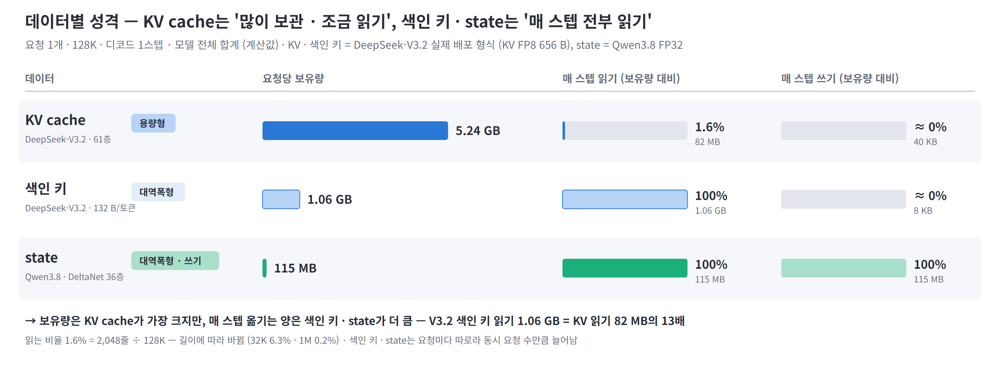

- **KV cache:** 5.24 GB 중 매 스텝 1.6%만 읽음 → 외부 메모리 배치 후보. 캐시와 빠른 링크가 조건.
- **색인 키:** KV의 약 1/5 크기지만 매 스텝 전부 읽음 → 읽기 대역폭·처리 위치가 중요.
- **state:** 매 스텝 전부 읽고 다시 씀 → 읽기·쓰기 대역폭과 갱신 위치가 중요.
- **배치 방향:** 보관량이 큰 데이터와 반복 접근이 많은 데이터를 구분해 메모리·처리 위치 선택.

**→ Ⅱ장:** KV 배치는 2.1, 색인 처리는 2.2, state 갱신은 2.4로 이어진다.

※ 기준: 요청 1개 · 128K · 디코드 1스텝. KV·색인은 DeepSeek-V3.2 전체 61층의 FP8 배포 형식(KV 656 B/줄, 색인 132 B/줄), state는 Qwen3.8 FP32 기준이다. 1.6%는 2,048줄 ÷ 128K로 계산하며 길이에 따라 달라진다. KV·색인·state는 요청별 데이터이므로 동시 요청 수에 따라 보관량이 늘어난다.

---

## 1.8 정리 — 남은 부담과 Ⅱ장

### 남은 부담에 따라 메모리 배치와 처리 장치를 구분한다

| 남은 부담 | 근거 | 필요한 HW 특성 | Ⅱ장 |
|---|---|---|---|
| **KV cache 보관량** — Sparse도 전체 KV를 유지 | 1.3 · 1.7 | 대용량 메모리 · 빠른 CPU–GPU 링크 | 2.1 |
| **색인 키 이동 · KV 모으기** — 전체 색인 읽기와 불규칙 접근 | 1.4 · 1.5 | 메모리 근처 처리 · 작은 단위 gather | 2.2 |
| **점수 계산 · top-k** — 저정밀 연산과 비교·선택 | 1.5 | 충분한 연산 성능 · 선택 전용 유닛 | 2.3 |
| **state 읽기·쓰기** — 매 스텝 전체 state 갱신 | 1.6 | 쓰기 대역폭 · 메모리 근처 갱신 | 2.4 |
| **층별·단계별 차이** — 필요한 자원이 구간마다 변화 | 1.1 · 1.5 | 층과 처리 단계에 맞춘 이종 실행 | 2.5 |

---

# Ⅱ. HW 부담과 대응

### 데이터 이동을 줄이고, 남은 연산에 맞춰 HW를 배치한다

2.1 계층형 KV 배치 · 2.2 메모리 근처 선택 · 2.3 색인 연산과 top-k · 2.4 state 갱신 PIM · 2.5 이종 가속기

각 절은 **부담 원인 → HW 요구 → 대응 원리와 사례 → 남은 과제** 순서다. 그림 왼쪽은 구조 특징, 오른쪽은 대응 방향을 보여준다. 성능 수치는 저자 보고값이며 실험 조건과 기준선이 달라 제안 간 직접 비교는 어렵다.

---

## 2.1 KV cache 용량 — 계층형 KV 배치

### 전체 KV는 대용량 메모리에 두고, 자주 쓰는 KV를 HBM에 유지한다

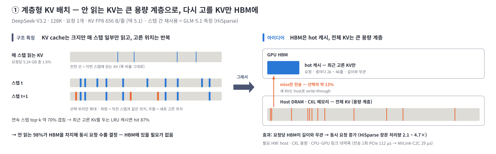

**부담 원인**

- **용량 부담:** 일부 KV만 읽어도 전체를 HBM에 보관 → 동시 요청 수 제한(1.3 · 1.7).
- **재사용 가능:** 연속 스텝의 선택 위치가 약 70% 겹침 → 최근 KV를 캐시할 근거(HiSparse, GLM-5.1).

**HW 요구**

- **대용량 계층:** 전체 KV를 보관할 host DRAM·CXL 메모리.
- **빠른 전송:** 캐시에 없는 KV를 가져올 링크 대역폭과 낮은 지연.

**대응 아이디어 — HBM은 캐시, 전체 KV는 큰 용량 메모리**

- **배치:** 전체 KV는 외부 메모리, 최근 선택한 KV와 색인 키는 HBM에 유지.
- **동작:** HBM에 있으면 바로 읽고, 없으면 외부에서 전송 → HBM 점유를 줄여 동시 요청 수 확대.
- **HiSparse:** 요청별·층별 캐시를 GPU 커널 하나로 관리. 적중률 약 87%, host 전송 약 13%.
- **적용·효과:** SGLang 반영. 장문 처리량 2.1 ~ 4.7배(저자 보고).

| 다른 제안 · 발표 | 아이디어 | 결과 (저자 보고) |
|---|---|---|
| **ECHO** (SJTU · Huawei) · OSDI 2026 | 색인 점수로 다음에 선택할 KV를 예측해 미리 전송. NSA 계열 대상 | 생성 처리량 최대 2.1× |
| **ESS** (Baidu) · 2025-12 프리프린트 | V3.2 KV 일부를 CPU 메모리에 두고 지연에 민감한 데이터는 GPU에 유지 | 128K 처리량 +123% (시뮬레이션) |
| **SAC** · 2026-06 프리프린트 | KV를 보관하는 외부 계층을 CXL 분리 메모리로 확장 | — |

**남은 과제**

- **색인 용량:** KV를 옮겨도 색인 키는 HBM에 유지. 요청당 HBM의 78%(128K) · 97%(1M), GLM-5.1 기준.
- **전송 지연:** 인용 구성의 전송 1회는 PCIe 112 µs · NVLink-C2C 29 µs.
- **외부 용량:** 외부 메모리도 충분히 커야 동시 요청 수를 늘릴 수 있음.

※ 출처: HiSparse(arXiv 2608.07009) §3 ~ §5, ECHO(OSDI 2026) abstract, ESS(arXiv 2512.10576), SAC(arXiv 2606.19746). 색인 키 비중은 GLM-5.1 78층의 요청당 HBM 분해 계산값([HiSparse 정리](paper-hisparse-claude.md) 4.1)이다. host CPU가 attention 일부를 계산하는 변형으로 Fluxion·HGCA가 있다.

---

## 2.2 색인 키 읽기와 KV gather — 메모리 근처 선택

### 색인 선택과 KV 모으기를 메모리 근처에서 처리한다

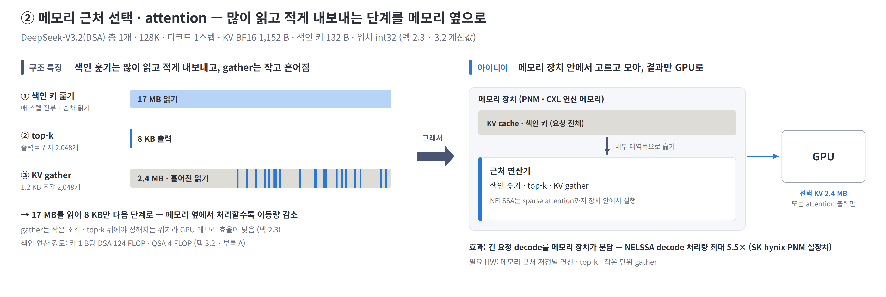

**부담 원인**

- **색인 이동:** 17 MB를 읽어 선택 위치 8 KB 생성 → KV 읽기를 줄여도 색인 읽기 부담은 유지(1.4).
- **흩어진 KV:** 1.2 KB × 2,048개를 모아 읽음 → 작은 메모리 요청 다수 발생(1.5).
- **단계 간 대기:** 위치는 top-k 이후 확정 → 별도 예측 없이 미리 읽기 어려움.

**HW 요구**

- **색인 처리:** 메모리 내부 대역폭을 활용하는 근처 연산기.
- **KV 모으기:** 작은 요청을 동시에 처리하는 gather 엔진과 선택 단위에 맞는 데이터 배치.

**대응 아이디어 — 고르고 모으는 일을 메모리 옆에서**

- **선택 처리:** 점수 계산·top-k를 메모리 근처에서 수행 → GPU에는 위치 8 KB 또는 KV 약 2.4 MB만 전송.
- **모으기 처리:** 흩어진 KV 읽기도 메모리 장치 안에서 수행.
- **NELSSA:** 긴 요청은 실제 PNM 장치에서 sparse attention까지 처리, 짧은 요청은 GPU에 배치.
- **보고 효과:** decode 처리량 최대 5.5배 · P99 지연 최대 15배 감소.

| 다른 제안 · 발표 | 아이디어 | 결과 (저자 보고) |
|---|---|---|
| **LongSight** (Cornell) · MICRO 2025 | CXL 연산 메모리에서 부호 비트로 후보를 줄이고 top-k 수행. 선택한 KV만 GPU로 전송 | GPU 1장 + CXL 1개로 1M 컨텍스트 |
| **PAM** (ICT CAS) · 2026-02 프리프린트 | HBM·DDR·SSD의 PIM에 자주 쓰는 KV와 드물게 쓰는 KV를 나눠 병렬 attention 수행 | vLLM 대비 12.9 ~ 26.4× |

**남은 과제**

- **적용 범위:** 기존 제안은 자체 선택 방식 사용. 학습된 DSA 색인을 그대로 실행하는 HW는 원본 검색 범위에서 미확인.
- **연산 성능:** DSA 124 FLOP/B · QSA 4 FLOP/B. QSA가 연산 부담은 작지만 내부 대역폭과 함께 검토 필요.

※ 출처: NELSSA(arXiv 2607.26633, MICRO 2026), LongSight(MICRO 2025, DOI 10.1145/3725843.3756062), PAM(arXiv 2602.11521). AMMA는 decode attention 전체를 PNM HBM cube로 옮기는 제안이며, H100 대비 attention 지연 15.5배 감소를 시뮬레이션으로 보고했다(arXiv 2604.26103). 구조 수치는 DeepSeek-V3.2 층 1개 · 128K · KV BF16 기준이다.

---

## 2.3 색인 연산과 top-k — 고르는 비용

### 점수 계산에는 저정밀 연산, top-k에는 비교·선택 처리가 필요하다

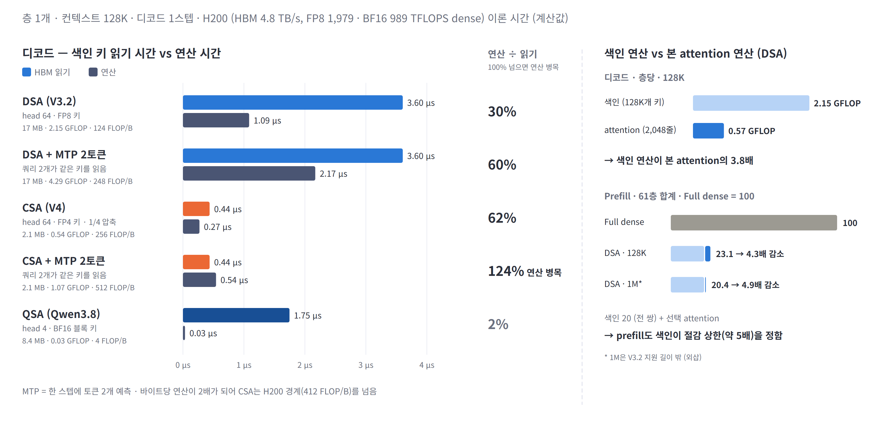

**부담 원인**

- **점수 계산:** head 64개가 키를 각각 계산 → 본 attention의 3.8배(128K), 29배(1M 외삽)(1.5).
- **top-k 선택:** 비교·선택·동기화가 중심 → 행렬곱 성능만 높여서는 해결되지 않음.
- **중간 데이터:** 점수를 메모리에 썼다가 다시 읽는 비용 발생.

**HW 요구**

- **점수 계산:** 충분한 저정밀 연산 성능.
- **top-k:** 점수 계산과 선택을 온칩에서 연결 → 중간 점수의 외부 메모리 왕복 감소.

**대응 아이디어 — 현황: 공백**

- **Sparse 대상:** 원본 검색 범위에서 전용 HW 미확인. cuDNN 결합 API·GVR 등 GPU 커널 중심.
- **PADE 참고:** dense 모델의 예측기와 attention을 bit-serial로 결합. H100 대비 7.43배 성능 보고.
- **선택 비용:** PADE의 8-bit 구성에서 예측기가 전체 비용의 63% 차지.

**심화 — 읽기 절감 이후의 연산 부담**

- **FP4·블록 색인:** 읽기와 연산이 같은 비율로 줄지 않을 수 있음 → 남은 계산량도 확인.
- **Speculative decoding:** 검증 토큰이 늘면 점수 계산도 증가 → 색인 연산이 새 병목이 될 가능성.
- **MTP 2토큰 예시:** CSA 색인 연산 시간은 읽기 시간의 124%(이론값).

※ 기준: 층 1개 · 128K 디코드 이론 시간, H200 HBM 4.8 TB/s · FP8 1,979 · BF16 989 TFLOPS(dense). 1M은 지원 길이 밖 외삽이다. 출처: PADE(arXiv 2512.14322, HPCA 2026). 전용 HW 미확인은 원본의 2026-11-11 검색 범위 기준이다.

---

## 2.4 state 갱신 — state 갱신 PIM

### state를 메모리 안에서 갱신해 GPU와의 왕복을 줄인다

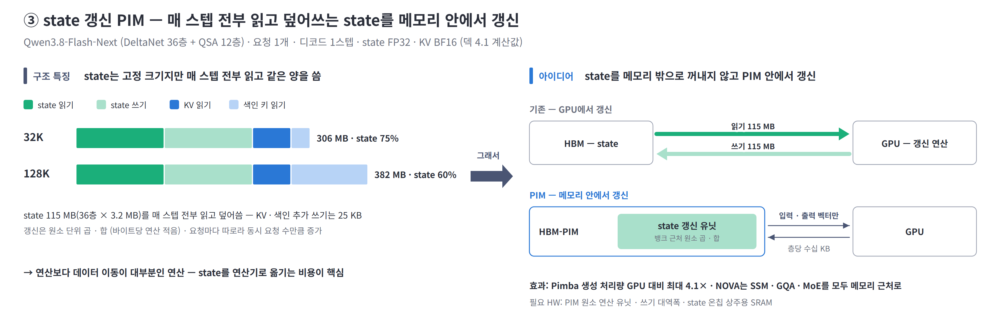

**부담 원인**

- **반복 이동:** 매 스텝 115 MB 읽기 + 115 MB 쓰기 → 약 230 MB, 128K 이동량의 60%(1.6).
- **낮은 연산 비중:** 계산에 비해 데이터 이동 부담이 큼.
- **동시 요청:** 요청마다 state가 별도 → 요청 수에 따라 보관량과 갱신 트래픽 증가.

**HW 요구**

- **쓰기 대역폭:** 매 스텝 읽기와 같은 양을 다시 저장.
- **갱신 위치:** 메모리 내부·온칩에서 처리해 state 전체의 GPU 왕복 감소.

**대응 아이디어 — state를 메모리 밖으로 꺼내지 않고 갱신**

- **기존 GPU 갱신:** 층당 state 약 3.2 MB를 읽고 같은 양을 다시 씀.
- **PIM 갱신:** state는 메모리에 유지, GPU와는 입력·출력 벡터만 교환(층당 수십 KB 추정).
- **Pimba:** 뱅크 2개당 갱신 유닛 1개 배치, MX 양자화로 원소 곱·합 처리.
- **보고 효과:** 생성 처리량 GPU 대비 최대 4.1배 · GPU + PIM 대비 2.1배.

| 다른 제안 · 발표 | 아이디어 | 결과 (저자 보고) |
|---|---|---|
| **NOVA** (KAIST) · MICRO 2026 | decode의 GQA·SSM·MoE를 모두 메모리 근처에서 처리해 GPU로 되돌리는 작업을 줄임 | 원문 확인 필요 |
| **HyPIM** (SNU) · MICRO 2026 | Mamba–Transformer hybrid를 위한 통합 PIM | 원문 미공개 |

**남은 과제**

- **대안:** state를 큰 온칩 SRAM에 유지.
- **선택 기준:** 동시 요청 수 × state 크기가 온칩에 들어가는지 확인하고 PIM의 이동 비용과 비교.

※ 출처: Pimba(arXiv 2507.10178, MICRO 2025), NOVA(arXiv 2608.22613), HyPIM(MICRO 2026 프로그램). 벡터 크기는 Qwen3.8 DeltaNet 층의 q·k·v·gate·출력을 BF16으로 둔 추정값이다. 제안별 대상 구조와 구현 조건은 구분해서 해석해야 한다.

---

## 2.5 층별 · 단계별 차이 — 이종 가속기

### 층과 처리 단계에 맞는 연산기·메모리를 조합한다

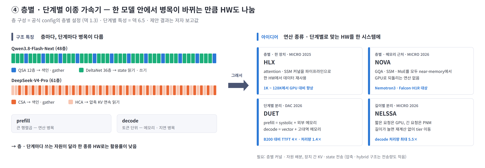

**부담 원인**

- **층별 차이:** Qwen3.8은 QSA 12층 + DeltaNet 36층, V4는 CSA·HCA 1:1 → 층마다 필요한 자원이 다름.
- **Prefill:** 입력 토큰을 한꺼번에 처리 → 큰 행렬곱·색인 계산 부담.
- **Decode:** 토큰을 순차 생성 → 메모리 접근·단계 간 대기 부담.

**HW 요구**

| 구분 | Prefill | Decode |
|---|---|---|
| **주 제약** | 연산 성능 | 메모리 대역폭 · 용량 · 지연 |
| **맞는 HW** | 높은 연산 처리량 · FP8·FP4 연산기 | 고대역·대용량 메모리 · gather·top-k 처리 · 낮은 지연 |

**대응 아이디어 — 연산 종류 · 단계마다 맞는 HW를 한 시스템에**

- **층별 배치:** attention·state 갱신에 맞는 유닛을 두거나 작업을 파이프라인으로 연결.
- **PD 분리:** prefill은 연산 중심 장치, decode는 메모리 중심 장치에 배치. 장치 간 KV·색인·state 전송 필요.
- **DUET:** prefill은 systolic chiplet + 외부 메모리, decode는 vector unit + 패키지 내 고대역 메모리.
- **보고 효과:** B200 대비 첫 토큰 생성 시간(TTFT) 4배 개선 · 처리량 1.4배.

| 다른 제안 · 발표 | 아이디어 | 결과 (저자 보고) |
|---|---|---|
| **HLX** (KAIST) · MICRO 2025 | attention·SSM 커널을 파이프라인으로 연결해 한 HW에서 실행 | 1K ~ 128K에서 GPU 대비 향상 |
| **NOVA** · **NELSSA** · MICRO 2026 | NOVA는 여러 연산을 메모리 근처에서 처리. NELSSA는 요청 길이에 따라 GPU와 PNM에 배치 | 2.4 · 2.2 참조 |

**남은 과제**

- **고정 지연:** KV 읽기가 빨라질수록 top-k·커널 경계·집합통신의 상대 비중이 커질 가능성.
- **전체 비용:** 장치 간 전송·동기화까지 포함해 이종 실행의 이득 확인.
- **전송량 절감:** 압축·Hybrid가 장치 간 전달할 데이터를 줄이는 효과도 함께 평가.

※ 출처: HLX(MICRO 2025, DOI 10.1145/3725843.3756115), DUET(arXiv 2603.15530, DAC 2026). MICRO 2026 채택은 원본의 프로그램 분석 자료 기준이다. 고정 지연과 통신의 실제 비중은 실측이 필요하다.

---

# Ⅲ. 종합

### 데이터별 배치와 처리 위치가 HW 설계의 주요 선택지가 된다

3.1 영역별 HW 요구와 대응 현황 · 3.2 시사점과 확인 필요 항목

---

## 3.1 영역별 HW 요구와 대응 현황

### 계층형 KV는 프레임워크에 반영됐고, 나머지 대응은 연구가 중심이다

| 영역 | 구조 원인 | 요구 방향 | 대응 아이디어 | 단계 |
|---|---|---|---|---|
| **메모리 용량** | Sparse도 전체 KV를 보관 | 대용량 계층 · 빠른 전송 링크 | 계층형 KV (HiSparse · ECHO) | 프레임워크 반영 사례 있음 |
| **메모리 대역폭 · 접근** | 전체 색인 읽기 · 흩어진 KV 접근 | 메모리 근처 처리 · gather | 메모리 근처 선택 (NELSSA · LongSight) | 논문 제안, 실제 PNM 장치 사례 포함 |
| **연산** | 색인 점수 계산 · top-k 비교와 선택 | 저정밀 연산 · 온칩 선택 | Sparse 전용 HW 미확인, dense 대상 PADE 참고 | 원본 검색 범위에서 미확인 |
| **쓰기 · 온칩** | state 전체를 반복해서 읽고 씀 | 메모리 내부 갱신 · 온칩 SRAM | state 갱신 PIM (Pimba · NOVA) | 논문 제안 |
| **시스템 · 통신** | 층과 단계마다 필요한 자원이 다름 | 이종 실행 · PD 분리 · 저지연 통신 | 이종 가속기 (HLX · DUET) | 논문 제안 |

- **남은 부담:** KV 보관 용량 · 색인 선택 · state 갱신.
- **대응 방향:** 데이터별 메모리 배치와 반복 작업의 처리 위치 조정.

※ 근거: 2.1 ~ 2.5. 프레임워크 반영은 오픈소스 서빙 시스템에 구현된 상태를 뜻한다. 논문 제안에는 시뮬레이션 평가가 포함된다. 전용 HW 미확인은 해당 분야에 제안이 없다는 단정이 아니라 원본 검색 범위의 결과다.

---

## 3.2 시사점과 확인 필요 항목

### 색인·top-k의 처리 위치와 state 갱신 방식을 우선 검토한다

- **메모리 계층:** KV를 옮긴 뒤 HBM에 남는 색인 키·state의 접근 대역폭 평가.
- **색인·top-k:** DSA와 QSA의 연산량 차이를 반영해 메모리 근처 연산기 성능 결정.
- **state 갱신:** Qwen3.8은 32K 이하에서 이동량의 75% 이상이 state → 갱신 처리 우선 검토.
- **PIM·SRAM 선택:** 목표 동시 요청 수에서 수용 용량과 이동 비용 비교.

| 확인 필요 항목 | 현재 상태 | 확인 방법 |
|---|---|---|
| 스텝 간 top-k 재사용률 | HiSparse의 GLM-5.1 측정에서 약 70% | DSA·QSA와 작업 종류별 재현 |
| top-k · 층별 고정 지연 | 정성 분석 중심 | 동시 요청 수별 커널 시간·대기·집합통신 측정 |
| gather 달성 대역폭 | 정성 분석 중심 | 토큰·블록 단위 gather 커널의 실제 대역폭 측정 |
| 학습된 색인의 메모리 근처 실행 | 원본 검색 범위에서 전용 HW 미확인 | DSA·QSA의 연산량과 PNM·PIM 요구 성능 비교 |
| MICRO 2026 채택 · 결과 | 프로그램 분석 자료 기준 | 공식 proceedings로 NELSSA·NOVA·HyPIM·AMMA 재확인 |

---

## 부록 A. 방식별 비교

| | 전부 읽기 (MLA · GQA) | 선택 읽기 (DSA · QSA) | 압축 저장 (CSA · HCA) | Linear state |
|---|---|---|---|---|
| 보관량 | `S` | `S` + 색인 키 (+3 ~ 11%) | `S/4` · `S/128` | 고정 크기 state |
| 매 스텝 쓰기 | KV 1줄 | KV 1줄 + 색인 키 | 4·128토큰마다 압축 KV 1줄 | state 전체 |
| 디코드당 읽기 (128K, 층당) | 151 ~ 268 MB | 13 ~ 20 MB | 1.2 ~ 3.3 MB | 약 3.2 MB, 쓰기도 같은 양 |
| 색인 산술 강도 | — | DSA 124 · QSA 4 FLOP/B | CSA 256 FLOP/B | — |
| 읽기 절감 상한 | — | DSA 약 9× · QSA 32× | CSA 72× · HCA 144× | — |
| 추가 연산 | — | 점수 계산 · top-k · KV 모으기 | 압축 · 선택 읽기(CSA) | state 갱신 |
| 주 HW 부담 | 용량 · 읽기 대역폭 | 용량 · 색인 연산 · top-k · gather | CSA의 색인·gather, HCA의 연속 읽기 | 읽기·쓰기 대역폭 · 온칩 용량 |
| 관련 HW 대응 (Ⅱ장) | — | 계층형 KV · 메모리 근처 선택 | 메모리 근처 선택(CSA) | state 갱신 PIM |

※ 선택 방식의 색인 키 기준 절감 상한은 KV 1줄 ÷ 토큰당 색인 바이트다. DSA는 1,152 ÷ 132 ≈ 8.7×, QSA는 2,048 ÷ 64 = 32×, CSA는 1,152 ÷ 16 = 72×다. 블록 키가 4토큰을 대표하므로 QSA의 토큰당 색인은 256 ÷ 4 = 64 B, CSA는 64 ÷ 4 = 16 B다. HCA는 128토큰을 압축한 KV를 색인 없이 전부 읽는다. 표의 HCA 144×는 원본의 Full 대비 비교값이다. sliding window는 최근 W줄만 보관하고 읽으며, 상세는 덱 부록 A에 있다.

---

## 부록 B. 계산 기준

| 항목 | 기준 |
|---|---|
| 단위 | 별도 표기가 없으면 층 1개 · 요청 1개 · 디코드 1스텝. 1M = 100만 토큰, 1 GB = 10⁹ B. 이동량 = 읽기 + 쓰기 |
| 비교 길이 | 기본 조건은 128K. 1M은 V3.2·Qwen3.8 지원 길이 밖의 외삽 |
| 구조 비교 (1.3 ~ 1.6 · 2.2 · 2.3) | KV BF16. KV 1줄은 MLA 1,152 B, GQA 2,048 B. 색인 키는 DSA FP8 + scale 132 B, CSA FP4 64 B, QSA 블록 키 BF16 256 B 가정 |
| 배포 형식 (1.7 · 2.1) | DeepSeek-V3.2의 KV FP8 656 B/줄, 색인 132 B/줄 |
| 이론 시간 (1.5 · 2.3) | H200 HBM 4.8 TB/s, FP8 1,979 · BF16 989 TFLOPS(dense). 바이트 ÷ 대역폭, FLOP ÷ 피크 성능으로 계산 |
| state | Qwen3.8-Flash-Next DeltaNet FP32. 층당 약 3.2 MB, 36층 약 115 MB |
| 제안 결과 | 저자 보고값. 실험 조건과 기준선이 달라 제안 간 직접 비교 불가 |
| 미포함 | 구조별 이동량 비교에는 가중치·활성값·통신 버퍼를 포함하지 않음. 이론 시간에는 top-k·불규칙 접근의 커널 비효율을 포함하지 않음. 정확도는 별도 검토 대상 |

---

## 부록 C. 출처

| 분야 | 링크 |
|---|---|
| 구조 분석 | [덱 원고](deck-draft-claude.md) · [메모리 보고서](../reports/llm-memory-requirements.md) |
| 계층형 KV | [HiSparse](https://arxiv.org/abs/2608.07009) · [SGLang HiSparse 블로그](https://www.lmsys.org/blog/2026-04-10-sglang-hisparse/) · [ECHO (OSDI 2026)](https://www.usenix.org/conference/osdi26/presentation/liu-guangda) · [ESS](https://arxiv.org/abs/2512.10576) · [SAC](https://arxiv.org/abs/2606.19746) · [Fluxion](https://arxiv.org/abs/2605.07719) · [HGCA](https://arxiv.org/abs/2507.03153) |
| 메모리 근처 | [NELSSA](https://arxiv.org/abs/2607.26633) · [LongSight (MICRO 2025)](https://dl.acm.org/doi/10.1145/3725843.3756062) · [PAM](https://arxiv.org/abs/2602.11521) · [AMMA](https://arxiv.org/abs/2604.26103) |
| Hybrid · 이종 | [Pimba](https://arxiv.org/abs/2507.10178) · [HLX (MICRO 2025)](https://dl.acm.org/doi/10.1145/3725843.3756115) · [NOVA](https://arxiv.org/abs/2608.22613) · [DUET](https://arxiv.org/abs/2603.15530) |
| 공백 · 참고 | [PADE](https://arxiv.org/abs/2512.14322) · [MICRO 2026 프로그램 분석](https://semihub.io/en/blog/micro-2026-guide.html) |

※ MICRO 2026 채택(NELSSA · NOVA · HyPIM · AMMA)은 원본의 프로그램 분석 자료 기준이며 공식 proceedings 확인이 필요하다. 전용 HW 미확인 판단은 원본의 2026-11-11 검색 범위 기준이다.
