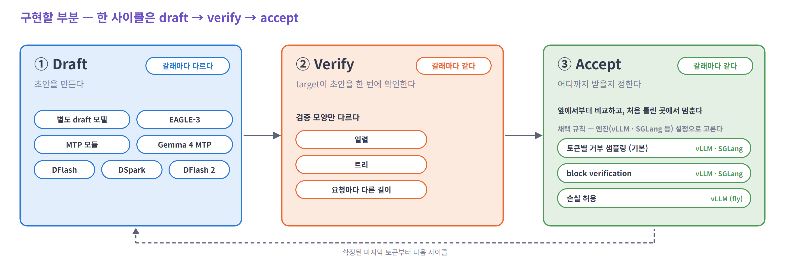
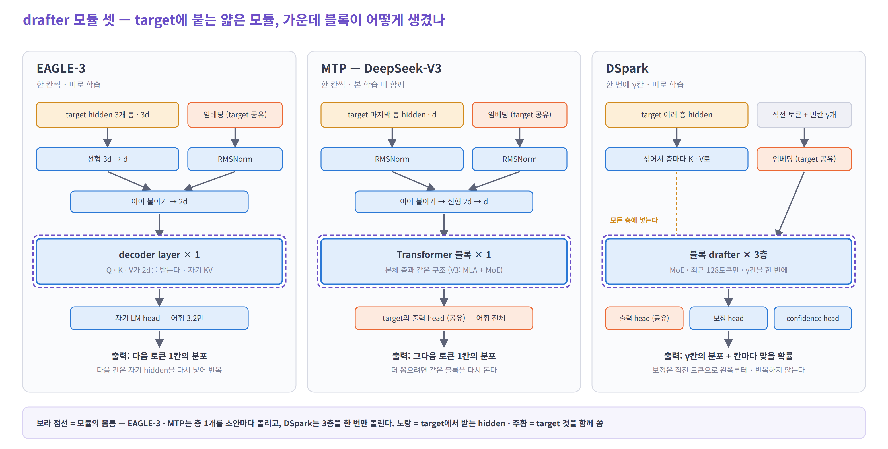
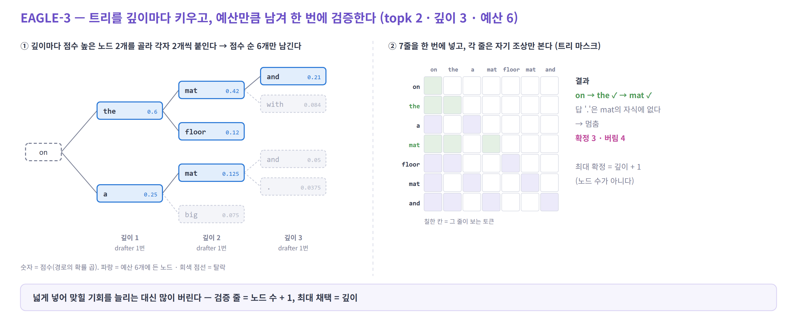
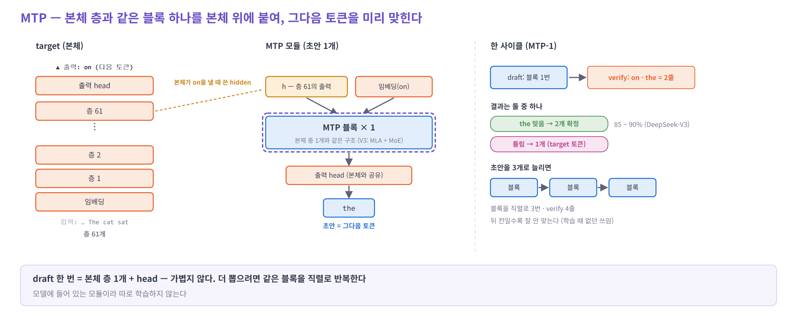
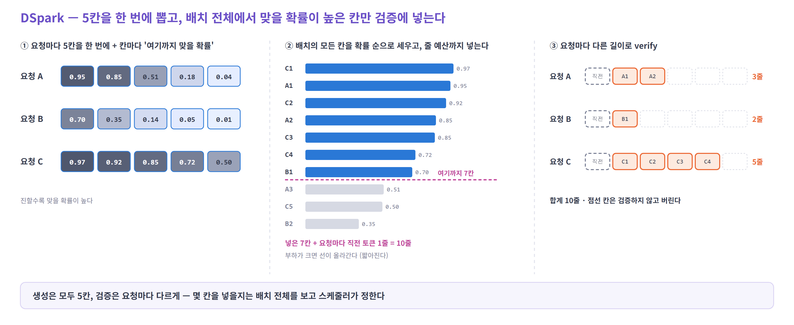
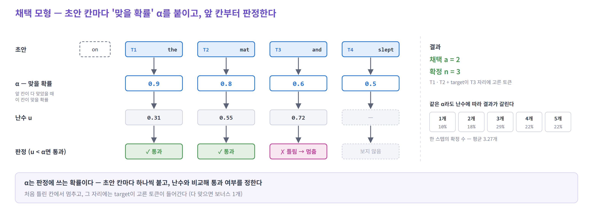
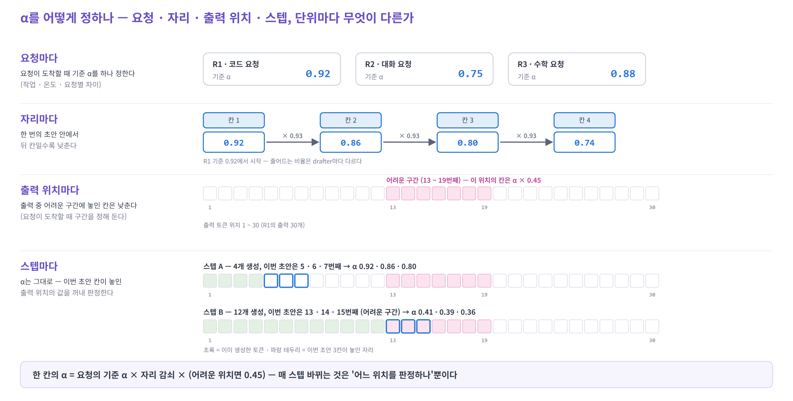
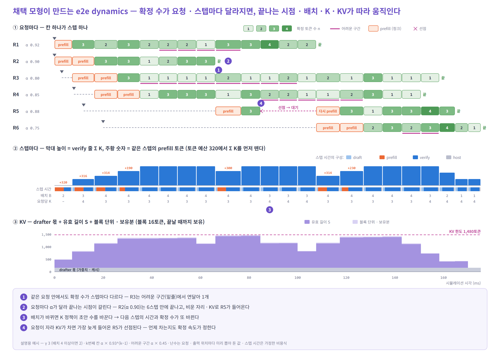

# Speculative decoding 구현 방안

> 시뮬레이터에 speculative decoding을 넣을 때 무엇을 어떻게 구현할지 고민한 내용이다.

---

## 1. 구현할 부분 — draft / verify / accept

- 한 사이클 = **draft**(초안을 만든다) → **verify**(target이 한 번에 확인한다) → **accept**(어디까지 받을지 정한다). 확정된 마지막 토큰부터 다음 사이클을 돈다
- 갈래가 크게 갈리는 곳은 **draft**다 — 별도 draft 모델부터 DFlash 2까지
- verify는 **연산**이 갈래마다 같다 — target forward 한 번에 초안 줄을 넣는다. 다른 것은 **넣는 모양**이고, 갈래와 설정이 정한다
  - 일렬 — MTP · EAGLE-3(`topk = 1`) · DFlash
  - 트리 — EAGLE-3(`topk > 1`). 각 노드가 자기 조상만 보게 attention을 가린다
  - 요청마다 다른 길이 — DSpark. 배치 안에서 요청마다 넣는 줄 수가 다르다
- accept도 갈래마다 같다 — 앞에서부터 비교하고 처음 틀린 곳에서 멈춘다. 채택 규칙은 알고리즘이 아니라 **엔진 설정**으로 고른다 (토큰별 거부 샘플링이 기본, vLLM · SGLang은 block verification도, vLLM은 손실 허용 `fly`도 있다) → 엔진별 정리는 [4절](#엔진은-채택-규칙을-어떻게-제공하나--구현할-때-참고)

**메모 — 어떻게 구현할지**

- **verify** — 기존 decode 연산에서 sequence 축만 바꾸면 된다(요청당 1줄 → `K`줄). 입력 · 출력 shape 정도만 손보면 될 듯
  - → 트리면 attention 마스크, DSpark면 요청마다 다른 줄 수만 추가로 챙기면 된다
- **draft** — 갈래별로 따로 구현해야 한다. 우선 EAGLE-3 · MTP · DSpark 세 개를 고려
  - → draft 비용은 상수가 아니다. 직전에 확정된 `a + 1`줄을 다시 넣는 패스가 있어서 스텝마다 바뀐다
- **accept** — e2e 관점에서 영향이 가장 클 것 같다. 실제 서빙 환경의 dynamics를 보여 줄 수 있는 부분
  - → 속도는 채택(분자)과 verify 비용(분모)이 함께 정한다. 작은 배치는 채택이, 큰 배치 · MoE · 긴 문맥은 verify 비용이 좌우한다

---

## 2. Verify 연산

- verify는 decode와 **같은 forward**다. 새 토큰 줄만 1 → `K`(직전 확정 토큰 1 + 초안)로 늘어난다
- **위 — 가중치 곱**: 입력이 1줄에서 5줄이 돼도 가중치는 한 번만 읽고, 곱셈만 5배가 된다
- **아래 — attention**: 새 5줄이 확정된 캐시를 모두 읽고, 이번 5줄끼리는 계단 모양으로 자기 앞만 본다
- **KV 쓰기**도 5줄이다. 그중 맞은 만큼만 남긴다
- **넣는 모양에 따라 다른 것은 attention 마스크뿐**이다 (가중치 곱 · KV 쓰기는 같다)
  - 일렬 — 위 그림의 계단 마스크
  - 트리 — 각 줄이 자기 조상만 보는 트리 마스크. 형제 노드는 같은 위치(깊이)를 받는다
  - 요청마다 다른 길이(DSpark) — 계단 마스크를 요청 경계로 나눈다. 요청마다 줄 수만 다르다

**메모**

- verify는 decode와 같은 forward라 쉽게 구현할 수 있을 듯
- MoE면 `K`줄이 각자 다른 expert를 부를 텐데, 라우팅은 기존 decode 방식을 그대로 따르면 될 것 같다
  - → 맞다. 줄 수만 `Σ K`로 넘기면 된다. 다만 버려질 초안 줄도 expert를 부르므로, 작은 배치에서는 불리는 expert가 늘어 verify가 생각보다 비싸진다

---

## 3. Drafter

**갈래별로 보면 — 지도**

**모듈이 어떤 모양인가 — EAGLE-3 · MTP · DSpark**

**한눈에 — 세 방법 비교** (이번 그림의 설정: EAGLE-3 트리 · MTP-1 · DSpark adaptive)

| | ① 초안을 어떻게 만드나 | ② target에 얼마나 넣나 | ③ 시뮬레이터에서 다르게 셀 것 |
|---|---|---|---|
| EAGLE-3 | 깊이마다 drafter 1번, 노드마다 상위 topk개 → 예산만큼 남김 (트리) | 노드 수 + 1줄 (예: 7줄) | 검증 줄과 최대 채택(깊이)을 따로 |
| MTP | MTP 블록으로 하나씩 (MTP-1은 1개) | 초안 수 + 1줄 (MTP-1은 2줄) | 초안을 늘리면 draft가 직렬로 길어진다 |
| DSpark | 블록을 한 번에 → 5칸, 직전 토큰으로 가볍게 보정 | 요청별 앞 `ℓ_r`칸 + 1줄 (요청 · 스텝마다 다름) | 생성 길이와 검증 길이를 따로, 검증 길이는 스케줄러가 |

### EAGLE-3 — 트리를 펼치고, 예산만큼 검증한다

- **① 초안** — 얇은 drafter(decoder 1층 + 작은 head)를 깊이마다 1번 돌린다. 깊이마다 점수(경로의 확률 곱)가 높은 노드 topk개를 골라 각자 상위 topk개를 붙이고, 다 펼친 뒤 점수 순으로 예산 `N`개만 남긴다
- **② target** — 노드 `N`개 + 1 = `N + 1`줄. 각 노드는 자기 조상만 본다(트리 마스크). 맞는 갈래를 따라 내려가므로 최대 확정은 깊이 + 1개
- **특이한 점** — 셋 중 트리는 EAGLE뿐. 채택 경로의 KV가 흩어져 있어 정리가 필요하다. `topk = 1`이면 일렬이 되고 MTP와 같은 틀
- **③ 시뮬레이터** — 검증 줄(노드 수 + 1)과 최대 채택(깊이)을 따로 센다. 트리를 넓히면 채택 기회와 함께 검증 비용 · KV가 는다

### MTP — MTP 블록으로 하나씩

- **① 초안** — 본체 층과 같은 MTP 블록 + target의 출력 head로 하나씩 만든다. MTP-1은 1개, 더 뽑으려면 같은 블록을 반복
- **② target** — 초안 수 + 1줄, 모든 요청 같다. MTP-1은 2줄 — 맞으면 2개 확정(DeepSeek-V3 0.85 ~ 0.90), 틀리면 1개
- **특이한 점** — 모델에 들어 있는 모듈이라 따로 학습하지 않는다. 대신 블록이 본체 층과 같아 draft 한 번이 무겁다
- **③ 시뮬레이터** — 초안을 늘리면 draft가 블록 수만큼 직렬로 길어지고, 뒤 칸 채택률이 빨리 떨어진다

### DSpark — 블록을 한 번에 뽑고, 요청마다 검증 길이를 고른다

- **① 초안** — 블록 drafter(MoE 3층)를 한 번 돌려 5칸을 내고, 직전 토큰을 보고 왼쪽부터 가볍게 고친다. 칸마다 "여기까지 맞을 확률"(confidence)도 낸다
- **② target** — 5칸 중 요청별 앞 `ℓ_r`칸만 + 1줄. `ℓ_r`은 스케줄러가 배치 전체를 보고 정한다 — 맞을 확률이 높은 칸부터 줄을 나눠 주고, 부하가 크면 짧게
- **특이한 점** — 검증 길이를 정하는 스케줄러가 있는 건 DSpark뿐. 서비스에서는 총 줄 수를 2스텝 전 confidence로 미리 정한다(CUDA graph)
- **③ 시뮬레이터** — 생성 길이(5칸)와 검증 길이(`ℓ_r`)를 따로 세고, 검증 길이는 부하 · confidence에 따라 스텝마다 바뀐다

**메모**

- drafter 연산 자체는 LLM에게 맡겨도 잘 짤 것 같다. 우리는 DSpark 스케줄링처럼 주요 포인트가 어디에 들어가는지만 이해하고 있으면 될 듯
  - → 맡길 때 꼭 짚어 줄 것: 갱신 패스(직전 `a + 1`줄) · 트리는 검증 줄 ≠ 최대 채택 · DSpark는 생성 길이 ≠ 검증 길이

---

## 4. Accept

### 채택 모형 — 초안 중 몇 개가 맞나

- 초안 칸마다 "맞을 확률" `α`를 붙이고, 앞 칸부터 난수와 비교해 판정한다. 처음 틀린 칸에서 멈춘다 → 채택 수 `a`, 확정 `a + 1`개
- 같은 `α`라도 난수에 따라 결과가 갈린다 — 위 예시면 확정 1 ~ 5개가 나오고 평균은 3.27개

### α를 어떻게 정하나 — 단위마다

| 단위 | 어디에 · 어떻게 | 언제 정하나 |
|---|---|---|
| 요청마다 | 요청 전체의 기준 `α`를 다르게 둔다 (작업 · 온도 · 요청별 차이) | 요청이 도착할 때 한 번 |
| 자리마다 | 한 번의 초안 안에서 뒤 칸일수록 낮춘다 (예: 칸마다 × 0.93) | drafter 종류로 정한 고정 규칙 |
| 출력 위치마다 | 출력 중 어려운 구간에 놓인 칸을 낮춘다 (예: 13 ~ 19번째 × 0.45) | 요청이 도착할 때 구간을 정해 둔다 |
| 스텝마다 | `α`는 그대로 — 이번 초안 칸이 놓인 출력 위치의 값을 꺼내 판정한다 | 매 스텝 |

### 엔진은 채택 규칙을 어떻게 제공하나 — 구현할 때 참고

채택 규칙은 알고리즘이 아니라 엔진(vLLM · SGLang 등)에서 설정으로 고른다. 대표적인 것만 모았다.

| 엔진 · 자료 | 제공하는 것 | 구현할 때 참고할 점 |
|---|---|---|
| vLLM | `rejection_sample_method`로 고른다 — `standard`(토큰별 거부 샘플링, 기본) · `block`(block verification) · `fly`(손실 허용) · `synthetic` | `synthetic`은 자리별 채택률(`synthetic_acceptance_rates`)이나 평균 채택 길이를 주면, 칸마다 난수와 비교해 판정한다 — 위 채택 모형과 같은 꼴 |
| vLLM 지표 | 요청별 `acceptance_histogram`(정확히 j개 채택된 스텝 수) · `per_step_accepted` · `per_step_drafted` | 채택률 값을 실제 실행에서 맞출 때 |
| SGLang | 토큰별 거부 샘플링(기본) · block verification · EAGLE 트리 판정 | `/server_info`가 평균 채택 길이 `avg_spec_accept_length`를 준다 |
| 논문 | 토큰별 거부 샘플링 — [Leviathan et al. 2023](https://arxiv.org/abs/2211.17192) · block verification — [Sun et al. 2024](https://arxiv.org/abs/2403.10444) | 출력 분포를 지키는 판정 규칙의 원형 |

문서: [vLLM — Speculative Decoding](https://docs.vllm.ai/en/latest/features/speculative_decoding/) · [vLLM — 요청별 채택 지표](https://docs.vllm.ai/en/latest/features/speculative_decoding/acceptance_metrics/) · [SGLang — Speculative Decoding](https://docs.sglang.io/docs/advanced_features/speculative_decoding)

### e2e에서 보면 — 채택 모형이 만드는 dynamics

| 그림 | 무엇이 일어나나 | 채택 모형의 어느 부분 때문인가 |
|---|---|---|
| ① | R3는 어려운 구간(밑줄)에서 확정 수가 연달아 1개 | 출력 위치마다 다른 `α` |
| ② | R2(`α` 0.90)는 6스텝 만에 끝나고, 비운 자리 · KV로 R5가 들어온다 | 요청마다 다른 `α` → 끝나는 시점이 갈린다 |
| ③ | 배치가 줄자 정책이 요청당 `K`를 3 → 4로 늘린다 | 끝나는 시점 → 배치 크기 → `K` |
| ④ | 요청이 자라 KV가 차고, 가장 늦게 들어온 R5가 선점된다 | 확정 속도 → KV가 차는 시점 |

- 시뮬레이터 루프는 이 되먹임을 이미 따라간다. 채택을 분포로 넣어 주기만 하면 TTFT · TPOT · 처리량에 이 dynamics가 나온다

**메모**

- 파라미터로 dynamics를 주는 건 스케줄링 쪽에서 구현할 수 있을 것 같다. vLLM 같은 서빙 엔진의 채택 모델을 참고하라고 하면 잘 짤 듯
  - → vLLM의 synthetic 채택이 바로 이 방식이다 — 칸마다 난수와 자리별 채택률을 비교
- 큰 틀(배치 · KV · 선점 · 시간 축)은 이미 시뮬레이터에 있으니, 파라미터와 피처 몇 개만 더하면 반영될 것 같다
  - → 대체로 맞다. 다만 `α` 값을 어디서 가져올지(엔진 지표 · 논문)는 따로 정해야 한다

---

## 5. 자원 · K 정책 — 추가로 고려할 만한 것

**자원 (메모리)**

- **target KV** — 요청마다 검증용 `K`줄을 더 잡는다. 버린 줄 때문에 더 잡은 블록은 요청이 끝날 때까지 남는다 (vLLM)
- **drafter KV** — drafter마다 다르다. EAGLE-3 · MTP는 1층분, DFlash는 층 수만큼(문맥 길이에 비례), DSpark는 최근 128토큰만, Gemma 4 MTP는 없다
- **drafter 가중치** — 모델에 한 번 든다. MTP(DeepSeek-V3)는 14B로 크다
- **선형 attention 혼합 모델** — 되돌리려고 중간 상태 `K`개를 들고 있다
- **drafter 캐시를 챙길 때** — 만드는 시간(prefill)이 들고, prefix cache 적중 · P/D 전송 · 선점 후 복귀 때도 함께 다뤄야 한다
- 결국 같은 GPU에 올릴 수 있는 요청 수가 줄고, 선점이 일찍 시작된다

**`K` 정책**

- 몇 줄을 검증할지 정하는 규칙 — 고정 / vLLM Dynamic SD(동시 요청 수) / SGLang adaptive(채택 길이의 이동 평균) / DSpark(confidence + 부하)
- 엔진의 정책을 그대로 따라 해야 정책 비교가 맞다

자세한 내용은 [05 EAGLE-3 · MTP · DSpark](speculative-decoding/05-eagle3-mtp-dspark.md) · [06 e2e 시뮬레이터 구현 포인트](speculative-decoding/06-sim-realism.md)에 있다.
