# 한 페이지 요약 — Speculative Decoding · MTP

> 01 ~ 04의 핵심을 한 페이지에 모았다. 그림 위주로 읽고, 더 필요한 내용은 "자세히"를 펼치거나 각 장으로 간다.

**모든 그림이 같은 예시를 쓴다.** 프롬프트 `The cat sat` 뒤에 모델이 `on`을 막 만들었다(아직 KV 없음). drafter가 초안 `the mat and slept`를 내고, target은 `the mat` 다음에 `.`을 고른다 → **3개 확정**.

| 용어 | 뜻 | 예시에서 |
|---|---|---|
| target | 실제로 서비스하는 큰 모델. 결과의 주인 | |
| drafter | 초안을 싸게 만드는 쪽. 작은 모델 · 붙인 모듈 · 문자열 매칭 | |
| hidden | target이 층을 지나며 만든 벡터 한 줄 — "여기까지 읽은 이해" | |
| `γ` · `K` | 초안 수 · target이 한 번에 검증하는 토큰 수 (`γ + 1`) | 4 · 5 |
| `a` · `τ` | 채택된 초안 수 · 사이클당 평균 확정 토큰 수 | 2 (이번에 3개 확정) |
| `α` | 초안 한 자리가 맞을 확률 (앞이 다 맞았다는 조건) | |

| | 내용 |
|---|---|
| 1 | 큰 구조 — draft · verify · accept · 정리 |
| 2 | verify의 연산 — 무엇이 순서대로 일어나나 |
| 3 | drafter — 갈래와 알고리즘 |
| 4 | verify 이후 — 받을 것을 정하고 캐시를 맞춘다 |
| 5 | 모델링할 때 고려할 것 |

---

## 1. 큰 구조 — 한 사이클은 네 칸이다

**왜 빨라지나.** decode의 forward 한 번은 대부분 **가중치를 메모리에서 읽는 시간**이다. 그래서 토큰을 1줄 넣으나 5줄 넣으나 시간이 거의 같다. 다음 토큰들을 미리 추측해(초안) 한 번에 넣으면, 맞은 만큼 forward 횟수가 준다.

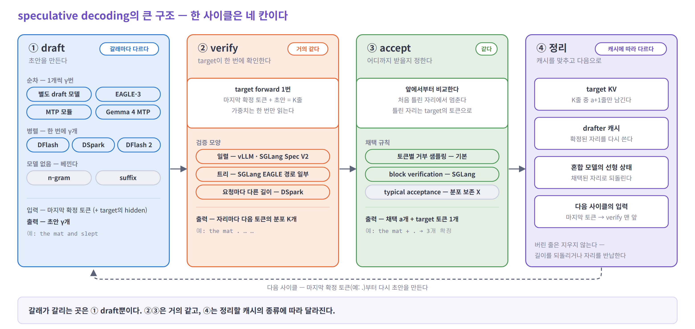

| 칸 | 하는 일 | 갈래마다 |
|---|---|---|
| ① draft | 초안 `γ`개를 만든다 | **다르다** — 누가 · 어떻게 만드나가 갈래의 정체다 (3절) |
| ② verify | target이 `K = γ + 1`줄을 forward 한 번에 처리한다 | 거의 같다 — 일렬이냐 트리냐 정도 (2절) |
| ③ accept | 앞에서부터 비교해 처음 틀린 곳에서 멈춘다 | 같다 — 채택 `a`개 + target의 토큰 1개 (4절) |
| ④ 정리 | 맞은 만큼만 캐시를 남기고 다음 사이클로 | 정리할 캐시의 종류에 따라 다르다 (4 · 5절) |

**얼마나 빨라지나**

```
속도 = τ ÷ (초안 시간 + 검증 시간)            τ = 사이클 하나에 평균 몇 개가 확정되나
τ = 1 + α₁ + α₁α₂ + … + α₁α₂⋯α_γ               α_k = k번째 초안이 맞을 확률 (앞이 다 맞았다는 조건)
  = 1 + α + α² + … + α^γ                      자리마다 같은 α로 둔 단순 모형
```

- 예: `α` = 0.8, 초안 4개 → `τ` = 3.36. 초안 시간 0.2 + 검증 1.05(target 한 스텝 = 1)면 **약 2.7배**
- `τ`는 `1 / (1 − α)`에서 멈춘다. 초안을 늘리기보다 **잘 맞히는 쪽**이 크다
- **초안을 몇 개 뽑을까** — 하나 더 넣었을 때 **확정 토큰의 증가율이 사이클 시간의 증가율보다 커야** 이득이다 (`Δτ / τ > ΔT / T`). `Δτ`는 새 초안이 살아남을 확률이다. 1개씩 만드는 drafter는 초안마다 시간이 늘어 짧게(2 ~ 5개), 한 번에 만드는 drafter는 시간이 거의 그대로라 길게(블록 16) 뽑는다
- 매 사이클 **최소 1개**는 확정된다. 그리고 채택 규칙이 target의 분포를 그대로 지켜, 빨라질 뿐 결과는 같다

<details>
<summary>자세히 — 시간 흐름과 τ 곡선</summary>


- 위: 일반 생성은 세 토큰에 forward 3번, speculative는 초안 4개 + forward 1번
- 아래: 초안을 늘려도 `τ`는 천장 `1 / (1 − α)`에서 멈춘다. `α`를 0.8 → 0.9로 올리면 천장이 5 → 10이 된다
- 자세히: [01 원리](01-principle.md)

</details>

---

## 2. verify의 연산 — 무엇이 순서대로 일어나나

verify는 decode와 **같은 forward**다. 새 토큰 줄이 1에서 `K`로 늘 뿐이다. 그래서 시뮬레이터는 **기존 decode 연산 표에서 줄 수만 바꾸면** 대부분 끝난다.

**다음 토큰을 모르는데 넣어도 되나?** 된다. 각 자리는 **자기 앞만 본다**(causal attention). `mat` 자리는 `The cat sat on the mat`이 맞다고 **가정하고** 계산한다. 가정이 틀렸으면 그 자리 뒤의 출력을 버리면 된다. 맨 앞의 `on`은 초안이 아니다 — 뽑히기만 하고 아직 target에 넣지 않아 KV가 없으니, 이번에 함께 넣는다.

### 무엇이 같고, 무엇이 늘어나나

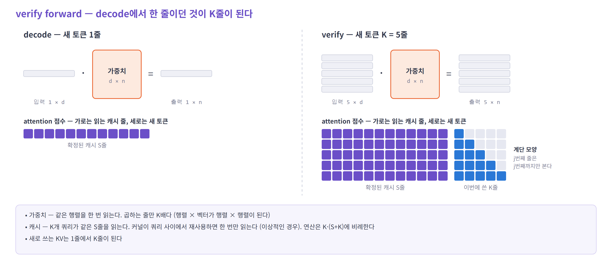

- **위 — 가중치 곱.** 입력이 1줄에서 5줄이 돼도 곱하는 가중치 상자는 같은 것 하나다. 한 번 읽고, 곱셈만 5배가 된다
- **아래 — attention.** 새 토큰 5개가 모두 확정된 캐시(보라)를 읽는다. 이번에 쓴 5줄(파랑)은 **계단 모양**으로 본다 — 앞에서 말한 "자기 앞만 본다"가 이 계단이다
- **KV 쓰기** — 1줄이 아니라 5줄을 쓴다. 그중 맞은 만큼만 나중에 남긴다 (4절)

### 연산의 순서

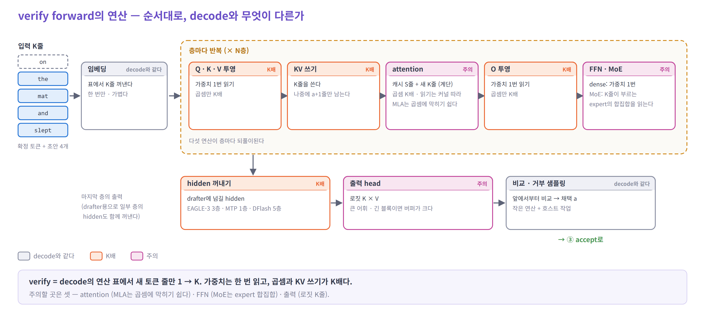

- **순서** — 임베딩 → 층마다 [Q · K · V 투영 → KV 쓰기 → attention → O 투영 → FFN] → hidden 꺼내기 → 출력 head → 비교
- **주황(K배)** — 가중치는 한 번 읽고, 곱셈과 쓰기만 `K`배다. `K`가 작으면 시간은 거의 그대로다
- **분홍(주의)** — 줄 수만 바꿔서는 틀리는 곳이다
  - attention: 캐시를 `K`개 쿼리가 함께 읽는다(새 줄끼리는 계단 모양). MLA는 캐시 1바이트로 하는 곱셈이 많아, 작은 검증 길이에서도 곱셈이 시간을 정할 수 있다 (GPU · GPU당 헤드 수 · 텐서 병렬에 따라 다르다)
  - FFN: MoE면 `K`줄이 각자 다른 expert를 불러, 읽는 가중치가 늘어난다
  - 출력 head: 자리마다 분포가 필요해 로짓이 `K × V`다

| 연산 | decode (1줄) | verify (`K`줄) |
|---|---|---|
| 가중치 곱 (투영 · FFN · head) | 가중치 읽기 | 읽기 그대로, 곱셈 `K`배 |
| attention | 캐시 `S`줄 읽기 | 곱셈 `K`배, 캐시 읽기는 커널 재사용에 따라 1 ~ `K`번 |
| KV 쓰기 · 로짓 | 1줄 | `K`줄 |

<details>
<summary>자세히 — 트리 검증 (한 자리에 후보를 여럿 둘 때)</summary>

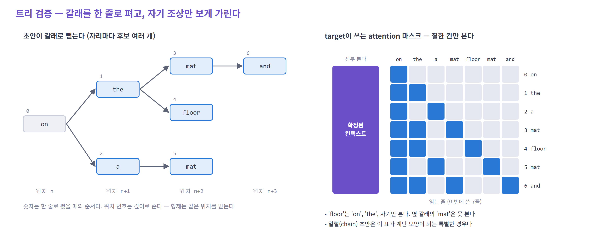

- `on` 다음이 `the`일지 `a`일지 모르면 둘 다 초안으로 낸다. 초안이 나무 모양이 되고, 한 자리에 하나만 맞아도 된다
- 노드를 **한 줄로 펴서** target에 넣고, attention을 **자기 조상만 보게** 가린다 (오른쪽 표). 형제는 같은 위치 번호를 받는다
- 배치 1에서는 남는 연산으로 후보를 늘려 더 빠르다. 하지만 노드가 수십 개라 버리는 줄이 많고(EAGLE-3 트리 60개면 약 94%), 남길 줄이 흩어져 롤백도 복잡하다. 그래서 vLLM과 SGLang의 새 엔진(Spec V2)은 일렬만 받고, SGLang의 EAGLE 경로는 모델에 따라 트리를 쓴다 — **엔진 · 모델별로 일렬과 트리가 공존한다**

</details>

<details>
<summary>자세히 — 텐서 모양으로 보면</summary>

Llama-3.1-8B 기준 (`d` 4096 · 쿼리 헤드 32 · KV 헤드 8 · 헤드 차원 128)

| 연산 | shape |
|---|---|
| Q · K · V 투영 | `(K × d) · (d × (n_h + 2n_kv)·d_h)` |
| attention | `Q (n_h, K, d_h)` × 캐시 `(n_kv, S + K, d_h)` |
| 출력 head | `(K × d) · (d × V)` → 로짓 `(K × V)` |

자세히: [03의 1절](03-compute-and-kv.md#1-verify-한-번은-decode-한-번보다-얼마나-비쌀까)

</details>

---

## 3. drafter — 갈래와 알고리즘

### 지도로 보면

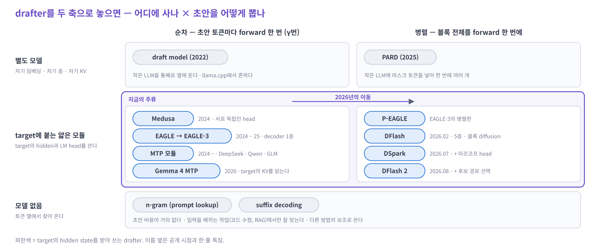

- **세로 — 어디에 사나**: 별도 모델 / target에 붙는 얇은 모듈 / 모델 없음
- **가로 — 초안을 어떻게 뽑나**: 1개씩 `γ`번(순차) / 블록을 한 번에(병렬)
- 가운데 줄(target에 붙는 모듈)이 지금의 주류이고, 그 안에서 **순차 → 병렬**로 옮겨 가는 중이다

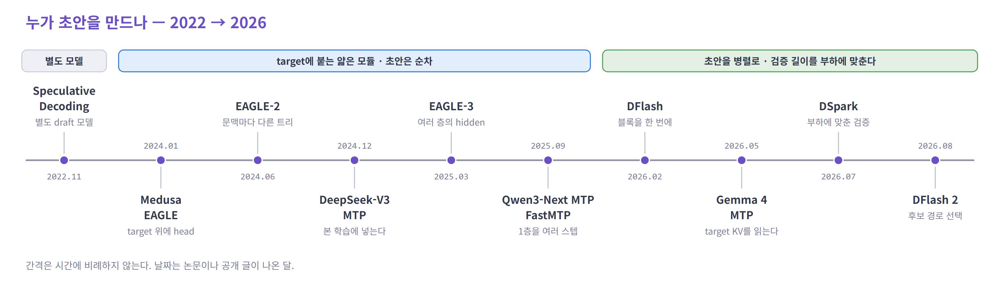

흐름은 세 단계다 — **별도 모델**(2022) → **target에 붙는 얇은 모듈**(2024 ~ 25: EAGLE, MTP) → **블록을 한 번에 + 부하에 맞춘 검증**(2026: DFlash, DSpark). 단계마다 앞 단계의 비용을 하나씩 없앴다 — 문맥을 다시 읽는 일, 초안을 하나씩 만드는 일.

### 한눈에 — target은 같고 draft만 다르다

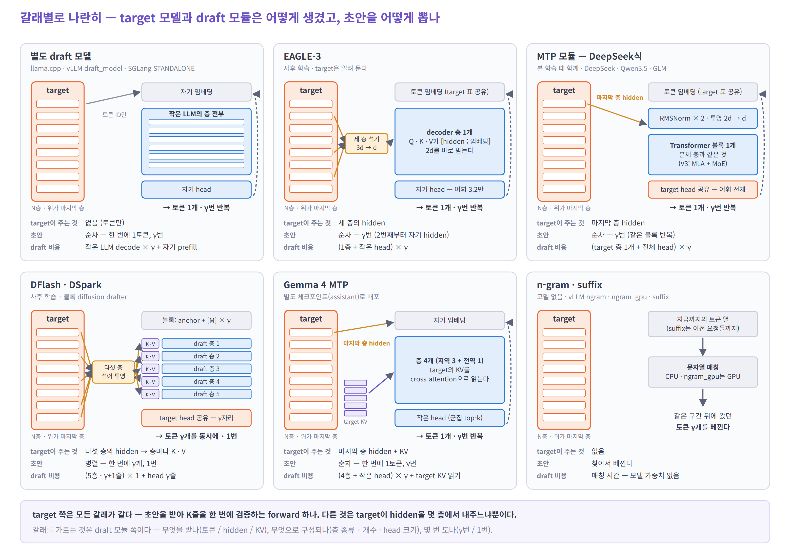

| 갈래 | 한 줄 요약 | draft가 한 번 도는 일 | 몇 번 | draft 캐시 |
|---|---|---|---|---|
| 별도 draft 모델 | 작은 LLM이 혼자 추측한다 | 작은 LLM의 decode 한 스텝 | `γ` | 자기 KV, 전 층 |
| EAGLE-3 | target이 읽은 결과(hidden)를 받아 1층으로 맞힌다 | decoder 1층 + 작은 head | `γ` | 1층 |
| MTP | EAGLE과 같은 모양을 본 학습 때 붙였다 | target 층 하나와 같은 블록 + 전체 head | `γ` | 1층 |
| DFlash · DSpark | 빈칸 블록을 한 번에 채운다 | 층 `L`개 × 블록 `γ + 1`줄 + head (DFlash · 논문 실험 5층, DSpark 서비스용 MoE 3층) | **1** | `L`층 (DSpark 서비스용은 최근 128줄) |
| Gemma 4 MTP | target의 KV를 직접 읽는다 | 4층 + 작은 head | `γ` | **없음** |
| n-gram · suffix | 이미 나온 글에서 베낀다 | 문자열 매칭 | — | 없음 |

### 알고리즘별로

**EAGLE-3 · MTP — target의 hidden과 다음 토큰으로 맞힌다**

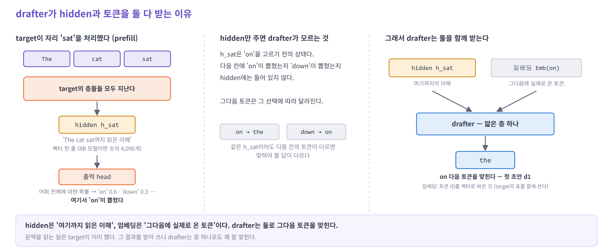

- **hidden**은 target이 문맥을 읽은 결과다("여기까지의 이해"). 이것을 받으니 drafter는 문맥을 다시 읽지 않고 **층 하나**로 충분하다
- 그런데 hidden은 다음 칸에 무엇이 뽑혔는지 모른다. 그래서 **실제로 뽑힌 토큰의 임베딩**을 함께 받는다
- 두 번째 초안부터는 target의 hidden이 없어 자기 hidden을 넣는다 → 뒤로 갈수록 덜 맞는다

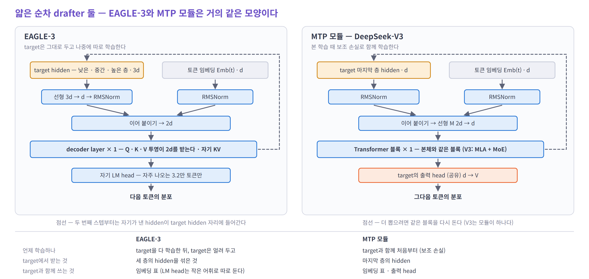

- **EAGLE-3** — target 세 층의 hidden을 섞고, head를 어휘 3.2만 개로 줄였다. 나중에 따로 학습한다
- **MTP** — hidden 한 층, 본체와 같은 블록, target의 head. 본 학습 때 붙어 나오므로 학습할 것이 없다 (DeepSeek-V3: 두 번째 토큰 채택 85 ~ 90%, 1.8배)

**DFlash · DSpark · DFlash 2 — 블록을 한 번에 뽑는다**

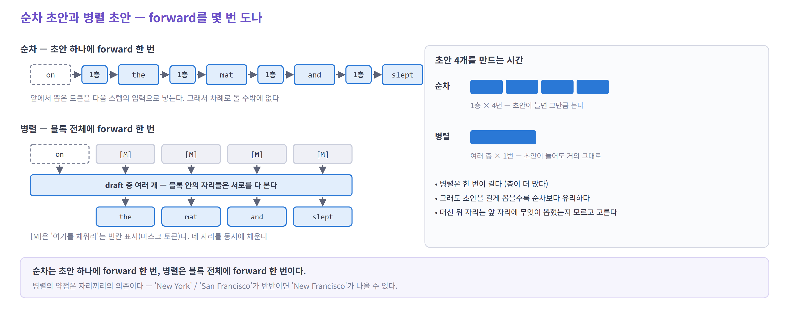

- **DFlash** — `on` 뒤에 빈칸 `[M]`을 붙여 5층에 **한 번** 통과시킨다. 초안을 길게 뽑아도 시간이 거의 같다. target 정보는 입력이 아니라 **모든 층의 K · V로** 넣는다 (KV injection)
- 약점은 뒤 칸이다 — 앞 칸에 무엇이 뽑힐지 모르고 동시에 고르니 "New Francisco" 같은 조합이 나온다
- **DSpark** — 직전 토큰으로 다음 칸을 고치고(아주 싼 순차 보정), 칸마다 통과 확률을 내서 **부하에 맞게 검증 길이를 정한다**. DeepSeek-V4에서 MTP-1 대비 사용자당 +57 ~ 85%
- **DFlash 2** — 칸마다 후보 16개를 남기고 이어지는 경로 하나를 고른다

<details>
<summary>자세히 — KV injection과 세 세대</summary>

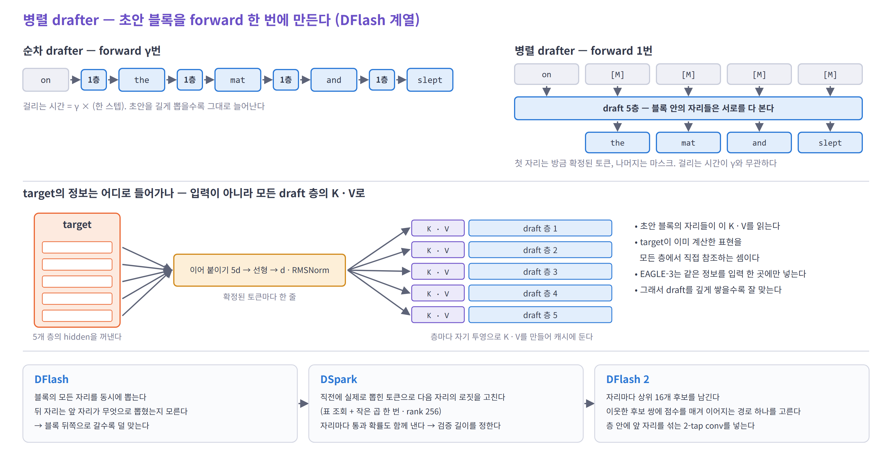

📌 Qwen3-8B, temp 0, 7개 벤치 평균: EAGLE-3(트리 60) 2.02× · `τ` 3.40 → DFlash(블록 16) **4.86× · `τ` 6.49**

</details>

**그 밖의 갈래**

- **별도 draft 모델** — 같은 토크나이저의 작은 LLM. 문맥을 다시 읽고 자기 KV를 둔다. 로컬 추론에 남아 있다
- **Gemma 4 MTP** — 4층 drafter가 target의 KV를 cross-attention으로 직접 읽는다. drafter 쪽에 캐시도 prefill도 없다
- **n-gram · suffix** — 모델 없이 같은 구간을 찾아 베낀다. 코드 수정 · 인용에서만 잘 맞는다

### 지금의 표준

- **검증** — 채택 규칙은 **토큰별 거부 샘플링**이 기본이다. 모양은 엔진 · 모델별로 다르다 — vLLM과 SGLang Spec V2는 일렬만, SGLang의 EAGLE 경로는 Llama · Grok 등에서 트리(기본 분기 4)를 쓴다
- **drafter** — 셋이 공존한다. 모델에 MTP가 있으면 **MTP**, 없으면 **EAGLE-3**, 공개 측정의 최전선은 **DFlash 계열**이다

<details>
<summary>자세히 — 공개 비교 (조건이 서로 다르다)</summary>

| 비교 | 조건 | 결과 |
|---|---|---|
| EAGLE-3 vs DFlash | Qwen3-8B, temp 0 | 2.02× vs **4.86×** |
| EAGLE-3 vs DFlash | gpt-oss-120b, TensorRT-LLM, B300 | 1.7× vs **2.3×** |
| 내장 MTP vs DFlash | Qwen3.5-397B-A17B, SGLang | 동시 1에서 DFlash가 MTP의 1.5배 |
| MTP-1 vs DSpark | DeepSeek-V4 서비스 | 사용자당 **+57 ~ 85%** |

자세히: [02 drafter](02-drafters.md)

</details>

---

## 4. verify 이후 — 받을 것을 정하고, 캐시를 맞춘다

### accept — 출력은 입력보다 한 칸 앞을 가리킨다


- 자리 `i`의 출력은 "자리 `i`까지 보고 고른 다음 토큰"이다. 그래서 **바로 다음 칸의 초안**과 비교한다
- `the` ✓, `mat` ✓, `and` ✗ → 여기서 멈추고 틀린 자리에는 target의 `.`을 쓴다. **3개 확정**
- 초안이 전부 맞으면 마지막 자리의 출력이 **보너스 토큰**이 된다
- 샘플링일 때는 "같은가"가 아니라 **확률을 비교해** 받는 비율을 조절한다. 결과 분포는 target과 같다

<details>
<summary>자세히 — 채택 규칙</summary>


1. drafter가 `q`에서 토큰 `x`를 뽑았다
2. 확률 `min(1, p(x) / q(x))`로 채택한다
3. 거부되면 `max(0, p − q)`를 정규화한 분포에서 다시 뽑는다

채택 확률은 두 분포가 겹치는 넓이 `Σ min(p, q)`다. 자세히: [01의 3절](01-principle.md)

</details>

### 정리 — 맞은 만큼만 남긴다

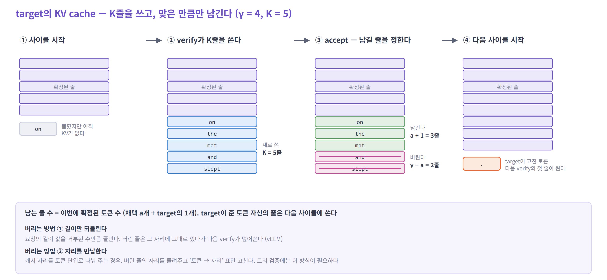

- **target KV** — verify가 5줄을 썼고, `on the mat` **3줄만 남긴다.** 남는 줄 수는 확정 수와 같지만 한 칸 밀려 있다
- **버리는 법** — 지우지 않는다. 길이 값을 되돌리거나(vLLM), 자리를 반납한다(SGLang). 트리 검증은 채택 경로가 흩어져 있으니, 그 KV를 **연속 위치로 옮기거나**(EAGLE 공식 구현) **위치 매핑을 고쳐야** 한다
- **drafter 캐시** — EAGLE · MTP는 확정된 자리를 **target의 진짜 hidden으로 다시 써서** 다음 초안을 시작한다
- **혼합 모델의 선형 attention 상태** — 길이로 되돌릴 수 없다. 검증 토큰마다 중간 상태를 남겨 두고 채택된 자리의 것을 고른다
- **다음 사이클** — target이 고친 `.`(아직 KV 없음)이 다음 verify의 맨 앞 입력이 된다. DSpark라면 여기서 다음 검증 길이도 정한다

---

## 5. 모델링할 때 고려할 것

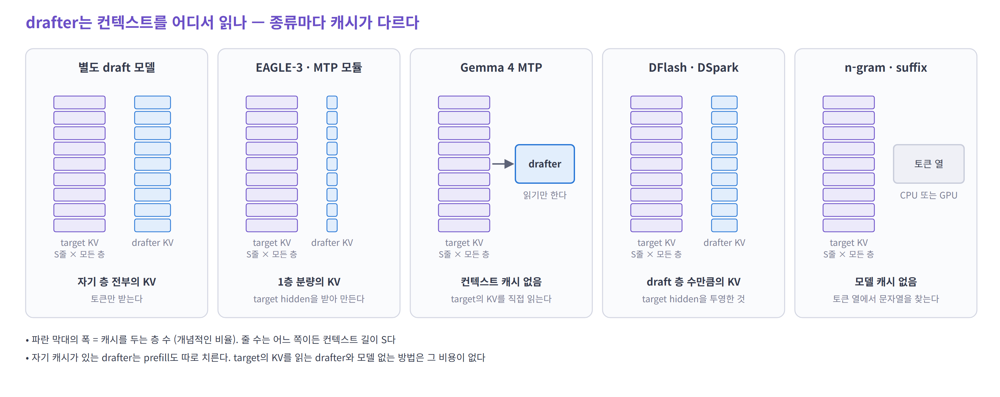

- 보라가 target KV, 파랑이 drafter 캐시다. **파란 막대의 폭이 층 수** — 별도 모델은 전 층, EAGLE · MTP는 1층, DFlash는 5층, Gemma 4는 없다

| 항목 | 무엇을 셀까 | 주의 |
|---|---|---|
| target 연산 | decode 표의 새 토큰 줄을 `K`로 | 가중치 읽기는 그대로 |
| draft 연산 | "한 번 도는 일 × 몇 번" | 순차는 `γ`번, 병렬은 1번 |
| target KV | 요청마다 `S + K`줄 자리. `K`줄 쓰고 `a + 1`줄 남김 | 버린 줄의 연산은 그대로 사라진다 (DFlash 블록 16이면 약 59%) |
| drafter 캐시 | 갈래별 층 수 × 토큰 수 | 토큰당 EAGLE-3 +3.1%, MTP +1.6%, DFlash +13.9%, Gemma 4 0 |
| drafter prefill | 문맥을 받는 방식에 따라 | 별도 모델은 전체, EAGLE · MTP는 1층, DFlash는 투영만, Gemma 4는 없음 |
| 로짓 · hidden 버퍼 | `K × V`, `K × d ×` 꺼내는 층 수 | 큰 어휘 · 긴 블록 · 큰 배치에서 커진다 |
| attention | 곱셈 `K·(S + K)`, 캐시 읽기는 재사용 계수 | MLA는 작은 검증 길이에서도 곱셈에 막힐 수 있다 — GPU당 헤드 수에 따라 다르다 |
| MoE | 한 forward의 토큰 수로 불리는 expert 수 | 배치가 작을수록 이득이 깎인다 |
| 선형 attention 혼합 | 중간 상태 `K`개 저장 | 길이 되돌리기로는 롤백이 안 된다 |
| 배치 | 한 forward의 줄 수 `Σ K` | 줄 수가 가중치 곱의 균형점에 다가가면 이득이 준다 (이론값: BF16 · H100에서 약 300줄. 실제 커널은 더 앞에서 꺾인다). 긴 컨텍스트는 예외 |
| 채택 모형 | 자리별 `α_k` | 작업 종류 · 온도에 따라 크게 다르다. 병렬 drafter는 뒤 자리가 낮다. 논문의 MAL(= `τ`)이나 채택 비율(`(τ − 1) / γ`)은 `α`로 역산해 쓴다 — 단, 숫자 하나에서 역산한 값은 자리마다 같다고 둔 **유효 `α`**이지 실제 자리별 확률이 아니다 |

<details>
<summary>자세히 — 배치를 키우면 이득이 준다</summary>

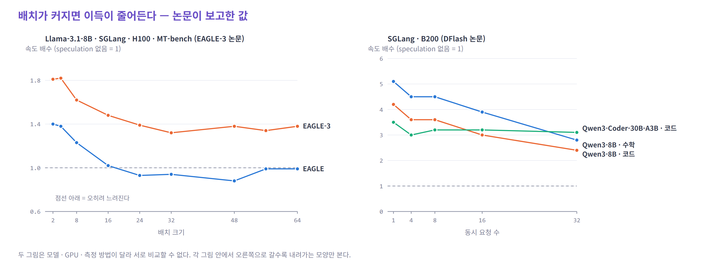

- 요청을 많이 묶으면, speculative decoding이 쓰던 "남는 곱셈 능력"을 배치가 먼저 써 버린다
- 왼쪽: EAGLE(1세대)은 배치 24부터 오히려 느려진다. 오른쪽: DFlash도 동시 요청 1 → 32에서 5.1배 → 2.8배
- 단, 컨텍스트가 길면 요청마다의 KV 읽기가 병목이라 큰 배치에서도 이득이 남는다

자세히: [03 연산과 KV cache](03-compute-and-kv.md) · [04 시뮬레이터에 넣기](04-simulator.md)

</details>

---

## 더 읽기

| 장 | 무엇을 더 보나 |
|---|---|
| [01 원리](01-principle.md) | 한 사이클을 처음부터, 채택 규칙의 증명, 속도 식 |
| [02 drafter](02-drafters.md) | 갈래별 구조 · 학습 · 수치, 엔진 지원 |
| [03 연산과 KV cache](03-compute-and-kv.md) | 연산 목록, 롤백, 트리, drafter 캐시, 배치, 구조별 예외 |
| [04 시뮬레이터에 넣기](04-simulator.md) | 상태 · 비용 · 채택 · 메모리 모형, 검산, 의사 코드 |
| [05 EAGLE-3 · MTP · DSpark](05-eagle3-mtp-dspark.md) | 세 방법을 단계별로 — 트리 예산, 고정 2줄, 요청별 검증 길이 |
| [06 시뮬레이터의 현실성](06-sim-realism.md) | 채택 분포 · 샘플링 방식 · 시간 축 · 엔진의 계단 · MoE 라우팅, 손잡이 표 |
