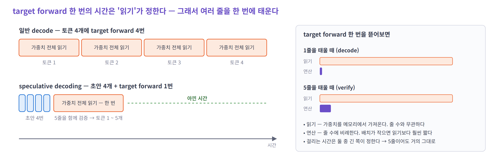
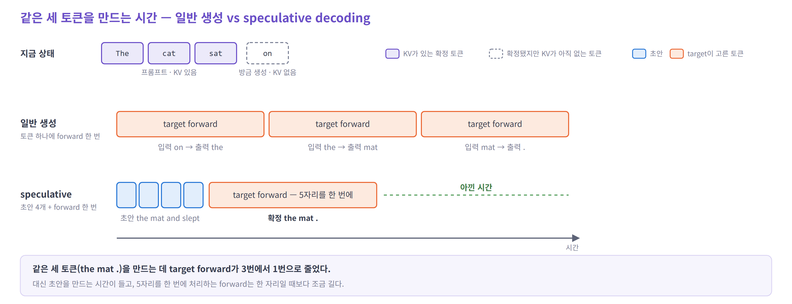
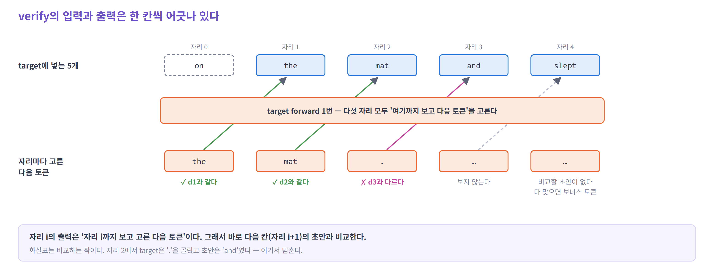
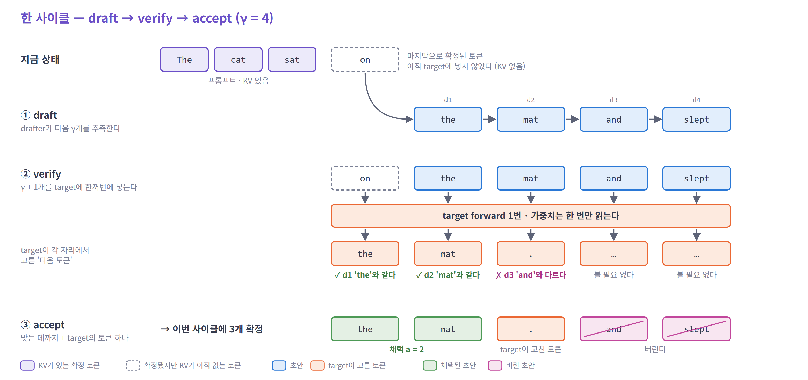
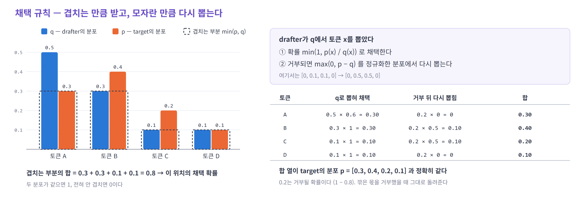
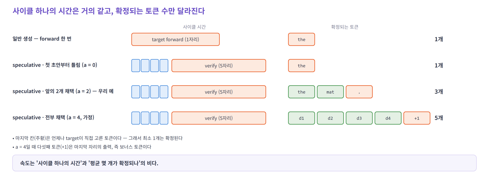
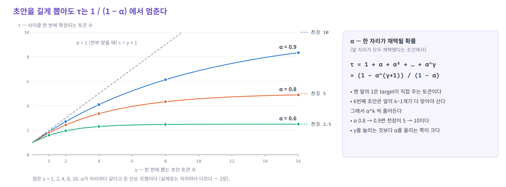

# 01. 원리 — 초안을 만들고, 한 번에 확인한다

> 이 장의 목표는 하나다. **토큰이 실제로 만들어지는 한 사이클**을 처음부터 끝까지 따라간다.
> 기호와 식은 예시를 따라간 뒤에 붙인다.

| 순서 | 질문 |
|---|---|
| 0 | 이 자료가 계속 쓰는 예시 |
| 1 | 작은 모델이 틀릴 수도 있는데, 어떻게 빨라질까? |
| 2 | 다음 토큰을 모르는데, 여러 토큰을 한꺼번에 넣어도 될까? — 한 사이클 따라가기 |
| 3 | 초안을 받아들이면 출력이 달라지지 않을까? — 채택 규칙 |
| 4 | 왜 초안을 길게 만들수록 무조건 빨라지지는 않을까? — 속도 식 |

---

## 0. 이 자료가 계속 쓰는 예시

프롬프트는 **"The cat sat"**이다. 모델이 이것을 읽고(prefill) 다음 토큰으로 **"on"**을 막 만들었다.

| 토큰 | 상태 | 그림에서 |
|---|---|---|
| `The` `cat` `sat` | 프롬프트. 이미 target 모델에 넣었으므로 **KV가 있다** | 보라 상자 |
| `on` | 방금 생성됐다. 아직 target에 넣지 않았으므로 **KV가 없다** | 점선 상자 |

`on`에 KV가 없는 이유는 생성의 순서 때문이다. `on`은 `sat` 자리의 계산 결과로 **뽑힌** 토큰이다. 어떤 토큰의 K와 V는 그 토큰을 **입력으로 넣을 때** 만들어지므로, `on`의 KV는 다음 forward에서 생긴다.

이 장부터 04까지 같은 예시를 쓴다. 초안은 `the mat and slept`이고, target은 `the mat` 다음에 `.`을 고른다.

---

## 1. 작은 모델이 틀릴 수도 있는데, 어떻게 빨라질까?

### 지금 방식 — 토큰 하나에 forward 한 번

일반 생성(decode)은 `on`을 넣어 `the`를 얻고, `the`를 넣어 `mat`을 얻고, `mat`을 넣어 `.`을 얻는다.
세 토큰에 target forward가 세 번 든다. 앞 토큰을 알아야 다음 입력을 넣을 수 있으니 순서대로 할 수밖에 없다.

### 무엇이 문제인가 — forward 한 번은 대부분 '읽는 시간'이다

forward 한 번이 무엇에 시간을 쓰는지 보면 이상한 점이 있다.



- 오른쪽 상자를 보자. forward 한 번에는 **가중치를 메모리에서 읽는 시간**(위 막대)과 **곱셈을 하는 시간**(아래 막대)이 있다
- 토큰 1줄을 넣을 때 곱셈 막대는 거의 보이지 않는다. 8B 모델이면 가중치 약 15 GB를 읽는 동안, 곱셈 능력의 0.3%만 쓴다
- 5줄을 넣어도 읽는 가중치는 **같다.** 곱셈만 5배가 되는데, 원래 너무 짧았으므로 forward 시간은 거의 그대로다

> **forward 한 번에 토큰 1줄을 넣으나 5줄을 넣으나 시간이 거의 같다.**

<details>
<summary>자세히 — 숫자의 근거 (Qwen3-8B, H100)</summary>

| | 계산 | 값 |
|---|---|---|
| 한 스텝에 읽는 가중치 | 층 36개 × 192.9M + LM head 622M = 7.57B개 × 2 B | 약 15.1 GB |
| 읽는 시간 | 15.1 GB ÷ 3.35 TB/s | 약 4.5 ms |
| 토큰 하나의 연산 | 7.57B × 2 FLOP (곱하고 더하기) | 약 0.015 TFLOP |
| 4.5 ms 동안 낼 수 있는 연산 | 989 TFLOPS × 4.5 ms | 약 4.4 TFLOP |

- Qwen3-8B: 층 36개, `d` 4096, FFN 12288, 쿼리 헤드 32 · KV 헤드 8 · 헤드 차원 128, 어휘 151,936
- 임베딩 표는 토큰 한 줄만 꺼내므로 읽는 양에 넣지 않았다. attention이 KV cache를 읽는 양은 컨텍스트가 짧다고 보고 뺐다 (긴 컨텍스트는 [03](03-compute-and-kv.md))
- 이 여유는 **배치가 작을 때** 이야기다. 요청을 많이 묶으면 곱셈 막대가 길어진다 ([03](03-compute-and-kv.md#5-배치를-키우면-이득은-어떻게-될까))

</details>

### 어떻게 바꾸나 — 다음 토큰들을 미리 추측해서 한 번에 넣는다

5줄을 넣어도 시간이 같다면, `the` `mat` …을 한 번에 넣고 싶다. 문제는 **아직 그 토큰들을 모른다**는 것이다.

그래서 두 역할을 나눈다.

- **초안을 만드는 작은 모델(drafter)** — 다음 토큰 몇 개를 싸고 빠르게 추측한다. 틀려도 된다
- **큰 모델이 초안을 확인하는 과정(verify)** — target이 초안을 한 번의 forward로 받아 맞는지 확인한다



- 위쪽 줄(일반 생성)은 주황 상자가 셋이다. forward 한 번에 토큰 하나씩, `the` `mat` `.`을 만든다
- 아래쪽 줄은 파란 상자 넷(초안 4개)과 주황 상자 하나다. 초안 `the mat and slept`을 한 번에 넣어 확인했고, 그 결과 **같은 세 토큰**이 확정됐다
- 초록 점선이 아낀 시간이다. 초안을 만드는 시간과, 5자리를 처리해 조금 길어진 forward를 빼고도 남는다

> **추측이 맞은 만큼 forward 횟수가 준다. 추측이 다 틀려도 target이 고른 토큰 하나는 얻는다.**

이 방법을 **speculative decoding**이라 한다. 그림에는 아직 설명하지 않은 것이 둘 있다 — 초안 4개를 넣었는데 왜 3개만 확정됐나, 그리고 `and` `slept`는 어디로 갔나. 다음 절에서 한 칸씩 따라간다.

---

## 2. 다음 토큰을 모르는데, 여러 토큰을 한꺼번에 넣어도 될까?

### ① draft — 초안 4개를 만든다

drafter가 `on` 다음을 추측해 `the` → `mat` → `and` → `slept`를 낸다. 어떻게 만드는지는 [02](02-drafters.md)에서 본다. 지금은 "무언가가 초안 4개를 줬다"로 충분하다.

### ② verify — 5개를 한꺼번에 넣고, 자리마다 다음 토큰을 고르게 한다

target에 넣는 것은 **5개**다. 맨 앞은 초안이 아니라 `on`이다. `on`은 확정됐지만 KV가 없으니, 이번에 함께 넣어 KV를 만든다.

다음 토큰을 모르는데 넣어도 되는 이유는 **causal attention**에 있다. 각 자리는 자기 앞만 본다.

- `mat` 자리는 `The cat sat on the mat`만 보고 다음 토큰을 고른다. 마치 그 문장이 맞다고 **가정**하고 계산하는 셈이다
- 가정이 틀렸다면? 그 자리의 결과를 쓰지 않으면 된다. 어디까지 맞았는지는 바로 다음 단계에서 확인한다

이제 가장 헷갈리는 부분이다. 출력은 입력과 **한 칸씩 어긋나 있다.**



- 아래 줄(주황)은 자리마다 target이 고른 "다음 토큰"이다. 자리 0(`on`)의 출력 `the`는 "`on` 다음에 올 토큰"이다
- 그래서 자리 0의 출력은 **자리 1의 초안**과 비교한다. 초록 화살표가 그 짝이다 — `the` = `the`, `mat` = `mat`
- 자리 2의 출력은 `.`인데 자리 3의 초안은 `and`다. 분홍 화살표 — 여기서 틀렸다
- 자리 4의 출력은 비교할 초안이 없다. 초안이 전부 맞았다면 이것이 공짜로 얻는 **보너스 토큰**이 된다

### ③ accept — 처음 틀린 곳에서 멈춘다



- 맨 아래 줄을 보자. `the` `mat`은 맞았으니 **채택**한다 (초록)
- 틀린 자리에는 **target이 고른 `.`**을 쓴다 (주황)
- `and` `slept`는 **버린다** (분홍). 이 둘의 출력은 틀린 토큰 `and`를 앞에 두고 계산한 값이라 쓸 수 없다
- 이번 사이클에 확정된 것은 `the mat .` **3개**다. target forward는 한 번이었다

결과는 경우에 따라 이렇다.

| 몇 개가 맞았나 | 확정되는 토큰 | 마지막 토큰은 |
|---|---|---|
| 첫 초안부터 틀림 | 1개 | target이 고친 토큰 |
| 앞의 2개 (우리 예) | 3개 | target이 고친 토큰 `.` |
| 4개 전부 | 5개 | 마지막 자리의 출력 — 보너스 토큰 |

- **매 사이클 최소 1개는 확정된다.** 초안이 전부 틀려도 일반 decode 한 번과 같은 결과다
- 사이클의 마지막 토큰(`.`)은 KV가 없다. 다음 사이클 verify의 **맨 앞 입력**이 된다 — 이번 사이클의 `on`과 같은 자리다

### 이제 기호를 붙인다

예시의 숫자에 이름을 붙이면 이렇다. 이후 장은 이 기호를 쓴다.

| 예시에서 | 기호 | 뜻 |
|---|---|---|
| 초안 4개 | `γ` = 4 | 한 사이클에 drafter가 내는 초안 수 |
| 검증 입력 5개 | `K` = `γ + 1` = 5 | target이 한 번에 처리하는 토큰 수 (마지막 확정 토큰 + 초안) |
| 채택 2개 | `a` = 2 | 맞아서 받아들인 초안 수. `0 ~ γ` |
| 새로 확정 3개 | `a + 1` = 3 | 이번 사이클에 늘어난 토큰 수 |
| 여러 사이클의 평균 | `τ` | 사이클 하나에 평균 몇 개가 확정되나 = `E[a] + 1` |

---

## 3. 초안을 받아들이면 출력이 달라지지 않을까?

drafter는 target보다 작고 부정확하다. 그 초안을 받아들이면 문장이 target 혼자 만들 때와 달라지지 않을까?

### greedy일 때 — 같으면 받고, 다르면 target 것을 쓴다

temperature 0(매번 확률이 가장 높은 토큰을 고르는 방식)이면 간단하다. 2절이 바로 이 경우다.
초안이 target의 선택과 **같을 때만** 받고, 다르면 target의 선택으로 바꾼다. 그래서 결과 문장은 target 혼자 greedy로 만든 문장과 같다. (차이는 부동소수점 오차뿐이다)

### 샘플링일 때 — 확률을 비교해서 받는 비율을 조절한다

확률에 따라 뽑는(샘플링) 경우는 "같다/다르다"로 판정할 수 없다. 대신 **두 모델의 확률**을 비교한다.

토큰이 A · B · C · D 넷뿐인 작은 예를 보자. drafter의 분포를 `q`, target의 분포를 `p`라 한다.



- 왼쪽 그래프에서 토큰 A는 drafter가 0.5로 밀지만 target은 0.3만 준다. drafter가 **너무 많이** 뽑는 토큰이다. 그래서 A가 뽑히면 `0.3 / 0.5 = 0.6`의 확률로만 받는다
- 토큰 B는 target이 더 좋아한다 (0.4 > 0.3). B가 뽑히면 **무조건** 받는다
- 거부됐을 때는 target이 더 좋아하는데 drafter가 덜 준 몫(B와 C의 모자란 부분)에서 다시 뽑는다
- 오른쪽 표의 마지막 열을 보자. 두 경로를 합치면 `[0.3, 0.4, 0.2, 0.1]` — **target의 분포 `p`와 정확히 같다**

규칙으로 쓰면 이렇다.

1. drafter가 `q`에서 토큰 `x`를 뽑았다
2. 확률 `min(1, p(x) / q(x))`로 채택한다
3. 거부되면 `max(0, p − q)`를 정규화한 분포에서 다시 뽑는다

**채택될 확률은 두 분포가 겹치는 넓이다.** 그림의 점선 상자를 모두 더하면 0.8이다.

```
채택 확률  =  Σ min(p, q)  =  1 − ½ Σ |p − q|
```

- drafter가 target과 비슷한 분포를 낼수록 높다. 그래서 drafter는 **target의 분포를 흉내 내도록** 학습한다. EAGLE-3 · DFlash가 target이 직접 생성한 응답으로 학습하는 이유다
- 초안이 여러 개면 `d1`부터 차례로 이 규칙을 적용하고, **처음 거부된 자리**에서 다시 한 번 뽑고 멈춘다. 전부 채택되면 마지막 자리의 분포에서 보너스 토큰을 뽑는다

<details>
<summary>자세히 — 한 줄 증명</summary>

채택 확률을 `β = Σ_x min(p(x), q(x))`라 하자. 거부됐을 때 다시 뽑는 분포는 `r(x) = max(0, p(x) − q(x)) / (1 − β)`다.

```
P(최종 = x) = q(x) · min(1, p(x)/q(x))   +   (1 − β) · r(x)
            =      min(q(x), p(x))       +   max(0, p(x) − q(x))
            =  p(x)
```

- 첫 항은 "drafter가 x를 뽑았고 채택됨", 둘째 항은 "무엇이 뽑혔든 거부됐고, 다시 뽑아서 x"
- `min(q, p) + max(0, p − q) = p`는 `p ≥ q`일 때와 `p < q`일 때를 나눠 보면 바로 나온다
- drafter가 argmax로 뽑으면(`q`가 한 점) 채택 확률은 `p(x_draft)`가 된다. vLLM의 drafter는 기본이 argmax다
- 출처: Leviathan et al. (2022), Chen et al. (2023)

</details>

<details>
<summary>자세히 — 검증 방식은 하나가 아니다</summary>

이 자료의 계산은 위의 **토큰별 거부 샘플링 + 일렬 초안**을 기준으로 한다. 서빙 엔진의 기본 경로가 이것이다. 다른 방식도 있다.

| 방식 | 하는 일 | 분포 | 어디서 |
|---|---|---|---|
| block verification | 토큰마다 끊지 않고 prefix 단위로 판정한다. 토큰별로는 앞 자리에서 거부됐을 경우에도 더 긴 prefix를 받을 수 있다 | 보정 분포로 지킨다 | SGLang `--speculative-use-block-verification` (`topk = 1`) |
| 트리 검증 | 한 자리에 후보가 여럿이다. 형제 후보를 차례로 시도한다 | 지킨다 | SGLang의 EAGLE 경로 ([03](03-compute-and-kv.md#3-갈래가-여럿이면--트리-검증)) |
| 서로 다른 어휘 | drafter와 target의 토크나이저가 달라도 텍스트로 맞춰 검증한다 | greedy만 | vLLM `use_heterogeneous_vocab` |
| typical acceptance | target의 확률이 임계값을 넘는 후보를 받는다 | **지키지 않는다** — 품질을 조금 내주고 채택을 늘린다 | Medusa |

- 공통인 것은 **한 번에 검증하고 target의 분포를 기준으로 판정한다**는 원리다. 채택 알고리즘과 구현 경로는 다르다
- "손실 없음"은 수학적으로 그렇다는 뜻이다. 실제 엔진에서는 배치 구성이 바뀌면 부동소수점 결과가 미세하게 달라져 logprob이 실행마다 조금씩 다를 수 있다 (vLLM 문서)

</details>

---

## 4. 왜 초안을 길게 만들수록 무조건 빨라지지는 않을까?

### 사이클의 시간은 거의 같고, 확정 토큰 수만 달라진다



- 아래 세 줄의 사이클 시간(파란 상자 넷 + 주황 상자 하나)은 **결과와 상관없이 같다.** 초안 4개를 만들고 5자리를 검증하는 일은 매번 한다
- 달라지는 것은 오른쪽, 확정되는 토큰 수다. 운이 나쁘면 1개, 우리 예는 3개, 다 맞으면 5개다
- 그래서 속도는 **"사이클 하나의 시간"과 "평균 몇 개가 확정되나"의 비**다

### 평균 몇 개가 확정되나 — `τ`

초안 하나하나가 맞을 확률이 0.8이라고 해 보자. `d2`는 `d1`이 맞아야 의미가 있고, `d3`는 `d1` `d2`가 다 맞아야 한다. 뒤로 갈수록 **살아남을 확률이 곱해져 줄어든다.**

| | target의 토큰 | `d1` | `d2` | `d3` | `d4` |
|---|---|---|---|---|---|
| 확정될 확률 | 1 (항상) | 0.8 | 0.8 × 0.8 = 0.64 | 0.512 | 0.41 |

이것을 모두 더한 1 + 0.8 + 0.64 + 0.512 + 0.41 = **3.36**이 사이클당 평균 확정 토큰 수다.

이제 식으로 쓴다. 자리마다 채택 확률을 `α`라 하면

```
τ = 1 + α + α² + … + α^γ   =   (1 − α^(γ+1)) / (1 − α)
```

- 맨 앞의 1은 target이 직접 주는 토큰이다
- `α^k`는 "`k`번째 초안이 살아남을 확률"이다
- 숫자를 넣으면 위 표와 같다: `α` = 0.8, `γ` = 4 → `(1 − 0.8⁵) / 0.2` = 3.36



- 가로축(초안 수)을 늘려도 세 곡선은 **어느 높이에서 멈춘다.** 그 천장이 `1 / (1 − α)`다. `α` = 0.8이면 아무리 길게 뽑아도 평균 5개를 넘지 못한다
- 뒤쪽 초안은 살아남을 확률이 너무 작아 거의 보태지 못하기 때문이다
- 초록 곡선(`α` = 0.6)은 초안 4개 이후로 사실상 평평하다. 반면 `α`를 0.8에서 0.9로 올리면 천장이 5에서 10이 된다

> **초안을 길게 뽑는 것보다 잘 맞히는 쪽이 훨씬 크다.**

실제로는 `α`가 자리마다 다르다. 한 토큰씩 만드는 drafter는 대체로 평평하고, 블록을 한 번에 만드는 drafter는 뒤로 갈수록 떨어진다 ([02](02-drafters.md#4-초안을-하나씩-만들어야-할까--병렬-drafter)).

<details>
<summary>자세히 — "채택률"이라는 말이 두 가지로 쓰인다</summary>

논문과 엔진이 내놓는 숫자가 둘이라 섞어 읽기 쉽다.

| 이름 | 정의 | Gemma 4 MTP, 초안 4개에서 MAL 4.35일 때 |
|---|---|---|
| 조건부 채택 확률 `α` | 앞이 다 맞았다는 조건에서 이 자리가 맞을 확률 | 약 **0.93** (자리마다 같다고 보고 `τ`에서 역산) |
| 채택 비율 | 채택된 초안 수 ÷ 제안한 초안 수 = `(τ − 1) / γ` | **0.838** (vLLM 블로그가 "acceptance rate"로 보고한 값) |

- MAL(mean acceptance length)은 `τ`와 같은 값이다 — target이 주는 1개를 포함한다
- 채택 비율은 뒤 자리가 앞 자리 때문에 죽는 몫까지 깎인 값이라 `α`보다 작다
- 시뮬레이터에 넣을 것은 `α`다. 보고값이 MAL이나 채택 비율이면 역산해서 쓴다 ([04](04-simulator.md#5-채택-모형--평균-몇-개가-맞나))

</details>

### 속도 식 — 시간까지 넣으면

target decode 한 스텝의 시간을 1로 두고, 사이클 하나의 시간을 센다.

```
속도  =  τ  /  (초안 시간 + 검증 시간)
```

- **초안 시간** — 한 토큰씩 만드는 drafter면 `γ × c`다. `c`는 drafter 한 스텝이 target 한 스텝의 몇 배인가(보통 0.05 안팎). 블록을 한 번에 만드는 drafter는 `γ`와 거의 무관하다
- **검증 시간** — target이 `K`자리를 한 번에 처리하는 시간. 1절에서 봤듯 배치가 작으면 1에 가깝다

숫자를 넣어 보자. 초안 4개, `c` = 0.05면 초안 시간은 0.20, 검증 시간을 1.05로 둔다.

| 초안이 맞는 확률 `α` | `τ` | 사이클 시간 | 속도 |
|---|---|---|---|
| 0.8 | 3.36 | 1.25 | **2.7배** |
| 0.6 | 2.31 | 1.25 | 1.8배 |
| 0.3 | 1.43 | 1.25 | 1.1배 |

- `α`가 0.3이면 1.1배 — 초안을 만들고 검증하는 비용을 겨우 넘는다. 더 낮으면 **오히려 느려진다**
- 같은 drafter도 작업에 따라 `α`가 크게 다르다. 코드나 수학처럼 예측하기 쉬운 글은 높고, 자유로운 대화는 낮다

**초안을 하나 더 늘릴지는 이렇게 판단한다.**

```
초안을 하나 더 넣으면 빨라진다   ⇔   늘어나는 확정 토큰의 비율  >  늘어나는 시간의 비율
                                    (새 초안이 살아남을 확률 ÷ τ)     (늘어난 시간 ÷ 사이클 시간)
```

- 예: `α` = 0.8에서 초안을 4개에서 5개로 늘리면, 다섯째 초안이 살아남을 확률은 0.8⁵ = 0.33이다. `τ`가 3.36 → 3.69로 약 10% 오른다. 사이클 시간은 1.25 → 1.30으로 4% 는다. **늘리는 게 낫다**
- `α` = 0.6이면 다섯째 초안의 생존 확률은 0.08이다. `τ`는 3%만 오르는데 시간은 4% 는다. **늘리면 손해다**
- 한 토큰씩 만드는 drafter는 초안 하나가 시간을 그대로 늘리니 일찍 멈춘다. 블록을 한 번에 만드는 drafter는 시간이 거의 늘지 않으니 길게 뽑는다 — DFlash가 블록 16을 쓰는 이유다
- 배치가 커지면 검증 시간도 `K`에 따라 늘기 시작해 답이 바뀐다. DSpark가 검증 길이를 요청마다 · 매 스텝 다시 정하는 이유다 ([02](02-drafters.md#dspark--틀릴-것-같은-초안은-검증하지-않는다))

<details>
<summary>자세히 — DeepSeek-V3 MTP를 넣어 보면 (가정 아래의 예시)</summary>

DeepSeek-V3 기술 보고서는 MTP 초안 하나(`γ` = 1)의 채택률 85 ~ 90%, 생성 속도 1.8배를 보고했다. `τ`는 1.85 ~ 1.90이다.

배치가 커서 target과 MTP 모듈이 모두 거의 모든 expert를 이미 읽는다고 가정하면

- 초안 시간 `c` ≈ 0.02 — MTP 블록 하나 + 출력 head를 본체 61층 + head와 견준 값 ([04](04-simulator.md#6-개략-검산--이-모형으로-공개-수치가-나오나))
- 검증 시간 ≈ 1 — 검증 토큰이 하나 늘어도 읽는 가중치가 그대로라서
- 속도 ≈ 1.87 / 1.02 ≈ 1.8배

보고값의 측정 조건은 공개되지 않았다. 값이 비슷하다는 것이 이 가정이 맞다는 근거는 아니다. 배치 1에서는 MoE가 검증 토큰마다 다른 expert를 불러 읽는 양이 늘고, 같은 계산이 약 1.2배가 된다 ([03](03-compute-and-kv.md#6-모델-구조에-따라-깨지는-가정)).

</details>

---

## 정리

1. decode의 forward 한 번은 대부분 **가중치를 읽는 시간**이다. 그래서 여러 자리를 한 번에 넣어도 시간이 거의 같다
2. **drafter**가 다음 토큰들을 추측하고, **target이 한 번의 forward로 verify**한다. 출력은 입력보다 한 칸 앞을 가리킨다
3. 앞에서부터 비교해 **처음 틀린 곳에서 멈춘다.** 틀린 자리는 target의 토큰으로 바꾸니 매 사이클 최소 1개는 확정된다
4. 채택 규칙은 **target의 분포를 그대로 지킨다.** 빨라질 뿐 결과의 분포는 같다
5. 속도는 **`τ` ÷ 사이클 시간**이다. `τ`는 `1 / (1 − α)`에서 멈추므로, 초안을 늘리기보다 잘 맞히는 쪽이 크다

**다음 장** — 지금까지 drafter는 "초안을 주는 무언가"였다. 그런데 작은 모델이 어떻게 큰 모델의 다음 토큰을 80% 넘게 맞힐 수 있을까? → [02 drafter](02-drafters.md)

---

## 참고

- [Leviathan et al., Fast Inference from Transformers via Speculative Decoding](https://arxiv.org/abs/2211.17192) · [Chen et al., Accelerating LLM Decoding with Speculative Sampling](https://arxiv.org/abs/2302.01318) — 채택 규칙과 분포 보존
- [DeepSeek-V3 Technical Report](https://arxiv.org/abs/2412.19437) 5.4.3절 — MTP 두 번째 토큰 채택률 85 ~ 90%, 1.8배
- [vLLM — Speculative Decoding](https://docs.vllm.ai/en/latest/features/speculative_decoding/) — 손실 없음의 범위, `use_heterogeneous_vocab`
- [SGLang — Speculative Decoding](https://docs.sglang.io/docs/advanced_features/speculative_decoding) — block verification
- [Medusa](https://arxiv.org/abs/2401.10774) — typical acceptance
- [vLLM 블로그 — Exploring Speculative Decoding in vLLM on AMD GPUs (2026-08)](https://vllm.ai/blog/2026-08-23-speculative-decoding-amd-gpus) — MAL과 acceptance rate 보고 방식
