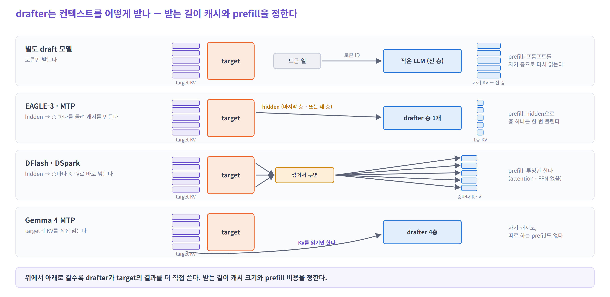

# 02. drafter — 초안을 누가, 어떻게 만드나

> 01에서 drafter는 "초안을 주는 무언가"였다. 이 장은 먼저 **갈래 전체를 한눈에** 놓고 무엇이 표준인지 본 뒤,
> 가장 단순한 drafter에서 출발해 이후 방법들이 **무엇을 하나씩 바꿨는지** 자세히 따라간다.

좋은 drafter의 조건은 둘이다. 01의 속도 식 `τ ÷ (초안 시간 + 검증 시간)`에서 바로 나온다.

- **잘 맞힌다** — `α`가 높아야 `τ`가 크다
- **싸다** — 초안 시간이 짧아야 한다

갈래마다 이 둘 중 하나를 개선하면서, 대개 다른 비용을 하나 새로 만든다.

| 순서 | 내용 | |
|---|---|---|
| 1 | 한눈에 보기 — 갈래별 target과 draft 모듈, 워크로드로 옮기면 | 갈래 |
| 2 | 무엇이 표준인가 | **질문 1** |
| 3 | 작은 LLM을 옆에 두면 되지 않나? — 별도 draft 모델 | 자세히 |
| 4 | target이 이미 읽은 것을 받으면? — EAGLE · EAGLE-3 | 자세히 |
| 5 | 처음부터 같이 학습하면? — MTP 모듈 | 자세히 |
| 6 | 초안을 꼭 하나씩 만들어야 할까? — DFlash · DSpark · DFlash 2 | 자세히 |
| 7 | drafter는 컨텍스트를 어디서 받나? — Gemma 4 MTP · n-gram | 자세히 |
| 8 | draft/target 구도와 MTP — 흐름 | **질문 2** |

---

## 1. 한눈에 보기 — 갈래와 구성

자세히 보기 전에 갈래 전체를 나란히 놓는다. 처음 보는 말은 3절부터 하나씩 풀어 쓰니, 여기서는 두 가지만 알면 된다.

- **hidden** — target이 문맥을 읽고 층마다 만들어 내는 벡터 한 줄. "여기까지 읽은 이해"다 (4절)
- **KV injection** — target의 hidden을 draft 층들이 읽는 K · V로 바꿔 넣는 것 (6절)

### target 모델과 draft 모듈을 나란히


패널 하나가 갈래 하나다. 왼쪽 주황 탑이 **target**, 오른쪽 상자들이 **draft 모듈**이다.

- **target은 여섯 갈래 모두 같다.** 초안을 받아 `K`줄을 한 번에 검증하는 forward 하나다. 다른 것은 **주황 화살표** — hidden을 몇 층에서 내주느냐뿐이다 (없음 / 마지막 층 / 세 층 / 다섯 층)
- **draft 모듈은 위에서 아래로 읽는다.** 맨 위가 입력(토큰 임베딩, 또는 블록), 가운데가 층(종류와 개수), 아래가 head(어휘를 얼마나 다루나), 맨 아래 굵은 글자가 출력이다
- **오른쪽 점선 되돌이 화살표**가 있으면 순차다 — 한 번에 토큰 1개를 내고 `γ`번 돈다. DFlash · DSpark에는 없다 — 한 번에 `γ`개를 낸다
- **보라 화살표**(Gemma 4)는 target의 KV를 직접 읽는 길이다. 이 갈래만 draft 쪽에 문맥 캐시가 없다
- 아래 세 줄이 패널의 요약이다 — target이 주는 것, 초안을 만드는 방식, draft 비용

### 워크로드로 옮기면

시뮬레이터에서 각 갈래를 모델링할 때 셀 것을 그림과 같은 순서로 적으면 이렇다. 사이클 하나 기준이다.

| 갈래 | target 쪽 | draft 모듈 — 한 번 도는 일 | 몇 번 | draft의 문맥 캐시 |
|---|---|---|---|---|
| 별도 draft 모델 | verify (`K`줄) | 작은 LLM의 decode 한 스텝 (자기 임베딩 · 전 층 · 자기 head) | `γ` | 자기 KV, 전 층 |
| EAGLE-3 | verify + 세 층의 hidden 내보내기 | decoder 1층 (Q · K · V 입력 `2d`) + 어휘 3.2만 head. 첫 스텝 앞에 세 층 섞기(`3d → d`) | `γ` | 1층 |
| MTP (DeepSeek식) | verify + 마지막 층 hidden | 투영 `2d → d` + **target 층 하나와 같은 블록** + target head(어휘 전체) | `γ` | 1층 |
| Gemma 4 MTP | verify + 마지막 층 hidden | 4층 (target KV를 읽는다) + 작은 head | `γ` | 없음 |
| DFlash · DSpark | verify + 다섯 층의 hidden | 5층 × 블록 `γ + 1`줄 + target head `γ`줄. 확정된 줄을 층마다 K · V로 투영 | **1** | 5층 (DSpark 서비스용은 최근 128줄) |
| n-gram · suffix | verify | 문자열 매칭 (CPU, `ngram_gpu`는 GPU) | — | 없음 |

- **target 쪽은 새로 만들 것이 거의 없다.** 기존 decode의 연산 표에서 새 토큰을 1줄에서 `K`줄로 바꾸면 된다 ([03](03-compute-and-kv.md#1-verify-한-번은-decode-한-번보다-얼마나-비쌀까))
- **draft 쪽은 "한 번 도는 일 × 몇 번 + 캐시"로 모델링한다.** 이름이 달라도 이 세 칸이 같으면 같은 코드다 — EAGLE-3와 MTP는 층의 종류와 head 크기만 다르다 ([04](04-simulator.md#1-무엇을-기준으로-고르나--이름이-아니라-비용-구조로))

### 지도로 보면


- 세로축은 **어디에 사나**(별도 모델 / target에 붙는 모듈 / 모델 없음), 가로축은 **초안을 어떻게 뽑나**(순차 / 병렬)다
- 가운데 보라 테두리 줄이 지금의 주류다. 2026년에 그 안에서 무게가 **왼쪽(순차)에서 오른쪽(병렬)으로** 옮겨 가고 있다

### 다섯 가지 질문으로 비교하면

| | 별도 draft 모델 | EAGLE-3 | MTP (DeepSeek식) | DFlash · DSpark | Gemma 4 MTP | n-gram · suffix |
|---|---|---|---|---|---|---|
| **무엇을 입력으로 받나** | 토큰 | target 세 층의 hidden + 토큰 | target 마지막 층 hidden + 토큰 | target 다섯 층의 hidden + 블록(anchor + 마스크) | target 마지막 층 hidden + 토큰 + **target KV** | 토큰 열 |
| **무엇을 계산하나** | 작은 LLM 전체 | decoder 1층 + 작은 head | 본체와 같은 블록 1개 + 공유 head | draft 5층 (서비스용 DSpark는 3층) + 공유 head | 4층 + 작은 head | 문자열 매칭 |
| **초안을 어떻게 만드나** | 순차 | 순차 | 순차 (같은 블록 반복) | **병렬** (+ DSpark는 얇은 순차 보정) | 순차 | 찾아서 베낀다 |
| **어디에 캐시를 두나** | 자기 KV, 전 층 | 1층 분량 | 1층 분량 | 층 수만큼, 투영만 해서 | **없음** — target 것을 읽는다 | 모델 캐시 없음 |
| **줄어드는 비용** | — | 문맥 다시 읽기 | 문맥 다시 읽기 + 따로 학습하기 | 초안의 순차 반복 | drafter 캐시와 prefill | 초안 비용 거의 전부 |
| **추가되는 비용** | 자기 prefill · KV · 관리 | 사후 학습, 1층 KV | 14B 모듈 (V3), 반복하면 뒤 자리 약함 | 5층 KV, 뒤 자리 약함(DSpark가 보정), 스케줄러 | 초안 스텝마다 target KV 읽기 | 잘 맞는 작업이 좁다 |

---

## 2. 무엇이 표준인가

### 검증 — 원리는 공통, 서빙의 기본은 일렬

모든 방법이 "한 번에 검증하고 target의 분포를 기준으로 판정한다"는 원리를 쓴다. 채택 알고리즘은 몇 갈래가 있다 ([01](01-principle.md#3-초안을-받아들이면-출력이-달라지지-않을까)의 자세히). 서빙 엔진의 기본 경로는 **토큰별 거부 샘플링 + 일렬 초안**으로 모이는 중이다.

- vLLM의 drafter 기반 클래스는 일렬 초안만 만든다 (`[배치, γ]` 모양). 이 클래스에는 트리 처리가 없다
- SGLang의 새 기본 엔진(Spec V2)은 `topk = 1`, 즉 일렬만 받는다. 트리는 이전 경로에 남아 있다
- DFlash · DSpark는 블록 하나를 일렬로 검증한다

💡 일렬로 모이는 이유는 03에서 본다 — 큰 배치에서는 넓은 트리를 검증할 여유가 없고, 롤백도 일렬이 단순하다.

### drafter — 하나가 아니라 셋이 공존한다

| | 위치 | 근거 |
|---|---|---|
| **내장 MTP** | 모델이 들고 나오면 일단 쓰는 기본값 | 따로 학습할 것이 없다 (추론 비용은 든다). 엔진 1급 지원. DeepSeek의 서비스 기준선(MTP-1) |
| **EAGLE-3** | MTP가 없는 모델의 사후 drafter 표준 | 체크포인트가 가장 넓다 (Llama · Qwen3 · gpt-oss · Gemma 4 · Kimi …). SGLang 문서의 권장 |
| **DFlash 계열** | 공개된 측정에서의 최전선. 지원과 체크포인트가 가장 빠르게 늘었다 | z-lab 체크포인트 20개 이상, NVIDIA · LMSYS · vLLM의 지원과 측정, DeepSeek 서비스가 MTP-1에서 DSpark로 |

- 이 표의 근거는 엔진 지원 · 공개 체크포인트 · 공개 측정이다. 실제 서비스에서 무엇이 얼마나 쓰이는지를 보여 주는 자료는 아니다
- 공개된 실험들에서는 같은 target 안에서 대체로 **EAGLE-3 < 내장 MTP ≲ DFlash < DSpark ≲ DFlash 2** 순으로 관찰됐다. 다섯을 같은 조건에서 함께 잰 실험은 없다 — 쌍마다 따로 잰 결과를 이어 붙인 순서다
- GPU · 엔진 · 체크포인트가 바뀌면 크기도 순서도 바뀐다. vLLM 블로그의 결론도 "하나를 고를 수 없다 — 대표 작업에서 처리량과 자리별 채택률로 고르라"다

<details>
<summary>자세히 — 엔진이 지원하는 것 (2026년 10월, 공식 문서 기준)</summary>

| drafter | vLLM (`method`) | SGLang (`--speculative-algorithm`) |
|---|---|---|
| 별도 draft 모델 | `draft_model` | `STANDALONE` |
| EAGLE · EAGLE-3 | `eagle` · `eagle3` | `EAGLE` · `EAGLE3` (**문서의 권장**) |
| 내장 MTP | `mtp` | EAGLE 경로 (`NEXTN`은 `EAGLE`의 다른 이름) |
| Gemma 4 MTP | `mtp` + assistant 체크포인트 | 문서에는 없다. 코드에 `frozen_kv_mtp` worker가 있다 (이름으로 보아 target KV를 읽는 MTP용) |
| 병렬 draft 모델 (PARD) | `parallel_drafting` | — |
| DFlash | `dflash` | `DFLASH` |
| DSpark | 지원, 검증 길이 조절은 DSpark만 | 코드에 DSpark 구성 요소가 있다 |
| n-gram · suffix | `ngram` · `ngram_gpu` · `suffix` | `NGRAM` |

- TensorRT-LLM도 draft 모델 · EAGLE-3 · MTP · n-gram을 지원하고, NVIDIA는 gpt-oss-120b에서 DFlash를 TensorRT-LLM으로 돌린 결과를 냈다
- llama.cpp는 draft 모델과 MTP(`--spec-type mtp`)를 지원한다

</details>

<details>
<summary>자세히 — 공개 비교와 그 조건</summary>

| 비교 | 조건 | 결과 | 출처 |
|---|---|---|---|
| EAGLE-3 vs DFlash | Qwen3-8B, temp 0, 7개 벤치 평균 | 2.02× vs **4.86×** | DFlash 논문 |
| EAGLE-3 vs DFlash | gpt-oss-120b, TensorRT-LLM, B300, 같은 동시 요청 수 | 평균 1.7× vs **2.3×** | NVIDIA |
| EAGLE-3 vs DFlash | Llama-3.1-8B, 같은 조건 | 평균 2.2× vs **2.8×** | NVIDIA |
| 내장 MTP (7스텝) vs DFlash | Qwen3.5-397B-A17B, 8 × B200, SGLang | 동시 요청 1 ~ 32 전 구간 DFlash 우세, 동시 1에서 MTP의 1.5배 | LMSYS |
| 내장 MTP vs DFlash | Qwen3.6-35B-A3B, AMD MI300X · MI355X, vLLM | 1.28 ~ 1.49× vs **1.77 ~ 2.06×** | vLLM 블로그 |
| Gemma 4 MTP vs DFlash vs EAGLE-3 | gemma-4-26B-A4B, AMD, vLLM | 최대 2.74× · **2.87×** · 2.11 ~ 2.27× | vLLM 블로그 |
| MTP-1 vs DSpark | DeepSeek-V4 서비스 | 사용자당 속도 **+57 ~ 85%** | DSpark 논문 |
| 반례 | Qwen3-8B, AMD, vLLM | EAGLE-3는 MATH-500에서 **기준보다 느림** (최대 0.88×), DSpark 1.15 ~ 1.63× | vLLM 블로그 |

속도 배수는 각 출처의 모델 · GPU · 엔진 · 배치 조건 안에서만 읽는다. 표의 줄끼리 직접 비교하지 않는다.

</details>

---

## 3. 작은 LLM을 옆에 두면 되지 않나? — 별도 draft 모델

*2022 · Google (Leviathan et al.), DeepMind (Chen et al.)*

가장 먼저 떠오르는 답이다. target이 70B라면 같은 계열의 8B 모델을 옆에 두고, 8B가 `on` 다음을 네 번 decode해서 `the mat and slept`를 내게 한다.

조건은 하나다. **토크나이저가 같아야 한다.** 검증이 "토큰 ID마다의 확률"을 비교하는 일이기 때문이다.

### 무엇이 문제인가

이 작은 모델은 target과 아무것도 나누지 않는다.

- **문맥을 처음부터 다시 읽는다.** "The cat sat on"을 target이 이미 읽었는데, 작은 모델도 자기 층으로 다시 읽는다(prefill). 그 결과를 담을 **자기 KV cache**도 따로 둔다
- **target이 이해한 것을 쓰지 못한다.** target은 문맥을 깊이 읽었는데, drafter는 자기 작은 머리로 처음부터 추측한다. 같은 크기라면 덜 맞는다
- **관리가 무겁다.** target을 바꾸면 맞는 draft 모델을 다시 골라야 한다

대형 서빙에서는 다음 절의 방식에 밀렸다. 남아 있는 곳은 로컬 추론(llama.cpp에서 같은 계열의 작은 모델을 쓰는 경우)과 엔진의 일반 경로(vLLM `draft_model`, SGLang `STANDALONE`)다.

<details>
<summary>자세히 — 별도 모델 계열의 변형</summary>

- **어휘가 다른 draft** — vLLM은 토크나이저가 달라도 텍스트로 맞춰 검증하는 경로를 둔다 (`use_heterogeneous_vocab`, greedy만)
- **PARD** (2025, AMD) — 작은 LLM에 마스크 토큰을 넣어 **여러 개를 한 번에** 뽑도록 고친 것이다 (vLLM `parallel_drafting`). 초안은 6절의 DFlash처럼 한 번에 뽑지만, 컨텍스트는 **자기 KV를 자기 prefill로** 만든다. target의 hidden을 받지 않는다

</details>

---

## 4. target이 이미 읽은 것을 받으면? — EAGLE · EAGLE-3

### 어떻게 바꾸나 — target의 hidden을 넘겨받는다

target은 프롬프트를 읽으며(prefill) `sat` 자리에서 다음 토큰 `on`을 골랐다. 그때 문맥 전체를 이미 읽었다. 그 결과가 **hidden**이다.

**hidden**은 target의 층들을 지나며 만들어진 벡터 한 줄이다(8B 모델이면 숫자 4,096개). `sat` 자리의 hidden `h_sat`에는 "The cat sat까지 읽은 이해"가 담겨 있다. target은 이 hidden에 **출력 head**(LM head — hidden을 어휘 전체에 대한 점수로 바꾸는 마지막 행렬)를 곱해 다음 토큰 `on`을 골랐다.

drafter가 이 hidden을 받으면 문맥을 다시 읽을 필요가 없다. **이해는 target이 이미 해 뒀으니, drafter는 그다음만 내다보면 된다.** 그래서 층 하나로도 충분하다.

### 그런데 hidden만으로는 모자란다

drafter가 처음 맞힐 것은 `on` 다음, 즉 `the`다. 그런데 `h_sat`에는 다음 칸에 **무엇이 뽑혔는지**가 없다.


- 왼쪽: `h_sat`은 출력 head를 지나 'on' 0.6 · 'down' 0.3처럼 **여러 후보에 확률을 나눠 준** 상태다. 그중 `on`이 뽑힌 것은 그 뒤의 일이다
- 가운데: 다음 칸이 `on`이면 그다음은 `the`가 자연스럽고, `down`이면 `on`일 수 있다 ("The cat sat down on…"). 같은 `h_sat`이어도 **답이 다르다**
- 오른쪽: 그래서 drafter는 `h_sat`과 함께 **`on`의 임베딩**을 받는다. **임베딩**은 토큰 ID를 벡터로 바꾼 것으로, target의 임베딩 표를 그대로 쓴다

> **hidden은 "여기까지 읽은 이해", 임베딩은 "그다음에 실제로 온 토큰"이다. drafter는 둘로 그다음 토큰을 맞힌다.**

### 한 스텝씩 따라가면

01의 초안 4개가 이렇게 나온다.

| 스텝 | drafter의 입력 | 출력 |
|---|---|---|
| 1 | target의 hidden `h_sat` + 임베딩 `Emb(on)` | `the` (= `d1`) |
| 2 | **drafter가 스텝 1에서 낸 자기 hidden** + `Emb(the)` | `mat` |
| 3 | 스텝 2의 자기 hidden + `Emb(mat)` | `and` |
| 4 | 스텝 3의 자기 hidden + `Emb(and)` | `slept` |

- 스텝 2부터는 target의 hidden이 없다. target은 아직 `on` `the` `mat` 자리를 계산하지 않았다. 그래서 **drafter가 직전에 만든 자기 hidden**을 대신 넣는다
- 💡 그래서 뒤 스텝일수록 덜 맞는다. 첫 스텝은 target의 진짜 이해를 받지만, 그 뒤는 drafter 자신의 근사를 받아 오차가 쌓인다
- verify가 끝나면 `on` `the` `mat` 자리의 **진짜 hidden**이 생긴다. 다음 사이클의 초안은 그것으로 시작한다 ([03](03-compute-and-kv.md#4-drafter도-캐시가-필요할까))

### EAGLE-3가 더한 것

*2025 · Li et al. · EAGLE(2024) → EAGLE-2(2024) → EAGLE-3*

EAGLE(2024)이 위 구조를 처음 제안했고, EAGLE-3가 세 가지를 바꿨다.


왼쪽 그림을 위에서 아래로 따라가자.

1. **target의 세 층에서 hidden을 꺼낸다** (낮은 · 중간 · 높은 층). 마지막 층의 hidden은 "다음 한 토큰"을 고르는 데 특화돼 있다. 그 뒤의 토큰을 내다보려면 더 일반적인 정보를 담은 아래 층도 쓰는 편이 낫다는 판단이다. 셋을 이어 붙여(`3d`) 선형 층으로 `d`로 줄인다
2. **섞은 hidden과 토큰 임베딩을 함께 decoder 층 하나에 넣는다.** 두 입력에 각각 정규화(RMSNorm)를 걸고 이어 붙여(`2d`) 넣는다
3. **출력 head를 작게 둔다.** target의 head는 어휘 12.8만 개(Llama-3.1)를 다 다룬다. EAGLE-3의 공개 체크포인트는 자주 나오는 **3.2만 개**만 다루는 자기 head를 쓴다. drafter 한 스텝의 비용에서 head가 큰 몫이라 효과가 크다 ([04](04-simulator.md#6-개략-검산--이-모형으로-공개-수치가-나오나))

학습할 때는 target을 얼려 두고 drafter만 학습한다. EAGLE-1/2는 "target의 다음 hidden"까지 맞히게 했는데, EAGLE-3는 이 손실을 버리고 **토큰만** 맞힌다. 학습 중에 자기 출력을 다시 입력으로 넣어, 위 표의 스텝 2 · 3 상황을 미리 연습시킨다(training-time test).

<details>
<summary>자세히 — 구조와 보고된 수치</summary>

- decoder 층의 Q · K · V 투영이 `2d` 입력을 바로 받는다 (별도의 `2d → d` 층이 없다). Llama-3.1-8B용 설정: 층 1개, `d` 4096, FFN 14336, `draft_vocab_size: 32000`
- EAGLE-2는 확신도가 높은 갈래만 키우는 **동적 트리**를 도입했다 (깊이 6, 노드 60개 안팎). EAGLE-3는 깊이를 8로 늘렸다

📌 EAGLE-3 논문, temperature 0, 트리 초안

| target | 속도 | `τ` |
|---|---|---|
| Llama-3.1-8B | 4.44× (EAGLE-2 3.23×) | 6.23 |
| Llama-3.3-70B | 4.12× | 5.88 |
| SGLang · H100 · 배치 1 · Llama-3.1-8B | 158 → 373 토큰/초 | — |

- 위 `τ`는 노드 수십 개짜리 트리 기준이다. 서빙에서 흔한 **일렬 초안**에서는 낮다 — 예: Kimi-K2.5, 초안 4개에서 MAL 3.96 (vLLM 블로그, AMD GPU)
- 다른 팀이 학습한 EAGLE-3는 훨씬 낮을 수 있다. DFlash 논문의 Qwen3-8B용 EAGLE-3는 트리 60개에서 `τ` 3.40, 2.02×였다

</details>

---

## 5. 처음부터 같이 학습하면? — MTP 모듈

*2024 · DeepSeek · Multi-Token Prediction*

### 무엇이 다른가 — 같은 모양을, 본 학습 때 붙인다

EAGLE은 target을 다 만든 뒤에 drafter를 따로 학습한다. DeepSeek-V3는 반대로 했다. 모델을 처음 학습할 때부터 **"다음 토큰" 외에 "그다음 토큰"도 맞히는 작은 모듈**을 붙였다.

원래 목적은 속도가 아니라 **학습 품질**이다. 한 칸 더 앞을 맞히게 하면 모델이 더 멀리 내다보는 표현을 배운다. 추론 때는 이 모듈을 버려도 되고, **그대로 drafter로** 쓸 수도 있다.

07 그림의 오른쪽이 MTP 모듈이다. 왼쪽 EAGLE-3와 견주면 거의 같다.

- 입력이 같다 — target의 hidden과 다음 토큰의 임베딩. 각각 RMSNorm을 걸고 이어 붙인다
- 다른 점 ① — hidden을 **마지막 층 하나**에서만 받는다
- 다른 점 ② — 층이 **본체와 같은 Transformer 블록**이다. DeepSeek-V3라면 MLA + MoE 블록 하나다. 그래서 모듈 하나가 14B나 되고, 초안 한 스텝이 본체 한 스텝의 약 4.4%다
- 다른 점 ③ — 출력 head를 **target과 함께 쓴다** (어휘 전체)

```
h'_i  =  M · [ RMSNorm(h_i) ; RMSNorm(Emb(t_(i+1))) ]          M : 2d → d
h''_i =  TRM( h'_i )                                            본체와 같은 Transformer 블록 하나
P(t_(i+2)) = OutHead( h''_i )                                    본체의 출력 head를 함께 쓴다
```

- 📌 DeepSeek-V3: 두 번째 토큰의 채택률 85 ~ 90%, 생성 속도 1.8배 (기술 보고서). DeepSeek는 이 방식(초안 1개, 요청당 2토큰 검증)을 **MTP-1**이라 부르며 서비스의 기준선으로 써 왔다

### 초안을 여러 개 뽑으려면

모듈이 하나뿐이면 같은 모듈을 **다시 돈다.** 출력 hidden을 입력 hidden 자리에 넣는 것이다 (그림의 점선).

- 그런데 학습 때 이 모듈은 한 번만 쓰이도록 배웠다. 두 번째 반복부터는 학습 때 없던 입력을 받는다. vLLM-Ascend 문서는 DeepSeek의 MTP로 3개 이상을 뽑으면 정확도와 속도를 보장할 수 없다고 적는다
- **FastMTP** (2025, Tencent)는 이 반복 사용에 맞춰 MTP 층을 따로 미세조정한다. vLLM의 Speculators가 이 방식을 지원한다
- Qwen3.5 · Qwen3.6은 MTP 층 하나(`mtp_num_hidden_layers: 1`)를 여러 스텝 쓴다. SGLang 블로그의 Qwen3.5-397B 비교는 7스텝으로 돌렸다

### 장점과 비용

- **따로 학습할 것이 없다.** 모델이 들고 나온다. 그래서 MTP가 있는 모델은 일단 MTP부터 켠다
- **추론 비용은 든다.** MTP 블록과 head의 연산, 모듈의 가중치 메모리(DeepSeek-V3는 14B), drafter용 KV가 붙는다 ([03](03-compute-and-kv.md#4-drafter도-캐시가-필요할까))

**MTP를 가진 공개 모델** — DeepSeek-V3 · V3.2 · V4, Qwen3-Next · Qwen3.5 · Qwen3.6, GLM-4.5 · GLM-5.x, ERNIE-4.5, Nemotron 3 Super · Ultra, MiMo. Gemma 4는 MTP라는 이름의 별도 체크포인트를 낸다 (7절).

---

## 6. 초안을 하나씩 만들어야 할까? — 병렬 drafter

### 무엇이 문제인가 — 얇아도 `γ`번 돈다

EAGLE-3도 MTP도 초안을 **하나씩** 만든다. `mat`을 알아야 `and`를 추측할 수 있으니 순서대로 돈다. 초안 시간이 초안 수에 비례하니, 01의 기준대로 초안을 길게 뽑을 수 없다. 한 번 도는 비용을 줄이려고 층도 하나로 묶어 둬야 한다.

### 어떻게 바꾸나 — 빈칸을 한꺼번에 채운다


- 위쪽(순차): `on` → 1층 → `the` → 1층 → `mat` …. 앞에서 뽑은 토큰이 다음 스텝의 입력이라 네 번 돈다
- 아래쪽(병렬): `on` 뒤에 빈칸 표시 `[M]`(마스크 토큰)을 넷 붙여 **한 번에** 넣는다. drafter는 네 빈칸을 동시에 채운다. 블록 안의 자리들은 서로를 다 본다
- 오른쪽 막대: 병렬은 한 번이 더 길다(층이 많다). 하지만 초안이 늘어도 거의 그대로라, 길게 뽑을수록 유리하다

### DFlash

*2026.02 · UC San Diego (z-lab) · Block Diffusion for Flash Speculative Decoding*

- 블록은 Qwen3 기준 **16칸**이다 — 맨 앞은 방금 확정된 토큰(anchor), 나머지 15칸은 마스크
- forward가 한 번뿐이니 층을 **5개**로 쌓을 수 있다. 순차 drafter였다면 5층 × 15번이 됐을 것이다
- 임베딩 표와 출력 head는 target 것을 함께 쓴다. 학습하는 것은 draft 층뿐이다

**target 정보를 넣는 곳도 바꿨다 — 모든 층의 K · V로 (KV injection)**

EAGLE-3는 target의 hidden을 drafter의 **입력**으로 넣었다. 그러면 그 정보는 첫 층에서만 직접 쓰이고, 위층으로 갈수록 흐려진다. DFlash는 hidden을 **draft의 모든 층이 attention으로 읽는 K · V**로 바꿔 넣는다.


- 위쪽 그림: target의 5개 층에서 hidden을 꺼내 이어 붙이고(`5d`), 하나로 섞는다. 이것을 draft 층 1 ~ 5가 각자의 K · V 투영으로 바꿔 캐시에 둔다
- 그러면 블록의 빈칸들은 **어느 층에서든** target이 만든 표현을 직접 attention으로 읽는다. draft를 깊게 쌓을수록 잘 맞는 이유다
- Qwen3-8B용 공개 drafter는 target 36층 중 **1, 9, 17, 25, 33번 층**을 쓴다

📌 DFlash 논문, Qwen3, temperature 0, 7개 벤치 평균

| target | EAGLE-3 (트리 60) | DFlash (블록 16) |
|---|---|---|
| Qwen3-4B | 2.08× · `τ` 3.48 | **4.91× · `τ` 6.54** |
| Qwen3-8B | 2.02× · `τ` 3.40 | **4.86× · `τ` 6.49** |

**빨라진 이유가 둘이다.** `τ`가 높고(깊은 drafter + 모든 층 주입), 사이클이 짧다(forward 1번). LMSYS의 분해 실험에서 "병렬만" 쓰면 `τ`는 EAGLE-3보다 낮은데도 더 빨랐고, "주입만" 쓰면 `τ`는 높은데 덜 빨랐다. 둘을 합쳐야 가장 빠르다.

<details>
<summary>자세히 — DFlash의 식과 학습</summary>

```
H_ctx = RMSNorm( W_c · [ H^(l1) ; H^(l2) ; … ; H^(l5) ] )      target 5개 층의 hidden을 이어 붙여 섞는다
```

- 이미지 diffusion처럼 여러 번 다듬지 않는다. 한 번에 끝낸다 — 어차피 target이 검증하므로 거친 초안이면 된다
- 학습: 응답에서 anchor 자리를 무작위로 뽑아(시퀀스당 512개) 그 뒤를 마스킹하고 맞히게 한다. 손실 가중치 `w_k = exp(−(k−1)/λ)`로 **앞 자리를 무겁게** 본다 (블록 16이면 `λ` = 7). 앞이 틀리면 뒤는 어차피 버려지기 때문이다. 논문은 이 감쇠 상수도 `γ`로 적지만, 여기서는 초안 수 `γ`와 헷갈리지 않게 `λ`로 쓴다
- 데이터는 target이 직접 생성한 응답 약 80만 개다
- 과제마다 다르다. Qwen3-8B에서 MATH-500은 6.08×, 대화(MT-Bench)는 2.75×다

</details>

### 대가 — 블록 뒤쪽일수록 덜 맞는다

빈칸을 **동시에** 채우면, 각 빈칸은 바로 앞 빈칸에 무엇이 뽑힐지 모른 채 고른다.

- "New York"과 "San Francisco"가 반반인 문맥이라면, 첫 칸은 New 0.5 / San 0.5, 둘째 칸은 York 0.5 / Francisco 0.5다. 따로 뽑으면 **"New Francisco"**가 나올 수 있다
- 블록 뒤로 갈수록 앞에 쌓인 갈림길이 많아 더 심해진다. 상위 1개가 정답일 비율이 0번 자리 85.4%에서 6번 자리 72.9%로 떨어진다 (DFlash 2 블로그, Qwen3-4B)

### DSpark — 틀릴 것 같은 초안은 검증하지 않는다

*2026.07 · DeepSeek-AI · Confidence-Scheduled Speculative Decoding with Semi-Autoregressive Generation*

DFlash를 그대로 쓰고 두 가지를 더한다.

**① 직전 토큰으로 다음 자리를 고친다 (마르코프 head)**

병렬 패스가 끝난 뒤, 왼쪽부터 한 자리씩 **실제로 뽑힌 직전 토큰**을 보고 다음 자리의 점수를 고친다. "New"가 뽑혔으면 다음 자리에서 "York"를 밀어 준다.
순차로 돌긴 하지만 층을 도는 것이 아니라 **표에서 한 줄 꺼내 작은 곱 한 번**이다. 사이클 시간이 0.2 ~ 1.3% 늘 뿐이다.

**② 자리마다 "통과할 확률"을 내고, 검증할 길이를 정한다 (confidence head + 스케줄러)**

01에서 초안을 늘리면 사이클 시간이 는다고 했다. 서버가 바쁠 때는 여기에 하나가 더 붙는다. **검증에 넣은 초안은 맞든 틀리든 GPU의 연산을 먹는다.** 통과할 확률이 0.3인 초안을 검증에 넣으면, 다른 요청이 쓸 수 있던 몫을 빼앗는다.

그래서 DSpark는 초안마다 "통과할 확률"을 따로 예측한다. 그리고 매 스텝, 모든 요청의 초안을 확률 순으로 세워 **시스템 전체의 초당 토큰 수가 가장 커지는 지점까지만** 검증에 넣는다.

```
요청 A:  0.95  0.91  0.72  0.40 …
요청 B:  0.93  0.60 …                 →  한 줄로 정렬:  0.97 0.95 0.94 0.93 0.91 0.88 | 0.81 0.72 …
요청 C:  0.97  0.94  0.88  0.81 …                                                   ↑ 여기서 멈춤
```

- 한가하면 길게, 바쁘면 짧게 — 01의 "초안을 하나 더 늘릴지" 기준을 **요청마다 · 매 스텝** 푸는 것이다
- 📌 DeepSeek-V4 서비스에서 MTP-1 대비 같은 처리량에서 사용자당 생성 속도 **V4-Flash +60 ~ 85%, V4-Pro +57 ~ 78%**. 중간 부하에서 요청당 약 4 ~ 6토큰을 검증한다 (MTP-1은 2토큰 고정)

<details>
<summary>자세히 — DSpark의 식과 수치</summary>

**마르코프 head**

```
로짓_k  +=  B(x_(k−1), ·)        B = W1 · W2,   W1 : V × r,  W2 : r × V,   r = 256
```

`V × V` 전이 행렬을 rank 256으로 눌러 든 것이다.

**confidence head와 보정**

```
c_k = σ( wᵀ [ h_k ; W1[x_(k−1)] ] )          k번째 초안이 통과할 확률 (앞이 다 통과했다는 조건)
학습 목표:  c_k* = 1 − ½ ‖ p_draft − p_target ‖₁       ← 01의 채택 확률 식 그대로
```

그대로 쓰면 과신한다. 왼쪽부터 자리마다 온도를 하나씩 맞추는 보정(Sequential Temperature Scaling)으로 보정 오차를 3 ~ 8%에서 약 1%로 줄였다.

**스케줄러**

```
Θ  =  τ · SPS(B)

  a_(r,j) = c_(r,1) × … × c_(r,j)                  요청 r의 j번째 초안이 살아남을 확률
  B       = Σ_r (1 + ℓ_r)                           이번 스텝에 target이 검증할 총 토큰 수
  τ       = Σ_r (1 + Σ_(j ≤ ℓ_r) a_(r,j))           기대 확정 토큰 수
  SPS(B)  = 배치 크기 B에서 엔진이 초당 도는 스텝 수  — 엔진을 켤 때 한 번 재 둔 표
```

- `a_(r,j)`를 큰 것부터 하나씩 넣으며 `Θ`를 갱신하고, 더 오르지 않으면 멈춘다
- 실제 서비스에서는 CUDA graph 때문에 다음 배치 크기를 미리 알아야 해서, **두 스텝 전의 confidence**로 총 길이를 정하고 지금의 confidence로 순서를 정한다

**수치**

| | 내용 |
|---|---|
| 오프라인 (Qwen3-4B, 초안 7개, 스케줄러 끔) | `τ` — GSM8K: EAGLE-3 5.14 · DFlash 5.40 · **DSpark 6.11** / MT-Bench: 2.39 · 3.07 · **3.64** / Arena-Hard: 2.55 · 2.83 · **3.29** |
| 평균 향상 | EAGLE-3 대비 +26.7 ~ 30.9%, DFlash 대비 +16.3 ~ 18.4% (Qwen3 4B · 8B · 14B) |
| 서비스용 drafter | MoE 3층 (mHC 포함), **최근 128토큰만 보는 attention**, 블록 최대 5 |

- 창이 있으니 서비스용 drafter의 캐시는 요청당 128줄로 묶인다
- 체크포인트: DeepSeek-V4-Pro-DSpark · V4-Flash-DSpark (Hugging Face), 코드: deepseek-ai/DeepSpec. vLLM의 "Adaptive Verification"은 현재 DSpark만 지원한다

</details>

### DFlash 2 — 후보 경로를 고른다

*2026.08 · Inco AI*

DSpark처럼 자리 사이의 의존을 되살리되, 더 싸게 한다. 자리마다 **상위 16개 후보**를 남기고, 이웃한 자리의 후보 쌍마다 "이어져도 자연스러운가" 점수를 매겨 **이어지는 경로 하나**를 고른다. "New → York"과 "San → Francisco"는 점수가 높고 "New → Francisco"는 낮다.

- 📌 Qwen3.5-4B 평균 `τ`: 내장 MTP 4.54 · DFlash 4.92 · DSpark 5.49 · **DFlash 2 5.97** — DFlash 2 저자의 측정이다. 여기의 DSpark는 커뮤니티가 학습한 것이다

<details>
<summary>자세히 — DFlash 2의 두 장치</summary>

- 경로 선택: 후보 쌍 `(a, b)`의 점수 `U_t(b) + ⟨A(a) ⊙ H(h_t), B(b)⟩`. 점수는 한 번에 다 계산하고 마지막 경로 따라가기만 순차다 (+2.0M 파라미터, 사이클 +0.6%)
- 2-tap conv: 층 안의 attention · MLP 앞뒤에 **앞 자리와 섞는** 작은 합성곱을 넣는다 (+16.5M, +0.7%)

</details>

---

## 7. drafter는 컨텍스트를 어디서 받나?

지금까지 본 drafter를 **문맥을 받는 길**로 다시 놓으면 차이가 선명해진다. 이 길이 03에서 볼 캐시 크기와 prefill 비용을 정한다.



- **별도 draft 모델** (맨 위) — target에서 받는 것은 토큰 ID뿐이다. 문맥을 자기 층으로 다시 읽고, 자기 KV를 전 층 분량으로 둔다
- **EAGLE-3 · MTP** — 주황 화살표로 hidden을 받는다. 그 hidden으로 drafter 층 하나를 돌려 **1층 분량**의 캐시를 만든다
- **DFlash · DSpark** — hidden을 섞어서 층마다 K · V로 **투영만** 한다. attention이나 FFN을 돌리지 않으니 만들기는 싸지만, 층 수만큼 저장한다
- **Gemma 4 MTP** (맨 아래) — target의 KV를 **직접 읽는다.** drafter에는 문맥용 캐시도, 따로 하는 prefill도 없다

### Gemma 4 MTP — target의 KV를 직접 읽는 drafter

*2026 · Google*

이름은 MTP지만 DeepSeek식과 다르다. 별도 체크포인트("assistant")로 배포되는 **4층짜리 작은 drafter**다(76M ~ 500M).

- 입력은 직전 스텝의 target 마지막 층 hidden과 토큰 임베딩이다 — EAGLE · MTP와 같다
- 다른 점은 문맥을 읽는 법이다. drafter의 attention이 **target의 KV를 직접 읽는다**(cross-attention). 그래서 문맥을 drafter 쪽에 다시 저장할 필요가 없다
- 작은 모델(E2B · E4B)은 어휘 26.2만 개짜리 head 대신, **토큰 군집 위의 top-k**로 head를 4,096개 규모로 줄인다
- Google은 최대 약 3배를 보고했다. vLLM에서는 `method: "mtp"`에 assistant 체크포인트를 `model`로 준다

> 💡 **MTP라는 이름이 두 가지를 가리킨다.** DeepSeek식은 "본 학습에 함께 넣은 블록", Gemma 4식은 "함께 배포하는 작은 drafter"다. 비용을 정하는 것은 이름이 아니라 **문맥을 어디서 읽느냐**다.

### 모델 없는 방법 — n-gram · suffix

drafter가 아예 없어도 초안을 만들 수 있다. **이미 나온 글에서 베낀다.**

- **n-gram (prompt lookup)** — 마지막 몇 토큰과 같은 구간을 프롬프트와 생성 결과에서 찾아, 그 뒤에 왔던 토큰을 초안으로 낸다. 코드를 고치거나 문서를 인용하는 작업에서는 입력을 그대로 다시 쓰는 일이 많아 길게 맞는다
- **suffix decoding** — 프롬프트와 **이전 요청들의 생성 결과**로 suffix tree를 만들어 찾는다 (vLLM `suffix`, Arctic Inference)
- 모델 가중치가 없으니 초안 비용이 작다. vLLM `ngram`과 suffix는 CPU에서 찾고, `ngram_gpu`는 GPU에서 작은 매칭 연산을 돈다 — "GPU를 전혀 안 쓴다"는 아니다
- 검증 비용은 다른 drafter와 같다. 새 글을 쓰는 작업에서는 거의 안 맞으므로, 큰 배치에서 모델 기반 drafter의 보조로 쓴다

---

## 8. draft/target 구도와 MTP — 흐름


연표를 세 시기로 읽는다. 시기마다 **앞 시기의 비용 하나**를 없앴다.

**① 2022 ~ 23 — 별도 모델.** 원리가 증명됐다. 하지만 drafter가 문맥을 처음부터 다시 읽고, target이 이해한 것을 쓰지 못했다.

**② 2024 ~ 25 — target에 붙는 얇은 모듈.** "target이 이미 읽은 것을 받자."

- Medusa는 target 위에 head를 여러 개 붙였지만 head끼리 서로를 몰랐다. EAGLE은 hidden을 한 스텝씩 이어 가며 이것을 고쳤다
- 같은 해 DeepSeek-V3가 MTP를 **본 학습에 넣었다.** 이때부터 모델이 drafter를 들고 나온다
- EAGLE-3는 여러 층의 hidden을 쓰고 토큰만 맞히도록 바꿔 사후 drafter의 표준이 됐다. Qwen3-Next · Qwen3.5 · GLM은 MTP 1층을 기본으로 싣고 나왔다

**③ 2026 — 초안을 병렬로, 검증을 부하에 맞춰.**

- DFlash가 초안의 순차 반복을 없앴다. DSpark · DFlash 2가 그 대가(뒤 자리의 품질)를 싸게 메웠다
- DSpark의 스케줄러는 "몇 개를 검증할까"를 고정값에서 **매 스텝의 결정**으로 바꿨다
- Gemma 4는 drafter가 **target의 KV를 직접 읽게** 해서 drafter의 캐시와 prefill을 없앴다. H-Spec(2026.09) 같은 연구도 같은 방향이다

### MTP는 어디에 서 있나

| | |
|---|---|
| 강점 | 따로 학습할 것이 없다. 본 학습 품질도 올린다. 모든 엔진이 1급으로 지원한다 |
| 한계 | 층 하나 · 순차라 초안을 길게 뽑기 어렵다. 모듈을 반복해 쓰면 뒤 자리가 약하다. 추론 때는 블록 · head 연산, 가중치 메모리(DeepSeek-V3는 14B), drafter KV가 든다 |
| 자리 | **모델이 주는 기본값.** 더 빠르게 하려면 병렬 drafter로 간다 — DeepSeek 자신이 그렇게 했다 |

> 💡 **"draft 모델이냐 MTP냐"는 이제 맞는 질문이 아니다.** 지금 쓰이는 drafter는 거의 전부 target의 hidden을 받는 얇은 모듈이고, 갈리는 것은 **언제 학습했나 · 순차냐 병렬이냐 · target 정보를 어디로 받나** 세 가지다.
> 모델을 낼 때 MTP와 함께, 또는 대신 **별도 drafter 체크포인트**를 같이 내는 사례도 늘고 있다 — DeepSeek-V4의 DSpark, Gemma 4의 assistant, Speculators의 Kimi K3 · GLM 5.2용 DSpark.

---

## 정리

1. **별도 draft 모델**은 문맥을 다시 읽고 target의 이해를 쓰지 못한다
2. **EAGLE · MTP**는 target의 hidden(여기까지의 이해)과 다음 토큰의 임베딩을 받아, 층 하나로 그다음을 맞힌다. MTP는 같은 모양을 본 학습 때 붙인 것이다
3. **DFlash**는 초안 블록을 빈칸 채우기로 한 번에 만들고, target 정보를 모든 층의 K · V로 넣는다. 뒤 자리가 약한 것을 **DSpark**(직전 토큰으로 보정 + 검증 길이 조절)와 **DFlash 2**(후보 경로 선택)가 메운다
4. 문맥을 받는 길이 다르다 — 다시 읽기 / hidden으로 1층 / hidden을 층마다 투영 / target KV 직접 읽기

**다음 장** — 지금까지는 토큰이 어떻게 확정되는지를 봤다. 그러면 메모리 안에서는 무슨 일이 일어날까? 초안이 틀렸을 때 이미 써 버린 KV는 어떻게 될까? → [03 연산과 KV cache](03-compute-and-kv.md)

---

## 참고

**논문**
- [Medusa](https://arxiv.org/abs/2401.10774) · [EAGLE](https://arxiv.org/abs/2401.15077) · [EAGLE-2](https://arxiv.org/abs/2406.16858) · [EAGLE-3](https://arxiv.org/abs/2503.01840)
- [DeepSeek-V3 Technical Report](https://arxiv.org/abs/2412.19437) 2.2절 · 5.4.3절 — MTP 모듈의 식, 손실 가중치, 채택률
- [FastMTP](https://arxiv.org/abs/2509.18362) — MTP 층을 여러 스텝용으로 미세조정
- [PARD](https://arxiv.org/abs/2504.18583) — 작은 draft 모델을 병렬 초안용으로 고친다
- [DFlash](https://arxiv.org/abs/2602.06036) — 블록 diffusion drafter, KV 주입, Qwen3 결과와 동시 요청 수별 표
- [DSpark](https://arxiv.org/abs/2607.05147) — 마르코프 head, confidence head, `Θ = τ · SPS(B)` 스케줄러, DeepSeek-V4 서비스 결과
- [Gemma 4 Technical Report](https://arxiv.org/abs/2607.02770) 2.6절 — MTP drafter의 구조, target KV cross-attention
- [H-Spec](https://arxiv.org/abs/2609.24197) — drafter 쪽 KV cache 없이 병렬 초안

**구현 · 문서 · 측정**
- [vLLM — Speculative Decoding](https://docs.vllm.ai/en/latest/features/speculative_decoding/) · [MTP](https://docs.vllm.ai/en/latest/features/speculative_decoding/mtp/) · [llm_base_proposer.py](https://github.com/vllm-project/vllm/blob/main/vllm/v1/spec_decode/llm_base_proposer.py) · [ngram_proposer_gpu.py](https://github.com/vllm-project/vllm/blob/main/vllm/v1/spec_decode/ngram_proposer_gpu.py)
- [vLLM Speculators](https://github.com/vllm-project/speculators) · [Speculators — MTP](https://docs.vllm.ai/projects/speculators/en/latest/user_guide/algorithms/mtp/)
- [SGLang — Speculative Decoding](https://docs.sglang.io/docs/advanced_features/speculative_decoding) · [LMSYS — DFlash and Spec V2 (2026-06)](https://www.lmsys.org/blog/2026-06-15-next-generation-speculative-decoding-dflash-v2/)
- [z-lab/dflash](https://github.com/z-lab/dflash) · [Inco AI — DFlash 2](https://inco.ai/blog/dflash2/)
- [NVIDIA — DFlash on Blackwell](https://developer.nvidia.com/blog/boost-inference-performance-up-to-15x-on-nvidia-blackwell-using-dflash-speculative-decoding/)
- [vLLM 블로그 — Speculative Decoding on AMD GPUs (2026-08)](https://vllm.ai/blog/2026-08-23-speculative-decoding-amd-gpus)
- [Hugging Face — Welcome Gemma 4](https://huggingface.co/blog/gemma4)
- 설정 파일: [yuhuili/EAGLE3-LLaMA3.1-Instruct-8B](https://huggingface.co/yuhuili/EAGLE3-LLaMA3.1-Instruct-8B) (`draft_vocab_size: 32000`) · [z-lab/Qwen3-8B-DFlash-b16](https://huggingface.co/z-lab/Qwen3-8B-DFlash-b16) (5층, 블록 16, target 층 1 · 9 · 17 · 25 · 33)

**범위와 주의**
- 속도 배수는 각 출처의 모델 · GPU · 엔진 · 배치 조건 안에서만 읽는다
- DFlash 2의 수치는 DFlash 2 저자의 블로그다. 제3자 검증은 아직 적다
- 엔진의 지원 목록은 빠르게 바뀐다. 쓰기 전에 공식 문서를 다시 본다
