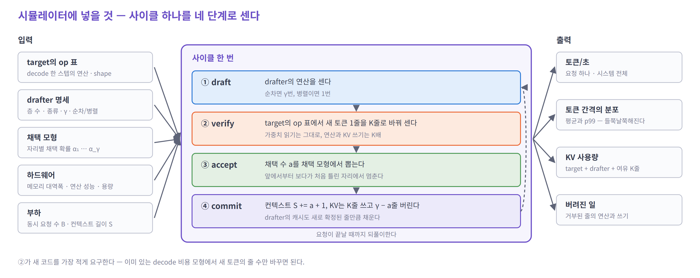
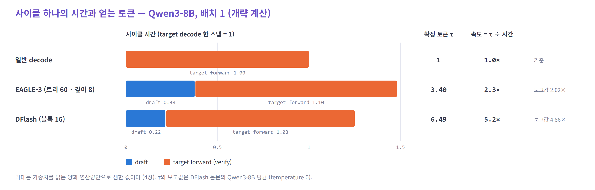

# 04. 시뮬레이터에 넣기 — 앞에서 본 동작을 상태와 비용으로 옮긴다

> 01 ~ 03에서 본 동작을 시뮬레이터가 기억할 **상태**와 셀 **비용**에 하나씩 연결한다.
> 가정: 시뮬레이터는 모델의 **op 표**(llm-arch-tracer의 `decode.csv` 같은 것)와 **하드웨어 사양**으로 스텝 시간을 낸다.

| 순서 | 질문 |
|---|---|
| 1 | 무엇을 기준으로 고르나? — 이름이 아니라 비용 구조로 |
| 2 | 어떤 모델로 시작하나? |
| 3 | 시뮬레이터는 무엇을 기억해야 하나? — 상태 |
| 4 | 한 사이클의 비용은 어떻게 세나? — verify와 drafter |
| 5 | 채택 모형 — 평균 몇 개가 맞나 |
| 6 | 개략 검산 — 이 모형으로 공개 수치가 나오나 |
| 7 | 메모리는 얼마나 더 드나? |
| 8 | 구현 순서와 확인 목록 |
| 9 | 의사 코드 |

---

## 1. 무엇을 기준으로 고르나? — 이름이 아니라 비용 구조로

02에서 drafter를 여럿 봤다. 이름마다 따로 구현하면 코드가 끝없이 늘어난다. 그래서 **비용 구조가 같은 것끼리 묶는다.**

| 기준 | 질문 |
|---|---|
| ① 실제로 쓰이나 | 주요 엔진이 지원하고, 공개 체크포인트가 있나 ([02](02-drafters.md#2-무엇이-표준인가)) |
| ② **비용 구조가 다른가** | 시뮬레이터에 **새 코드 경로**를 요구하나. 이름이 달라도 비용 구조가 같으면 매개변수만 다르다 |
| ③ 맞춰 볼 숫자가 있나 | 같은 target에서 보고된 `τ`와 속도가 있나 |
| ④ op 표가 있나 | target을 트레이서로 이미 뽑았나 |

### drafter를 두 축으로 나눈다

②로 보면 drafter의 비용은 **두 가지 질문**으로 정해진다. 02의 두 그림이 각각 하나씩에 답한다.

**축 1 — 초안을 어떻게 뽑나?** ([02의 순차 · 병렬 그림](02-drafters.md#6-초안을-하나씩-만들어야-할까--병렬-drafter)) → 초안 시간을 정한다

| 생성 방식 | forward | 해당 |
|---|---|---|
| 순차 | `γ`번, 매번 요청당 1줄 (트리면 깊이마다 후보 수만큼) | 별도 draft 모델, EAGLE-3, 내장 MTP, Gemma 4 MTP |
| 병렬 | 1번, 요청당 `γ + 1`줄 (anchor + 마스크 토큰) | PARD, DFlash, DSpark, DFlash 2 |
| 모델 없음 | 0 — CPU의 매칭, 또는 GPU의 작은 매칭 연산(`ngram_gpu`) | n-gram, suffix |

**축 2 — 문맥을 어떻게 받나?** ([02의 경로 그림](02-drafters.md#7-drafter는-컨텍스트를-어디서-받나)) → drafter 캐시 · prefill · 사이클마다의 쓰기를 정한다

| 문맥 공급 | drafter 캐시 | prefill 때 추가로 하는 일 | 해당 |
|---|---|---|---|
| 자기 모델의 KV | 작은 모델의 모든 층 | 작은 모델의 prefill 전체 | 별도 draft 모델, **PARD** |
| target hidden → drafter 층 forward | 1층 분량 | drafter 층 1개로 프롬프트 전체 forward | EAGLE-3, 내장 MTP |
| target hidden → 층마다 K · V 투영만 | `L`층 분량 (창이 있으면 상한) | 투영만 — attention · FFN 없음 | DFlash, DSpark, DFlash 2 |
| target의 KV를 직접 읽기 | 없음 | 없음 (대신 초안 스텝마다 target KV를 읽는다) | Gemma 4 MTP |
| 없음 | 없음 (CPU의 토큰 열, 또는 GPU의 토큰 버퍼) | 없음 | n-gram, suffix |

- **PARD와 DFlash는 둘 다 병렬로 뽑지만 문맥 공급이 다르다.** PARD는 독립 소형 모델이라 자기 prefill과 자기 KV 전부를 치른다. 두 축을 따로 구현해 조합하면 이런 차이가 새 코드 없이 나온다
- 자주 쓰는 두 조합에 이름을 붙여 둔다. 이 페이지의 나머지는 이 이름을 쓴다
  - **A = 순차 + hidden → 1층 forward** — 내장 MTP, EAGLE-3
  - **B = 병렬 + 층마다 투영** — DFlash, DSpark, DFlash 2
- **공개된 drafter 체크포인트의 대부분이 A와 B에 속한다.** 나머지는 같은 두 축의 다른 칸이다
- **내장 MTP와 EAGLE-3는 같은 코드다.** 다른 것은 매개변수 셋이다 — 층의 종류(MTP는 본체와 같은 층, EAGLE-3는 Q · K · V 입력이 `2d`인 decoder 층), head의 어휘 크기(MTP는 target 어휘, EAGLE-3는 3.2만), target에서 꺼내는 hidden 층 수(1 대 3)

> **결론: 사이클 프레임 하나 + 두 축(생성 방식 · 문맥 공급)을 따로 구현하고, A · B부터 채운다.** 나머지 칸은 매개변수와 작은 항목으로 붙인다.

---

## 2. 어떤 모델로 시작하나?

### 트레이서에 있는 모델과 쓸 수 있는 drafter

| target (트레이서) | 내장 MTP (config) | 공개 drafter | 맞춰 볼 숫자 |
|---|---|---|---|
| **Llama-3.1-8B** | 없음 | EAGLE-3 (yuhuili), DFlash (z-lab, 블록 10) | EAGLE-3 논문 배치별 표, NVIDIA의 EAGLE-3 2.2× vs DFlash 2.8× |
| Llama-3.1-70B | 없음 | EAGLE-3 (Speculators) | EAGLE-3 논문 (Llama-3.3-70B 4.12×) |
| gpt-oss-20b · 120b | 없음 | EAGLE-3 (Speculators), DFlash (z-lab) | NVIDIA (120b): 1.7× vs 2.3× |
| Qwen3-30B-A3B | 없음 | EAGLE-3, DFlash (Speculators) | — |
| **DeepSeek-V3** | 1 (`num_nextn_predict_layers`) | — | 채택률 0.85 ~ 0.90, 1.8× (DeepSeek, 측정 조건 미공개) |
| **DeepSeek-V4-Flash · Pro** | 1 | DSpark (DeepSeek-V4-*-DSpark) | DSpark vs MTP-1: 사용자당 +57 ~ 85% |
| GLM-5.2 · GLM-4.5-Air | 1 | GLM 5.2: DSpark (Speculators) | — |
| ERNIE-4.5-21B-A3B | 1 | — | — |
| Nemotron-3 Super · Ultra | 1 | DFlash (Speculators) | — |
| **Qwen3.5-4B · 397B-A17B** | 1 (`mtp_num_hidden_layers`) | DFlash (z-lab) | 4B: `τ` MTP 4.54 · DFlash 4.92 · DSpark 5.49 (Inco) / 397B: DFlash vs MTP (LMSYS) |
| Qwen3.6-27B · 35B-A3B | 1 (`mtp_num_hidden_layers`) | DFlash (z-lab), 35B-A3B는 DSpark (Speculators) | 35B-A3B: MTP 1.28 ~ 1.49× vs DFlash 1.77 ~ 2.06× (AMD) |
| Kimi-K2.6 · K2.7-Code | 0 | DFlash (z-lab) | — |
| Kimi-K3 | 0 | DSpark (Speculators) | — |

- 내장 MTP 열은 트레이서가 받은 각 모델의 `config.json`(`full/provenance.json`)에서 읽었다
- drafter 열은 z-lab · Speculators · DeepSeek의 공개 목록(2026년 10월)이다. 쓰기 전에 다시 확인한다
- DFlash 논문의 주 실험 모델인 **Qwen3-8B는 트레이서에 없다.** config만 있으면 되므로 추가해 두면 6절의 검산을 그대로 재현할 수 있다

### 트레이서의 op 표에는 MTP가 없다 — 합성해야 한다

- 네이티브 transformers 구현은 MTP 모듈을 만들지 않는다. 그래서 MTP가 있는 모델도 **op 표에 MTP가 없다.** 트레이서의 검사 C15가 이것을 WARN으로 남긴다 (DeepSeek-V3 · V4, GLM, ERNIE, Nemotron 3 등 10개, tiny-deepseek-v3 포함)
- ⚠️ **Qwen3.5 · Qwen3.6은 C15를 PASS로 통과했지만 MTP가 빠져 있다.** 이 모델들은 MTP를 `mtp_num_hidden_layers`라는 키로 선언하는데, C15는 `num_nextn_predict_layers`와 `num_mtp_layers`만 본다 (`src/validate.py`의 `c15_entrypoint_coverage`). 4개 모델(Qwen3.5-4B, 397B-A17B, Qwen3.6-27B, 35B-A3B)이 해당한다
- 합성 규칙: MTP 블록은 **본체의 decoder 층 하나와 같은 종류**다 (DeepSeek-V3는 MLA + MoE 층). `decode.csv`에서 그 층의 op 행을 복사하고, 앞뒤에 RMSNorm 2개 · 이어 붙이기 · 투영 `2d → d` · final norm · 출력 head(공유)를 더한다. Qwen3.5 · 3.6의 MTP 층이 어떤 attention 종류인지는 엔진의 MTP 모델 코드에서 확인한다

### 추천 순서

| 단계 | 조합 | 이 단계에서 확인되는 것 |
|---|---|---|
| 1 | **Llama-3.1-8B + EAGLE-3, DFlash** | 가장 단순한 target(dense · GQA)에서 A와 B. 같은 target에 두 drafter의 공개 비교가 있다 |
| 2 | **DeepSeek-V3 + MTP-1** | MoE의 expert 합집합, MLA(verify의 attention이 곱셈에 묶임), 합성한 MTP op. 보고된 1.8×는 측정 조건이 공개되지 않아 정답으로 쓰지 않는다 — 배치에 따라 이득이 달라지는 **방향**을 본다 |
| 3 | **Qwen3.5-397B-A17B 또는 Qwen3.6-35B-A3B + 내장 MTP vs DFlash** | 선형 attention 혼합 — 중간 상태 저장 비용. MoE. LMSYS · AMD 결과 |
| 4 | **DeepSeek-V4-Flash + DSpark** | 압축 · 희소 attention의 검증, 요청마다 다른 검증 길이(스케줄러), MTP-1과의 비교 |

---

## 3. 시뮬레이터는 무엇을 기억해야 하나? — 상태



그림의 가운데 상자가 사이클 하나다 — **① draft → ② verify → ③ accept → ④ commit**. 배치 안의 요청들은 같은 forward를 함께 탄다. 사이클 시간은 배치 전체로 한 번 센다.

요청마다 기억할 것을 예시로 보면 이렇다.

| 상태 | 뜻 | 예시: 사이클 전 → 후 |
|---|---|---|
| `S` | target KV에 있는 줄 수 | 3 (`The cat sat`) → 6 (`… on the mat`) |
| 대기 토큰 | 확정됐지만 KV가 없는 토큰 1개 — 다음 verify의 맨 앞 | `on` → `.` |
| `S_draft` | drafter 캐시의 줄 수 (문맥을 자기 캐시로 받는 drafter) | A라면 확정된 자리 수를 따라간다 |
| `γ_r` | 이번 사이클에 검증할 초안 수 | 4 — 고정이거나 스케줄러가 정한다 |
| 선형 attention 상태 | 혼합 모델이면 층마다 상태 하나 + 검증 중 중간 상태 `K`개 | — |

출력은 그림의 오른쪽이다. **사용자당 토큰/초와 전체 처리량을 함께** 낸다. DSpark · NVIDIA가 비교에 쓰는 축이 "같은 처리량에서 사용자당 속도"다.

---

## 4. 한 사이클의 비용은 어떻게 세나?

### 4.1 verify — decode 표의 새 토큰 줄을 `K`로 바꾼다

03의 1절에서 본 그대로다. verify는 decode와 같은 forward이고 **새 토큰 줄만 늘어난다.** 그래서 새 코드가 거의 필요 없다.

트레이서의 `decode.csv`는 새 토큰이 1줄인 스텝이다. shape에 `B`(새 토큰 줄), `T+1`(읽는 문맥)이 기호로 들어 있다. verify는 이 표에서 **새 토큰 줄을 `Σ_r K_r`로, 문맥을 요청마다 `S + K`로** 바꿔 센다.

| op 종류 | 읽기 | 곱셈 | 쓰기 |
|---|---|---|---|
| 가중치 곱 (투영 · FFN · 출력 head) | 가중치 1번 | 줄 수 `Σ K_r`에 비례 | — |
| **MoE expert 곱** | **불린 expert 수** × expert 크기 | 줄 수에 비례 | — |
| attention 점수 · 가중합 | 요청마다 캐시 `S + K`줄 × 재사용 계수 (이상적이면 1번, 쿼리마다 따로 읽으면 `K`번) | `K·(S + K)`에 비례 | — |
| KV 쓰기 | — | — | 요청마다 `K`줄 |
| 원소별 연산 (norm · RoPE · softmax …) | 활성값 | `K`배 | 활성값 |
| 출력 head 뒤 로짓 | — | — | `K × V` |
| 비교 · 거부 샘플링 | 로짓 | 작다 | — |
| 선형 attention 상태 갱신 | 상태 | `K`배 | **중간 상태 `K`개** |
| 색인 · top-k (DSA · CSA · QSA) | 색인 키 `S` (또는 `S/4`) | `K`배 | — |
| 골라 읽기 (gather) | **`K`개 선택의 합집합** | — | — |

- op 하나의 시간은 시뮬레이터가 이미 쓰는 규칙을 그대로 쓴다 (예: `max(바이트 ÷ 대역폭, FLOP ÷ 연산 성능)`)
- **attention은 읽기와 곱셈을 둘 다 센다.** 재사용 계수는 커널이 정하므로 매개변수로 둔다. MLA target은 `K` = 2만 돼도 곱셈이 시간을 정한다 ([03](03-compute-and-kv.md#1-verify-한-번은-decode-한-번보다-얼마나-비쌀까))
- MoE의 불린 expert 수는 층마다 `E · (1 − (1 − k/E)^n)`로 센다. `n`은 그 forward에서 라우팅되는 토큰 수 `Σ K_r`다 ([03](03-compute-and-kv.md#6-모델-구조에-따라-깨지는-가정))
- 스텝마다 붙는 고정 비용(호스트 작업, 커널 실행)도 따로 둔다. 비교 · 롤백 · 초안 관리로 호스트 일이 는다. SGLang의 Spec V2가 이것을 GPU와 겹친 것만으로 처리량을 33% 올렸다 — 작은 항목이 아니다

### 4.2 drafter — 조합별 op 목록

**A — 순차 + hidden → 1층 forward (내장 MTP, EAGLE-3)**

03의 4절에서 본 "진짜 hidden으로 다시 쓰기"가 첫 패스다.

```
첫 패스   줄 = a + 1  (지난 사이클에 확정된 자리 — 예시에서는 on, the, mat)
          [EAGLE-3만] hidden 섞기   (줄 × 3d) · (3d × d)
          임베딩 조회 · RMSNorm × 2 · 이어 붙이기
          [MTP만] 투영              (줄 × 2d) · (2d × d)
          층 1개                     MTP: target의 층 하나와 같은 op  /  EAGLE-3: Q · K · V 입력이 2d
                                     attention은 drafter 캐시 S_draft줄을 읽고, 줄 수만큼 쓴다
          head (마지막 1줄)          MTP: (1 × d) · (d × V)   /   EAGLE-3: (1 × d) · (d × 32,000)
나머지    (γ − 1)번 × [같은 층 1줄 + head 1줄]   — 입력 hidden은 직전 스텝의 자기 출력
```

- 트리를 쓰면 깊이마다 forward 한 번, 줄 수는 그 깊이의 후보 수(`topk`)다. 검증 줄 `K`는 노드 수다
- **head가 비싸다.** target 어휘가 크면 drafter 한 스텝의 절반 이상이 head다 — EAGLE-3가 어휘를 줄이고, Gemma 4가 군집 top-k를 쓰는 이유다

**B — 병렬 + 층마다 투영 (DFlash, DSpark)**

```
문맥 투영    줄 = a + 1
             hidden 섞기          (줄 × m·d) · (m·d × d)        m = target에서 꺼내는 층 수 (DFlash 5)
             층마다 K · V 투영    L층 × (줄 × d) · (d × 2 n_kv d_h)
             drafter 캐시에 줄 × L층 쓰기          ← Q · attention · FFN은 없다
블록 forward 줄 = γ + 1  (anchor + 마스크 γ개)
             L층 × [Q · K · V · O 투영, attention(캐시 S_draft줄 + 블록 γ+1줄, 블록 안은 양방향), FFN]
             head (γ줄)            (γ × d) · (d × V)              target의 head를 함께 쓴다
[DSpark]     γ번 × [W1 행 조회 (r) + (1 × r) · (r × V)]            순차, r = 256
             confidence head        γ × 작은 내적
[DFlash 2]   자리마다 상위 16개 + 이웃 쌍 점수                      작다
```

- 초안 비용이 `γ`와 거의 무관하다 — 블록 forward의 가중치 읽기가 한 번이다
- 창이 있는 drafter(DSpark 서비스용, 128토큰)는 캐시를 `min(S, 128)`줄만 읽는다

**두 축의 다른 칸**

| drafter | 축 1 · 축 2 | 초안 비용 | 덧붙일 것 |
|---|---|---|---|
| Gemma 4 MTP | 순차 · target KV 직접 | `γ` × [4층 1줄 + 작은 head] | 초안 스텝마다 **target KV 읽기** (읽는 층 수는 매개변수) |
| 별도 draft 모델 | 순차 · 자기 KV | `γ` × (작은 모델의 decode 표) | 작은 모델의 prefill과 KV — 트레이서에 있는 작은 모델의 표를 그대로 쓴다 |
| PARD | 병렬 · 자기 KV | 1 × (작은 모델의 forward, `γ + 1`줄) | 작은 모델의 prefill과 KV — B의 투영 경로가 아니다 |
| n-gram · suffix | 모델 없음 | CPU 매칭 시간(상수), 또는 GPU의 작은 매칭 연산 | 채택 모형만 다르다 — 작업 종류에 크게 의존 |

prefill 때 drafter가 추가로 하는 일은 1절 축 2의 표 그대로다.

---

## 5. 채택 모형 — 평균 몇 개가 맞나

01에서 본 대로, 사이클의 결과는 "처음 틀린 자리가 어디냐"로 정해진다. 시뮬레이터는 사이클마다 · 요청마다 그것을 뽑는다.

```
for k in 1 .. γ_r:
    if random() > α_k:  break      # k번째 초안 거부
a = (통과한 수)
확정 토큰 = a + 1
```

### 값은 어디서 얻나

논문과 엔진은 대개 MAL(`τ`)이나 채택 비율을 보고한다. 자리마다 같은 `α`로 바꾸면 이렇다 ([01](01-principle.md#평균-몇-개가-확정되나--τ)의 식을 거꾸로 푼 값).

| drafter · target · 작업 | 초안 수 | 보고값 | `α` (자리마다 같다고 볼 때) | 출처 |
|---|---|---|---|---|
| MTP-1 · DeepSeek-V3 | 1 | 채택률 0.85 ~ 0.90 | 0.85 ~ 0.90 | DeepSeek-V3 |
| Gemma 4 MTP · Gemma 4 · GSM8K | 4 | MAL 4.35 | 0.93 | vLLM 블로그 |
| EAGLE-3 · Kimi-K2.5 · GSM8K | 4 | MAL 3.96 | 0.88 | vLLM 블로그 |
| EAGLE-3 · Qwen3-4B · GSM8K / MT-Bench | 7 | `τ` 5.14 / 2.39 | 0.87 / 0.59 | DSpark 논문 |
| DFlash · Qwen3-4B · GSM8K / MT-Bench | 7 | `τ` 5.40 / 3.07 | 0.88 / 0.69 | DSpark 논문 |
| DSpark · Qwen3-4B · GSM8K / MT-Bench | 7 | `τ` 6.11 / 3.64 | 0.92 / 0.75 | DSpark 논문 |
| DSpark · Qwen3-8B · GSM8K | 7 | MAL 6.49 | 0.94 | vLLM 블로그 |
| DFlash · Qwen3-8B · MATH-500 / MT-Bench | 15 | `τ` 7.87 / 4.24 | 0.89 / 0.77 | DFlash 논문 |
| DFlash · Qwen3-8B · 평균, temp 0 / temp 1 | 15 | `τ` 6.49 / 5.48 | 0.86 / 0.83 | DFlash 논문 |

### 자리마다 다르게 넣는다

자리마다 같은 `α`는 첫 근사일 뿐이다. 02에서 본 drafter의 성격이 곡선의 모양으로 나타난다.

- **순차 drafter(A)는 대체로 평평하다.** 매 스텝 앞 토큰을 보고 뽑기 때문이다
- **병렬 drafter(B)는 첫 자리가 높고 뒤로 갈수록 떨어진다.** 앞 자리에 무엇이 뽑혔는지 모르고 고르기 때문이다("New Francisco"). `α_k = α₁ · ρ^(k−1)` 정도로 두고 `ρ`를 맞춘다
- 위키 [08-decoding 8.6](../../08-decoding.md)이 인용한 DSpark 논문의 위치별 값: DFlash는 첫 자리 약 0.88(수학), 2 ~ 7번째가 코드 0.87 → 0.78, 대화 0.72 → 0.63으로 떨어지고, EAGLE-3는 약 0.81에서 평평하다
- DSpark · DFlash 2는 이 곡선을 펴는 것이 목적이다 — 같은 `α₁`에 `ρ`를 1에 가깝게

**작업과 온도** — 같은 drafter도 작업에 따라 크게 다르다 (DFlash · Qwen3-8B: MATH-500 `τ` 7.87, MT-Bench 4.24). 부하는 **작업 종류의 혼합**으로 넣는다. temperature 1은 0보다 낮다.

💡 **요청 안의 상관** — 쉬운 구간(코드의 반복, 인용)은 연달아 잘 맞고 어려운 구간은 연달아 틀린다. 요청마다 `α`에 배율을 하나씩 뽑아 곱하면 토큰 간격의 분산(p99)이 현실에 가까워진다.

---

## 6. 개략 검산 — 이 모형으로 공개 수치가 나오나

4절의 비용 모형을 **가중치를 읽는 양만으로** 단순하게 돌려 보고, 공개 수치와 견준다. 배치 1, 읽기가 시간을 정하는 구간이다.

### Qwen3-8B — EAGLE-3와 DFlash



- 막대 길이가 사이클 시간이다(target decode 한 스텝 = 1). 파랑이 초안, 주황이 verify다
- EAGLE-3는 초안 막대가 길다 — 깊이 8번을 순차로 돈다. DFlash는 초안 막대가 짧다 — forward 한 번이다
- 오른쪽 열이 핵심이다. DFlash는 **사이클이 더 짧은데 확정 토큰(`τ`)은 거의 2배**다. 둘을 나누면 속도가 나온다

| | 계산 | target 한 스텝 대비 |
|---|---|---|
| target 한 스텝 | 층 36 × 192.9M + 출력 head 622M = 7.57B | 1 |
| EAGLE-3 한 스텝 | 층 1개 218M (Q · K · V 입력 `2d`, FFN은 target 층과 같은 12288이라고 가정) + head 4096 × 32,000 = 131M → 0.35B | 0.046 |
| EAGLE-3 초안 (깊이 8) | 8 × 0.046 + hidden 섞기 50M | **0.38** |
| DFlash 초안 (블록 16) | 층 5개 965M + head 622M + 섞기 84M = 1.67B | **0.22** |
| verify | 트리 60줄 / 블록 16줄 — 곱셈 증가분을 읽기 시간의 10% / 3%로 둠 | 1.10 / 1.03 |

| | `τ` (보고) | 사이클 시간 | 계산한 속도 | 보고된 속도 |
|---|---|---|---|---|
| EAGLE-3 (트리 60) | 3.40 | 1.48 | **2.3×** | 2.02× |
| DFlash (블록 16) | 6.49 | 1.25 | **5.2×** | 4.86× |
| DFlash ÷ EAGLE-3 | | | 2.26 | 2.41 |

- 두 경우 모두 **10 ~ 15% 높게** 나온다. 빠진 것은 호스트 작업, 샘플링, attention의 캐시 읽기, 작은 행렬곱의 커널 효율이다 — 4.1의 고정 비용 항목으로 메운다
- 둘 사이의 비율은 잘 맞는다. **이 정도 단순한 모형으로도 어느 drafter가 왜 빠른지는 재현된다**

### DeepSeek-V3 — MTP-1, 배치에 따라 (가정 아래의 예시)

target과 MTP의 비용은 **같은 배치 조건에서** 함께 센다. 배치가 바뀌면 양쪽이 부르는 expert의 수가 함께 바뀌기 때문이다.

| | 배치 1 | 큰 배치 (가정: target과 MTP 모두 expert를 거의 다 읽는다) |
|---|---|---|
| target 한 스텝의 가중치 읽기 | 61층 × 584M + head 927M = 36.5B | MoE 58층 × 11.5B + dense 3층 + head = 670B |
| MTP 한 스텝 | 층 1개 584M + 투영 103M + head 927M = 1.61B → **`c` = 0.044** | 층 1개 11.5B + 투영 + head = 12.5B → **`c` = 0.019** |
| verify `K` = 2의 읽기 | 선택 expert 8 → 15.8개 → **1.54배** | 이미 다 읽고 있다 → **약 1.0배** |
| 속도 (`τ` 1.875) | 1.875 / (1.54 + 0.044) ≈ **1.2×** | 1.875 / (1.0 + 0.019) ≈ **1.8×** |

- 층 하나의 활성 파라미터 584M = MLA 187M + expert 9개(공유 1 + 선택 8) × 44.0M. expert를 다 읽으면 층 하나가 11.5B다 (expert 257개)
- **둘 다 가정 아래의 예시 계산이다.** 라우팅이 고르고 독립이라고 두었고, 가중치 읽기만 셌다. 큰 배치에서는 KV 읽기와 곱셈(특히 MLA의 attention)도 시간에 들어온다
- DeepSeek가 보고한 1.8배는 측정 조건이 공개되지 않았다. 그 값이 "큰 배치에서 expert 읽기가 포화됐기 때문"이라고 확인된 것은 아니므로, **구현을 검증하는 정답으로 쓰지 않는다**
- 가져갈 것은 방향이다 — 💡 MoE에서는 같은 drafter라도 **배치가 작을 때 이득이 작다.** 시뮬레이터가 expert 합집합을 세지 않으면 배치 1의 MoE 속도를 크게 부풀린다
- 실제로는 이웃 토큰의 expert가 겹쳐 1.54배보다 작다. 실제 라우팅 기록이 있으면 그것으로 바꾼다

---

## 7. 메모리는 얼마나 더 드나?

speculative decoding은 메모리를 세 곳에서 더 쓴다 — **검증용 여유 줄, drafter의 캐시, drafter의 가중치**.

요청 하나가 차지하는 것

| 항목 | 크기 | 비고 |
|---|---|---|
| target KV | `(S + K) ×` 토큰당 크기 | `K`줄은 verify용 여유 (03의 2절) |
| drafter 캐시 | 축 2에 따라 — hidden → 1층 forward: `S ×` 1층분 / 층마다 투영: `min(S, W) ×` `L`층분 / 자기 KV(별도 모델 · PARD): 작은 모델 전체 / target KV 직접 · 모델 없음: 0 | 03의 표: EAGLE-3 +3.1%, DSV3 MTP +1.6%, DFlash 5층 +13.9% |
| 선형 attention 상태 | 층마다 (1 + `K`) × 상태 크기 | 혼합 모델만 |
| 로짓 버퍼 | `K × V × 4 B` | 블록이 길고 어휘가 크면 수 MB |
| hidden 버퍼 | `K × d ×` 꺼내는 층 수 `× 2 B` | 잠깐 쓴다 |

모델 하나에 한 번 드는 것 — drafter 가중치

| drafter | 크기 |
|---|---|
| EAGLE-3 (Llama-3.1-8B용) | decoder 1층 243M (Q · K · V 입력 `2d`, FFN 14336) + hidden 섞기 `3d → d` 50M + 어휘 3.2만 head 131M ≈ **0.43B** (임베딩 표 제외 — 체크포인트와 구현에 따라 target 것을 함께 쓴다) |
| DFlash (Qwen3-8B용) | 층 5개 ≈ 1B (임베딩 · head는 target 것) |
| MTP (DeepSeek-V3) | 14B — 체크포인트에 들어 있지만 올려 둬야 한다 |
| Gemma 4 MTP | 76M ~ 500M |

---

## 8. 구현 순서와 확인 목록

| 단계 | 만드는 것 | 확인 |
|---|---|---|
| 1 | 사이클 프레임 + 상수 `α` 채택 모형 + verify 비용 (decode 표를 `K`줄로). drafter 비용은 0 | `γ` = 0이면 **기존 decode 결과와 정확히 같다** · `α` = 1이면 `τ = γ + 1` · `α` = 0이면 사이클당 1토큰이고 기존보다 느리다 |
| 2 | A (EAGLE-3 on Llama-3.1-8B). head 어휘 크기, 첫 패스 줄 수 | 짧은 컨텍스트에서 배치가 커질수록 이득이 줄고, `τ`가 낮은 drafter가 먼저 1 아래로 내려간다 (03의 배치 그림 왼쪽) |
| 3 | B (DFlash) | Qwen3-8B에서 DFlash ÷ EAGLE-3 ≈ 2.4 · 동시 요청 1 → 32에서 5.1× → 2.8×의 모양 |
| 4 | MoE expert 합집합 + 합성한 MTP op + attention 재사용 계수 (DeepSeek-V3) | **방향** — 배치가 작을수록 MoE의 이득이 깎이고, 컨텍스트가 길수록 MLA의 verify attention이 비싸진다. 6절의 1.2× · 1.8×는 정답이 아니라 예시다 |
| 5 | 메모리 모형 — `K`줄 여유, drafter 캐시, 혼합 모델의 중간 상태 (Qwen3.5) | 같은 HBM에서 동시 요청 수의 상한이 drafter 종류에 따라 줄어드는 양 |
| 6 | (선택) 트리 검증, DSpark 스케줄러 | 아래 |
| 7 | 출력 — **사용자당 토큰/초 대 전체 처리량** 곡선 | "같은 처리량에서 사용자당 속도"로 비교한다 |

**DSpark 스케줄러를 넣는다면** — `Θ = τ · SPS(B)`의 `SPS(B)`는 시뮬레이터가 **스스로 계산할 수 있다** (verify 줄 수 `B`에서의 사이클 시간의 역수). 요청마다 `a_(r,j) = α_(r,1) ⋯ α_(r,j)`를 한 줄로 세워 큰 것부터 넣고 `Θ`가 오르지 않으면 멈춘다. confidence의 오차를 흉내 내려면 `α`에 잡음을 섞은 값으로 고르고, 채택은 진짜 `α`로 뽑는다.

---

## 9. 의사 코드

```python
def step(batch, target, drafter, hw):
    """배치 하나의 사이클 한 번. 반환: 걸린 시간. 요청 상태를 갱신한다."""
    # ① draft — 지난 사이클에 확정된 줄로 drafter 캐시를 채우고, 초안을 낸다
    t_draft = drafter.cost(batch, hw)        # A: 첫 패스(a+1줄) + (γ-1) × 1줄 / B: 투영(a+1줄) + 블록 1번

    # ② verify — target의 decode 표를 새 토큰 Σ K_r 줄로
    rows = sum(r.gamma + 1 for r in batch)
    t_verify = target.step_cost(new_rows=rows,
                                ctx=[r.S + r.gamma + 1 for r in batch],
                                moe_tokens=rows,
                                kv_reuse=hw.kv_reuse,   # 1 = 이상적 재사용, K = 쿼리마다 따로 읽음
                                hw=hw)

    # ③ accept
    for r in batch:
        a = 0
        while a < r.gamma and random() < r.alpha[a]:
            a += 1
        r.last_a = a
        r.emitted += a + 1

        # ④ commit — target KV는 K줄을 썼고 a+1줄을 남긴다 (예시: 5줄 쓰고 on·the·mat 3줄)
        r.S += a + 1
        r.kv_writes += r.gamma + 1
        r.wasted_rows += r.gamma - a
        drafter.commit(r, a)                 # 다음 첫 패스가 처리할 줄 = a + 1

    return t_draft + t_verify + hw.step_overhead


def serve(requests, target, drafter, hw):
    clock, active = 0.0, []
    while requests or active:
        active += admit(requests, active, hw)          # 메모리: target KV (S+K) + drafter 캐시 + 상태
        prefill = [r for r in active if not r.prefilled]
        clock += prefill_cost(prefill, target, drafter, hw)   # 문맥 공급 축에 따라 drafter의 prefill도 센다
        decode = [r for r in active if r.prefilled]
        for r in decode:
            r.gamma = drafter.choose_gamma(r, decode, hw)     # 고정 γ, 또는 DSpark식 Θ 최대화
        clock += step(decode, target, drafter, hw)
        active = [r for r in active if not r.done()]
    return clock
```

- `drafter.cost`와 `target.step_cost`는 4절의 표를 op 표 위에서 계산하는 함수다. 시뮬레이터의 기존 decode 비용 함수가 **새 토큰 줄 수**, **MoE 토큰 수**, **attention 재사용 계수**를 인자로 받게 하면 대부분이 끝난다
- prefill과 decode를 한 스텝에 섞는 엔진(청크 prefill)을 흉내 낸다면, 검증 토큰도 같은 토큰 예산에서 나간다는 점을 넣는다 ([03](03-compute-and-kv.md#5-배치를-키우면-이득은-어떻게-될까))

---

## 참고

- llm-arch-tracer — `README.md`(op 표의 형식), `rules/structures/auxiliary/mtp.md`(MTP가 트레이스되지 않는 이유), `src/validate.py`의 `c15_entrypoint_coverage`
- [DFlash](https://arxiv.org/abs/2602.06036) — Qwen3 결과, EAGLE-3 트리 60과의 비교 · [z-lab/Qwen3-8B-DFlash-b16 설정](https://huggingface.co/z-lab/Qwen3-8B-DFlash-b16)
- [EAGLE-3](https://arxiv.org/abs/2503.01840) · [yuhuili/EAGLE3-LLaMA3.1-Instruct-8B 설정](https://huggingface.co/yuhuili/EAGLE3-LLaMA3.1-Instruct-8B) · [vLLM — llama_eagle3.py](https://github.com/vllm-project/vllm/blob/main/vllm/model_executor/models/llama_eagle3.py)
- [DeepSeek-V3 Technical Report](https://arxiv.org/abs/2412.19437) — MTP의 채택률과 속도
- [DSpark](https://arxiv.org/abs/2607.05147) — 오프라인 `τ` 표, 스케줄러
- [PARD](https://arxiv.org/abs/2504.18583) — 병렬 초안을 내는 독립 소형 모델
- [vLLM 블로그 — Speculative Decoding on AMD GPUs (2026-08)](https://vllm.ai/blog/2026-08-23-speculative-decoding-amd-gpus) — MAL과 acceptance rate
- [Inco AI — DFlash 2](https://inco.ai/blog/dflash2/) — Qwen3.5-4B의 MTP · DFlash · DSpark · DFlash 2 `τ`
- [LMSYS — DFlash and Spec V2](https://www.lmsys.org/blog/2026-06-15-next-generation-speculative-decoding-dflash-v2/) — 호스트 작업을 겹쳐 얻은 처리량
- [vLLM Speculators](https://github.com/vllm-project/speculators) · [z-lab/dflash](https://github.com/z-lab/dflash) — 공개 drafter 목록
