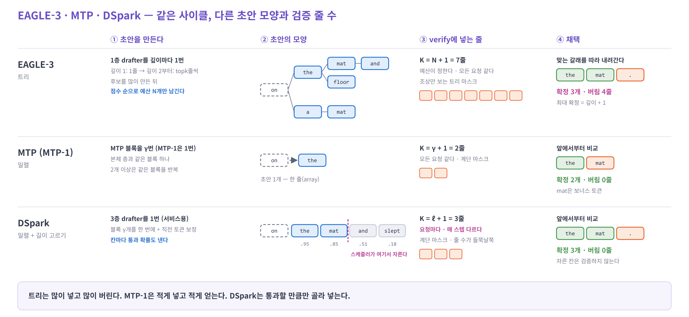
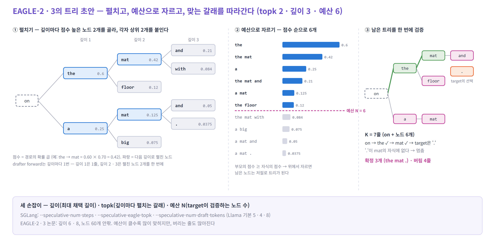
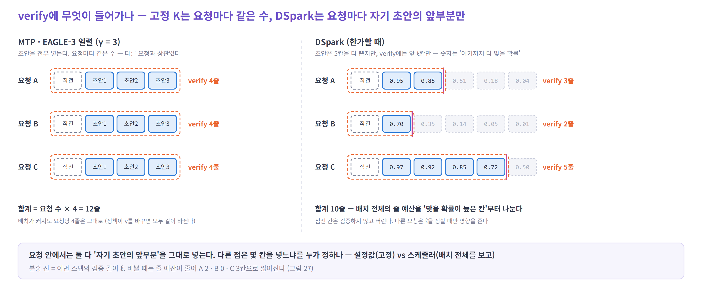
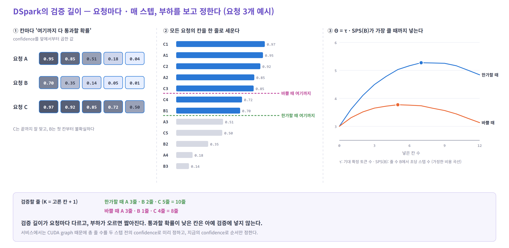

# 05. EAGLE-3 · MTP · DSpark — 단계별로 나란히

> 세 방법은 같은 사이클(초안 → verify → 채택 → 정리)을 돈다. 다른 것은 네 가지다.
> **초안을 몇 개 만드나 · 어떤 모양인가(트리 / 일렬) · target에 몇 줄을 넣나 · 그 길이를 누가 정하나.**

예시는 그대로다 — 마지막 확정 토큰 `on`, target은 `on` 다음에 `the mat .`을 고른다.

| 순서 | 내용 |
|---|---|
| 1 | 한눈에 — 단계별 비교 |
| 2 | EAGLE-3 — 트리를 키우고, 예산으로 자른다 |
| 3 | MTP — 한 줄로, 짧게 |
| 4 | DSpark — 블록을 한 번에 뽑고, 요청마다 검증 길이를 고른다 |
| 5 | 같은 예시로 비교 · 시뮬레이터에 넣을 때 |

---

## 1. 한눈에 — 단계별 비교



- **② 초안의 모양** — EAGLE-3는 **트리**(한 자리에 후보 여럿), MTP와 DSpark는 **일렬**(array)이다
- **③ verify에 넣는 줄** — 셋이 다 다르다. EAGLE-3는 **예산**(설정값)만큼, MTP는 `γ + 1`, DSpark는 **요청마다 스케줄러가 정한 만큼**이다
- **④ 채택** — 같은 3개를 얻으려고 EAGLE-3는 7줄을 넣고 4줄을 버렸다. DSpark는 3줄을 넣고 하나도 버리지 않았다

| 단계 | EAGLE-3 | MTP | DSpark |
|---|---|---|---|
| drafter | decoder 1층 + 작은 head (어휘 3.2만) | 본체와 같은 블록 1개 + target head | MoE 3층 (서비스용) + 보정 head + confidence head |
| drafter forward | 깊이 `d`번 — 첫 번은 직전에 확정된 `a + 1`줄, 이후 `topk`줄 | `γ`번 (MTP-1은 1번) — 첫 번은 `a + 1`줄 | 새 문맥 `a + 1`줄 투영 + 블록 **1번** + 칸마다 아주 싼 보정 |
| 만드는 후보 | `topk + (d − 1) · topk²`개 → 예산 `N`개만 남김 | `γ`개 | `γ`개 (서비스 최대 5) → 앞 `ℓ_r`개만 검증 |
| 초안 모양 | **트리** | 일렬 | 일렬 + 칸별 통과 확률 |
| verify 줄 `K` | `N + 1` — 모든 요청 같다 | `γ + 1` — 모든 요청 같다 (MTP-1은 2) | **`ℓ_r + 1` — 요청 · 스텝마다 다르다** |
| attention 가림 | 조상만 보는 트리 마스크 | 계단 | 계단 (요청마다 길이가 다르다) |
| 채택 | 뿌리부터 맞는 갈래를 따라간다 | 앞에서부터 | 앞에서부터 |
| 최대 확정 | 깊이 + 1 | `γ + 1` | `ℓ_r + 1` |
| 버리는 줄 | `N − a` | `γ − a` | `ℓ_r − a` |
| 길이를 정하는 것 | 설정값 (깊이 · topk · 예산) | 설정값 (`γ`) | **스케줄러** (confidence + 부하) |

---

## 2. EAGLE-3 — 트리를 키우고, 예산으로 자른다

*EAGLE-2(2024)의 동적 트리를 EAGLE-3(2025)가 이어 쓴다*



**① 펼치기 — 깊이마다 drafter를 한 번 돌린다**

- 깊이 1: `on`에서 상위 `topk`개(`the` 0.60, `a` 0.25)를 낸다
- 깊이 2: 지금까지 **점수가 높은 노드 `topk`개**(`the`, `a`)를 한꺼번에 넣어, 각자 상위 `topk`개를 붙인다
- 깊이 3: 다시 점수 상위 `topk`개(`the mat` 0.42, `a mat` 0.125)만 펼친다
- 점수는 **경로의 확률 곱**이다. drafter forward는 깊이 수만큼이고, 한 번에 `topk`줄을 함께 넣는다

**② 예산으로 자르기 — target에 넣을 노드 수를 정한다**

- 펼친 후보 10개를 점수 순으로 세워 위에서 **`N` = 6개**만 남긴다
- 자식의 점수는 항상 부모보다 낮다(확률을 곱하니까). 그래서 위에서 자르면 남은 노드가 저절로 트리가 된다

**③ 검증 — 뿌리 + 노드 6개 = 7줄을 한 번에**

- 노드를 한 줄로 펴서 target에 넣고, 각 노드가 **자기 조상만 보게** 가린다

**④ 채택 — 맞는 갈래를 따라 내려간다**

- `on` → `the` ✓ → `mat` ✓ → target은 `.`을 골랐는데 `mat`의 자식에는 `and`뿐이다 → 멈춘다
- 확정 3개(`the mat .`), 버림 4줄. **최대로 채택할 수 있는 길이는 깊이(3)까지**다 — 노드가 6개여도 그렇다

**⑤ 정리** — 채택 경로의 줄은 흩어져 있다. 그 KV를 연속 위치로 옮기거나(EAGLE 공식 구현) 자리 표를 고친다.

> **넓게 넣어 많이 맞히는 대신, 많이 버린다.** 남는 연산이 많은 배치 1에서 가장 유리하다. 배치가 크면 예산을 줄이거나 일렬(`topk = 1`)로 간다.

<details>
<summary>자세히 — 엔진 매개변수와 일렬 모드</summary>

| 손잡이 | 뜻 | SGLang | Llama 기본 | 다른 모델 기본 | EAGLE 논문 |
|---|---|---|---|---|---|
| 깊이 `d` | 최대 채택 길이 | `--speculative-num-steps` | 5 | 3 | 6 (EAGLE-3 8) |
| `topk` | 깊이마다 펼치는 갈래 | `--speculative-eagle-topk` | 4 | 1 | 10 |
| 예산 | target이 검증하는 줄 수 | `--speculative-num-draft-tokens` | 8 | 4 | 노드 60개 안팎 |

- SGLang의 `num-draft-tokens`는 뿌리를 포함한 `K`다. `topk = 1`이면 일렬이 되고 `K = 깊이 + 1`로 맞춰진다
- SGLang의 새 엔진(Spec V2)과 vLLM의 기본 경로는 일렬만 받는다
- 비용: drafter 한 번 = decoder 1층 + 작은 head, `topk`줄. 이것을 깊이 수만큼. verify는 `K`줄
- 샘플링(temperature > 0)이면 한 자리의 형제 후보를 차례로 시도하는 거부 샘플링을 쓴다. 시뮬레이터에서는 같은 설정(깊이 · topk · 예산)에서 보고된 `τ`를 쓰는 편이 간단하다

</details>

---

## 3. MTP — 한 줄로, 짧게

*2024 · DeepSeek-V3 · 본 학습 때 붙은 모듈을 drafter로 쓴다*

**① 초안** — MTP 블록(본체와 같은 층 하나)과 target의 head로 1개를 낸다. 2개 이상이 필요하면 같은 블록을 반복한다.

**② 모양** — 일렬. 예시에서 `on` → `the`.

**③ 검증** — `K = γ + 1`. DeepSeek의 **MTP-1은 요청마다 2줄로 고정**이다.

**④ 채택** — 앞에서부터. MTP-1이면 결과는 둘 중 하나다.

| 결과 | 확률 (DeepSeek-V3) | 확정 |
|---|---|---|
| 초안이 맞다 | 0.85 ~ 0.90 | 2개 (초안 + 보너스) |
| 초안이 틀렸다 | 0.10 ~ 0.15 | 1개 (target의 토큰) |

**⑤ 정리** — 버리는 줄이 최대 1줄이다. 길이 값만 되돌리면 된다.

> **적게 넣고 적게 얻는다.** 버리는 일이 거의 없지만 한 사이클에 최대 2개라 `τ`의 천장이 낮다. 초안을 늘리려고 블록을 반복하면 뒤 자리가 약해진다(학습 때 없던 쓰임).

<details>
<summary>자세히 — 비용과 변형</summary>

- drafter 한 스텝 = 본체 층 하나(V3: MLA + MoE) + 출력 head(어휘 전체). 배치 1에서 target 한 스텝의 약 4.4%다
- `γ` > 1: vLLM · SGLang 모두 같은 블록을 반복한다. vLLM-Ascend 문서는 DeepSeek MTP로 3개 이상은 보장하지 않는다고 적는다. FastMTP는 반복용으로 미세조정한다. Qwen3.5 비교(SGLang 블로그)는 7스텝으로 돌렸다
- SGLang에서는 MTP도 EAGLE 경로를 타므로 `topk` > 1로 트리를 만들 수도 있다

</details>

---

## 4. DSpark — 블록을 한 번에 뽑고, 요청마다 검증 길이를 고른다

*2026.07 · DeepSeek-AI · DFlash 위에 두 가지를 더했다*

DSpark에는 다른 두 방법에 없는 단계가 둘 있다. **칸마다 통과 확률을 내는 것**, 그리고 **그 확률로 요청마다 검증 길이를 정하는 것**이다.

**먼저 구분하자 — 요청 안과 배치**

- **요청 안에서 보면 다른 방법과 같다.** 자기 초안을 앞에서부터 넣고, 앞에서부터 비교한다. 다른 요청의 토큰과 섞이지 않는다
- 다른 점은 하나다. drafter는 매번 5칸을 뽑지만, **verify에는 앞 `ℓ_r`칸만** 넣는다. 나머지는 검증하지 않고 버린다
- **`ℓ_r`을 정할 때만 배치를 본다.** verify 비용은 배치 전체의 줄 수로 정해진다. 그래서 그 줄을 맞을 확률이 높은 칸에 먼저 준다



**① 초안 — forward 1번에 블록 전체**

- drafter(서비스용 MoE 3층, 최근 128토큰만 보는 attention)에 `on` + 빈칸을 넣어 `γ`칸(서비스 최대 5)을 한 번에 낸다

**② 보정 — 왼쪽부터 한 칸씩, 직전 토큰을 보고 고친다**

- 빈칸을 동시에 채우면 "New Francisco" 같은 조합이 나온다. 그래서 실제로 뽑힌 직전 토큰으로 다음 칸의 점수를 고친다
- 순차지만 층을 도는 게 아니라 **표에서 한 줄 꺼내 작은 곱 한 번**이다. 사이클이 1% 남짓 늘 뿐이다

**③ 통과 확률 — 칸마다 "여기까지 다 통과할 확률"**

- confidence head가 칸마다 "앞이 다 맞았다면 이 칸이 맞을 확률" `c_k`를 낸다. 그대로 쓰면 과신해서 보정을 한 번 거친다
- 앞에서부터 곱하면 **생존 확률**이다 — 요청 A라면 0.95 → 0.85 → 0.51 → 0.18 → 0.04



**④ 스케줄 — 배치 전체를 보고 검증 길이를 정한다**

- 그림 ②: **배치의 모든 요청**의 칸을 생존 확률 순으로 한 줄로 세운다
- 그림 ③: 위에서부터 하나씩 넣으며 **Θ = τ · SPS(B)** 를 계산한다. τ는 기대 확정 토큰 수, SPS(B)는 줄 수 `B`에서 엔진이 초당 도는 스텝 수다. 넣을수록 τ는 늘지만 `B`가 커져 SPS가 떨어진다. **곱이 가장 클 때** 멈춘다
- 그 결과 요청마다 검증 길이 `ℓ_r`이 다르다. 한가할 때는 A 2칸 · B 1칸 · C 4칸, 바쁠 때는 A 2칸 · B 0칸 · C 3칸이다

**⑤ 검증 — 요청마다 다른 줄 수를 한 배치로**

- 요청마다 `ℓ_r + 1`줄 — 한가할 때 3 · 2 · 5 = 10줄, 바쁠 때 3 · 1 · 4 = 8줄
- 줄 수가 들쭉날쭉한(ragged) 배치다. 토큰을 펼쳐 한 줄로 처리하고, 요청 경계는 마스크로 나눈다

**⑥ 채택 · 정리** — 앞에서부터 비교한다. 통과 확률이 낮은 칸은 **애초에 넣지 않았으니** 버리는 줄이 적다.

> **"몇 개를 검증할까"가 설정값이 아니라 매 스텝의 결정이다.** 한가하면 길게, 바쁘면 짧게, 잘 맞는 요청은 길게, 불확실한 요청은 짧게.

📌 DeepSeek-V4 서비스에서 MTP-1(요청당 2줄 고정) 대비, 같은 처리량에서 사용자당 생성 속도 **V4-Flash +60 ~ 85%, V4-Pro +57 ~ 78%**. 중간 부하에서 요청당 약 4 ~ 6줄을 검증했다.

<details>
<summary>자세히 — 식과 서비스 세부</summary>

```
보정:        로짓_k += W1[x_(k−1)] · W2                 W1 : V × r,  W2 : r × V,  r = 256
confidence:  c_k = σ( wᵀ [ h_k ; W1[x_(k−1)] ] )        학습 목표 c_k* = 1 − ½ ‖p_draft − p_target‖₁
생존 확률:   a_(r,j) = c_(r,1) × … × c_(r,j)
배치 줄 수:  B = Σ_r (1 + ℓ_r)
기대 확정:   τ = Σ_r (1 + Σ_(j ≤ ℓ_r) a_(r,j))
목표:        Θ = τ · SPS(B)        SPS(B)는 엔진을 켤 때 한 번 재 둔 표
```

- 그림 27의 SPS는 설명용으로 가정한 비용 곡선이다 (줄 하나에 스텝 시간 +10% · +20%)
- **CUDA graph** 때문에 다음 스텝의 배치 크기를 미리 알아야 한다. 그래서 서비스에서는 **두 스텝 전의 confidence**로 총 줄 수를 정하고, 지금의 confidence로 어느 칸을 넣을지 고른다
- confidence 보정은 왼쪽부터 칸마다 온도를 하나씩 맞추는 방식(Sequential Temperature Scaling)이다. 보정 오차를 3 ~ 8%에서 약 1%로 줄였다
- 오프라인 실험(초안 7개, 5층 drafter, 스케줄러 끔)의 `τ`: Qwen3-4B GSM8K EAGLE-3 5.14 · DFlash 5.40 · DSpark 6.11
- vLLM의 "Adaptive Verification"이 이 검증 길이 조절이고, 현재 DSpark만 지원한다

</details>

---

## 5. 같은 예시로 비교 · 시뮬레이터에 넣을 때

| | EAGLE-3 (topk 2 · 깊이 3 · 예산 6) | MTP-1 | DSpark (요청 A, 한가할 때) |
|---|---|---|---|
| drafter forward | 3번 (1줄 · 2줄 · 2줄) | 1번 | 1번 + 보정 4칸 |
| verify 줄 | 7 | 2 | 3 |
| 확정 | 3 (`the mat .`) | 2 (`the mat`) | 3 (`the mat .`) |
| 버림 | 4 | 0 | 0 |

**시뮬레이터에 넣을 때**

| | draft 비용 (사이클당) | verify 줄 `K` | 채택 모형 | 따로 둘 상태 |
|---|---|---|---|---|
| EAGLE-3 트리 | 첫 패스 (`a + 1`줄) + (깊이 − 1) × (1층 + 작은 head, `topk`줄) | 예산 + 1 (고정) | 같은 설정에서 보고된 `τ` · 최대 깊이 + 1 | 트리 마스크 · 흩어진 채택 경로 |
| EAGLE-3 일렬 | 첫 패스 (`a + 1`줄) + (`γ` − 1) × (1층 + 작은 head, 1줄) | `γ + 1` | 자리별 `α_k` | — |
| MTP | 첫 패스 (`a + 1`줄) + (`γ` − 1) × (target 층 1개 + 전체 head) | `γ + 1` (MTP-1은 2) | `α` (V3: 0.85 ~ 0.90) | — |
| DSpark | 문맥 투영 (`a + 1`줄) + 1 × (`L`층, `γ + 1`줄) + `γ` × (작은 보정) | **요청마다 `ℓ_r + 1`** — 스케줄러가 정한다 | 자리별 `α_k` + confidence 오차 | SPS 표 · 두 스텝 전 confidence |

- `a`는 **직전 사이클**의 채택 수다. 첫 패스 · 문맥 투영은 지난 사이클에 확정된 자리를 진짜 hidden으로 drafter에 넣는 단계라, 줄 수가 채택에 따라 바뀐다 ([04의 4.2](04-simulator.md#42-drafter--조합별-op-목록))
- DSpark를 흉내 내려면 시뮬레이터 안에서 스케줄러를 돌린다. `SPS(B)`는 시뮬레이터가 스스로 계산할 수 있다 (줄 수 `B`일 때 스텝 시간의 역수)
- 채택은 진짜 `α`로 뽑고, confidence는 그와 따로 만든다(과신 치우침 + 요청을 구별하는 정확도). 그래야 "과신해서 길게 넣는" 손해까지 재현된다. 논문의 보정 오차 약 1%는 ECE라서 개별 예측의 잡음 크기가 아니다 ([06의 5번](06-sim-realism.md#5-k-정책--몇-줄을-검증할지-누가-정하나))
- 사이클마다의 채택 분포, 요청마다의 차이, 출력 구간에 따른 변화는 → [06 e2e 시뮬레이터 구현 포인트](06-sim-realism.md)

---

## 참고

- [EAGLE-2](https://arxiv.org/abs/2406.16858) — 동적 트리 (펼치기 · 재정렬) · [EAGLE-3](https://arxiv.org/abs/2503.01840)
- [SGLang — Speculative Decoding](https://docs.sglang.io/docs/advanced_features/speculative_decoding) — 깊이 · topk · 예산 매개변수와 기본값
- [DeepSeek-V3 Technical Report](https://arxiv.org/abs/2412.19437) — MTP 모듈, 두 번째 토큰 채택률
- [DSpark](https://arxiv.org/abs/2607.05147) — 마르코프 head, confidence head, `Θ = τ · SPS(B)` 스케줄러, 서비스 결과
- [vLLM — Speculative Decoding](https://docs.vllm.ai/en/latest/features/speculative_decoding/) — Adaptive Verification
