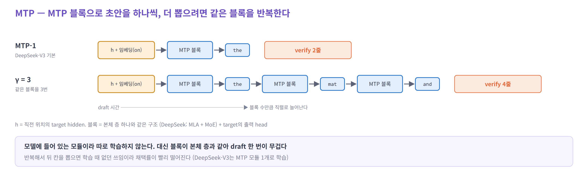

# 05. EAGLE-3 · MTP · DSpark — 무엇이 다른가

> 세 방법은 같은 사이클(초안 → verify → 채택)을 돈다. 세 가지 기준으로 나란히 본다.
> **① 초안을 어떻게 만드나 → ② target에 얼마나 넣나 → ③ 그래서 시뮬레이터에서 무엇을 다르게 세나**
>
> 이번 그림의 설정: **EAGLE-3 트리**(topk 2 · 깊이 3 · 예산 6) · **MTP-1** · **DSpark adaptive**(스케줄러 켬, 한가할 때).
> 예시: 직전 확정 토큰 `on`, target의 답은 `the mat .`

| 순서 | 내용 |
|---|---|
| 1 | 한눈에 |
| 2 | EAGLE-3 — 트리를 펼치고, 예산만큼 검증한다 |
| 3 | MTP — MTP 블록으로 하나씩 |
| 4 | DSpark — 블록을 한 번에 뽑고, 요청마다 검증 길이를 고른다 |
| 5 | 정리 — 시뮬레이터에 넣을 때 |
| 부록 | 엔진 설정 · 식 · 서비스 세부 |

---

## 1. 한눈에


**① 초안을 어떻게 만드나**

- **EAGLE-3** — 얇은 drafter를 깊이마다 한 번 돌린다. 깊이 1에서 `on` 뒤에 상위 2개(`the`, `a`)를 붙이고, 깊이 2 · 3에서는 **지금까지 점수가 높은 노드 2개만** 골라 각자 상위 2개를 붙인다. 다 펼치면 후보가 10개 — 그중 점수 순으로 **6개만 남긴다**(예산)
- **MTP** — MTP 블록으로 한 개씩 만든다. MTP-1은 `the` 하나
- **DSpark** — 블록을 한 번에 계산해 5칸을 내고, 직전 토큰을 보고 가볍게 고친다. 칸마다 "여기까지 맞을 확률"도 낸다

**② target에 얼마나 넣나** — 언제나 "직전 확정 토큰 1줄 + 초안 줄"이다. 다른 것은 초안 줄의 수다.

- **EAGLE-3** — 남긴 노드 6개 + 1 = **7줄**. 트리를 한 줄로 펴서 넣고, 각 노드가 자기 조상만 보게 가린다. 맞는 갈래를 따라 `the` ✓ `mat` ✓ 다음 답 `.`이 트리에 없어 멈춘다 → 확정 3 · 버림 4
- **MTP-1** — 초안 1 + 1 = **2줄**. `the` ✓ + 보너스 → 확정 2 · 버림 0
- **DSpark** — 5칸 중 스케줄러가 고른 앞 2칸 + 1 = **3줄**. 확정 3 · 버림 0. 몇 칸을 넣을지는 요청마다 · 스텝마다 다르다

**③ 시뮬레이터에서 다르게 셀 것**

| | 한 문장 |
|---|---|
| EAGLE-3 | 검증 줄(노드 수 + 1)과 최대 채택(깊이)을 따로 센다 |
| MTP | 초안을 늘리면 draft가 블록 수만큼 직렬로 길어진다 |
| DSpark | 생성 길이와 검증 길이를 따로 세고, 검증 길이는 스케줄러가 스텝마다 정한다 |

---

## 2. EAGLE-3 — 트리를 펼치고, 예산만큼 검증한다

*이번 설정: 트리 (topk 2 · 깊이 3 · 예산 6)*


**① 초안을 어떻게 만드나** — 얇은 drafter(decoder 1층 + 작은 head)를 깊이마다 1번 돌린다. 깊이마다 **점수(경로의 확률 곱)가 높은 노드 topk개**를 골라 각자 상위 topk개를 붙인다. 다 펼친 뒤 점수 순으로 **예산 N개만** 남긴다. 자식의 점수는 부모보다 낮으니, 위에서 자르면 남은 노드가 저절로 트리가 된다.

**② target에 얼마나 넣나** — 노드 N개 + 1 = **N + 1줄**, 모든 요청이 같다. 각 노드는 자기 조상만 본다(트리 마스크). 맞는 갈래를 따라 내려가며 채택하므로 최대 확정은 **깊이 + 1**개다 — 노드가 6개여도 3 + 1 = 4개까지.

**EAGLE만 특이한 점** — 셋 중 트리를 쓰는 것은 EAGLE뿐이다. 채택된 경로의 KV가 흩어져 있어 연속 위치로 옮기는 정리가 필요하다. `topk = 1`로 두면 일렬이 되고, 그때는 MTP와 같은 틀(초안 수 + 1줄)이다.

**③ 시뮬레이터에서 다르게 셀 것** — 검증 줄(노드 수 + 1)과 최대 채택(깊이)을 따로 센다. 트리를 넓히면 채택 기회와 함께 검증 비용 · KV 사용량이 는다.

---

## 3. MTP — MTP 블록으로 하나씩

*이번 설정: MTP-1 (DeepSeek-V3)*



**① 초안을 어떻게 만드나** — 본체 층과 같은 MTP 블록 + target의 출력 head로 하나씩 만든다. 입력은 직전 위치의 target hidden과 토큰 임베딩이다. MTP-1은 1개, 더 뽑으려면 같은 블록을 반복한다.

**② target에 얼마나 넣나** — 초안 수 + 1줄, 모든 요청이 같다. MTP-1은 **2줄**이고 결과는 둘 중 하나다 — 맞으면 2개 확정(DeepSeek-V3 0.85 ~ 0.90), 틀리면 1개.

**MTP만 특이한 점** — 모델에 들어 있는 모듈이라 따로 학습하지 않는다. 대신 블록이 본체 층과 같아(DeepSeek: MLA + MoE) draft 한 번이 무겁다 — 배치 1에서 target 한 스텝의 약 4.4%.

**③ 시뮬레이터에서 다르게 셀 것** — 초안을 늘리면 draft가 블록 수만큼 직렬로 길어지고(`γ` × 블록), 뒤 칸 채택률이 빨리 떨어진다.

---

## 4. DSpark — 블록을 한 번에 뽑고, 요청마다 검증 길이를 고른다

*이번 설정: adaptive (스케줄러 켬), 한가할 때*


**① 초안을 어떻게 만드나** — 블록 drafter(서비스용 MoE 3층)를 한 번 돌려 5칸을 낸 뒤, 직전 토큰을 보고 왼쪽부터 가볍게 고친다(표 조회 + 작은 곱). 칸마다 "여기까지 맞을 확률"(confidence)도 낸다.

**② target에 얼마나 넣나** — 뽑은 5칸 중 **요청별 앞 `ℓ_r`칸만** + 1줄. `ℓ_r`은 스케줄러가 배치 전체를 보고 정한다 — 맞을 확률이 높은 칸부터 줄을 나눠 주고, 부하가 크면 짧게 한다. 요청 안에서는 다른 방법처럼 앞에서부터 비교한다. 자른 칸은 검증하지 않고 버린다.

**DSpark만 특이한 점** — 검증 길이를 정하는 단계(스케줄러)가 있는 것은 DSpark뿐이다. 서비스에서는 CUDA graph 때문에 총 줄 수를 2스텝 전 confidence로 미리 정한다.

**③ 시뮬레이터에서 다르게 셀 것** — 생성 길이(5칸)와 검증 길이(`ℓ_r`)를 따로 세고, 검증 길이는 부하 · confidence에 따라 스텝마다 바뀐다 — 시뮬레이터 안에서 스케줄러를 돌린다.

📌 DeepSeek-V4 서비스에서 MTP-1(요청당 2줄 고정) 대비, 같은 처리량에서 사용자당 생성 속도 V4-Flash +60 ~ 85%, V4-Pro +57 ~ 78%. 중간 부하에서 요청당 약 4 ~ 6줄을 검증했다.

---

## 5. 정리 — 시뮬레이터에 넣을 때

| | draft 비용 (스텝당) | verify 줄 | 최대 채택 | 따로 둘 것 |
|---|---|---|---|---|
| EAGLE-3 트리 | 갱신 패스 + (깊이 − 1) × `topk`줄 | 예산 + 1 | 깊이 `d` | 트리 마스크 · 채택 경로 정리 |
| EAGLE-3 일렬 | 갱신 패스 + (`γ` − 1) × 1줄 | `γ + 1` | `γ` | — |
| MTP | 갱신 패스 + (`γ` − 1) × 블록 | `γ + 1` (MTP-1은 2) | `γ` | — |
| DSpark | 투영 + 블록 1번 + 보정 | 요청마다 `ℓ_r + 1` | `ℓ_r` | 스케줄러 · 2스텝 전 confidence |

- 갱신 패스 · 투영 = 직전에 확정된 `a + 1`줄을 drafter에 넣는 패스. 줄 수가 직전 채택에 따라 바뀐다 → [06의 3번](06-sim-realism.md#3-draft-비용--drafter가-초안을-만드는-시간)
- 채택 모형은 셋 다 같은 틀이고 `α` 곡선 모양만 다르다 → [06의 1번](06-sim-realism.md#1-채택-모형--초안-중-몇-개가-맞나)

---

## 부록 — 엔진 설정 · 식 · 서비스 세부

<details>
<summary>EAGLE — 엔진 매개변수와 일렬 모드</summary>

| 손잡이 | 뜻 | SGLang | Llama 기본 | 다른 모델 기본 | EAGLE 논문 |
|---|---|---|---|---|---|
| 깊이 `d` | 최대 채택 길이 | `--speculative-num-steps` | 5 | 3 | 6 (EAGLE-3 8) |
| `topk` | 깊이마다 펼치는 갈래 | `--speculative-eagle-topk` | 4 | 1 | 10 |
| 예산 | target이 검증하는 줄 수 | `--speculative-num-draft-tokens` | 8 | 4 | 노드 60개 안팎 |

- SGLang의 `num-draft-tokens`는 뿌리를 포함한 `K`다. `topk = 1`이면 일렬이 되고 `K = 깊이 + 1`로 맞춰진다
- SGLang의 새 엔진(Spec V2)과 vLLM의 기본 경로는 일렬만 받는다
- 샘플링(temperature > 0)이면 한 자리의 형제 후보를 차례로 시도하는 거부 샘플링을 쓴다. 시뮬레이터에서는 같은 설정의 결과 분포를 쓰는 편이 간단하다
- EAGLE-2(2024)의 동적 트리를 EAGLE-3(2025)가 이어 쓴다. EAGLE-3 drafter의 어휘는 3.2만이다

</details>

<details>
<summary>MTP — 비용과 변형</summary>

- drafter 한 스텝 = 본체 층 하나(V3: MLA + MoE) + 출력 head(어휘 전체)
- `γ` > 1: vLLM · SGLang 모두 같은 블록을 반복한다. vLLM-Ascend 문서는 DeepSeek MTP로 3개 이상은 보장하지 않는다고 적는다. FastMTP는 반복용으로 미세조정한다. Qwen3.5 비교(SGLang 블로그)는 7스텝으로 돌렸다
- SGLang에서는 MTP도 EAGLE 경로를 타므로 `topk` > 1로 트리를 만들 수도 있다

</details>

<details>
<summary>DSpark — 검증 길이를 고르는 방법</summary>


- 칸마다 confidence `c_k`를 앞에서부터 곱한 것이 생존 확률이다 — 요청 A라면 0.95 → 0.85 → 0.51 → 0.18 → 0.04
- **배치의 모든 요청**의 칸을 생존 확률 순으로 한 줄로 세우고, 위에서부터 하나씩 넣으며 `Θ = τ · SPS(B)`를 계산한다. `τ`는 기대 확정 토큰 수, `SPS(B)`는 줄 수 `B`에서 엔진이 초당 도는 스텝 수다. 곱이 가장 클 때 멈춘다
- 결과: 한가할 때 A 2칸 · B 1칸 · C 4칸(10줄), 바쁠 때 A 2칸 · B 0칸 · C 3칸(8줄)

```
보정:        로짓_k += W1[x_(k−1)] · W2                 W1 : V × r,  W2 : r × V,  r = 256
confidence:  c_k = σ( wᵀ [ h_k ; W1[x_(k−1)] ] )        학습 목표 c_k* = 1 − ½ ‖p_draft − p_target‖₁
생존 확률:   a_(r,j) = c_(r,1) × … × c_(r,j)
배치 줄 수:  B = Σ_r (1 + ℓ_r)
기대 확정:   τ = Σ_r (1 + Σ_(j ≤ ℓ_r) a_(r,j))
목표:        Θ = τ · SPS(B)        SPS(B)는 엔진을 켤 때 한 번 재 둔 표
```

- 그림 27의 SPS는 설명용으로 가정한 비용 곡선이다 (줄 하나에 스텝 시간 +10% · +20%)
- confidence 보정은 왼쪽부터 칸마다 온도를 하나씩 맞추는 방식(Sequential Temperature Scaling)이다. 보정 오차(ECE)를 3 ~ 8%에서 약 1%로 줄였다
- 오프라인 실험(초안 7개, 5층 drafter, 스케줄러 끔)의 `τ`: Qwen3-4B GSM8K EAGLE-3 5.14 · DFlash 5.40 · DSpark 6.11
- vLLM의 "Adaptive Verification"이 이 검증 길이 조절이고, 현재 DSpark만 지원한다

</details>

<details>
<summary>자세한 비교 표</summary>

| 단계 | EAGLE-3 | MTP | DSpark |
|---|---|---|---|
| drafter | decoder 1층 + 작은 head (어휘 3.2만) | 본체와 같은 블록 1개 + target head | MoE 3층 (서비스용) + 보정 head + confidence head |
| drafter forward | 깊이 `d`번 — 첫 번은 직전에 확정된 `a + 1`줄, 이후 `topk`줄 | `γ`번 (MTP-1은 1번) — 첫 번은 `a + 1`줄 | 새 문맥 `a + 1`줄 투영 + 블록 1번 + 칸마다 아주 싼 보정 |
| 만드는 후보 | `topk + (d − 1) · topk²`개 → 예산 `N`개만 남김 | `γ`개 | `γ`개 (서비스 최대 5) → 앞 `ℓ_r`개만 검증 |
| 초안 모양 | 트리 | 일렬 | 일렬 + 칸별 통과 확률 |
| verify 줄 `K` | `N + 1` — 모든 요청 같다 | `γ + 1` — 모든 요청 같다 | `ℓ_r + 1` — 요청 · 스텝마다 다르다 |
| attention 가림 | 조상만 보는 트리 마스크 | 계단 | 계단 (요청마다 길이가 다르다) |
| 채택 | 뿌리부터 맞는 갈래를 따라간다 | 앞에서부터 | 앞에서부터 |
| 최대 확정 | 깊이 + 1 | `γ + 1` | `ℓ_r + 1` |
| 버리는 줄 | `N − a` | `γ − a` | `ℓ_r − a` |
| 길이를 정하는 것 | 설정값 (깊이 · topk · 예산) | 설정값 (`γ`) | 스케줄러 (confidence + 부하) |

</details>

---

## 참고

- [EAGLE-2](https://arxiv.org/abs/2406.16858) — 동적 트리 (펼치기 · 재정렬) · [EAGLE-3](https://arxiv.org/abs/2503.01840)
- [SGLang — Speculative Decoding](https://docs.sglang.io/docs/advanced_features/speculative_decoding) — 깊이 · topk · 예산 매개변수와 기본값
- [DeepSeek-V3 Technical Report](https://arxiv.org/abs/2412.19437) — MTP 모듈, 두 번째 토큰 채택률
- [DSpark](https://arxiv.org/abs/2607.05147) — 마르코프 head, confidence head, `Θ = τ · SPS(B)` 스케줄러, 서비스 결과
- [vLLM — Speculative Decoding](https://docs.vllm.ai/en/latest/features/speculative_decoding/) — Adaptive Verification
