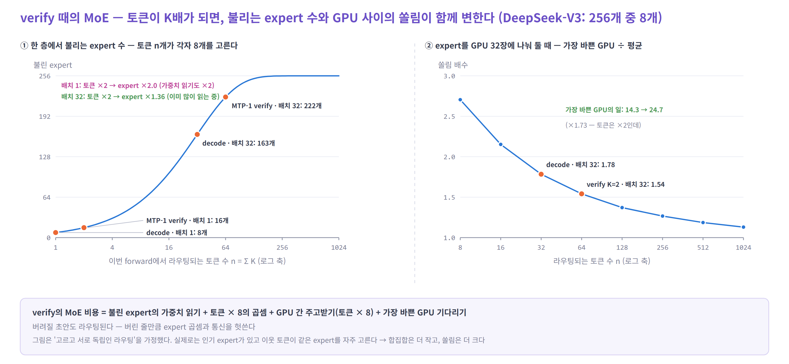

# 06. 시뮬레이터의 현실성 — 평균 하나로는 안 보이는 것

> [04](04-simulator.md)는 평균 `α`, 고정 `γ`, 평균 비용으로 사이클을 셌다. 실제 서빙은 **사이클마다 · 요청마다 · 시간에 따라** 흔들린다.
> 이 장은 그 흔들림을 **어떤 손잡이(매개변수)로** 넣을지 정리한다. 손잡이는 마지막에 [표 하나](#8-손잡이-한곳에)로 모았다.

| 순서 | 내용 |
|---|---|
| 1 | 왜 평균으로는 부족한가 |
| 2 | 채택을 분포로 — 사이클 · 자리 · 요청 · 시간 |
| 3 | 샘플링 방식 — 무엇이 채택 확률을 정하나 |
| 4 | 시간 축 — 컨텍스트 · 부하 · `γ` 정책 · 끝날 때 |
| 5 | 엔진이 만드는 계단 — CUDA graph · host · KV 여유 |
| 6 | verify 때의 MoE 라우팅 |
| 7 | 그 밖에 |
| 8 | 손잡이 한곳에 |
| 9 | 의사 코드와 맞추는 법 |

---

## 1. 왜 평균으로는 부족한가


왼쪽 두 부하는 평균 `τ`가 거의 같다(3.36 vs 3.32). 그래도 결과는 다르다.

- **사용자마다 체감이 다르다** — 오른쪽 부하에서는 반은 사이클당 4.5개, 반은 2.1개를 받는다. 같은 평균인데 한쪽 사용자는 두 배 느리다
- **비용이 줄 수에 대해 곧지 않다** — CUDA graph 크기로 올림, expert 합집합, 타일 경계. 평균 줄 수의 비용 ≠ 비용의 평균이다
- **정책이 순간값에 반응한다** — 채택 길이를 보고 `γ`를 바꾸는 엔진, 요청별로 검증 길이를 고르는 DSpark는 그 순간의 값으로 움직인다
- **꼬리가 늦다** — 토큰 간격의 p99는 "연달아 틀리는 구간"이 정한다(오른쪽 그림의 아래 줄)

> 시뮬레이터는 `α`를 상수 하나가 아니라 **자리별 · 요청별 · 시간에 따라 변하는 값**으로 뽑는다. 평균 `τ`는 결과로 확인한다.

---

## 2. 채택을 분포로 — 사이클 · 자리 · 요청 · 시간

### 2.1 사이클 하나 — 몇 개가 확정되나 (보너스 포함)

사이클의 결과는 "처음 틀린 자리"로 정해진다. 틀려도 target이 그 자리에서 고른 토큰 1개가 나오고, 다 맞히면 다음 자리 토큰 1개가 **보너스**로 붙는다. 그래서 확정은 항상 `a + 1`개다.

```
P(a = k) = α_1 ⋯ α_k · (1 − α_(k+1))      k < γ      — k개 채택 후 틀림
P(a = γ) = α_1 ⋯ α_γ                                  — 다 맞힘, 보너스
```

| 확정 토큰 (`γ` = 4) | 1 | 2 | 3 | 4 | 5 (보너스) |
|---|---|---|---|---|---|
| 모든 요청 `α` = 0.8 | 0.20 | 0.16 | 0.13 | 0.10 | **0.41** |
| 반은 0.95, 반은 0.55 | **0.25** | 0.15 | 0.09 | 0.06 | **0.45** |

- 가장 흔한 결과가 **"다 맞힘"** 이고, 그다음이 **"첫 칸에서 틀림"** 이다. 가운데는 얇다
- 요청이 섞이면 양 끝이 더 두꺼워진다. 보너스 확률 `Π α`는 `γ`가 길수록 빨리 줄어서, 긴 `γ`에서 마지막 칸은 "거의 쓰이지 않는 줄"이 된다

📌 vLLM은 요청마다 이 분포를 그대로 낸다 — `acceptance_histogram`(정확히 `j`개 채택된 스텝 수, 길이 `γ + 1`). `detailed` 수준에서는 스텝마다의 채택 수 `per_step_accepted`도 순서대로 준다. 실제 기록에서 아래 손잡이를 맞출 때 쓴다.

<details>
<summary>자세히 — 조건부 · 무조건 채택률</summary>

- `α_k`는 **조건부**다 — "앞이 다 맞았을 때 k번째가 맞을 확률"
- 엔진과 논문이 "k번째 자리의 채택률"이라고 할 때는 **무조건** 값인 경우가 많다 — `r_k = P(a ≥ k) = α_1 ⋯ α_k`. 그래서 항상 줄어든다
- 바꾸는 법: `α_k = r_k / r_(k−1)`, `r_0 = 1`. `τ = 1 + r_1 + … + r_γ`
- vLLM의 `synthetic_acceptance_rates`는 무조건 값을 받는다 (길이 `γ`, 줄어드는 값만 허용)

</details>

### 2.2 자리마다 — 곡선의 모양

[04의 5절](04-simulator.md#5-채택-모형--평균-몇-개가-맞나)에서 본 대로다.

- **순차 drafter**(EAGLE-3, MTP 반복)는 대체로 평평하다
- **병렬 drafter**(DFlash)는 첫 자리가 높고 뒤로 떨어진다 → `α_k = α_1 · ρ^(k−1)`
- **DSpark**는 이 곡선을 펴는 것이 목적이다. 그리고 곡선을 **요청마다 스스로 추정**해서 검증 길이를 고른다([05](05-eagle3-mtp-dspark.md#4-dspark--블록을-한-번에-뽑고-요청마다-검증-길이를-고른다))
- **트리**(EAGLE 예산 > 깊이)는 한 깊이에 후보가 여럿이라 깊이별 채택률이 일렬보다 높다. 자리별로 따로 모형을 만들기보다 같은 설정(깊이 · topk · 예산)에서 보고된 `τ`를 쓴다

### 2.3 요청마다 — 분포에서 뽑는다

같은 drafter라도 작업에 따라 크게 다르다 (📌 DFlash · Qwen3-8B: MATH-500 `τ` 7.87, MT-Bench 4.24).

- **작업 혼합** — 요청에 작업 종류(코드 · 수학 · 대화 …)를 붙이고, 종류마다 `α` 곡선을 둔다
- **요청별 배율** — 같은 종류 안에서도 흩어진다. 배율을 Beta 분포에서 뽑는다

```
배율 m_r ~ Beta(μ·κ, (1 − μ)·κ)        μ: 평균,  κ: 클수록 요청끼리 비슷하다
α_(r,k) = min(1, α_k(작업) · m_r / μ)
```

- 결과로 보는 것: 평균 `τ`가 아니라 **사용자당 속도의 분포**(p10 · p50 · p90)

### 2.4 시간에 따라 — 요청 안에서 뭉친다

쉬운 구간(코드의 반복, 인용, 정해진 형식)은 연달아 잘 맞고, 어려운 구간은 연달아 틀린다. 그림 28의 아래 줄이 그 모양이다.

- **두 상태 마르코프** — 상태 "쉬움"(`α_easy`) · "어려움"(`α_hard`), 사이클마다 확률 `p_switch`로 바뀐다. 한 구간의 평균 길이는 `1 / p_switch` 사이클
- 맞추는 법: 실제 `per_step_accepted`에서 이웃 사이클끼리의 상관을 재고, 같은 상관이 나오게 `p_switch`를 고른다
- **길이에 따른 변화** — drafter는 대개 짧은 문맥(4k 미만)으로 학습한다. 문맥이 그보다 길어지면 `α`가 떨어질 수 있다(LongSpec). `α`에 `S`의 함수 `f(S)`를 곱하는 손잡이를 둔다

### 2.5 온도

- temperature가 오르면 `α`가 내려간다 — 📌 DFlash · Qwen3-8B 평균 `τ` 6.49(T = 0) → 5.48(T = 1), 약 0.84배
- 요청마다 temperature가 다르면 요청별 배율에 넣는다

---

## 3. 샘플링 방식 — 무엇이 채택 확률을 정하나

`p` = target의 분포, `q` = drafter의 분포, `x` = 초안 토큰.

| 방식 | 채택 조건 | 한 자리의 채택 확률 | 틀렸을 때 나오는 토큰 |
|---|---|---|---|
| greedy (T = 0) | `x` = `p`의 1등 | 두 모델의 1등이 같을 확률 | `p`의 1등 |
| 샘플링 · drafter도 샘플 | 난수 `u < p(x) / q(x)` | `Σ min(p, q)` = 1 − 두 분포의 차이 | `max(0, p − q)`를 정규화해 뽑는다 |
| 샘플링 · drafter는 1등만 | 난수 `u < p(x)` | `p(x)` | `p`에서 `x`를 뺀 분포에서 뽑는다 |
| 트리 (후보 여럿) | 형제 후보를 차례로 시도 | 자리마다 후보 수만큼 기회 | 마지막으로 남은 분포에서 |
| block verification | 블록 전체를 함께 판단 | 토큰별보다 낮지 않다 (논문의 증명) | — |
| 손실 허용 (Medusa typical, vLLM `fly`) | target 분포와의 일치를 포기 | 더 높다 | — |

- 💡 **시뮬레이터는 토큰을 만들지 않는다.** 샘플링 방식은 `α`의 값만 바꾼다 — temperature · top-p를 요청별 배율로, block · 손실 허용은 `α` 곡선을 올리는 것으로 넣는다
- 거부 샘플링 자체의 비용(`K × 어휘` 로짓의 softmax, 비교, 나머지 분포에서 뽑기)은 사이클마다의 고정 비용으로 넣는다

📌 **실제 엔진으로 비용 모형만 따로 맞추기** — vLLM은 `rejection_sample_method: synthetic`을 둔다. 채택을 지정한 값으로 강제한다.

- `synthetic_acceptance_rates` — 자리별 무조건 채택률 (길이 `γ`, 줄어드는 값)
- `synthetic_acceptance_length` — 평균 채택 길이 하나 (`1 ~ γ + 1`). 둘 중 하나만 쓴다
- 💡 쓰는 법: `τ`를 바꿔 가며 실제 엔진의 스텝 시간과 처리량을 재고, 시뮬레이터가 **같은 `τ`에서 같은 시간을 내는지** 본다. 채택 모형의 오차와 비용 모형의 오차를 나눠서 확인할 수 있다

---

## 4. 시간 축 — 컨텍스트 · 부하 · `γ` 정책 · 끝날 때

### 4.1 컨텍스트가 자란다

- 사이클마다 `S += a + 1`. verify attention은 `K · S`에 비례하므로 **같은 요청도 뒤로 갈수록 사이클이 길어진다**
- `τ`가 높을수록 `S`가 시간당 빨리 자란다. 긴 생성(추론 모델)에서는 끝부분의 attention이 사이클 시간을 정한다

### 4.2 부하가 출렁인다

- 도착(포아송 `λ` 또는 실제 기록) · 프롬프트 길이 · 출력 길이의 분포가 배치 크기 `B(t)`를 만든다
- `B`가 바뀌면 speculation의 이득이 바뀐다([03의 5절](03-compute-and-kv.md#5-배치를-키우면-이득은-어떻게-될까)). 시작(배치가 차오름) · 정상 · 끝(남은 요청이 적어 배치가 작음)이 서로 다르다
- 새 요청의 prefill이 같은 스텝에 섞인다. 청크 prefill을 쓰는 엔진은 **한 스텝의 토큰 예산**을 verify 줄 `Σ K`와 prefill 청크가 나눠 쓴다

### 4.3 `γ`를 바꾸는 정책 — 정책 자체를 흉내 낸다

| 정책 | 무엇을 보고 | 무엇을 바꾸나 | 손잡이 |
|---|---|---|---|
| 고정 | — | — | `γ` 또는 (깊이 · topk · 예산) |
| vLLM Dynamic SD | 동시 요청 수 | 구간별 `γ` (예: 1 ~ 64 → 3, 65 ~ 128 → 1, 129 ~ 512 → 0) | `[시작, 끝, γ]` 표 |
| SGLang adaptive | 배치 평균 채택 길이의 이동 평균 | 스텝 수 ≈ 반올림(평균) + 1 (후보 목록 안에서) | 평균의 무게 0.2 · 시작 후 10번 관찰 · 5번마다 갱신 · 오르내림 문턱 |
| DSpark | 요청별 confidence + `SPS(B)` | 요청별 검증 길이 `ℓ_r` | `SPS` 표 · 2스텝 지연 · confidence 오차 |

- 💡 반응하는 정책에는 **지연**이 있다. 2.4의 뭉침이 이동 평균보다 빠르게 바뀌면, 정책은 늘 한발 늦게 `γ`를 고른다. 이상적인 `γ`가 아니라 **정책을 그대로** 돌려야 이 손해가 보인다
- SGLang adaptive는 EAGLE · `topk = 1`에서만 켜지고, 바꾸는 것도 사이클(라운드) 사이에서만 한다
- vLLM Dynamic SD는 data parallel(`--data-parallel-size > 1`)에서는 꺼지고 고정 `γ`로 돌아간다
- DSpark의 confidence는 진짜 `α`와 다르다. 📌 보정 전 오차 3 ~ 8%, 보정 후 약 1%. confidence = 진짜 `α` + 잡음으로 고르고, 채택은 진짜 `α`로 뽑는다

### 4.4 끝날 때 — EOS와 길이 제한

- 채택된 토큰 중간에 EOS · 정지 문자열 · `max_tokens`가 오면 **그 뒤는 버린다**
- 그래서 요청의 마지막 사이클은 검증한 줄 일부를 헛쓴다. 출력이 짧은 부하일수록 비중이 크다
- 요청이 끝나는 시점이 `a + 1` 단위로 움직이므로, 배치에서 빠지는 시점도 계단처럼 움직인다

---

## 5. 엔진이 만드는 계단 — CUDA graph · host · KV 여유

### 5.1 CUDA graph — 미리 찍어 둔 크기로만 돈다

- 엔진은 decode를 몇 가지 크기로 미리 캡처해 둔다. 실제 줄 수는 **다음 캡처 크기로 올림**되고, 비용도 그 크기의 비용이다
- speculation이 있으면 한 요청이 `K`줄이라 크기의 단위가 바뀐다. DSpark처럼 요청마다 줄 수가 다르면 다음 스텝의 총 줄 수를 미리 알아야 해서, **2스텝 전의 confidence로 총 줄 수를 정한다**
- SGLang adaptive는 스텝 수 후보마다 graph를 따로 캡처해 두고 포인터만 바꾼다. 후보가 많을수록 시작 시 메모리가 는다
- 손잡이: 캡처 크기 목록. 그 밖의 크기는 graph 없이(느리게) 돌거나 올림한다

### 5.2 host 비용과 겹치기

- 사이클마다 CPU가 하는 일(스케줄링, 거부 샘플링 결과 처리, 상태 갱신)이 있다. speculation은 사이클 수를 줄이므로 이 비용도 함께 준다
- 겹치기(overlap scheduler)를 켜면 다음 스텝의 CPU 일을 이번 스텝의 GPU 일 뒤에 숨긴다 → `사이클 시간 = max(GPU, host)`. 끄면 `GPU + host`
- 📌 SGLang Spec V2는 겹치기가 기본으로 켜져 있고, `topk = 1`(일렬)만 받는다. 트리를 쓰면 겹치기를 포기하는 셈이다

### 5.3 KV 여유와 선점

- verify는 요청마다 `K`줄을 먼저 쓴다. 그 자리가 **스텝 전에 비어 있어야** 한다 (트리면 예산만큼)
- 자리가 모자라면 요청을 내보낸다(선점) — 다시 들어올 때 prefill을 다시 하거나 KV를 옮겨 온다. 사용자에게는 긴 멈춤으로 보인다
- drafter 캐시와 혼합 모델의 중간 상태도 같은 메모리를 쓴다 ([04의 7절](04-simulator.md#7-메모리는-얼마나-더-드나))

---

## 6. verify 때의 MoE 라우팅

verify의 `Σ K`줄은 **모두 라우터를 탄다** — 버려질 초안도 expert를 부르고, GPU 사이를 오간다.



**① 불리는 expert 수** — 층마다 `E · (1 − (1 − k/E)^n)`, `n = Σ K`

- 배치 1: 토큰 ×2 → expert ×2.0. **가중치 읽기가 그대로 두 배**라 MoE에서는 작은 배치의 이득이 깎인다
- 배치 32: 토큰 ×2 → expert ×1.36. 이미 많이 읽고 있어 늘어나는 몫이 작다

**② GPU 사이의 쏠림** — expert를 여러 GPU에 나눠 두면(expert parallel) 스텝은 **가장 바쁜 GPU**를 기다린다

- 고른 라우팅이라도 토큰이 적으면 쏠림이 크다. 32장 · 배치 32에서 decode 1.78배 → verify(`K` = 2) 1.54배
- 그래서 가장 바쁜 GPU의 일은 토큰이 2배여도 **약 1.7배**만 는다

**③ GPU 사이의 통신** — expert로 보내고(dispatch) 다시 모으는(combine) 양이 `n × top-k × hidden`에 비례한다. 버린 줄도 보낸다

**④ 실제 라우팅은 고르지도, 독립이지도 않다**

- 인기 expert가 있다 → 쏠림이 그림보다 크다. DeepSeek은 인기 expert를 복제해 나누는 EPLB를 쓴다
- **이웃 토큰은 같은 expert를 자주 고른다** — 📌 Mixtral 논문: 연속한 두 토큰의 1순위 expert가 같은 비율이 무작위(12.5%)보다 높다(15번 층 약 28%, ArXiv 문서). 초안은 연속한 토큰이라 합집합은 공식보다 작고, 한 GPU로 몰릴 가능성은 커진다
- drafter도 MoE일 수 있다 — DeepSeek MTP 블록은 MoE 층이고, DSpark의 서비스 drafter도 MoE 3층이다. drafter의 expert 합집합도 따로 센다
- DSpark처럼 요청별 줄 수가 바뀌면 `n`이 스텝마다 바뀌고, MoE 비용도 함께 흔들린다

**시뮬레이터의 세 단계**

| 단계 | 방법 | 언제 |
|---|---|---|
| 1 | 공식 — 고르고 독립인 라우팅의 합집합 + 평균 부하 | 처음 |
| 2 | 뽑기 — expert 인기를 치우친 분포(Zipf 등)로, 이웃 토큰의 반복을 확률 `ρ`로 두고 라우팅을 뽑는다 → 합집합 · 가장 바쁜 GPU · 통신량을 센다 | 쏠림이 궁금할 때 |
| 3 | 재생 — 실제 라우팅 기록을 그대로 쓴다 | 기록이 있을 때 |

---

## 7. 그 밖에

| 항목 | 무엇이 달라지나 | 손잡이 |
|---|---|---|
| 선형 attention 혼합 (Qwen3.5 등) | 검증 중 중간 상태 `K`개를 들고 있다가, 채택한 자리의 상태로 되돌린다 | 상태 크기 × `K`의 메모리 · 복사 비용 |
| 희소 attention (DSA · CSA · QSA) | 검증 줄마다 고르는 위치가 다르다 → 색인 연산 `K`배, 읽는 줄은 `K`개 선택의 합집합 | 색인 비용 × `K` · 선택의 겹침 비율 |
| 작은 행렬 곱의 효율 | 줄 수 `Σ K`가 타일 경계(64 · 128 …)를 넘을 때 시간이 계단처럼 뛴다 | 타일 크기 · 줄 수별 효율 표 |
| 출력 head | 줄마다 `어휘` 크기의 로짓 — 어휘가 크면(12.9만) 무시하지 못한다 | head 비용 × `K` |
| 초안과 검증을 겹치기 | 초안이 검증 결과를 기다리지 않게 하는 연구(PEARL 등)가 있다. 엔진 기본은 순차 | 순차 / 겹침 |

자세한 연산은 [03의 6절](03-compute-and-kv.md#6-모델-구조에-따라-깨지는-가정)에 있다.

---

## 8. 손잡이 한곳에

| 분류 | 손잡이 | 예 (그림 · 문헌) | 어디서 맞추나 |
|---|---|---|---|
| 채택 · 자리 | `α_1`, `ρ` (또는 자리별 `α_k`) | 0.88 · 0.97 정도 (병렬 drafter) | 04의 표 · `acceptance_histogram` |
| 채택 · 요청 | 작업 혼합 비율, Beta의 `μ` · `κ` | 코드 · 수학 · 대화 | 작업별 벤치마크 |
| 채택 · 시간 | `α_easy` · `α_hard` · `p_switch` | 0.93 · 0.45 · 0.12 (그림 28, 설명용) | `per_step_accepted`의 이웃 상관 |
| 채택 · 길이 | `f(S)` | 학습 길이 밖에서 감소 | 긴 문맥 측정 |
| 채택 · 온도 | 온도별 배율 | T 1에서 약 0.84 (DFlash) | 온도별 측정 |
| 정책 | 고정 `γ` · 트리 (깊이 · topk · 예산) · Dynamic SD 표 · adaptive (무게 0.2 · 10 · 5) · DSpark (`SPS` 표 · 2스텝 지연 · 오차) | 05 · 4.3절 | 엔진 설정 |
| 부하 | 도착률, 프롬프트 · 출력 길이 분포, temperature 분포 | — | 서비스 기록 |
| 엔진 | CUDA graph 캡처 크기, 스텝당 토큰 예산, host 비용, 겹치기 여부, KV 여유 · 선점 방식 | — | 엔진 설정 · `synthetic` 측정 |
| MoE | `E` · top-k · expert parallel 크기 · 라우팅 모형(공식 / 뽑기 / 재생) · 복제 expert | 256 · 8 · 32 (그림 29) | 라우팅 기록 |

---

## 9. 의사 코드와 맞추는 법

```python
class AcceptModel:
    """요청마다 · 사이클마다 채택 수를 뽑는다. 04의 step()에서 random() < r.alpha[a]를 이것으로 바꾼다."""

    def start(self, r):
        r.task = choose(self.task_mix)                      # 2.3 작업 혼합
        r.mult = beta(self.mu * self.kappa, (1 - self.mu) * self.kappa) / self.mu
        r.mult *= self.temp_scale(r.temperature)            # 2.5 온도
        r.hard = False                                      # 2.4 마르코프 상태

    def draw(self, r, gamma):
        if random() < self.p_switch:
            r.hard = not r.hard
        s = r.mult * (self.hard_scale if r.hard else 1.0) * self.length_decay(r.S)
        a = 0
        while a < gamma and random() < min(1.0, r.task.alpha[a] * s):
            a += 1
        return a                                            # 확정 = a + 1, EOS가 끼면 자른다 (4.4)
```

**맞추는 순서**

1. **비용 모형** — vLLM `synthetic`으로 `τ`를 몇 가지 고정하고, 실제 스텝 시간 · 처리량과 시뮬레이터를 맞춘다 (채택 모형은 아직 끈다)
2. **채택 모형** — 실제 실행의 `acceptance_histogram`으로 자리별 곡선을, 요청별 평균의 흩어짐으로 `κ`를, `per_step_accepted`의 이웃 상관으로 `p_switch`를 맞춘다
3. **정책 · 엔진** — `γ` 정책, CUDA graph 크기, 토큰 예산을 엔진 설정 그대로 넣는다
4. **결과 비교** — 평균 처리량만이 아니라 **사용자당 속도 분포**와 **토큰 간격 p99**를 같이 본다

---

## 참고

- [vLLM — Speculative Decoding](https://docs.vllm.ai/en/latest/features/speculative_decoding/) — `rejection_sample_method` (`standard` · `synthetic` · `block` · `fly`), synthetic 설정
- [vLLM — Dynamic Speculative Decoding](https://docs.vllm.ai/en/latest/features/speculative_decoding/dynamic_speculative_decoding/) · [Per-Request Acceptance Metrics](https://docs.vllm.ai/en/latest/features/speculative_decoding/acceptance_metrics/) · [Adaptive Verification](https://docs.vllm.ai/en/latest/features/speculative_decoding/adaptive_verification/)
- [SGLang — Speculative Decoding](https://docs.sglang.io/docs/advanced_features/speculative_decoding) — Spec V2 겹치기 · [Adaptive Speculative Decoding](https://docs.sglang.io/docs/advanced_features/adaptive_speculative_decoding) — 이동 평균 규칙, graph 미리 캡처
- [DFlash](https://arxiv.org/abs/2602.06036) — 작업별 · 온도별 `τ` · [DSpark](https://arxiv.org/abs/2607.05147) — confidence 보정 오차
- [Block Verification](https://arxiv.org/abs/2403.10444) — 블록 단위 채택이 토큰별보다 낮지 않다
- [LongSpec](https://arxiv.org/abs/2502.17421) — 짧은 문맥으로 학습한 drafter가 긴 문맥에서 약해진다
- [Mixtral of Experts](https://arxiv.org/abs/2401.04088) — 연속한 토큰의 expert 반복 (라우팅 분석)
