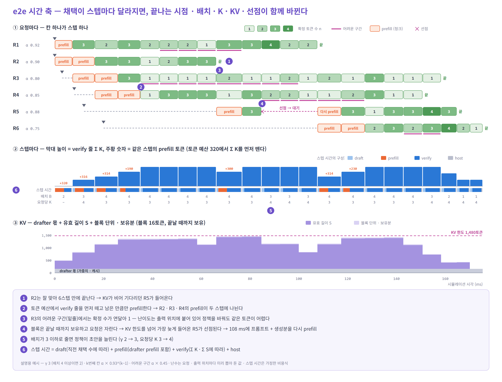

# 06. e2e 시뮬레이터에 넣기 — speculative decoding 구현 포인트

> 전제: 일반 서빙 기능(배치 · 토큰 예산 · KV 블록 · 선점 · prefix cache · P/D · ET · ASTRA-sim · MoE · 지표)은 이미 있다.
> 여기에는 speculative decoding 때문에 **더하거나 바꿀 것**만, **중요한 순서로** 적는다.


---

## 시간 축에서 무엇이 바뀌나



- 스텝마다 확정 수가 요청마다 다르다 → **끝나는 시점 · 배치 크기 · 다음 스텝의 `K` · KV 사용량 · 스텝 시간**이 매번 바뀐다
- 루프가 이미 이 되먹임을 따라간다. speculative decoding 쪽에서 할 일은 **채택을 분포로 뽑아 주고**, 그 결과를 상태와 비용에 정확히 넘기는 것이다
- 이번 스텝 verify의 비용은 넣은 줄 수 `K`로 정해지고 `a`와 무관하다. `a`는 **다음 스텝**의 비용(drafter 갱신 줄 수)과 상태를 바꾼다

**기호**

| 기호 | 뜻 | 그림 31에서 |
|---|---|---|
| `α` | 초안 한 칸이 맞을 확률 (앞 칸이 다 맞았을 때) | 요청마다 기준값 하나 — R6 0.75 … R1 0.92 |
| `ρ` | 뒤 칸으로 갈수록 줄어드는 비율 — k번째 칸은 `α · ρ^(k−1)` | 0.93 |
| 어려운 구간 | 출력 위치에 붙은 난이도 — 이 위치의 칸은 `α`에 0.45를 곱한다 | ①의 분홍 밑줄 |
| `γ` | 요청당 초안 수 | 배치 3 이하면 3, 4 이상이면 2 |
| `K` | 요청당 verify 줄 수 = `γ + 1` (직전 확정 토큰 1 + 초안 `γ`) | ② 아래 셋째 줄 |
| `a` | 이번 스텝에 채택된 초안 수 (0 ~ `γ`) | 앞 칸부터 통과 여부를 보고, 처음 틀린 칸에서 멈춤 |
| `n` | 이번 스텝에 확정된 토큰 수 = `min(a + 1, L − 지금까지 생성한 수)` | ① 칸 안의 숫자 |
| `L` | 요청의 출력 길이 (워크로드가 정한다) | 16 ~ 30 |
| `B` | 이번 스텝에 들어간 요청 수 (decode + prefill) | ② 아래 둘째 줄 |
| `Σ K` | 스텝 하나의 verify 줄 합 | ② 막대 높이 |
| `S` | 요청의 유효 KV 길이 (프롬프트 + 생성한 토큰) | ③ 진한 보라 |
| 할당 블록 | `S + K`를 16토큰 블록으로 올림한 것 — 끝날 때까지 줄이지 않는다 | ③ 연한 보라 |

**그림 31은 무엇을 어떤 단위로 바꿨나**

| 단위 | 바꾼 것 |
|---|---|
| 요청마다 | 기준 `α`, 도착 시각, 프롬프트 길이, 출력 길이 `L`, 어려운 구간의 위치 |
| 초안 칸(자리)마다 | 뒤 칸일수록 낮아진다 — `α · 0.93^(k−1)` |
| 출력 위치마다 | 어려운 구간이면 `α × 0.45`. 통과 여부를 정하는 난수도 **요청 · 출력 위치마다 미리 뽑아 둔 값**이다 |
| 스텝마다 | 위 값들로 `a`를 정한다 → `n`이 매번 다르다. 배치 `B`를 보고 `γ`를 정한다. 토큰 예산 · KV로 입장 · prefill 청크 · 선점을 정한다 |

- 스텝 시간(가정한 식, ms) = draft `0.30·γ + 0.03·Σ(a_prev + 1)` + prefill `0.012·(prefill 토큰)`(drafter prefill 포함) + verify `3.0 + 0.10·ΣK + 0.002·ΣS` + host `0.4`
- 토큰 예산 320: verify 줄 `Σ K`를 먼저 떼고, 남은 만큼 prefill 청크를 넣는다
- KV 한도 1,480토큰 중 160은 drafter 몫. 새 요청은 프롬프트 블록이 지금 들어가야 입장한다. 자라는 요청 때문에 한도를 넘으면 가장 늦게 들어온 요청을 선점하고, 나중에 프롬프트 + 생성분을 다시 prefill한다

**아래 8개 포인트 중 그림 31에 들어간 것** — 그림은 되먹임의 **모양**을 보이는 예시다. 시뮬레이터에는 1 ~ 8을 모두 넣는다

| # | 포인트 | 그림 31 |
|---|---|---|
| 1 | 채택 모형 | ○ 요청별 `α` · 칸별 감쇠 · 출력 위치별 어려운 구간. 온도 · 트리는 없다 |
| 2 | verify 비용 | ○ `ΣK` · `ΣS`에 비례 (가정한 선형식) |
| 3 | draft 비용 | ○ `γ`와 직전 채택 수에 따라 바뀐다. prefill 스텝에 drafter prefill. 통신은 없다 |
| 4 | 자원 계산 | ○ 토큰 예산 · `S + K` 블록 · 블록 보유 · drafter 메모리 |
| 5 | `K` 정책 | △ 배치 크기별 `γ` (vLLM Dynamic SD식). adaptive · DSpark · 비동기 스케줄링은 없다 |
| 6 | 확정 처리 | ○ `n = min(a + 1, L − 생성한 수)`, 한꺼번에 내보내기 |
| 7 | drafter 상태 | △ drafter prefill · 선점 후 다시 prefill. P/D · prefix 적중은 없다 (요청 하나짜리 그림으로 보이기 어렵다) |
| 8 | 기록과 검증 | △ 요청 · 출력 위치마다 미리 뽑은 난수. 정책 두 개를 나란히 비교한 그림은 아니다 |

---

## 주요 구현 포인트 — 중요한 순서

| # | 포인트 | 어디서 | 틀리면 |
|---|---|---|---|
| 1 | **채택 모형** — 분포로, 자리별로 | ⑤ 스텝 끝 | 이득 자체가 틀린다 |
| 2 | **verify 비용** — target forward를 `Σ K`줄로 | ③ STAGE | 큰 배치에서 이득을 크게 본다 |
| 3 | **draft 비용** — 스텝마다 계산 | ③ 또는 별도 계산 | 작은 배치에서 이득을 크게 본다 |
| 4 | **자원 계산** — 토큰 예산 · KV 예약 · drafter 메모리 | ② 스케줄러 | 동시 요청 수 · 선점 · TTFT가 틀린다 |
| 5 | **`K` 정책** — 엔진의 정책을 그대로 | ② 스케줄러 | 정책 비교가 틀린다 |
| 6 | **확정 처리** — 출력 수, 묶음 출력 | ⑤ 스텝 끝 | 끝나는 시점 · ITL이 틀린다 |
| 7 | **drafter 상태** — prefill · P/D · prefix 적중 · 선점 | ② 스케줄러 | TTFT · 전송량이 틀린다 |
| 8 | **기록과 검증** — 값을 나눠 남기고, 같은 난수로 비교 | ⑥ 지표 | 오차가 어디서 났는지 모른다 |

---

### 1. 채택 모형 — 분포로, 자리별로


- **입력은 자리별 채택률**로 받는다 — `r_k = P(a ≥ k)`. vLLM `synthetic_acceptance_rates`와 같은 형식이라 실제 엔진과 바로 맞춰 볼 수 있다
- **평균 AL 하나로 충분한 경우는 `γ` 고정 · 평균 처리량만 볼 때뿐이다.** `γ`가 바뀌는 정책이나 TPOT 꼬리를 보려면 자리별 값이 있어야 한다. AL만 있으면 자리별 곡선으로 역산하고 가정을 적는다
- **요청마다 다르게** — 작업 × 온도별 곡선 + 요청별 흩어짐(`logit(α) += ε_r`)
- **출력 구간마다 다르게** — 쉬운 · 어려운 구간을 **출력 토큰 위치**에 미리 정해 둔다. 스텝 단위로 바꾸면 정책에 따라 워크로드가 달라진다
- 주의
  - 트리의 최대 채택은 **깊이 `d`** 다 (`K`가 아니다). 분포는 같은 트리 설정의 히스토그램을 받는다
  - 온도 효과는 `τ` 비율을 `α`에 곱해서 넣지 않는다 — 온도별 곡선을 따로 둔다

### 2. verify 비용 — target forward를 `Σ K`줄로

- 기존 decode ET에서 요청당 1줄을 **`K`줄**로 바꾼다. attention은 요청마다 `K × (S + K)`, 트리면 조상 마스크
- MoE는 기존 라우팅 모형에 `Σ K`줄을 그대로 넘긴다 — **버려질 줄도 라우팅된다**
- 출력: 로짓 `K × 어휘` + 거부 샘플링
- CUDA graph: verify 배치는 요청당 `1 + γ`줄의 균일 decode다. DSpark처럼 요청마다 길이가 다르면 균일하지 않다. 패딩 줄은 비용에만 넣는다

### 3. draft 비용 — 스텝마다 계산한다

| 방식 | 장점 | 놓치는 것 |
|---|---|---|
| ET에 drafter op로 | drafter의 통신(TP · EP)까지 ASTRA-sim이 센다 | STAGE에 drafter 모델이 필요하다 |
| 루프라인으로 따로 계산해 ET 앞에 노드 하나로 | 간단하다 | 통신, 작은 커널의 바닥 시간 |

- 어느 쪽이든 **상수가 아니다** — 배치 `B`, 갱신 줄 `Σ(a_prev + 1)`, `γ`(트리는 깊이 · topk)에 따라 스텝마다 바뀐다
- 갱신 패스(지난 스텝에 확정된 자리를 진짜 hidden으로 drafter에 넣기) + 직렬 초안 `γ − 1`번이 기본 구조다
- 루프라인 노드로 넣을 때는 **host가 아니라 GPU 시간**으로 넣는다(host 겹치기를 넣으면 사라진다). 커널 바닥 시간을 더하고, MoE drafter(DeepSeek MTP, DSpark)를 EP로 돌리면 통신을 더한다
- prefill 스텝에는 drafter prefill을 함께 넣는다

### 4. 자원 계산 — 토큰 예산 · KV 예약 · drafter 메모리

- 토큰 예산: decode 요청 하나가 `K`토큰을 쓴다. 모자라면 초안을 자른다(vLLM)
- KV: 스텝 전에 `S + K`줄(+ drafter용 여유 칸)을 예약한다. 버린 줄 때문에 더 잡은 블록은 vLLM에서 요청이 끝날 때까지 남는다 → **유효 길이와 할당 블록을 따로** 센다
- drafter 메모리: 가중치, drafter 캐시, 로짓 버퍼(`Σ K × 어휘`), `γ` 후보별 CUDA graph

### 5. `K` 정책 — 엔진의 정책을 그대로

| 정책 | 무엇을 보고 |
|---|---|
| 고정 `γ` · 트리 | — |
| vLLM Dynamic SD | 동시 요청 수 구간별 `γ` (그림 31의 예) |
| SGLang adaptive | 채택 길이의 이동 평균 + 1 |
| DSpark | 요청별 confidence + 줄 수별 처리 속도 `SPS(B)` |

- 이상적인 `γ`가 아니라 **정책을 그대로** 돌린다. 정책의 반응이 늦는 손해까지 나온다
- **DSpark는 두 단계**로 정한다
  - 총 줄 수: 2스텝 전 confidence로 `Θ = τ · SPS(B)`를 최대화한다
  - 요청별 배분: 이번 confidence로 생존 확률이 높은 칸부터 채운다. 이번 confidence는 시뮬레이터가 미리 뽑는다
  - confidence는 채택 확률과 따로 만든다(과신 · 잡음). 채택은 진짜 확률로 뽑는다
- **비동기 스케줄링**을 흉내 내면 다음 스텝은 `a`를 모르는 채로 짠다. vLLM은 "다 맞았다"고 가정하고 짠 뒤 나중에 고친다 → 예약 · 예산이 최대 기준이 된다

### 6. 확정 처리 — 출력 수, 묶음 출력

- `n = min(a + 1, L − 지금까지 생성한 수)`. 출력 분포를 지키는 검증이면 출력 길이 `L`은 워크로드 값 그대로라 EOS를 따로 뽑지 않는다
- 마지막 스텝은 `K`줄을 검증하고 일부만 쓴다 — 출력이 짧을수록 손해 비율이 크다
- `n`개를 스텝 끝 시각에 한꺼번에 내보낸다. ITL은 비교할 벤치마크와 같은 정의(묶음 단위 / 토큰 단위)로 잰다
- `a`를 다음 스텝의 draft 비용(갱신 줄 수)에 넘긴다

### 7. drafter 상태 — prefill · P/D · prefix 적중 · 선점

- **P/D**: drafter prefill은 target hidden이 있는 **P에서** 하고, drafter KV와 hidden을 함께 보낸다. D에서 하려면 프롬프트 모든 위치의 hidden이 필요해 비싸다. DSpark는 최근 128토큰만 필요해 어디서 해도 싸다
  - 📌 NVIDIA Dynamo의 SGLang 분리 배포 예시는 P와 D에 같은 speculative 설정을 준다. AWS Neuron의 vLLM 설계는 P가 draft KV까지 만든다
- **prefix 적중**: 버린 줄은 등록하지 않는다. 적중 시 drafter KV도 적중했는지, 어느 구간을 다시 계산할지 정한다(vLLM은 EAGLE 계열이면 적중을 블록 하나 줄여 다시 계산)
- **선점**: 다시 계산할 때 drafter prefill도 다시 한다

### 8. 기록과 검증

**스텝마다 따로 남길 값** — 제안 수 · 검증 수 `K` · 실행 줄 수(패딩 포함) · 채택 수 `a` · 출력 수 `n` · 유효 길이 `S` · 할당 블록 수

- **같은 난수로 비교한다** — 요청 · 출력 위치마다 난수를 미리 정해 두면, 정책을 바꿔도 "어느 토큰이 맞나"가 같다. 정책 차이만 남는다
- **비용 먼저 맞춘다** — vLLM `rejection_sample_method: synthetic`으로 채택을 고정하고, 같은 배치 · 같은 `K`에서 스텝 시간을 맞춘다
- **채택은 고정 길이 실행으로 맞춘다** — 길이가 바뀌는 정책의 기록은 검증하지 않은 자리가 섞여 뒤 자리 채택률이 낮게 나온다. 쓴다면 `per_step_drafted`로 검증한 자리만 센다
- **확인** — drafter를 싣지 않은 설정 = 기존 결과 · `α = 1`이면 매 스텝 최대 채택 · `α = 0`이면 스텝당 1토큰 · `n ≤ a + 1 ≤ K`

---

## 의사 코드 — 기존 루프에 더하는 줄

```python
while not workload.done():
    workload.arrive(clock)                   # + 요청마다 채택 프로필 · 출력 위치별 난수
    batch = scheduler.schedule(clock)        # + K 정책 → 토큰 예산에 K, KV에 S + K
    et = stage.build(batch)                  # + draft(a_prev) → verify(Σ K) → 거부 샘플링
    clock += astra_sim.run(et)
    for r in batch.decoding:
        a = accept.draw(r, r.max_accept)     # + 일렬 γ · 트리 d · DSpark ℓ_r
        n = min(a + 1, r.L - r.gen)          # + 남은 출력 수에서 자른다
        r.emit(n, clock)                     #   n개를 한꺼번에
        r.S += n; r.gen += n; r.a_prev = a   # + 블록은 그대로, 버린 줄은 prefix cache에 넣지 않음
        log.step(r, verified=r.k, accepted=a, emitted=n, kv_len=r.S, blocks=r.num_blocks)
```

---

## 참고

- [vLLM — Speculative Decoding](https://docs.vllm.ai/en/latest/features/speculative_decoding/) — synthetic 채택, [Dynamic SD](https://docs.vllm.ai/en/latest/features/speculative_decoding/dynamic_speculative_decoding/), [요청별 채택 지표](https://docs.vllm.ai/en/latest/features/speculative_decoding/acceptance_metrics/)
- vLLM 소스 — [`scheduler.py`](https://github.com/vllm-project/vllm/blob/main/vllm/v1/core/sched/scheduler.py) (초안 토큰과 토큰 예산) · [`single_type_kv_cache_manager.py`](https://github.com/vllm-project/vllm/blob/main/vllm/v1/core/single_type_kv_cache_manager.py) (블록 보유) · [`kv_cache_coordinator.py`](https://github.com/vllm-project/vllm/blob/main/vllm/v1/core/kv_cache_coordinator.py) (EAGLE의 prefix 적중) · [`gpu_model_runner.py`](https://github.com/vllm-project/vllm/blob/main/vllm/v1/worker/gpu_model_runner.py) (비동기 스케줄링에서 "다 맞았다"고 가정)
- [SGLang — Adaptive Speculative Decoding](https://docs.sglang.io/docs/advanced_features/adaptive_speculative_decoding) · [DSpark](https://arxiv.org/abs/2607.05147)
- P/D와 drafter — [NVIDIA Dynamo: SGLang speculative decoding](https://docs.nvidia.com/dynamo/dev/additional-resources/speculative-decoding/speculative-decoding-with-sg-lang) · [AWS Neuron vLLM 분리 추론 설계](https://awsdocs-neuron.readthedocs-hosted.com/en/latest/_sources/vllm-neuron/docs/design/vllm/disaggregated-inference.md)
