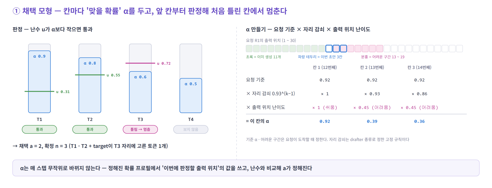
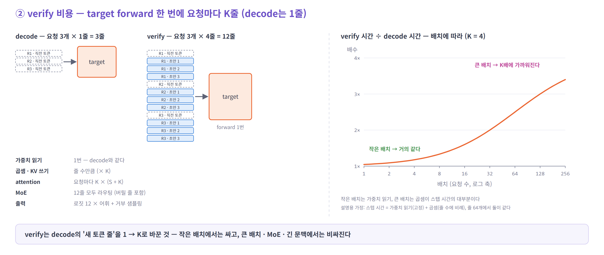
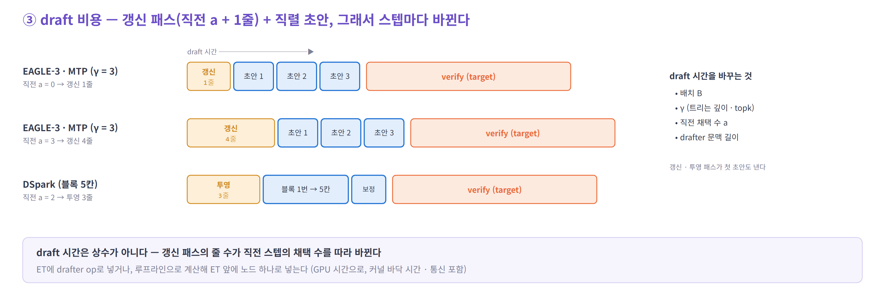
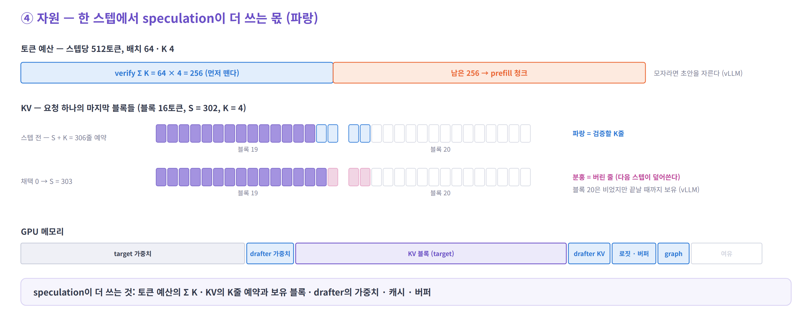
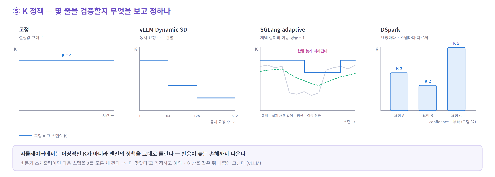
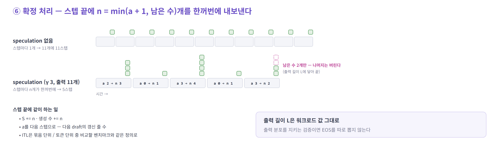
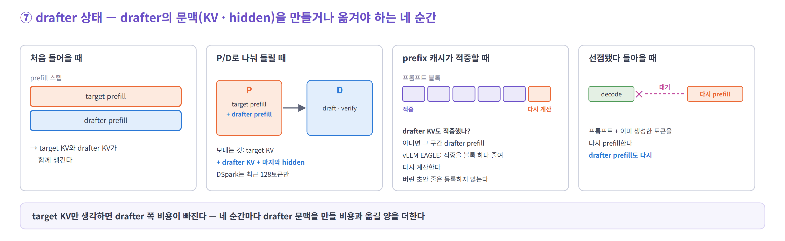
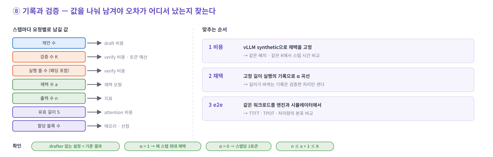

# 06. e2e 시뮬레이터에 넣기 — speculative decoding 구현 포인트

> 전제: 일반 서빙 기능(배치 · 토큰 예산 · KV 블록 · 선점 · prefix cache · P/D · ET · ASTRA-sim · MoE · 지표)은 이미 있다.
> 여기에는 speculative decoding 때문에 **더하거나 바꿀 것**만 적는다. 항목마다 **그림 → 무엇인가 → 어떻게 모델링하나** 순서다.


---

## 시간 축에서 한 번에 보기


아래 구현 포인트 1 ~ 8을 넣은 작은 예시 시뮬레이션이다. 스텝마다 확정 수가 달라지면 **끝나는 시점 · 배치 크기 · `K` · KV · 선점**이 함께 바뀐다. 이런 dynamics가 생긴다는 것을 먼저 보고, 아래에서 항목별로 본다.

| 기호 | 뜻 | 그림에서 |
|---|---|---|
| `α` | 초안 한 칸이 맞을 확률 (요청마다 기준값) | R6 0.75 … R1 0.92 |
| `γ` · `K` | 요청당 초안 수 · verify 줄 수(`γ + 1`) | 배치 3 이하면 `γ` 3, 4 이상이면 2 |
| `a` · `n` | 채택된 초안 수 · 확정된 토큰 수 | ① 칸 안의 숫자가 `n` |
| `B` · `Σ K` | 스텝의 요청 수 · verify 줄 합 | ② 아래 숫자 · 막대 높이 |
| `S` · 할당 블록 | 유효 KV 길이 · 16토큰 블록으로 잡은 양 | ③ 진한 · 연한 보라 |

| # | 포인트 | 그림 31 |
|---|---|---|
| 1 | 채택 모형 | ○ 요청별 `α` · 자리 감쇠 · 출력 위치별 어려운 구간(분홍 밑줄) · 미리 뽑은 난수 |
| 2 · 3 | verify · draft 비용 | ○ `Σ K` · `Σ S` · 직전 채택 수에 따라 (② 아래 띠) |
| 4 | 자원 | ○ 토큰 예산 · 블록 단위 KV · 블록 보유 · drafter 몫 |
| 5 | `K` 정책 | △ 배치 크기별 `γ`만 |
| 6 | 확정 처리 | ○ `n = min(a + 1, 남은 수)` |
| 7 | drafter 상태 | △ drafter prefill · 선점 후 다시 prefill. P/D · prefix 적중은 없다 |
| 8 | 기록과 검증 | — |

<details>
<summary>그림 31의 가정</summary>

- 스텝 시간(ms) = draft `0.30·γ + 0.03·Σ(a_prev + 1)` + prefill `0.012·(prefill 토큰)` + verify `3.0 + 0.10·ΣK + 0.002·ΣS` + host `0.4`
- 자리 감쇠 `0.93^(k−1)`, 어려운 구간 `× 0.45`, 토큰 예산 320, 블록 16토큰, KV 한도 1,480토큰(drafter 몫 160)
- 새 요청은 프롬프트 블록이 지금 들어가야 입장한다. 한도를 넘으면 가장 늦게 들어온 요청을 선점한다

</details>

---

## 구현 포인트 8개 — 한눈에

| # | 포인트 | 무엇을 모델링하나 | 어디서 |
|---|---|---|---|
| 1 | [채택 모형](#1-채택-모형--초안-중-몇-개가-맞나) | 초안 중 몇 개가 맞나 | ⑤ 스텝 끝 |
| 2 | [verify 비용](#2-verify-비용--target이-요청마다-k줄을-계산하는-시간) | target이 요청마다 `K`줄을 계산하는 시간 | ③ STAGE |
| 3 | [draft 비용](#3-draft-비용--drafter가-초안을-만드는-시간) | drafter가 초안을 만드는 시간 | ③ STAGE 또는 별도 계산 |
| 4 | [자원](#4-자원--speculation이-더-쓰는-몫) | 토큰 예산 · KV · GPU 메모리에서 더 쓰는 몫 | ② 스케줄러 |
| 5 | [`K` 정책](#5-k-정책--몇-줄을-검증할지-누가-정하나) | 몇 줄을 검증할지 정하는 규칙 | ② 스케줄러 |
| 6 | [확정 처리](#6-확정-처리--채택-결과를-요청에-반영) | 채택 결과를 요청 상태에 반영 | ⑤ 스텝 끝 |
| 7 | [drafter 상태](#7-drafter-상태--drafter의-문맥을-만들고-옮기기) | drafter의 문맥을 만들고 옮기기 | ② 스케줄러 |
| 8 | [기록과 검증](#8-기록과-검증--틀리면-어디서-틀렸는지) | 오차의 원인을 찾을 수 있게 값을 남기기 | ⑥ 지표 |

> **1과 2가 핵심이다.** 속도 = `τ` ÷ (draft + verify 시간)에서 1은 분자, 2는 분모다. 작은 배치에서는 채택 모형이, 큰 배치 · MoE · 긴 문맥에서는 verify 비용이 결과를 좌우한다.

### 구현 순서

| 단계 | 넣을 것 | 이 단계에서 보이는 것 |
|---|---|---|
| 1 | **1 채택 모형 + 2 verify + 6 확정 처리** (고정 `γ`, 일렬). 스케줄러는 예산 · KV에 `K`만 반영 | 루프가 돈다. 스텝당 확정 수와 시간 |
| 2 | **3 draft 비용** — 먼저 루프라인 노드로 | 작은 배치에서 이득이 줄어드는 모습 |
| 3 | 4 자원 세부 · 5 `K` 정책 · 7 drafter 상태 · 트리 | 선점 · TTFT · 정책 차이 |
| 4 | 8 기록과 검증 | 실제 엔진과 맞는지 |

- 1단계만으로는 draft 비용이 0이라 이득이 **실제보다 크게** 나온다. drafter끼리 비교는 2단계부터 한다
- 1단계를 마치면 확인한다 — drafter 없는 설정 = 기존 결과 · `α = 1`이면 매 스텝 최대 채택 · `α = 0`이면 스텝당 1토큰

---

## 1. 채택 모형 — 초안 중 몇 개가 맞나



**무엇인가** — 초안 칸마다 "맞을 확률" `α`를 두고, 앞 칸부터 하나씩 판정해 처음 틀린 칸에서 멈춘다. 채택 수 `a`가 정해지고, 확정은 `a + 1`개다(틀린 칸 자리에 target이 고른 토큰, 다 맞으면 보너스 1개).

**drafter마다 다른 것** — 판정 방식(앞 칸부터, 처음 틀리면 멈춤)은 모든 일렬 drafter에 공통이다. 검증 규칙이 drafter와 상관없기 때문이다. 다른 것은 **`α` 곡선의 모양**과 **최대 채택 길이**다.

| drafter | `α` 곡선 | 최대 채택 | 📌 예 |
|---|---|---|---|
| MTP-1 | 칸 1개 | 1 | DeepSeek-V3 0.85 ~ 0.90 |
| MTP 반복 (`γ` > 1) | 뒤 칸이 빨리 떨어진다 — 학습 때 없던 쓰임 | `γ` | — |
| EAGLE-3 일렬 | 대체로 평평하다 — 매번 앞 토큰을 보고 뽑는다 | `γ` | 자리마다 약 0.81 |
| DFlash | 첫 칸이 높고 뒤로 떨어진다 — 블록을 한 번에 뽑는다 | `γ` | 첫 칸 약 0.88(수학), 2 ~ 7번째 0.87 → 0.78(코드) |
| DSpark | DFlash보다 평평하다 — 직전 토큰으로 보정 | 요청마다 `ℓ_r` | — |
| 트리 (EAGLE `topk` > 1) | 칸별 `α` 대신 같은 설정의 결과 분포를 쓴다 | 깊이 `d` | — |

같은 drafter라도 target · 작업 · 온도에 따라 값이 크게 다르다. 자리별 값은 [04의 5절](04-simulator.md#5-채택-모형--평균-몇-개가-맞나)에 모아 두었다.

**어떻게 모델링하나**

| 항목 | 방법 |
|---|---|
| 요청마다 | 기준 `α`를 다르게 둔다 (작업 · 온도 · 요청별 차이). 요청이 도착할 때 한 번 |
| 자리마다 | 뒤 칸일수록 낮춘다 — k번째 칸 = 기준 × `ρ^(k−1)`. `ρ`는 drafter마다 다르다(위 표) |
| 출력 위치마다 | 어려운 구간에서 낮춘다. 요청이 도착할 때 구간을 정해 둔다 |
| 판정 | 칸마다 난수 `u`를 뽑아 `u < α`면 통과, 처음 틀리면 멈춤. seed 고정 — vLLM의 synthetic 채택과 같은 방식 |
| 정책 비교 (선택) | 난수를 출력 위치마다 미리 뽑아 두면, 정책이 달라도 같은 토큰은 같은 결과가 나온다 |
| 트리 | 최대 채택은 깊이 `d`다(`K`가 아니다). 같은 트리 설정의 결과 분포에서 확정 수를 바로 뽑는다 |
| 온도 · 입력 | 온도별 곡선을 따로 둔다(`τ` 비율을 `α`에 곱하지 않는다). 입력은 자리별 값(vLLM `synthetic_acceptance_rates` 형식) |

---

## 2. verify 비용 — target이 요청마다 K줄을 계산하는 시간



**무엇인가** — decode는 요청당 1줄, verify는 요청당 `K`줄(직전 확정 토큰 1 + 초안 `γ`)을 forward 한 번에 계산한다. 가중치는 한 번만 읽고, 곱셈 · KV 쓰기 · attention이 줄 수만큼 는다. 그래서 작은 배치에서는 싸고, 큰 배치에서는 `K`배에 가까워진다.

**어떻게 모델링하나**

| 항목 | 방법 |
|---|---|
| 줄 수 | 기존 decode ET에서 요청당 1줄을 `K`줄로 — 배치 전체 `Σ K` |
| attention | 요청마다 `K × (S + K)`. 트리면 각 노드가 조상만 보게 가린다 |
| MoE | 기존 라우팅 모형에 `Σ K`줄을 넘긴다 — 버려질 줄도 라우팅된다 |
| 출력 | 로짓 `K × 어휘` + 거부 샘플링 |
| CUDA graph | 요청당 `1 + γ`줄의 균일 decode 배치로 본다. 패딩 줄은 비용에만 넣는다 |

---

## 3. draft 비용 — drafter가 초안을 만드는 시간



**무엇인가** — 갱신 패스(지난 스텝에 확정된 `a + 1`줄을 진짜 hidden으로 drafter에 넣기, 첫 초안도 여기서 나온다) + 나머지 초안 `γ − 1`번(DSpark는 블록 1번). 그래서 배치 · `γ` · 직전 채택 수에 따라 스텝마다 바뀐다.

**어떻게 모델링하나**

| 항목 | 방법 |
|---|---|
| 넣는 곳 | ET에 drafter op로 — 통신까지 ASTRA-sim이 센다. 또는 루프라인으로 계산해 ET 앞에 노드 하나로 — 간단하다 |
| 입력 | 배치 `B`, 갱신 줄 `Σ(a_prev + 1)`, `γ`(트리는 깊이 · topk), drafter 문맥 길이 |
| 노드로 넣을 때 | host가 아니라 GPU 시간으로. 커널 바닥 시간을 더하고, MoE drafter면 EP 통신 · TP면 all-reduce를 더한다 |
| prefill | prefill 스텝에는 drafter prefill도 넣는다 |

---

## 4. 자원 — speculation이 더 쓰는 몫



**무엇인가** — speculation은 스텝마다 토큰 예산에서 `Σ K`, KV에서 `K`줄 예약과 보유 블록, GPU 메모리에서 drafter의 가중치 · 캐시 · 버퍼를 더 쓴다. 이것이 동시에 받을 수 있는 요청 수, prefill 속도, 선점을 바꾼다.

**어떻게 모델링하나**

| 자원 | 방법 |
|---|---|
| 토큰 예산 | verify 줄을 먼저 떼고 남은 만큼 prefill한다. 모자라면 초안을 자른다(vLLM) |
| KV 예약 | 스텝 전에 요청마다 `S + K`줄(+ drafter용 여유 칸)을 잡는다 |
| KV 반환 | 버린 줄 때문에 더 잡은 블록은 요청이 끝날 때까지 남는다(vLLM) → 유효 길이와 할당 블록을 따로 센다 |
| GPU 메모리 | drafter 가중치, drafter KV, 로짓 버퍼(`Σ K × 어휘`), `γ` 후보별 CUDA graph |

---

## 5. `K` 정책 — 몇 줄을 검증할지 누가 정하나



**무엇인가** — 스텝마다, 요청마다 검증할 줄 수 `K`를 무엇을 보고 정하느냐다. 엔진마다 다르고, 같은 drafter라도 정책에 따라 결과가 달라진다.

**어떻게 모델링하나** — 이상적인 `K`가 아니라 엔진의 정책을 그대로 돌린다.

| 정책 | 무엇을 보고 | 시뮬레이터에서 |
|---|---|---|
| 고정 · 트리 | — | 설정값 그대로 |
| vLLM Dynamic SD | 동시 요청 수 | 구간별 `γ` 표 |
| SGLang adaptive | 채택 길이의 이동 평균 | `γ` ≈ 평균 + 1 |
| DSpark | 요청별 confidence + 부하 | 총 줄 수는 2스텝 전 confidence로, 요청별 배분은 이번 confidence로. confidence는 채택 확률과 따로 만든다 ([05](05-eagle3-mtp-dspark.md#6-dspark--블록을-한-번에-뽑고-요청마다-검증-길이를-고른다)) |
| 비동기 스케줄링 | `a`를 모른 채 다음 스텝을 짠다 | "다 맞았다"고 가정하고 예약 · 예산을 잡은 뒤 나중에 고친다(vLLM) |

---

## 6. 확정 처리 — 채택 결과를 요청에 반영



**무엇인가** — 스텝 끝에 채택 결과로 몇 개를 출력하고, 요청 상태를 얼마나 진행시키느냐다. 토큰이 스텝마다 묶음으로 나간다.

**어떻게 모델링하나**

| 항목 | 방법 |
|---|---|
| 출력 수 | `n = min(a + 1, L − 생성한 수)`. 출력 길이 `L`은 워크로드 값 그대로라 EOS를 따로 뽑지 않는다 |
| 상태 | `S += n`, 생성 수 `+= n` |
| 출력 시각 | `n`개를 스텝 끝 시각에 한꺼번에. ITL은 비교할 벤치마크와 같은 정의(묶음 / 토큰 단위)로 잰다 |
| 다음 스텝 | `a`를 넘긴다 — 다음 draft의 갱신 줄 수 |

---

## 7. drafter 상태 — drafter의 문맥을 만들고 옮기기



**무엇인가** — drafter도 자기 문맥(KV · hidden)을 가진다. 처음 들어올 때, P/D로 옮길 때, prefix 캐시가 적중할 때, 선점됐다 돌아올 때 이 문맥을 만들거나 옮겨야 한다.

**어떻게 모델링하나**

| 상황 | 방법 |
|---|---|
| 처음 들어올 때 | prefill 스텝에 drafter prefill을 함께 넣는다 |
| P/D | drafter prefill은 P에서 하고, drafter KV와 마지막 hidden을 함께 보낸다. DSpark는 최근 128토큰만 |
| prefix 적중 | 버린 줄은 등록하지 않는다. drafter KV도 적중했는지, 어느 구간을 다시 계산할지 정한다(vLLM은 EAGLE 계열이면 적중을 블록 하나 줄여 다시 계산) |
| 선점 후 복귀 | 프롬프트 + 생성분을 다시 prefill할 때 drafter prefill도 다시 한다 |

---

## 8. 기록과 검증 — 틀리면 어디서 틀렸는지



**무엇인가** — 시뮬레이터 결과를 실제 엔진과 맞춰 보고, 틀렸을 때 비용 · 채택 · 메모리 중 어디가 원인인지 찾을 수 있게 값을 나눠 남기는 것이다.

**어떻게 모델링하나**

| 항목 | 방법 |
|---|---|
| 기록 | 스텝마다 요청별로 제안 수 · 검증 수 `K` · 실행 줄 수 · 채택 수 `a` · 출력 수 `n` · 유효 길이 `S` · 할당 블록 수 |
| 1 비용 | vLLM synthetic으로 채택을 고정하고, 같은 배치 · 같은 `K`에서 스텝 시간을 맞춘다 |
| 2 채택 | 고정 길이 실행의 기록으로 맞춘다. 길이가 바뀌는 정책의 기록은 검증한 자리만 센다(`per_step_drafted`) |
| 3 e2e | 같은 워크로드를 엔진과 시뮬레이터에서 돌려 TTFT · TPOT · 처리량의 분포를 비교한다 |

---

---

## 의사 코드 — 기존 루프에 더하는 줄

```python
while not workload.done():
    workload.arrive(clock)                   # + 요청마다 기준 α · 어려운 구간 · (선택) 위치별 난수
    batch = scheduler.schedule(clock)        # + K 정책 → 토큰 예산에 Σ K, KV에 S + K
    et = stage.build(batch)                  # + draft(a_prev) → verify(Σ K) → 거부 샘플링
    clock += astra_sim.run(et)
    for r in batch.decoding:
        a = accept.draw(r, r.max_accept)     # + 일렬 γ · 트리 d · DSpark ℓ_r
        n = min(a + 1, r.L - r.gen)          # + 남은 출력 수에서 자른다
        r.emit(n, clock)                     #   n개를 한꺼번에
        r.S += n; r.gen += n; r.a_prev = a   # + 블록은 그대로, 버린 줄은 prefix cache에 넣지 않음
        log.step(r, verified=r.k, accepted=a, emitted=n, kv_len=r.S, blocks=r.num_blocks)
```

---

## 참고

- [vLLM — Speculative Decoding](https://docs.vllm.ai/en/latest/features/speculative_decoding/) — synthetic 채택, [Dynamic SD](https://docs.vllm.ai/en/latest/features/speculative_decoding/dynamic_speculative_decoding/), [요청별 채택 지표](https://docs.vllm.ai/en/latest/features/speculative_decoding/acceptance_metrics/)
- vLLM 소스 — [`rejection_sampler.py`](https://github.com/vllm-project/vllm/blob/main/vllm/v1/sample/rejection_sampler.py) (synthetic: 칸마다 난수와 조건부 채택률 비교) · [`scheduler.py`](https://github.com/vllm-project/vllm/blob/main/vllm/v1/core/sched/scheduler.py) (초안 토큰과 토큰 예산) · [`single_type_kv_cache_manager.py`](https://github.com/vllm-project/vllm/blob/main/vllm/v1/core/single_type_kv_cache_manager.py) (블록 보유) · [`kv_cache_coordinator.py`](https://github.com/vllm-project/vllm/blob/main/vllm/v1/core/kv_cache_coordinator.py) (EAGLE의 prefix 적중) · [`gpu_model_runner.py`](https://github.com/vllm-project/vllm/blob/main/vllm/v1/worker/gpu_model_runner.py) (비동기 스케줄링)
- [SGLang — Adaptive Speculative Decoding](https://docs.sglang.io/docs/advanced_features/adaptive_speculative_decoding) · [DSpark](https://arxiv.org/abs/2607.05147)
- P/D와 drafter — [NVIDIA Dynamo: SGLang speculative decoding](https://docs.nvidia.com/dynamo/dev/additional-resources/speculative-decoding/speculative-decoding-with-sg-lang) · [AWS Neuron vLLM 분리 추론 설계](https://awsdocs-neuron.readthedocs-hosted.com/en/latest/_sources/vllm-neuron/docs/design/vllm/disaggregated-inference.md)
