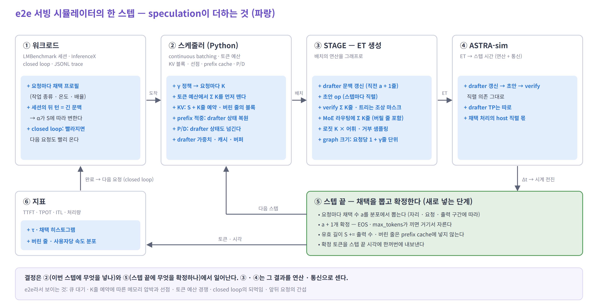
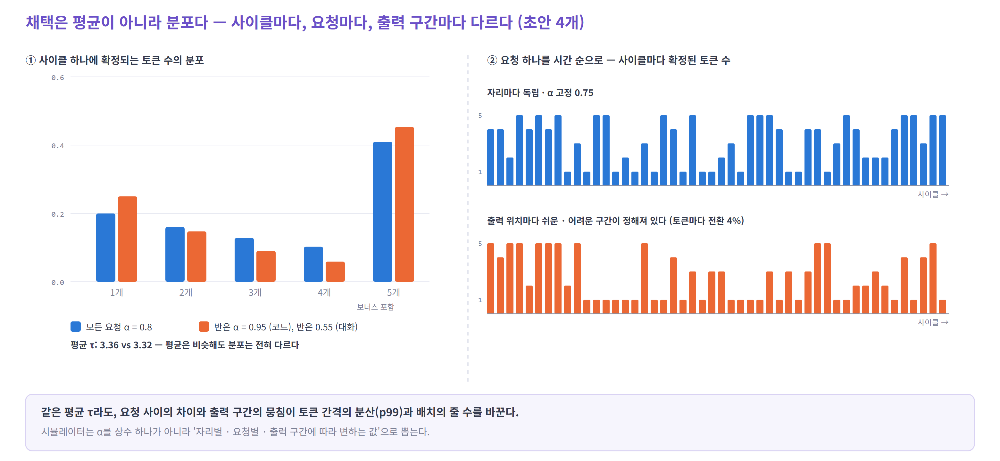

# 06. e2e 시뮬레이터에 넣기 — speculative decoding 구현 포인트

> 전제: 일반 서빙 기능(배치 · 토큰 예산 · KV 블록 · 선점 · prefix cache · P/D · ET · ASTRA-sim · MoE · 지표)은 이미 있다.
> 여기에는 speculative decoding 때문에 **더하거나 바꿀 것**만 적는다.



## 핵심 다섯 가지

1. **스케줄러가 요청마다 `K`를 정한다** — 토큰 예산 · KV 예약 · ET가 모두 이 값으로 바뀐다
2. **ET에 drafter op를 더한다** — 문맥 갱신(직전 `a + 1`줄) → 초안 → verify `Σ K`줄
3. **스텝 끝에 채택 수 `a`를 뽑는다** — 분포에서, 최대 채택 길이(`K`가 아니다)까지
4. **drafter 상태를 들고 다닌다** — 메모리, prefix 적중, P/D, 선점
5. **값을 따로 남긴다** — 제안 · 검증 · 실행 줄 · 채택 · 출력 · 유효 길이 · 할당 블록

이번 스텝 verify의 비용은 넣은 줄 수 `K`로 정해지고 `a`와 무관하다. 그래서 `a`는 시간을 받은 뒤 뽑아도 된다. 다만 `a`는 **다음 스텝**의 drafter 갱신 줄 수와 상태를 바꾼다.

---

## 1. 스케줄러

**`K` 정하기** — `choose_k(배치) → 요청마다 (K, 최대 채택 길이)`

| 방식 | `K` | 최대 채택 | 정하는 것 |
|---|---|---|---|
| 일렬 | `γ + 1` | `γ` | 고정, 또는 정책 |
| 트리 | 예산 + 1 | 깊이 `d` | 고정 (깊이 · topk · 예산) |
| DSpark | `ℓ_r + 1` | `ℓ_r` | 스케줄러가 스텝마다 |

- 정책: 고정 / vLLM Dynamic SD(동시 요청 수 구간별 `γ`) / SGLang adaptive(채택 길이의 이동 평균 + 1) / DSpark. 이상적인 `γ`가 아니라 **정책을 그대로** 돌린다 — 반응이 늦는 손해까지 나온다
- **DSpark**
  - 총 줄 수는 **2스텝 전 confidence**로 정한다(CUDA graph 크기)
  - 요청별 배분은 **이번 confidence**로 정한다. 시뮬레이터에는 실제 drafter가 없으니, 스케줄러가 이번 confidence를 미리 뽑아 배분한다
  - confidence는 채택 확률과 따로 만든다 — `logit(c) = logit(p) + 치우침 + 잡음`. 논문의 보정 오차 약 1%는 ECE이지 잡음의 크기가 아니다
  - `SPS(B)` 표는 시작할 때 ASTRA-sim으로 줄 수별 스텝 시간을 재서 만든다

**토큰 예산** — decode 요청 하나가 `K`토큰을 쓴다. 예산이 모자라면 초안을 자른다(vLLM).

**KV**

- 스텝 전에 `S + K`줄(+ drafter용 여유 칸)을 예약한다
- 버린 줄 때문에 더 잡은 블록은 vLLM에서 **요청이 끝날 때까지 남는다** → 유효 길이 `S`와 할당 블록 수를 따로 센다
- drafter 몫의 메모리: 가중치, drafter 캐시, 로짓 버퍼(`Σ K × 어휘`), `γ` 후보별 CUDA graph

**prefix cache**

- 버린 초안의 줄은 등록하지 않는다
- 적중 시 **drafter KV도 적중했는지, 다시 계산할 구간이 어디인지** 정한다. vLLM은 EAGLE 계열이면 적중을 블록 하나만큼 줄이고 그 블록을 다시 계산한다

**선점 · P/D · 종료**

- 선점 후 다시 계산하면 **drafter prefill도 다시** 한다
- P/D: drafter prefill은 target hidden이 있는 P에서 하고, drafter KV · hidden을 함께 보낸다고 둔다 (DSpark는 최근 128토큰 창만). 실제 전송 방식은 쓰는 엔진에서 확인한다
- 출력 수 `n = min(a + 1, EOS · max_tokens까지)`

---

## 2. STAGE — ET에 더할 op

| op | 줄 수 | 메모 |
|---|---|---|
| drafter 문맥 갱신 | `a_prev + 1` | 지난 스텝에 확정된 자리를 진짜 hidden으로. EAGLE-3 · MTP는 첫 패스, DFlash · DSpark는 K · V 투영 |
| 초안 | EAGLE-3 (깊이 − 1) × `topk` · MTP (`γ` − 1) × 1 · DSpark 블록 1번 | 스텝끼리 직렬 |
| verify | `Σ K` | 트리는 조상 마스크 |
| 로짓 · 거부 샘플링 | `Σ K` | `K × 어휘` |
| 트리 정리 | 채택 경로 | 트리일 때만 — KV 옮기기 |

- **`a`에 따른 비용의 위치** — vLLM은 verify 직후 같은 스텝에서 다음 초안을 만든다. 시뮬레이터는 (가) 다음 스텝 ET 앞에 넣거나, (나) `a`를 미리 뽑아 이번 ET 뒤에 넣는다. 합계는 같고 첫 · 마지막 스텝과 ITL만 다르다
- **prefill 청크**에는 drafter prefill을 함께 넣는다
- **MoE** — 기존 라우팅 모형에 `Σ K`줄(버릴 줄 포함)을 그대로 넘긴다. drafter가 MoE면(DeepSeek MTP, DSpark) drafter 라우팅도 따로
- **CUDA graph** — verify 배치는 요청당 `1 + γ`줄의 균일 decode다. DSpark는 줄 수가 들쭉날쭉하다. 패딩 줄은 비용에만 넣는다
- **구조별** — 희소 attention 색인 `K`배, 선형 attention 상태 `K`개 ([03의 6절](03-compute-and-kv.md#6-모델-구조에-따라-깨지는-가정))

---

## 3. ASTRA-sim

- 의존: drafter 갱신 → 초안 → verify → 거부 샘플링 — 직렬
- drafter TP는 target과 따로 정할 수 있다
- 채택 처리 · 상태 갱신의 host 시간은 직렬로 남는다. SGLang Spec V2의 겹치기는 일렬(`topk = 1`)에서만 된다

---

## 4. 스텝 끝 — 채택 뽑기



```
P(a = k) = α_1 ⋯ α_k · (1 − α_(k+1))     — k개 채택 후 틀림
P(a = 최대) = α_1 ⋯ α_최대               — 다 맞힘, 보너스
```

| 확정 토큰 (`γ` = 4) | 1 | 2 | 3 | 4 | 5 (보너스) |
|---|---|---|---|---|---|
| 모든 요청 `α` = 0.8 | 0.20 | 0.16 | 0.13 | 0.10 | **0.41** |
| 반은 0.95, 반은 0.55 | **0.25** | 0.15 | 0.09 | 0.06 | **0.45** |

평균 `τ`는 거의 같아도(3.36 vs 3.32) 분포와 사용자별 속도는 다르다. 그래서 `α`를 상수 하나로 두지 않는다.

**`α`를 무엇에 따라 바꾸나** — 요청을 만들 때 프로필을 붙인다

| 축 | 모형 |
|---|---|
| 자리 | 순차 drafter는 평평, 병렬 drafter는 `α_k = α_1 · ρ^(k−1)` |
| 요청 | 작업 × 온도별 곡선 + `logit(α) += ε_r` |
| 출력 구간 | **출력 토큰 위치마다** 쉬움 / 어려움을 미리 정한다 — 정책을 바꿔도 워크로드가 같다 |
| 문맥 길이 | 학습 길이를 넘으면 낮아질 수 있다 — `f(S)` |

**주의 세 가지**

- **트리의 최대 채택은 깊이 `d`다.** 깊이 3 · 7줄이면 최대 4개 확정. 분포는 같은 트리 설정의 히스토그램을 쓴다
- **온도는 `τ` 비율을 `α`에 곱하지 않는다.** DFlash 6.49 → 5.48(0.84배)은 `τ`의 비율이다. `α` 0.86에 0.84를 곱하면 `τ`가 3.58로 떨어진다. 온도별 곡선을 따로 맞춘다
- **확률은 logit 공간에서 더한다** — 배율을 곱하면 1을 넘는다

샘플링 방식(greedy · 샘플링 · block · 손실 허용)은 `α` 곡선만 바꾼다. 출력 분포를 지키는 검증이면 출력 길이는 워크로드 값 그대로다.

---

## 5. 지표 · 기록

- **ITL** — 토큰이 `a + 1`개씩 한꺼번에 나온다. 비교할 벤치마크 도구와 같은 정의(묶음 단위 / 토큰 단위)로 잰다
- **더 낼 것** — 요청별 `τ`, 채택 히스토그램, 버린 줄 · 패딩 줄 비율, 사용자당 속도 분포

**스텝마다 따로 남길 값**

| 값 | 쓰는 곳 |
|---|---|
| 제안 수 (트리는 노드 수, DSpark는 블록 전체) | draft 비용 |
| 검증 수 `K` | 토큰 예산 · verify |
| 실행 줄 수 (패딩 포함) | 비용만 |
| 채택 수 `a` | 다음 drafter 갱신 |
| 출력 수 `n` | 지표 |
| 유효 길이 `S` · 할당 블록 수 | attention · 메모리 |

---

## 6. 맞추는 순서 · 확인 목록

1. **비용** — vLLM `rejection_sample_method: synthetic`으로 채택을 고정하고, 같은 배치 · 같은 `K`에서 스텝 시간을 맞춘다
2. **채택** — 고정 길이 실행으로 먼저 맞춘다. 가변 길이 기록(DSpark 등)은 **검증한 자리만** 센다 — `per_step_accepted`와 `per_step_drafted`를 함께 써서 `α̂_k = (a ≥ k) / (a ≥ k − 1 이고 검증 ≥ k)`
3. **e2e** — 같은 워크로드를 실제 엔진과 돌려 TTFT · TPOT의 분포를 비교한다

**확인**

- drafter를 싣지 않은 설정 = 기존 결과와 같다 (실행 중 `γ = 0`은 메모리가 남아 다르다)
- `α = 1` → 매 스텝 `a` = 최대 채택 · `α = 0` → 스텝당 1토큰
- `n ≤ a + 1 ≤ K`, `Σ K ≤ 실행 줄 수`
- 같은 seed면 정책을 바꿔도 요청별 난이도 구간이 같다

---

## 7. 의사 코드 — 기존 루프에 더하는 줄

```python
while not workload.done():
    workload.arrive(clock)                   # + 요청마다 채택 프로필 · 출력 위치별 난이도
    batch = scheduler.schedule(clock)        # + choose_k → 토큰 예산에 K, KV에 S + K
    et = stage.build(batch)                  # + drafter 갱신(a_prev + 1) → 초안 → verify(Σ K)
    clock += astra_sim.run(et) + host_serial(batch)
    for r in batch.decoding:
        a = accept.draw(r, r.max_accept)     # + 일렬 γ · 트리 d · DSpark ℓ_r
        n = min(a + 1, r.left_until_stop())  # + 종료 조건
        r.emit(n, clock)
        r.S += n; r.a_prev = a               # + 블록은 그대로, 버린 줄은 prefix cache에 넣지 않음
        log.step(r, proposed=r.proposed, verified=r.k, accepted=a, emitted=n,
                 kv_len=r.S, blocks=r.num_blocks)
```

---

## 참고

- [vLLM — Speculative Decoding](https://docs.vllm.ai/en/latest/features/speculative_decoding/) — synthetic 채택, [Dynamic SD](https://docs.vllm.ai/en/latest/features/speculative_decoding/dynamic_speculative_decoding/), [요청별 채택 지표](https://docs.vllm.ai/en/latest/features/speculative_decoding/acceptance_metrics/)
- vLLM 소스 — [`scheduler.py`](https://github.com/vllm-project/vllm/blob/main/vllm/v1/core/sched/scheduler.py) (초안 토큰과 토큰 예산) · [`single_type_kv_cache_manager.py`](https://github.com/vllm-project/vllm/blob/main/vllm/v1/core/single_type_kv_cache_manager.py) (블록 보유) · [`kv_cache_coordinator.py`](https://github.com/vllm-project/vllm/blob/main/vllm/v1/core/kv_cache_coordinator.py) (EAGLE의 prefix 적중)
- [SGLang — Adaptive Speculative Decoding](https://docs.sglang.io/docs/advanced_features/adaptive_speculative_decoding) · [DSpark](https://arxiv.org/abs/2607.05147) · [DFlash](https://arxiv.org/abs/2602.06036)
