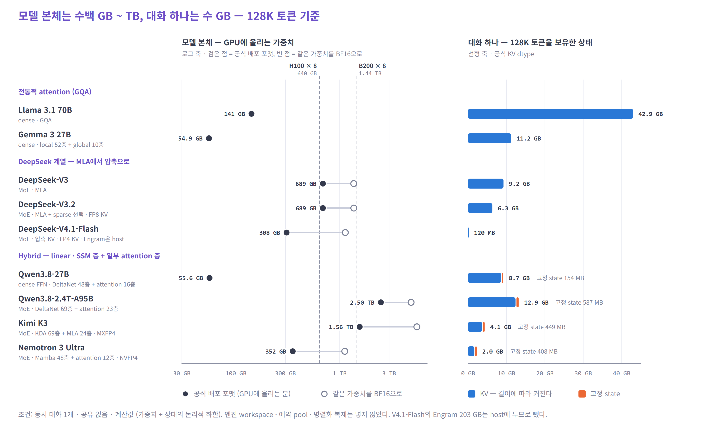
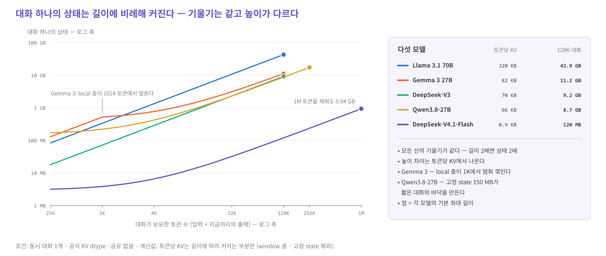
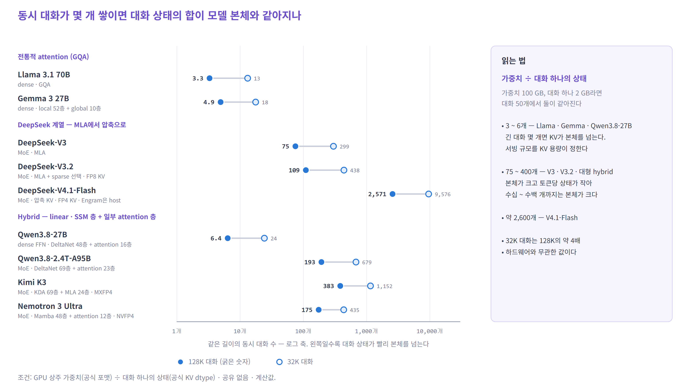
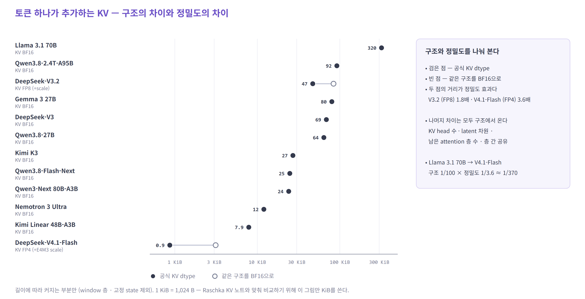

# 최신 LLM은 메모리를 얼마나 쓰는가 — 가중치와 대화 상태

- 자료 기준일: **2026-10-27**
- 대상: 공개 가중치 모델의 **추론 · 서빙**. 학습 메모리는 다루지 않는다
- 모든 수치는 공식 config · 체크포인트 · 기술 보고서에서 가져오거나 계산했다. 자체 GPU 실측은 하지 않았다
- 용량은 모두 10진 단위다 (1 GB = 10⁹ B). 체크포인트 크기와 GPU 표기가 10진이기 때문이다. 부록 그림 A1만 KiB를 쓴다
- 계획서: [llm-memory-requirements-plan.md](llm-memory-requirements-plan.md) · 기존 자료 검토: [llm-memory-related-work.md](llm-memory-related-work.md)

LLM이 GPU에 올리는 메모리는 크게 둘이다.

| 이름 | 쉽게 말하면 | 언제 커지나 |
|---|---|---|
| **가중치** | 모든 요청이 함께 쓰는 모델 본체 | 모델이 클수록. 요청 수와 무관 |
| **대화 상태** | 대화마다 따로 쌓이는 작업 메모리. 두 종류가 있다 | 대화가 길수록, 동시 대화가 많을수록 |
| └ KV cache | 지나간 토큰을 한 줄씩 적어 두는 메모 | 토큰마다 한 줄씩 늘어난다 |
| └ 고정 state | 지나간 내용을 요약해 계속 고쳐 쓰는 메모 (linear attention · SSM) | 길이와 무관하게 대화마다 일정 |

---

## 핵심 관측 세 가지

1. **대화 하나만 보면 모델 본체가 압도적이다.** 최신 대형 모델의 가중치는 공식 배포 포맷으로 0.3 ~ 2.5 TB다. 반면 128K 토큰짜리 대화 하나의 상태는 0.1 ~ 13 GB다. H100 8장 노드(640 GB)에는 이 보고서의 대형 MoE 6개 중 4개가 공식 포맷으로 들어가지 않는다.
2. **토큰 하나가 남기는 KV는 2년 사이 수백 배 줄었다.** Llama 3.1 70B는 토큰당 320 KiB, DeepSeek-V4.1-Flash는 0.9 KiB다. 줄인 방법은 모델마다 다르다 — 구조(MLA · 압축 · 층 간 공유), 정밀도(FP8 → FP4), 일부 층의 recurrent state 대체. hybrid 모델에는 대화마다 **0.15 ~ 0.6 GB의 고정 state**가 새로 생긴다.
3. **그래도 대화가 길어지고 많아지면 상태가 다시 본체를 따라잡는다.** 128K 대화 기준으로 상태의 합이 본체와 같아지는 동시 대화 수는 Llama 3.1 70B가 3개, V4.1-Flash가 약 2,600개다. Kimi K3는 토큰당 KV가 Llama의 1/12이지만, 1M 토큰을 채우면 대화 하나가 29 GB가 된다.

---

## 1. 최신 모델은 얼마나 필요한가



**왼쪽 — 모델 본체.** 검은 점이 공식 배포 포맷으로 GPU에 올리는 크기, 빈 점은 같은 가중치를 BF16으로 바꾼 크기다. 둘 사이의 선이 길수록 낮은 정밀도로 크기를 줄였다는 뜻이다. Kimi K3는 2.8T 파라미터지만 MXFP4로 학습해 1.56 TB다. BF16이었다면 5.6 TB다.

**오른쪽 — 대화 하나.** 128K 토큰을 보유한 대화 하나의 상태다. 파랑은 길이에 따라 커지는 KV, 주황은 고정 state다. 같은 128K라도 43 GB(Llama 3.1 70B)부터 0.12 GB(V4.1-Flash)까지 350배 차이가 난다.

| 모델 | 구조 | 전체 / 활성 파라미터 | 공식 포맷 | GPU 상주 가중치 | 대화 상태 32K | 대화 상태 128K |
|---|---|---|---|---|---|---|
| Llama 3.1 70B | dense · GQA | 70.6B / 70.6B | BF16 | 141 GB | 10.7 GB | 43.0 GB |
| Gemma 3 27B | dense · local + global | 27.4B / 27.4B | BF16 | 55 GB | 3.1 GB | 11.2 GB |
| DeepSeek-V3 | MoE · MLA | 671B (+MTP 14B) / 37B | FP8 | 689 GB | 2.3 GB | 9.2 GB |
| DeepSeek-V3.2 | MoE · MLA + sparse 선택 | 671B (+MTP 14B) / 37B | FP8 | 689 GB | 1.6 GB | 6.3 GB |
| DeepSeek-V4.1-Flash | MoE · 압축 + 층 간 공유 | 552B 본체 + Engram 196B / 8B · 16B | FP8 + FP4 expert | 308 GB ※ | 0.03 GB | 0.12 GB |
| Qwen3.8-27B | dense FFN · hybrid | 27.8B / 27.8B | BF16 | 56 GB | 2.3 GB | 8.7 GB |
| Qwen3.8-2.4T-A95B | MoE · hybrid | 2.45T / 95B | FP8 | 2.5 TB | 3.7 GB | 12.9 GB |
| Kimi K3 | MoE · hybrid (KDA) | 2.8T / 104B | MXFP4 | 1.56 TB | 1.4 GB | 4.1 GB |
| Nemotron 3 Ultra | MoE · hybrid (Mamba) | 550B / 55B | NVFP4 | 352 GB | 0.8 GB | 2.0 GB |

조건: 동시 대화 1개 · 공유 없음 · 공식 KV dtype · 계산값. **가중치 + 상태의 논리적 하한**이며, 엔진의 workspace · 예약 pool · 병렬화 복제는 들어 있지 않다.
※ V4.1-Flash의 Engram 표(203 GB, FP8)는 추론 시 host 메모리에서 미리 가져오도록 설계되어 GPU 상주분에서 뺐다. 체크포인트 전체는 510 GB다.

**표를 읽을 때 주의할 점 두 가지**

- **"전체 파라미터"의 범위가 모델마다 다르다.** V4.1-Flash는 본체 552B에 Engram 196B와 MTP · 보조 모듈이 따로 있어, HF 메타데이터에는 763B로 잡힌다. Qwen3.8-Flash-Next(부록)는 본체 125B에 n-gram 표 51B와 MTP 4B를 더하면 180B다. 그래서 이 보고서는 파라미터 수 대신 **실제로 GPU에 올리는 바이트**를 기준으로 삼는다.
- **활성 파라미터는 메모리 용량이 아니다.** MoE는 토큰마다 일부 expert만 쓰지만, 어떤 expert가 뽑힐지 모르므로 전체를 올려 둔다. 활성 파라미터는 4절의 **읽기량**에서만 의미가 있다. V4.1-Flash처럼 prefill(8B)과 decode(16B)의 활성량이 다른 모델도 있다.

---

## 2. 대화가 길어지고 사용자가 늘면

### 길이: 기울기는 같고 높이가 다르다



로그-로그 축에서 대부분의 선은 기울기 1이다. 길이가 두 배면 상태도 두 배다. 모델 간 차이는 **토큰당 KV**(선의 높이)와 **꺾이는 지점**에서 나온다.

- **Gemma 3** — 62층 중 52층이 최근 1024 토큰만 보존한다. 1K 이후에는 global 10층만 자라 기울기가 Llama보다 낮은 높이에서 이어진다
- **Qwen3.8-27B** — 64층 중 48층이 고정 state(약 150 MB)다. 짧은 대화에서는 이 고정분이 바닥을 만들고, 2.3K 토큰부터 KV가 더 커진다
- **V4.1-Flash** — 1M 토큰을 채워도 약 1 GB다

**hybrid의 고정 state는 작지 않다.** 고정 state가 KV와 같아지는 길이는 Qwen3.8-27B가 약 2.3K 토큰, Kimi K3가 약 16K, Nemotron 3 Ultra가 약 33K다. Nemotron 3 Ultra는 32K 대화에서 상태의 절반이 고정 state다. config가 recurrent state를 FP32로 지정하기 때문이다.

### 동시 대화: 몇 개가 모이면 본체만큼 커지나

가중치는 모든 대화가 함께 쓰고, 대화 상태는 대화 수만큼 곱해진다. 가상의 예로, 가중치가 100 GB이고 대화 하나가 2 GB라면 대화 1개는 102 GB, 8개는 116 GB, 50개는 200 GB다. 그래서 동시 대화 수 하나로 모든 모델을 비교하기보다, **대화 상태의 합이 가중치와 같아지는 동시 대화 수**를 보면 모델의 성격이 바로 드러난다.



- **Llama 3.1 70B · Gemma 3 · Qwen3.8-27B (3 ~ 6개)** — 128K 대화 몇 개면 상태가 본체를 넘는다. 서빙 용량은 사실상 KV가 정한다
- **DeepSeek-V3 · V3.2 · 대형 hybrid (75 ~ 400개)** — 본체가 크고 토큰당 상태가 작아, 수십 ~ 수백 개의 긴 대화까지는 본체가 지배한다
- **V4.1-Flash (약 2,600개)** — 긴 대화를 아주 많이 동시에 보유해도 본체가 지배한다

이 값은 하드웨어와 무관하다. 32K 대화(빈 점)는 128K의 약 4배다.

### 참고: 한 노드에 올리면

| 모델 | H100 80GB × 8 (640 GB) | B200 180GB × 8 (1.44 TB) | TP8로 나눌 때 KV 복제 |
|---|---|---|---|
| Llama 3.1 70B | 들어감 · 128K 대화 약 12개 | 약 30개 | 없음 (KV head 8) |
| Gemma 3 27B | 들어감 · 약 52개 | 약 124개 | 없음 (KV head 16) |
| DeepSeek-V3 / V3.2 | **초과** (689 GB) | 약 82 / 119개 | **8배** (MLA latent) |
| DeepSeek-V4.1-Flash | 들어감 ※ · 약 2,780개 | 약 9,470개 | **8배** (KV head 1) |
| Qwen3.8-27B | 들어감 · 약 67개 | 약 158개 | 2배 (KV head 4) |
| Qwen3.8-2.4T-A95B | **초과** (2.5 TB) | **초과** | 2배 |
| Kimi K3 | **초과** (1.56 TB) | **초과** | 8배 (MLA) |
| Nemotron 3 Ultra | 들어감 ※ · 약 143개 | 약 539개 | 4배 (KV head 2) |

조건: (노드 표기 용량 − GPU 상주 가중치) ÷ 128K 대화 하나의 상태. **엔진 부가 비용과 병렬화 복제를 넣지 않은 논리 상한**이다.
※ V4.1-Flash는 Engram을 host에 둘 때만 들어간다. Hopper에는 FP4 tensor core가 없으므로, V4.1-Flash의 FP4 expert와 Nemotron 3 Ultra의 NVFP4를 H100에서 어떤 커널로 실행할 수 있는지는 확인하지 못했다.

- **"합산 용량 ÷ 8"이 장치당 요구량이 아니다.** tensor parallel(TP)은 KV head를 GPU에 나눠 담는다. KV head가 GPU 수보다 적으면 같은 KV를 여러 GPU가 복제한다. MLA는 KV head가 사실상 1개라 TP8에서 8개 GPU가 모두 같은 latent를 들고 있다. 이 경우 표의 대화 수는 1/8이 된다. 그래서 SGLang 등은 attention 부분만 data parallel로 돌려 복제를 피한다(DP attention)
- **실제 엔진은 이보다 적게 받는다.** activation · CUDA graph · 통신 버퍼 · 예약 여유분을 뺀 나머지가 KV pool이 된다. vLLM은 시작할 때 `Maximum concurrency for N tokens per request: X` 로그로 이 값을 직접 알려 준다
- **표의 대화 수는 "보유 가능한 수"다.** 실제로 한 번에 처리하는 수는 엔진 설정(최대 동시 시퀀스 수, prefill 토큰 예산)과 지연 목표가 정한다. continuous batching에서는 활성 대화 수와 길이가 계속 바뀐다
- 27B 모델을 8장에 하나만 올리는 일은 드물다. 보통 1 ~ 2장에 복제본을 여러 개 둔다

---

## 3. 최근 무엇이 달라졌나

KV를 줄이는 방법은 다섯 갈래로 나뉜다. 중요한 점은 **저장량과 읽기량이 따로 움직인다는 것**이다.

| 방법 | 예 | 저장량 | decode 한 스텝의 읽기량 | 대가 |
|---|---|---|---|---|
| **덜 저장하기** — KV head 공유(GQA) · latent(MLA) | Llama 3.1, DeepSeek-V3 | ↓ | ↓ (저장량만큼) | TP에서 KV 복제가 생기기 쉽다 |
| **작게 저장하기** — KV 양자화 | V3.2 (FP8), V4.1-Flash (FP4) | ↓ | ↓ | scale 메타데이터, 커널 지원, 품질 검증 |
| **일부만 남기기** — sliding window | Gemma 3, V4.1-Flash (SWA 128) | 해당 층은 상한 | 해당 층은 상한 | global 층은 그대로 자란다. prefix cache 규칙이 복잡해진다 |
| **골라 읽기** — sparse 선택 | DeepSeek-V3.2 | **그대로** (+ indexer key) | main KV는 top-2048만. indexer는 여전히 전체를 훑는다 | 비연속 gather, indexer 저장 |
| **요약해 고쳐 쓰기** — linear attention · SSM | Qwen3.8, Kimi K3, Nemotron 3 Ultra | 해당 층은 고정 크기 | 고정 state 전체를 매 스텝 읽고 덮어쓴다 | 남은 attention 층은 계속 자란다. prefix cache · speculative decoding에 state 사본이 필요 |

여기에 최신 모델은 **메모리 계층을 나누는 방법**을 더한다.

- **다시 계산하기** — V4.1-Flash는 SWA KV를 오래 보관하지 않고, 필요하면 최근 128 토큰을 다시 돌려 복원한다(SWA Bounded Replay). 보관 용량을 연산으로 바꾼 것이다. 그 결과 장기 보관 KV는 V4의 1/8이 되었다
- **밖에 두기** — V4.1-Flash의 Engram 표(196B)는 입력 토큰만 보면 어떤 행이 필요한지 미리 알 수 있다. 그래서 host 메모리에서 RDMA로 미리 가져온다. 큰 "가중치"가 GPU 밖으로 나가는 첫 사례다
- **나눠 쓰기** — prefix 공유는 같은 앞부분의 KV를 한 번만 저장한다. 그러나 요청마다 그 KV를 다시 읽으므로 **저장량만 줄고 읽기량은 줄지 않는다**(공유 prefix 전용 커널을 쓰는 경우는 예외)

**DeepSeek 계열이 이 흐름을 한 줄로 보여 준다.** V4.1-Flash 기술 보고서는 global KV가 V4-Flash의 1/4, DeepSeek V1의 1/437이라고 밝힌다. 다만 이 배율에는 **구조 변화와 정밀도 변화가 섞여 있다.**

| 모델 | 토큰당 KV (공식 dtype) | 같은 구조를 BF16으로 | 무엇이 바뀌었나 |
|---|---|---|---|
| DeepSeek-V3 | 70 KB (BF16) | 70 KB | MLA latent 576차원 × 61층 |
| DeepSeek-V3.2 | 48 KB (FP8 + scale, indexer 포함) | 86 KB | 저장은 V3와 같은 구조 + indexer. 줄어든 것은 정밀도 |
| DeepSeek-V4.1-Flash | 0.89 KB (FP4) | 3.2 KB | 압축 · 층 간 공유로 구조상 1/22, FP4로 다시 1/3.6 |

정밀도 효과와 구조 효과를 모델별로 나눈 그림은 [부록 그림 A1](#a1-토큰당-kv--구조와-정밀도)에 있다.

**가중치는 반대로 커졌다.** 이 표본에서 가장 큰 모델의 파라미터는 671B(V3, 2024-12)에서 2.8T(K3, 2026)로 약 4배가 되었다. 반면 바이트는 689 GB에서 1.56 TB로 약 2.3배 늘었다. 4-bit 학습(QAT) · FP8 배포가 증가를 흡수했다. 다만 이것은 공개 모델 10여 개의 관측이고, 시장 전체의 추세로 일반화할 수는 없다. 품질이 같다고 검증되지 않은 모델끼리 비교한 것이라는 점도 주의해야 한다.

---

## 4. 같은 메모리라도 쓰는 방법이 다르다

| 대상 | 쓰기 | 읽기 | 수명 | 특징 |
|---|---|---|---|---|
| dense · shared 가중치 | 없음 (추론 중 고정) | 매 스텝 전체를 큰 덩어리로 순차 읽기 | 서버 수명 | 배치 안의 모든 대화가 한 번 읽은 것을 함께 쓴다 |
| MoE expert 가중치 | 없음 | routing이 고른 expert만 | 서버 수명 | 배치가 크면 뽑힌 expert의 합집합이 커진다 — `활성 × 배치`가 아니다 |
| Engram · n-gram 표 | 없음 | 토큰이 정한 행 몇 개 (작고 흩어진 읽기) | 서버 수명 | 주소를 미리 알 수 있어 prefetch · 하위 계층 배치가 가능하다 |
| global KV | 토큰마다 한 줄 추가 | 매 스텝 과거 전체를 다시 읽기 | 대화 수명 | 길이 × 대화 수에 비례. page 단위로 할당한다 |
| sparse 선택 KV + indexer | 한 줄 추가 (+ indexer key) | indexer 전체를 훑고 선택한 줄만 gather | 대화 수명 | 읽기는 줄지만 흩어진다 |
| window KV | 한 줄 추가, 오래된 줄 회수 | 최근 구간만 | window 동안 | 링 버퍼 · page 재사용 |
| recurrent · SSM state | 매 스텝 **전체 덮어쓰기** | 매 스텝 전체 | 대화 수명 | 크기 고정. 되돌리기(speculative decoding)에는 사본이 필요하다 |

**decode 한 스텝에 읽는 양 (대화 1개, 128K 보유, 분석값)**

| 모델 | 가중치 읽기 | 대화 상태 읽기 | 대화 상태 쓰기 |
|---|---|---|---|
| Llama 3.1 70B | 141 GB | KV 43 GB | KV 0.3 MB |
| DeepSeek-V3 | 약 37 GB (활성 37B · FP8) | KV 9.2 GB | KV 70 KB |
| DeepSeek-V3.2 | 약 37 GB | main KV 0.08 GB + indexer 1.06 GB (저장은 6.3 GB) | 48 KB |
| Qwen3.8-27B | 약 54 GB | KV 8.6 GB + state 0.15 GB | KV 66 KB + state 0.15 GB 덮어쓰기 |

- **대화 하나에서는 가중치 읽기가 크다.** 하지만 대화가 늘면 가중치는 한 번만 읽고 KV 읽기는 대화 수만큼 늘어난다. Llama 3.1 70B에서 128K 대화 32개면 가중치 141 GB, KV 1.4 TB를 읽는다. 문맥이 길어질수록 주된 읽기가 가중치에서 KV로 옮겨 간다는 결론은 Hooper(2026) 2장, *The KV Cache Is the New Memory Wall*, Scaling Book의 추론 장이 이미 보였다
- **V3.2는 "덜 읽지만 덜 저장하지는 않는" 예다.** 저장은 6.3 GB 그대로인데, 한 스텝에 읽는 main KV는 0.08 GB다. 남은 읽기의 대부분은 길이에 비례하는 indexer scan이다
- 이 표는 분석 모델이다. 캐시 적중, 커널 융합, 실제 routing을 반영하지 않으므로 실측 트래픽이나 지연시간으로 읽으면 안 된다

---

## 5. 어떻게 해석하면 되는가

- **"이 모델이 들어가나?"는 가중치가 정한다.** 공식 배포 포맷의 GPU 상주분을 보라. 파라미터 수 × 2는 FP8 · FP4 시대에 2 ~ 4배 틀린다. Engram처럼 GPU 밖에 두는 부분도 있다
- **"몇 명을 동시에 받나?"는 토큰당 상태가 정한다.** 그림 3의 숫자가 작은 모델일수록 KV 용량이 서빙 규모를 직접 제한한다
- **"KV가 줄었다"는 말에는 무엇이 줄었는지 붙여야 한다.** 저장량 · 읽기량 · 장기 보관량 중 하나다. 정밀도 덕분인지 구조 덕분인지도 구분해야 한다
- **hybrid라고 상태가 고정 크기인 것은 아니다.** attention 층의 KV는 계속 자라고, 대화마다 수백 MB의 고정 state가 더해진다
- **실제 배포에서는 이 보고서의 값보다 메모리가 더 든다.** 병렬화 복제(특히 MLA의 TP), 엔진 예약 pool, prefill 순간 최대치, prefix · speculative decoding용 사본은 여기에 넣지 않았다

**이 보고서가 하지 않은 것.** 자체 GPU 실측, 품질 비교, prefill 순간 최대 메모리, 비공개 모델, Mistral Large 4(2026-10-06 공개 preview로 attention 설정을 확인하지 못함), DeepSeek-V4-Pro의 압축 KV 세부 계산.

---

## 부록

### A. 전체 모델 표

| 모델 | 공개 (HF) | 체크포인트 | GPU 상주 | BF16 환산 | 토큰당 KV (공식 / BF16) | 고정 state | 기본 최대 길이 | 최대 길이 상태 |
|---|---|---|---|---|---|---|---|---|
| Llama 3.1 70B | 2024-07 | 141 GB | 141 GB | 141 GB | 327,680 B / 동일 | — | 128K | 43 GB |
| Gemma 3 27B | 2025-03 | 55 GB | 55 GB | 55 GB | 81,920 B / 동일 (+ local 436 MB 상한) | — | 128K | 11 GB |
| DeepSeek-V3 | 2024-12 | 689 GB | 689 GB | 1.37 TB | 70,272 B / 동일 | — | 128K | 9.2 GB |
| DeepSeek-V3.2 | 2025-12 | 689 GB | 689 GB | 1.37 TB | 48,068 B / 85,888 B | — | 128K | 6.3 GB |
| DeepSeek-V4.1-Flash | 2026-09 | 510 GB | 308 GB | 1.13 TB | 890 B / 3,200 B (+ SWA 약 3 MB) | — | 1M | 0.94 GB |
| Qwen3.8-27B | 2026-08 | 56 GB | 56 GB | 56 GB | 65,536 B / 동일 | 154 MB | 262K | 17 GB |
| Qwen3.8-2.4T-A95B | 2026-08 | 2.50 TB (FP8) | 2.50 TB | 4.89 TB | 94,208 B / 동일 | 587 MB | 262K | 25 GB |
| Kimi K3 | 2026-06 | 1.56 TB | 1.56 TB | 5.56 TB | 27,648 B / 동일 | 449 MB | 1M | 29 GB |
| Nemotron 3 Ultra | 2026-06 | 352 GB (NVFP4) | 352 GB | 1.12 TB | 12,288 B / 동일 | 408 MB | 262K (공식 최대 1M) | 3.6 GB |
| Qwen3-Next 80B-A3B | 2025-09 | 163 GB | 163 GB | 163 GB | 24,576 B / 동일 | 77 MB | 262K | 6.5 GB |
| Kimi Linear 48B-A3B | 2025-10 | 98 GB | 98 GB | 98 GB | 8,064 B / 동일 | 43 MB | 1M | 8.5 GB |
| Qwen3.8-Flash-Next | 2026-08 | 360 GB | 360 GB (n-gram 102 GB 포함) | 360 GB | 25,344 B / 동일 | 116 MB | 262K | 6.8 GB |

- "공개 (HF)"는 공식 HF 저장소 생성 월이다. 발표일과 다를 수 있다
- 전체 수치: [data/memory-results.csv](llm-memory-requirements/data/memory-results.csv). 그림과 표는 모두 [make_figures.py](llm-memory-requirements/figures/make_figures.py) 한 파일에서 나온다

### B. 계산식

```text
대화 상태(T)  = KV_token × T  +  Σ window층 min(T, W) × KV_token,층  +  고정 state
동시 대화 B개 = 가중치(GPU 상주) + B × 대화 상태(T)
같아지는 수 N = 가중치(GPU 상주) ÷ 대화 상태(T)

GQA · MHA     KV_token = 층 수 × KV head × head 차원 × 2(K, V) × 바이트
MLA           KV_token = 층 수 × (latent + RoPE 차원) × 바이트      ← K와 V로 두 번 세지 않는다
Gated DeltaNet · KDA   state = 층 수 × value head × d_k × d_v × 4 B(FP32)  +  conv state
Mamba-2       state = 층 수 × head × head 차원 × d_state × 4 B(FP32)  +  conv state
```

- **T**는 대화가 지금 보유한 토큰 수(입력 + 지금까지의 출력)다. 최대 지원 길이나 대기열의 요청 수가 아니다
- 토큰 수가 같아도 tokenizer가 다르면 같은 양의 텍스트가 아니다

### C. 모델별 계산 메모

| 모델 | 근거와 가정 |
|---|---|
| Llama 3.1 70B | 80층 × KV head 8 × 128 × 2 × 2 B |
| Gemma 3 27B | 62층, `sliding_window_pattern` 6 → global 10층 · local 52층(window 1024), KV head 16 × 128. local 층은 엔진이 window 밖을 회수한다고 가정 |
| DeepSeek-V3 | 61층 × (512 + 64) × BF16. 체크포인트는 HF usedStorage (index의 total_size는 BF16 기준이라 잘못됨) |
| DeepSeek-V3.2 | main KV는 FlashMLA FP8 형식으로 층당 656 B (512 FP8 + 16 B scale + 128 B RoPE BF16). indexer key는 층당 132 B (128 FP8 + 4 B scale)로 계산 |
| DeepSeek-V4.1-Flash | global KV 890 B/token (FP4 E2M1 + 16채널마다 E4M3 scale)은 기술 보고서의 공식값. SWA는 40층 × 128 토큰 × 576 B(FP8)로 약 3 MB로 추정. Engram은 safetensors header에서 2 × (384M × 256 FP8 + scale) = 203 GB |
| Qwen3.8 계열 | `layer_types`로 층을 셌다. `mamba_ssm_dtype: float32`. conv state는 kernel 4 · BF16 |
| Kimi K3 | `full_attn_layers` 24개 · `kda_layers` 69개. MLA는 latent 512 + RoPE 64를 저장한다고 가정(`mla_use_nope`이면 512만 저장해 11% 작아질 수 있다). KDA state dtype은 config에 없어 FP32로 가정(BF16이면 절반) |
| Nemotron 3 Ultra | `layers_block_type`에서 Mamba 48 · attention 12. KV head 2 × 128. `mamba_ssm_cache_dtype: float32`, d_inner 16,384, n_groups 8, d_state 128 |

**기존 자료와 맞춰 보기.** Raschka KV 노트의 값과 일치한다 — DeepSeek-V3 68.6 KiB, Qwen3-Next 24 KiB, V4.1-Flash 3.125 KiB(BF16) / 890 B(FP4). 그의 계산기는 고정 state · window 회수 · sparse indexer를 넣지 않는다고 밝히고 있어, 이 보고서는 그 세 가지를 보완했다.

### D. 실행 메모리에 더해지는 것

계산값 위에 다음이 더해진다. 모델과 엔진마다 크기가 달라 일괄 비율로 더하지 않았다.

- **병렬화 복제** — TP에서 KV head 수 < GPU 수이면 KV가 복제된다(2절 표의 마지막 열). 나눌 수 없는 embedding · norm, EP의 중복 expert도 복제된다
- **엔진 예약** — vLLM은 GPU 메모리 사용 비율을 미리 정해 KV pool을 잡는다. 그래서 `nvidia-smi`에는 실제 사용량이 아니라 예약량이 보인다
- **hybrid 페이지 맞춤** — vLLM의 hybrid KV cache manager는 attention 층과 Mamba 층의 page 크기를 맞추느라 state를 padding한다. prefix caching을 켜면 블록 경계마다 state 사본을 저장한다
- **prefill 순간 최대치 · activation · CUDA graph · 통신 버퍼**
- **speculative decoding** — MTP · drafter 가중치와 KV, recurrent state의 되돌리기용 사본

### A1. 토큰당 KV — 구조와 정밀도



빈 점과 검은 점이 떨어진 모델은 KV를 BF16보다 낮은 정밀도로 저장한다(V3.2 FP8, V4.1-Flash FP4). 나머지 모델의 차이는 모두 구조에서 나온다. 이 그림은 길이에 따라 커지는 부분만 보여 준다. window 층과 고정 state는 빠져 있다.

### E. 출처

**모델 설정 · 체크포인트** (`data/raw/`에 config와 V4.1-Flash header 원본, 체크포인트 크기 요약 `checkpoint-sizes.json` 보관. revision은 2026-10-27 기준 HF `sha` 앞 10자리)

| 모델 | 저장소 | revision |
|---|---|---|
| Llama 3.1 70B | [meta-llama/Llama-3.1-70B-Instruct](https://huggingface.co/meta-llama/Llama-3.1-70B-Instruct) (config는 unsloth 미러) | 1605565b47 |
| Gemma 3 27B | [google/gemma-3-27b-it](https://huggingface.co/google/gemma-3-27b-it) (config는 unsloth 미러) | 005ad3404e |
| DeepSeek-V3 | [deepseek-ai/DeepSeek-V3](https://huggingface.co/deepseek-ai/DeepSeek-V3) · [arXiv:2412.19437](https://arxiv.org/abs/2412.19437) | e815299b0b |
| DeepSeek-V3.2 | [deepseek-ai/DeepSeek-V3.2](https://huggingface.co/deepseek-ai/DeepSeek-V3.2) | a7e62ac04e |
| DeepSeek-V4.1-Flash | [deepseek-ai/DeepSeek-V4.1-Flash](https://huggingface.co/deepseek-ai/DeepSeek-V4.1-Flash) · [arXiv:2609.19969](https://arxiv.org/abs/2609.19969) | 314113f8a7 |
| Qwen3.8-27B | [Qwen/Qwen3.8-27B](https://huggingface.co/Qwen/Qwen3.8-27B) | 1d4bf0f2ff |
| Qwen3.8-2.4T-A95B | [Qwen/Qwen3.8-2.4T-A95B](https://huggingface.co/Qwen/Qwen3.8-2.4T-A95B) · [-FP8](https://huggingface.co/Qwen/Qwen3.8-2.4T-A95B-FP8) | 207bd685a7 · d2dc35658b |
| Qwen3.8-Flash-Next | [Qwen/Qwen3.8-Flash-Next](https://huggingface.co/Qwen/Qwen3.8-Flash-Next) | de4b8e4d43 |
| Kimi K3 | [moonshotai/Kimi-K3](https://huggingface.co/moonshotai/Kimi-K3) | f831ab6681 |
| Nemotron 3 Ultra | [NVFP4](https://huggingface.co/nvidia/NVIDIA-Nemotron-3-Ultra-550B-A55B-NVFP4) · [BF16](https://huggingface.co/nvidia/NVIDIA-Nemotron-3-Ultra-550B-A55B-BF16) · [연구 페이지](https://research.nvidia.com/labs/nemotron/Nemotron-3-Ultra/) | 02462641f1 · 77df655d5e |
| Qwen3-Next 80B-A3B | [Qwen/Qwen3-Next-80B-A3B-Instruct](https://huggingface.co/Qwen/Qwen3-Next-80B-A3B-Instruct) | 9c7f2fbe84 |
| Kimi Linear 48B-A3B | [moonshotai/Kimi-Linear-48B-A3B-Instruct](https://huggingface.co/moonshotai/Kimi-Linear-48B-A3B-Instruct) · [arXiv:2510.26692](https://arxiv.org/abs/2510.26692) | e1df551a44 |

**해설 · 분석 자료**

- Sebastian Raschka, [LLM Memory Calculator](https://sebastianraschka.com/llm-architecture-gallery/memory-calculator/) · [KV cache 계산 노트](https://sebastianraschka.com/llm-architecture-gallery/kv-cache-calculations/) — 모델별 토큰당 KV의 교차 확인
- [How To Scale Your Model — All About Transformer Inference](https://jax-ml.github.io/scaling-book/inference/) — 가중치 · KV · 배치와 decode 속도의 관계
- Coleman Hooper, [Memory-Efficient LLM Inference Algorithms](https://www2.eecs.berkeley.edu/Pubs/TechRpts/2026/EECS-2026-175.html), UC Berkeley, 2026-05 — 2장: 문맥이 길어지면 주된 트래픽이 가중치에서 KV로 이동
- T. Singh, [The KV Cache Is the New Memory Wall](https://arxiv.org/abs/2609.30854), 2026-09 프리프린트 — GPU별 교차 길이. paging과 prefix 공유는 대역폭이 아니라 용량을 줄인다
- [FlashMLA](https://github.com/deepseek-ai/FlashMLA) — V3.2 FP8 KV 형식(656 B)
- [vLLM Hybrid KV Cache Manager](https://docs.vllm.ai/en/latest/design/hybrid_kv_cache_manager/) — window 회수, Mamba state padding, prefix caching
- [SGLang DeepSeek 문서](https://docs.sglang.io/docs/basic_usage/deepseek_v3) · [LMSYS 블로그(대규모 EP)](https://lmsys.org/blog/2025-05-05-large-scale-ep/) — MLA KV의 TP 복제와 DP attention
- [NVIDIA H100](https://www.nvidia.com/en-us/data-center/h100/) — 노드 용량의 표기값

**확인하지 못한 것**

- H100에서 FP4 · NVFP4 체크포인트를 실행할 수 있는 커널과 엔진 버전
- Nemotron 3 Ultra · Kimi K3의 recurrent state를 엔진이 실제로 어떤 dtype으로 할당하는지
- Kimi K3 MLA가 RoPE 차원을 저장하는지
- V4.1-Flash의 indexer cache가 공식 global KV 890 B에 포함되는지. 이 보고서는 포함된 것으로 보았다
- I/O 종설(*Artificial Intelligence Review*, 2026)의 게재 정보와 그림. Springer 페이지에 접근하지 못했고, 같은 제목의 Research Square 프리프린트(2026-03)만 확인했다
