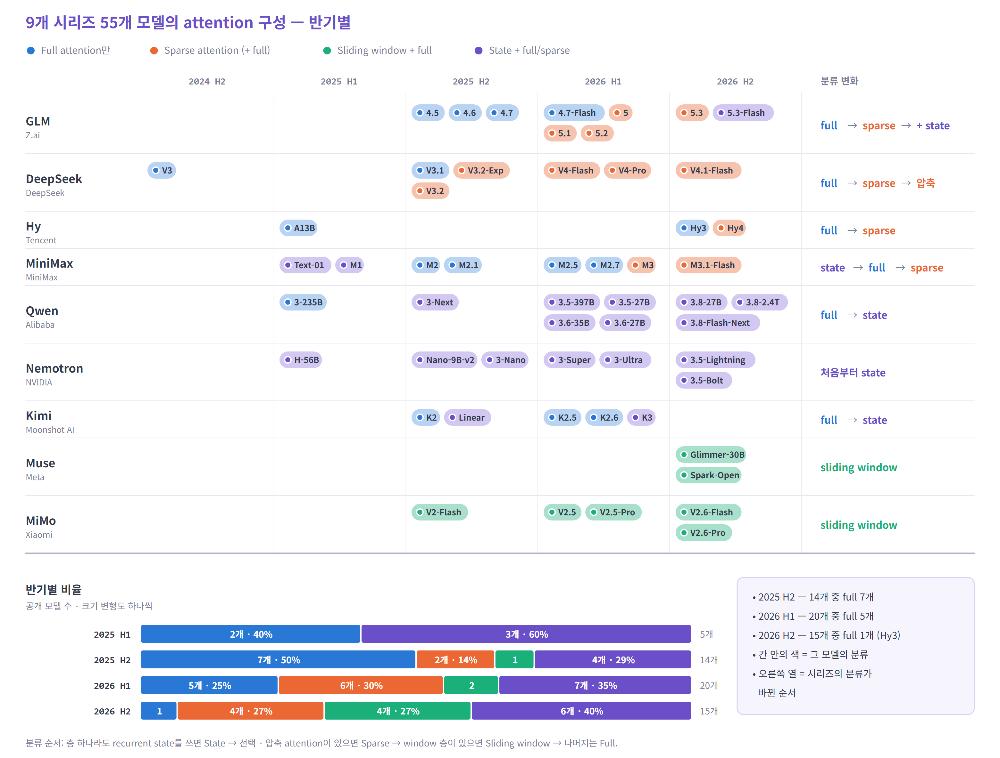
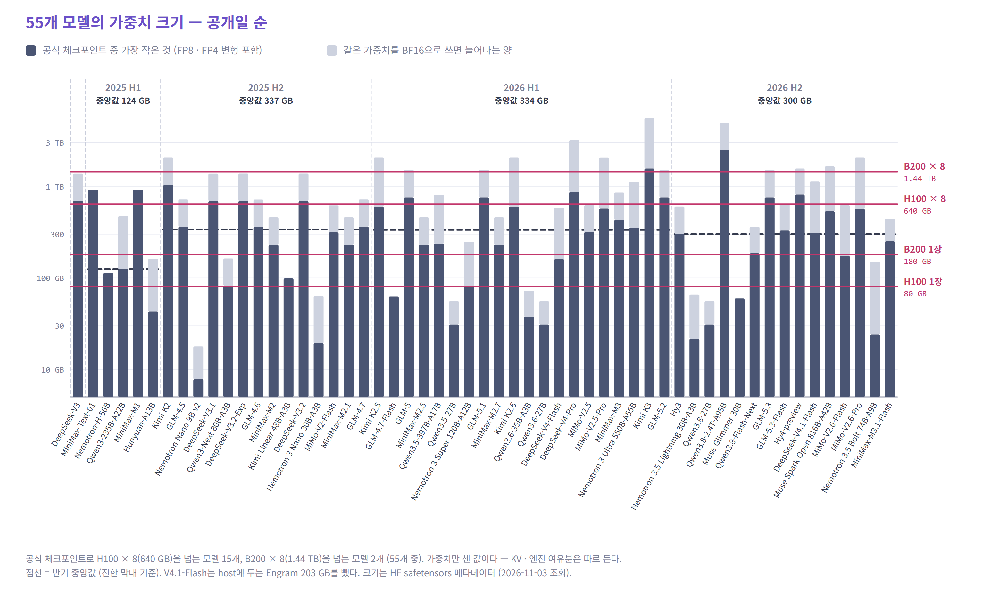
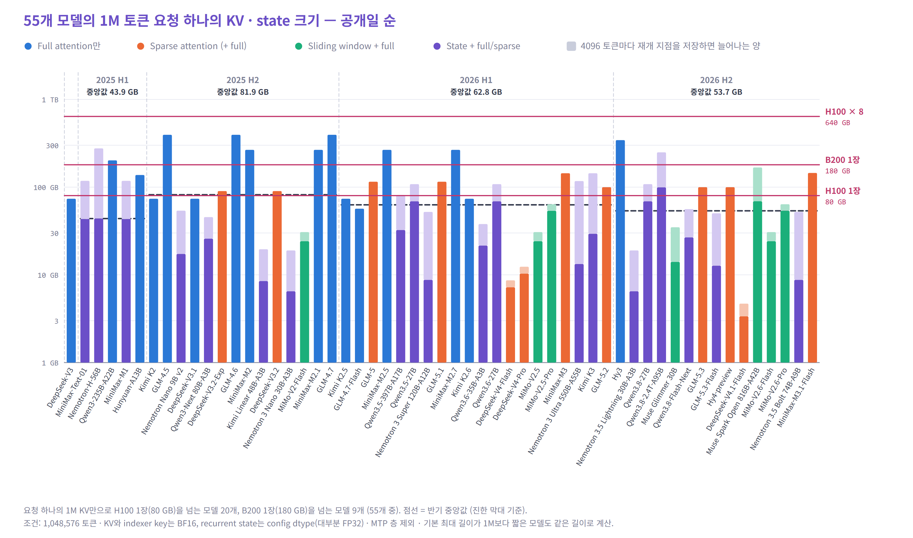
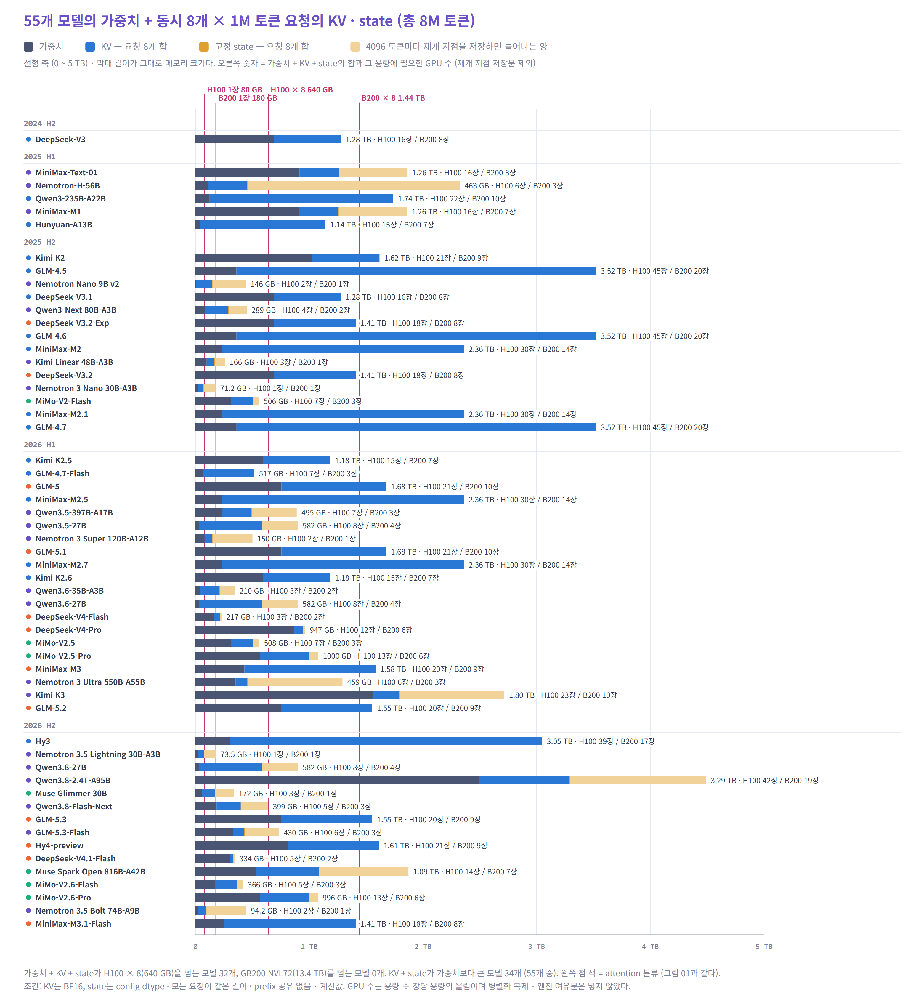
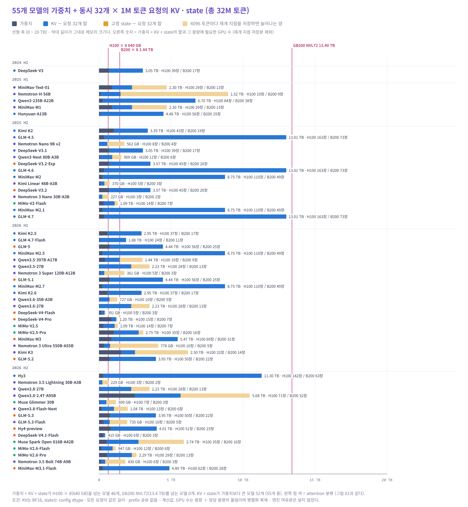
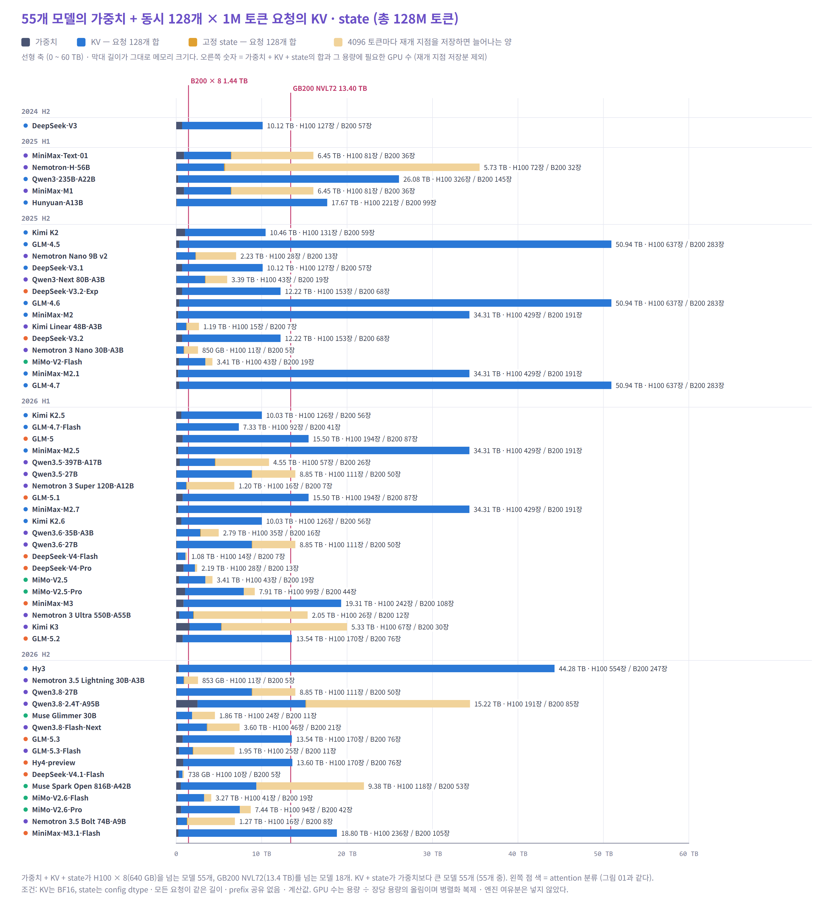
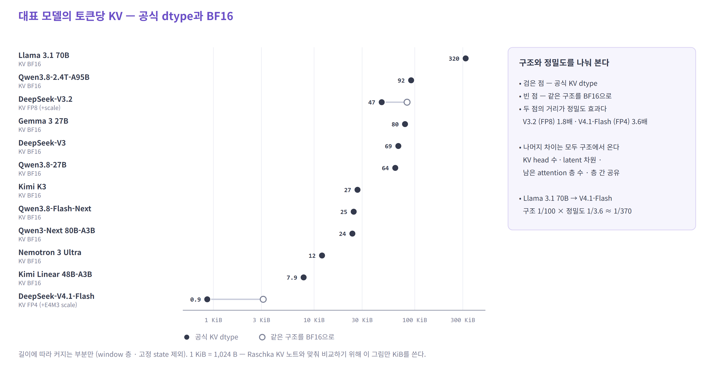

# 최신 LLM의 추론 메모리 — 가중치와 KV cache · state

- 자료 기준일: config **2026-11-02**, 체크포인트 크기 **2026-11-03** (공식 HF 저장소)
- 대상: 공개 가중치 모델의 **추론 · 서빙**. 학습 메모리와 자체 GPU 실측은 다루지 않는다
- 모든 수치는 공식 config · 체크포인트 · 기술 보고서에서 가져오거나 계산했다
- 용량은 10진 단위다 (1 GB = 10⁹ B). 체크포인트와 GPU 표기가 10진이기 때문이다
- 계획서: [llm-memory-requirements-plan.md](llm-memory-requirements-plan.md) · 기존 자료 검토: [llm-memory-related-work.md](llm-memory-related-work.md)

---

## 0. 추론 메모리의 구성

LLM이 추론할 때 GPU에 올리는 메모리는 가중치와 대화 상태 두 가지다.

| | 내용 | 크기를 정하는 것 | 쓰기 · 읽기 |
|---|---|---|---|
| **가중치** | 모델 본체. 모든 요청이 함께 쓴다 | 파라미터 수와 저장 정밀도(BF16 · FP8 · FP4). 요청 수와 무관 | 서빙 중 쓰지 않는다. 매 스텝 읽는다 |
| **대화 상태** | 요청마다 따로 갖는 메모리 | 요청 길이 × 동시 요청 수 | 요청이 끝날 때까지 쌓거나 덮어쓴다 |
| └ KV cache | 지나간 토큰마다 K · V를 한 줄씩 저장 | 토큰 수에 비례 | 토큰마다 한 줄 추가, 과거 전체를 읽는다 |
| └ 고정 state | 지나간 내용을 고정 크기로 요약 (linear attention · SSM) | 길이와 무관, 요청마다 일정 | 매 스텝 전체를 읽고 전체를 덮어쓴다 |

```text
필요한 메모리 = 가중치 + (동시 요청 수 × 요청 하나의 대화 상태) + 엔진 여유분
```

---

## 요약

1. 9개 시리즈 55개 모델 중 2026 H2 공개분 15개에서 full attention만 쓰는 모델은 Hy3 하나다. 나머지는 sparse 4개, sliding window 4개, state hybrid 6개다.
2. 가중치의 반기 중앙값은 239 → 337 → 379 → 300 GB다. 55개 중 47개가 BF16보다 낮은 정밀도로 배포된다. 17개는 H100 × 8(640 GB)을, 2개는 B200 × 8(1.44 TB)을 넘는다.
3. 1M 토큰 요청 하나의 KV · state는 3.4 GB(DeepSeek-V4.1-Flash)부터 395 GB(GLM-4.x)까지다. 반기 중앙값은 2025 H2 82 GB, 2026 H2 54 GB다.
4. 1M 요청 하나의 KV · state가 가중치보다 큰 모델은 13개다. 가중치와 같아지는 동시 1M 요청 수의 반기 중앙값은 2.6개(2025 H1)에서 7.6개(2026 H2)로 늘었다.

---

## 1. attention 구성에 따른 모델 분류

### 분류 기준

KV 크기는 attention이 지나간 토큰을 저장하고 읽는 방식에 따라 달라진다. 이 보고서는 모델을 네 가지로 나누고, 위에서부터 먼저 맞는 분류를 쓴다.

| 분류 | 지나간 토큰을 다루는 방식 | 1M 요청 하나의 KV (BF16) | 대표 모델 |
|---|---|---|---|
| **Full attention만** | 모든 층이 모든 토큰의 K · V를 저장하고 매번 전부 읽는다 | 중앙값 234 GB | |
| └ MHA → GQA | 여러 query head가 K · V head를 나눠 쓴다 | 137 ~ 395 GB | Llama 3.1 70B(344 GB), GLM-4.x, MiniMax-M2.x, Hy3 |
| └ MLA | K · V를 작은 latent 벡터 하나로 압축해 저장한다 | 57 ~ 74 GB | DeepSeek-V3.x, Kimi K2.x |
| **Sparse attention (+ full)** | KV는 모두 저장하고, 토큰마다 일부(top-k)만 골라 읽는다. DeepSeek-V4는 저장도 압축한다 | 중앙값 100 GB (V4 계열 3 ~ 10 GB) | DeepSeek-V3.2 · V4, GLM-5, MiniMax-M3, Hy4 |
| **Sliding window + full** | 일부 층은 최근 W 토큰만 남긴다. 나머지 full 층만 길이에 따라 커진다 | 중앙값 24 GB | MiMo(W 128), Muse(W 2048) |
| **State + full/sparse** | 대부분 층은 고정 크기 state를 덮어쓰고, 일부 층만 attention을 쓴다 | 중앙값 26 GB + 고정 state 0.05 ~ 0.9 GB | Qwen3.5 이후, Nemotron, Kimi K3, MiniMax-M1 |

- 저장량과 읽기량은 따로 움직인다. sparse는 읽기만 줄고 저장은 그대로다(DeepSeek-V3.2 128K 기준: 저장 6.3 GB, 한 스텝의 main KV 읽기 0.08 GB). state는 크기가 고정이지만 매 스텝 전체를 덮어쓴다
- 이 분류와 별개로 KV를 낮은 정밀도로 저장하기도 한다(V3.2 FP8, V4.1-Flash FP4). 3절부터는 구조끼리 비교하려고 KV를 모두 BF16으로 맞췄다

### 9개 시리즈의 attention 구성 변화



GLM, DeepSeek, Hy, MiniMax, Qwen, Nemotron, Kimi, Muse, MiMo의 세대별 모델 55개를 공개 반기별로 놓고 분류 색을 칠했다. 오른쪽 열은 각 시리즈의 분류가 바뀐 순서다.

- 반기별 full attention 비율: 2025 H1 40%, 2025 H2 50%, 2026 H1 25%, 2026 H2 7%(Hy3 하나)
- sparse로 바꾼 시리즈: DeepSeek(V3.2 DSA → V4 압축), GLM(GLM-5부터 DSA), MiniMax(M3 MSA), Hy(Hy4)
- state를 쓰는 시리즈: Qwen(3-Next 이후), Nemotron(처음부터 Mamba), Kimi(Linear, K3)
- sliding window를 쓰는 시리즈: MiMo, Muse
- MiniMax는 state(Text-01 · M1) → full(M2.x) → sparse(M3) 순서로 바뀌었다. GLM은 같은 날 GLM-5.3(sparse)과 GLM-5.3-Flash(state + DSA)를 공개했다
- Hy4-preview의 attention 설정은 GLM-5.2 · 5.3과 거의 같다 (MLA 78층, indexer 21층, 57층은 선택 공유)

---

## 2. 모델 가중치 크기 (공개일 순)



진한 막대는 공식 저장소가 낸 체크포인트 중 가장 작은 것(FP8 · FP4 변형 포함), 옅은 부분은 같은 가중치를 BF16으로 저장할 때 늘어나는 양이다. 빨간 선은 GPU 용량, 검은 점선은 반기 중앙값이다.

| GPU 용량 | 공식 체크포인트가 들어가는 모델 | BF16이면 |
|---|---|---|
| H100 1장 (80 GB) | 9개 | 9개 |
| B200 1장 (180 GB) | 17개 | 14개 |
| H100 × 8 (640 GB) | 38개 | 27개 |
| B200 × 8 (1.44 TB) | 53개 | 41개 |

(55개 중. 가중치만 센 값이며 KV와 엔진 여유분은 포함하지 않았다.)

- 반기 중앙값은 239 → 337 → 379 → 300 GB다. 가장 큰 모델은 Qwen3.8-2.4T(2.5 TB, FP8)와 Kimi K3(1.56 TB, MXFP4)다
- 55개 중 47개가 BF16보다 낮은 정밀도로 배포된다. 2025 H2 이후 반기 중앙값 기준으로 BF16 크기의 약 절반이다. FP4 계열(NVFP4 · MXFP4 · INT4 · FP4 expert)은 2026 H1에 7개, H2에 5개다
  - Kimi K3: 2.8T 파라미터, MXFP4로 1.56 TB. BF16이면 5.6 TB
  - DeepSeek-V4-Pro: 1.6T 파라미터, FP4 expert로 865 GB. BF16이면 3.2 TB
- 파라미터 수 × 2로 계산한 크기는 FP8 모델에서 약 2배, FP4 모델에서 약 3 ~ 4배 크게 나온다
- DeepSeek-V4.1-Flash의 Engram 표(203 GB)는 입력 토큰으로 필요한 행을 미리 알 수 있어 host 메모리에서 가져오도록 설계되었다. 그래프의 308 GB는 이것을 뺀 값이다
- MoE 모델은 활성 파라미터가 아니라 전체 파라미터를 GPU에 올린다. 어떤 expert가 선택될지 미리 알 수 없기 때문이다

---

## 3. KV cache · state 크기 (공개일 순)

### 1M 기준

요청 하나가 1M(1,048,576) 토큰을 보유한 상태로 비교한다. 최신 모델의 기본 최대 길이가 1M에 모여 있어, 구조 차이를 같은 기준으로 비교하기 위해서다. 값은 두 가지다.

- **KV@1M / state 1개** (진한 막대) — 이어서 생성하는 데 필요한 양. KV(+ indexer key) + window KV + 고정 state 한 벌
- **KV@1M / 4096 단위 저장** (옅은 부분까지) — 같은 대화를 4096 토큰마다 다시 이어 갈 수 있게 저장할 때(prefix caching)의 양
  - KV는 줄을 덧붙이기만 하므로 모든 지점이 이미 들어 있다 → 늘지 않는다
  - state는 매 스텝 덮어쓰므로 지점마다 사본이 필요하다 → state × 256
  - window KV도 지점마다 최근 W 토큰이 필요하다 → 층마다 min(1M, 256 × W) 토큰

KV와 indexer key는 모두 BF16, recurrent state는 config의 state dtype(대부분 FP32)이다.



| 반기 | 모델 수 | 128K 요청 하나 | 1M 요청 하나 | 1M · 4096 단위 저장 |
|---|---|---|---|---|
| 2025 H1 | 5 | 6.3 GB | 43.9 GB | 137 GB |
| 2025 H2 | 14 | 10.2 GB | 81.9 GB | 81.9 GB |
| 2026 H1 | 20 | 7.9 GB | 62.8 GB | 90.6 GB |
| 2026 H2 | 15 | 6.8 GB | 53.7 GB | 63.8 GB |

(반기 중앙값. 2024 H2는 DeepSeek-V3 하나라 뺐다.)

- 1M 요청 하나의 KV · state가 H100 1장(80 GB)보다 큰 모델은 20개, B200 1장(180 GB)보다 큰 모델은 9개다
- 같은 반기 안의 차이가 반기 간 중앙값 차이보다 크다. 2026 H2는 3.4 GB(V4.1-Flash)부터 344 GB(Hy3)까지다
- full GQA: GLM-4.x 395 GB, Hy3 344 GB, MiniMax-M2.x 266 GB. full MLA: Kimi K2.x · DeepSeek-V3.x 74 GB
- sparse: GLM-5 115 GB, MiniMax-M3 144 GB, Hy4 100 GB. 저장도 압축하는 DeepSeek-V4 계열은 V4-Flash 7.2 GB, V4.1-Flash 3.4 GB다
- state hybrid는 4096 단위 저장 시 크게 늘어난다: Nemotron 3 Ultra 13 → 117 GB(8.8배), Kimi K3 29 → 144 GB, Qwen3.8-2.4T 99 → 249 GB
- sliding window는 window 크기에 따라 늘어나는 정도가 다르다: MiMo(W 128) 24 → 31 GB, Muse Spark Open(W 2048) 69 → 168 GB

### 실제 서비스의 요청 길이

| 출처 | 대상 · 기간 | 요청 하나가 보유한 토큰 |
|---|---|---|
| OpenRouter *State of AI* | 100조 토큰, 2024-01 ~ 2025-11 | 평균 prompt 1.5K → 6K 이상 |
| TraceLab | Claude Code · Codex 약 4,300 세션, 2025-09 ~ 2026-06 | 코딩 에이전트 한 스텝: Claude Code P50 126K · P90 467K · P99 918K |

- 일반 채팅 · API는 수천 토큰이고, 코딩 에이전트는 대화 이력과 도구 결과가 쌓여 수십만 토큰이다. 긴 에이전트 세션은 1M에 가까워진다
- 이 보고서의 55개 모델은 기본 최대 길이가 모두 1M 이하라, 요청 하나는 1M이 상한이다. 공개 가중치 중 1M을 넘는 모델은 Llama 4 Scout(10M, 2025-04) 정도다
- 그래서 요청 하나는 1M을 기준으로 두고, 4절에서는 1M 요청을 동시에 여러 개 보유하는 경우를 본다

---

## 4. 가중치와 KV cache · state 비교

### 1M 요청을 동시에 보유할 때

서버는 요청을 여러 개 동시에 보유하고, 끝난 세션의 KV를 재사용하려고 보관하기도 한다. 1M 요청의 동시 보유 수를 8 · 32 · 128개로 가정해 가중치와 합쳤다. 동시 보유 수는 가정값이다.

| 동시 1M 요청 | 총 보유 토큰 | H100 × 8(640 GB)을 넘는 모델 | B200 × 8(1.44 TB)을 넘는 모델 | GB200 NVL72(13.4 TB)를 넘는 모델 | KV + state가 가중치보다 큰 모델 | 합계 중앙값 |
|---|---|---|---|---|---|---|
| 8개 | 8M | 33개 | 19개 | 0개 | 32개 | 1.2 TB |
| 32개 | 32M | 46개 | 37개 | 0개 | 52개 | 2.5 TB |
| 128개 | 128M | 55개 | 48개 | 18개 | 55개 | 8.8 TB |

(55개 중. 가중치만으로는 H100 × 8을 넘는 모델이 17개, B200 × 8을 넘는 모델이 2개다.)

각 그림은 모델마다 가중치(진한 회색), KV(파랑), 고정 state(주황), 4096 토큰마다 재개 지점을 저장하면 늘어나는 양(옅은 주황)을 한 막대에 이어 붙였다. 선형 축이며 그림마다 축 범위가 다르다. 오른쪽 숫자는 가중치 + KV + state의 합과 그 용량에 필요한 GPU 수다 (재개 지점 저장분 제외).







- 동시 8개에서 이미 55개 중 32개 모델의 KV + state가 가중치보다 크다. 32개부터는 거의 모든 모델이 그렇다
- full GQA 모델은 동시 32개에서 GLM-4.7 13.0 TB, Hy3 11.3 TB로 랙 하나(13.4 TB)에 가깝다. 128개에서는 51 TB, 44 TB다
- 압축 KV인 DeepSeek-V4.1-Flash는 동시 128개에서도 738 GB다
- state hybrid는 KV + state 자체는 작지만, 재개 지점을 저장하면 크게 늘어난다. 동시 32개에서 Kimi K3 2.5 TB → +3.7 TB, Nemotron 3 Ultra 0.78 TB → +3.3 TB
- 이 규모는 GPU 메모리에 모두 둘 수 없어, 실제로는 KV를 CPU 메모리 · SSD로 내려 보관하고 필요할 때 다시 올린다

### 반기별 추이

| 반기 | 가중치 | 128K 요청 하나 | 1M 요청 하나 | 가중치와 같아지는 동시 1M 요청 수 |
|---|---|---|---|---|
| 2025 H1 | 239 GB | 6.3 GB | 43.9 GB | 2.6개 |
| 2025 H2 | 337 GB | 10.2 GB | 81.9 GB | 3.1개 |
| 2026 H1 | 379 GB | 7.9 GB | 62.8 GB | 7.8개 |
| 2026 H2 | 300 GB | 6.8 GB | 53.7 GB | 7.6개 |

(모두 반기 중앙값. 마지막 열은 모델별 가중치 ÷ 1M 요청 하나의 중앙값이다.)

가중치와 1M 요청 하나 모두 2025 H2 ~ 2026 H1에 가장 크고 2026 H2에 줄었다. 가중치와 같아지는 동시 1M 요청 수는 2025년 3개 안팎에서 2026년 8개 안팎으로 늘었다.

### 동시 요청 수와 요청 길이

| 분류 | 128K 요청 | 1M 요청 | 1M · 4096 단위 저장 |
|---|---|---|---|
| Full attention만 | 7개 | 0.9개 | 0.9개 |
| Sparse (+ full) | 61개 | 7.6개 | 7.6개 |
| Sliding window + full | 84개 | 10.5개 | 8.9개 |
| State + full/sparse | 59개 | 8.1개 | 2.3개 |

(대화 상태의 합이 가중치와 같아지는 동시 요청 수, 분류별 중앙값.)

- 요청 길이가 128K에서 1M으로 8배 길어지면 같아지는 요청 수는 약 1/8이 된다
- full attention 모델은 1M 요청 1개 안팎, 다른 분류는 1M 요청 8 ~ 10개 안팎에서 대화 상태가 가중치와 같아진다
- 같아지는 요청 수가 큰 모델은 DeepSeek-V4.1-Flash 92개, V4-Pro 84개, Kimi K3 53개다
- state 모델은 4096 단위 저장을 하면 중앙값이 8.1개에서 2.3개로 줄어든다

### 쓰기 · 읽기 특성

| 대상 | 쓰기 | 읽기 (decode 한 스텝) | 수명 | 특징 |
|---|---|---|---|---|
| 가중치 (dense · shared) | 없음 | 전체를 큰 덩어리로 순차 읽기 | 서버 수명 | 배치 안의 모든 요청이 한 번 읽은 것을 함께 쓴다 |
| 가중치 (MoE expert) | 없음 | routing이 고른 expert만 | 서버 수명 | 배치가 크면 선택된 expert의 합집합이 커진다 |
| 가중치 (Engram · n-gram 표) | 없음 | 토큰이 정한 몇 행 (작고 흩어진 읽기) | 서버 수명 | 주소를 미리 알 수 있어 host 메모리에 둘 수 있다 |
| KV (full) | 토큰마다 한 줄 추가 | 과거 전체 | 요청 수명 | 길이 × 요청 수에 비례 |
| KV (sparse) | 한 줄 추가 (+ indexer key) | indexer 전체를 훑고 고른 줄만 | 요청 수명 | 읽기는 줄지만 흩어진다. 저장은 full과 같다 |
| KV (window) | 한 줄 추가, 오래된 줄 회수 | 최근 W 토큰만 | window 동안 | 링 버퍼 |
| 고정 state | 매 스텝 전체 덮어쓰기 | 매 스텝 전체 | 요청 수명 | 되돌리기 · 재개에는 사본이 필요하다 |

**decode 한 스텝에 읽고 쓰는 양** (요청 1개, 128K 보유, 분석값)

| 모델 | 가중치 읽기 | 대화 상태 읽기 | 대화 상태 쓰기 |
|---|---|---|---|
| Llama 3.1 70B | 141 GB | KV 43 GB | KV 0.3 MB |
| DeepSeek-V3 | 약 37 GB (활성 37B · FP8) | KV 9.2 GB | KV 70 KB |
| DeepSeek-V3.2 | 약 37 GB | main KV 0.08 GB + indexer 1.06 GB (저장은 6.3 GB) | 48 KB |
| Qwen3.8-27B | 약 30 GB (FP8) | KV 8.6 GB + state 0.15 GB | KV 66 KB + state 0.15 GB 덮어쓰기 |

- 가중치는 배치 전체가 한 번 읽고, KV는 요청 수만큼 읽는다. Llama 3.1 70B에서 128K 요청 32개면 가중치 141 GB, KV 1.4 TB를 읽는다. 요청이 늘수록 읽기의 대부분이 KV가 된다는 점은 Hooper(2026) 2장, *The KV Cache Is the New Memory Wall*에서도 다룬다
- KV는 토큰마다 수십 KB를 추가하고, state는 매 스텝 수백 MB 전체를 다시 쓴다
- 캐시 적중 · 커널 융합 · 실제 routing은 반영하지 않은 분석값이다

---

## 5. 정리

- 모델이 GPU에 들어가는지는 가중치로 판단한다. 파라미터 수가 아니라 공식 체크포인트의 실제 바이트를 기준으로 한다
- 동시에 받을 수 있는 긴 요청 수는 attention 구성에 따라 크게 달라진다. full GQA는 1M 요청 하나가 가중치와 비슷하거나 크고, 압축 KV는 수십 개를 받아도 가중치보다 작다
- KV 감소를 비교할 때는 저장량 · 읽기량 · 재개 지점 저장량을 나눠 보고, 정밀도 효과와 구조 효과를 구분한다
- 실제 배포는 이 보고서의 값보다 메모리가 더 든다. 병렬화 복제, 엔진 예약, prefill 순간 최대치는 넣지 않았다 ([부록 D](#d-실행-메모리에-더해지는-것))

**다루지 않은 것.** 자체 GPU 실측, 품질 비교, prefill 순간 최대 메모리, 비공개 모델, Mistral Large 4(2026-10-06 공개 preview로 attention 설정을 확인하지 못함), DeepSeek-V4-Pro의 압축 KV 세부 계산.

---

## 부록

### A. 전체 표 — 55개 모델 (분류별, 공개일 순)

<details>
<summary>펼치기</summary>

| 분류 | 모델 | 공개일 | Attention 구성 | 가중치 (포맷) | BF16이면 | KV@1M / state 1개 | KV@1M / 4096 단위 저장 | 기본 최대 길이 |
|---|---|---|---|---|---|---|---|---|
| **Full attention만** | DeepSeek-V3 | 2024-12-25 | MLA 61층 | 688 GB (FP8) | 1.37 TB | 73.7 GB | 같음 | 128K |
|  | Qwen3-235B-A22B | 2025-04-27 | GQA 94층 (KV 4 × 128) | 239 GB (FP8) | 470 GB | 202 GB | 같음 | 40K |
|  | Hunyuan-A13B | 2025-06-25 | GQA 32층 (KV 8 × 128) | 80.9 GB (FP8) | 161 GB | 137 GB | 같음 | 32K |
|  | Kimi K2 | 2025-07-11 | MLA 61층 | 1.03 TB (FP8) | 2.05 TB | 73.7 GB | 같음 | 128K |
|  | GLM-4.5 | 2025-07-20 | GQA 92층 (KV 8 × 128) | 361 GB (FP8) | 717 GB | 395 GB | 같음 | 128K |
|  | DeepSeek-V3.1 | 2025-08-21 | MLA 61층 | 689 GB (FP8) | 1.37 TB | 73.7 GB | 같음 | 128K |
|  | GLM-4.6 | 2025-09-29 | GQA 92층 (KV 8 × 128) | 361 GB (FP8) | 714 GB | 395 GB | 같음 | 200K |
|  | MiniMax-M2 | 2025-10-22 | GQA 62층 (KV 8 × 128) | 230 GB (FP8) | 457 GB | 266 GB | 같음 | 196K |
|  | MiniMax-M2.1 | 2025-12-20 | GQA 62층 (KV 8 × 128) | 230 GB (FP8) | 457 GB | 266 GB | 같음 | 196K |
|  | GLM-4.7 | 2025-12-22 | GQA 92층 (KV 8 × 128) | 362 GB (FP8) | 717 GB | 395 GB | 같음 | 200K |
|  | Kimi K2.5 | 2026-01-01 | MLA 61층 | 595 GB (INT4) | 2.05 TB | 73.7 GB | 같음 | 256K |
|  | GLM-4.7-Flash | 2026-01-19 | MLA 47층 | 62.4 GB (BF16) | 같음 | 56.8 GB | 같음 | 200K |
|  | MiniMax-M2.5 | 2026-02-12 | GQA 62층 (KV 8 × 128) | 230 GB (FP8) | 457 GB | 266 GB | 같음 | 196K |
|  | MiniMax-M2.7 | 2026-04-09 | GQA 62층 (KV 8 × 128) | 230 GB (FP8) | 457 GB | 266 GB | 같음 | 200K |
|  | Kimi K2.6 | 2026-04-14 | MLA 61층 | 595 GB (INT4) | 2.05 TB | 73.7 GB | 같음 | 256K |
|  | Hy3 | 2026-07-02 | GQA 80층 (KV 8 × 128) | 300 GB (FP8) | 598 GB | 344 GB | 같음 | 256K |
| **Sparse attention (+ full)** | DeepSeek-V3.2-Exp | 2025-09-29 | MLA + DSA 61층 (indexer 61층) | 690 GB (FP8) | 1.37 TB | 90.1 GB | 같음 | 128K |
|  | DeepSeek-V3.2 | 2025-12-01 | MLA + DSA 61층 (indexer 61층) | 689 GB (FP8) | 1.37 TB | 90.1 GB | 같음 | 128K |
|  | GLM-5 | 2026-02-11 | MLA + DSA 78층 (indexer 78층) | 756 GB (FP8) | 1.51 TB | 115 GB | 같음 | 200K |
|  | GLM-5.1 | 2026-04-03 | MLA + DSA 78층 (indexer 78층) | 756 GB (FP8) | 1.51 TB | 115 GB | 같음 | 200K |
|  | DeepSeek-V4-Flash | 2026-04-22 | CSA 21층 + HCA 20층 + SWA만 2층 (모든 층 SWA 128) | 160 GB (FP4 expert + FP8) | 582 GB | 7.2 GB | 8.7 GB | 1M |
|  | DeepSeek-V4-Pro | 2026-04-22 | CSA 30층 + HCA 31층 + SWA만 0층 (모든 층 SWA 128) | 865 GB (FP4 expert + FP8) | 3.20 TB | 10.3 GB | 12.4 GB | 1M |
|  | MiniMax-M3 | 2026-06-02 | GQA 60층 (KV 4 × 128) · MSA 57층 + full 3층 | 854 GB (BF16) | 같음 | 144 GB | 같음 | 1M |
|  | GLM-5.2 | 2026-06-16 | MLA + DSA 78층 (indexer 21층, 나머지 57층은 선택 공유) | 755 GB (FP8) | 1.51 TB | 99.9 GB | 같음 | 1M |
|  | GLM-5.3 | 2026-08-25 | MLA + DSA 78층 (indexer 21층, 나머지 57층은 선택 공유) | 755 GB (FP8) | 1.51 TB | 99.9 GB | 같음 | 1M |
|  | Hy4-preview | 2026-08-27 | MLA + DSA 78층 (indexer 21층, 나머지 57층은 선택 공유) | 814 GB (FP8) | 1.56 TB | 99.9 GB | 같음 | 1M |
|  | DeepSeek-V4.1-Flash | 2026-09-10 | 압축 global KV + 층 간 공유 + SWA 128 (40층) | 308 GB (FP4 expert + FP8) | 1.13 TB | 3.4 GB | 4.7 GB | 1M |
|  | MiniMax-M3.1-Flash | 2026-10-17 | GQA 60층 (KV 4 × 128) · MSA 60층 | 250 GB (8-bit) | 441 GB | 145 GB | 같음 | 1M |
| **Sliding window + full** | MiMo-V2-Flash | 2025-12-16 | SWA 39층 (window 128, KV 8) + full 9층 (KV 4) | 313 GB (FP8) | 620 GB | 24.2 GB | 30.7 GB | 256K |
|  | MiMo-V2.5 | 2026-04-27 | SWA 39층 (window 128, KV 8) + full 9층 (KV 4) | 315 GB (FP8) | 622 GB | 24.2 GB | 30.7 GB | 1M |
|  | MiMo-V2.5-Pro | 2026-04-27 | SWA 60층 (window 128, KV 8) + full 10층 (KV 8) | 1.03 TB (FP8) | 2.05 TB | 53.7 GB | 63.8 GB | 1M |
|  | Muse Glimmer 30B | 2026-08-09 | SWA 39층 (window 2048) + full 13층 (KV 2 × 128) | 59.6 GB (BF16) | 같음 | 14.0 GB | 34.9 GB | 128K |
|  | Muse Spark Open 816B-A42B | 2026-09-15 | SWA 46층 (window 2048) + full 16층 (KV 16 × 64) | 533 GB (NVFP4) | 1.64 TB | 69.1 GB | 168 GB | 1M |
|  | MiMo-V2.6-Flash | 2026-09-21 | SWA 39층 (window 128, KV 8) + full 9층 (KV 4) | 173 GB (FP4 혼합) | 622 GB | 24.2 GB | 30.7 GB | 1M |
|  | MiMo-V2.6-Pro | 2026-09-21 | SWA 60층 (window 128, KV 8) + full 10층 (KV 8) | 566 GB (FP4 혼합) | 2.05 TB | 53.7 GB | 63.8 GB | 1M |
| **State + full/sparse** | MiniMax-Text-01 | 2025-01-12 | lightning attention 70층 + GQA 10층 (KV 8 × 128) | 915 GB (BF16) | 같음 | 43.2 GB | 118 GB | 1M |
|  | Nemotron-H-56B | 2025-04-08 | Mamba-2 54층 + GQA 10층 (KV 8 × 128) | 113 GB (BF16) | 같음 | 43.9 GB | 277 GB | 8K |
|  | MiniMax-M1 | 2025-06-13 | lightning attention 70층 + GQA 10층 (KV 8 × 128) | 912 GB (BF16) | 같음 | 43.2 GB | 118 GB | 1M |
|  | Nemotron Nano 9B v2 | 2025-08-12 | Mamba-2 27층 + GQA 4층 (KV 8 × 128) | 7.8 GB (NVFP4) | 17.8 GB | 17.3 GB | 53.9 GB | 128K |
|  | Qwen3-Next 80B-A3B | 2025-09-09 | Gated DeltaNet 36층 + GQA 12층 (KV 2 × 256) | 82.0 GB (FP8) | 163 GB | 25.8 GB | 45.6 GB | 262K |
|  | Kimi Linear 48B-A3B | 2025-10-30 | KDA 20층 + MLA 7층 | 98.2 GB (BF16) | 같음 | 8.5 GB | 19.6 GB | 1M |
|  | Nemotron 3 Nano 30B-A3B | 2025-12-04 | Mamba-2 23층 + GQA 6층 (KV 2 × 128) | 19.3 GB (NVFP4) | 63.2 GB | 6.5 GB | 19.0 GB | 262K |
|  | Qwen3.5-397B-A17B | 2026-02-16 | Gated DeltaNet 45층 + GQA 15층 (KV 2 × 256) | 406 GB (FP8) | 807 GB | 32.4 GB | 81.4 GB | 262K |
|  | Qwen3.5-27B | 2026-02-24 | Gated DeltaNet 48층 + GQA 16층 (KV 4 × 256) | 30.9 GB (FP8) | 55.6 GB | 68.9 GB | 108 GB | 262K |
|  | Nemotron 3 Super 120B-A12B | 2026-03-10 | Mamba-2 40층 + GQA 8층 (KV 2 × 128) | 80.3 GB (NVFP4) | 247 GB | 8.8 GB | 52.2 GB | 262K |
|  | Qwen3.6-35B-A3B | 2026-04-15 | Gated DeltaNet 30층 + GQA 10층 (KV 2 × 256) | 37.5 GB (FP8) | 71.9 GB | 21.5 GB | 38.0 GB | 262K |
|  | Qwen3.6-27B | 2026-04-21 | Gated DeltaNet 48층 + GQA 16층 (KV 4 × 256) | 30.9 GB (FP8) | 55.6 GB | 68.9 GB | 108 GB | 262K |
|  | Nemotron 3 Ultra 550B-A55B | 2026-06-03 | Mamba-2 48층 + GQA 12층 (KV 2 × 128) | 352 GB (NVFP4) | 1.12 TB | 13.3 GB | 117 GB | 262K |
|  | Kimi K3 | 2026-06-13 | KDA 69층 + MLA 24층 | 1.56 TB (MXFP4) | 5.56 TB | 29.4 GB | 144 GB | 1M |
|  | Nemotron 3.5 Lightning 30B-A3B | 2026-08-01 | Mamba-2 23층 + GQA 6층 (KV 2 × 128) | 21.6 GB (NVFP4) | 65.8 GB | 6.5 GB | 19.0 GB | 262K |
|  | Qwen3.8-27B | 2026-08-05 | Gated DeltaNet 48층 + GQA 16층 (KV 4 × 256) | 30.9 GB (FP8) | 55.6 GB | 68.9 GB | 108 GB | 262K |
|  | Qwen3.8-2.4T-A95B | 2026-08-08 | Gated DeltaNet 69층 + GQA 23층 (KV 4 × 256) | 2.50 TB (FP8) | 4.89 TB | 99.4 GB | 249 GB | 262K |
|  | Qwen3.8-Flash-Next | 2026-08-24 | Gated DeltaNet 36층 + sparse GQA 12층 (indexer 1/4 압축) | 186 GB (FP8) | 360 GB | 26.7 GB | 56.1 GB | 262K |
|  | GLM-5.3-Flash | 2026-08-25 | KDA 34층 + MLA·DSA 11층 (RoPE 없음, indexer 1/4 압축) | 328 GB (FP8) | 643 GB | 12.7 GB | 50.3 GB | 1M |
|  | Nemotron 3.5 Bolt 74B-A9B | 2026-10-09 | Mamba-2 40층 + GQA 8층 (KV 2 × 128) | 150 GB (BF16) | 같음 | 8.8 GB | 52.2 GB | 262K |

- **가중치** = 공식 저장소(같은 회사의 FP8 · NVFP4 등 변형 저장소 포함) 중 가장 작은 체크포인트. 크기는 safetensors의 dtype별 원소 수 × 바이트이고, FP4 · INT4처럼 묶어 저장하는 dtype이 있으면 index의 `total_size`(없으면 `usedStorage`)를 썼다. V4.1-Flash는 host에 두는 Engram 203 GB를 뺐다
- **BF16이면** = BF16 저장소의 크기, 없으면 파라미터 수 × 2. "같음"은 공식 체크포인트가 BF16이라는 뜻이다
- **4096 단위 저장의 "같음"** = 재개 지점을 저장해도 늘지 않는다 (KV만 있는 구조)
- 공개일은 공식 HF 저장소 생성일, 기본 최대 길이는 config의 `max_position_embeddings`다
- DeepSeek-V4 · V4-Pro는 config의 `compress_ratios`로 층을 셌다. CSA 층은 4 토큰마다 512차원 entry 하나 + indexer key, HCA 층은 128 토큰마다 하나, 모든 층에 SWA 128이 있다고 계산했다. V4.1-Flash의 global KV(3,200 B/token)는 기술 보고서의 BF16 환산값이다
- GLM-5.2 · 5.3 · Hy4는 `indexer_types`가 `full`인 21층만 indexer key를 저장한다고 보았다. GLM-5.3-Flash와 Qwen3.8-Flash-Next는 indexer key를 1/4로 압축한다
- MiniMax-Text-01 · M1의 lightning attention state, Kimi KDA state, Nemotron-H-56B · Nano 9B v2의 SSM state는 config에 dtype이 없어 FP32로 가정했다 (BF16이면 state 부분이 절반)
- MiniMax-M3.1-Flash의 체크포인트는 U8 저장이 대부분인데 크기가 파라미터당 약 1바이트라 "8-bit"로 적었다. MiMo-V2.6 RL 체크포인트는 파라미터당 약 0.55바이트라 "FP4 혼합"으로 적었다
- Muse Spark Open은 접근 제한 저장소라 config는 unsloth 미러에서 읽었다
- 전체 수치: [data/lineage-kv1m.csv](llm-memory-requirements/data/lineage-kv1m.csv)

</details>

### B. 대표 모델 상세 (128K 기준, 공식 KV dtype)

| 모델 | 공개 (HF) | GPU 상주 가중치 | BF16 환산 | 토큰당 KV (공식 / BF16) | 고정 state | 128K 요청 하나 | 기본 최대 길이 |
|---|---|---|---|---|---|---|---|
| Llama 3.1 70B | 2024-07 | 141 GB (BF16) | 141 GB | 327,680 B / 동일 | — | 43.0 GB | 128K |
| Gemma 3 27B | 2025-03 | 55 GB (BF16) | 55 GB | 81,920 B / 동일 (+ local 436 MB 상한) | — | 11.2 GB | 128K |
| DeepSeek-V3 | 2024-12 | 689 GB (FP8) | 1.37 TB | 70,272 B / 동일 | — | 9.2 GB | 128K |
| DeepSeek-V3.2 | 2025-12 | 689 GB (FP8) | 1.37 TB | 48,068 B / 85,888 B | — | 6.3 GB | 128K |
| DeepSeek-V4.1-Flash | 2026-09 | 308 GB (FP8 + FP4 expert) | 1.13 TB | 890 B / 3,200 B (+ SWA 약 3 MB) | — | 0.12 GB | 1M |
| Qwen3.8-27B | 2026-08 | 31 GB (FP8) | 56 GB | 65,536 B / 동일 | 154 MB | 8.7 GB | 262K |
| Qwen3.8-2.4T-A95B | 2026-08 | 2.50 TB (FP8) | 4.89 TB | 94,208 B / 동일 | 587 MB | 12.9 GB | 262K |
| Kimi K3 | 2026-06 | 1.56 TB (MXFP4) | 5.56 TB | 27,648 B / 동일 | 449 MB | 4.1 GB | 1M |
| Nemotron 3 Ultra | 2026-06 | 352 GB (NVFP4) | 1.12 TB | 12,288 B / 동일 | 408 MB | 2.0 GB | 262K (공식 최대 1M) |

- 이 표만 KV를 **공식 dtype**으로 셌다 (V3.2 FP8, V4.1-Flash FP4). 본문 3 · 4절은 BF16이다
- **DeepSeek 계열의 KV 축소에는 구조와 정밀도가 섞여 있다.** V3 → V3.2는 저장 구조가 같고 FP8로 줄었다. V4.1-Flash는 압축 · 층 간 공유로 구조상 1/22, FP4로 다시 1/3.6이다. 기술 보고서의 "V1 대비 1/437"도 두 효과를 합친 값이다
- 전체 수치: [data/memory-results.csv](llm-memory-requirements/data/memory-results.csv). 그림과 표는 모두 [make_figures.py](llm-memory-requirements/figures/make_figures.py) 한 파일에서 나온다



빈 점과 검은 점이 떨어진 모델은 KV를 BF16보다 낮은 정밀도로 저장한다. 나머지 차이는 모두 구조에서 나온다. 길이에 따라 커지는 부분만 보여 주며, 이 그림만 KiB(1,024 B)를 쓴다.

### C. 계산식

```text
대화 상태(T)  = KV_token × T  +  Σ window층 min(T, W) × KV_token,층  +  고정 state
동시 요청 B개 = 가중치 + B × 대화 상태(T)
같아지는 수 N = 가중치 ÷ 대화 상태(T)

GQA · MHA     KV_token = 층 수 × KV head × head 차원 × 2(K, V) × 바이트
MLA           KV_token = 층 수 × (latent + RoPE 차원) × 바이트      ← K와 V로 두 번 세지 않는다
Gated DeltaNet · KDA   state = 층 수 × value head × d_k × d_v × 4 B(FP32)  +  conv state
Mamba-2       state = 층 수 × head × head 차원 × d_state × 4 B(FP32)  +  conv state
```

- **T**는 요청이 지금 보유한 토큰 수(입력 + 지금까지의 출력)다. 최대 지원 길이가 아니다
- 토큰 수가 같아도 tokenizer가 다르면 같은 양의 텍스트가 아니다

**모델별 계산 메모**

| 모델 | 근거와 가정 |
|---|---|
| Llama 3.1 70B | 80층 × KV head 8 × 128 × 2 × 2 B |
| Gemma 3 27B | 62층, `sliding_window_pattern` 6 → global 10층 · local 52층(window 1024), KV head 16 × 128. local 층은 엔진이 window 밖을 회수한다고 가정 |
| DeepSeek-V3 | 61층 × (512 + 64) × BF16. 체크포인트 index의 total_size는 BF16 기준이라 잘못되어 있어 dtype별 원소 수로 계산 |
| DeepSeek-V3.2 | main KV는 FlashMLA FP8 형식으로 층당 656 B (512 FP8 + 16 B scale + 128 B RoPE BF16). indexer key는 층당 132 B (128 FP8 + 4 B scale) |
| DeepSeek-V4.1-Flash | global KV 890 B/token (FP4 E2M1 + 16채널마다 E4M3 scale)은 기술 보고서의 공식값. SWA는 40층 × 128 토큰 × 576 B(FP8)로 약 3 MB. Engram은 safetensors header에서 2 × (384M × 256 FP8 + scale) = 203 GB |
| Qwen3.8 계열 | `layer_types`로 층을 셌다. `mamba_ssm_dtype: float32`. conv state는 kernel 4 · BF16 |
| Kimi K3 | `full_attn_layers` 24개 · `kda_layers` 69개. MLA는 latent 512 + RoPE 64를 저장한다고 가정(`mla_use_nope`이면 11% 작아질 수 있다). KDA state dtype은 FP32로 가정 |
| Nemotron 3 Ultra | `layers_block_type`에서 Mamba 48 · attention 12. KV head 2 × 128. `mamba_ssm_cache_dtype: float32`, d_inner 16,384, n_groups 8, d_state 128 |

Raschka KV 노트의 값과 일치한다 — DeepSeek-V3 68.6 KiB, Qwen3-Next 24 KiB, V4.1-Flash 3.125 KiB(BF16) / 890 B(FP4). 그의 계산기는 고정 state · window 회수 · sparse indexer를 넣지 않는다고 밝히고 있어, 이 보고서는 그 세 가지를 보완했다.

### D. 실행 메모리에 더해지는 것

계산값 위에 다음이 더해진다. 모델과 엔진마다 크기가 달라 일괄 비율로 더하지 않았다.

- **병렬화 복제** — tensor parallel(TP)은 KV head를 GPU에 나눠 담는다. KV head가 GPU 수보다 적으면 같은 KV를 여러 GPU가 복제한다. MLA는 KV head가 사실상 1개라 TP8에서 8개 GPU가 모두 같은 latent를 들고 있다. 그래서 SGLang 등은 attention 부분만 data parallel로 돌린다(DP attention). 나눌 수 없는 embedding · norm, EP의 중복 expert도 복제된다
- **엔진 예약** — vLLM은 GPU 메모리 사용 비율을 미리 정해 KV pool을 잡는다. `nvidia-smi`에는 예약량이 보인다. 시작 로그의 `Maximum concurrency for N tokens per request: X`가 실제로 받을 수 있는 요청 수다
- **hybrid 페이지 맞춤** — vLLM의 hybrid KV cache manager는 attention 층과 Mamba 층의 page 크기를 맞추느라 state를 padding한다. prefix caching을 켜면 블록 경계마다 state 사본을 저장한다 (3절의 4096 단위 저장)
- **prefill 순간 최대치 · activation · CUDA graph · 통신 버퍼**
- **speculative decoding** — MTP · drafter 가중치와 KV, recurrent state의 되돌리기용 사본
- Hopper(H100)에는 FP4 tensor core가 없다. FP4 체크포인트를 H100에서 어떤 커널로 실행할 수 있는지는 확인하지 못했다

### E. 출처

**모델 설정 · 체크포인트**

- 55개 모델의 config 원본: `data/raw/cfg_*.json` (2026-11-02 기준 각 공식 HF 저장소, Muse Spark Open만 unsloth 미러)
- 체크포인트 크기: `data/raw/checkpoint-sizes-lineage.json` (2026-11-03 HF API — safetensors dtype별 원소 수, index `total_size`, `usedStorage`, revision `sha`). 대표 모델의 이전 조회분은 `data/raw/checkpoint-sizes.json` (2026-10-27)
- V4.1-Flash Engram 크기: `data/raw/hdr_v41_*.json` (safetensors header)

| 모델 | 저장소 | revision |
|---|---|---|
| Llama 3.1 70B | [meta-llama/Llama-3.1-70B-Instruct](https://huggingface.co/meta-llama/Llama-3.1-70B-Instruct) (config는 unsloth 미러) | 1605565b47 |
| Gemma 3 27B | [google/gemma-3-27b-it](https://huggingface.co/google/gemma-3-27b-it) (config는 unsloth 미러) | 005ad3404e |
| DeepSeek-V3 | [deepseek-ai/DeepSeek-V3](https://huggingface.co/deepseek-ai/DeepSeek-V3) · [arXiv:2412.19437](https://arxiv.org/abs/2412.19437) | e815299b0b |
| DeepSeek-V3.2 | [deepseek-ai/DeepSeek-V3.2](https://huggingface.co/deepseek-ai/DeepSeek-V3.2) | a7e62ac04e |
| DeepSeek-V4.1-Flash | [deepseek-ai/DeepSeek-V4.1-Flash](https://huggingface.co/deepseek-ai/DeepSeek-V4.1-Flash) · [arXiv:2609.19969](https://arxiv.org/abs/2609.19969) | 314113f8a7 |
| Qwen3.8-27B | [Qwen/Qwen3.8-27B](https://huggingface.co/Qwen/Qwen3.8-27B) · [-FP8](https://huggingface.co/Qwen/Qwen3.8-27B-FP8) | 1d4bf0f2ff |
| Qwen3.8-2.4T-A95B | [Qwen/Qwen3.8-2.4T-A95B](https://huggingface.co/Qwen/Qwen3.8-2.4T-A95B) · [-FP8](https://huggingface.co/Qwen/Qwen3.8-2.4T-A95B-FP8) | 207bd685a7 · d2dc35658b |
| Kimi K3 | [moonshotai/Kimi-K3](https://huggingface.co/moonshotai/Kimi-K3) | f831ab6681 |
| Nemotron 3 Ultra | [NVFP4](https://huggingface.co/nvidia/NVIDIA-Nemotron-3-Ultra-550B-A55B-NVFP4) · [BF16](https://huggingface.co/nvidia/NVIDIA-Nemotron-3-Ultra-550B-A55B-BF16) · [연구 페이지](https://research.nvidia.com/labs/nemotron/Nemotron-3-Ultra/) | 02462641f1 · 77df655d5e |
| Kimi Linear 48B-A3B | [moonshotai/Kimi-Linear-48B-A3B-Instruct](https://huggingface.co/moonshotai/Kimi-Linear-48B-A3B-Instruct) · [arXiv:2510.26692](https://arxiv.org/abs/2510.26692) | e1df551a44 |

**해설 · 분석 자료**

- Sebastian Raschka, [LLM Memory Calculator](https://sebastianraschka.com/llm-architecture-gallery/memory-calculator/) · [KV cache 계산 노트](https://sebastianraschka.com/llm-architecture-gallery/kv-cache-calculations/) — 모델별 토큰당 KV의 교차 확인
- [How To Scale Your Model — All About Transformer Inference](https://jax-ml.github.io/scaling-book/inference/) — 가중치 · KV · 배치와 decode 속도의 관계
- Coleman Hooper, [Memory-Efficient LLM Inference Algorithms](https://www2.eecs.berkeley.edu/Pubs/TechRpts/2026/EECS-2026-175.html), UC Berkeley, 2026-05 — 2장: 문맥이 길어지면 주된 트래픽이 가중치에서 KV로 이동
- T. Singh, [The KV Cache Is the New Memory Wall](https://arxiv.org/abs/2609.30854), 2026-09 프리프린트 — GPU별 교차 길이. paging과 prefix 공유는 대역폭이 아니라 용량을 줄인다
- OpenRouter, [State of AI: An Empirical 100 Trillion Token Study](https://openrouter.ai/state-of-ai) ([arXiv:2601.10088](https://arxiv.org/abs/2601.10088)) — 요청당 평균 prompt 길이의 증가 (2024-01 ~ 2025-11)
- [TraceLab: Characterizing Coding Agent Workloads for LLM Serving](https://arxiv.org/abs/2606.30560) — Claude Code · Codex 세션의 스텝별 prefix 길이 분포
- [FlashMLA](https://github.com/deepseek-ai/FlashMLA) — V3.2 FP8 KV 형식(656 B)
- [vLLM Hybrid KV Cache Manager](https://docs.vllm.ai/en/latest/design/hybrid_kv_cache_manager/) — window 회수, Mamba state padding, prefix caching
- [SGLang DeepSeek 문서](https://docs.sglang.io/docs/basic_usage/deepseek_v3) · [LMSYS 블로그(대규모 EP)](https://lmsys.org/blog/2025-05-05-large-scale-ep/) — MLA KV의 TP 복제와 DP attention
- [NVIDIA H100](https://www.nvidia.com/en-us/data-center/h100/) — 노드 용량의 표기값

**확인하지 못한 것**

- H100에서 FP4 · NVFP4 체크포인트를 실행할 수 있는 커널과 엔진 버전
- Nemotron 3 Ultra · Kimi K3의 recurrent state를 엔진이 실제로 어떤 dtype으로 할당하는지
- Kimi K3 MLA가 RoPE 차원을 저장하는지
- V4.1-Flash의 indexer cache가 공식 global KV 890 B에 포함되는지. 이 보고서는 포함된 것으로 보았다
- MiniMax-M3.1-Flash · MiMo-V2.6 RL 체크포인트의 정확한 양자화 형식 (U8로 저장되어 있어 크기로만 추정)
- I/O 종설(*Artificial Intelligence Review*, 2026)의 게재 정보와 그림. Springer 페이지에 접근하지 못했고, 같은 제목의 Research Square 프리프린트(2026-03)만 확인했다
