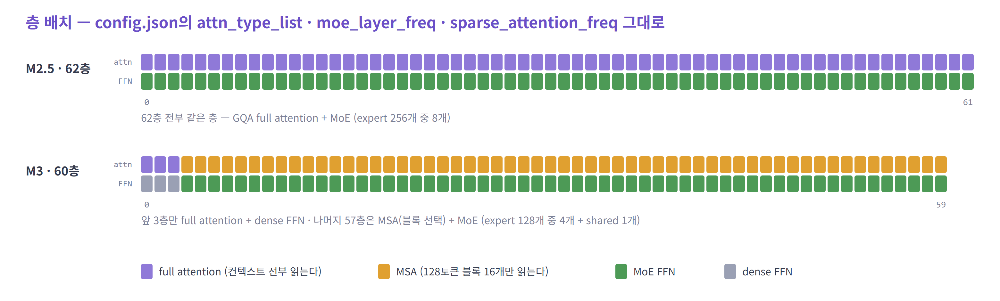
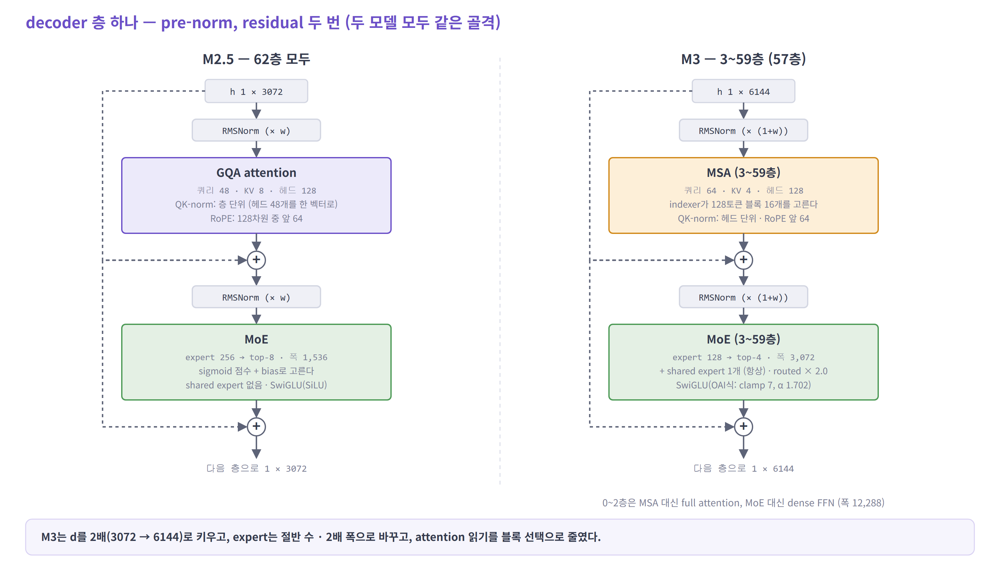
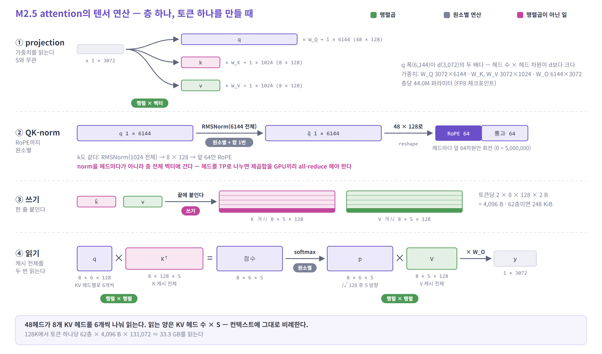
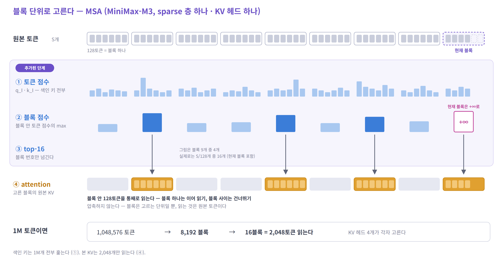
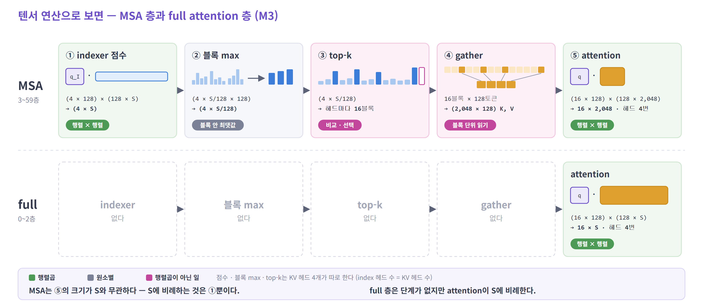
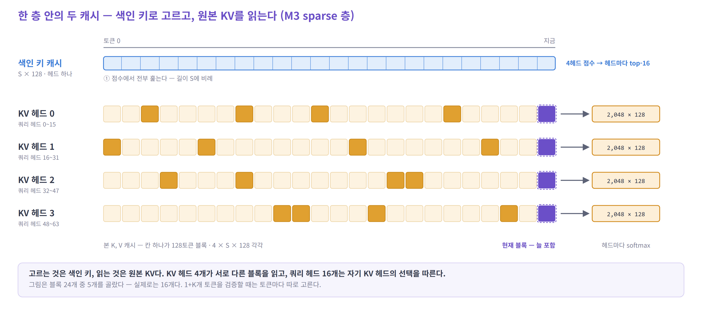
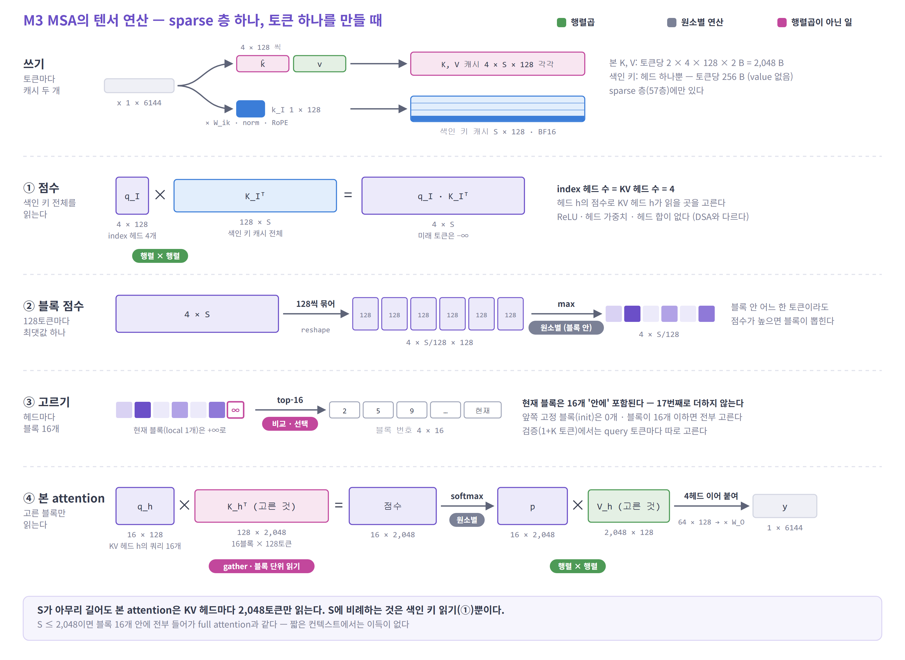
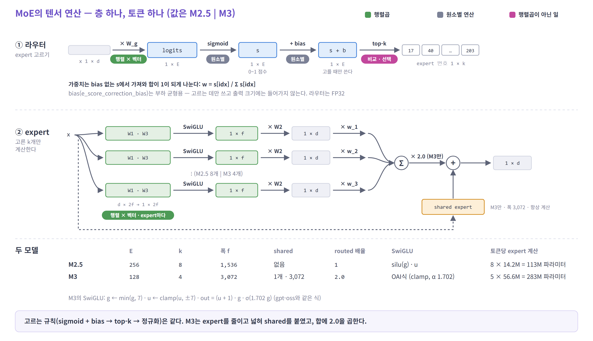
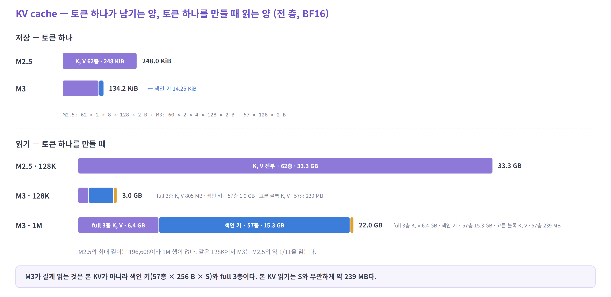

# MiniMax M2.5 · M3 — 층 구성과 attention · MoE 연산

> 두 모델의 층이 어떻게 쌓여 있는지 보고, 층 안의 attention과 MoE에서 **토큰 하나가 지나갈 때 어떤 텐서 연산이 일어나는지** 정리한다.
> 모든 shape은 decode(토큰을 하나씩 생성하는 단계) 기준이다. 수치는 공개 `config.json`, safetensors 헤더, transformers 구현에서 읽었다.

| 순서 | 내용 |
|---|---|
| 1 | 한눈에 비교 |
| 2 | 층 배치와 decoder 층 하나 |
| 3 | M2.5 attention — GQA |
| 4 | M3 attention — MSA (블록 선택) |
| 5 | MoE — 두 모델 공통 골격과 차이 |
| 6 | KV cache — 저장과 읽기 |
| 7 | 정리 |

---

## 1. 한눈에 비교

| | MiniMax-M2.5 | MiniMax-M3 |
|---|---|---|
| 공개 | 2026-02 | 2026-06 |
| 파라미터 (전체 / 토큰당) | 228.7B / 약 10B | 426B (텍스트) / 약 23B |
| hidden `d` | 3,072 | **6,144** |
| 층 수 | 62 | 60 |
| attention | GQA · 쿼리 48 / KV 8 · 헤드 128 | GQA · 쿼리 64 / **KV 4** · 헤드 128 |
| attention 읽기 | 62층 전부 full | 0~2층 full, **3~59층 MSA** (블록 16개만) |
| QK-norm | **층 단위** (헤드 전체를 한 벡터로) | **헤드 단위** (128차원마다) |
| RoPE | 128차원 중 앞 64 · θ 5M | 같음 |
| FFN | 62층 전부 MoE | 0~2층 dense (12,288), 3~59층 MoE |
| MoE | expert 256 · **top-8** · 폭 1,536 · shared 없음 | expert 128 · **top-4** · 폭 3,072 · **shared 1** |
| 라우팅 | sigmoid + bias → top-k → 정규화 | 같음 + routed 출력 **× 2.0** |
| 활성 함수 | SwiGLU (SiLU) | SwiGLU (gpt-oss식 clamp) |
| 최대 길이 | 196,608 | **1,048,576** |
| KV cache / 토큰 (BF16) | 248 KiB | 134 KiB (색인 키 14 KiB 포함) |
| 기타 | FP8 체크포인트 | 멀티모달 (vision encoder 별도) |

> **M3는 M2.5를 키운 것이 아니다. 층마다 읽는 양을 줄이는 쪽(MSA)과 expert를 굵게 하는 쪽(top-4 + shared)으로 다시 짰다.**

---

## 2. 층 배치와 decoder 층 하나

### 층 배치

- **M2.5는 62층이 전부 같다.** full attention + MoE. config의 `attn_type_list`가 전부 1이다
- **M3는 앞 3층만 다르다.** `moe_layer_freq`와 `sparse_attention_freq`가 둘 다 앞 3개만 0이다
  - 0~2층: full attention + dense FFN (폭 12,288)
  - 3~59층: MSA + MoE — 57층
- 앞 몇 층을 dense로 두는 것은 DeepSeek-V3(`first_k_dense_replace` = 3)와 같은 선택이다. 얕은 층의 라우팅 불안정을 피하려는 것으로 보인다

---

### decoder 층 하나

골격은 같다. `RMSNorm → attention → + → RMSNorm → FFN → +`.

| | M2.5 | M3 |
|---|---|---|
| RMSNorm | `x̂ · w` | `x̂ · (1 + w)` — Gemma식 (`use_gemma_norm`) |
| attention 안의 QK-norm | q 6,144차원 · k 1,024차원 **전체에 하나** | q, k **헤드마다** 128차원 |
| FFN | MoE | MoE (3~59층) · dense (0~2층) |

자세히 — 층마다 붙은 가중치 (safetensors 헤더)

| 가중치 | M2.5 | M3 |
|---|---|---|
| `q_proj` | 6144 × 3072 (FP8) | 8192 × 6144 |
| `k_proj`, `v_proj` | 1024 × 3072 (FP8) | 512 × 6144 |
| `o_proj` | 3072 × 6144 (FP8) | 6144 × 8192 |
| `q_norm`, `k_norm` | 6144, 1024 | 128, 128 |
| `index_q_proj` · `index_k_proj` | — | 512 × 6144 · 128 × 6144 (3~59층) |
| `index_q_norm` · `index_k_norm` | — | 128, 128 |
| router `gate` | 256 × 3072 (FP32) | 128 × 6144 (FP32) |
| `e_score_correction_bias` | 256 (FP32) | 128 (FP32) |
| expert 하나 `w1`, `w3` / `w2` | 1536 × 3072 / 3072 × 1536 | 3072 × 6144 / 6144 × 3072 |
| `shared_experts` | — | gate · up 3072 × 6144, down 6144 × 3072 |
| dense `mlp` (0~2층) | — | gate · up 12288 × 6144, down 6144 × 12288 |

- `q_norm` 크기가 M2.5는 6,144, M3는 128이다. 이것이 "층 단위 / 헤드 단위" QK-norm의 차이다
- M2.5 공개 체크포인트는 FP8(블록 128 × 128 스케일), M3 기본 체크포인트는 BF16이다. M3는 MXFP8 · NVFP4 · MXFP4 체크포인트가 따로 있다

---

## 3. M2.5 attention — GQA

> **GQA** · 쿼리 헤드 48 · KV 헤드 8 · 헤드 차원 128 — 쿼리 헤드 6개가 KV 헤드 하나를 함께 읽는다

### 연산 목록 (층 하나, 토큰 하나)

| 연산 | 식 | shape | `S`와의 관계 |
|---|---|---|---|
| Q · K · V projection | `x @ Wq`, `x @ Wk`, `x @ Wv` | `(1 × 3072)` → `(1 × 6144)`, `(1 × 1024)` × 2 | 무관 |
| QK-norm | RMSNorm(q 6,144 전체), RMSNorm(k 1,024 전체) | 유지 | 무관 |
| RoPE | 헤드마다 앞 64차원만 회전 | `(48 × 128)`, `(8 × 128)` | 무관 |
| cache append — **쓰기** | `k`, `v`를 끝에 붙인다 | `(8 × S × 128)` 각각 | 무관 — 한 줄만 |
| score — **읽기 ①** | `q @ Kᵀ` | `(8 × 6 × 128) × (8 × 128 × S)` → `(8 × 6 × S)` | **비례** |
| scale · softmax | `/ √128` → softmax | 유지 | 비례 |
| weighted sum — **읽기 ②** | `p @ V` | `(8 × 6 × S) × (8 × S × 128)` → `(8 × 6 × 128)` | **비례** |
| output projection | `o @ Wo` | `(1 × 6144)` → `(1 × 3072)` | 무관 |

- 쿼리 폭(48 × 128 = 6,144)이 `d`(3,072)의 **두 배**다. 헤드 수 × 헤드 차원이 `d`와 같아야 할 이유는 없다
- 읽기는 표준 GQA와 같다. 캐시 전체를 두 번 읽고, 읽는 양은 `S`에 비례한다

### 특이점 — 층 단위 QK-norm

- 보통 QK-norm(Qwen3 등)은 **헤드마다** 128차원에 RMSNorm을 건다. M2.5는 **헤드 48개를 이어 붙인 6,144차원 벡터 전체**에 하나를 건다 (`qk_norm_type: per_layer`)
- 계산은 단순하다. 문제는 **TP로 헤드를 나눌 때**다. GPU마다 헤드 일부만 있어서, 제곱합을 GPU끼리 더해야(all-reduce) 정규화할 수 있다. 층마다 q와 k에 작은 통신이 하나씩 붙는다
- M3는 이것을 **헤드 단위**로 바꿨다. 통신이 필요 없다

---

## 4. M3 attention — MSA (블록 선택)

> **MSA** (MiniMax Sparse Attention) · 3~59층 · 128토큰 블록 단위로 KV 헤드마다 16블록을 고른다
> 컨텍스트가 아무리 길어도 본 attention은 **KV 헤드마다 2,048토큰**만 읽는다

본 attention 자체는 GQA(쿼리 64 / KV 4)다. 그 앞에 **어느 블록을 읽을지 고르는 작은 indexer**가 붙는다.

#### 블록 단위로 고른다

- ① indexer가 **토큰마다** 점수를 낸다. 색인 키를 처음부터 끝까지 훑는다
- ② 128토큰마다 **최댓값 하나**를 블록 점수로 쓴다
- ③ 점수가 높은 블록 16개를 고른다. 쿼리가 속한 **현재 블록은 +∞**로 바꿔 항상 들어간다
- ④ 고른 블록의 **원본 KV를 통째로** 읽는다. 블록은 고르는 단위일 뿐, 압축하지 않는다

> **CSA는 묶어서 저장하고 고른다. MSA는 저장은 그대로 두고, 고르는 단위만 블록으로 키웠다.**

#### 텐서 연산으로 보면

- MSA 층은 ①~④ 네 단계가 더 붙는다. 대신 ⑤ attention의 크기가 `S`와 무관하다 (KV 헤드마다 2,048토큰)
- full 층(0~2층)은 단계가 없다. attention이 `S` 전체를 읽는다
- ④ gather가 **128토큰짜리 연속 읽기 16번**이라, 토큰 단위로 흩어 읽는 DSA보다 메모리 접근이 고르다

#### 한 층 안의 두 캐시

- **색인 키 캐시**(`S × 128`, 헤드 하나)로 고르고, **본 KV 캐시**(`4 × S × 128`)를 읽는다
- index 헤드 4개 = KV 헤드 4개다. **KV 헤드마다 다른 블록**을 고르고, 쿼리 헤드 16개는 자기 KV 헤드의 선택을 따른다

#### 단계별 shape

### 연산 목록 (sparse 층 하나, 토큰 하나)

| 단계 | 연산 | shape | `S`와의 관계 |
|---|---|---|---|
| projection | `x @ Wq`, `Wk`, `Wv`, `W_iq`, `W_ik` | `(1 × 6144)` → q `64 × 128`, k · v `4 × 128`, q_I `4 × 128`, k_I `1 × 128` | 무관 |
| norm · RoPE | 헤드마다 RMSNorm, 앞 64차원 RoPE (q, k, q_I, k_I 모두) | 유지 | 무관 |
| **쓰기** | k, v → 본 캐시 / k_I → 색인 키 캐시 | `(4 × S × 128)` 각각 / `(S × 128)` | 무관 |
| ① 점수 | `q_I @ K_Iᵀ` | `(4 × 128) × (128 × S)` → `(4 × S)` | **비례 — 색인 키 전체** |
| ② 블록 점수 | 128개씩 묶어 max | `(4 × S/128 × 128)` → `(4 × S/128)` | 비례 |
| ③ 고르기 | 현재 블록에 +∞ → top-16 | → 블록 번호 `(4 × 16)` | 비례 (비교) |
| ④ 본 attention | KV 헤드 `h`마다 고른 블록을 gather해 GQA | `(16 × 128) × (128 × 2048)` → `(16 × 2048)` → `× (2048 × 128)` | **무관 — 상한 2,048** |
| output projection | 4헤드 이어 붙여 `@ Wo` | `(1 × 8192)` → `(1 × 6144)` | 무관 |

### indexer는 DSA와 어떻게 다른가

| | DSA (DeepSeek-V3.2) | MSA (MiniMax-M3) |
|---|---|---|
| 고르는 단위 | 토큰 | **128토큰 블록** |
| 고르는 개수 | 2,048토큰 | 16블록 = 2,048토큰 |
| index 쿼리 헤드 | 64 | **4** (= KV 헤드 수) |
| 색인 키 | 1 × 128 · FP8 | 1 × 128 · BF16 |
| 점수 | `Σ_h w_h · ReLU(q_h · k)` — 헤드를 합쳐 **하나** | `q_h · k` — 헤드마다 **따로** |
| 고르는 결과 | 모든 헤드가 같은 토큰 | **KV 헤드마다 다른 블록** |
| 블록 점수 | — | 블록 안 토큰 점수의 **max** |

- 블록 점수를 max로 내므로, **블록 안 어느 한 토큰이라도 중요하면 블록 전체가 뽑힌다**
- 고른 블록은 압축하지 않는다. 원본 KV를 그대로 읽는다. 블록은 고르는 단위일 뿐이다
- 블록 단위라 gather가 **128토큰짜리 연속 읽기 16번**이 된다. 토큰 단위 gather(DSA)보다 메모리 접근이 훨씬 고르다. KV 페이지 크기도 128로 맞춘다

### 현재 블록과 짧은 컨텍스트

- `sparse_local_block` = 1: **쿼리가 속한 블록**은 점수를 +∞로 바꿔 항상 뽑힌다. 이 블록은 16개 **안에** 들어간다 (17번째로 더하지 않는다)
- `sparse_init_block` = 0: 맨 앞 블록(attention sink)을 강제로 넣지는 않는다
- 블록 안에서는 causal mask를 그대로 건다. 현재 블록의 미래 토큰은 보지 않는다
- **`S` ≤ 2,048이면 블록이 16개 이하라 전부 뽑힌다.** full attention과 같고, indexer 비용만 더 든다. MSA의 이득은 긴 컨텍스트에서만 생긴다

자세히 — 구현에서 본 것

- transformers `MiniMaxM3VLIndexer`: `idx_q` `[B, 4, S_q, 128]`, `idx_k` `[B, 1, S_k, 128]`. `scores = idx_q @ idx_kᵀ` → 미래 토큰 −∞ → `view(..., S_k/128, 128).amax(-1)` → 현재 블록 `scatter_(+inf)` → `topk(16)`. 결과는 `[B, 4, S_q, 16]`이고, 빈 자리는 −1로 채운다
- eager · SDPA 경로는 이 블록 번호를 `[B, 64, S_q, S_k]` 마스크로 펴서 쓴다. 쿼리 헤드 16개가 같은 KV 헤드의 선택을 공유한다. 배포 커널은 마스크 없이 블록 번호를 바로 읽는다
- 체크포인트의 `sparse_disable_index_value`가 sparse 층에서 1이다. indexer에는 value가 없고 색인 키만 캐시에 남는다
- vLLM은 다섯 projection(q · k · v · index_q · index_k)을 하나의 GEMM으로 묶는다: `6144 → 8192 + 512 + 512 + 512 + 128`
- spec decode 검증처럼 쿼리가 `1 + K`개면 **쿼리 토큰마다 따로** 고른다. 쿼리끼리 고른 블록이 얼마나 겹치는지가 검증 단계의 KV 읽기량을 정한다

---

## 5. MoE — 두 모델 공통 골격과 차이

### 연산 목록 (층 하나, 토큰 하나)

| 단계 | 연산 | shape (M2.5 \| M3) | 종류 |
|---|---|---|---|
| router | `x @ W_g` (FP32) | `(1 × d)` → `(1 × E)` · E = 256 \| 128 | 행렬 × 벡터 |
| 점수 | `s = sigmoid(logits)` | `(1 × E)` | 원소별 |
| 선택 | `top-k(s + bias)` | → 번호 `(1 × k)` · k = 8 \| 4 | 비교 · 선택 |
| 가중치 | `w = s[idx] / Σ s[idx]` | `(1 × k)` | 원소별 |
| expert | 고른 expert마다 `W1 · W3` → SwiGLU → `W2` | `(1 × d)` → `(1 × 2f)` → `(1 × f)` → `(1 × d)` · f = 1,536 \| 3,072 | 행렬 × 벡터 × k |
| 합 | `Σ w_i · y_i` | `(1 × d)` | 원소별 |
| M3만 | `× 2.0` 후 `+ shared(x)` | `(1 × d)` | 행렬 × 벡터 (shared) |

- **고르는 규칙은 같다.** softmax가 아니라 sigmoid로 expert마다 독립 점수를 낸다
- **bias는 고를 때만 쓴다.** 출력에 곱하는 가중치는 bias 없는 점수에서 가져온다. 학습 중 bias를 조정해 부하를 맞추는 방식이다 (DeepSeek-V3의 auxiliary-loss-free 방식)
- M3는 정규화한 routed 출력에 **2.0을 곱하고**, 항상 계산하는 **shared expert**를 더한다

### expert 설계 — 많고 얇게 vs 적고 굵게

| | M2.5 | M3 |
|---|---|---|
| expert 수 × 폭 | 256 × 1,536 | 128 × 3,072 |
| 토큰당 계산하는 expert | 8개 | 4개 + shared 1개 |
| expert 하나의 크기 | 3 × 3072 × 1536 = 14.2M | 3 × 6144 × 3072 = 56.6M |
| 토큰당 FFN 파라미터 | 113M | 283M |
| 폭 / `d` | 0.5 | 0.5 |

- 폭/`d` 비율은 같다. M3는 `d`가 두 배가 되면서 expert가 같은 비율로 굵어졌다
- expert 수는 절반, 고르는 수도 절반이다. 대신 shared가 생겼다
- M3의 SwiGLU는 gpt-oss와 같은 식이다: `g ← min(g, 7)`, `u ← clamp(u, −7, 7)`, `out = (u + 1) · g · σ(1.702 g)`. 큰 활성값을 잘라 두면 FP8/FP4 같은 낮은 정밀도에 유리하다 (설계 의도는 추정)

---

## 6. KV cache — 저장과 읽기

| | M2.5 | M3 |
|---|---|---|
| 본 K, V / 토큰 / 층 | 2 × 8 × 128 × 2 B = 4,096 B | 2 × 4 × 128 × 2 B = 2,048 B |
| 색인 키 / 토큰 / 층 | — | 128 × 2 B = 256 B (57층) |
| **토큰 하나 (전 층)** | **248 KiB** | **134 KiB** |
| 128K 요청 하나 | 33.3 GB | 18.0 GB |
| 128K에서 토큰 하나를 만들 때 읽는 양 | 33.3 GB | **3.0 GB** |
| 1M에서 읽는 양 | — (최대 196K) | 22.0 GB |

- **저장은 절반쯤 줄었다.** KV 헤드를 8 → 4로 줄인 효과다. MSA는 저장을 줄이지 않는다 — 오히려 색인 키가 더해진다
- **읽기는 128K에서 약 1/11이다.** 이것이 MSA의 효과다
- 긴 컨텍스트에서 M3가 읽는 것의 대부분은 **본 KV가 아니다.**
  - 색인 키: 57층 × 256 B × `S` — 1M에서 15.3 GB
  - full attention 3층: 3 × 2,048 B × `S` — 1M에서 6.4 GB
  - 고른 블록의 본 KV: 57층 × 2,048토큰 × 2,048 B — `S`와 무관하게 **약 239 MB**

> **MSA는 본 KV 읽기를 상수로 만들었다. 남은 `S` 비례 항은 색인 키와 앞 3층이다.**

자세히 — GPU 한 장 기준 (TP)

TP로 KV 헤드를 나누면 GPU마다 일부만 갖는다. KV 헤드 수가 TP보다 적으면 **복제**한다.

| | M2.5 TP8 | M3 TP4 · TP8 |
|---|---|---|
| GPU당 KV 헤드 | 8 / 8 = 1 | 4 / 4 = 1 · TP8은 4를 8로 못 나눠 **복제해 1** |
| 본 K, V / 토큰 | 62 × 2 × 1 × 128 × 2 B = 31,744 B | 60 × 2 × 1 × 128 × 2 B = 30,720 B |
| 색인 키 / 토큰 | — | 57 × 128 × 2 B = 14,592 B (헤드 하나라 GPU마다 전부) |
| **합계 (BF16)** | **31,744 B** | **45,312 B** |
| 합계 (KV만 FP8, 색인 키는 BF16) | 15,872 B | 29,952 B |

- **GPU 한 장으로 보면 M3가 오히려 크다.** KV 헤드 복제와 색인 키 때문이다. 전체 합(134 KiB)만 보고 메모리를 잡으면 틀린다
- M3 FP8 KV의 29,952 B는 InferenceX 레시피 주석의 값과 같다 ("60 layers of sharded FP8 K/V plus 57 layers of BF16 indexer cache")

---

## 7. 정리

| | M2.5 | M3 | 바뀐 이유 (추정 — 공식 설명 아님) |
|---|---|---|---|
| 폭 | `d` 3,072 · 62층 | `d` 6,144 · 60층 | 더 큰 모델 (활성 약 10B → 약 23B) |
| 저장 | KV 헤드 8 | KV 헤드 4 + 색인 키 | 1M 컨텍스트에서 캐시를 줄인다 |
| 읽기 | 전부 | 블록 16개 (2,048토큰) | 1M에서 읽는 양을 상수에 가깝게 |
| 앞 층 | 다른 층과 같다 | 3층 full attention + dense FFN | 얕은 층의 안정성 |
| QK-norm | 층 단위 | 헤드 단위 | TP 통신 제거 |
| MoE | 256 × top-8, 얇게 | 128 × top-4 + shared, 굵게 | 고른 expert 수를 줄여 라우팅 · 통신을 줄인다 |
| 활성 함수 | SiLU | clamp된 SwiGLU | 저정밀 배포 |

- **두 모델의 골격은 같다.** pre-norm decoder, GQA, partial RoPE, sigmoid 라우팅 MoE
- **M3의 핵심은 MSA다.** 본 attention은 그대로 GQA이고, 앞에 블록을 고르는 indexer만 붙었다. 짧은 컨텍스트에서는 dense와 같다
- **긴 컨텍스트에서 다음 병목은 색인 키다.** 고른 KV는 상수지만, 색인 키를 훑는 것은 여전히 `S`에 비례한다

자세히 — 파라미터 계산

| 부분 | M2.5 | M3 |
|---|---|---|
| attention (층당) | 3072 × (6144 + 1024 × 2) + 6144 × 3072 = 44.0M | 6144 × (8192 + 512 × 2) + 8192 × 6144 = 107.0M |
| indexer (층당) | — | 6144 × (512 + 128) = 3.9M (57층) |
| attention 합 | 62층 = 2.73B | 60층 + indexer = 6.64B |
| dense FFN | — | 3층 × 3 × 6144 × 12288 = 0.68B |
| routed expert | 62 × 256 × 14.2M = 224.6B | 57 × 128 × 56.6M = 413.1B |
| shared expert | — | 57 × 56.6M = 3.2B |
| embedding + lm_head | 2 × 200,064 × 3,072 = 1.23B | 2 × 200,064 × 6,144 = 2.46B |
| **전체** | **228.7B** (체크포인트 합과 같다) | **426.2B** (vision 포함 427.0B) |
| **토큰당 활성** (lm_head 제외 / 포함) | 9.8B / 10.4B | 23.5B / 24.7B |

- M3 모델 카드의 "약 23B activated"는 lm_head를 뺀 값과 맞는다
- config에 MTP 설정(`num_mtp_modules`: M2.5 3, M3 7)이 있지만, 이번에 본 체크포인트 index에서는 MTP 가중치를 찾지 못했다

---

## 출처

- [MiniMaxAI/MiniMax-M2.5](https://huggingface.co/MiniMaxAI/MiniMax-M2.5) — `config.json`, `modeling_minimax_m2.py`, safetensors 헤더
- [MiniMaxAI/MiniMax-M3](https://huggingface.co/MiniMaxAI/MiniMax-M3) — `config.json`, 모델 카드, safetensors 헤더
- transformers `models/minimax_m3_vl/modular_minimax_m3_vl.py` — `MiniMaxM3VLIndexer`, `MiniMaxM3VLSparseMoeBlock`
- [MiniMax-M3 기술 보고서](https://arxiv.org/abs/2606.13392) · [MSA 커널](https://github.com/MiniMax-AI/MSA)
- 그림 생성: [figures/make_figures.py](figures/make_figures.py) — `python make_figures.py`
